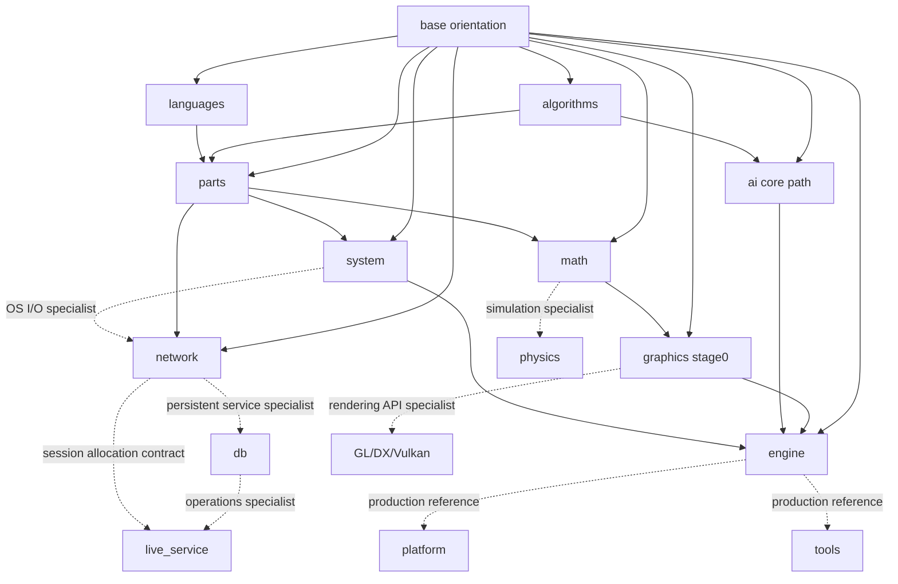

# Teach Yourself CS — 게임 개발자 편

이 저장소는 [TeachYourselfCS](https://teachyourselfcs.com/)의 목표를 게임 개발에 맞게 옮긴 자습 커리큘럼이다. 대상은 특정 직무 전문가가 아니라, **모든 게임 개발자가 공통으로 알아야 하는 컴퓨터 과학**이다.

따라서 저장소 안에는 전문 트랙과 실무 참고 자료도 있지만, 커리큘럼의 중심은 따로 둔다. 공통 핵심은 알고리즘·언어·메모리·운영체제·네트워크·수학·렌더링 원리·엔진 통합처럼 게임 개발 전반에 반복해서 등장하는 사고 모델이다. 물리, 멀티플레이, DB, 라이브 서비스, API별 그래픽스, 플랫폼, 도구는 필요할 때 들어가는 선택 트랙이다.

처음에는 `base/`에서 게임 시스템을 바라보는 공통 질문과 용어를 익힌다. 이후 필요한 분야의 심화 장에서 원리가 성립하는 가정, 지켜야 할 불변식, 비용과 실패 조건, 검증 방법을 살펴본다. 아래 학습 지도와 권장 경로를 참고해 관심 분야와 맡은 일에 맞는 순서를 고를 수 있다.

---

## 목차
1. [진입 계층](#진입-계층)
2. [공통 핵심](#공통-핵심)
3. [전문 선택 트랙](#전문-선택-트랙)
4. [실무 참고 트랙](#실무-참고-트랙)
5. [학습 지도](#학습-지도)
6. [과목과 교재](#과목과-교재)
7. [프로젝트](#프로젝트)
8. [권장 경로](#권장-경로)

---

## 진입 계층

`base/`는 계산 비용과 수 표현에서 시작해 자료구조·언어·시스템·네트워크를 거쳐 그래픽스·물리·AI·엔진·운영까지 전체 지형을 연결한다. 각 글은 분야가 모델링하는 상태, 핵심 불변식, 비용과 대표 실패를 설명한다.

처음 읽는 개발자가 전체 흐름을 이해하고, 더 깊이 공부할 분야를 고를 수 있도록 구성했다. 각 장의 중심 질문과 읽는 순서는 [base/README.md](base/README.md)에서 확인할 수 있다.

## 공통 핵심

모든 게임 개발자가 공통으로 가져야 할 CS 축이다. 직무와 엔진이 달라도 설계 판단의 바닥에서 반복해서 쓰인다.

| 시리즈 | 역할 |
|---|---|
| `algorithms/` | 정확성·복잡도, 순서·구간·문자열, 그래프·최단 경로, Greedy·DP·조합 최적화, 압축·검증 |
| `languages/` | 파싱·의미론·런타임·GC·컴파일러·JIT·스크립팅·리플렉션 |
| `parts/` | 메모리·자료구조·동시성·C++ 객체 모델·실행 비용 |
| `system/` 공통 경로 | 프로세스·가상 메모리·스케줄러·파일·I/O·네트워크 스택. 17~22는 Windows IOCP와 커널 전문 경로 |
| `network/` 핵심 경로 | 인터넷·전송·실제 서버 런타임에서 게임 protocol·권위·복제·rollback·검증까지 |
| `math/` | 게임 수학과 수치 계산. 좌표·회전·기하 질의와 그 질의가 깨지는 조건 |
| graphics stage0 | API와 무관한 렌더링 원리, GPU 실행 모델과 자원 메모리 |
| `engine/` | 하위 시스템과 프레임·월드 수명·스트리밍·저장 복구의 통합 경계 |
| `ai/` 핵심 경로 | 의사결정, 길찾기, 지각, 월드 모델, 디버깅 |

`physics/` 전체, `ai/` 전체, GL/DX/Vulkan 전체, 서버·운영 전체를 공통 필수로 보지 않는다. 공통 핵심은 “모든 개발자가 설계 대화에서 공유해야 하는 언어”이고, 전문 트랙은 “그 일을 맡을 때 깊게 들어가는 교재”다.

## 전문 선택 트랙

특정 직무나 장르에서 깊게 필요하지만 모든 개발자의 필수 경로는 아닌 축이다.

| 시리즈 | 들어갈 때 |
|---|---|
| `physics/` | 물리 기반 게임플레이, 충돌, 제약 해법, 안정적 시뮬레이션을 직접 다룰 때 |
| `db/` | 계정·인벤토리·경제·분석 데이터의 무결성과 그 저장소의 운영을 설계할 때 |
| `live_service/` | 계정·경제·패치·매치메이킹·게임 서버 fleet과 운영 체계를 설계할 때 |
| `network/` 전문 경로 | replay·관전, 음성 통신, anti-cheat 신뢰 경계를 다룰 때 |
| graphics API별 장 | OpenGL·DirectX·Vulkan의 실제 API 자원·동기화 모델이 필요할 때 |
| `ai/` 고급 경로 | GOAP/HTN, Flow Field, 분대 전술, ML NPC, 고급 질의 시스템이 필요할 때 |

전문 트랙도 얕은 참고 문서가 아니다. 다만 커리큘럼의 공통 필수 요구가 아니라 직무별 심화 요구로 분류한다.

## 실무 참고 트랙

중요하지만 CS 핵심 축이라기보다 제품 제작·배포에서 필요할 때 찾아보는 자료다.

| 시리즈 | 역할 |
|---|---|
| `platform/` | 모바일·콘솔·웹·Windows 텍스트 경계·플랫폼 이식 |
| `tools/` | 에디터·절차 생성·디버깅·에셋·빌드 도구 |
| `git.md` | 코드와 에셋 버전 관리 |

`distributed/`, `verification/`, `audio/`, `netcode/`, `multiplayer/`는 독립 시리즈에서 해체했다. 중요한 내용은 각각 `db/`·`live_service/`, 각 분야의 검증 절, `engine/part01_audio.md`, 통합 `network/`에 흡수했다.

## 학습 지도

화살표는 강제 읽기 순서가 아니라 개념 의존을 뜻한다. 실선은 공통 핵심 경로, 점선은 전문 선택 경로다.

## 과목과 교재

| 축 | 함께 읽을 교재 |
|---|---|
| 알고리즘 | Skiena, *The Algorithm Design Manual* · Cormen 외, *Introduction to Algorithms* |
| 언어와 런타임 | Nystrom, [*Crafting Interpreters*](https://craftinginterpreters.com/) · Pierce, *Types and Programming Languages* |
| 컴퓨터 시스템 | Bryant & O'Hallaron, *CS:APP* · [*OSTEP*](https://pages.cs.wisc.edu/~remzi/OSTEP/) |
| 네트워크 | Kurose & Ross, *Computer Networking: A Top-Down Approach* |
| 수학 | Dunn & Parberry, [*3D Math Primer*](https://gamemath.com/) |
| 그래픽스 원리 | Akenine-Möller 외, *Real-Time Rendering* · [*PBRT*](https://www.pbr-book.org/) |
| AI 핵심 | Millington, *AI for Games* · [*Game AI Pro*](http://www.gameaipro.com/) |
| 엔진 | Gregory, *Game Engine Architecture* |
| 물리 선택 | Ericson, *Real-Time Collision Detection* · Millington, *Game Physics Engine Development* |
| 게임 네트워킹 | Glazer & Madhav, *Multiplayer Game Programming* · [Gaffer On Games](https://gafferongames.com/) |
| 데이터와 운영 선택 | Kleppmann, *Designing Data-Intensive Applications* · [*Site Reliability Engineering*](https://sre.google/sre-book/table-of-contents/) |

각 문서의 참고 자료는 해당 장에서 사용한 원전·명세·추가 교재를 가리킨다.

## 프로젝트

`projects/mini/`는 이론의 핵심 주장을 측정으로 확인하는 작은 실습들이다. 언어 축도 렉서·바이트코드 검증기·VM을 직접 구현해 실행 의미와 샌드박스 경계를 확인한다. `projects/mega/`는 여러 분야를 하나의 완성된 C++20 협동 디펜스와 엔진 테스트로 통합한다. 구현 순서는 프로젝트 문서에 기록하며 단계별 코드 복사본은 두지 않는다.

프로젝트는 이론의 대체물이 아니다. 이론에서 모델과 실패 조건을 이해한 뒤, 프로젝트에서 그 주장이 실제 관측값으로 나타나는지 확인한다.

## 권장 경로

- **전체 지형 파악**: `base`
- **공통 필수 CS**: `base` → `algorithms` → `languages` → `parts` → `system` → `network` → `math` → graphics stage0 → `ai` 핵심 경로 → `engine`
- **물리 시뮬레이션 선택**: `math` → `physics`
- **렌더링 API 선택**: graphics stage0 → OpenGL·DirectX·Vulkan 중 필요한 API 트랙
- **멀티플레이 선택**: `network` 01~03 → `system`의 동시성·I/O → `network` 04~12
- **서버·운영 선택**: `network` → `db` → `live_service`
- **제작 실무 참고**: 필요한 시점에 `platform`, `tools`, `git.md`

역할과 유지 기준은 [CURRICULUM_MAP.md](CURRICULUM_MAP.md)와 [CONTENT_OWNERSHIP.md](CONTENT_OWNERSHIP.md), 프로젝트의 완료 기준은 [PROJECTS_PLAN.md](PROJECTS_PLAN.md)에서 관리한다.

저장소에는 학습 문서, 최종 프로젝트 코드, 실행에 필요한 에셋, 빌드·테스트·문서 생성 스크립트를 보관한다. 로컬 검수 보고서·수정 제안, 임시 백업, 빌드 산출물, ZIP, 업로드용 내보내기 결과는 추적하지 않는다. Mermaid 원본은 Markdown에 있으며, 게시용 PNG는 `scripts/export_mermaid_png.ps1`, 업로드 원고는 `scripts/export_velog.py`로 생성한다.
