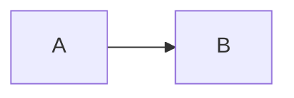

# VeLog 스타일 가이드

이 문서는 VeLog에 게재되는 모든 글이 따라야 할 작성 규칙을 정의한다. 시리즈 전체를 한 사람이 일관된 어조로 쓴 것처럼 보이게 하는 것이 목적이다. 새 글을 쓰기 전, 기존 글을 손보기 전, 보충편을 추가하기 전에 이 문서를 먼저 본다.

---

## 목차
1. [작성 어조와 종결어미](#작성-어조와-종결어미)
2. [문서 구조 템플릿](#문서-구조-템플릿)
3. [헤딩 규칙](#헤딩-규칙)
4. [도식과 표](#도식과-표)
5. [코드 블록](#코드-블록)
6. [수식과 단위](#수식과-단위)
7. [링크와 레퍼런스](#링크와-레퍼런스)
8. [용어와 표기](#용어와-표기)
9. [이모지와 시각 요소](#이모지와-시각-요소)
10. [파일과 디렉토리 규칙](#파일과-디렉토리-규칙)
11. [시리즈 작성 원칙](#시리즈-작성-원칙)
12. [체크리스트](#체크리스트)

---

## 작성 어조와 종결어미

### 기본 종결어미는 `~다`

평서문은 모두 `~다`로 끝낸다. `~합니다`, `~입니다`, `~이에요`는 사용하지 않는다. 사실을 나열하는 어조를 유지한다.

```
사용 금지:  메모리 할당은 모든 프로그램의 기초입니다.
사용 권장:  메모리 할당은 모든 프로그램의 기초다.

사용 금지:  이 글에서는 ~을 다룹니다.
사용 권장:  이 글에서는 ~을 다룬다.

사용 금지:  결정해야 합니다.
사용 권장:  결정해야 한다.
```

### 의문문, 청유, 인용은 예외

수사적 의문문, 인용문, 코드 주석 안의 자연어는 원래 문맥을 따른다.

```
허용:  free()는 어떻게 해제할 메모리 블록의 크기를 알 수 있을까?
허용:  Dennis Ritchie는 "A process is the execution of an image."라고 썼다.
허용:  // 여기서 락을 잡는다고 가정하자
```

### 사실을 직접 진술한다

자기검열적 표현, 과장된 권유, 주관적 판단어를 줄인다. 데이터와 인과로 말한다.

```
지양:  매우 중요한 핵심적이고 필수적인 개념입니다.
권장:  이 개념은 객체 수명과 참조 안정성을 판단하는 기준이다.

지양:  엄청나게 빠릅니다!
권장:  벤치마크 조건과 분포를 밝히고 L1 hit와 DRAM miss의 지연을 비교한다.

지양:  꼭 알아두셔야 합니다.
권장:  이 구조는 락 획득 순서와 순환 대기 가능성을 설명한다.
```

### 일인칭과 청자 호칭

`우리`, `저`, `여러분`은 사용하지 않는다. 대신 사실 진술이나 이인칭 생략으로 처리한다.

```
지양:  우리는 이 함수를 호출합니다.
권장:  이 함수를 호출한다.

지양:  여러분은 다음 단계를 따라야 합니다.
권장:  다음 단계를 따른다.
```

다만 회고나 후기 성격의 문단에서는 `필자` 정도는 사용해도 무방하다. 빈도는 낮게 유지한다.

---

## 문서 구조 템플릿

모든 본문 글은 다음 골격을 따른다.

```markdown
## 들어가며

(2~4 문단. 이 글이 다루는 문제, 왜 다루는지, 어떤 결과를 얻을지를 사실 위주로 진술한다.
마지막 문단에서 이 글의 범위와 도달할 결과를 짧게 명시한다.)

---

## 목차
1. [섹션명](#섹션명)
2. [섹션명](#섹션명)
...

---

## 1. 첫 번째 섹션
...

## 2. 두 번째 섹션
...

---

## 결론

(2~3 문단. 이 글에서 도달한 결과와 핵심 트레이드오프 한두 가지를 정리한다.)
```

`## 들어가며`, `## 목차`, `## 결론`은 글마다 반드시 둔다. 보충편처럼 짧은 글이라면 목차를 생략할 수 있다.

섹션 번호는 `## 1. 제목` 형태로 본문 헤딩에 직접 박는다. 별도 outline 섹션과 본문이 이중으로 번호를 가지지 않게 한다.

`---` 가로줄은 다음 위치에서만 사용한다.
- 들어가며와 목차 사이
- 목차와 본문 1번 섹션 사이
- 마지막 본문 섹션과 결론 사이

본문 섹션 사이에는 가로줄을 넣지 않는다.

---

## 헤딩 규칙

### 헤딩 레벨

- `#` (H1): 사용하지 않는다. Velog가 글 제목을 H1으로 처리하므로, 본문은 H2부터 시작한다.
- `##` (H2): 최상위 섹션. `## 들어가며`, `## 1. 섹션`, `## 결론`.
- `###` (H3): 섹션 내부의 소주제.
- `####` (H4): 소주제 내부의 더 작은 단위. 자주 쓰지 않는다. 4단계 이상 깊어지면 글을 쪼갠다.
- `#####`, `######`: 사용하지 않는다.

### 번호 매기기

본문 섹션은 `## 1. 제목`, `## 2. 제목` 형식이다. 하위 H3는 번호를 붙이지 않는다.

```
사용:    ## 3. 동기화 프리미티브
사용:    ### CRITICAL_SECTION
사용:    ### Mutex와 Semaphore

지양:    ### 3.1 CRITICAL_SECTION   (본문 헤딩에는 다중 번호 금지)
```

`## 들어가며`, `## 목차`, `## 결론`에는 번호를 붙이지 않는다.

### math / physics 시리즈 예외

`math/` 와 `physics/` 시리즈는 수식·정의·정리의 내부 참조가 많으므로 H3에 `### 1.1 제목` 형식의 하위 번호를 허용한다. 글 안에서 "3.5절의 epsilon 비교", "4.4절의 catastrophic cancellation" 같은 내부 참조가 자연스러워진다.

이 예외는 H3 번호에만 적용한다. H1, 가로줄, 어조, 전방 참조, 선수지식, lab 분리 규칙은 다른 이론 시리즈와 동일하다. `parts/`, `system/`, `graphics/` 등 다른 시리즈는 H3에 번호를 붙이지 않는다.

### 헤딩에 영문/이모지

영문 약어는 그대로 둔다. 한글 옆에 영문을 같이 쓸 때는 괄호를 사용한다.

```
사용:    ## 3. 가상 메모리(Virtual Memory)
사용:    ## 5. IOCP의 내부 구조
```

이모지는 헤딩에 사용하지 않는다.

---

## 도식과 표

### 도식은 모두 mermaid로

ASCII 박스 도식, 그림 첨부, 외부 다이어그램 도구 출력 모두 사용하지 않는다. 단순 흐름이든 복잡한 그래프든 mermaid로 표현한다. mermaid가 표현하지 못하는 도식은 그 도식을 빼는 쪽으로 글을 다시 쓴다.


자주 쓰는 mermaid 종류는 다음과 같다.

- `flowchart`: 일반 흐름도, 시스템 구조도, 데이터 흐름.
- `sequenceDiagram`: 객체 간 호출 순서, 프로토콜 핸드셰이크.
- `gitGraph`: 브랜치 전략, 커밋 흐름.
- `stateDiagram-v2`: 상태 머신.
- `classDiagram`: 클래스 관계.
- `erDiagram`: DB 스키마.
- `gantt`: 프로젝트 타임라인.

### 표는 markdown 표로

ASCII 표는 사용하지 않는다. markdown 표 문법으로 작성한다.

```
| 항목 | 시간 | 메모리 |
|-----|------|-------|
| Array | O(1) | 4 KB |
| List | O(n) | 24 KB |
```

- 헤더 정렬은 좌측 정렬이 기본이다. 숫자 칼럼이 많으면 `|---:|` 으로 우측 정렬한다.
- 표가 5열을 넘으면 화면 가독성을 위해 분할하거나 mermaid 도식으로 대체한다.
- 표 셀 안에는 코드 인라인(`` `Foo` ``)과 굵은 글씨까지만 사용한다. 표 안에서 코드 블록과 mermaid를 사용하지 않는다.

### 도식과 표의 위치

도식이나 표 직전 문단에서 무엇을 보여주는지 한 줄로 예고한다. 직후 문단에서 이 도식/표에서 끌어낼 결론 한 줄을 짚는다.

```
이 시스템의 데이터 흐름은 다음과 같다.

(mermaid 도식)

요청은 항상 한 방향으로만 흐르며, 응답은 별도 채널로 돌아온다는 점이 핵심이다.
```

---

## 코드 블록

### 언어 태그

모든 코드 블록에 언어 태그를 붙인다.

````
```cpp
void Foo() { ... }
```

```bash
git commit -m "메시지"
```


````

언어가 명확하지 않은 출력 결과는 ` ```text ` 또는 ` ```console `을 사용한다.

### 코드 길이

한 코드 블록은 50줄을 넘지 않게 유지한다. 더 길어진다면 다음 중 하나를 택한다.

- 논리 단위로 쪼개고, 사이에 1~2 문단의 설명을 둔다.
- 핵심만 보여주고 나머지는 `// ...` 또는 `/* 생략 */`으로 표시한다.

### 부분 구현과 추후 채움

선언만 두고 구현은 다음 절에서 채워도 된다. 시리즈에서 점진적으로 코드를 키울 때 이 패턴을 자주 쓴다.

```cpp
void Init();
void Update(float dt);
void Render();

void Init() {
    // 1.3절에서 채운다.
}
```

### 중복 게재

이전 절이나 이전 글에서 이미 보였던 코드라도, 현재 흐름의 이해를 돕기 위해 다시 적는 것을 허용한다. 독자가 "이 코드 어디서 봤더라" 하며 위로 스크롤하지 않게 한다. 다만 다음 두 가지를 지킨다.

- 새로 추가한 부분은 주석으로 명시한다(예: `// 추가: 디버그 카운터`).
- 5회 이상 같은 코드를 통째로 다시 보일 정도면, 그 코드를 함수/구조체로 추출하는 리팩터링을 글에 포함하는 편이 낫다.

### 주석

코드 안의 한국어 주석은 본문 어조와 같은 `~다` 종결을 쓴다. 영문 주석을 쓰는 코드 베이스에서는 영문 그대로 둔다.

```cpp
// 헤더에서 크기 정보를 읽는다
size_t size = chunk->size & ~FLAGS_MASK;
```

---

## 수식과 단위

### 수식

LaTeX는 KaTeX 문법으로 쓴다. Velog는 `$...$`(인라인)와 `$$...$$`(블록)를 지원한다.

```
인라인:  시간 복잡도는 $O(\log n)$이다.
블록:
$$
T(n) = 2T(n/2) + O(n)
$$
```

수식 한 개로 표현 가능한 것을 굳이 일반 텍스트로 풀어 쓰지 않는다.

### 단위와 숫자

- 숫자와 단위 사이를 띄어 쓰지 않는다: `16 ms` 대신 `16ms`로 통일한다. (SI 표기법은 띄어 쓰지만, 게임 프로그래밍 관례를 따른다)
- 큰 숫자는 천 단위 콤마를 사용한다: `1,000,000`.
- 메모리는 KB, MB, GB. 시간은 ns, μs, ms, s. CPU 사이클은 `cycle`.
- 비율은 백분율 또는 배수로 통일한다. 같은 글 안에서 섞지 않는다.

---

## 링크와 레퍼런스

### 다른 글로의 참조 금지

VeLog 게시 글 사이의 상호 링크는 본문에 작성하지 않는다. 자연어로 다른 글을 가리키는 것도 금지한다. 시리즈명, 회차 번호, 다른 글 제목을 본문에서 언급하지 않는다. Velog의 시리즈 기능과 사이드 패널이 글 간 이동을 처리하므로, 본문은 본문 자체로 완결된다.

### 선수지식과 글 참조를 구분한다

이전 학습에서 얻은 지식을 선수지식으로 사용하는 것은 허용한다. 특히 `parts/`가 다루는 메모리, 자료구조, 동시성, 실행 비용의 기본 개념은 다른 시리즈에서 전제할 수 있다. 허용되는 것은 **지식의 사용**이지 **글의 참조**가 아니다.

- `std::vector`의 연속 저장, 캐시 라인, 시간 복잡도처럼 보편적인 선수지식은 다시 처음부터 강의하지 않아도 된다.
- 현재 글의 핵심 논증에 필요한 정의·가정·기호는 현재 글 안에서 다시 적는다.
- 선수지식의 세부 구현이 결론을 좌우한다면 필요한 불변식과 실패 조건도 현재 글에 적는다.
- "이전 파트에서", "앞선 회차에서", "parts에서 설명한"처럼 지식의 출처를 다른 글로 돌리지 않는다.
- 같은 글 안의 절·식·도표 참조는 허용한다.

모든 이론 문서에서 전방 참조를 금지한다. "다음 글에서 다룬다", "추후 구현한다", "후속 파트에서 증명한다" 같은 예고를 쓰지 않는다. 현재 범위 밖의 내용을 밝혀야 한다면 현재 문서의 한계로만 진술한다.

이론 문서는 lab이나 프로젝트를 언급하지 않는다. 이론은 원리·모델·불변식·실패 조건을 닫고, 실습 문서가 이론을 선수지식으로 사용한다.

```
사용 금지:  자세한 내용은 [이 글](https://velog.io/...)을 참고한다.
사용 금지:  자세한 내용은 시스템 프로그래밍 #4 스마트 포인터에서 다룬다.
사용 금지:  이전 글에서 다룬 SlotMap 구조를 사용한다.
사용 금지:  다음 글에서 이어서 살펴본다.
```

대신, 다른 글의 내용을 이 글에서 다시 활용해야 한다면 그 내용 자체를 본문에 다시 적는다. 코드, 정의, 도식 모두 마찬가지다. 독자가 이 글 하나만으로 흐름을 따라갈 수 있어야 한다.

```
권장:  SlotMap은 세대 번호와 밀집 데이터 배열을 결합한 핸들 컨테이너다.

       template<typename T>
       class SlotMap { ... };

       이 구조에서 Insert는 O(1)로 동작한다.
```

시리즈 회차 사이의 자연스러운 연결이 필요하면, "다음 회차" 같은 표현 없이 사실만 진술한다. 예: "여기까지의 코드는 입력 처리만 다룬다. 렌더링은 아직 추가되지 않았다."

### 외부 링크는 허용

외부 자료(공식 문서, 논문, 저장소, 블로그)의 링크는 자유롭게 사용한다. 가능하면 origin 도메인이 권위 있는 출처로 이어지게 한다.

```
[Linux Kernel Documentation](https://www.kernel.org/doc/html/latest/)
[Intel Intrinsics Guide](https://www.intel.com/content/www/us/en/docs/intrinsics-guide/index.html)
```

### 레퍼런스 섹션

긴 글 끝에 별도 `## 레퍼런스` 섹션을 두지 않는다. 본문 흐름 안에 자연스럽게 링크를 박는 것을 우선한다. 다만 시스템 프로그래밍 시리즈의 일부 글처럼 출처가 글 자체의 가치를 결정하는 경우, `## 더 읽을거리`라는 이름으로 짧게 둘 수 있다. 이 경우에도 마크다운 표가 아니라 글머리 기호로 정리한다.

```markdown
## 더 읽을거리

- Linux 커널의 task_struct 정의: include/linux/sched.h
- Robert Love, "Linux Kernel Development" 3판 3장
- "Operating Systems: Three Easy Pieces" CPU Virtualization 부분
```

---

## 용어와 표기

### 한글-영문 병기

한 글에서 처음 등장하는 핵심 용어는 한글(영문) 형식으로 적고, 그 뒤로는 한글만 쓴다. 단 영문이 일반적으로 더 널리 쓰이는 약어(API, GPU, SIMD)는 영문 그대로 쓴다.

```
첫 등장: 가상 메모리(Virtual Memory)는 ...
이후:    가상 메모리는 ...

첫 등장: 캐시 일관성(Cache Coherence)
이후:    캐시 일관성

그대로:  GPU, API, FPS, IOCP, mmap, SIMD
```

### 굳어진 외래어 표기

- 컴파일, 디버그, 프로파일링, 인터럽트, 패킷, 스레드, 페이지, 캐시, 클라이언트
- 카멜케이스 함수명/타입명은 본문에서도 영문 그대로: `task_struct`, `std::vector`, `IOCP`.
- 한글 옆에 영문 코드 표기를 인라인으로 둘 때는 백틱을 쓴다: 페이지 폴트(`page fault`).

### 서술 위치

용어 정의는 첫 등장 시 한 문장으로 끝낸다. 본문에서 정의 자체가 핵심 주제가 아니라면, 더 끌고 가지 않는다.

```
사용:  TLB(Translation Lookaside Buffer)는 가상 주소 → 물리 주소 변환을 캐시하는 하드웨어다.
       이 캐시 없이는 모든 메모리 접근이 페이지 테이블을 거쳐야 한다.
```

---

## 이모지와 시각 요소

### 이모지 금지

본문 어디에도 이모지를 사용하지 않는다. 헤딩, 표, 코드 주석, 인용 모두 마찬가지다.

```
사용 금지:  헤딩 앞뒤에 장식용 이모지를 붙이는 것 (예: 로켓, 체크 표시)
사용 금지:  코드 주석에 경고·전구 이모지를 붙이는 것
사용 권장:  ## 결론
사용 권장:  // 주의: 락 순서가 바뀌면 데드락이 발생한다
```

기존 문서에서 이모지가 발견되면 제거한다. 시각적 강조가 필요하면 굵은 글씨, 인용 블록, 표를 사용한다.

### 강조 표기

- **굵은 글씨**: 한 문장 안에서 핵심 키워드 한두 개에만. 한 문단에 다섯 개씩 박지 않는다.
- *기울임*: 외국어 책 제목, 강한 강조. 한국어 단어 강조에는 잘 쓰지 않는다.
- > 인용 블록: 외부 저자의 문장이나 정의를 그대로 옮길 때.

### 색상

본문에서 색상을 사용할 수 없다. mermaid 다이어그램 안의 색상 분류 정도까지만 허용한다.

---

## 파일과 디렉토리 규칙

### 파일명

- 모든 markdown 파일은 소문자 + 스네이크 케이스다: `part01_memory_allocation.md`.
- `Part01_audio.md` 처럼 대문자가 섞인 파일명은 점진적으로 통일한다.
- 한국어 파일명은 시리즈 외 단편 글에 한해 허용한다(예: `게임 개발을 위한 자료구조 선택.md`). 다만 시리즈 글은 영문 스네이크 케이스로 둔다.
- 보충편 파일(`*_supplement.md`)은 두지 않는다. 보충 내용은 본 회차 안에 통합하거나 정수 번호의 새 회차로 승격한다.

### 디렉토리

- 시리즈는 시리즈명 디렉토리 하나에 모든 회차를 모은다.
- `research/`는 외부 공개되지 않는 자료 모음이다. 본문 글이 아니다.
- `examples/`는 코드 스니펫 검증용 예제다. 본문에 인용되는 코드의 컴파일 가능한 사본이 들어간다.

### Velog 게시 시점

코드 저장소의 markdown 파일도 *본문 그대로* 둔다. 첫 줄은 `## 들어가며` 다. 글 제목은 *Velog의 제목 필드* 에서 직접 입력하고, 파일에는 별도 H1을 두지 않는다. 이 규칙으로 코드 저장소와 Velog 본문이 *비트 단위로 같은* 형태가 된다 — 복사-붙여넣기 시 손볼 일이 없다.

파일명에는 글의 토픽을 영문 스네이크 케이스로 박는다 (예: `part01_number_representation.md`). 제목 자체는 파일 안 어디에도 두지 않고 *시리즈 README* 또는 *Velog 게시 시 직접 입력* 으로 관리한다.

---

## 시리즈 작성 원칙

### 이론 시리즈와 프로젝트 시리즈를 구분한다

이 저장소에는 두 종류의 시리즈가 있다.

- **이론 시리즈**: `parts/`, `system/`, `math/`, `physics/`, `graphics/`처럼 하나의 학문적 축을 여러 독립 장으로 설명한다. 각 글은 그 자체로 논지를 닫으며 프로젝트 코드를 누적하지 않는다.
- **프로젝트 step 시리즈**: `projects/mini/*/articles/`처럼 하나의 결과물을 단계적으로 구현한다. 글 사이의 코드는 누적되며 각 step은 해당 시점의 빌드 가능한 상태를 만든다.

이론 문서에서 프로젝트를 예고하거나 lab의 장면을 설명하지 않는다. 프로젝트 문서는 필요한 이론을 선수지식으로 사용하되 특정 이론 글의 제목이나 회차를 가리키지 않는다.

### 프로젝트 step 시리즈 = 하나의 누적 프로젝트

프로젝트 step 시리즈는 첫 step부터 마지막 step까지 따라 치면 작동하는 하나의 프로젝트가 완성되는 형태로 구성한다. 각 step은 직전 상태를 확장하며, 중간 step도 독립적으로 빌드하고 검증할 수 있어야 한다.


### 프로젝트 시리즈 진입과 분기

프로젝트의 첫 step은 다음을 명시한다.

- 무엇을 만드는지(최종 결과물).
- 사전 지식 수준.
- 사용 언어, 라이브러리, 빌드 환경.

회차 번호 외 다른 글의 제목이나 회차 수를 본문에서 언급하지 않는다. 시리즈 전체 목차가 필요하면 Velog의 시리즈 기능에 맡긴다.

각 step의 들어가며에는 다음을 진술한다.

- 현재까지 만들어진 결과물의 상태(한 문단). "이전 회차" 같은 표현 없이 객관적인 사실로 적는다. 예: "여기까지의 코드는 빈 윈도우를 띄우고 OpenGL 컨텍스트를 바인딩한다."
- 이 글에서 도달할 상태(한 문단).

각 step의 결론에는 다음을 진술한다.

- 이 회차에서 도달한 결과(한 문단).
- 현재 결과물에 아직 누락된 부분과 한계를 객관적인 사실로 정리한다. 후속 회차나 다음 글을 예고하지 않는다.

### 코드 누적 방식

기존 코드는 다음 두 가지 방식 중 하나로 다룬다.

- **그대로 다시 보이기**: 이해의 연속성이 중요할 때. 변경된 부분만 주석으로 표시한다.
- **함수 시그니처만 두고 구현 비우기**: 새로 추가되는 부분의 위치를 보여줄 때.

```cpp
// 기존 Renderer 인터페이스를 유지한다
class Renderer {
public:
    void Init();          // 기존 구현
    void DrawQuad(...);   // 기존 구현
    void DrawText(...);   // 현재 step에서 추가
};

void Renderer::DrawText(...) {
    // 본문에서 채운다
}
```

### 보충편을 두지 않는다

회차 사이에 별도 보충편(`#N.5`, `_supplement.md`)을 두지 않는다. 보충하고 싶은 내용이 있다면, 해당 회차 본문에 그대로 흡수시킨다. 본문이 길어지면 회차를 한 번 더 쪼개서 정수 번호로 분리한다. 보충편이 사이에 끼어 있으면 시리즈 목차의 흐름이 깨지고, 어느 글에서 어느 내용을 다뤘는지 추적이 어려워진다.

기존에 보충편으로 분리되어 있던 글들은 다음 절차로 통합한다.

- 보충편 내용 중 본 회차의 흐름과 직접 닿는 부분은 해당 회차 안의 적절한 절로 옮긴다.
- 본 흐름과는 결이 다르지만 가치 있는 깊이 있는 부분은 새로운 정수 번호 회차로 승격한다.
- 흡수가 끝나면 보충편 파일은 삭제한다.

### 시리즈 간 의존

다른 시리즈의 **글**을 전제로 하지 않는다. 공통 핵심에서 형성한 지식은 선수지식으로 사용할 수 있지만, 현재 논증의 핵심 정의·가정·불변식은 현재 글 안에 둔다. 다른 시리즈의 이름, 글 제목, 회차를 본문에서 언급하지 않는다.

---

## 체크리스트

글을 게시하기 직전 다음 항목을 확인한다.

### 어조

- [ ] 모든 평서문이 `~다`로 끝난다.
- [ ] `우리`, `저`, `여러분`이 본문에 없다.
- [ ] 과장된 부사(매우, 엄청, 정말)와 자기검열 표현(꼭, 반드시)을 사실 진술로 바꿨다.

### 구조

- [ ] H1이 본문 어디에도 없다 (첫 줄이 `## 들어가며` 다).
- [ ] `## 들어가며`, `## 목차`, `## 결론`이 모두 있다.
- [ ] 본문 섹션은 `## 1. ...` 형태로 번호를 가진다.
- [ ] H3는 번호를 붙이지 않는다 — 단 `math/` · `physics/` 시리즈는 `### 1.1 제목` 허용.
- [ ] 모든 이론 문서에 전방 참조나 후속 예고가 없다.
- [ ] 선수지식은 사용하되 "이전 파트에서"처럼 다른 글을 참조하지 않는다.
- [ ] 현재 논증의 핵심 정의·가정·불변식은 현재 글 안에 있다.
- [ ] 모든 이론 문서에 lab이나 프로젝트 구현 언급이 없다.
- [ ] 가로줄(`---`)이 *3개* 다 (들어가며/목차 경계, 목차/본문 경계, 마지막 본문/결론 경계).

### 시각

- [ ] 이모지가 본문 어디에도 없다.
- [ ] 모든 도식이 mermaid다.
- [ ] 모든 표가 markdown 표 문법이다.
- [ ] ASCII 박스 도식이 없다.

### 코드

- [ ] 모든 코드 블록에 언어 태그가 있다.
- [ ] 한 블록이 50줄 이내거나, 자연스럽게 쪼개져 있다.
- [ ] 한국어 주석이 `~다`로 끝난다.

### 링크

- [ ] Velog 내부 글로의 직접 링크가 없다.
- [ ] 다른 시리즈, 다른 회차, 다른 글 제목을 본문에서 언급하지 않는다.
- [ ] 외부 링크는 권위 있는 출처를 가리킨다.

### 시리즈

- [ ] 본문이 다른 글을 언급하지 않고도 그 자체로 완결된다.
- [ ] 이론 문서는 프로젝트를 누적하지 않고 이론적 논지를 닫는다.
- [ ] 프로젝트 step은 필요한 기존 코드와 변경점을 현재 글 안에서 식별할 수 있다.
- [ ] 따라 친 코드만으로 현재 step의 결과물이 나온다.
- [ ] 현재 step의 코드가 독립적으로 빌드되고 검증된다.
- [ ] 보충편 형태의 분리된 파일이 없다. 깊이 있는 내용은 본 회차 안에 흡수되었거나 정수 번호 회차로 분리되었다.
