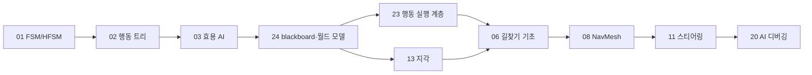

# 게임 AI 시리즈 지도

`ai/`는 모든 주제를 공통 필수 과목으로 다루지 않는다. 모든 게임 개발자가 공유해야 할 핵심 모델과, AI 담당자나 특정 장르에서 깊게 들어가는 고급 선택 주제를 분리한다.

파일 번호는 주제 묶음의 등록 순서지 읽는 순서가 아니다. 01~05는 의사결정, 06~12는 이동과 경로, 13~16은 지각과 전술, 17~19는 학습 기반, 20은 관측, 21~25는 회피·탐색·아키텍처 묶음이다. 공통 핵심 경로는 이 묶음들을 가로지르는 부분열이므로, 디렉터리 순서로 읽으면 순서가 맞지 않는다. 순서는 아래 표가 정한다.

## 읽는 순서

의사결정 모델 셋을 먼저 세우고, 그 셋이 공통으로 읽고 쓰는 *지식 저장소* 와 *행동 실행 계층* 을 바로 이어 붙인다. 이동 트랙은 그 위에서 목적지를 경로로, 경로를 움직임으로 바꾸는 단계다.

## 공통 핵심 경로

| 순서 | 문서 | 세우는 모델 | 이 자리인 이유 |
|---|---|---|---|
| 1 | [FSM과 HFSM](part01_fsm_hfsm.md) | 상태와 전이, 행동의 가장 기본적인 모델 | 이후 모든 의사결정 모델이 비교 기준으로 삼는 출발점 |
| 2 | [행동 트리](part02_behavior_tree.md) | 상용 게임 AI의 대표적 합성 모델 | 상태 사이 전이 연결이 복잡해질 때 행동을 트리로 합성하는 대안 |
| 3 | [효용 AI](part03_utility_ai.md) | 연속 점수 기반 의사결정과 튜닝 | 이산 분기로 표현되지 않는 우선순위를 점수로 다루는 세 번째 축 |
| 4 | [Blackboard와 월드 모델](part24_blackboard_world_model.md) | 공유 월드 상태와 지식 표현 | 앞의 세 모델이 공통으로 읽는 입력 메모리. 키의 타입·수명·신뢰도를 여기서 정하지 않으면 세 모델의 오작동이 전부 지식 버그로 돌아온다 |
| 5 | [행동 실행 계층](part23_ai_architecture_action_layer.md) | 의사결정과 행동 실행의 분리 | 의사결정 모델 셋과 그 입력을 본 뒤라야 "무엇을 무엇에서 분리하는가"가 성립한다 |
| 6 | [지각 시스템](part13_perception_systems.md) | 시야·청각·기억 등 AI 입력 모델 | 4번이 정의한 기록을 실제로 채우는 쪽. 관찰의 불확실성이 지식의 신뢰도로 이어진다 |
| 7 | [길찾기 기초](part06_pathfinding_basics.md) | 그래프 최단 경로와 A*의 게임 적용 | 결정된 목적지를 경로로 바꾸는 첫 단계 |
| 8 | [NavMesh](part08_navmesh.md) | 3D 이동 공간 표현의 표준 모델 | 격자 가정을 걷어내고 실제 레벨 지오메트리 위에서 같은 탐색을 돌린다 |
| 9 | [스티어링](part11_steering_behaviors.md) | 경로를 실제 움직임으로 바꾸는 로컬 제어 | 행동 실행 계층이 소비하는 최종 출력 |
| 10 | [AI 디버깅](part20_ai_debugging.md) | AI의 결정 과정을 관측·재현하는 방법 | 앞서 구성한 AI 상태를 눈으로 확인하고 재현하는 검증 단계 |

이 경로가 "모든 게임 개발자가 알아야 할 AI CS"에 해당한다. 목적은 AI 시스템을 직접 전부 구현하는 것이 아니라, 상태·탐색·지각·행동 실행·디버깅의 공통 언어를 갖는 것이다.

지식 저장소와 행동 실행 계층이 4·5번에 오는 이유는 둘이 고급 주제여서가 아니라 *토대* 이기 때문이다. 어떤 의사결정 알고리즘을 얹든 입력 메모리와 실행 계층의 계약이 필요하고, 그 계약이 느슨하면 의사결정 모델을 바꿔도 같은 증상이 반복된다. 의사결정과 이동 기법을 실제 시스템으로 연결할 때 함께 읽는다.

## 고급 선택 경로

공통 핵심 경로를 마친 뒤, 맡은 장르와 시스템에 따라 필요한 묶음만 고른다.

### 계획과 질의

- [GOAP](part04_goap.md)
- [HTN](part05_htn.md)
- [환경 질의 시스템](part25_environment_query_system.md)

목표와 전제조건, 작업 분해, 환경 질의가 중요한 전술 AI나 대규모 NPC 시스템에서 필요하다. 세 편 모두 의사결정 모델 셋과 지식 저장소를 전제하므로 공통 핵심 다음에 둔다.

### 고급 이동과 군중

- [고급 길찾기](part07_advanced_pathfinding.md)
- [Flow Field](part10_flow_field.md)
- [로컬 회피](part21_local_avoidance.md)
- [Flocking과 Boids](part12_flocking_boids.md)

대규모 유닛, 동적 장애물, 군중 이동, 로컬 회피가 게임플레이 핵심일 때 필요하다. 공통 핵심의 이동 트랙(7~9번)을 전제한다.

### 전술·연출 AI

- [영향력 맵](part09_influence_map.md)
- [분대 협동](part14_squad_coordination.md)
- [공격 슬롯](part15_attack_slot_system.md)
- [보스와 디렉터](part16_boss_directors.md)
- [적대적 탐색](part22_adversarial_search.md)

전투 전술, 보스 연출, 보드게임형 탐색, 다수 에이전트 조율이 필요한 장르의 선택 과목이다. 여러 에이전트가 지식을 공유하므로 지식 저장소의 scope 모델을 전제한다.

### 학습 기반 AI

- [강화학습 입문](part17_rl_intro.md)
- [모방학습](part18_imitation_learning.md)
- [신경망 NPC](part19_neural_npc.md)

강화학습과 신경망 NPC는 일반 게임 AI의 기본 도구라기보다 연구·도구·특수 시스템에 가까운 선택 과목이다.

## 연결해서 읽기

기법을 비교할 때는 어떤 상태를 기억하고, 그 상태를 갱신하는 데 어떤 비용이 들며, 실패를 어떻게 관측하는지 함께 살펴본다. 고급 경로에서는 그 기법이 필요한 장르와 성립하는 전제를 공통 핵심 모델에 연결한다.

특히 Blackboard와 행동 실행 계층에서는 키의 타입과 수명, 값이 없을 때의 처리, 결정과 실행의 경계를 확인한다. 의사결정 예제를 확장할 때 이 계약을 먼저 정하면, 판단 알고리즘의 문제와 오래되거나 누락된 지식·완료되지 않은 행동의 문제를 구분하기 쉽다.
