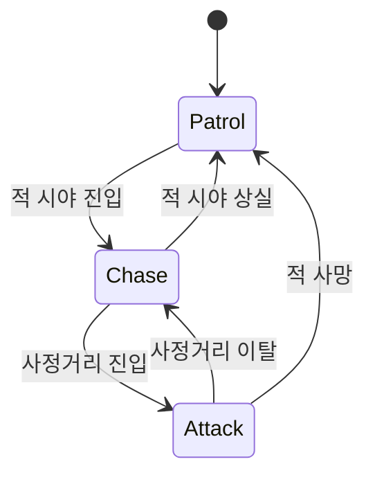
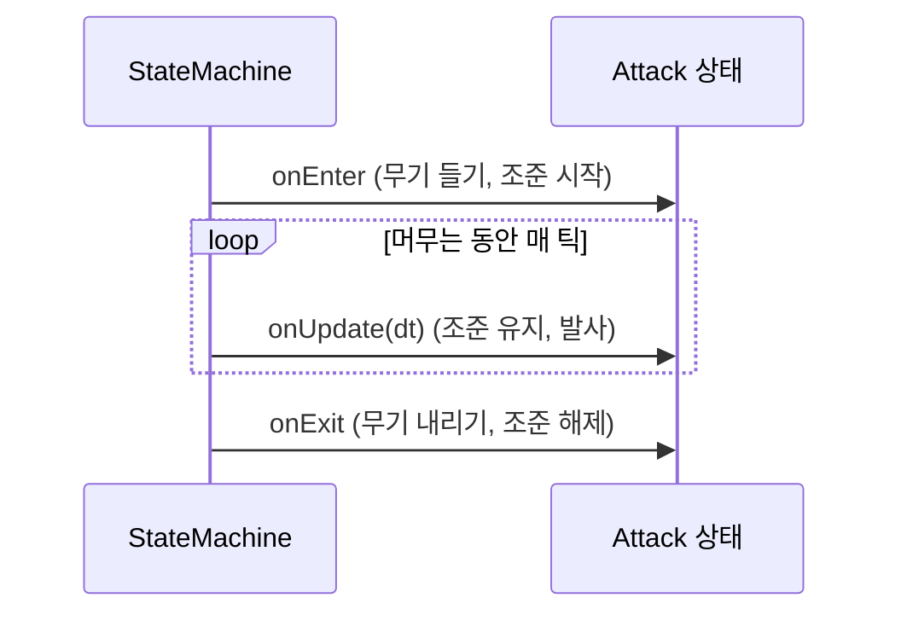
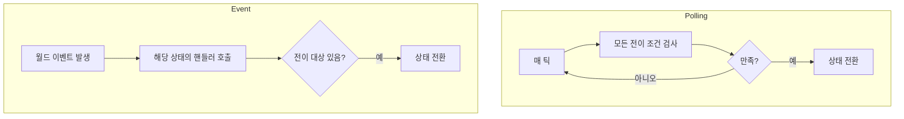
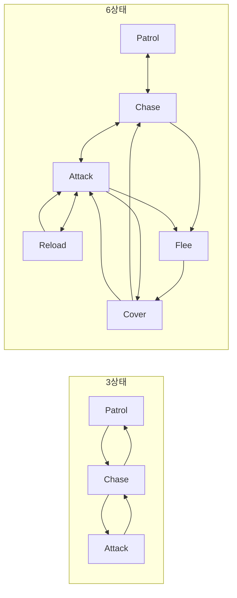
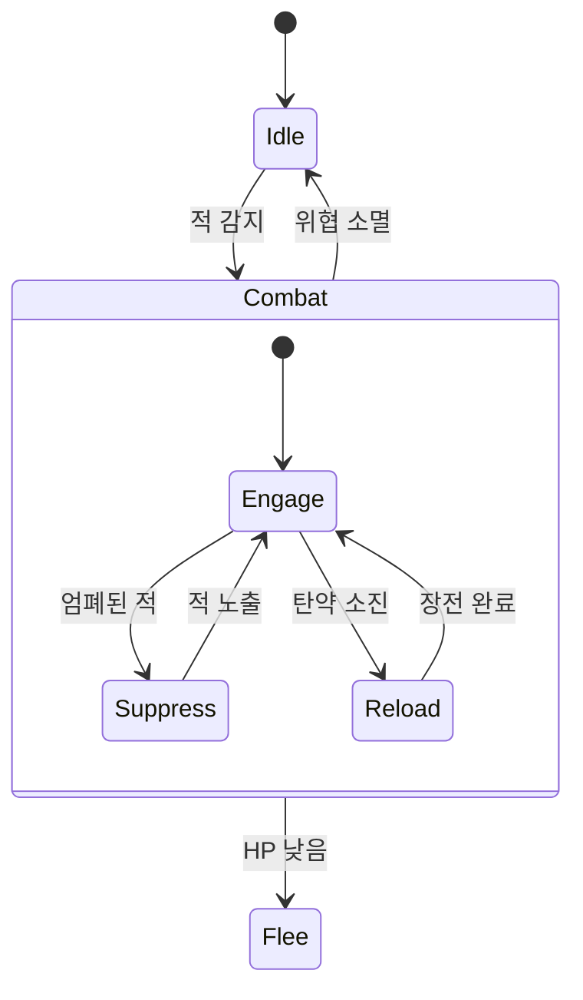
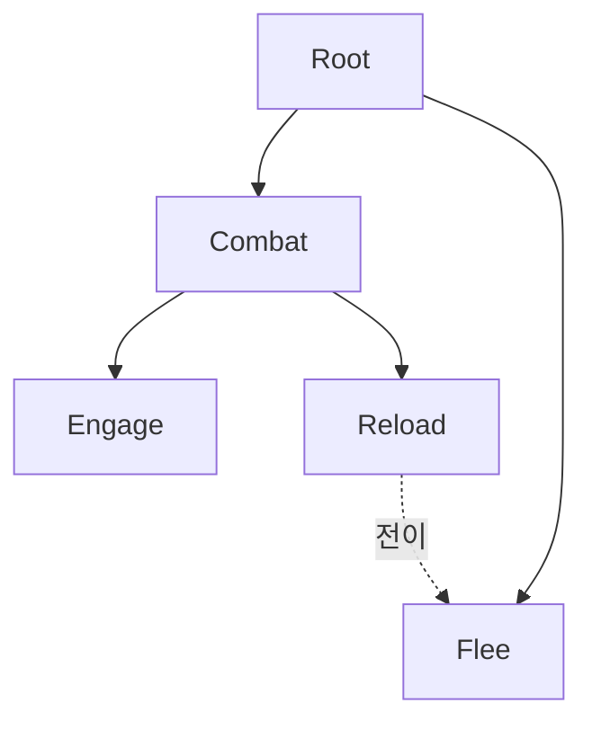
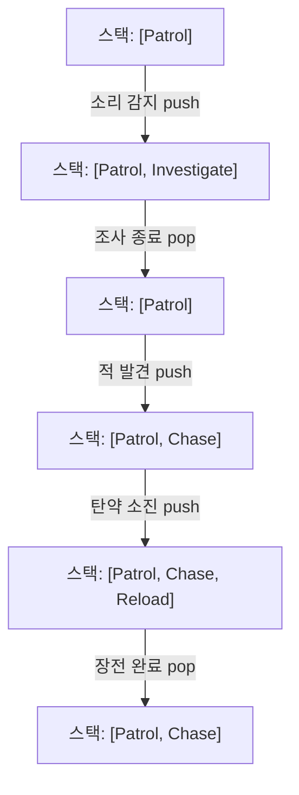
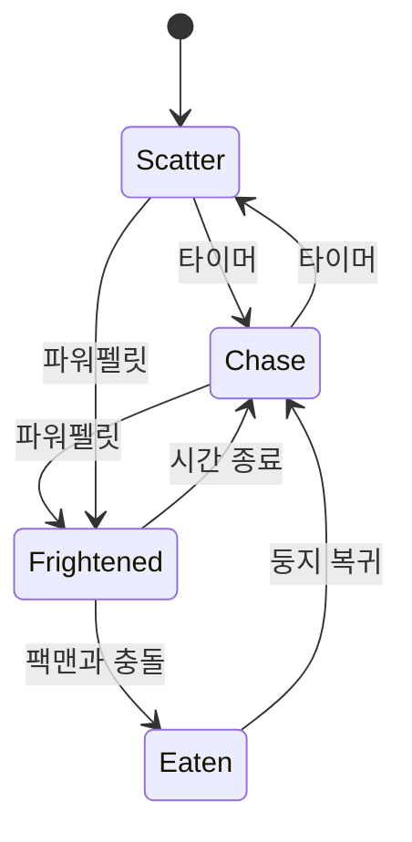
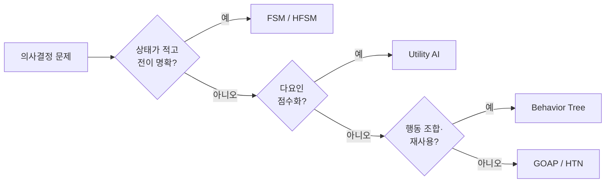

## 들어가며

게임 NPC가 내리는 모든 행동은 결국 "지금 무엇을 할 것인가"라는 질문에 대한 답이다. 이 질문에 답하는 가장 오래되고 가장 단순한 도구가 유한 상태 기계(Finite State Machine, FSM)다. 1980년대 아케이드 게임의 적부터 현대 AAA 게임의 보조 시스템까지, FSM은 형태를 바꿔 가며 살아남았다. 이유는 단순하다. 코드가 적고, 동작이 예측 가능하며, 디버깅이 쉽다.

FSM의 핵심 개념은 두 가지뿐이다. *상태(state)* 와 *전이(transition)*. NPC는 한 시점에 정확히 하나의 상태에 있고, 어떤 조건이 만족되면 다른 상태로 옮겨간다. Patrol에서 적을 보면 Chase로, 사정거리에 들어오면 Attack으로. 이 모델은 인간이 머릿속에 그리는 "행동 다이어그램"과 거의 그대로 대응되기 때문에 설계자와 프로그래머 사이의 의사소통 비용이 낮다.

문제는 규모다. 상태 사이 연결이 조밀해지면 전이의 수가 제곱 규모까지 늘어날 수 있고, "HP가 낮으면 어느 상태에서든 도망친다" 같은 횡단 관심사(cross-cutting concern)가 모든 상태를 오염시킨다. 이 글은 평면 FSM의 정의에서 출발해, 구현 패턴 셋의 성능·유지보수 트레이드오프, 상태 폭발을 완화하는 계층적 FSM(Hierarchical FSM, HFSM)과 그 정확한 진입·이탈 알고리즘, 스택 기반 변형인 푸시다운 오토마타(Pushdown Automata)까지를 다룬다. 마지막으로 FSM의 한계가 어디인지, 그래서 더 복잡한 의사결정 구조가 왜 필요해지는지, 그리고 FSM을 *디버깅·검증* 하는 도구까지 정리한다.



이 글의 목표.

1. **FSM의 형식 정의** — 상태, 전이 함수, Moore/Mealy, 생명주기.
2. **전이 방식** — polling과 event, 가드, 그리고 전이 중 재진입 문제.
3. **구현 패턴** — switch / 전이 테이블 / State 패턴의 성능·검증·데이터 주도.
4. **상태 폭발** — 전이 $O(n^2)$와 직교 상태 곱셈의 정량화.
5. **계층적 FSM** — 호이스팅, LCA 기반 진입·이탈, history, 직교 영역.
6. **푸시다운 오토마타** — 중단·복귀를 스택으로, Pause/Resume 의미론.
7. **실제 사례** — Pac-Man, Quake, Halo, 애니메이션 상태 기계.
8. **FSM의 한계** — 다른 패러다임으로의 졸업 기준.
9. **디버깅과 시각화** — 상태 트레이스, 전이 로그, 정적 검증.


---

## 목차
1. [FSM의 형식 정의](#1-fsm의-형식-정의)
2. [전이: polling과 event](#2-전이-polling과-event)
3. [구현 패턴 세 가지](#3-구현-패턴-세-가지)
4. [상태 폭발 문제](#4-상태-폭발-문제)
5. [계층적 FSM](#5-계층적-fsm)
6. [푸시다운 오토마타](#6-푸시다운-오토마타)
7. [실제 게임 사례](#7-실제-게임-사례)
8. [FSM의 한계와 경계](#8-fsm의-한계와-경계)
9. [디버깅과 시각화](#9-디버깅과-시각화)


---

## 1. FSM의 형식 정의

### 5-튜플과 게임에서의 단순화

오토마타 이론의 FSM은 5-튜플 $(S, I, \delta, s_0, F)$로 정의된다.

- $S$: 상태 집합. NPC의 행동 모드 — Patrol, Chase, Attack, Flee.
- $I$: 입력 집합. 월드에서 들어오는 이벤트나 조건 — 시야 진입, HP 변화, 타이머 만료.
- $\delta: S \times I \to S$: 전이 함수. 현재 상태와 입력으로부터 다음 상태를 결정한다.
- $s_0$: 초기 상태.
- $F \subseteq S$: 수용 상태 집합. 입력을 다 읽었을 때 이 상태에 있으면 문자열을 수용한다.

게임 AI에서는 문자열 수용을 위한 집합 $F$가 거의 의미 없다 — NPC의 의사결정은 *끝나지 않고 계속 도는* 루프이기 때문이다(죽음조차 Death 상태일 뿐 "수용 상태"가 아니다). 그래서 실질적으로 $(S, I, \delta, s_0)$ 네 요소가 남는다. 이것이 학계의 DFA(결정적 유한 오토마타)와 게임 FSM의 첫 차이다 — 게임 FSM은 *언어를 인식* 하지 않고 *행동을 생성* 한다.

핵심 불변식은 *한 시점에 활성 상태가 정확히 하나* 라는 점이다. 이 단일 활성 상태 제약이 FSM의 단순함과 한계를 동시에 만든다. 단순한 이유는 "지금 무엇을 하는가"가 항상 하나의 변수로 표현되기 때문이고("저 NPC는 지금 Chase 상태"), 한계인 이유는 동시에 두 가지를 신경 써야 하는 상황(이동하면서 재장전)을 표현하려면 두 상태 차원의 조합을 열거해야 하기 때문이다. 이 한 줄짜리 상태 변수가 *디버깅의 출발점이자 표현력의 천장* 이다.

### Moore 머신과 Mealy 머신

행동(action)을 어디에 붙이느냐에 따라 두 모델로 갈린다.

- *Moore*: 행동이 *상태* 에 종속된다. 출력은 현재 상태만의 함수 $\lambda: S \to O$. "Chase 상태에 있는 동안 매 틱 플레이어 쪽으로 이동".
- *Mealy*: 행동이 *전이* 에 종속된다. 출력은 (상태, 입력)의 함수 $\lambda: S \times I \to O$. "Patrol→Chase 전이가 일어나는 순간 경고음을 낸다".

차이가 실전에서 왜 중요한가? *경고음* 을 생각해 보자. Moore로 "Alert 상태에서 매 틱 경고음"을 만들면 소리가 끊임없이 반복된다. Mealy로 "→Alert 전이 순간 한 번 경고음"으로 만들면 *진입 시 한 번* 만 난다. 일회성 효과(소리, 파티클, 애니메이션 트리거)는 Mealy(전이)에, 지속 효과(이동, 조준 유지)는 Moore(상태)에 붙이는 것이 자연스럽다.

게임 FSM은 둘을 섞는다. 상태에는 지속 행동(Moore)을, 전이에는 일회성 행동(Mealy)을 붙인다. 구현에서 이는 상태의 `onUpdate`(매 틱)와 전이 경계의 `onEnter`/`onExit`(1회)로 나타난다.

```cpp
struct State {
    StateId                    id;
    std::function<void(Agent&)>        onEnter;   // 진입 1회 — Mealy 성격
    std::function<void(Agent&, float)> onUpdate;  // 매 틱  — Moore 성격
    std::function<void(Agent&)>        onExit;    // 이탈 1회 — Mealy 성격
    std::vector<Transition>            transitions;
};
```

### 진입·갱신·이탈의 생명주기

정상적인 외부 전이 생명주기는 *onEnter → onUpdate × N → onExit*다. 다만 진입 직후 즉시 전이하면 `onUpdate`가 0회일 수 있고, internal transition은 상태를 나가지 않아 `onExit/onEnter`를 호출하지 않을 수 있다. 이 의미를 전이 종류별로 고정해야 자원 생명주기가 예측 가능하다.



`onEnter`/`onExit`의 가치는 *자원의 획득/반납 대칭* 이다. "Attack에 진입할 때 무기를 들고, 떠날 때 내린다", "Aim에 진입할 때 조준 UI를 켜고, 떠날 때 끈다". 이 대칭이 깨지는 것이 FSM의 가장 흔한 버그다.

```cpp
// 흔한 버그: onEnter 에서 켠 것을 onExit 에서 끄지 않음
void Attack::Enter(Agent& a)  { a.aimUI.Show(); a.weapon.Raise(); }
void Attack::Exit(Agent& a)   { a.weapon.Lower(); }   // aimUI.Hide() 누락!
// → 다른 상태로 가도 조준 UI 가 화면에 남는다.
```

대칭을 강제하는 한 가지 방법은 진입에서 *복원 함수(undo)를 등록* 하고 이탈에서 일괄 실행하는 RAII 스타일이다. 하지만 게임 FSM은 보통 단순함을 위해 onEnter/onExit를 손으로 짝 맞추고, 그 짝이 맞는지는 코드 리뷰와 정적 검사로 검증한다.

## 2. 전이: polling과 event

전이 조건을 *언제 검사하는가* 가 FSM 설계의 첫 갈림길이다.



### polling 방식

매 틱마다 현재 상태에서 나갈 수 있는 모든 전이의 조건을 평가한다.

```cpp
void StateMachine::Tick(Agent& a, float dt) {
    for (const Transition& t : current_->transitions) {
        if (t.guard && !t.guard(a)) continue;   // 가드 통과 못하면 건너뜀
        if (t.condition(a)) {                    // 조건 검사
            ChangeState(a, t.target);
            return;                              // 첫 만족 전이를 따른다
        }
    }
    current_->onUpdate(a, dt);                   // 전이 없으면 현재 상태 갱신
}
```

장점은 *현재 조건을 반복 확인한다* 는 점이다. 다음 평가 때까지 참으로 유지되고 더 높은 우선순위 전이에 가리지 않는 조건은 그 틱에 잡힌다. 틱 사이에 참이었다가 다시 거짓이 된 순간 사건은 놓칠 수 있으므로 이벤트나 누적 플래그가 필요하다. 단점은 비용이다. 상태마다 전이가 $k$개면 매 틱 $k$번의 조건 평가가 들어간다. 시야 검사(raycast)처럼 조건 자체가 비싼 경우 이 비용이 누적된다 — NPC 200마리 × 전이 5개 × 60fps = 초당 6만 번 조건 평가. 그래서 비싼 조건은 *캐싱* 하거나(시야 결과를 N틱마다 갱신) event로 옮긴다.

*전이 우선순위* 는 검사 순서로 정한다. 위 코드처럼 "첫 만족 전이"를 따르면 배열 앞쪽이 우선이다. 이 순서 의존성은 미묘한 버그의 원천이다 — "HP 낮음 → Flee"가 "적 보임 → Chase"보다 *뒤에* 있으면, 둘 다 참일 때 Flee 대신 Chase로 가버린다. 안전 관련 전이는 *앞쪽* 에 둔다.

### event 방식

전이를 월드 이벤트의 콜백으로 등록한다. 조건을 매 틱 보는 대신, 이벤트가 발생할 때만 반응한다.

```cpp
void StateMachine::OnEvent(Agent& a, const Event& e) {
    for (const Transition& t : current_->transitions) {
        if (t.triggerEvent != e.type) continue;
        if (t.guard && !t.guard(a)) continue;
        ChangeState(a, t.target);
        break;
    }
}
```

장점은 효율이다. HP가 0이 되는 순간 *한 번만* 처리하면 된다 — 매 틱 "HP == 0?"을 묻지 않는다. 단점은 셋이다.

- *누락 위험*: 이벤트를 발행하는 쪽이 빠뜨리면 전이가 영영 일어나지 않는다.
- *순서 의존*: 상태 전환 도중에 들어온 이벤트의 처리 순서가 꼬이면 잘못된 상태로 간다.
- *과거 조건 누락*: "조건이 이미 참인 상태로 진입"하는 경우(이벤트는 이미 과거에 발생) event-only로는 잡지 못한다. 예: Chase로 진입했는데 그 순간 이미 사정거리 안이면, "사정거리 진입" 이벤트는 안 오므로 Attack으로 못 간다.

### 가드와 혼합

polling과 event는 한 기계 안에서 섞을 수 있다. 연속 값에서 매 평가 시점 확인해야 하는 조건(거리, HP 비율)은 polling으로, 순간 사건(피격, 사망, 소리 감지)은 event로 표현하기 좋다. 가드(guard) — 전이를 허용할지 막는 부울 술어 — 는 두 방식 모두에 얹어, "전이는 가능하지만 지금은 막는다"(예: 쿨다운 중)를 표현한다.

```cpp
struct Transition {
    StateId target;
    std::function<bool(const Agent&)> condition;  // polling 트리거
    std::function<bool(const Agent&)> guard;      // 공통 가드 (선택)
    EventType triggerEvent = EventType::None;     // event 트리거 (선택)
};
```

### 전이 중 재진입 문제

깊이 들어가면 만나는 함정이 *재진입(reentrancy)* 이다. `onExit`/`onEnter` 안에서 *또 다른 상태 전환을 트리거* 하면 어떻게 되는가? 예컨대 Attack의 `onEnter`가 "탄약 없음"을 발견하고 즉시 Reload로 가려 하면, 전환이 *전환 도중에* 일어난다. 단순 구현은 여기서 상태가 꼬이거나 무한 재귀에 빠진다.

해법은 *전환을 큐에 넣고 직렬화* 하는 것이다.

```cpp
void StateMachine::ChangeState(Agent& a, StateId next) {
    if (transitioning_) {           // 이미 전환 중이면 큐에 적재
        pendingTarget_ = next;
        return;
    }
    transitioning_ = true;
    do {
        StateId target = next;
        pendingTarget_ = kNone;
        current_->onExit(a);        // 이 안에서 ChangeState 불리면 pending 적재
        current_ = states_[target];
        current_->onEnter(a);       // 여기서도 마찬가지
        next = pendingTarget_;      // onEnter 가 또 전환을 요청했나?
    } while (next != kNone);        // 요청이 멈출 때까지 직렬 처리
    transitioning_ = false;
}
```

이 패턴은 단일 스레드에서 전환 도중의 재진입을 직렬화한다. `pendingTarget_`은 큐가 아니라 슬롯 하나이므로 여러 요청 중 마지막 것만 남긴다. 모든 요청을 보존하려면 실제 큐가 필요하고, Enter가 서로를 계속 요청하는 순환에는 한 틱의 전환 예산이나 순환 검출이 필요하다. 이 코드는 콜백이 예외를 던지지 않는 모형이며, 스레드 간 원자성이나 무한 전환 방지를 자동으로 제공하지 않는다. 같은 발상이 deferred event queue로도 나타난다 — 전환 도중 들어온 이벤트를 즉시 처리하지 않고 큐에 모았다가 전환 완료 후 처리한다. 재진입 안전성은 작은 FSM에선 무시되다가, 상태가 많아지면 *재현 안 되는 버그* 로 돌아온다.

## 3. 구현 패턴 세 가지

같은 FSM이라도 코드로 옮기는 방법은 세 갈래다. 각각 유지보수성·성능·데이터 주도성이 다르다.

### switch 분기

가장 직접적이다. 상태를 enum으로, 전이를 switch로 표현한다.

```cpp
void UpdateGuard(Guard& g, float dt) {
    switch (g.state) {
    case State::Patrol:
        Walk(g, dt);
        if (CanSeePlayer(g)) g.state = State::Chase;
        break;
    case State::Chase:
        MoveToward(g, g.lastSeen, dt);
        if (InAttackRange(g)) g.state = State::Attack;
        else if (!CanSeePlayer(g)) g.state = State::Patrol;
        break;
    case State::Attack:
        FacePlayer(g);
        Shoot(g, dt);
        if (!InAttackRange(g)) g.state = State::Chase;
        break;
    }
}
```

상태가 3~4개면 이만큼 명료한 코드가 없다. 컴파일러는 비교 체인이나 점프 테이블로 낮출 수 있다. 가상 함수 호출은 없지만 점프 테이블은 간접 분기이며, 예측 성공률은 상태 분포와 생성 코드에 달려 있다. 단점은 확장성이다. 상태를 추가하면 모든 관련 case를 손봐야 하고, onEnter/onExit를 끼워 넣으면 분기가 더 지저분해진다. 전이 구조가 코드에 *흩어져* 있어 전체 그래프를 한눈에 보기 어렵다 — Patrol에서 어디로 갈 수 있는지 알려면 Patrol case를 다 읽어야 한다.

### 전이 테이블 (데이터 주도)

전이를 코드가 아니라 데이터로 표현한다.

```cpp
struct Row { State from; Trigger on; State to; };

constexpr Row kTable[] = {
    { State::Patrol, Trigger::SeePlayer,    State::Chase  },
    { State::Chase,  Trigger::InRange,      State::Attack },
    { State::Chase,  Trigger::LostPlayer,   State::Patrol },
    { State::Attack, Trigger::OutOfRange,   State::Chase  },
    { State::Attack, Trigger::TargetDead,   State::Patrol },
};

State Next(State cur, Trigger t) {
    for (const Row& r : kTable)
        if (r.from == cur && r.on == t) return r.to;
    return cur;   // 정의된 전이 없음 — 현재 유지
}
```

전이 그래프 전체가 한 테이블에 모여 있어 검토와 검증이 쉽다. 행동(onEnter/onUpdate/onExit)은 별도 테이블로 분리해 상태에 매핑한다. 이 분리 — *전이 구조 데이터* 와 *행동 코드* 의 분리 — 가 전이 테이블의 본질적 가치다.

### State 패턴 (다형성)

각 상태를 클래스로 만들고 가상 함수로 행동을 분리한다.

```cpp
class IState {
public:
    virtual ~IState() = default;
    virtual void Enter(Agent&) {}
    virtual void Update(Agent&, float dt) {}
    virtual void Exit(Agent&) {}
    virtual StateId Decide(const Agent&) const = 0;  // 다음 상태 결정
};

class StateMachine {
public:
    void Tick(Agent& a, float dt) {
        StateId next = states_[current_]->Decide(a);
        if (next != current_) {
            states_[current_]->Exit(a);
            current_ = next;
            states_[current_]->Enter(a);
        }
        states_[current_]->Update(a, dt);
    }
private:
    std::unordered_map<StateId, std::unique_ptr<IState>> states_;
    StateId current_;
};
```

상태별 로직이 각 클래스에 캡슐화되어 상태 추가가 새 클래스 작성으로 끝난다. 비용은 *간접 호출(가상 디스패치)* 과 *객체 분산으로 인한 캐시 비친화성* 이다.

### 성능 비교 — 군중 규모에서

세 패턴의 차이는 NPC 수뿐 아니라 갱신 빈도, 행동 본문의 비용, 상태 객체 배치에 달려 있다. 같은 행동과 입력 순서로 디스패치 비용을 분리해 측정한다.

| 패턴 | 디스패치 | 캐시 | 데이터 주도 | 군중 적합 |
|---|---|---|---|---|
| switch | 비교 체인 또는 간접 분기 점프 테이블 | 생성 코드·상태 순서 의존 | 전이는 코드에 정의 | 일괄 처리에 유리한 후보 |
| 전이 테이블 | 테이블 탐색·인덱싱 | 배열 배치·탐색 방식 의존 | 가능 | 활성 전이 검사 비용에 의존 |
| State 패턴 | 가상 호출 가능 | 객체 배치·공유 방식 의존 | 부분 | 상태 수·행동 본문 비용에 의존 |

State 패턴은 상태 객체를 개별 할당해 흩어 놓으면 가상 디스패치와 캐시 미스가 누적될 수 있다. 반대로 불변 상태 객체를 공유하거나 pool에 배치하면 locality가 달라진다. 데이터 지향(DOD) 대안은 상태를 *enum 배열(SoA)* 로 두고 핫 루프에서 switch로 일괄 처리하는 것이다.

```cpp
// 군중용 SoA: 상태가 연속 배열에 — 캐시 친화적
std::vector<State> states;       // N개 NPC의 상태
std::vector<AgentData> data;     // N개 NPC의 데이터 (SoA 권장)

void UpdateGuardSoA(State& state, AgentData& data, float dt);  // enum switch 구현

void TickCrowd(float dt) {
    for (size_t i = 0; i < states.size(); ++i)
        UpdateGuardSoA(states[i], data[i], dt);   // switch — 가상 함수 호출 없음; 간접 분기는 생길 수 있음
}
```

실전에서는 *군중* 에 enum + switch/테이블을, *복잡한 개체* 에 State 패턴을 적용하는 분담을 고려할 수 있다. 상태별 로직이 복잡하면 클래스 캡슐화의 이득이 커지지만, 개체 수만으로 성능 결론을 정하지는 않는다.

### 데이터 주도 FSM 포맷

전이 테이블을 한 걸음 더 밀면, FSM 정의를 *코드 밖 데이터 파일* 로 빼 디자이너가 편집하게 만들 수 있다.

```json
{
  "initial": "Patrol",
  "states": {
    "Patrol": { "onEnter": "StartPatrolRoute",
      "transitions": [ {"on": "SeePlayer", "to": "Chase"} ] },
    "Chase":  { "onEnter": "AlertNearby",
      "transitions": [ {"on": "InRange", "to": "Attack"},
                       {"on": "LostPlayer", "to": "Patrol"} ] },
    "Attack": { "transitions": [ {"on": "OutOfRange", "to": "Chase"} ] }
  }
}
```

로더는 이 JSON을 파싱해 런타임 FSM을 구성하고, `"StartPatrolRoute"` 같은 문자열을 *코드에 등록된 함수 테이블*에서 찾아 바인딩한다. 프로그래머는 행동 함수(onEnter 후보)만 제공하고, 디자이너는 상태·전이 구조를 데이터로 조립한다. 이 분업은 코드 빌드 없이 AI를 튜닝하게 하고, 의사결정 구조와 실행 코드를 분리하는 데이터 주도 설계의 출발점이 된다.

### 정적 검증

전이 테이블/데이터 포맷의 숨은 이점은 *정적 분석* 이 가능하다는 것이다. FSM을 그래프로 보면 흔한 결함을 자동으로 잡을 수 있다.

- *도달 불가능 상태(unreachable)*: 초기 상태에서 그래프 탐색(DFS/BFS)으로 도달 못 하는 상태 — 죽은 코드.
- *막다른 상태(dead-end)*: 나가는 전이가 없는 비종료 상태 — NPC가 갇힘.
- *누락된 전이*: "모든 상태에 LowHP→Flee가 있어야 한다" 같은 규약 위반.

```cpp
std::set<State> ReachableFrom(State start, const std::vector<Row>& table) {
    std::set<State> seen{start};
    std::vector<State> stack{start};
    while (!stack.empty()) {
        State s = stack.back(); stack.pop_back();
        for (const Row& r : table)
            if (r.from == s && !seen.count(r.to)) { seen.insert(r.to); stack.push_back(r.to); }
    }
    return seen;   // 전체 상태 - 이 집합 = 도달 불가능 상태
}
```

빌드 시 이 검사로 초기 상태와 연결되지 않은 상태를 찾을 수 있다. guard를 무시한 그래프에서 도달 가능하더라도 실제 실행에서 그 guard 조합이 성립한다는 증명은 아니므로, 전이 조건과 우선순위는 별도로 검증한다. switch 분기로는 이런 전역 분석이 어렵다 — 전이가 코드에 흩어져 있기 때문이다.

## 4. 상태 폭발 문제

평면 FSM의 주요 확장 비용은 전이 수와 횡단 규칙의 복제다.

### 전이 수의 정량화

상태가 $n$개면 self-transition을 제외한 가능한 방향성 전이는 최대 $n(n-1)$개다. 이것은 *최악의 완전 연결 상한* 이다. 인접 상태로만 이동하는 희소 FSM은 간선 수가 $O(n)$일 수도 있으므로, 상태가 늘었다고 실제 전이가 자동으로 제곱 증가하지는 않는다. 문제가 되는 것은 여러 상태에서 같은 긴급 전이와 조합 상태를 반복 정의할 때 그래프가 조밀해지는 경우다.

그래프 복잡도는 상태 수 $n$과 실제 전이 수 $m$을 따로 기록해야 한다. 정적 검사와 매 프레임 polling 비용도 구현에 따라 $O(m)$ 전체 스캔이 아니라 활성 상태에서 나가는 차수 $O(\deg^+(s))$일 수 있다. 유지보수 지표로는 $m$, 상태당 최대 out-degree, 중복 guard 수, 우선순위 충돌 수가 더 직접적이다.



### 횡단 관심사가 더 큰 문제

순수한 전이 수보다 심각한 것이 *횡단 관심사* 다. "HP가 20% 미만이면 어느 상태에서든 즉시 Flee로 전환한다"는 규칙을 평면 FSM에 넣으려면, Patrol·Chase·Attack·Reload·Cover *모든 상태* 에 동일한 전이를 복제해야 한다. 상태를 하나 추가할 때마다 이 복제를 빠뜨리지 않아야 하고, Flee 조건을 수정하면 모든 복사본을 함께 고쳐야 한다. 이것이 평면 FSM의 유지보수 비용을 폭발시키는 진짜 원인이다.

```cpp
// 모든 상태에 같은 전이가 복제되는 안티패턴
case State::Patrol:  if (LowHP(a)) { a.state = State::Flee; break; } ...
case State::Chase:   if (LowHP(a)) { a.state = State::Flee; break; } ...
case State::Attack:  if (LowHP(a)) { a.state = State::Flee; break; } ...
case State::Reload:  if (LowHP(a)) { a.state = State::Flee; break; } ...
case State::Cover:   if (LowHP(a)) { a.state = State::Flee; break; } ...
```

복제는 *코드 중복* 이상이다 — 의미적으로 "이 규칙은 전역이다"라는 의도가 코드에 표현되지 못하고, $n$개의 동일 조각으로 흩어져 *일관성을 사람이 손으로 유지* 해야 한다. 한 곳을 고치고 다른 곳을 깜빡하면 "어떤 상태에서는 도망치고 어떤 상태에서는 안 도망치는" 버그가 된다. HFSM은 공통 전이를 상위 상태로 끌어올려 이 복제를 줄인다.

### 직교 상태의 곱셈

또 하나의 폭발원은 *직교(orthogonal) 상태* 다. NPC가 두 개의 *독립적인* 상태 차원을 동시에 가져야 한다고 하자.

| 이동 차원 \ 전투 차원 | 비무장 | 조준 | 사격 |
|---|---|---|---|
| 정지 | 정지·비무장 | 정지·조준 | 정지·사격 |
| 걷기 | 걷기·비무장 | 걷기·조준 | 걷기·사격 |
| 달리기 | 달리기·비무장 | 달리기·조준 | 달리기·사격 |

평면 FSM은 이 둘을 곱해 $3 \times 3 = 9$개의 합성 상태를 만들어야 한다. 차원이 하나 더 늘면(예: 자세 차원 2개) $9 \times 2 = 18$로 다시 곱해진다. $k$개 차원 각각 $m$개 값이면 가능한 전역 구성은 $m^k$개다. Statechart의 직교 영역은 이 전역 구성 수를 줄이지 않는다. 대신 각 차원의 상태 정의와 지역 전이를 대략 $m \times k$ 규모로 따로 저작하게 해, Cartesian product를 코드와 데이터에 명시적으로 열거하는 비용을 줄인다.

### 곱셈이 폭발인 정확한 이유 — 상태가 아니라 전이의 복제

상태 수 비교($m^k$ 대 $mk$)는 비용을 *과소평가* 한다. FSM의 유지보수 비용은 상태가 아니라 전이에서 나오고(횡단 관심사 항에서 본 복제가 그 증거다), 직교 분해의 진짜 이득도 전이 수에서 드러난다. 이를 정확히 세어 보자.

$k$개의 *독립* 차원, 차원 $i$가 $m_i$개 값과 $t_i$개의 차원 내부 전이(그 차원의 값만 바꾸는 전이)를 가진다고 하자. 평면 곱 FSM의 전역 상태는 튜플 $(s_1,\dots,s_k)$다. 차원 $i$의 값을 $a\to b$로 바꾸는 하나의 *개념적* 전이는, $i$번째 성분이 $a$인 *모든* 전역 상태에서 살아 있어야 한다 — 즉 나머지 성분의 모든 조합 $\prod_{j\neq i} m_j$개만큼 복제된다. 따라서 평면 전이 총수는

$$T_{\text{flat}} = \sum_{i=1}^{k} t_i \prod_{j\neq i} m_j .$$

직교 영역으로 분리하면 각 차원이 독립 기계라 전이가 복제되지 않는다.

$$T_{\text{orth}} = \sum_{i=1}^{k} t_i .$$

균등한 경우($m_i=m$, $t_i=t$)로 두면 $T_{\text{flat}} = k\,t\,m^{k-1}$, $T_{\text{orth}} = k\,t$이고, 전이 복제 인자는 $t>0$일 때

$$\frac{T_{\text{flat}}}{T_{\text{orth}}} = m^{k-1}$$

이다. 상태 비($m^k/(mk)=m^{k-1}/k$)보다 *전이 비가 $k$배 더 가파르다*. 직교 영역이 막는 것은 상태의 산술적 증가가 아니라 전이의 기하급수적 복제이며, 그래서 단 한 줄짜리 규칙("→ Aiming")을 평면 곱에서는 $m^{k-1}$곳에 손으로 맞춰 두어야 한다.

| 차원 $k$ | 값 $m$ | 차원당 전이 $t$ | 평면 상태 $m^k$ | 평면 전이 $T_{\text{flat}}$ | 직교 전이 $T_{\text{orth}}$ | 복제 인자 $m^{k-1}$ |
|---|---|---|---|---|---|---|
| 2 | 3 | 2 | 9 | 12 | 4 | 3 |
| 3 | 3 | 2 | 27 | 54 | 6 | 9 |

각 영역의 전이가 다른 영역의 상태를 읽거나 함께 바꾸지 않는 단순한 비동기 곱 모델에서는, 영역별 전이 관계의 interleaving으로 전역 전이를 정확히 구성할 수 있다. 차원 $i$의 전이 가드가 차원 $j$의 현재 값을 읽으면(예: "*달리는 중이 아닐 때만* 정밀 조준으로"), 독립 분해만으로는 그 결합 조건을 표현할 수 없다. Statechart는 영역 간 event, 동기화와 `in(state)` 술어로 이런 의존을 명시하지만, 그만큼 전역 구성에 대한 추론과 테스트가 다시 필요하다. 따라서 직교 영역은 독립적인 지역 규칙의 중복을 줄이는 도구이지, 교차 의존을 없애는 정리는 아니다.

## 5. 계층적 FSM

HFSM의 핵심 통찰은 *상태를 중첩* 시키는 것이다. 상위 상태(super-state)가 하위 FSM을 통째로 포함한다. Combat이라는 상위 상태 안에 Engage/Suppress/Reload 하위 상태가 들어가는 식이다.



### 공통 전이를 끌어올린다

HFSM이 상태 폭발을 푸는 방식은 *공통 전이를 상위 상태로 호이스팅* 하는 것이다. "HP가 낮으면 Flee"는 Combat 상위 상태에 단 한 번 정의한다. Combat 안의 어느 하위 상태(Engage/Suppress/Reload)에 있든, 상위에 정의한 전이도 후보가 되어 Flee로 빠질 수 있다. 하위 전이와 동시에 참일 때의 우선순위는 아래 평가 정책으로 정한다. 4절의 5중 복제가 1줄로 줄어든다.

전이 검사는 *안쪽에서 바깥으로* 진행한다.

```cpp
StateId HFSM::ResolveTransition(const Agent& a) {
    // 1) 현재 활성 하위(leaf) 상태의 전이 먼저
    if (StateId t = leaf_->Decide(a); t != kNone) return t;
    // 2) 없으면 조상 체인을 따라 위로 (leaf → ... → root)
    for (Node* p = leaf_->parent; p; p = p->parent) {
        if (StateId t = p->Decide(a); t != kNone) return t;
    }
    return kNone;
}
```

안→밖 순서가 의미하는 바는 "구체적인 전이가 일반적인 전이를 *오버라이드* 한다"는 것이다. Reload 상태에서 "장전 완료 → Engage"가 있고 Combat에 "HP 낮음 → Flee"가 있으면, 둘 다 참일 때 — 정책에 따라 — 하위를 먼저 보거나 상위(안전)를 먼저 본다. 보통 *안전 관련 상위 전이를 먼저* 보도록 순서를 뒤집는 변형을 쓴다.

### LCA 기반 진입·이탈

HFSM의 진짜 난제는 *계층을 가로지르는 전이* 의 진입·이탈 순서다. Reload(Combat 안)에서 Flee(Combat 밖)로 갈 때, 어떤 onExit/onEnter가 어떤 순서로 불려야 하는가?

외부 전이의 기본 규칙은 출발 leaf와 목표 상태의 *최소 공통 조상(Lowest Common Ancestor, LCA)* 을 찾아, 출발에서 LCA 직전까지 안→밖 순서로 exit하고 LCA 직후부터 목표까지 밖→안 순서로 enter하는 것이다. 그러나 self-transition과 조상/자손 전이는 UML의 internal·local·external semantics에 따라 경계 호출이 달라진다. 아래 코드는 leaf에 선언된, 서로 다른 분기 사이의 external transition만 설명하는 축약형이다. 상위 상태에 선언한 전이를 일반적으로 지원하려면 전이를 찾을 때 선언 source와 종류도 보존하고, 그 의미에 맞는 exit/entry 경계를 계산해야 한다.



Reload → Flee 전이의 경우:
- Reload 경로: `Root / Combat / Reload`
- Flee 경로: `Root / Flee`
- LCA = `Root`
- 이탈(안→밖): `Reload.onExit` → `Combat.onExit`
- 진입(밖→안): `Flee.onEnter`

```cpp
void HFSM::Transition(Agent& a, Node* target) {
    // internal/self/조상-자손 전이는 이 축약형의 구현 범위 밖이다.
    Node* lca = FindLCA(leaf_, target);
    // 1) leaf 에서 LCA 직전까지 onExit (안 → 밖)
    for (Node* n = leaf_; n != lca; n = n->parent)
        n->onExit(a);
    // 2) LCA 직후부터 target 까지 onEnter (밖 → 안)
    std::vector<Node*> entryPath;
    for (Node* n = target; n != lca; n = n->parent)
        entryPath.push_back(n);
    for (auto it = entryPath.rbegin(); it != entryPath.rend(); ++it)
        (*it)->onEnter(a);
    // 3) target 이 복합 상태면 하위 entry도 밖→안 순서로 호출하며 내려간다.
    leaf_ = DescendToInitial(target, a);
}
```

전이 종류와 entry/exit 순서가 일관되면 계층 자원의 획득·반납 대칭을 만들 수 있다. Combat 내부 하위 상태끼리 이동할 때 Combat을 exit하지 않고, Combat 밖으로 나갈 때만 exit하는 식이다. 콜백 자체가 반납을 빠뜨리거나 전이 도중 예외·취소가 발생하면 LCA 계산만으로 자원 안전이 자동 보장되지는 않는다.

### history

HFSM에 *history* 를 더하면 상위 상태를 떠나기 전에 기록한 마지막 활성 구성을 복원할 수 있다. 기록 시점은 exit 콜백이 상태를 바꾸기 전이어야 하고, 복원 대상이 삭제·비활성화됐을 때 initial state로 폴백해야 한다.

```cpp
struct CompositeNode {
    Node*  initial;        // 기본 진입 하위 상태
    Node*  lastActive;     // history: 마지막 활성 하위 상태
    bool   useHistory;
    Node*  EntryTarget() const { return useHistory && lastActive ? lastActive : initial; }
};
```

UML statechart는 *shallow history* (직속 하위만 복원)와 *deep history* (가장 깊은 leaf까지 복원)를 구분한다. 게임에서는 "교전 중 잠깐 회피했다가 하던 행동 그대로 복귀" 같은 자연스러움을 만든다.

### 직교 영역

David Harel의 statechart는 한 상위 상태 안에 *독립적으로 동시 활성* 인 직교 영역(orthogonal region)을 둔다. 이동 3상태와 전투 3상태를 별도 영역으로 저작하면 상태 정의와 지역 전이는 대략 $3+3$으로 관리할 수 있다. 그러나 실행 중 가능한 전역 구성 수는 여전히 $3\times3=9$이고, 두 영역을 동시에 조건으로 삼는 전이가 많아지면 결합 복잡도가 다시 나타난다. 직교 영역은 Cartesian product를 없애는 것이 아니라 제품 상태를 명시적으로 열거하지 않게 한다.

```cpp
struct OrthogonalState {
    StateMachine movement;   // 정지/걷기/달리기 — 독립
    StateMachine combat;     // 비무장/조준/사격 — 독립
    void Tick(Agent& a, float dt) {
        movement.Tick(a, dt);   // 두 영역을 매 틱 모두 갱신
        combat.Tick(a, dt);
    }
};
```

게임 엔진의 애니메이션 그래프도 계층적 상태 전이와 병렬 레이어라는 비슷한 구성 도구를 제공한다. 상체 사격과 하체 이동을 서로 다른 레이어에서 평가해 bone mask와 blend 규칙으로 합성할 수 있다. 다만 애니메이션 blend, transition duration, root motion과 동기화 marker는 고전 statechart의 이산 상태 의미론에 없는 요소이므로 두 모델을 동일시하면 안 된다.

## 6. 푸시다운 오토마타

평면 FSM이 풀지 못하고 HFSM의 history로도 다 풀리지 않는 패턴이 하나 있다. *중단하고 나중에 돌아오기* 다. 적이 순찰 중(Patrol) 소리를 들어 조사(Investigate)하다가, 조사가 끝나면 *원래 하던 것* 으로 복귀해야 한다. 그런데 "원래 하던 것"이 Patrol일 수도, Chase일 수도 있다. 평면 전이로는 *동적인 복귀 대상* 을 알 수 없다 — 복귀 대상이 컴파일 타임이 아니라 *런타임 히스토리* 에 달렸기 때문이다. 5절의 history는 이 한 단계 복귀를 주지만, 상위 상태당 슬롯 하나라 중단이 겹겹이 쌓이면(조사 중 재장전, 재장전 중 피격 반응) 복귀 대상을 잃고, history가 기록하는 것은 활성 구성이고, 상태 데이터를 보존할지는 exit/enter의 계약에 달려 있다.

푸시다운 오토마타(Pushdown Automata, PDA)는 상태를 *스택* 으로 관리해 이를 해결한다. 현재 상태 위에 임시 상태를 push하고, 끝나면 pop해서 *그 아래 있던 상태* 를 그대로 복원한다.



```cpp
class IPushdownState : public IState {
public:
    virtual void Pause(Agent&) {}
    virtual void Resume(Agent&) {}
};

class PushdownMachine {
public:
    void Push(Agent& a, StateId s) {
        if (!stack_.empty()) states_[stack_.back()]->Pause(a);   // 아래 상태 일시정지
        stack_.push_back(s);
        states_[s]->Enter(a);
    }
    void Pop(Agent& a) {
        if (stack_.empty()) return;
        states_[stack_.back()]->Exit(a);
        stack_.pop_back();
        if (!stack_.empty()) states_[stack_.back()]->Resume(a);  // 아래 상태 재개
    }
    void Tick(Agent& a, float dt) {
        if (!stack_.empty()) states_[stack_.back()]->Update(a, dt);  // 맨 위만 갱신
    }
private:
    std::vector<StateId> stack_;
    std::unordered_map<StateId, std::unique_ptr<IPushdownState>> states_;
};
```

### Pause/Resume vs Enter/Exit

주목할 점은 `Pause`/`Resume` 가 `Enter`/`Exit` 와 *별개* 라는 것이다. 의미가 다르다.

| 콜백 | 의미 | 상태 데이터 |
|---|---|---|
| Enter | 상태 시작 | 초기화 |
| Exit | 상태 종료 | 파기 |
| Pause | 잠시 멈춤 (스택에 남음) | *보존* |
| Resume | 다시 활성 | 보존된 채 재개 |

Reload를 push할 때 Chase는 *종료(Exit)되는 게 아니라 일시정지(Pause)* 된다 — 추적 타이머나 마지막 목격 위치 같은 상태 데이터가 보존된다. Reload를 pop하면 Chase가 `Resume`되어 그 데이터 그대로 재개된다. 만약 Pause/Resume 없이 Exit/Enter로 처리하면, Chase가 *처음부터 다시 시작* 되어 추적하던 맥락을 잃는다.

```text
Chase(추적 중, target=플레이어, 타이머=3.2s)
  → 탄약 소진, Reload push
  → Chase.Pause()  [target, 타이머 보존]
  → Reload 진행...
  → 장전 완료, Reload pop
  → Chase.Resume()  [target=플레이어, 타이머=3.2s 그대로]
```

### 스택 깊이 관리

PDA는 재장전, 피격 반응(hit reaction), 짧은 회피, 대화 같은 *완료 후 복귀* 행동에 자연스럽다. 한계는 *스택 깊이 관리* 다. push만 하고 pop을 빠뜨리면 스택이 무한히 자라고(메모리 누수 + 잘못된 상태), 어떤 상태에서 무엇이 쌓여 있는지 추적이 어려워진다. 실전에서는 *깊이 상한* 을 두고(예: 4), 초과 시 경고/덤프하며, 같은 상태가 스택에 *중복 push* 되지 않도록 검사한다. 또 PDA를 HFSM과 *결합* 하기도 한다 — 계층으로 큰 구조를 잡고, 일시적 중단·복귀가 필요한 지점에만 스택을 쓴다.

## 7. 실제 게임 사례

### Pac-Man 고스트 — 공유 FSM, 분리된 휴리스틱

Pac-Man 고스트는 Scatter·Chase·Frightened 같은 공통 모드와 고스트별 목표 타일 규칙을 결합한 고전적 사례다. 아래 네 상태 그림은 둥지 출입·부활·라운드별 타이머 세부를 생략한 *설계 모델* 이며 원본 ROM의 완전한 상태 기계를 그대로 옮긴 것이 아니다.



고스트별 차이를 가장 잘 드러내는 부분은 Chase 목표 타일 계산이다.

| 고스트 | Chase 목표 좌표 | 성격 |
|---|---|---|
| Blinky(빨강) | 팩맨의 현재 칸 | 정직한 추격 |
| Pinky(분홍) | 팩맨 진행 방향 4칸 앞 | 매복 |
| Inky(청록) | Blinky 위치를 이용한 벡터 반사 | 변덕 |
| Clyde(주황) | 멀면 추격, 가까우면(8칸) Scatter 모서리로 | 겁쟁이 |

공통 모드 구조 위에 다른 추격 휴리스틱을 얹어 성격을 구분한다는 원리는 FSM의 *구조와 정책 분리*를 잘 보여준다. 실제 동작 차이가 Chase 함수 하나에만 전부 들어 있다고 단정할 필요는 없다. Frightened 이동, 집 복귀, 타이밍과 원본 구현의 예외도 행동에 영향을 준다.

### Quake / Doom 몬스터 — 최소 FSM

초기 id Software 계열 몬스터 코드는 애니메이션 frame과 think callback, 이동·공격·pain·death 모드를 촘촘히 결합한다. 이를 Idle/Run/Attack/Pain/Death의 작은 FSM으로 해석하면 최소주의를 설명하기 좋지만, 소스 구조가 현대적인 `State` 객체의 평면 FSM과 정확히 같다는 뜻은 아니다. 피격 뒤 완전한 호출 스택을 복원하기보다 정해진 전투 흐름으로 돌아가는 단순화는 콘텐츠와 애니메이션이 의사결정 복잡도를 대신하는 사례다.

### Halo — 계층 구조와 그 너머

Bungie의 Halo 2 AI는 적의 의사결정을 Idle/Alert/Combat 같은 큰 묶음으로 계층화하고, 그 안에 더 작은 행동을 두었다. 이 구조는 HFSM의 공통 전이 호이스팅과 같은 동기 — 복잡도를 계층으로 누른다 — 에서 출발한다. 다만 Halo 2의 구조는 순수한 HFSM을 넘어, 우선순위로 정렬된 행동들을 위에서 아래로 평가해 *실행 가능한 가장 높은 우선순위 행동* 을 고르는 형태로 발전했다. 이는 의사결정을 상태가 아니라 행동의 선택 문제로 재구성한 것으로, 상태 중심 모델과 행동 중심 모델의 경계에 있다. Damian Isla의 GDC 2005 발표 "Handling Complexity in the Halo 2 AI"가 이 설계를 공개했고, 이후 행동 중심 의사결정 구조에 큰 영향을 줬다.

### 애니메이션 상태 기계 — FSM이 사라지지 않는 이유

애니메이션 계층에서도 state machine/statechart는 널리 쓰인다. Unreal Animation State Machine과 Unity Animator가 대표적이다. 다만 blend tree, motion matching, procedural animation, montage가 함께 사용되므로 "한 시점 한 클립"이나 대체재가 없다는 설명은 지나치게 좁다. 상태 기계는 locomotion mode와 전환 계약을 소유하고, 연속 블렌딩과 자세 생성은 다른 구조가 맡을 수 있다.

## 8. FSM의 한계와 경계

FSM은 상태가 적고 전이가 명확한 문제에서 강한 도구다. 현재 활성 상태가 중요한 진단 신호지만, guard 값·전이 우선순위·이벤트 순서·entry/exit 부작용까지 기록해야 원인을 설명할 수 있다. HFSM과 PDA는 적용 범위를 넓히지만 결합 규칙과 history semantics라는 새 복잡도도 들여온다.

- *의사결정이 다요인일 때*. "지금 공격할지 후퇴할지"를 HP·탄약·거리·아군 수·엄폐 가능성 등 여러 연속 변수의 가중 합으로 정하고 싶다면, 이것을 이산 상태와 부울 전이로 표현하는 일이 곧 한계에 부딪힌다. 상태가 아니라 *점수* 로 행동을 고르는 효용 기반 모델이 더 자연스럽다.

- *행동을 조합·재사용해야 할 때*. "문으로 이동 → 문 열기 → 통과"처럼 하위 행동을 트리로 조합하고 어디서든 재사용하려면, 상태 그래프보다 *트리 구조(행동 트리)* 가 모듈성에서 앞선다.

- *목표에서 역방향으로 계획해야 할 때*. "적을 죽인다"는 목표만 주고 그에 이르는 행동 순서를 런타임에 *탐색* 으로 찾게 하려면, FSM처럼 전이를 미리 다 적어 두는 모델이 맞지 않는다. 계획 기반 AI(GOAP/HTN)의 영역이다.



중요한 것은 FSM이 *틀렸다* 가 아니라 *문제에 맞는 도구가 따로 있다* 는 점이다. 실제 상용 게임은 거의 항상 이들을 혼합한다 — 애니메이션 계층은 statechart로, 전투 의사결정은 행동 트리나 효용 시스템으로, 그 말단의 단순 행동은 다시 작은 FSM으로. *언제 졸업할지* 의 신호는 명확하다: 같은 전이를 여러 상태에 복제하기 시작하면(HFSM으로), 전이 조건이 점수 비교로 변하기 시작하면(효용으로), 행동을 다른 NPC와 공유하고 싶어지면(행동 트리로).

## 9. 디버깅과 시각화

FSM의 가장 큰 장점 중 하나는 *디버깅 가능성* 이다. "한 시점 한 상태"라는 제약 덕분에, 현재 상태 하나만 보면 NPC가 무엇을 하는지 안다. 이 장점을 실제 도구로 만드는 것이 FSM 개발의 마지막 조각이다.

### 상태 트레이스

가장 기본은 *전이 로그* — 언제 어떤 상태에서 어떤 상태로, 무슨 트리거로 갔는지 기록한다.

```cpp
struct TransitionLog {
    float    time;
    StateId  from, to;
    const char* trigger;
};

void StateMachine::ChangeState(Agent& a, StateId next, const char* trigger) {
    log_.push_back({Now(), current_, next, trigger});
    if (log_.size() > kMaxLog) log_.pop_front();   // 링 버퍼
    // ... onExit/onEnter ...
}
```

이상 행동이 났을 때 이 로그를 덤프하면 "Patrol → Chase(SeePlayer) → Attack(InRange) → ??? " 하고 *결정의 경로* 가 그대로 보인다. NPC가 "왜 저기서 멈췄지?"의 답이 전이 로그에 있다.

### 화면 오버레이

공간적 디버깅은 그림이 압도적이다. NPC 머리 위에 *현재 상태 이름* 을, 시야 콘·타깃·경로를 디버그 드로우로 표시한다.

```cpp
void Agent::DebugDraw(DebugRenderer& dr) const {
    dr.DrawText3D(headPos_, StateName(sm_.Current()), StateColor(sm_.Current()));
    dr.DrawCone(eyePos_, facing_, fovAngle_, sightRange_, Color::Yellow);
    if (HasTarget()) dr.DrawArrow(pos_, target_, Color::Red);
}
```

상태별로 색을 다르게 하면(Patrol=초록, Chase=노랑, Attack=빨강) *멀리서 한눈에* 부대 전체의 상태 분포가 보인다 — "왜 절반이 아직 Patrol이지?" 같은 의문이 즉시 생긴다.

### 정적 검증과 런타임 단언

3절의 도달 불가능 상태 검사에 더해, 런타임 단언으로 *불변식* 을 지킨다.

- *스택 깊이 상한*(PDA): `assert(stack_.size() <= kMaxDepth)`.
- *진입/이탈 짝*: onEnter 호출 수와 onExit 호출 수가 종료 시 일치하는지.
- *유효 전이*: ChangeState의 target이 현재 상태에서 도달 가능한 전이인지(데이터 주도 FSM이면 테이블 조회로 검증).

이 검증 인프라가 FSM의 "예측 가능하고 디버깅 쉽다"는 약속을 *실제로* 지키게 만든다. 도구 없는 FSM은 작을 때만 디버깅이 쉽고, 커지면 다른 모든 시스템처럼 들여다보기 어려워진다.


---

## 결론

FSM은 *적은 코드로 즉시 동작하는* 의사결정 도구다. 상태와 전이라는 두 개념만으로 NPC의 행동을 인간이 읽을 수 있는 다이어그램과 1:1로 대응시킨다. 단일 활성 상태라는 제약이 단순함의 원천이자 한계의 원천이며, Moore/Mealy 행동 분리와 onEnter/onUpdate/onExit 생명주기가 그 위에 실전 구조를 올린다. 전이는 polling과 event를 섞고, 재진입은 전환 직렬화로 안전하게 다룬다.

구현은 switch·전이 테이블·State 패턴의 트레이드오프 위에 놓이며, 군중은 enum+테이블로, 복잡한 개체는 State 패턴으로 나눈다. 데이터 주도 포맷은 디자이너 튜닝과 정적 검증(도달 불가능 상태 탐지)을 가능하게 한다. 상태 폭발 — 조밀한 전이의 $O(n^2)$ 상한, 횡단 관심사 복제, 직교 상태의 Cartesian product — 은 HFSM의 공통 전이 호이스팅과 LCA 기반 진입·이탈, statechart 직교 영역의 분리 저작으로 완화한다. 가능한 전역 구성 수 자체는 곱으로 남으며, 영역 간 의존이 많으면 결합 복잡도도 되살아난다. PDA는 스택으로 중단·복귀를 표현해 Pause/Resume의 맥락 보존을 제공한다.

다요인 점수화, 실행 중 행동 조합, 목표에서 행동 순서를 역산하는 계획은 FSM 전이 그래프가 직접 소유하지 않는 문제다. 이런 요구는 효용 함수, 행동 트리나 planner를 조합하되, 말단의 예측 가능한 행동 상태와 애니메이션 제어는 FSM으로 유지할 수 있다. 각 계층이 서로의 상태를 중복 소유하지 않도록 경계를 정하는 것이 핵심이다.

## 더 읽을거리

- Damian Isla, "Handling Complexity in the Halo 2 AI" (GDC 2005) — 계층적 행동 구조의 산업 공개.
- David Harel, "Statecharts: A Visual Formalism for Complex Systems" (1987) — HFSM·직교 영역·history·LCA 진입의 원전.
- David Harel & Amnon Naamad, "The STATEMATE Semantics of Statecharts" (ACM TOSEM 5(4), 1996) — 직교(AND) 상태의 곱 의미론과 `in(state)` 영역 간 술어의 형식 정의.
- Ian Millington, *AI for Games*, 3rd Ed., Ch. 5 "Decision Making" — FSM/HFSM/전이 테이블 구현 정리.
- Steve Rabin (ed.), *AI Game Programming Wisdom* 시리즈의 State Machines 섹션 — 전이 테이블·PDA·데이터 주도 FSM의 실전 패턴.
- Mat Buckland, *Programming Game AI by Example*, Ch. 2 — State 패턴 기반 FSM과 메시지/이벤트 처리.
- Jamey Pittman, "The Pac-Man Dossier" (Gamasutra, 2009) — 고스트별 Chase 목표 타일 규칙과 Scatter/Chase 모드 타이밍의 정리.
- Unreal Engine / Unity 애니메이션 상태 기계 문서 — statechart의 상용 구현(레이어·블렌드).
