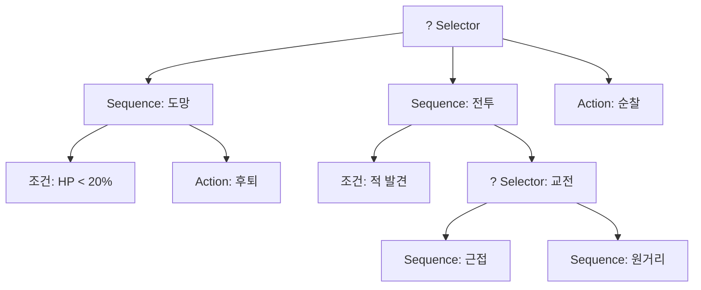
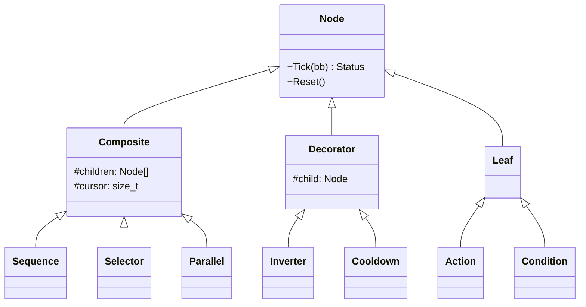
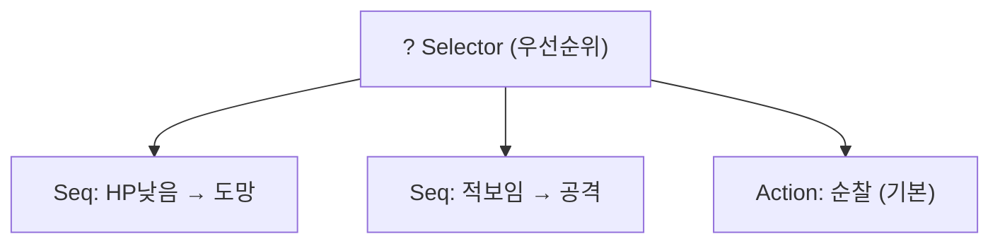
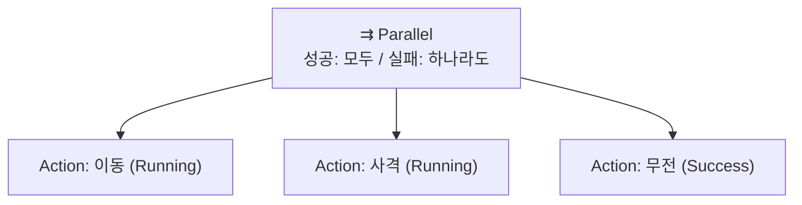
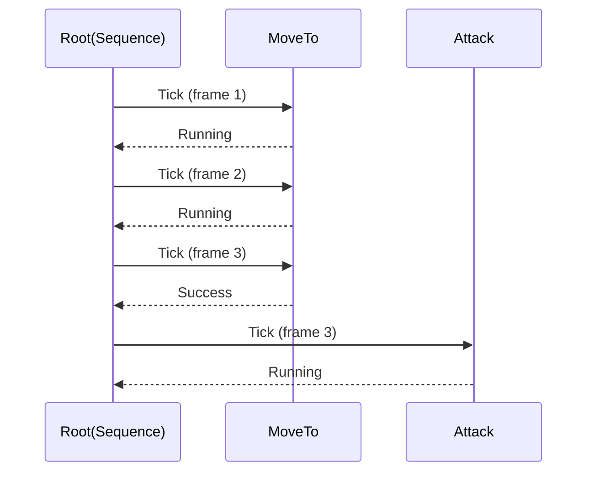
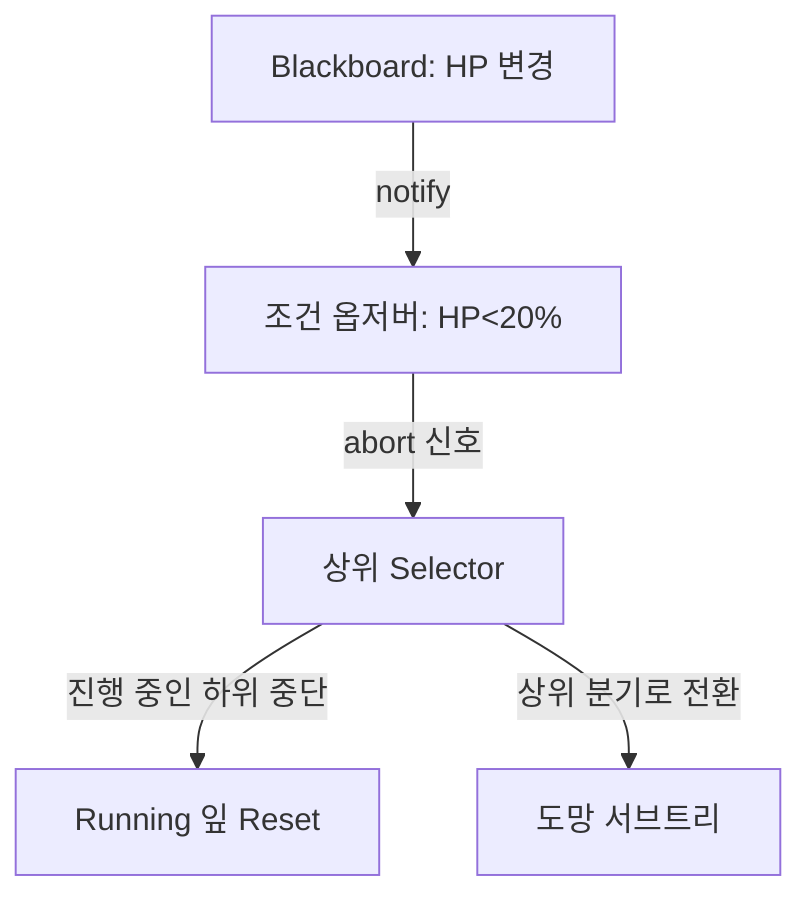
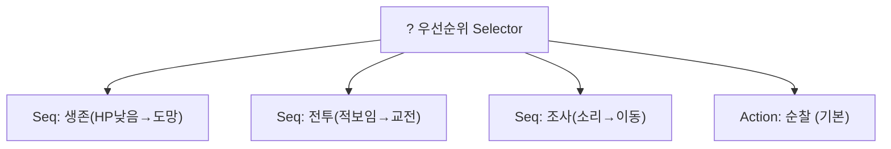
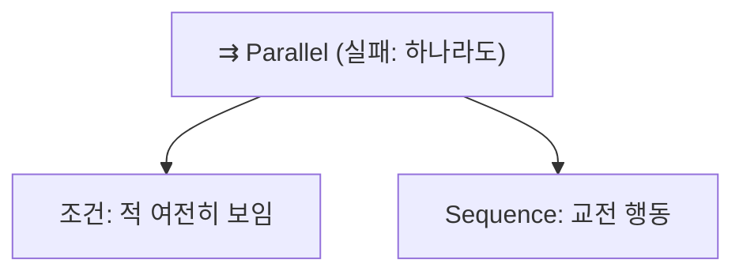
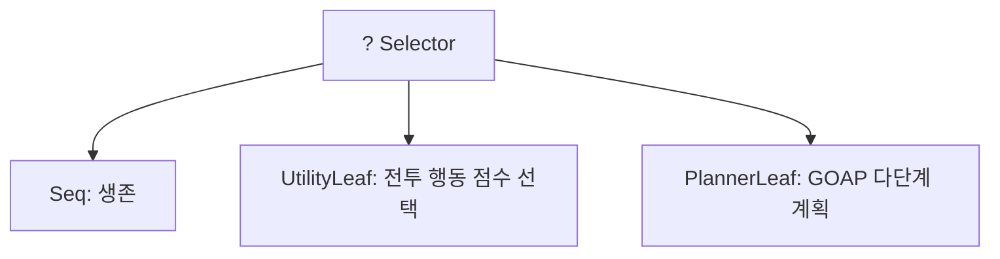

## 들어가며

유한 상태 기계는 의사결정을 상태와 전이의 그래프로 펼친다. 행동 트리(Behavior Tree, BT)는 같은 문제를 다른 축으로 본다. 행동을 *트리로 합성* 하고, 매 프레임 루트에서 잎까지 평가를 흘려보내 "지금 실행할 잎"을 고른다. 상태 사이의 전이를 일일이 적는 대신, 행동을 우선순위와 순서로 조립한다.

BT의 결정적 장점은 *합성성(composability)* 이다. "엄폐물로 이동 → 엄폐 → 사격"이라는 서브트리를 한 번 만들면, 일반 적에게도 보스에게도 그대로 붙일 수 있다. FSM에서 같은 행동을 재사용하려면 전이를 다시 그려야 하지만, BT에서는 노드를 옮겨 붙이면 끝난다. 이 모듈성 덕분에 디자이너가 트리 편집기에서 행동을 조립하고, 프로그래머는 잎 노드(실제 행동)만 구현하는 분업이 가능해진다.

이 글은 BT의 세 노드 종류(Composite/Decorator/Leaf)에서 시작해, Sequence와 Selector가 어떻게 제어 흐름을 만드는지, 데코레이터가 어떻게 조건과 반복을 분리하는지, tick 모델과 Running 상태가 어떻게 시간에 걸친 행동을 표현하는지를 깊이 파고든다. polling BT의 비효율을 줄이는 event-driven BT의 abort 정책, 실전에서 반복되는 BT 패턴 카탈로그, 그리고 BT를 디버깅·시각화하는 도구까지 다룬다.



이 글의 목표.

1. **노드 분류** — Composite/Decorator/Leaf, 공통 인터페이스, 트리 구성.
2. **Sequence와 Selector** — AND/OR, memory/reactive 변형.
3. **데코레이터** — 조건·반복·쿨다운의 분리와 카탈로그.
4. **Parallel** — 동시 실행, 성공/실패 정책, 자원 충돌.
5. **tick 모델** — Running 노드 기억과 재평가 비용.
6. **Blackboard** — 노드 간 데이터 공유와 스코프.
7. **Event-Driven BT** — abort 정책으로 매 틱 전체 평가 제거.
8. **BT 패턴 카탈로그** — 실전에서 반복되는 관용구.
9. **BT의 한계** — 효용·계획과의 혼합.
10. **디버깅과 시각화** — tick 경로 하이라이트, blackboard watch.


---

## 목차
1. [세 가지 노드 종류](#1-세-가지-노드-종류)
2. [Sequence와 Selector](#2-sequence와-selector)
3. [데코레이터와 조건 노드](#3-데코레이터와-조건-노드)
4. [Parallel과 동시 실행](#4-parallel과-동시-실행)
5. [tick 모델과 상태 반환](#5-tick-모델과-상태-반환)
6. [Blackboard 통신 구조](#6-blackboard-통신-구조)
7. [Event-Driven BT](#7-event-driven-bt)
8. [BT 패턴 카탈로그](#8-bt-패턴-카탈로그)
9. [BT의 한계](#9-bt의-한계)
10. [디버깅과 시각화](#10-디버깅과-시각화)


---

## 1. 세 가지 노드 종류

BT의 모든 노드는 셋 중 하나다.

- *Composite*: 자식을 여럿 두고 조합한다. Sequence, Selector, Parallel.
- *Decorator*: 자식을 정확히 하나 두고 그 결과나 실행을 변형한다. Inverter, Repeater, Cooldown, 조건 데코레이터.
- *Leaf*: 자식이 없다. 실제 행동(Action)이나 조건 검사(Condition). MoveTo, Attack, IsEnemyVisible.

### 공통 인터페이스

모든 노드는 동일한 인터페이스를 공유한다. `Tick`을 호출받고 세 가지 상태 중 하나를 반환한다.

```cpp
enum class Status { Success, Failure, Running };

class Node {
public:
    virtual ~Node() = default;
    virtual Status Tick(Blackboard& bb) = 0;
    virtual void   Reset() {}            // Running 중단 시 정리 (onExit 성격)
};

class Composite : public Node {
protected:
    std::vector<std::unique_ptr<Node>> children_;
    size_t cursor_ = 0;                  // 현재 진행 중인 자식
public:
    void Add(std::unique_ptr<Node> c) { children_.push_back(std::move(c)); }
};

class Decorator : public Node {
protected:
    std::unique_ptr<Node> child_;
};
```

이 단일 인터페이스가 BT의 합성성을 만든다. Composite는 자식이 Leaf인지 다른 Composite인지 알 필요가 없다 — `Tick`을 호출하고 `Status`를 받을 뿐이다. 그래서 임의의 서브트리를 임의의 위치에 끼울 수 있다. `Reset`은 Running 중이던 노드가 중단될 때(상위 우선순위가 선점) 자원을 정리하는 FSM의 onExit에 대응한다.



### 트리 구성

트리는 보통 빌더 패턴이나 데이터(JSON/XML)로 구성한다. 핵심은 *구조(트리)는 공유 자산, 실행 상태(cursor, blackboard)는 인스턴스별* 이라는 점이다. 공유 자산에 실행 상태를 넣으면 여러 NPC가 같은 cursor와 임시 값을 덮어쓰게 된다.

## 2. Sequence와 Selector

두 합성 노드가 BT 제어 흐름의 거의 전부다.

### Sequence — 논리 AND

자식을 순서대로 tick한다. 자식이 Success면 다음 자식으로, Failure면 즉시 Failure를 반환하고 중단한다. 모든 자식이 Success여야 Sequence가 Success다.

```cpp
Status Sequence::Tick(Blackboard& bb) {
    for (; cursor_ < children_.size(); ++cursor_) {
        Status s = children_[cursor_]->Tick(bb);
        if (s == Status::Running) return Status::Running;  // 위치 기억
        if (s == Status::Failure) { cursor_ = 0; return Status::Failure; }
    }
    cursor_ = 0;
    return Status::Success;
}
```

"엄폐물로 이동 → 엄폐 → 사격"은 Sequence다. 이동이 실패하면(경로 없음) 엄폐도 사격도 시도하지 않는다.

### Selector — 논리 OR

자식을 순서대로 tick하되, Success면 즉시 Success를 반환하고 중단한다. Failure면 다음 자식으로 넘어간다. 모든 자식이 Failure여야 Selector가 Failure다. 흔히 `?`로 표기한다.

```cpp
Status Selector::Tick(Blackboard& bb) {
    for (; cursor_ < children_.size(); ++cursor_) {
        Status s = children_[cursor_]->Tick(bb);
        if (s == Status::Running) return Status::Running;
        if (s == Status::Success) { cursor_ = 0; return Status::Success; }
    }
    cursor_ = 0;
    return Status::Failure;
}
```

Selector는 *우선순위 폴백(fallback)* 이다. "전투를 시도하고, 안 되면 순찰한다"는 Selector로, 전투 서브트리가 Failure를 반환할 때만 순찰로 내려간다. 자식의 *배치 순서가 곧 우선순위* 다.

### memory vs reactive 변형

위 두 구현은 `cursor_`로 진행 위치를 기억한다 — *memory(스테이트풀) 버전* 이다. Running이던 자식부터 이어서 tick한다. 그런데 BT에는 두 의미론이 공존한다.

| 변형 | 동작 | 쓰임 |
|---|---|---|
| memory (스테이트풀) | Running 자식부터 이어감, 앞쪽 재평가 안 함 | 진행 중 시퀀스를 끊지 않을 때 |
| reactive (스테이트리스) | 매 틱 항상 첫 자식부터 재평가 | 앞쪽 조건이 바뀌면 즉시 반응 |

```cpp
// reactive Sequence: 매 틱 처음부터 — 앞쪽 조건 노드가 바뀌면 즉시 중단
Status ReactiveSequence::Tick(Blackboard& bb) {
    for (size_t i = 0; i < children_.size(); ++i) {
        Status s = children_[i]->Tick(bb);
        if (s != Status::Success) {
            // 이전에 Running이던 뒤쪽 자식이 있으면 Reset (선점됨)
            for (size_t j = i + 1; j < children_.size(); ++j) children_[j]->Reset();
            return s;
        }
    }
    return Status::Success;
}
```

차이가 중요한 경우: `Sequence[IsEnemyVisible, MoveToEnemy]`에서 MoveToEnemy가 Running 중인데 적이 사라지면, memory 버전은 IsEnemyVisible을 *다시 보지 않아* 계속 이동하고, reactive 버전은 매 틱 IsEnemyVisible을 재검사해 적이 사라지면 중단할 수 있다. 조건 유지가 행동의 안전 전제라면 reactive 재검사나 event-driven abort가 필요하고, 완료까지 같은 순서를 유지해야 하는 작업은 memory semantics가 맞다. 한 트리 안에서도 노드별 계약에 따라 둘을 섞을 수 있다.

### 둘의 조합이 if/else가 된다

Sequence 안에 조건 노드를 첫 자식으로 두면 if가 된다. "적이 보이면(조건) 공격한다(행동)"는 `Sequence[IsEnemyVisible, Attack]`이다. 조건이 Failure면 Sequence 전체가 Failure가 되어 상위 Selector가 다음 분기로 넘어간다. Selector 아래에 조건으로 시작하는 Sequence들을 우선순위 순으로 나열하면 `if / else if / else`와 같은 의사결정 구조가 된다.



## 3. 데코레이터와 조건 노드

데코레이터는 자식 하나를 감싸 그 결과나 실행 방식을 바꾼다. 제어 흐름을 행동에서 분리하는 장치다.

| 데코레이터 | 효과 | Running 처리 |
|---|---|---|
| Inverter | Success↔Failure 뒤집기 | Running 그대로 |
| Succeeder | 항상 Success | Running 그대로 |
| Failer | 항상 Failure | Running 그대로 |
| Repeater(n) | 자식을 n번 반복 | 매 반복 Reset |
| UntilSuccess / UntilFailure | 특정 결과까지 반복 | 반복 |
| Cooldown(t) | 최근 실행 후 t초 동안 Failure | 쿨다운 중 자식 미실행 |
| TimeLimit(t) | t초 초과 시 Failure + 자식 Reset | 타임아웃 |
| Condition(pred) | 술어 거짓이면 자식 미실행, Failure | 가드 |

쿨다운은 데코레이터가 시간 상태를 가질 수 있음을 보여주는 좋은 예다.

```cpp
Status Cooldown::Tick(Blackboard& bb) {
    float now = bb.Get<float>("time");
    if (now - lastFire_ < interval_) return Status::Failure;  // 아직 쿨다운
    Status s = child_->Tick(bb);
    if (s == Status::Success) lastFire_ = now;                // 성공 시점 기록
    return s;
}
```

TimeLimit은 Running을 강제 종료하는 예다 — 자식이 너무 오래 Running이면 Failure로 끊고 Reset한다.

```cpp
Status TimeLimit::Tick(Blackboard& bb) {
    if (startTime_ < 0) startTime_ = bb.Get<float>("time");
    if (bb.Get<float>("time") - startTime_ > limit_) {
        child_->Reset(); startTime_ = -1;
        return Status::Failure;                               // 타임아웃
    }
    Status s = child_->Tick(bb);
    if (s != Status::Running) startTime_ = -1;                // 끝나면 리셋
    return s;
}
```

데코레이터의 가치는 *관심사 분리* 다. "3초마다 한 번만 수류탄을 던진다"를 Throw 행동 안에 타이머로 박는 대신, `Cooldown(3.0)[ThrowGrenade]`로 감싼다. ThrowGrenade는 던지는 일만 알고, 빈도 제어는 데코레이터가 맡는다. 같은 ThrowGrenade를 다른 쿨다운으로 재사용할 수 있다.

조건을 데코레이터로 둘지 Leaf로 둘지는 스타일 차이다. Unreal은 조건을 데코레이터(블랙보드 기반 조건)로 두어 서브트리 진입 자체를 막고, 관찰 중인 조건이 바뀌면 현재 실행 중인 하위 가지를 중단하는 abort 정책과 결합한다. 고전적 BT는 조건을 Sequence의 첫 Leaf로 둔다.

## 4. Parallel과 동시 실행

Sequence와 Selector는 한 번에 한 자식만 진행한다. Parallel은 *모든 자식을 같은 틱에 tick* 한다. "플레이어를 향해 이동하면서 동시에 사격"처럼 둘 이상의 행동이 겹쳐야 할 때 쓴다.

문제는 종료 조건이다. 자식들이 서로 다른 시점에 끝나므로, Parallel이 언제 Success/Failure를 반환할지 정책으로 정해야 한다.



- *Success 정책*: `RequireAll`(모든 자식 Success) 또는 `RequireOne`(하나라도 Success).
- *Failure 정책*: `RequireAll`(모두 Failure) 또는 `RequireOne`(하나라도 Failure).

```cpp
Status Parallel::Tick(Blackboard& bb) {
    int success = 0, failure = 0;
    for (auto& c : children_) {
        Status s = c->Tick(bb);
        if (s == Status::Success) ++success;
        else if (s == Status::Failure) ++failure;
    }
    if (failurePolicy_ == Policy::RequireOne && failure > 0) { ResetChildren(); return Status::Failure; }
    if (failurePolicy_ == Policy::RequireAll && failure == (int)children_.size()) return Status::Failure;
    if (successPolicy_ == Policy::RequireOne && success > 0) { ResetChildren(); return Status::Success; }
    if (successPolicy_ == Policy::RequireAll && success == (int)children_.size()) return Status::Success;
    return Status::Running;
}
```

종료 시 *아직 Running이던 자식을 Reset* 하는 것이 중요하다 — 한 자식이 RequireOne로 전체를 끝낼 때, 나머지 Running 자식이 잡고 있던 자원(이동 컨트롤러)을 풀어야 한다.

Parallel은 강력하지만 위험하다. 동시에 실행되는 행동들이 같은 자원(이동 컨트롤러, 애니메이션 슬롯)을 다투면 충돌한다. 그래서 Parallel을 "주 행동 1개 + 부수 모니터링 N개" 형태로 제한할 수 있다. `Parallel[교전 서브트리, 체력감시, 탄약감시]`처럼 한 자식만 실제 운동을 만들고 나머지는 조건을 감시하면 쓰기 충돌의 범위를 줄일 수 있다.

## 5. tick 모델과 상태 반환

BT의 시간 모델은 세 가지 반환값에 압축돼 있다.

- *Success*: 행동이 완료됐다.
- *Failure*: 행동이 불가능하거나 실패했다.
- *Running*: 아직 진행 중이다. 다음 틱에 이어서 호출돼야 한다.

Running이 BT를 FSM과 구분 짓는 핵심이다. MoveTo는 목적지에 도달할 때까지 여러 틱에 걸쳐 Running을 반환하다가, 도착하면 Success를 반환한다.



### Running 노드 기억

memory Composite는 *그 자식 위치를 기억* 해야 한다 — 2절의 `cursor_`가 그 역할이다. 그렇지 않으면 매 틱 처음부터 다시 평가해 진행 중인 이동이 리셋된다. 반대로 reactive Composite는 매 틱 처음부터 평가하되, *이전에 Running이던 자식을 Reset* 해 선점을 표현한다.

### 매 틱 전체를 다시 평가한다

순수(polling) BT의 의미론은 "매 틱 루트부터 다시 평가"다. 이는 반복 평가 비용을 지불해 *반응성* 을 얻는다. MoveTo가 Running인 동안에도, 상위 reactive Selector는 매 틱 더 높은 우선순위 분기(예: "HP 낮음 → 도망")의 조건을 먼저 검사한다. 조건이 참이 되면 진행 중이던 MoveTo는 버려지고(Reset 호출) 도망 분기로 넘어간다. 이 "상위 우선순위가 항상 먼저 검사된다"는 성질은 상태 기계에서 흔히 생기는 횡단 관심사 문제를 줄인다. 여러 상태마다 "위급하면 도망" 전이를 반복해서 붙이지 않고, 트리 위쪽에 한 번만 두면 모든 하위 행동을 선점한다.

비용은 명백하다. 트리가 크면 매 틱 루트부터 같은 조건들을 반복 평가한다. 잎이 수백 개인 트리에서 이 비용이 누적된다. 값이 바뀐 blackboard key에 의존하는 조건만 다시 깨우는 event-driven 평가를 사용하면 이 반복을 줄일 수 있지만, 의존성 등록 누락과 이벤트 순서가 새로운 정확성 조건이 된다.

## 6. Blackboard 통신 구조

BT 노드는 서로 직접 인자를 주고받지 않는다. 대신 공유 키-값 저장소인 *Blackboard* 를 통해 데이터를 읽고 쓴다. IsEnemyVisible이 `lastSeenPos`를 쓰고, MoveTo가 그것을 읽는 식이다.

```cpp
class Blackboard {
public:
    template <class T> void Set(std::string_view key, T v) { data_[std::string(key)] = v; }
    template <class T> T    Get(std::string_view key) const {
        auto it = data_.find(std::string(key));
        return it != data_.end() ? std::any_cast<T>(it->second) : T{};
    }
    bool Has(std::string_view key) const { return data_.count(std::string(key)) > 0; }
private:
    std::unordered_map<std::string, std::any> data_;
};
```

### 인스턴스 분리와 스코프

Blackboard는 NPC마다 인스턴스를 둔다. 노드는 *스테이트리스(stateless)* 하게 유지하고 — Running 위치 같은 최소한의 진행 상태만 노드에 두고 — 행동의 입출력은 모두 Blackboard에 둔다. 이렇게 하면 같은 트리 정의(노드 구조)를 여러 NPC가 공유하면서 데이터만 인스턴스별로 분리할 수 있다. 트리는 *공유 자산*, Blackboard는 *인스턴스 상태* 라는 분리가 메모리와 로딩 양쪽에서 이득이다.

큰 시스템은 Blackboard를 *스코프* 로 계층화한다 — 전역(팀 공유), NPC별, 서브트리별. 분대 정보(공유 타깃)는 팀 Blackboard에, 개인 정보(내 탄약)는 NPC Blackboard에 둔다. 이 계층을 두면 개인 행동과 집단 행동이 같은 저장소를 덮어쓰지 않고, 공유 판단과 개인 판단의 책임 경계가 분명해진다.

### 센서 경계

Blackboard는 BT 바깥과의 경계이기도 하다. 지각 시스템(perception)이 `lastSeenEnemy`를 채우고, BT는 그것을 소비한다. 이 단방향 흐름 — 센서가 쓰고 BT가 읽는다 — 이 명확하면 디버깅이 쉬워진다. 어떤 행동이 이상하면 해당 입력 키의 값, 마지막 작성자와 갱신 시각을 함께 기록해 원인을 좁힐 수 있다.

## 7. Event-Driven BT

5절에서 봤듯 polling BT는 매 틱 변하지 않은 조건까지 다시 평가한다. 잎이 수백 개인 트리에서 이 비용은 무시할 수 없다. Event-driven BT는 *조건이 바뀔 때만 트리의 영향받는 부분을 재평가* 한다.

핵심 아이디어는 두 가지다.

- *실행 경로 캐싱*: 현재 Running인 잎까지의 경로를 기억한다. 매 틱 루트부터 내려가는 대신, 캐시된 경로의 잎부터 tick한다.
- *조건 옵저버*: 상위 우선순위 분기의 조건들을 Blackboard 키에 *구독* 시킨다. 그 키가 바뀌면 옵저버가 트리에 "상위에서 재평가가 필요하다"는 신호(abort)를 보낸다.



### abort 정책

Unreal Engine의 Behavior Tree가 이 모델의 대표다. 데코레이터(조건)에 *abort 정책* 을 붙인다.

| abort 정책 | 동작 |
|---|---|
| None | 조건 변화 무시 (진입 시 한 번만 검사) |
| Self | 조건이 거짓이 되면 자기 서브트리(현재 Running)를 중단 |
| Lower Priority | 조건이 참이 되면 더 낮은 우선순위(오른쪽) 분기를 선점 |
| Both | Self + Lower Priority |

"HP 낮음" 조건에 *Lower Priority* abort를 걸면, HP가 떨어지는 순간 — 매 틱 검사 없이 *그 이벤트 시점에* — 진행 중이던 오른쪽 전투 분기가 중단되고 도망 분기가 활성화된다. polling의 반응성을 유지하면서, 재평가를 *키 변화 빈도* 에 비례하게 줄인다.

```cpp
// 조건 데코레이터: blackboard 키를 구독, 변화 시 abort 신호
void ConditionDecorator::OnBlackboardChanged(const std::string& key) {
    if (key != observedKey_) return;
    bool now = Evaluate(bb_);
    if (now != lastValue_) {
        lastValue_ = now;
        if ((abortPolicy_ == Abort::LowerPriority || abortPolicy_ == Abort::Both) && now)
            tree_->AbortLowerPriority(this);     // 오른쪽 분기 선점
        if ((abortPolicy_ == Abort::Self || abortPolicy_ == Abort::Both) && !now)
            tree_->AbortSelf(this);              // 현재 서브트리 중단
    }
}
```

대가는 복잡도다. 옵저버 등록/해제, abort 전파, 캐시 무효화를 정확히 다뤄야 한다. 선택 기준은 전체 잎 수보다 *활성 경로에서 반복 평가하는 조건 비용*, 키 알림 빈도, 분기 전환 빈도다. 작은 트리에서도 조건이 비싸고 드물게 변하면 event-driven이 유리할 수 있고, 큰 트리라도 활성 경로가 짧고 키가 매 틱 변하면 polling이 더 단순하고 빠를 수 있다.

### polling과 event-driven의 비용 모델 — 손익분기 변화 빈도

5절은 polling BT가 "매 틱 루트부터 같은 조건을 반복 평가"하고 그 비용이 잎 수에 비례해 누적된다고 했고, 위에서 event-driven이 그 재평가를 "키 변화 빈도에 비례하게 줄인다"고 했다. 두 진술을 정량화하면 *언제 event-driven으로 바꿔야 이득인가* 라는 손익분기가 나온다.

먼저 비용을 분해한다. 두 모델 모두 매 틱 Running 잎(실제 행동)은 한 번 tick해 진행시켜야 한다. 이 잎 비용 $c_{\text{leaf}}$는 양쪽에 공통이라 비교에서 상쇄되고, 차이는 *조건(가드) 재평가* 비용뿐이다. 활성 경로(루트→Running 잎)와 그 위 우선순위 가드를 합쳐 매 틱 polling이 다시 보는 가드 수를 $G$라 하자. 우선순위 Selector 아래 $k$개의 가드된 Sequence에서 $j$번 분기가 Running이면, polling은 $1..j$번 분기의 가드를 매 틱 다시 검사하므로 $G$는 활성 분기와 그보다 높은 우선순위 가드의 수다. polling의 틱당 조건 비용은 변화 여부와 무관하게

$$C_{\text{poll}} = G\,c_{\text{eval}}$$

이고, $f$Hz에서 초당 $f\,G$회 평가다.

event-driven은 각 가드 $i$가 자기 Blackboard 키를 구독하고, 그 키가 의미 있게 바뀔 때 재평가된다. 키 $i$의 틱당 알림 기대 횟수를 $q_i$, 알림 처리 비용을 $c_{\text{notify},i}$, 조건 결과가 실제로 바뀌어 abort까지 일으킬 조건부 확률을 $a_i$라 두면

$$
C_{\text{ev}}
= \sum_i q_i\big(c_{\text{notify},i}+c_{\text{eval},i}+a_i c_{\text{abort},i}\big)
+ c_{\text{obs}}.
$$

$c_{\text{obs}}$는 옵저버 장부와 더티 큐 유지 비용이다. 구현과 등록 처닝에 따라 무시할 수도, 지배적일 수도 있으므로 측정 항목으로 남긴다.

단순한 감각을 얻기 위해 모든 가드가 같은 알림률 $q$, 같은 평가비용 $c_{\text{eval}}$을 갖고 알림 자체 비용을 평가비용에 포함하며, 모든 알림이 abort를 일으키는 보수적 상한($a=1$), $c_{\text{obs}}=0$을 가정하자. abort 오버헤드 비를 $r=c_{\text{abort}}/c_{\text{eval}}$라 하면

$$
\frac{C_{\text{poll}}}{C_{\text{ev}}}
\approx \frac{1}{q(1+r)}, \qquad
C_{\text{ev}}<C_{\text{poll}}\ \Longleftrightarrow\ q<\frac{1}{1+r}.
$$

이 식은 보편적인 손익분기가 아니라 가정을 드러내는 장난감 모델이다. 실제로는 가드별 비용과 알림률이 다르고, 대부분의 알림이 같은 boolean 결과를 내면 $a_i<1$이며, 한 키를 여러 가드가 공유하면 알림 fan-out 비용이 생긴다. 조건이 거의 정적이면 재평가 비용은 줄지만 $c_{\text{obs}}$와 등록 비용은 남는다.

예를 들어 60Hz, 활성 가드 20개, 각 키가 평균 2초에 한 번 알리고, 알림마다 평가 한 번과 같은 비용의 abort가 발생한다고 가정하면 polling은 초당 1,200회 평가 단위, event-driven은 초당 10회 알림 × 2단위 = 20단위다. 이 모델에서는 60배 차이지만, 이는 조건 평가 부분만의 계산이며 Running task, 서비스, 센서 갱신, 옵저버 유지와 실제 fan-out을 포함한 전체 BT 속도 향상이 아니다.

세 가지가 이 이득을 뒤집는 실패 경계다.

첫째, *고빈도 키 구독* 이다. 거리·시간처럼 매 틱 바뀌는 키에 가드를 구독시키면 $q\to1$이고 알림 비용까지 더해져 polling보다 비싸질 수 있다. 완화는 키를 *의미 전이* 에서만 알리는 것 — 연속 거리 대신 "사거리 안/밖" 임계 교차에서만 쓰면 알림률이 쓰기율이 아니라 의미 전이율로 떨어진다.

둘째, *값 변화가 아닌 쓰기 알림* 이다. 옵저버가 *쓰기* 마다(같은 값 재기록 포함) 발화하면 $q$가 쓰기율로 부풀어 첫째와 같은 함정에 빠진다. 위 `ConditionDecorator`의 `if (now != lastValue_)` 가드는 같은 평가 결과에서 abort를 막지만 평가 자체는 이미 수행했다. 저장소가 값 변화 전에 알림을 걸러야 재평가 비용까지 없어진다.

셋째, *옵저버 등록 처닝* 이다. 서브트리 진입·이탈마다 옵저버를 등록·해제해야 한다. 틱당 abort 기대 횟수를 $\lambda_{\text{abort}}=\sum_i q_i a_i$라 두면 등록 비용은 $c_{\text{reg}}\cdot(\text{서브트리 가드 수})\cdot\lambda_{\text{abort}}$만큼 더해진다. 분기 전환 자체가 빈번한 작고 변덕스러운 트리에서는 이 처닝이 이득을 먹어, "작은 트리엔 polling"이라는 위의 경험칙에 정량 근거를 준다.

## 8. BT 패턴 카탈로그

실전 BT는 몇 가지 관용구의 조합이다. 이 패턴들을 알면 트리를 빠르게 읽고 쓴다.

### 우선순위 Selector

가장 흔한 골격. Selector 아래에 "조건+행동" Sequence들을 우선순위 순으로 나열.



위에서 아래로 "할 수 있는 가장 높은 우선순위 행동"을 고른다. 가장 아래에 항상 성공하는 기본 행동(순찰)을 두어 트리가 Failure로 끝나지 않게 한다.

### Guarded Sequence (가드된 시퀀스)

Sequence 첫 자식에 조건을 두어 "조건이 참일 때만 행동". reactive Sequence면 행동 중에도 조건이 유지되는지 매 틱 확인.

### Monitor + Action Parallel

Parallel로 "주 행동 + 중단 조건 감시". 감시 조건이 Failure를 내면 RequireOne 실패 정책으로 주 행동을 중단.



적이 사라지면 Mon이 Failure → Parallel 중단 → 교전 행동 Reset. "조건이 유지되는 동안만 행동"을 Parallel로 표현한 형태다.

### Fallback Chain (폴백 사슬)

Selector로 "A 시도, 안 되면 B, 안 되면 C". "원거리 공격 시도 → 안 되면 근접 → 안 되면 후퇴".

### Interrupt (인터럽트)

event-driven의 Lower Priority abort로 "낮은 우선순위 행동을 높은 우선순위가 선점". 8절 우선순위 Selector + abort 정책의 결합.

이 패턴들은 서로 중첩된다. 실전 트리는 "우선순위 Selector(인터럽트 가능) → 각 분기는 Guarded Sequence → 일부는 Monitor+Action Parallel"의 다층 구조다.

## 9. BT의 한계

BT는 합성성과 반응성에서 뛰어나지만, 잘 맞지 않는 영역이 있다.

- *우선순위가 연속적일 때*. Selector의 우선순위는 *순서* 로 표현된다 — 위에 있을수록 높다. 그런데 "HP·탄약·거리를 종합한 점수가 가장 높은 행동"처럼 우선순위 자체가 연속 변수의 함수라면, 이산적 순서로는 표현이 어색해진다. 트리에 점수 비교 노드를 욱여넣게 되는데, 이는 BT가 아니라 효용 기반 모델이 풀 문제다.

- *상태 복원이 필요할 때*. BT는 매 틱 루트에서 다시 흐르므로 "원래 하던 것으로 정확히 복귀"라는 의미가 약하다. 재장전 후 직전 교전 맥락을 그대로 잇는 일은, 스택 기반 상태 모델(푸시다운 오토마타)이나 Blackboard에 맥락을 명시적으로 저장하는 방식으로 보완해야 한다.

- *깊은 다단계 계획*. "목표에서 역방향으로 5단계 행동을 탐색"하는 일은 BT의 정적 트리로는 표현되지 않는다. 트리는 미리 짜둔 구조를 따를 뿐, 런타임에 새 시퀀스를 *생성* 하지 않는다. 이 지점이 GOAP/HTN 같은 계획 기반 모델의 영역이다.

실전에서는 이들을 섞는다. 큰 의사결정의 골격은 BT로 잡고, 그 안의 한 잎을 "효용 점수로 하위 행동 선택"으로 두거나, 다른 잎을 "GOAP 플래너 호출"로 둔다. BT는 다른 기법을 *담는 그릇* 으로도 자주 쓰인다.



## 10. 디버깅과 시각화

BT의 큰 실전 이점은 *시각적 디버깅* 이다. 트리 구조 자체가 그림이라, 실행 상태를 그 위에 겹쳐 보일 수 있다.

### tick 경로 하이라이트

이번 틱에 평가된 노드들을 트리 위에 표시하고, 현재 Running인 잎까지의 경로를 강조한다. 노드 상태를 색으로 구분한다 — Success(초록)/Failure(빨강)/Running(노랑)/미평가(흐림).

```cpp
struct NodeDebugInfo {
    Status lastStatus;
    int    lastTickFrame;     // 마지막으로 평가된 프레임
};
// Tick 시 기록 → 에디터/오버레이가 트리를 그리며 색칠
```

이상 행동이 났을 때 "왜 이 잎이 실행 중이지?"의 답이 *루트부터의 색칠된 경로* 에 그대로 보인다 — Selector의 어느 분기가 통과/실패했는지, 어느 조건이 Failure를 냈는지.

### Blackboard watch

6절의 Blackboard 키-값을 실시간으로 들여다보는 창. "MoveTo가 엉뚱한 곳으로 간다"면 `targetPos` 값을 watch해 "타깃 위치가 잘못 설정됐다"를 확인한다. BT 노드 간 데이터가 전부 Blackboard를 거치므로, 그 키들이 *결정의 입력 전체* 다.

### tick 트레이스 로그

BT의 전이 로그는 "프레임 N: Root→전투Seq→교전Sel→근접Seq→MoveTo(Running)" 식으로 활성 경로를 기록한다. event-driven BT에서는 abort 발생 시점과 원인이 된 key 변경을 함께 남긴다. Unreal의 Behavior Tree 디버거는 실행 중인 노드 하이라이트와 Blackboard 값 관찰을 제공하는 공개된 제품 사례다.


---

## 결론

행동 트리는 행동을 트리로 *합성* 하고, 매 틱 루트에서 잎으로 평가를 흘려 실행할 행동을 고른다. Composite(Sequence/Selector/Parallel), Decorator, Leaf 세 종류와 Running/Success/Failure 세 반환값이 전부지만, 이 최소 구성으로 우선순위 폴백, 시간에 걸친 행동, 동시 실행, 조건 분리를 모두 표현한다. memory/reactive 변형이 "진행 유지"와 "조건 반응"을 가르고, 데코레이터가 빈도·반복·타임아웃을 행동에서 분리한다.

BT의 진짜 가치는 모듈성이다. 서브트리를 재사용하고, Blackboard로 데이터를 인스턴스별로 분리하고, 디자이너가 트리를 조립하고 프로그래머가 잎을 구현하는 분업이 가능하다. polling BT의 반응성 비용은 event-driven의 abort 정책(Self/Lower Priority/Both)으로 키 변화 빈도에 비례하게 줄인다. 실전 트리는 우선순위 Selector·Guarded Sequence·Monitor+Action Parallel 같은 관용구의 다층 조합이다.

한계는 연속적 우선순위, 정확한 상태 복원, 런타임 계획 생성이다. 이 셋은 각각 효용 AI, 상태 스택, 계획 기반 AI의 영역이며, 실전 BT는 이들을 잎으로 품어 함께 쓴다. tick 경로 하이라이트와 blackboard watch 같은 시각적 디버깅 도구가 BT의 합성성을 실제로 다룰 수 있게 만든다. BT는 단독 해법이라기보다, 게임 AI 의사결정의 *조립 골격* 으로 자리 잡았다.

## 더 읽을거리

- Damian Isla, "Handling Complexity in the Halo 2 AI" (GDC 2005) — 산업 BT의 출발점.
- Alex J. Champandard, "Behavior Trees for Next-Gen Game AI" (GDC 2007) — BT 설계 원칙과 패턴.
- Steve Rabin (ed.), *Game AI Pro* 1권, "The Behavior Tree Starter Kit" — 노드 구현과 데코레이터 카탈로그.
- Unreal Engine 공식 문서, "Behavior Trees" / "Decorators" — event-driven 모델과 abort 정책.
- Michele Colledanchise & Petter Ögren, *Behavior Trees in Robotics and AI* (2018) — BT의 형식적 분석과 FSM 등가성 증명.
- Andreas Marzinotto, Michele Colledanchise, Christian Smith & Petter Ögren, "Towards a Unified Behavior Trees Framework for Robot Control" (IEEE ICRA 2014, pp. 5420–5427) — tick·반환 상태·반응 실행의 형식적 정의.
- Chris Simpson, "Behavior trees for AI: How they work" (Gamasutra) — 입문용 시각적 설명.
