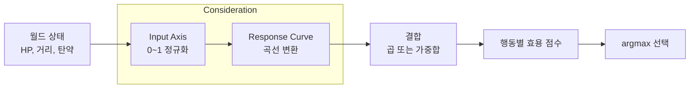
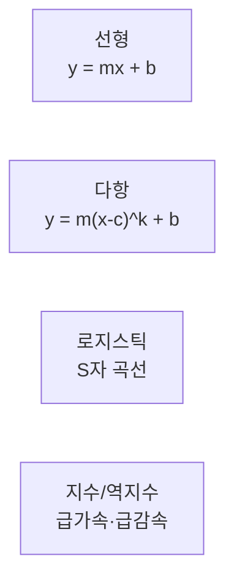
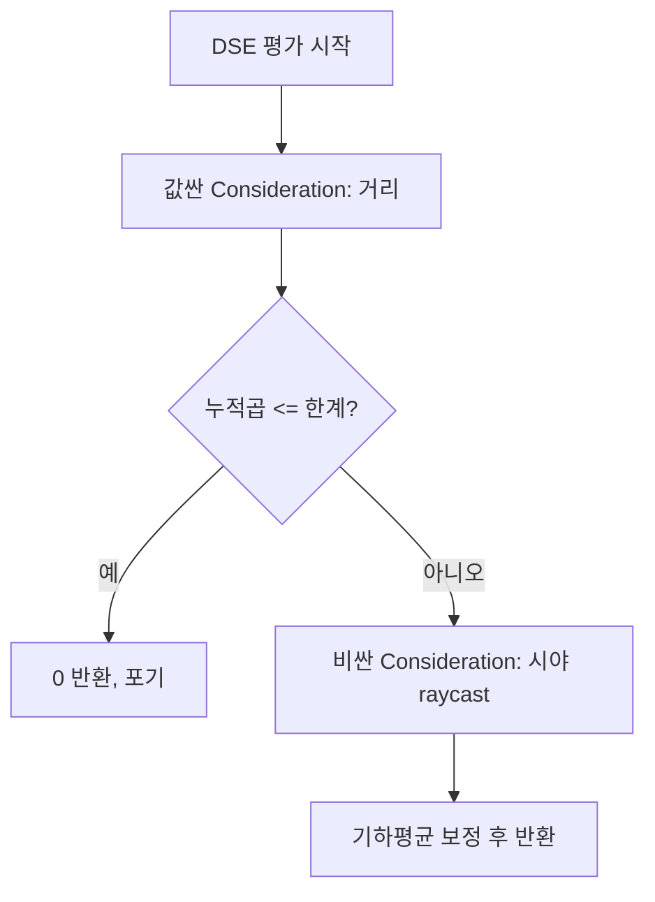
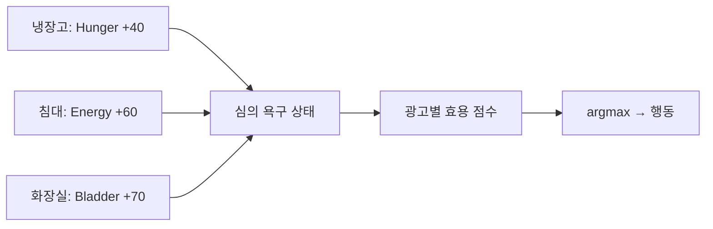
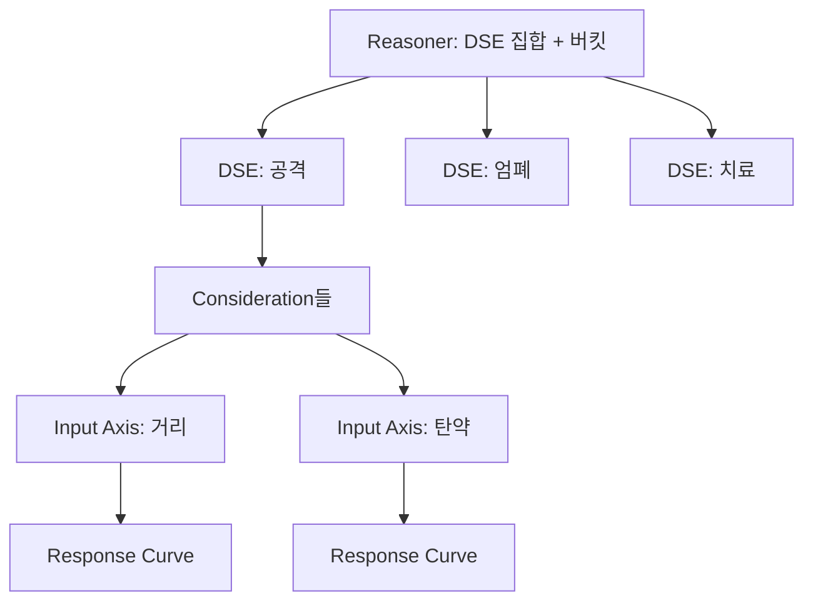
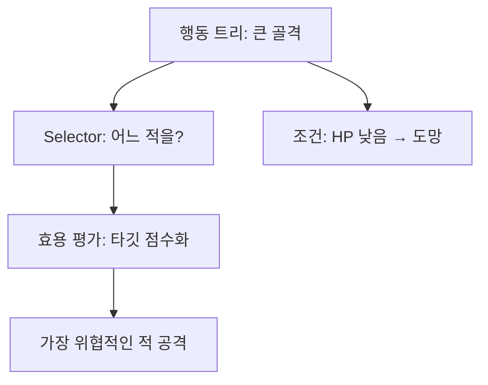

## 들어가며

유한 상태 기계와 행동 트리는 본질적으로 if/else의 변형이다. 조건을 검사하고, 참이면 그 가지로 간다. 결정은 *이산적* 이다 — 조건은 참 아니면 거짓이고, 행동은 선택되거나 안 되거나다. 효용 기반 AI(Utility AI)는 발상을 뒤집는다. 가능한 모든 행동에 *연속적인 점수* 를 매기고, 가장 높은 점수의 행동을 고른다. 의사결정이 "어느 분기로 가는가"에서 "어느 점수가 가장 높은가"로 바뀐다.

이 차이가 표현력의 차이를 만든다. "HP가 낮으면 도망"은 임계값 하나로 켜고 끄는 스위치지만, "HP가 낮을수록 도망의 매력이 부드럽게 올라간다"는 곡선이다. 후자는 HP 30%와 31%에서 갑자기 행동이 바뀌지 않고, 여러 요인(HP·탄약·적의 수·거리)이 *경쟁* 하며 상황에 맞는 행동이 자연스럽게 부상한다. The Sims의 NPC가 배고픔·피로·방광·사교 욕구 사이에서 끊임없이 우선순위를 바꾸는 모습, RimWorld 정착민이 일과 휴식과 식사를 오가는 모습이 이 모델의 산물이다.

이 글은 효용 점수를 *어떻게 설계하고 결합하는가* 에 집중한다. 월드 변수를 0~1로 정규화하는 Input Axis, 그 축 값에 형태를 주는 Response Curve, 둘을 묶은 단위인 Consideration, 여러 Consideration을 하나의 효용으로 합치는 결합 공식, 그리고 이를 데이터로 조직하는 Decision Score Evaluator와 Infinite Axis Utility System을 차례로 다룬다. 곡선의 수치적 거동, 결합 공식의 수학적 함정, 매 틱 수백 개의 점수를 평가하는 비용을 정량화하고, 마지막으로 점수 폭발과 예측 불가능성이라는 효용 AI의 비용과 그것을 길들이는 디버깅 도구를 정리한다.



이 글의 목표.

1. **기본 발상** — 점수화와 argmax 선택, 결정론과 변주의 트레이드오프.
2. **Consideration** — Input Axis의 0~1 정규화와 동적 범위 설계.
3. **Response Curve** — 선형·다항·로지스틱·지수의 수치 거동과 통일 매개변수화.
4. **결합 공식** — 가중합과 곱셈, 단조 감소 함정, 보정 공식의 유도.
5. **Decision Score Evaluator** — 행동+고려요소 묶음, 버킷 필터링, 조기 종료.
6. **The Sims와 RimWorld** — 광고 모델과 우선순위 변형의 실제 수치.
7. **IAUS** — 데이터 주도 효용 프레임워크의 구조와 평가 비용.
8. **효용 AI의 비용** — 폭발, 예측 불가능성, 다단계 계획의 부재.
9. **디버깅과 시각화** — 점수 덤프, 기여도 분해, 곡선 에디터.


---

## 목차
1. [점수 기반 의사결정](#1-점수-기반-의사결정)
2. [Consideration과 정규화](#2-consideration과-정규화)
3. [Response Curve](#3-response-curve)
4. [점수 결합 공식](#4-점수-결합-공식)
5. [Decision Score Evaluator](#5-decision-score-evaluator)
6. [The Sims와 RimWorld](#6-the-sims와-rimworld)
7. [Infinite Axis Utility System](#7-infinite-axis-utility-system)
8. [효용 AI의 비용](#8-효용-ai의-비용)
9. [디버깅과 시각화](#9-디버깅과-시각화)


---

## 1. 점수 기반 의사결정

효용 AI의 골격은 한 줄로 요약된다. *모든 후보 행동의 효용을 계산하고 최댓값을 고른다.* 이 한 줄 안에 효용 AI의 모든 설계 결정이 압축되어 있다.

### argmax 루프

```cpp
const Action* SelectAction(const std::vector<Action>& actions, const Context& ctx) {
    const Action* best = nullptr;
    float bestScore = -1.0f;
    for (const Action& a : actions) {
        float u = a.Score(ctx);           // 0~1 효용
        if (u > bestScore) { bestScore = u; best = &a; }
    }
    return best;
}
```

이 단순함이 강점이다. 새 행동을 추가하려면 점수 함수 하나를 정의해 풀에 넣으면 된다 — FSM처럼 전이를 다시 그리거나 트리 위치를 고민할 필요가 없다. 행동들은 서로를 모른 채 *각자의 매력도만 보고* 경쟁하고, 시스템은 그중 최고를 고른다. 이 점에서 효용 AI는 *개방형(open)* 의사결정 구조다. 의사결정 로직의 복잡도가 행동 수에 선형이고, 행동 사이의 결합도가 0에 가깝다.

대신 두 가지 설계 결정이 모든 것을 좌우한다. *서로 다른 단위의 입력을 어떤 효용 척도로 변환하는가* 와 *여러 요인을 어떤 결합 규칙으로 하나의 점수에 모으는가* 다. 이 두 결정이 잘못되면 NPC가 명백히 어리석은 선택을 한다 — 적이 코앞인데 배고픔 때문에 밥을 먹으러 가는 식으로. 효용 AI의 튜닝은 주로 입력 변환과 결합 규칙, 행동 전환 안정성에 집중된다.

### 정규화와 점수 의미의 보정

argmax가 의도대로 동작하려면 행동 점수의 의미를 같은 의사결정 척도로 보정해야 한다. 한 행동은 0~1000, 다른 행동은 0~1을 반환하면 전자가 수치 범위만으로 이긴다. 그러나 모두 0~1에 넣었다고 의미가 자동으로 같아지는 것도 아니다. 공격 0.7과 도망 0.7이 같은 선호 강도를 뜻하도록 response curve, 가중치와 후보별 score 분포를 함께 calibration해야 한다.

0~1 범위는 결합 결과의 수치 범위를 예측하기 쉽게 한다. 0~1 값끼리 곱하면 결과도 그 범위에 머물지만, 독립성이나 의미적 타당성까지 보장하지는 않는다. 거리·탄약처럼 단위가 다른 관측을 무차원 response로 바꾸고, 실제 gameplay trace에서 행동별 선택률과 경계 사례를 검증해야 공통 척도가 된다.

### argmax의 변형

항상 최고점을 고르면 NPC가 결정론적이고 때로 뻣뻣해 보인다. 같은 입력에는 항상 같은 행동이 나오므로, 플레이어가 패턴을 학습하면 예측당한다. 그래서 세 변형을 쓴다.

| 정책 | 동작 | 효과 |
|---|---|---|
| 순수 argmax | 최고점 1개 | 결정론적, 디버깅 쉬움 |
| 가중 랜덤 | 점수를 확률 가중치로 | 비슷한 점수 사이 변주 |
| 상위 N 랜덤 | 상위 N개 중 무작위 | 명백히 나쁜 행동 배제 + 다양성 |

가중 랜덤은 점수를 정규화해 누적 분포를 만든 뒤 룰렛 휠로 뽑는다.

```cpp
const Action* WeightedRandom(const std::vector<Scored>& scored, float topRatio = 0.85f) {
    float maxS = 0.0f;
    for (auto& s : scored) maxS = std::max(maxS, s.score);
    // 최고점의 topRatio 이상이고 양수인 후보만 추림 — 명백히 나쁜 행동과 0 가중치 배제
    float sum = 0.0f;
    std::vector<const Scored*> pool;
    for (auto& s : scored)
        if (std::isfinite(s.score) && s.score > 0.0f && s.score >= maxS * topRatio) {
            pool.push_back(&s); sum += s.score;
        }
    if (pool.empty()) return nullptr;             // 선택 가능한 후보 없음
    if (!std::isfinite(sum) || sum <= 0.0f)       // 양수 유한 총합이 없으면 명시적 fallback
        return pool.front()->action;
    float r = RandFloat() * sum;                  // [0, sum)
    for (auto* s : pool) { r -= s->score; if (r <= 0.0f) return s->action; }
    return pool.back()->action;
}
```

`topRatio` 컷오프가 중요하다. 컷오프 없이 전체에서 가중 랜덤을 하면, 점수 0.05짜리 어리석은 행동도 작은 확률로 선택되어 NPC가 가끔 바보처럼 군다. The Sims가 가중 랜덤을 써서 같은 상황에서도 심(Sim)마다 조금씩 다른 선택을 하게 만들되, 컷오프로 "방광이 터지기 직전인데 TV를 보는" 사태는 막는다. 가중치가 0 이하이거나 비유한 점수는 풀에서 제외하고, 살아남은 양수 총합이 없으면 첫 후보를 의도적 fallback으로 반환한다.

### 확률적 선택의 형식화 — 볼츠만 분포와 온도

위 가중 랜덤은 점수를 *그대로* 확률 가중치로 쓴다 — 비례(proportional) 선택, 곧 룰렛 휠이다. 간단하지만 두 약점이 있다. 첫째, *척도에 휘둘린다*. 점수에 상수를 곱하면 확률이 그대로지만(비율 보존), 점수에 상수를 더하면 분포가 달라진다 — 0.7/0.65/0.2가 0.45/0.42/0.13인데, 같은 간격의 1.2/1.15/0.7은 0.39/0.38/0.23으로 평탄해진다. 둘째, *탐험의 날카로움을 조절할 손잡이가 없다*. "거의 결정론적"과 "거의 무작위" 사이를 연속적으로 오갈 방법이 비례 선택에는 없다.

볼츠만(Boltzmann, softmax) 분포가 이 둘을 동시에 푼다. 효용 $u_i$를 가진 행동을 다음 확률로 고른다.

$$P(a_i) = \frac{\exp(u_i/\tau)}{\sum_j \exp(u_j/\tau)}$$

$\tau > 0$는 *온도(temperature)* 다. 온도의 두 극한이 효용 AI의 두 끝을 잇는다. 분자·분모를 $\exp(u_{\max}/\tau)$로 나누면

$$P(a_i) = \frac{\exp\big((u_i - u_{\max})/\tau\big)}{\sum_j \exp\big((u_j - u_{\max})/\tau\big)}$$

이고, 최대가 아닌 $i$는 지수가 음수라 $\tau \to 0^+$에서 0으로 죽고 최댓값 항만 1로 남는다 — *순수 argmax*. 반대로 $\tau \to \infty$면 모든 $u_j/\tau \to 0$, $\exp \to 1$이라 *균등 분포* $1/n$. 즉 온도 하나가 결정론(탐욕)에서 완전 무작위(탐험)까지를 연속으로 잇는다. 비례 선택은 이 스펙트럼의 한 점도 정확히 짚지 못한다.

볼츠만은 효용의 *절대값이 아니라 차이* 만 본다. 모든 $u_j$에 상수 $c$를 더해도 $\exp(c/\tau)$가 분자·분모에서 약분되어 분포가 불변이다(시프트 불변). 이것이 비례 선택의 척도 의존(상수 곱 불변·상수 합 가변)과 정반대이고, 가중치 때문에 0~1 범위를 벗어나거나 음수가 된 효용도 받을 수 있다. 두 행동의 선택 오즈는 오직 효용 차로 정해진다.

$$\frac{P(a_i)}{P(a_j)} = \exp\!\Big(\frac{u_i - u_j}{\tau}\Big)$$

고정된 효용 간격 $\Delta u$가 선택 오즈로 어떻게 환산되는지가 온도의 의미다. 간격 0.05는 $\tau{=}1$에서 오즈 $e^{0.05} \approx 1.05$(거의 동전 던지기), $\tau{=}0.1$에서 $\approx 1.65$, $\tau{=}0.01$에서 $\approx 148$(사실상 결정론). 표가 같은 세 효용에 온도가 주는 분포를 보여준다.

| 정책 | $u=0.7$ | $u=0.65$ | $u=0.2$ |
|---|---:|---:|---:|
| 비례(룰렛) | 0.452 | 0.419 | 0.129 |
| softmax $\tau=0.1$ | 0.620 | 0.376 | 0.004 |
| softmax $\tau=0.5$ | 0.440 | 0.398 | 0.162 |
| softmax $\tau=1$ | 0.391 | 0.372 | 0.237 |
| softmax $\tau\to0$ | 1.000 | 0.000 | 0.000 |
| softmax $\tau\to\infty$ | 0.333 | 0.333 | 0.333 |

구현에서 하나의 함정이 오버플로다. 단정밀도 `float`의 $\exp$는 인자가 약 88을 넘으면 무한대다. 가중 DSE 효용이 2까지 가고 $\tau{=}0.01$이면 $\exp(2/0.01) = \exp(200)$이 inf가 되어 분모가 $\text{inf}/\text{inf} = \text{NaN}$으로 무너진다. 해법은 위 극한 유도에서 쓴 것과 같다 — 지수를 취하기 전에 최대 효용을 빼면(시프트 불변이라 분포는 그대로) 가장 큰 지수가 0이 되어 오버플로가 사라진다(log-sum-exp 안정화).

```cpp
const Action* BoltzmannSelect(const std::vector<Scored>& scored, float tau) {
    if (scored.empty()) return nullptr;
    if (tau <= 1e-6f) {                          // τ→0: argmax 분기 (0 나눗셈 회피)
        const Scored* best = &scored[0];
        for (auto& s : scored) if (s.score > best->score) best = &s;
        return best->action;
    }
    float maxU = -std::numeric_limits<float>::infinity();
    for (auto& s : scored) maxU = std::max(maxU, s.score);
    std::vector<float> w(scored.size());
    float sum = 0.0f;
    for (size_t i = 0; i < scored.size(); ++i) {
        w[i] = std::exp((scored[i].score - maxU) / tau);  // 최댓값 차감으로 오버플로 방지
        sum += w[i];
    }
    float r = RandFloat() * sum;                          // [0, sum)
    for (size_t i = 0; i < scored.size(); ++i) { r -= w[i]; if (r <= 0.0f) return scored[i].action; }
    return scored.back().action;
}
```

경계 조건 셋. (1) $\tau$를 정확히 0으로 두면 $u/\tau$가 0 나눗셈이라 위 코드처럼 작은 양수 임계에서 argmax로 분기해야 한다. (2) 볼츠만은 음수·0 효용도 받지만(시프트 불변), 그래서 효용 0인 행동도 *0이 아닌 확률* 을 갖는다 — 곱셈 결합이 "탄약 0 → 거부"로 만든 효용 0이 softmax에서는 작게나마 되살아난다. 명백히 나쁜 행동을 확실히 배제하려면 비례 선택의 `topRatio`처럼 후보를 먼저 거르거나, 그 행동을 풀에서 빼야 한다. (3) 같은 $\tau$라도 효용이 한곳에 뭉친 분포와 넓게 퍼진 분포에서 체감 무작위성이 다르므로(오즈가 효용 차에만 의존), 분포 폭에 맞춰 $\tau$를 적응시키기도 한다. 이 온도 손잡이는 강화학습의 볼츠만 탐험과 정확히 같은 장치다 — 효용을 행동가치로 바꾸면 같은 식이 $\epsilon$-greedy의 부드러운 대안이 된다.

## 2. Consideration과 정규화

한 행동의 효용은 보통 단일 변수가 아니라 *여러 고려요소(Consideration)* 에서 나온다. "공격한다"의 매력은 적과의 거리, 내 탄약, 내 HP 등에 동시에 의존한다. 각 Consideration은 하나의 월드 변수를 *0~1 구간으로 정규화* 한 축(Input Axis)과, 그 축 값에 형태를 주는 Response Curve의 짝이다. 이 절은 그중 정규화만 본다. Response Curve 는 3절의 주제다.

### 선형 정규화와 반전

정규화의 첫 단계는 입력을 의미 있는 범위로 매핑하는 것이다.

```cpp
float Normalize(float raw, float minV, float maxV) {
    if (!(maxV > minV)) return 0.0f;  // 잘못된 범위는 호출 계약 위반
    return std::clamp((raw - minV) / (maxV - minV), 0.0f, 1.0f);
}
```

예를 들어 "적과의 거리"가 0~50m 범위라면, 거리 10m는 0.2로 정규화된다. 하지만 이 선형 정규화 값을 그대로 효용으로 쓰면 부자연스럽다. "가까울수록 공격이 매력적"이라면 거리가 *반전* 되어야 한다(가까울수록 1). 반전은 정규화를 유효 구간 `minV < maxV`로 유지한 뒤 `1 - Normalize(raw, minV, maxV)`로 처리한다. `Normalize`의 계약이 `maxV > minV`를 요구하므로 `minV`와 `maxV`를 뒤집어 매핑하면 안 된다. 사정거리 안쪽에서는 거리 차가 거의 무의미하고 바깥에서 급격히 매력이 떨어지는 것처럼 비선형 관계가 필요하면 Response Curve로 정규화된 입력을 다시 변환한다.

### 동적 범위 설계가 첫 번째 튜닝이다

정규화에서 흔한 실수는 입력 범위를 잘못 잡는 것이다. 거리 최댓값을 5m로 잡으면 6m 밖의 모든 적이 똑같이 1(포화)이 되어 구분이 사라진다. 반대로 최댓값을 500m로 잡으면 실제 교전이 일어나는 0~30m가 전부 0~0.06 구간에 뭉개져, 곡선의 거의 전 구간이 쓰이지 않는다.

원칙은 *입력의 의미 있는 동적 범위를 곡선이 충분히 활용하도록* 범위를 정하는 것이다. "의미 있는 범위"란 *그 변화가 의사결정을 바꿀 수 있는* 구간이다. 다음 표는 같은 거리 변수를 세 범위로 잡았을 때 정규화 값이 어떻게 달라지는지 보여준다.

| 실제 거리 | 범위 0~5m | 범위 0~50m | 범위 0~500m |
|---:|---:|---:|---:|
| 2m | 0.40 | 0.04 | 0.004 |
| 10m | 1.00 (포화) | 0.20 | 0.02 |
| 30m | 1.00 (포화) | 0.60 | 0.06 |
| 100m | 1.00 (포화) | 1.00 (포화) | 0.20 |

0~5m는 10m 이후가 전부 포화되어 원거리 구분이 사라지고, 0~500m는 근접 교전 구간이 전부 0 근처로 뭉개진다. 0~50m가 교전 거리의 변화를 곡선에 고르게 분배한다. 이 범위 선택이 곡선 형태보다 먼저 와야 하는 *기초 튜닝* 이다.

### Consideration은 순수 함수여야 한다

Consideration의 평가는 *부작용이 없어야* 한다. 같은 컨텍스트에 대해 항상 같은 값을 내고, 월드를 바꾸지 않아야 한다. 한 틱에 같은 Consideration이 여러 DSE에서 중복 평가될 수 있어 결과를 캐싱하려면 순수해야 하며, 점수를 기록하는 진단 평가가 상태를 바꾸면 관측이 대상을 교란한다. Consideration은 월드를 *읽기* 만 하고 정해진 효용 척도의 값을 돌려주는 읽기 전용 센서다.

## 3. Response Curve

Response Curve는 정규화된 입력 $x \in [0,1]$를 출력 효용 $y \in [0,1]$로 변환하는 함수다. 곡선의 형태가 "이 요인이 효용에 어떻게 기여하는가"를 결정한다. Dave Mark는 대부분의 유용한 곡선이 네 종류와 그 매개변수로 표현된다고 정리했다.



### 선형

$y = mx + b$. 가장 단순하다. "거리가 멀수록 비례해서 덜 매력적"처럼 균등한 변화에 쓴다. 기울기 $m$이 음수면 반전(감소) 곡선이 된다. 선형은 직관적이지만 한계가 분명하다 — 임계 부근에서 부드럽게 전환하거나 양 끝에서 포화시키는 거동을 표현하지 못한다.

### 다항 (Polynomial)

$y = m(x - c)^k + b$. 지수 $k$로 곡률을 조절한다. $k > 1$이면 작은 $x$에서 완만하다 큰 $x$에서 급해지고(아래로 볼록), $0 < k < 1$이면 반대다. "HP가 어느 정도 떨어지기 전엔 무덤덤하다가 위급해지면 급격히 도망 욕구가 솟는다"는 $k > 1$ 곡선이다. 다음 표가 $k$에 따른 거동 차이를 보여준다($m=1, c=0, b=0$).

| $x$ | $k=0.5$ | $k=1$ | $k=2$ | $k=4$ |
|---:|---:|---:|---:|---:|
| 0.25 | 0.50 | 0.25 | 0.06 | 0.004 |
| 0.50 | 0.71 | 0.50 | 0.25 | 0.063 |
| 0.75 | 0.87 | 0.75 | 0.56 | 0.316 |
| 1.00 | 1.00 | 1.00 | 1.00 | 1.000 |

$k=4$ 곡선은 $x=0.75$까지도 0.32에 머물다 끝에서 급등한다 — "위급해지기 전엔 거의 반응 안 함"의 수치적 모습이다.

```cpp
float Polynomial(float x, float m, float k, float c, float b) {
    return std::clamp(m * std::pow(x - c, k) + b, 0.0f, 1.0f);
}
```

`std::pow`에서 $x-c$가 음수이고 $k$가 정수가 아니면 결과는 실수 범위에서 정의되지 않아 NaN이 될 수 있다. 해결은 곡선의 의도에 달렸다. one-sided 곡선이면 아래 코드처럼 밑을 0으로 클램프하고, 부호 있는 정수 지수 곡선이면 `k`를 정수로 제한하며, 대칭 곡선이면 설계상 명시적으로 `abs(x-c)`를 쓴다. 단순히 절댓값을 취하면 감소 구간이 대칭 증가 구간으로 바뀌므로 NaN 회피용 일반 해법이 아니다. 로드 시 매개변수 도메인을 검증하고 런타임에는 `std::isfinite` 단언을 둔다.

### 로지스틱 (S자)

$$y = \frac{1}{1 + e^{-s(x - m)}}$$

중간값 $m$ 근처에서 급격히 전환되고 양 끝에서 포화된다. "임계 거리 부근에서 빠르게 매력이 바뀌되, 아주 멀거나 아주 가까운 구간에선 둔감"한 행동에 적합하다. 기울기 $s$가 전환의 날카로움을, $m$이 전환점을 정한다. $s \to \infty$면 $m$에서의 계단 함수(이산 임계값)에 수렴하고, $s \to 0$이면 상수 0.5에 가까워진다. 그래서 로지스틱은 사실상 *부드러운 임계값* 이며, FSM의 이산 조건과 연속 효용 사이의 다리다.

순수 로지스틱은 $x=0$에서 $y$가 정확히 0이 아니고, $x=1$에서 정확히 1이 아니다(꼬리가 0과 1에 점근만 한다). 효용을 깔끔하게 0~1로 쓰려면 양 끝값으로 재정규화한다.

```cpp
float Logistic(float x, float s, float m) {
    auto sig = [&](float t){ return 1.0f / (1.0f + std::exp(-s * (t - m))); };
    float lo = sig(0.0f), hi = sig(1.0f);
    return std::clamp((sig(x) - lo) / (hi - lo), 0.0f, 1.0f);   // [0,1] 재정규화
}
```

`std::exp`의 인자가 크게 양수, 즉 $x-m$이 크게 음수일 때 오버플로 위험이 있다. 예를 들어 $s=200, x=0, m=0.5$면 지수 인자가 +100이라 단정밀도 `exp` 범위를 넘는다. 게임에서 쓰는 $s$는 보통 1~20 범위라 문제가 적지만, 극단적 값을 허용하는 에디터라면 지수 인자를 클램프한다.

### 지수 / 역지수

$y = x^k$에서 $k$를 크게 하면 지수에 가까운 급가속, 작게 하면 급감속이다. "위협이 임계를 넘는 순간 폭발적으로 중요해진다"는 류의 비선형 강조에 쓴다. 이는 다항의 특수형($m=1, c=0, b=0$)이지만, 디자이너 도구에서는 별도 프리셋으로 노출해 "급가속/급감속"이라는 의도를 직접 고르게 하는 편이 다루기 쉽다.

### 통일 매개변수화와 데이터 표현

선형은 다항식의 $k=1$인 경우이고, 지수/역지수 프리셋도 Polynomial의 매개변수 조합으로 표현할 수 있다. 로지스틱만 별도 공식을 사용한다. 디자이너 도구는 의도에 맞는 프리셋을 보여 주되 런타임 데이터는 세 공식으로 정규화할 수 있다.

```cpp
enum class CurveType { Linear, Polynomial, Logistic };

struct ResponseCurve {
    CurveType type = CurveType::Linear;
    float m = 1.0f, k = 1.0f, c = 0.0f, b = 0.0f;   // 공통 4 매개변수

    float Eval(float x) const {
        switch (type) {
        case CurveType::Linear:     return std::clamp(m * (x - c) + b, 0.0f, 1.0f);
        case CurveType::Polynomial: {
            float base = std::max(0.0f, x - c);      // 음수 밑 NaN 방지
            return std::clamp(m * std::pow(base, k) + b, 0.0f, 1.0f);
        }
        case CurveType::Logistic:   return Logistic(x, m, c);   // s=m, m_center=c
        }
        return x;
    }
};
```

효용 AI 튜닝의 상당 부분이 *이 곡선을 눈으로 보며 슬라이더를 조정* 하는 작업이다. 곡선이 데이터이므로, 런타임 코드 한 줄 바꾸지 않고 NPC의 "성격"을 조정할 수 있다 — 겁이 많은 NPC는 도망 곡선의 전환점 $m$을 높은 HP 쪽으로 옮기고, 용감한 NPC는 낮은 쪽으로 옮긴다.

## 4. 점수 결합 공식

한 행동의 여러 Consideration을 하나의 효용으로 합쳐야 한다. 두 가지 방식이 대립하며, 이 선택이 효용 AI의 *논리적 정확성* 을 좌우한다.

### 가중합 (weighted sum)

$$U = \frac{\sum_i w_i c_i}{\sum_i w_i}$$

직관적이고 익숙하지만 게임 AI에선 위험하다. 한 요인이 0이어도 다른 요인들이 높으면 전체 점수가 살아남기 때문이다. 구체적 예로 "공격" 행동이 거리 $c=0.9$, HP $c=0.8$, 탄약 $c=0.0$의 세 Consideration을 가중 1로 합치면,

$$U = \frac{0.9 + 0.8 + 0.0}{3} = 0.567$$

탄약이 0인데도 효용 0.567이 나와, 다른 행동을 누르고 선택될 수 있다. "탄약 없이 공격"이라는 비논리다. 가중합은 *보완재* 관계(한 요인의 부족을 다른 요인이 메움)를 표현하지, *필수 조건* 을 표현하지 못한다.

### 곱셈 결합 (multiplicative)

$$U = \prod_i c_i$$

필수 조건을 연속적으로 표현할 때 자주 쓰는 결합이다. 같은 입력에 적용하면,

$$U = 0.9 \times 0.8 \times 0.0 = 0.0$$

한 Consideration이 0이면 행동 전체의 점수가 0이 된다. 다만 softmax처럼 0점 후보도 선택할 수 있는 정책에서는 이것만으로 절대 거부가 되지 않는다. 탄약·도달 가능성처럼 진짜 불가능 조건은 후보 생성 단계의 precondition/filter로 제거하고, 곱셈은 살아 있는 후보 안에서 상호 보상시키지 않을 선호를 표현하는 데 쓴다.

### 단조 감소 함정

곱셈의 문제는 *단조 감소* 다. 모든 $c_i < 1$이므로, Consideration이 늘수록 곱이 계속 작아져, 고려요소가 많은 행동이 부당하게 불리해진다. 모든 요소가 0.8일 때 요소 수에 따른 곱을 보자.

| 요소 수 $n$ | 곱 $0.8^n$ | 기하평균 $0.8^{n \cdot 1/n}$ |
|---:|---:|---:|
| 1 | 0.800 | 0.800 |
| 2 | 0.640 | 0.800 |
| 3 | 0.512 | 0.800 |
| 5 | 0.328 | 0.800 |
| 8 | 0.168 | 0.800 |

요소가 8개인 행동은 각 요소가 0.8로 "꽤 좋은데도" 곱이 0.168로 주저앉아, 요소 2개짜리 0.64 행동에 진다. 행동의 매력이 *기술된 고려요소 개수* 라는 무관한 변수에 휘둘리는 것이다.

### 보정 공식의 유도

고려요소 개수에 따른 스케일 감소를 줄이는 한 방법은 기하평균이다.

$$U = \left(\prod_i c_i\right)^{1/n}$$

$n$제곱근을 취하면 모든 요소가 같은 값일 때 결과가 요소 수와 무관해진다. 0 하나가 전체를 0으로 만드는 성질도 남는다. 그러나 AND 의미가 완전히 보존되는 것은 아니다. 하나가 0.1이고 나머지 아홉 개가 1이면 단순 곱은 0.1이지만 기하평균은 $0.1^{1/10}\approx0.794$다. 요소 수가 많을수록 단일한 낮은 비영점 값의 거부력이 희석된다. 따라서 기하평균은 *개수 보정* 이고, 하드 게이트나 필수 조건의 대체물이 아니다.

Dave Mark가 제안한 또 다른 보정은 "make-up value"로, 요소 수가 곱을 낮추는 만큼을 곱에 가산해 끌어올린다.

$$U = p + \left(1 - \frac{1}{n}\right)(1 - p)\,p, \quad p = \prod_i c_i$$

요소가 1개면 $1 - 1/n = 0$이라 보정이 없고, 요소가 많아질수록 보정이 커진다. 기하평균보다 0 근처에서 부드럽다는 성질이 있어, 어느 쪽을 쓸지는 점수 분포를 보고 정한다. 어느 보정이든 raw 곱 $p$에만 적용하고 DSE 가중치(`baseWeight`)는 보정 뒤에 곱한다 — 가중치를 먼저 곱하면 보정 입력이 [0,1]을 벗어난다. 다음은 기하평균 보정 구현이다.

```cpp
float CombineMultiplicative(const std::vector<float>& cons) {
    if (cons.empty()) return 1.0f;           // 곱의 항등원; 빈 행동 금지는 별도 검증
    float product = 1.0f;
    for (float c : cons) {
        if (c <= 0.0f) return 0.0f;          // 한 요소라도 0이면 즉시 거부
        product *= c;
    }
    // 동일한 분포의 요소 수가 점수 스케일을 낮추는 효과 완화
    return std::pow(product, 1.0f / static_cast<float>(cons.size()));
}
```

`c <= 0.0f`에서 즉시 0을 반환하는 것은 결합 규칙의 흡수원 성질을 이용한 조기 종료다. `pow(0, 1/n)` 같은 경계 계산을 피하고 남은 곱셈도 건너뛸 수 있다.

## 5. Decision Score Evaluator

이제 행동과 그 고려요소들을 하나의 단위로 묶는다. 이 묶음을 Decision Score Evaluator(DSE) 또는 단순히 "효용 행동"이라 부른다.

```cpp
struct Consideration {
    std::function<float(const Context&)> input;   // 월드 변수 → raw (정규화된 0~1)
    ResponseCurve                         curve;   // raw → 0~1
    float Eval(const Context& ctx) const { return curve.Eval(input(ctx)); }
};

struct DSE {
    std::string                action;
    std::vector<Consideration> considerations;
    float                      weight = 1.0f;      // DSE 간 상대 우선순위
    int                        bucket = 0;         // 우선순위 버킷

    float Score(const Context& ctx) const {
        std::vector<float> vals;
        vals.reserve(considerations.size());
        for (const auto& c : considerations) vals.push_back(c.Eval(ctx));
        // 순서 고정: raw product → 보정(입력 [0,1]) → baseWeight
        const float compensated = CombineMultiplicative(vals);
        return weight * compensated;
    }
};
```

`weight`는 DSE 사이의 *전역 우선순위* 를 준다. 두 DSE의 내부 곱이 같아도, "생존" 행동의 가중치를 1.5로, "탐색" 행동을 0.5로 두면 동점 상황에서 생존이 이긴다. 이 가중치는 0~1 정규화를 깨뜨리지만(가중치 1.5면 점수가 1을 넘을 수 있음), argmax 비교는 상대 크기만 보므로 문제없다 — 단, 가중 랜덤(1절)을 쓴다면 가중치가 확률에 직접 영향을 주므로 의도를 점검해야 한다. 보정은 baseWeight를 곱하기 전 raw product에 적용하므로 보정 함수의 입력은 항상 [0,1]을 유지한다.

### 평가 비용의 정량화

매 틱 모든 DSE를 평가하고 최고점을 실행하는 것이 기본 루프다. 문제는 비용이다. 비용은 다음 곱으로 추산된다.

$$\text{비용} = N_{\text{agent}} \times N_{\text{DSE}} \times N_{\text{cons}} \times f_{\text{tick}}$$

NPC 100마리, DSE 20개, 각 DSE의 Consideration 5개, 60fps면 매 초 $100 \times 20 \times 5 \times 60 = 600{,}000$번의 Consideration 평가다. 실제 비용은 consideration별로 다르다. 캐시된 산술과 raycast·경로 질의를 같은 "한 번"으로 세면 예산을 예측할 수 없으므로, 평가 횟수와 함께 종류별 평균·p95 시간, 캐시 적중률을 기록한다. 버킷과 조기 종료는 이 작업량을 줄이는 두 선택지다.

### 버킷과 계층적 필터링

*버킷(bucket) 분류* 는 DSE를 우선순위 그룹으로 묶는다. "긴급(생존)" 버킷의 어떤 DSE가 충분히 높은 점수를 내면, 낮은 버킷("한가할 때 할 일")은 아예 평가하지 않는다. 생사가 걸린 결정 앞에서 "심심풀이" 후보의 점수를 계산하는 것은 낭비이기 때문이다.

```cpp
const DSE* SelectBucketed(const std::vector<DSE>& dses, const Context& ctx) {
    // DSE는 bucket 오름차순(긴급 우선)으로 정렬되어 있다고 가정
    const DSE* best = nullptr; float bestScore = 0.0f; int curBucket = -1;
    for (const DSE& d : dses) {
        // 더 높은 우선순위 버킷에서 이미 확실한 승자가 났으면 하위 버킷은 건너뜀
        if (d.bucket != curBucket && bestScore >= kBucketCutoff) break;
        curBucket = d.bucket;
        float s = d.Score(ctx);
        if (s > bestScore) { bestScore = s; best = &d; }
    }
    return best;
}
```

`kBucketCutoff`(예: 0.75)는 "이 점수면 더 낮은 버킷은 볼 필요 없다"는 임계다. The Sims와 IAUS가 쓰는 계층적 필터가 이 형태다. 버킷은 곱셈 결합의 단조 감소를 *전역* 차원에서 보완하기도 한다 — 긴급 행동이 컷오프를 넘기면 자기 버킷 안에서만 경쟁하므로, 고려요소가 적어 점수가 높게 나오는 한가한 행동에 밀리지 않는다(컷오프 미달이면 하위 버킷과 전역 argmax로 경쟁한다).

### 조기 종료 (early-out)

곱셈 결합은 누적 곱이 *현재 최고점 이하로 떨어지는 순간* 그 DSE를 포기할 수 있다. 남은 Consideration을 평가해 봐야 곱은 더 작아질 뿐이기 때문이다(모든 값이 1 이하). 비싼 Consideration을 뒤쪽에 배치하면 값싼 것에서 먼저 걸러져 비싼 계산을 건너뛴다.

```cpp
float DSE::ScoreWithCutoff(const Context& ctx, float bestSoFar) const {
    if (considerations.empty())
        return weight; // 빈 곱의 기하평균은 1; 허용 여부는 로드 검증에서 결정
    if (!(weight > 0.0f))
        return 0.0f;   // 이 구현은 양의 가중치만 지원
    if (bestSoFar >= weight)
        return 0.0f;   // 내부 기하평균의 최대가 1이므로 이길 수 없음

    float product = 1.0f;
    const float n = static_cast<float>(considerations.size());
    const float ratio = std::max(bestSoFar, 0.0f) / weight;
    const float bound = std::pow(ratio, n);
    for (const auto& c : considerations) {
        product *= c.Eval(ctx);
        if (product <= bound) return 0.0f;   // 이미 최고점 못 넘음 → 포기
    }
    return weight * std::pow(product, 1.0f / n);
}
```

조기 종료 한계(`bound`)는 "최종 효용 $w \cdot p^{1/n}$이 `bestSoFar`를 넘으려면 $p > (\text{bestSoFar}/w)^n$"을 푼 결과다. 모든 consideration 출력이 $[0,1]$일 때만 남은 곱이 현재 곱보다 커지지 않는다는 상한이 성립한다. 항이 많으면 곱과 `bound`가 underflow할 수 있으므로 로그 합 $\sum\log c_i$와 로그 한계를 비교하는 구현이 더 안정적이다.

평가 순서를 단순 비용 오름차순으로 고정하는 것도 최적이라고 보장할 수 없다. 약간 비싸더라도 거의 항상 낮은 값을 내어 조기에 탈락시키는 consideration을 먼저 보는 편이 유리할 수 있다. 각 항의 비용과 cutoff 유발 확률을 trace에서 측정해 실행 순서를 정하고, 순서를 바꿔도 부작용이 없도록 consideration을 순수 함수로 유지한다.



조기 종료는 정렬과 결합되어야 효과가 크다. 비싼 것이 앞에 있으면 이미 평가한 뒤라 절약이 없다.

## 6. The Sims와 RimWorld

### The Sims — 광고 모델

The Sims의 효용 시스템은 한 가지 발상으로 유명하다. *NPC가 행동을 찾는 게 아니라, 객체가 행동을 광고한다.* 냉장고는 "나를 쓰면 배고픔(Hunger)을 +40 채워준다"고 광고하고, 침대는 "에너지(Energy)를 +60", 샤워는 "위생(Hygiene)을 +50"을 광고한다. 심은 자신의 현재 욕구 부족분에 각 광고가 얼마나 기여하는지를 효용으로 환산해 가장 높은 것을 고른다.



핵심은 광고된 효용이 *현재 욕구 수준에 따라 달라진다* 는 점이다. 배고픔이 거의 가득 찬 심에게 냉장고의 "+40"은 거의 가치가 없고, 굶주린 심에게는 결정적이다. 이 관계는 욕구의 현재값에 적용된 Response Curve로 표현된다 — 욕구가 낮을수록(부족할수록) 그것을 채우는 광고의 효용이 가파르게 오른다. 다음은 욕구 한 종에 대한 광고 효용 계산이다.

```cpp
// 광고가 채워주는 욕구의 현재 부족분에 곡선을 적용한다
float AdvertisedScore(const Advertisement& ad, const Sim& sim) {
    const Need& need = sim.needs[ad.needType];
    float before = need.value;                    // 현재 욕구값 (낮을수록 부족)
    float after  = std::min(before + ad.amount, need.max);
    // 부족할 때 채우는 가치가 크도록: 곡선의 before~after 구간 면적 차
    return NeedCurve(before) - NeedCurve(after);   // NeedCurve는 감소 곡선
}
```

`NeedCurve`가 가파른 감소 곡선이면, 욕구가 바닥일 때 같은 +40이 훨씬 큰 효용 차를 만든다. 이것이 "배고픔이 위급할 때 밥 먹기가 다른 모든 것을 압도하는" 거동을 자연스럽게 만든다.

이 모델의 우아함은 *확장성* 이다. 새 객체(예: 게임기)를 월드에 추가하면 그것이 스스로 "재미(Fun) +50"을 광고하고, 심의 의사결정 코드는 한 줄도 바뀌지 않는다. 욕구는 시간에 따라 감소(decay)하므로, 채워진 욕구는 점차 다시 부족해지고 우선순위가 동적으로 순환한다. 욕구의 부족분과 광고 효용의 상호작용이 심의 "자율적으로 살아가는" 인상을 만든다. 광고 모델은 행동 후보와 효용 데이터를 상호작용 객체 쪽에 분산하는 구조다.

### RimWorld — 우선순위 변형

RimWorld의 정착민은 다른 절충을 택한다. 작업 유형(요리·건설·채굴·간호 등)에 플레이어가 1~4의 우선순위를 부여하고, ThinkTree가 우선순위 순으로 작업 후보를 순회하며 *수행 가능한 첫 작업* 을 잡는다.

```cpp
// 우선순위 순회 — 점수 곡선 대신 이산 우선순위 + 가능성 검사
Job* PickJob(Pawn& pawn) {
    for (int prio = 1; prio <= 4; ++prio) {                 // 1이 최우선
        for (WorkType& w : pawn.workTypesAtPriority(prio)) {
            if (Job* j = w.TryGiveJob(pawn))                 // 수행 가능한 첫 작업
                return j;                                    // 즉시 채택
        }
    }
    return IdleJob(pawn);
}
```

이는 순수 효용보다 단순한 — 점수 곡선 대신 이산 우선순위 + 가능성 검사 — 변형이지만, 가능한 행동들을 후보로 두고 선호 순으로 고른다는 철학을 공유한다. 효용 AI와 우선순위 리스트 사이의 스펙트럼에서, RimWorld는 우선순위 쪽에, IAUS는 연속 점수 쪽에 가깝다. 둘의 차이는 *경쟁의 해상도* 다. 우선순위는 동률을 순회 순서로 깨고, 효용은 연속 점수로 미세한 차이까지 반영한다. 우선순위는 선택 경로가 짧아 추적하기 쉽고, 효용은 각 후보의 입력·곡선·최종 점수를 함께 남겨야 원인을 설명할 수 있다.

## 7. Infinite Axis Utility System

Dave Mark의 Infinite Axis Utility System(IAUS)은 효용 AI를 *데이터 주도 프레임워크* 로 정식화한 대표적 접근이다. 2~5절의 조각들(Consideration, Response Curve, 곱셈 결합, DSE)을 하나의 일관된 데이터 구조로 묶고, 그 위에 평가·선택 정책을 올린다.



### 네 계층

- *Input Axis*: 정규화된 하나의 월드 변수. "무한 축"이라는 이름은 임의 개수의 축(요인)을 자유롭게 조합한다는 뜻이다. 각 축은 월드를 읽어 0~1을 내는 순수 센서이며, 2절의 정규화가 이 계층이다.
- *Consideration*: Input Axis + Response Curve. 축 값을 곡선으로 효용 기여로 변환한다. 2절에서 정의하고 3절에서 곡선을 붙인 그 단위다.
- *DSE*: action + Consideration들 + 가중치 + 버킷. 5절의 구조와 같다.
- *Reasoner*: DSE 집합 + 버킷 정책 + 선택 정책(argmax / 가중랜덤 / 상위 N).

IAUS의 핵심 가치는 *이 모든 것이 코드가 아니라 데이터* 라는 점이다. 디자이너는 DSE를 추가하고, 축을 고르고, 곡선을 그래픽으로 조정한다. 프로그래머는 Input Axis를 채우는 센서와 action을 실행하는 코드만 제공한다. 새 행동의 추가·튜닝·삭제가 코드 빌드 없이 이뤄진다.

### 데이터 표현과 타깃 루프

IAUS가 단순 DSE 목록과 다른 결정적 지점은 *타깃(target)에 대한 평가* 다. "공격" DSE는 추상적 행동이 아니라 "*어느 적* 을 공격할지"까지 정해야 한다. 그래서 DSE 평가는 행동 × 타깃의 이중 루프가 된다.

```cpp
struct Decision { const DSE* dse; const Entity* target; float score; };

Decision EvaluateReasoner(const Reasoner& r, const Context& ctx) {
    Decision best{nullptr, nullptr, 0.0f};
    for (const DSE& d : r.dses) {
        for (const Entity* tgt : ctx.CandidateTargets(d)) {   // 타깃마다 점수
            Context tctx = ctx.WithTarget(tgt);               // 축 입력이 타깃에 의존
            float s = d.ScoreWithCutoff(tctx, best.score);    // 조기 종료
            if (s > best.score) best = {&d, tgt, s};
        }
    }
    return best;                                              // 행동 + 타깃 동시 결정
}
```

이 이중 루프가 평가 비용을 한 차원 더 키운다(5절의 비용 식에 $N_{\text{target}}$이 곱해진다). 그래서 IAUS 구현은 조기 종료와 버킷에 더해, 타깃 후보를 거리·시야로 *사전 필터링* 해 루프 폭을 줄인다. 행동과 타깃을 한 점수 공간에서 동시에 고르는 이 구조가 IAUS의 표현력이자 비용의 근원이다.

이 데이터 주도성과 타깃 통합 의사결정이 효용 AI를 대규모 프로덕션에서 운용 가능하게 만든 결정적 요소다. Reasoner를 여러 개 두고(이동용, 전투용, 사회적 행동용) 각각 독립 평가하면, 직교한 의사결정 축을 병렬로 굴릴 수도 있다.

## 8. 효용 AI의 비용

효용 AI는 부드러운 선호와 데이터 주도 튜닝이라는 강력한 장점을 주지만, 공짜가 아니다. 세 가지 비용이 구조적이다.

### 예측 불가능성

여러 곡선이 곱해진 결과를 사람이 머릿속으로 예측하기 어렵다. "왜 이 NPC가 이때 도망쳤지?"에 답하려면 그 순간 모든 DSE의 점수를 덤프해 봐야 한다. FSM은 현재 상태만 보면 행동을 알 수 있지만(단일 활성 상태), 효용 AI는 *왜 그 점수가 나왔는지* — 어느 Consideration이 결정적이었는지 — 를 역추적해야 한다. 곱셈 결합에서는 특히, 점수가 낮은 원인이 "여러 요소가 조금씩 부족"인지 "한 요소가 거의 0"인지가 최종 점수만으로는 구분되지 않는다. 따라서 후보별 원시 입력, 곡선 출력, 보정 전후 점수와 최종 선택을 함께 기록해야 한다.

### 곡선 튜닝의 조합 폭발

DSE가 수십 개, 각 DSE의 Consideration이 여러 개, 각 곡선이 4개 매개변수를 가지면, 튜닝 공간이 거대해진다. 한 곡선을 바꾸면 그 행동이 다른 행동들과의 경쟁에서 이기거나 지는 균형이 흔들린다. 더 나쁜 것은 *비국소성* 이다 — "공격" 곡선을 올렸더니 엉뚱하게 "엄폐"가 절대 안 나오게 되는 식의, 한 곳을 건드리면 먼 곳이 깨지는 결합이 생긴다. 곱셈 결합과 가중치, 버킷이 얽혀 전역적으로 일관된 튜닝이 어렵다. 자동 튜닝(시뮬레이션으로 행동 분포를 측정해 곡선을 조정)이나 회귀 테스트(고정 시나리오에서 선택 분포가 변하지 않는지 검사)로 이 폭발을 길들인다.

### 국소적 합리성, 전역적 비일관성

효용 AI는 매 순간 가장 매력적인 행동을 고를 뿐, *여러 단계에 걸친 계획* 을 세우지 않는다. "지금 후퇴 → 재장전 → 측면 공격"이라는 3단계 의도는 효용만으로는 자연히 나오지 않는다. 각 단계가 독립적으로 최고점이어야 하는데, 중간 단계(후퇴)는 그 순간엔 손해처럼 보일 수 있다. 효용 AI는 *탐욕적(greedy)* 이며, 미래 보상을 내다보지 않는다.

부분적 우회책은 있다. *모멘텀(inertia)* — 직전에 고른 행동에 작은 보너스를 줘 매 틱 행동이 떨리는(flip-flopping) 것을 막는다. 두 행동의 점수가 0.71과 0.70으로 엎치락뒤치락할 때, 보너스 없이는 NPC가 매 틱 둘 사이를 진동해 어느 쪽도 완수하지 못한다.

```cpp
float ApplyInertia(const DSE& d, float rawScore, const Context& ctx) {
    if (&d == ctx.lastChosenDSE)
        return std::min(d.weight, rawScore + kInertiaBonus);   // DSE 상한 안에서 보너스
    return rawScore;
}
```

`kInertiaBonus`(예: 0.05)는 행동 떨림을 막는 가장 값싼 장치이지만, 너무 크면 NPC가 더 나은 선택을 무시하고 하던 일에 고집을 부린다. 다단계 의도가 본질적으로 중요하면, 모멘텀 같은 미봉책보다 계획 기반 AI(GOAP/HTN)가 더 맞는다 — 효용은 "지금 무엇이 가장 매력적인가"는 잘 풀지만 "이 목표에 이르는 행동 순서"는 풀지 못한다.

### 혼합이 실전 패턴이다

이 한계들 때문에 효용 AI는 보통 *단독* 보다 *혼합* 으로 쓰인다. 큰 의사결정 골격은 행동 트리나 상태 기계로 잡고, "여러 후보 중 하나를 부드럽게 고르는" 특정 지점에서 효용 점수를 호출하는 식이다. 점수화가 빛나는 곳 — 목표 선택, 타깃 우선순위, 광역 욕구 관리 — 에 국소적으로 배치하는 것이 실전 패턴이다.



행동 트리의 한 셀렉터 노드가 자식들의 효용 점수를 비교해 고르게 하면, 트리의 구조적 명료함과 효용의 부드러운 선택을 함께 얻는다.

## 9. 디버깅과 시각화

효용 AI의 가장 큰 약점은 예측 불가능성이다(8절). 이 약점을 도구로 메우는 것이 효용 AI를 실전에서 운용 가능하게 만드는 마지막 조각이다. FSM이 "현재 상태 하나"로 디버깅되듯, 효용 AI는 "그 순간의 전체 점수표"로 디버깅된다.

### 점수 덤프

가장 기본은 선택 시점의 *모든 DSE 점수를 표로 덤프* 하는 것이다. 어떤 행동이 왜 이겼는지, 차점은 무엇이었는지가 한눈에 보인다.

```cpp
struct ScoreTrace {
    std::string action;
    float       finalScore;
    std::vector<std::pair<std::string, float>> contributions;  // (축 이름, 곡선 출력)
};

void DumpScores(const std::vector<ScoreTrace>& traces) {
    auto sorted = traces;
    std::sort(sorted.begin(), sorted.end(),
              [](auto& a, auto& b){ return a.finalScore > b.finalScore; });
    for (const auto& t : sorted) {
        Log("%-16s = %.3f", t.action.c_str(), t.finalScore);
        for (const auto& [name, v] : t.contributions)
            Log("    %-12s : %.3f", name.c_str(), v);   // 기여도 분해
    }
}
```

### 기여도 분해가 핵심이다

최종 점수만으로는 부족하다. 곱셈 결합에서 점수 0.05가 나왔을 때, 그것이 "다섯 요소가 모두 0.55쯤"인지 "네 요소는 0.9인데 한 요소가 0.07"인지가 의사결정을 좌우한다. 후자라면 그 한 요소가 *병목* 이고, 튜닝은 거기에 집중되어야 한다. 그래서 각 Consideration의 *곡선 출력값* 을 따로 기록해, 어느 축이 행동을 죽였는지 짚는다.

```text
Attack           = 0.056
    Distance     : 0.910     ← 거리는 좋다
    Ammo         : 0.070     ← 탄약이 행동을 죽임 (병목)
    HP           : 0.880
Flee             = 0.640
    HP           : 0.640
    EnemyCount   : 1.000
```

이 덤프에서 "Attack이 안 나온 이유는 탄약(0.07)"임이 즉시 보인다. 최종값 0.056만 봤다면 원인을 알 수 없다. 곱셈 결합을 쓰는 효용 AI에서 기여도 분해는 선택이 아니라 필수다.

### 화면 오버레이와 곡선 에디터

공간 디버깅은 NPC 머리 위에 *현재 선택된 행동과 그 점수* 를, 타깃을 향한 화살표를, 차점 행동을 보조 색으로 표시한다. 부대 전체를 멀리서 보면 "왜 절반이 아직 후퇴 안 하지?" 같은 의문이 즉시 생긴다.

```cpp
void Agent::DebugDraw(DebugRenderer& dr) const {
    const auto& top = lastTrace_.front();
    dr.DrawText3D(headPos_, top.action + " " + Fmt("%.2f", top.finalScore));
    if (target_) dr.DrawArrow(pos_, target_->pos, Color::Red);
    // 차점 행동을 흐리게 — 결정이 아슬아슬했는지(점수 근접) 한눈에
    if (lastTrace_.size() > 1)
        dr.DrawText3D(headPos_ - up_, lastTrace_[1].action, Color::Gray);
}
```

마지막 조각은 *곡선 에디터* 다. 곡선이 데이터이므로(3절), 런타임에 곡선 매개변수를 슬라이더로 조정하며 그 자리에서 NPC 행동이 어떻게 바뀌는지 본다. 곡선 위에 *현재 입력값* 을 점으로 표시하면, "지금 거리 곡선의 어느 지점에서 평가되고 있는가"가 보여 튜닝이 직관적이 된다. 이 도구 없이는 효용 AI의 "데이터 주도 튜닝"이라는 약속이 공허해진다 — 곡선을 *보지 못한 채* 4개 매개변수를 숫자로 조정하는 것은 사람이 할 수 있는 일이 아니다.

이 세 도구 — 점수 덤프, 기여도 분해, 곡선 에디터 — 가 효용 AI의 예측 불가능성을 *관측 가능성* 으로 바꾼다. 효용 AI는 점수 도구와 함께 출하될 때만 운용 가능한 시스템이 된다.


---

## 결론

효용 AI는 의사결정을 이산 조건에서 *연속 점수* 로 옮긴다. 월드 변수를 Input Axis로 정규화하고 Response Curve로 의미를 부여해 Consideration을 만든 뒤, 문제의 의미에 맞는 결합 함수와 선택 정책을 적용한다. 가중합은 보상 가능한 선호, 곱셈은 상호 보상시키지 않을 선호, filter는 실제 불가능 조건에 적합하다. 기하평균은 요소 수 편향을 줄이지만 낮은 비영점 요소의 거부력을 희석하므로 별도의 하드 게이트를 대체하지 않는다.

The Sims의 광고 모델은 객체가 효용을 광고하게 해 확장성을 얻었고, RimWorld는 같은 철학을 이산 우선순위로 단순화했으며, IAUS는 축·곡선·DSE를 데이터로 만들어 디자이너 주도 튜닝과 행동·타깃 통합 결정을 가능하게 했다. 버킷과 조기 종료는 평균 평가량을 줄일 수 있지만, deadline은 평가 개수 상한·시간 예산·지연 작업 큐로 별도 강제해야 한다. 모멘텀과 hysteresis는 행동 떨림을 줄이되 긴급 전환 조건을 가리지 않도록 설계한다.

대가는 튜닝 조합 폭발과 다단계 계획의 부재다. 그래서 효용 AI는 점수 덤프·기여도 분해·곡선 에디터와 함께 쓰고, 큰 실행 골격은 트리나 상태 기계가, 부드러운 선택은 효용 함수가 맡도록 조합한다. 효용은 “지금 무엇이 가장 매력적인가”를 비교하지만 목표에 이르는 행동 순서와 중간 상태의 전제조건은 표현하지 않는다. 그 계약이 필요하면 planner가 후보 계획을 만들고 효용이 목표나 계획 사이의 우선순위를 정한다.

## 더 읽을거리

- Dave Mark, *Behavioral Mathematics for Game AI* (2009) — Response Curve와 효용 결합, 단조 감소 보정의 원전.
- Dave Mark & Kevin Dill, "Improving AI Decision Modeling Through Utility Theory" (GDC 2010) — 효용 이론·Response Curve·선택 모델의 입문 발표.
- Luke Dicken, Dino Dini & Dave Mark, "Architecture Tricks: Managing Behaviors in Time, Space, and Depth" (GDC 2013 AI Summit) — Reasoner·버킷·타깃 평가 구조. IAUS의 상세 설명은 GDC 2015 "Building a Better Centaur"에 있다.
- Steve Rabin (ed.), *Game AI Pro* 1권, "An Introduction to Utility Theory"와 "Building Utility Decisions into Your Existing Behavior Tree" — 입문 정리와 BT 혼합.
- Kevin Dill & Dave Mark, "Embracing the Dark Art of Mathematical Modeling in AI" (GDC 2012 AI Summit) — 곡선 설계 실무.
- Will Wright / Ken Forbus, The Sims 욕구·광고 모델 디자인 강연 자료 — 객체 광고 기반 욕구 시뮬레이션.
- Richard Evans & Emily Short, "Versu — A Simulationist Storytelling System" — 사회적 효용 모델의 확장 사례.
- Richard S. Sutton & Andrew G. Barto, *Reinforcement Learning: An Introduction*, 1st ed., §2.3 — 온도 기반 Softmax Action Selection. 2nd ed., §2.8은 온도 매개변수 없이 선호도 기반 soft-max 분포를 쓰는 Gradient Bandit을 다룬다.
