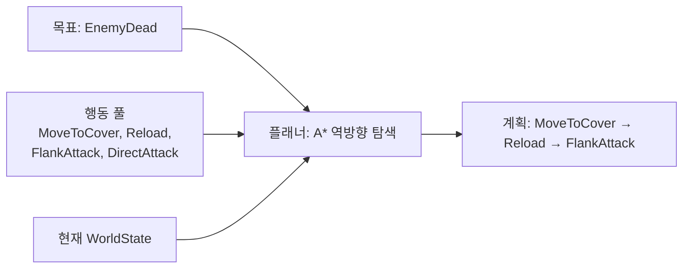
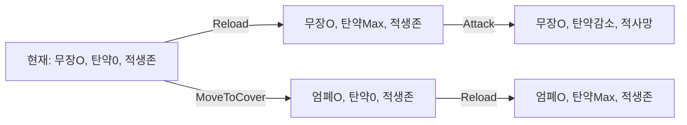
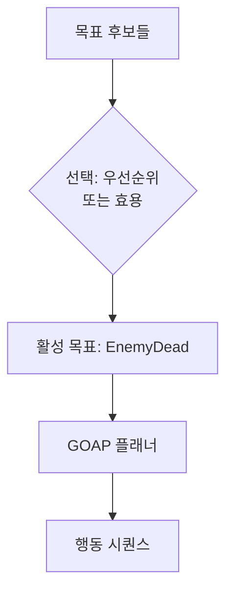
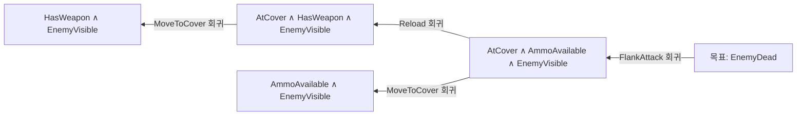
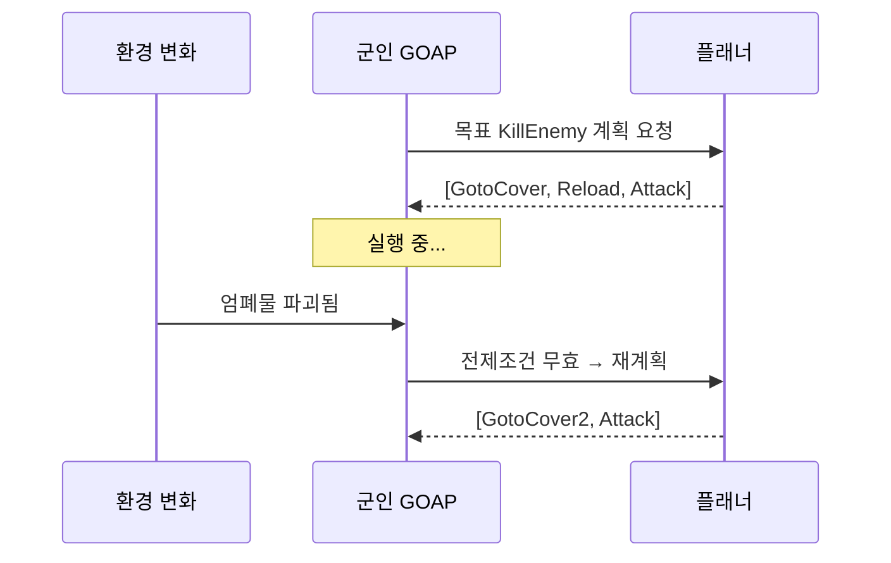
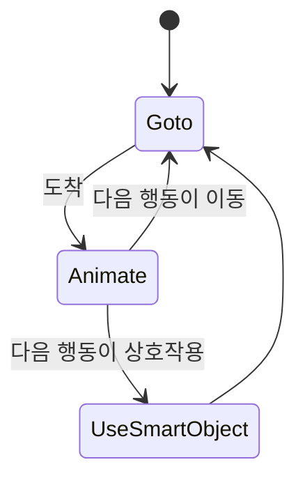
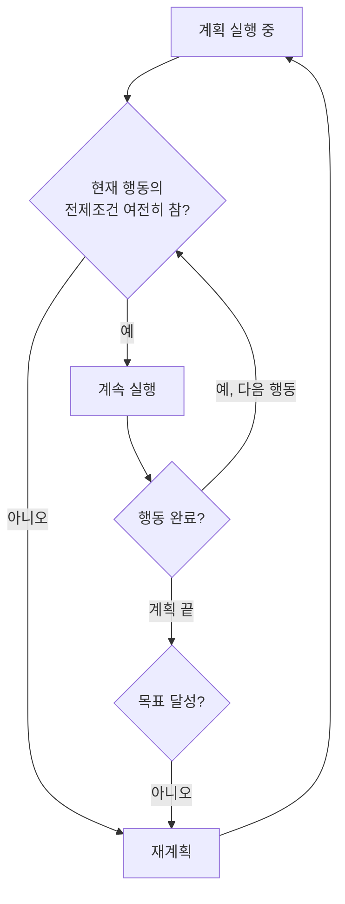
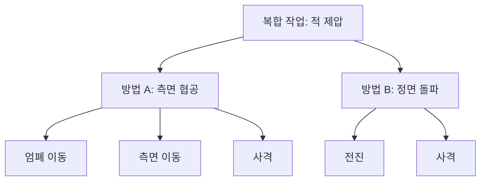

## 들어가며

FSM, 행동 트리, 효용 AI는 전이 그래프·트리·후보 점수처럼 설계된 결정 구조에서 현재 행동을 고른다. Goal Oriented Action Planning(GOAP)은 목표 상태를 *선언* 하고, 현재 상태에서 그 목표까지 도달하는 행동 *시퀀스를 런타임에 탐색* 한다.

차이를 구체적으로 보자. "엄폐물 뒤에서 재장전 후 측면 공격"이라는 3단계 행동을, FSM이라면 상태 셋과 전이로, BT라면 Sequence로 *미리* 짜둬야 한다. GOAP에서는 그런 시퀀스를 적어 두지 않는다. 대신 개별 행동들 — MoveToCover, Reload, FlankAttack — 각각에 "이 행동을 하려면 무엇이 참이어야 하고(전제조건), 하고 나면 무엇이 바뀌는가(효과)"만 정의한다. 플래너가 목표(EnemyDead)에서 출발해 전제조건을 거슬러 올라가며 시퀀스를 *조립* 한다. 같은 행동 풀에서 상황에 따라 전혀 다른 계획이 나온다.

2005년 Monolith의 F.E.A.R.은 이 방식으로 개별 행동을 조립하고, 단순한 분대 명령·공간 제약·재계획의 상호작용으로 측면 공격처럼 보이는 전술을 만들었다. 이 글은 GOAP의 근간인 STRIPS 표현, WorldState의 비트셋 인코딩, 행동의 전제조건/효과, 그리고 계획을 A*로 탐색하는 방법을 다룬다. 탐색 알고리즘은 *손으로 따라가는 트레이스 예제* 로 한 노드씩 펼쳐 보고, 역방향 회귀(regression)의 정확한 비트 연산, 재계획(replanning)의 트리거와 비용, 성능 최적화, 그리고 GOAP가 큰 도메인에서 부딪히는 탐색 폭발과 그 대안까지 정리한다.



이 글의 목표.

1. **STRIPS 기반** — 자동 계획의 게임 적용, 닫힌 세계 가정.
2. **WorldState** — 심볼릭 상태의 비트셋 표현, mask의 정확한 의미.
3. **행동의 전제조건/효과** — 그래프의 간선, 적용과 회귀.
4. **목표** — 달성하려는 상태 부분집합과 선택.
5. **A* 계획 탐색** — implicit graph 역방향 탐색, 트레이스, 정합성.
6. **F.E.A.R. 사례** — 창발적 전술의 출처와 세 상태.
7. **재계획** — 환경 변화 대응과 비용.
8. **성능** — 풀, 닫힌 집합, 프레임 분할.
9. **탐색 폭발** — GOAP의 한계와 계층적 대안.


---

## 목차
1. [GOAP와 자동 계획](#1-goap와-자동-계획)
2. [WorldState와 심볼릭 표현](#2-worldstate와-심볼릭-표현)
3. [행동의 전제조건과 효과](#3-행동의-전제조건과-효과)
4. [목표와 우선순위](#4-목표와-우선순위)
5. [A* 기반 계획 탐색](#5-a-기반-계획-탐색)
6. [F.E.A.R.의 적용](#6-fear의-적용)
7. [재계획 트리거](#7-재계획-트리거)
8. [성능 최적화](#8-성능-최적화)
9. [탐색 폭발과 한계](#9-탐색-폭발과-한계)


---

## 1. GOAP와 자동 계획

GOAP는 AI 학계의 *자동 계획(automated planning)*, 구체적으로는 STRIPS(Stanford Research Institute Problem Solver, 1971) 표현을 게임에 맞게 단순화한 것이다. 계획 문제를 푸는 일반 알고리즘을 NPC 한 마리의 의사결정에 욱여넣은 것이라고 봐도 된다.

### STRIPS 세 요소

STRIPS의 세 요소가 그대로 게임에 대응된다.

- *상태(state)*: 세계에 대한 명제들의 집합. 게임에서는 WorldState. "적이 보인다", "탄약이 있다" 같은 부울 명제의 모음이다.
- *연산자(operator)*: 전제조건(precondition)과 효과(effect)를 가진 행동. 게임에서는 Action. "재장전: 무기를 들고 있으면(전제), 탄약이 채워진다(효과)".
- *목표(goal)*: 달성하고자 하는 상태 조건. "적이 죽었다".

계획 문제는 "현재 상태에서 목표 상태로 가는 연산자 시퀀스를 찾아라"로 정의되고, 이는 *상태 공간 탐색(state-space search)* 으로 환원된다. 각 상태가 노드, 각 행동이 간선이며, 행동을 적용하면 새 상태로 전이한다.

### 암묵적 그래프

핵심은 그래프가 미리 펼쳐져 있지 않고 탐색하면서 *암묵적으로(implicit)* 생성된다는 점이다. $k$개의 부울 명제가 있으면 상태 공간은 $2^k$개의 노드를 가진다 — 명제 20개면 100만 노드가 넘는다. 이 전체를 메모리에 명시할 수 없으므로, 탐색이 닿는 노드만 그때그때 만든다. 길찾기에서 NavMesh 폴리곤이 미리 있는 것과 대조적이다. 여기서는 *노드 자체가 탐색의 부산물* 이다.



위 도식의 노드들은 디자이너가 그린 것이 아니라 탐색이 행동을 적용해 *생성* 한 결과다. Reload를 S0에 적용하면 S1이 태어난다.

### 닫힌 세계 가정

STRIPS는 *닫힌 세계 가정(closed-world assumption)* 위에서 돈다. WorldState에 명시되지 않은 명제는 *거짓* 으로 간주한다. "EnemyVisible 비트가 없으면 적이 안 보인다"로 본다. 여기에 *효과에 없는 명제는 그대로 유지된다* 는 STRIPS 가정(상황 계산의 frame axiom을 일일이 쓰지 않게 하는 규약)이 더해져, 행동의 효과를 *변경된 비트만 기술* 하면 된다. 부분 상태를 `values`와 `mask`로 표현하면 "이 비트는 비교 대상이 아니다"를 나타낼 수 있지만, 이것이 확률적 불확실성까지 모델링하는 것은 아니다.

### 선언적 분리의 대가

디자이너의 작업은 행동과 목표를 정의하는 것까지다. 시퀀스 자체는 코드를 짜는 대신 *탐색이 생성* 한다. 이 분리가 GOAP의 강점이자 부담이다.

| 측면 | FSM/BT | GOAP |
|---|---|---|
| 행동 순서 | 설계자가 명시 | 런타임 탐색이 생성 |
| 새 행동 추가 | 전이/노드 직접 연결 | 행동 하나만 등록 |
| 동작 예측성 | 높음(그래프 고정) | 낮음(상황 의존) |
| 런타임 비용 | 거의 없음 | 탐색 비용 발생 |
| 창발성 | 약함 | 강함 |

행동 하나를 추가했을 때 FSM은 어디서 어디로 갈지 전이를 일일이 이어야 하지만, GOAP는 그 행동의 전제/효과만 적으면 플래너가 알아서 끼워 넣는다. 대가는 동작이 *예측하기 어려워지고* 런타임 탐색 비용을 감수해야 한다는 점이다.

## 2. WorldState와 심볼릭 표현

WorldState는 계획이 추론하는 세계의 *심볼릭 추상* 이다. 정밀한 좌표나 연속값이 아니라, 계획에 필요한 명제들만 담는다. "적이 보이는가", "탄약이 있는가", "엄폐 중인가" 같은 부울 명제가 전형적이다.

### 왜 비트셋인가

표현의 핵심 요구는 *빠른 비교와 차분* 이다. 탐색 중 두 상태가 같은지, 한 상태가 목표를 만족하는지를 반복 검사한다. 깊이 5, 분기 5인 완전 트리는 잎만 $5^5=3{,}125$개이고, 각 노드에서 행동 적용 가능성을 검사하면 명제 비교가 빠르게 늘어난다. 부울 명제 수가 작고 고정돼 있다면 비트셋은 여러 비교를 워드 단위 `AND/XOR`로 묶는 효율적인 표현이다. 값 범위가 크거나 동적으로 늘어나는 사실에는 enum·정수 필드나 구조화된 상태가 더 적합할 수 있다.

```cpp
// 명제 정의 — 비트 위치를 enum 으로 고정한다
enum Atom : int {
    HasWeapon = 0,
    AmmoAvailable,
    EnemyVisible,
    AtCover,
    EnemyDead,
    WeaponLoaded,
    AtomCount       // <= 64
};

struct WorldState {
    uint64_t values = 0;   // 각 비트 = 한 명제의 참(1)/거짓(0)
    uint64_t mask   = 0;   // 각 비트 = 이 명제가 "관심 대상"인지

    void Set(Atom a, bool v) {
        mask |= (1ull << a);
        if (v) values |=  (1ull << a);
        else   values &= ~(1ull << a);
    }
};
```

### mask의 정확한 의미

`mask`가 이 구조의 핵심이다. 비트마다 두 가지를 구분한다 — "이 명제에 *관심이 있는가*"(mask 비트)와 "관심이 있다면 *값이 무엇인가*"(values 비트). 세 가지 상태가 가능하다.

| mask 비트 | values 비트 | 의미 |
|---|---|---|
| 1 | 1 | 이 명제는 참이어야/참이다 |
| 1 | 0 | 이 명제는 거짓이어야/거짓이다 |
| 0 | (무시) | 이 명제는 *무관* (don't care) |

목표는 보통 *전체 상태가 아니라 일부 명제* 만 지정한다. "적이 죽었다(EnemyDead=true)"가 목표라면 그 외 명제(탄약·엄폐 여부)는 목표 입장에서 무관하다. 그 명제들은 mask 비트가 0이라 비교에서 빠진다. 현재 상태(start)는 보통 모든 비트가 mask=1인 완전한 상태이고, 목표와 회귀된 부분 목표는 mask가 듬성한 부분 상태다. 명제 $k$개일 때 전방 탐색이 저장하는 unique world state는 모든 비트가 정해진 완전 상태라 최대 $2^k$개지만, 회귀 탐색의 subgoal key는 values·mask로 참/거짓/무관을 나타내는 부분 상태라 최대 $3^k$개다. 두 상한은 서로 다른 대상의 수이므로 같은 탐색량으로 혼용하지 않는다.

### 충족 검사와 거리

`Satisfies`는 "관심 있는 비트들이 일치하는가"를 한 줄로 검사한다. `Distance`는 A* 휴리스틱이 될 "충족되지 않은 명제 수"다.

```cpp
struct WorldState {
    uint64_t values = 0, mask = 0;

    // this 가 목표 g 를 만족하는가: g 가 관심 갖는 비트들이 일치하는가
    bool Satisfies(const WorldState& g) const {
        return (values & g.mask) == (g.values & g.mask);
    }
    // 충족되지 않은 명제 수 (A* 휴리스틱 h)
    int Distance(const WorldState& g) const {
        uint64_t diff = (values ^ g.values) & g.mask;   // 다른 비트만, 관심 영역에서
        return std::popcount(diff);                     // 1비트 세기 — 단일 명령
    }
    bool operator==(const WorldState& o) const {
        return mask == o.mask
            && (values & mask) == (o.values & o.mask);
    }
};
```

`Distance`는 두 상태의 values를 XOR해 다른 비트를 뽑고, 목표의 mask로 관심 영역만 남긴 뒤 `popcount`로 1의 개수를 센다. 지원 CPU와 compiler target에서는 `POPCNT` 같은 명령으로 낮아질 수 있지만 호출·데이터 접근까지 공짜인 것은 아니다. 이 값은 충족돼야 할 명제 중 몇 개가 아직 어긋나 있는지를 센다.

### 이산화 — 부울로 부족할 때

부울로 부족한 경우 — 탄약 *개수*, 거리 *값* — 는 명제를 임계 기반으로 이산화할 수 있다. "AmmoCount > 0"을 `AmmoAvailable` 한 비트로, "거리 < 근접 사정거리"를 `InMeleeRange` 비트로 환원하는 식이다. 전통적인 propositional GOAP는 유한한 이산 상태를 사용하지만, 수치 fluent와 구간 추상화를 지원하는 planner도 있으므로 모든 GOAP가 부울 심볼만 써야 하는 것은 아니다. 임계값과 구간을 어떻게 잡느냐가 전술 판단 경계와 이산화 손실을 결정한다.

## 3. 행동의 전제조건과 효과

각 행동은 세 가지를 가진다. *전제조건(precondition)*, *효과(effect)*, *비용(cost)*. 전제조건은 "이 행동이 적용 가능하려면 무엇이 참이어야 하는가", 효과는 "적용 후 무엇이 바뀌는가", 비용은 A* 간선 가중치다. 전제조건은 다시 시작 시점에만 확인하는 시작 조건(`CanStart`)과 Running 동안 계속 참이어야 하는 유지 불변식(`invariant`, MustRemainTrue)으로 나뉜다 — 탄약처럼 시작할 때 소비되는 조건은 시작 조건에만, 시야처럼 유지되어야 하는 조건은 불변식에 둔다.

```cpp
struct Action {
    const char* name;
    WorldState  precondition;  // 시작 조건(CanStart) — 시작 시 한 번 검사
    WorldState  invariant;     // 유지 불변식(MustRemainTrue) — Running 동안 계속 검사
    WorldState  effect;        // 완료 시 적용
    float       cost = 1.0f;   // A* 간선 가중치 (선호도)

    bool CanStart(const WorldState& s) const {     // 시작 가능 여부
        return s.Satisfies(precondition);
    }
};
```

### 전방 적용(apply)

전방 탐색에서는 상태 $s$에 행동을 적용해 새 상태를 만든다. 효과의 mask가 가리키는 비트만 효과 값으로 덮어쓰고, 나머지는 그대로 둔다(STRIPS 가정).

```cpp
// 전방: s 에 행동을 적용한 결과 상태
WorldState Apply(const WorldState& s, const Action& a) {
    WorldState r = s;
    // effect 가 건드리는 비트만 effect 값으로 교체
    r.values = (r.values & ~a.effect.mask) | (a.effect.values & a.effect.mask);
    r.mask  |= a.effect.mask;        // 그 비트들이 이제 "알려진" 값이 됨
    return r;
}
```

`(r.values & ~a.effect.mask)`로 효과가 건드리는 비트를 일단 0으로 비우고, `(a.effect.values & a.effect.mask)`로 효과 값을 그 자리에 OR해 넣는다. 효과 밖 비트는 손대지 않는다.

### 역방향 회귀(regress)

GOAP 구현은 목표에서 현재 상태 쪽으로 부분 목표를 회귀시키는 역방향 탐색을 사용할 수 있다. 역방향에서는 "이 목표 상태를 만들려면, 이 행동을 하기 *직전* 에 어떤 조건이 참이어야 했는가"를 계산한다. 이를 *회귀(regression)* 라 한다. 회귀는 두 단계다.

1. 행동의 효과가 이미 만족시킨 목표 비트는 *제거* 한다(그 행동이 책임지므로 더 거슬러 올라갈 필요 없음).
2. 행동의 전제조건을 *새 목표로 추가* 한다(그 행동을 하려면 전제가 참이어야 하므로).

행동을 회귀에 쓰려면 세 조건이 모두 필요하다.

1. 효과가 현재 목표 명제를 하나 이상 달성한다.
2. 효과가 건드리는 다른 목표 명제와 충돌하지 않는다.
3. 효과를 제거하고 남은 목표와 행동 전제조건이 충돌하지 않는다.

```cpp
// 성공하면 out에 "행동 직전 만족해야 할 목표"를 쓴다.
bool TryRegress(const WorldState& g, const Action& a, WorldState& out) {
    uint64_t affectedGoals = a.effect.mask & g.mask;
    if (affectedGoals == 0) return false;

    // 목표가 P=true를 요구하는데 행동이 P=false로 만들면 사용할 수 없다.
    uint64_t effectConflicts =
        (a.effect.values ^ g.values) & affectedGoals;
    if (effectConflicts != 0) return false;

    WorldState r = g;
    // 효과가 책임지는 목표 명제를 이전 목표에서 제거한다.
    r.mask   &= ~a.effect.mask;
    r.values &= ~a.effect.mask;

    // 행동이 건드리지 않은 목표는 행동 전제와 동시에 참일 수 있어야 한다.
    uint64_t shared = r.mask & a.precondition.mask;
    uint64_t preconditionConflicts =
        (r.values ^ a.precondition.values) & shared;
    if (preconditionConflicts != 0) return false;

    r.mask   |= a.precondition.mask;
    r.values  = (r.values & ~a.precondition.mask)
              | (a.precondition.values & a.precondition.mask);
    out = r;
    return true;
}
```

회귀가 GOAP A*의 본질이다. 목표에서 거꾸로 한 행동씩 떼어 내며 "그 전에 무엇이 필요했나"를 누적해, 결국 *현재 상태가 만족하는* 부분 목표에 닿으면 계획이 완성된다.

### 효과의 기여 검사

`EnemyDead=true`를 원하는데 효과가 `EnemyDead=true`인 행동(Attack)은 기여한다. 그러나 같은 행동이 동시에 `AtCover=false`를 만들고 현재 목표가 `AtCover=true`도 요구한다면 사용할 수 없다. 단순히 "일치하는 효과가 하나 있는가"만 검사하면 이 충돌을 놓친다. 그래서 기여 검사와 회귀의 유효성 검사를 `TryRegress` 하나로 묶는다. 이 검사가 목표와 무관하거나 목표를 파괴하는 행동을 함께 걸러 역방향 분기를 줄인다.

### 행동 정의 예시

예제로 쓸 행동 풀을 표로 정의한다.

| 행동 | 전제조건 | 효과 | 비용 |
|---|---|---|---|
| Reload | HasWeapon | AmmoAvailable | 1 |
| MoveToCover | — | AtCover | 2 |
| FlankAttack | AtCover, AmmoAvailable, EnemyVisible | EnemyDead | 3 |
| DirectAttack | AmmoAvailable, EnemyVisible | EnemyDead | 4 |

비용은 행동의 *선호도* 를 인코딩한다. FlankAttack(3)이 DirectAttack(4)보다 싸므로, 둘 다 가능하면 플래너는 측면 공격을 선호한다. 효과가 같은 두 행동(둘 다 EnemyDead)이라도 전제조건과 비용이 달라, 상황과 선호에 따라 다른 경로가 선택된다. "전술적으로 더 나은" 계획을 비용으로 유도하는 것이 GOAP 튜닝의 한 축이다 — 코드를 고치지 않고 숫자만 바꿔 행동 경향을 조정한다. 표의 전제조건은 시작 시점(`CanStart`)에 확인하는 조건이다. Running 동안 매 틱 확인해야 하는 조건이 다르면 각 행동의 `invariant`에 따로 적는다.

## 4. 목표와 우선순위

목표는 *달성하려는 WorldState의 부분집합* 이다. KillEnemy 목표는 `EnemyDead=true` 하나만 지정하고 나머지는 mask 밖에 둔다. 즉 목표 WorldState는 mask가 듬성한 부분 상태다.

```cpp
struct Goal {
    const char* name;
    WorldState  desired;       // 달성하려는 부분 상태
    int         priority;      // 정적 우선순위 (높을수록 먼저)
    // 이 목표가 지금 의미 있는가 (관련성)
    std::function<bool(const Agent&)> relevant;
};
```

### 목표 선택

NPC는 보통 여러 목표 후보를 가진다 — KillEnemy, Survive, Patrol, Investigate. 하나를 고르는 방식은 두 가지다.

- *우선순위 리스트*: 목표에 정적 우선순위를 부여하고, 현재 *관련성(relevance)* 이 있는 최고 우선순위 목표를 고른다. "적이 보이면 KillEnemy, 안 보이면 Patrol".
- *효용 점수*: 목표 선택 자체를 효용 AI로 처리한다. HP·위협·탄약을 종합한 연속 점수로 Survive와 KillEnemy 중 고른다.

```cpp
Goal* SelectGoal(std::vector<Goal>& goals, const Agent& a) {
    Goal* best = nullptr;
    for (Goal& g : goals) {
        if (!g.relevant(a)) continue;                 // 지금 무관하면 건너뜀
        if (!best || g.priority > best->priority)
            best = &g;
    }
    return best;
}
```

### 두 층의 분리

효용 기반 선택은 GOAP와 효용 AI의 자연스러운 결합이다 — *목표 선택* 은 효용으로, *그 목표 달성 시퀀스* 는 GOAP 탐색으로. 이 계층 분리가 실전에서 흔하다. 목표 선택은 "무엇을 원하는가"라는 가치 판단(연속·다요인)이고, 계획은 "어떻게 거기 도달하는가"라는 이산 탐색이라, 서로 다른 도구가 맞다.



목표가 정해지면 플래너가 그 목표의 `desired`를 종료 조건으로 삼아 탐색을 시작한다. 목표가 자주 바뀌면 계획도 자주 폐기되므로, 목표 선택의 히스테리시스와 최소 유지 시간은 재계획 빈도와 행동 중단 횟수에 직접 영향을 준다.

## 5. A* 기반 계획 탐색

계획 탐색은 A*로 구현한다. 다만 일반적인 길찾기 A*와 두 가지가 다르다. 첫째, 그래프가 *암묵적* 이다 — 노드(상태)는 행동을 적용할 때 생성된다. 둘째, 보통 *역방향(backward)* 으로 탐색한다 — 목표에서 출발해 회귀를 거듭하며 현재 상태에 닿을 때까지 간다.

### 왜 역방향인가

역방향 탐색이 유리한 이유는 *분기 축소* 다. 현재 상태에서 적용 가능한 행동은 많지만(전제조건만 맞으면 다 후보), *목표에 기여하는* 행동은 적다. 목표에서 거꾸로 보면 "EnemyDead를 효과로 갖는 행동"만 후보가 되어 분기가 작아진다. 행동 30개 중 EnemyDead를 만드는 것이 2개뿐이라면, 첫 분기가 30이 아니라 2다.



화살표가 오른쪽에서 왼쪽으로 — 목표에서 시작 상태 방향으로 — 흐른다. 각 회귀가 "아직 충족돼야 할 조건"을 새로 만든다.

### 플래너 구현

역방향 A*의 노드는 "아직 충족돼야 할 부분 목표"를 들고 있다. 비용 $g$는 누적된 행동 비용, 휴리스틱 $h$는 부분 목표가 현재 상태와 얼마나 어긋났는지(`start.Distance(partialGoal)`)다. `Distance`는 인자의 `mask`를 사용하므로 호출 순서가 중요하다. `partialGoal.Distance(start)`로 뒤집으면 시작 상태의 전체 mask를 적용해 don't-care 비트까지 목표처럼 센다.

```cpp
struct PlanNode {
    WorldState goal;        // 아직 충족돼야 할 (회귀된) 목표
    float      g;           // 누적 비용
    int        parent;      // 부모 노드 인덱스 (경로 복원용)
    int        actionIdx;   // 부모→이 노드에 쓴 행동
};

struct WSHash {
    size_t operator()(const WorldState& w) const {
        uint64_t h = (w.values & w.mask) * 0x9E3779B97F4A7C15ull;
        h ^= w.mask + 0x9E3779B97F4A7C15ull + (h << 6) + (h >> 2);
        return static_cast<size_t>(h);
    }
};

std::vector<const Action*> Reconstruct(const std::vector<PlanNode>& nodes,
                                       int leaf,
                                       const std::vector<Action>& actions);

std::optional<std::vector<const Action*>>
Plan(const WorldState& start, const WorldState& goal,
     const std::vector<Action>& actions) {
    std::vector<PlanNode> nodes;
    auto f = [&](int n) { return nodes[n].g + start.Distance(nodes[n].goal); };
    auto cmp = [&](int a, int b) { return f(a) > f(b); };   // 작은 f 가 우선
    std::priority_queue<int, std::vector<int>, decltype(cmp)> open(cmp);
    std::unordered_map<WorldState, float, WSHash> bestG;

    nodes.push_back({ goal, 0.0f, -1, -1 });
    open.push(0);
    bestG.emplace(goal, 0.0f);

    while (!open.empty()) {
        int cur = open.top(); open.pop();
        auto known = bestG.find(nodes[cur].goal);
        if (known != bestG.end() && nodes[cur].g > known->second)
            continue; // lazy push 뒤 남은 낡은 노드

        if (start.Satisfies(nodes[cur].goal))            // 시작이 남은 목표를 충족
            return Reconstruct(nodes, cur, actions);     // 계획 완성

        for (int i = 0; i < (int)actions.size(); ++i) {
            const Action& a = actions[i];
            WorldState regressed;
            if (!TryRegress(nodes[cur].goal, a, regressed)) continue;
            float ng = nodes[cur].g + a.cost;
            auto it = bestG.find(regressed);
            if (it != bestG.end() && it->second <= ng) continue;
            bestG[regressed] = ng;
            nodes.push_back({ regressed, ng, cur, i });
            open.push((int)nodes.size() - 1);
        }
    }
    return std::nullopt;   // 계획 없음
}
```

경로 복원은 시작 쪽에서 발견된 leaf부터 부모를 따라 목표 쪽 root로 올라간다. leaf에 저장된 행동이 실행 순서의 첫 행동이고 부모의 행동이 그다음이므로, 이 저장 규약에서는 수집 결과가 이미 시작→목표 순서다. 별도의 `reverse`를 하면 오히려 잘못된다.

반환형이 `optional`인 이유도 의미론적이다. 시작 상태가 이미 목표를 만족하면 성공한 계획은 길이 0의 빈 벡터다. 계획을 찾지 못한 경우도 빈 벡터로 반환하면 두 상태를 구분할 수 없으므로 실패는 `nullopt`로 표현한다.

```cpp
std::vector<const Action*> Reconstruct(const std::vector<PlanNode>& nodes,
                                       int leaf, const std::vector<Action>& actions) {
    std::vector<const Action*> plan;
    for (int n = leaf; nodes[n].actionIdx >= 0; n = nodes[n].parent)
        plan.push_back(&actions[nodes[n].actionIdx]);
    // 역방향 탐색이므로 이미 시작→목표 순서다 (leaf 가 시작 쪽)
    return plan;
}
```

### 탐색 트레이스 — 한 노드씩

3절의 행동 풀로 실제 탐색을 손으로 따라가 본다. 시작 상태와 목표는 다음과 같다.

- 시작 `start`: `HasWeapon=1, AmmoAvailable=0, EnemyVisible=1, AtCover=0, EnemyDead=0` (모든 비트 mask=1)
- 목표 `goal`: `EnemyDead=1` (이 비트만 mask=1, 나머지 무관)

비용은 Reload=1, MoveToCover=2, FlankAttack=3, DirectAttack=4다. $h$는 `start.Distance(goal)` — 부분 목표 중 start와 어긋난 비트 수.

초기 노드 N0을 open에 넣는다. N0의 목표는 `{EnemyDead=1}`. start의 EnemyDead는 0이므로 어긋남 1개 → $h=1$, $g=0$, $f=1$.

```text
open = [ N0(f=1) ]
```

N0을 꺼낸다. start가 `{EnemyDead=1}`을 만족하나? start.EnemyDead=0 → 불만족. 확장한다. EnemyDead=1을 효과로 갖는 행동은 FlankAttack과 DirectAttack 둘.

- FlankAttack 회귀: EnemyDead 제거, 전제 `AtCover, AmmoAvailable, EnemyVisible` 추가 → 목표 `{AtCover=1, AmmoAvailable=1, EnemyVisible=1}`. start와 비교: AtCover=0(어긋), AmmoAvailable=0(어긋), EnemyVisible=1(일치) → $h=2$. $g=3$, $f=5$. (N1)
- DirectAttack 회귀: EnemyDead 제거, 전제 `AmmoAvailable, EnemyVisible` 추가 → 목표 `{AmmoAvailable=1, EnemyVisible=1}`. start: AmmoAvailable=0(어긋), EnemyVisible=1(일치) → $h=1$. $g=4$, $f=5$. (N2)

```text
open = [ N2(f=5, g=4), N1(f=5, g=3) ]
```

둘 다 $f=5$로 동률이다. 이 역방향 탐색에서 $f$ 동률이면 *$g$가 큰* 쪽은 $h$가 작아 종료 조건인 시작 상태에 더 가깝다(N1·N2는 둘 다 root의 자식이라 깊이는 같다). 이를 먼저 꺼내도록 타이브레이크하면 탐색이 더 빨리 바닥에 닿는다. N2(g=4)를 먼저 꺼낸다고 하자.

N2 목표 `{AmmoAvailable=1, EnemyVisible=1}`. start가 만족하나? AmmoAvailable=0 → 불만족. 확장. AmmoAvailable=1을 효과로 갖는 행동은 Reload 하나.

- Reload 회귀: AmmoAvailable 제거, 전제 `HasWeapon` 추가 → 목표 `{HasWeapon=1, EnemyVisible=1}`. start: HasWeapon=1(일치), EnemyVisible=1(일치) → $h=0$. $g=4+1=5$, $f=5$. (N3)

```text
open = [ N3(f=5, g=5), N1(f=5, g=3) ]
```

N3을 꺼낸다($g$ 타이브레이크로 먼저). 목표 `{HasWeapon=1, EnemyVisible=1}`. start가 만족하나? 둘 다 일치 → **만족**. 종료.

경로 복원: N3 ← Reload ← N2 ← DirectAttack ← N0. 시작 쪽(N3)부터 모으면 `[Reload, DirectAttack]`. 총비용 $5$.

플래너가 찾은 계획은 **Reload → DirectAttack**이다. FlankAttack 경로(N1)는 $g=3$에서 더 확장해야 했고, MoveToCover(비용 2) + Reload(1) + FlankAttack(3) = 6으로 DirectAttack 경로(5)보다 비쌌을 것이다. start가 이미 엄폐 중이 아니라 엄폐 이동 비용이 들기 때문에, 이 상황에서는 직접 공격이 더 싸다. *같은 행동 풀, 다른 시작 상태면 다른 계획* 이 나온다는 GOAP의 성질이 트레이스에서 그대로 드러난다.

### 휴리스틱과 정합성

휴리스틱은 `Distance` — 충족되지 않은 명제 수 — 다. 싸고(popcount 한 번) 직관적이지만, 일반적으로 *admissible(과소추정)을 보장하지 않는다.* 두 가지 이유다.

- *한 행동이 여러 명제를 동시에 충족*: 어긋난 명제가 3개여도 한 행동의 효과가 셋을 모두 맞추면 실제 남은 비용은 1행동이다. `Distance=3`은 실제 비용(1)을 과대평가할 수 있다.
- *행동 비용이 1이 아님*: `Distance`는 "명제 수"를 세지 비용을 모른다. 행동 비용이 0.5거나 10이면 명제 수와 비용이 비례하지 않는다.

admissible하지 않으면 A*가 *최적해를 보장하지 않는다.* 게임 GOAP는 대개 이를 받아들인다 — "꽤 좋은 계획을 빠르게"가 "최적 계획을 느리게"보다 낫기 때문이다. 엄밀한 최적성이 필요하면 $h=0$(다익스트라, 느림)으로 두거나, 도메인에서 과대평가하지 않음이 증명된 휴리스틱만 쓴다. 실전에서는 비admissible `Distance`를 그대로 쓰되, 트레이스가 보여주듯 비용 차가 큰 경로를 잘 거르므로 충분히 합리적인 계획을 낸다.

### 휴리스틱을 admissible하게 — 삭제 완화와 $h_{\max}$·$h_{\text{add}}$

바로 위에서 `Distance`(목표-개수 휴리스틱)가 admissible하지 않을 수 있다고 했다. 이를 형식화하면, 자동 계획의 완화된 문제에서 실제 제약 일부를 제거해 원래 최적 비용의 하한을 계산하는 휴리스틱을 유도할 수 있다. 어떤 제약을 제거했는지가 하한의 타당성과 정보량을 함께 결정한다.

**`Distance`의 비admissible성 — 반례.** 효과가 목표 비트 두 개를 한 번에 맞추는 행동을 두자: 전제 없음, 효과 `{EnemyDead=1, AtCover=1}`, 비용 1. 목표가 `{EnemyDead=1, AtCover=1}`이고 시작이 둘 다 0이면 `Distance=2`인데 실제 최적 비용은 1행동 $=1$이다. $h{=}2 > h^\star{=}1$이므로 과대평가, A* 최적성이 깨진다. 반대로 5절 트레이스의 최상위 목표 `{EnemyDead=1}`은 `Distance=1`인데 실제 비용은 5라(과소평가) 거의 정보가 없다. 목표-개수 휴리스틱은 *양방향으로 모두 빗나간다* — 한 행동의 다중 효과에서 과대, 깊은 전제 사슬에서 과소.

**삭제 완화(delete relaxation)와 $h^+$.** 자동 계획의 표준 처방은 *삭제 효과를 무시한 완화 문제* 다. 각 행동에서 비트를 *끄는*(false로 만드는) 효과를 지우고 *켜는* 효과만 남기면, 한 번 참이 된 명제는 영원히 참이다(단조 누적). 완화 문제의 최적 비용을 $h^+$라 하자.

이 설명은 양의 원자만 쓰는 STRIPS 표기다. `P=false` 같은 음의 전제·목표를 직접 지원하는 비트셋 구현에서는 먼저 `NotP`를 별도 원자로 컴파일하고, `P`와 `NotP`의 상호 배타성을 전이 규칙으로 관리해야 한다. 단순히 false 효과를 전부 버리면 음의 목표 의미까지 사라진다.

$h^+$는 admissible하다. 원문제의 임의 계획은 완화 문제에서도 유효한 계획이기 때문이다 — 삭제를 없애면 전제 충족이 깨질 일이 없으므로, 실제로 실행되는 시퀀스는 완화 세계에서도 그대로 실행된다. 따라서 완화 최적해는 원 최적해 이하다:

$$h^+ \le h^\star.$$

문제는 $h^+$ 자체가 비싸다는 것이다. 삭제 없는 STRIPS의 계획 *존재* 는 다항시간이지만, *최소 비용* 완화 계획을 구하는 것은 NP-난해다(Bylander 1994). 그래서 $h^+$를 직접 풀지 않고 다항시간 *근사* 를 쓴다.

**$h_{\max}$와 $h_{\text{add}}$ — 도달 비용의 고정점.** 각 명제 $p$에 "그 명제를 완화 세계에서 처음 참으로 만드는 비용" $h(p)$를 정의하고, 명제 집합의 비용을 원소 비용으로 합성한다. 시작 상태에서 이미 참인 명제는 $h(p)=0$. 그 외에는 $p$를 효과로 갖는 행동 중 가장 싼 경로로 도달한다:

$$h(p) = \min_{a:\, p \in \mathrm{add}(a)} \big( \mathrm{cost}(a) + H(\mathrm{pre}(a)) \big),$$

집합 비용 $H$를 어떻게 합성하느냐가 두 휴리스틱을 가른다:

$$h_{\max}(g) = \max_{p \in g} h(p), \qquad h_{\text{add}}(g) = \sum_{p \in g} h(p).$$

$h_{\max}$는 "집합을 달성하는 비용 $\ge$ 가장 비싼 한 원소"라는 하한만 주장하므로 $h_{\max}\le h^+\le h^\star$, *admissible* 다. $h_{\text{add}}$는 원소들이 부분 목표를 *공유하지 않는다* 고 가정하고 비용을 더하므로 정보량은 많지만 공유분을 이중계산해 과대평가할 수 있다 — *비admissible* 다.

**이중계산 반례.** 명제 $P$가 $A,B$의 공통 전제라 하자: $a_0$(전제 없음, 효과 $P$, 비용 1), $a_1$(전제 $P$, 효과 $A$, 비용 1), $a_2$(전제 $P$, 효과 $B$, 비용 1). 목표 $\{A,B\}$의 실제 최적은 $a_0\to a_1\to a_2 = 3$(= $h^+$). $h_{\max}$는 $h(P){=}1$, $h(A){=}h(B){=}2$, $h_{\max}{=}\max(2,2){=}2 \le 3$(admissible). $h_{\text{add}}$는 같은 $h(A){=}h(B){=}2$에서 $h_{\text{add}}{=}2{+}2{=}4 > 3$ — $P$를 만드는 비용 1을 $A,B$ 양쪽에 두 번 셌다(과대평가).

**3절 행동 풀에서의 값.** 같은 계산을 5절 트레이스 도메인에 돌리면(시작에서 `HasWeapon, EnemyVisible`만 참) $h(\text{AmmoAvailable}){=}1$(Reload), $h(\text{AtCover}){=}2$(MoveToCover)다. EnemyDead의 두 achiever는 FlankAttack $3+H\{\text{AtCover, AmmoAvailable, EnemyVisible}\}$, DirectAttack $4+H\{\text{AmmoAvailable, EnemyVisible}\}$. $h_{\max}$는 FlankAttack $3+\max(2,1,0){=}5$·DirectAttack $4+\max(1,0){=}5$ → $5$. $h_{\text{add}}$는 FlankAttack $3+(2{+}1{+}0){=}6$·DirectAttack $4+(1{+}0){=}5$ → $5$. 실제 최적은 Reload→DirectAttack $=5=h^\star$. 두 완화 휴리스틱 모두 정확히 $5$를 — `Distance`가 준 $1$과 달리 — 맞춘다. 이 도메인에서 완화가 정확한 이유는 최적 경로에 *되돌려지는*(삭제되는) 명제가 없어 삭제 완화가 손실을 주지 않기 때문이다.

**계산과 경계 조건.** $h(p)$는 명제와 행동의 의존이 순환할 수 있어(전제가 효과를 거쳐 자기 자신으로) 한 번에 못 풀고 *고정점까지 반복* 한다 — 모든 도달 비용을 $\infty$로 초기화(시작에서 참인 명제만 0)하고 비용이 더 안 줄 때까지 층층이 이완한다(벨만-포드 골격). 도달 불가능한 명제는 $\infty$로 남아 그 목표가 든 행동을 무한 비용으로 걸러 낸다($h{=}\infty$ ⇒ 계획 없음).

```cpp
// 완화(삭제 무시) 도달 비용 — h_max / h_add 공통 골격
// useMax=true → h_max(admissible), useMax=false → h_add(informative)
float RelaxedCost(const WorldState& start, const WorldState& goal,
                  const std::vector<Action>& actions, bool useMax) {
    constexpr float INF = std::numeric_limits<float>::infinity();
    std::array<float, AtomCount> cost;
    for (int p = 0; p < AtomCount; ++p)        // 시작에서 참인 명제만 0, 나머지 INF
        cost[p] = (start.values & (1ull << p)) ? 0.0f : INF;

    bool changed = true;
    while (changed) {                          // 고정점까지 이완 (벨만-포드)
        changed = false;
        for (const Action& a : actions) {
            float pre = SetCost(a.precondition, cost, useMax);   // max 또는 sum
            if (pre == INF) continue;                            // 전제 미도달 → 적용 불가
            for (int p = 0; p < AtomCount; ++p)
                if (a.effect.AddsTrue(p) && a.cost + pre < cost[p]) {
                    cost[p] = a.cost + pre;    // 더 싼 도달 경로 발견
                    changed = true;
                }
        }
    }
    return SetCost(goal, cost, useMax);        // 목표 집합 비용 (INF면 계획 불가)
}
```

**언제 `Distance`를 쓸 것인가.** 완화 휴리스틱은 탐색 노드마다 명제·행동 의존성을 이완해야 하므로 popcount 한 번보다 비싸다. 작은 도메인에서는 `Distance`로 더 많은 노드를 펼치는 편이 빠를 수 있고, 큰 도메인에서는 $h_{\text{add}}$ 계열과 *helpful action* 가지치기가 비싼 노드당 비용을 보상할 수 있다. 어느 쪽이 유리한지는 행동 수만으로 결정되지 않는다. 목표 상호작용, 캐시, 재계획 빈도와 실제 확장 수를 함께 측정한다.

### 닫힌 집합

같은 부분 목표는 여러 행동 순서에서 다시 생길 수 있다. 길찾기 A*처럼 `bestG`에 부분 목표별 최소 누적비용을 저장하고, 더 비싼 중복 노드를 버린다. 플래너 코드의 lazy-push 검사까지 있어야 이미 큐에 들어간 낡은 노드도 확장하지 않는다. `WorldState` 해시는 `values`와 `mask`를 모두 섞어야 한다. 값이 같아도 관심 명제가 다른 두 부분 목표는 같은 상태가 아니다.

## 6. F.E.A.R.의 적용

Jeff Orkin이 F.E.A.R.(2005)에 적용한 GOAP는 게임 AI 역사에서 가장 자주 인용되는 사례다. Replica 군인들은 다음 구조로 동작했다.

### 행동 집합과 짧은 실행 계획

Orkin의 공개 자료에는 `Attack`, `DodgeShuffle`, `DodgeRoll`, `GotoNode`, `AttackFromCover`, `BlindFireFromCover`처럼 작게 합성되는 행동들이 등장한다. 핵심은 특정 행동 수나 보편적인 계획 깊이가 아니라, 행동의 전제·효과를 좁게 유지하고 실패에서 얻은 월드 지식으로 다시 계획하는 구조다. 짧은 실행 계획은 환경 변화에 폐기할 비용을 낮추지만, 필요한 깊이는 목표와 레벨 상호작용에 따라 달라진다.

### 단순한 분대 조정에서 나타난 복합 전술

F.E.A.R.에 명시적 협동 코드가 없었던 것은 아니다. 공개 발표에 따르면 전역 coordinator가 근접한 AI를 분대로 묶고, squad behavior가 suppression 역할과 이동할 엄폐 위치를 배정하며, 여러 AI가 같은 엄폐 노드를 받지 않도록 조정했다. 각 AI는 명령을 자기 목표들과 다시 비교해 수락하거나, 수류탄 회피처럼 더 높은 우선순위 목표를 택할 수 있었다.



복잡한 측면 협공 절차를 별도로 스크립트한 것은 아니었다. squad behavior가 "한 명은 제압, 다른 인원은 더 나은 엄폐로 이동" 같은 단순한 슬롯을 배정하고, 개별 AI의 센서·경로 탐색·GOAP가 구체적 이동을 해결했다. 벽과 사용 가능한 엄폐의 배치 때문에 이동 경로가 플레이어 양옆으로 갈라지면 협공처럼 보였다. 즉 *조정이 전혀 없는 창발* 이 아니라, 단순한 상위 조정과 분산된 하위 문제 해결의 결합이다.

### 세 상태와 SmartObject

Orkin의 GDC 2006 발표 제목 "Three States and a Plan"은 설계를 압축한다. 표면의 상태 기계는 단 *세 상태* — Goto(이동), Animate(애니메이션 재생), UseSmartObject(상호작용) — 뿐이고, 복잡성은 모두 *계획 층* 에 있었다.



핵심은 *행동과 그 애니메이션·효과를 SmartObject로 캡슐화* 한 점이다. 의자가 "여기 와서 이 애니메이션을 재생하면 Seated 효과를 준다"는 정보를 스스로 들고 있고, 군인의 행동은 그 SmartObject를 사용하는 일반 동작으로 환원된다. 새 상호작용을 추가할 때 AI 코드를 건드리지 않고 SmartObject만 배치하면 된다. GOAP의 선언적 분리(1절)가 레벨 디자인 층까지 확장된 형태다. 디자이너는 행동과 오브젝트를 추가하기만 했고, 그 조합은 플래너가 찾았다.

## 7. 재계획 트리거

계획은 만든 순간의 WorldState를 전제로 한다. 환경이 변하면 계획이 무효가 된다 — 목표가 엄폐였는데 엄폐물이 부서지거나, 추격하던 적이 사라지거나, 더 높은 우선순위 목표가 생기거나. GOAP 시스템은 계획을 *언제 다시 세울지* 정해야 한다.



### 트리거 세 종류

- *행동 실패*: 현재 행동의 전제조건이 더 이상 성립하지 않거나, 실행 자체가 실패하면(경로 막힘) 즉시 재계획한다. 가장 흔한 트리거다.
- *목표 변경*: 효용/우선순위가 다른 목표를 더 높게 평가하면(생존 > 공격) 계획을 폐기하고 새 목표로 계획한다. 4절의 목표 선택이 바뀌는 경우다.
- *주기적 검증*: 매 틱 또는 일정 주기로 "계획이 여전히 유효한가"를 가볍게 검사한다.

### 실행기와 검증

실행기(executor)는 계획을 한 행동씩 진행하며 *현재 행동의 유지 불변식(`invariant`)* 만 값싸게 검증한다. 시작 전제조건(`CanStart`)은 행동을 시작할 때 한 번만 본다. 전체 계획을 매 틱 다시 짜지 않는다.

```cpp
class PlanExecutor {
    std::vector<const Action*> plan_;
    size_t idx_ = 0;
    bool   started_ = false;   // 현재 행동이 이미 시작됐는가
public:
    enum class Status { Running, NeedReplan, Done };

    Status Tick(Agent& a, const WorldState& ws, float dt) {
        if (idx_ >= plan_.size()) return Status::Done;
        const Action* cur = plan_[idx_];

        // 1) 시작 전제조건은 행동을 시작할 때 한 번만 검사
        if (!started_ && !cur->CanStart(ws)) return Status::NeedReplan;
        // 2) Running 동안에는 유지 불변식만 검사 (소비된 시작 조건은 재요구하지 않음)
        if (started_ && !ws.Satisfies(cur->invariant)) return Status::NeedReplan;

        // 3) 행동 실행 (애니메이션/이동 진행). 완료 시 다음으로
        //    주의: 한 틱에 RunAction은 한 번만 호출(중복 호출 시 부작용·진행이 2배가 된다).
        ActionResult r = RunAction(a, *cur, dt);
        started_ = true;
        if (r == ActionResult::Failed)    { started_ = false; return Status::NeedReplan; }
        if (r == ActionResult::Completed) { ++idx_; started_ = false; }
        return Status::Running;
    }
    void SetPlan(std::vector<const Action*> p) { plan_ = std::move(p); idx_ = 0; started_ = false; }
};
```

### 비용과 빈도의 균형

재계획 빈도가 비용과 직결된다. 매 틱 전체 재계획은 탐색 비용을 누적시키므로, 보통은 *현재 행동의 실행 불변식만 값싸게 검증* 하다가 깨질 때만 전체 탐색을 돌린다. F.E.A.R.이 택한 "짧은 계획 + 잦은 재계획"은 이 검증을 가볍게 유지하는 한 방식이다 — 계획이 짧으면 무효화 시 다시 짜는 비용도 작다.

| 전략 | 검증 비용 | 반응성 | 위험 |
|---|---|---|---|
| 매 틱 전체 재계획 | 높음 | 즉각 | 프레임 예산 초과 |
| 매 틱 실행 불변식만 검증 | 낮음 | 불변식 변화는 매 틱 | 시작 전제 변화는 완료까지 놓침 |
| 주기 + 즉시 트리거 혼합 | 중간 | 균형 | 튜닝 필요 |

혼합 정책은 실용적인 출발점이다. 값싼 불변식 검증을 자주 하고, 엄폐물 파괴·적 소멸 같은 명확한 무효화 이벤트에는 즉시 반응하며, 그 외의 전체 재계획은 예산과 허용 지연에 맞춘 주기로 제한한다. 주기는 고정된 수백 ms가 아니라 게임의 반응성 계약과 프로파일링으로 정한다. 목표 선택에 히스테리시스를 두면 비슷한 효용의 목표 사이에서 재계획이 진동하는 현상을 줄일 수 있다.

## 8. 성능 최적화

순수 GOAP 플래너는 NPC 한 마리당 수십~수백 노드를 만든다. 군중이거나 재계획이 잦으면 이 비용이 프레임 예산을 압박한다. 몇 가지 표준 최적화가 있다.

### 메모리 풀과 재사용

탐색마다 노드 벡터·우선순위 큐·닫힌 집합을 새로 할당하면 힙 비용이 누적된다. 플래너 인스턴스를 *재사용* 하고 컨테이너를 `clear`만 해 용량을 유지한다. 다만 재사용 범위는 컨테이너마다 다르다. `std::vector`(`nodes_`, `openHeap_`)는 `clear`가 원소 저장 공간(용량)을 그대로 보존하지만, `std::unordered_map`(`bestG_`)의 `reserve`/`clear`가 재사용하는 것은 bucket 배열이고 각 노드는 삽입마다 별도로 할당될 수 있다. 노드 단위 무할당까지 보장하려면 custom pool allocator를 붙이거나 연속형 탐색 테이블을 별도로 설계해야 한다.

```cpp
class Planner {
    std::vector<PlanNode>        nodes_;     // reserve 후 clear 재사용
    std::vector<int>             openHeap_;  // 직접 관리하는 바이너리 힙
    std::unordered_map<WorldState, float, WSHash> bestG_;  // bucket 배열만 재사용
public:
    Planner() { nodes_.reserve(256); bestG_.reserve(256); }
    void Reset() { nodes_.clear(); openHeap_.clear(); bestG_.clear(); }
    // Plan(...) 내부에서 nodes_/openHeap_/bestG_ 를 사용한다.
};
```

NPC마다 플래너를 하나씩 가지거나, 풀에서 빌려 쓴다. 핵심은 *노드 인덱스* 로 부모를 가리키는 것 — 포인터 대신 인덱스라 벡터가 재할당돼도 안전하고, 캐시 지역성이 좋다.

### WorldState 해싱

닫힌 집합 키로 쓸 해시는 `values`와 `mask`를 섞는다. 둘 다 섞어야 같은 values라도 mask가 다르면(관심 영역이 다르면) 구별된다.

플래너 코드의 `WSHash`처럼 `values`와 `mask`를 모두 섞는다. WorldState가 두 워드면 해시·동등 비교의 계산량은 고정이지만, 해시 테이블 조회의 실제 비용은 부하율·충돌·메모리 지역성에 의존한다.

### 프레임 분할과 캐싱

계획이 한 프레임 예산을 넘길 위험이 있으면 두 가지로 대응한다.

- *예산 제한 탐색*: 확장 노드 수에 상한(예: 200)을 두고, 초과하면 탐색을 포기해 기본 행동으로 후퇴한다. 무한 탐색으로 프레임이 튀는 것보다 낫다.
- *시분할(time-slicing)*: 여러 NPC의 재계획을 한 프레임에 몰지 않고 라운드로빈으로 분산한다. NPC 200마리가 동시에 재계획하면 스파이크가 나므로, 프레임당 N마리만 재계획하도록 큐잉한다. 순환 시작 인덱스를 영속시켜 매 프레임 같은 앞쪽 에이전트만 처리하는 기아를 막는다.

```cpp
// 프레임당 재계획 예산 — 스파이크 방지
// size_t nextReplan_ = 0;   // 다음 프레임에 재계획을 시작할 순환 인덱스 (AIManager 멤버)
void AIManager::Tick(float dt) {
    // 1) 실행기는 매 프레임 모든 에이전트에서 진행하고 반환값을 needsReplan에 연결 (AI-003)
    for (Agent* a : agents_) {
        const PlanExecutor::Status result = a->executor.Tick(*a, a->worldState, dt);
        if (result == PlanExecutor::Status::NeedReplan)
            a->needsReplan = true;
        // Running/Done은 여기서 추가 동작 없이 다음 단계로
    }
    // 2) 재계획은 순환 시작 인덱스에서 예산만큼만 (고정 순서 기아 방지, AI-006)
    const size_t n = agents_.size();
    int budget = kReplansPerFrame;          // 예: 8
    for (size_t scanned = 0; scanned < n && budget > 0; ++scanned) {
        Agent* a = agents_[nextReplan_];
        nextReplan_ = (nextReplan_ + 1) % n;
        if (!a->needsReplan) continue;
        // 재계획 경계에서 현재 행동을 중단하고 예약을 정리한 뒤 탐색한다
        a->Replan();                        // 비싼 탐색
        a->needsReplan = false;             // 처리 완료 해제, 미처리분은 다음 프레임 이월
        --budget;
    }
}
```

### 계획 캐싱

같은 시작 상태·목표 조합이 반복되면 직전 계획을 재사용할 수 있다. 다만 WorldState가 조금만 달라도 키가 바뀌고, procedural precondition이나 공간 질의 결과가 키 밖에 있으면 캐시한 계획을 다시 검증해야 한다. 작은 심볼 상태라도 노드 비용에는 행동 순회, 해시 조회, 동적 전제와 메모리 접근이 포함되므로 노드 수만으로 마이크로초를 단정할 수 없다. 대상 플랫폼에서 계획 지연 분포와 캐시 적중률을 측정한다.

## 9. 탐색 폭발과 한계

GOAP의 강점인 런타임 탐색이 곧 한계의 원천이다.

### 분기 인수와 깊이

상태 공간 탐색은 분기 인수 $b$와 깊이 $d$에 대해 최악 $O(b^d)$다. 행동 풀이 커지면 $b$가 커지고, 깊은 계획이 필요하면 $d$가 커진다.

| 행동 수 ($b$) | 계획 깊이 ($d$) | 최악 노드 수 ($b^d$) |
|---:|---:|---:|
| 5 | 3 | 125 |
| 5 | 5 | 3,125 |
| 20 | 5 | 3,200,000 |
| 50 | 6 | 약 156억 |

역방향 회귀의 기여·충돌 검사와 닫힌 집합은 유효 분기를 줄이지만, 최악의 지수 성장은 남는다. 행동 수와 깊이만으로 프레임 초과를 단정할 수는 없다. 적용 가능한 행동 비율, 중복 상태 합류, 휴리스틱 품질, procedural precondition 비용이 실제 확장량을 결정한다. 그래서 노드·시간 예산을 명시하고 예산 소진을 "계획 없음"과 구분해야 한다.

### 휴리스틱의 한계

"충족되지 않은 명제 수"(`Distance`)는 싸지만, 5절에서 봤듯 최적성을 보장하는 휴리스틱으로 일반화하기 어렵다. 행동 간 상호작용(한 행동이 여러 목표 명제를 동시에 충족)과 서로 다른 행동 비용을 반영하지 못해, 때로는 탐색 순서를 잘못 이끈다. 더 강한 휴리스틱(예: 완화된 계획 그래프 기반 추정)은 계산 비용이 들어 트레이드오프다 — 노드당 휴리스틱을 비싸게 만들면 노드 수는 줄지만 노드당 비용이 늘어, 전체 시간이 오히려 늘 수도 있다.

### 표현의 이산화 손실

연속값을 비트 명제로 환원하는 과정에서 정보가 손실된다. "탄약이 많다/적다"의 이산 경계가 실제 전술과 어긋날 수 있다 — 탄약 1발과 30발이 같은 `AmmoAvailable=1`로 뭉뚱그려지면, "거의 빈 탄창으로 무리하게 공격"하는 계획이 나온다. 추론 층(이산)과 실행 층(연속) 사이의 간극을 메우는 코드 — 행동이 실제로 실행 가능한지 연속 좌표로 재확인하는 로직 — 가 추가로 필요하다. 이산 명제를 더 잘게 쪼개면(탄약을 3단계로) 표현은 정밀해지지만 상태 공간 $2^k$가 커져 탐색이 느려진다.

### 계층적 대안 — HTN

탐색 공간을 통제하는 대표적 대안이 *계층적 분해* 다. 큰 목표를 미리 정의된 방법(method)으로 하위 작업으로 쪼개는 Hierarchical Task Network(HTN)가 그 예다. 잘 제한된 게임 도메인에서는 authored method가 불필요한 행동 조합을 제거할 수 있지만, HTN도 여러 method의 백트래킹과 재귀 분해를 포함하므로 자동으로 빠르거나 종료한다고 보장되지는 않는다.



HTN은 "적 제압"을 자유로운 원자 행동 조합으로만 찾는 대신, 디자이너가 적어 둔 방법(측면 협공 / 정면 돌파) 중 적용 가능한 것을 골라 하위 작업을 펼친다. method 수·재귀 깊이·백트래킹 budget을 제한하면 탐색 범위와 행동 형태를 제품 계약 안에 둘 수 있다.

| 측면 | GOAP | HTN |
|---|---|---|
| 계획 생성 | 자유 탐색(조립) | 분해 규칙 적용 |
| 행동 순서의 소유자 | 런타임 행동 탐색 비중 큼 | authored method 비중 큼 |
| 탐색 비용 | 유효 행동 분기·깊이에 의존 | method 분기·재귀·백트래킹에 의존 |
| 통제·예측성 | 낮음 | 높음 |
| 새 행동 추가 | 행동만 등록 | 방법 그래프 갱신 |

게임 설계 관점의 차이는 "표현력 우열"보다 행동 순서를 누가 소유하는가에 있다. GOAP는 전제·효과에서 런타임 조합을 더 많이 허용하고, HTN은 method에 의도한 골격을 더 많이 기록한다. 전자는 예상 밖 조합의 검증 비용이, 후자는 method 유지와 누락된 분해 경로가 비용이다. 둘을 혼합할 수도 있지만, 그 자체가 보편적인 정답은 아니다.


---

## 결론

GOAP는 행동의 *순서를 미리 짜두지 않는다.* 개별 행동에 전제조건과 효과만 선언하고, 목표에서 역방향으로 A* 탐색을 돌려 현재 상태에 닿는 시퀀스를 런타임에 조립한다. STRIPS의 상태-연산자-목표 모델을 64비트 비트셋 WorldState로 인코딩해, `values`와 `mask`의 두 워드로 빠른 충족 검사(`Satisfies`)와 popcount 휴리스틱(`Distance`)을 얻는다. 역방향 회귀는 "효과가 충족한 목표는 제거하고 전제를 새 목표로 합성"하는 비트 연산으로, 5절의 트레이스에서 보았듯 목표에서 시작 상태까지 한 행동씩 거슬러 올라간다.

역방향 탐색은 목표에 기여하면서 다른 목표를 파괴하지 않는 행동만 회귀시키고, `bestG`로 중복 부분 목표를 줄인다. 휴리스틱 `Distance`는 admissible하지 않아 최적성을 보장하지 않으므로, 최적 비용이 계약이면 $h=0$이나 증명된 하한을 써야 한다. F.E.A.R.은 세 실행 상태(Goto/Animate/UseSmartObject), 모듈화된 행동, 재계획, 전역 squad coordinator를 결합했다. 단순한 분대 슬롯과 개별 경로·계획이 레벨 기하와 만나 복잡한 협공처럼 보이는 결과를 냈다는 점이 핵심이다.

한계는 최악의 지수적 탐색과 이산화 손실이다. 행동 풀이 크거나 깊은 계획이 필요하면 노드·시간 budget, 시분할과 실패 사유 구분이 필요하다. HTN의 authored method는 탐색 범위를 좁히는 대안이지만, 재귀와 백트래킹을 제한하지 않으면 그 역시 비용과 종료 문제가 생긴다. GOAP와 HTN의 선택은 추상적 표현력 순위가 아니라 런타임 조합과 저작된 행동 골격 중 어느 쪽에 통제권을 둘지의 결정이다.

## 더 읽을거리

- Jeff Orkin, "Three States and a Plan: The A.I. of F.E.A.R." (GDC 2006) — GOAP 게임 적용의 결정적 사례, 세 상태와 SmartObject.
- Jeff Orkin, "Applying Goal-Oriented Action Planning to Games" (*AI Game Programming Wisdom 2*) — 비트셋 표현과 플래너 구현 상세.
- Fikes & Nilsson, "STRIPS: A New Approach to the Application of Theorem Proving to Problem Solving" (1971) — 자동 계획과 회귀의 원전.
- Steve Rabin (ed.), *Game AI Pro* 2권, GOAP·planning 관련 챕터 — 비트셋 표현과 최적화 패턴.
- Stuart Russell & Peter Norvig, *AIMA*, "Classical Planning" 및 "Planning and Acting" 장 — 회귀 탐색·휴리스틱·계획 그래프의 학술적 배경.
- Blai Bonet & Héctor Geffner, "Planning as Heuristic Search" (*Artificial Intelligence* 129, 2001) — $h_{\max}$·$h_{\text{add}}$와 휴리스틱 탐색 계획(HSP)의 원전.
- Jörg Hoffmann & Bernhard Nebel, "The FF Planning System: Fast Plan Generation Through Heuristic Search" (*JAIR* 14, 2001) — 완화 계획 휴리스틱 $h_{\text{FF}}$와 helpful action 가지치기.
- Tom Bylander, "The Computational Complexity of Propositional STRIPS Planning" (*Artificial Intelligence* 69, 1994) — STRIPS 계획의 PSPACE-완전성과 완화(삭제 없는) 최적화의 NP-난해성.
- Chris Conway, Peter Higley & Eric Jacopin, "Goal-Oriented Action Planning: Ten Years Old and No Fear!" (GDC 2015 AI Summit) — GOAP 채택 게임들의 회고와 함정.
- Troy Humphreys, "Exploring HTN Planners through Example" (*Game AI Pro*) — GOAP의 계층적 대안 HTN의 실전 구현.
