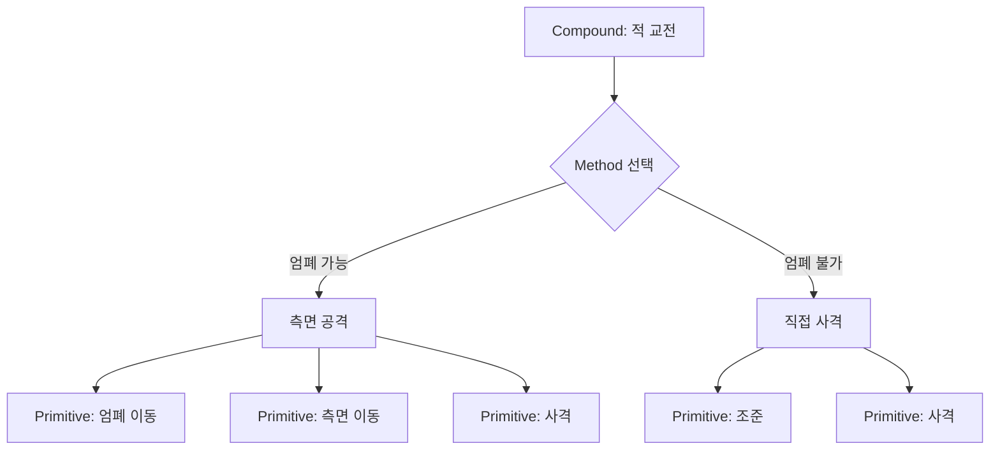
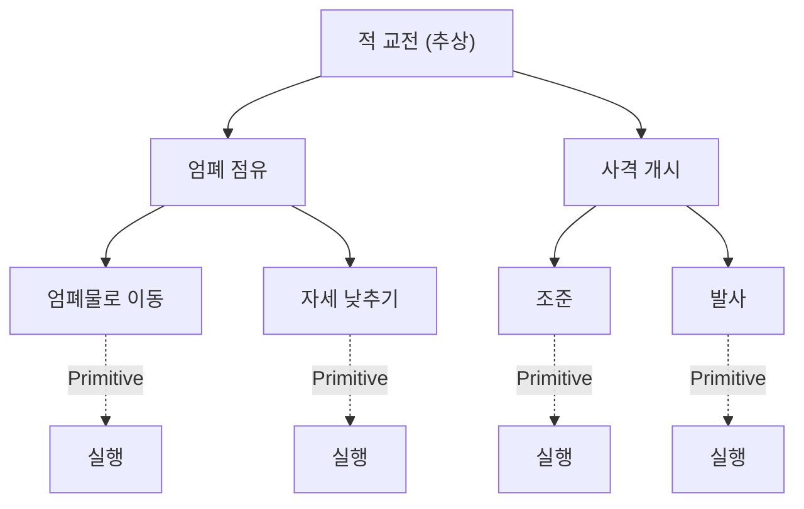
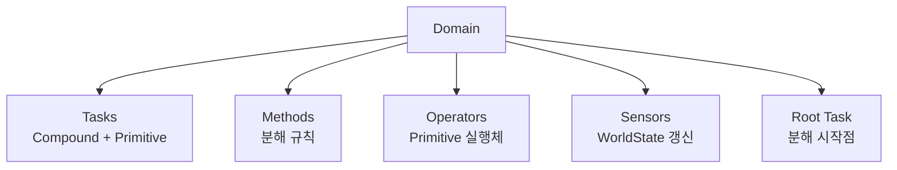
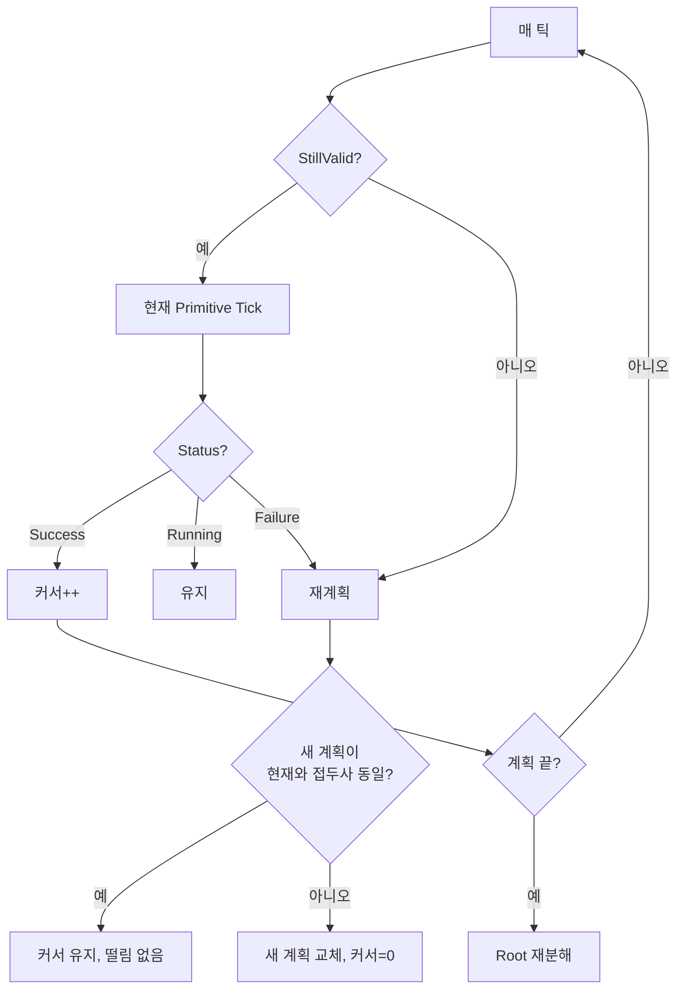
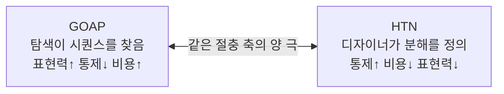

## 들어가며

계획 기반 AI는 행동의 순서를 런타임에 만든다. 같은 출력 — 실행할 행동들의 순서 — 을 두 가지 상반된 방법으로 얻을 수 있다. GOAP는 이를 *자유 탐색* 으로 한다. 목표 상태에서 출발해 행동 풀 전체를 거슬러 시퀀스를 찾는다. 표현력은 높지만 탐색 공간이 행동 수와 계획 깊이에 따라 폭발한다. Hierarchical Task Network(HTN)은 반대편 절충을 택한다. 디자이너가 *작업을 어떻게 분해하는지* 를 미리 정의하고, 플래너는 그 분해 규칙을 따라 큰 작업을 작은 작업으로 재귀적으로 쪼갠다.

비유하자면 GOAP는 "목적지만 알려주면 길을 탐색해 찾는" 내비게이션이고, HTN은 "이 목적지로 가는 표준 절차는 이렇다"는 *플레이북* 을 따르는 방식이다. HTN은 탐색 공간이 분해 규칙으로 제한되므로 빠르고, 결과가 디자이너의 의도를 따르므로 예측 가능하다. 대가는 표현력이다 — 미리 정의하지 않은 상황 조합은 다룰 수 없다. 이 한 줄의 절충이 HTN 설계 전체를 관통한다. 분해 트리를 어떻게 짜고, 백트래킹을 어디까지 허용하며, 계획을 언제 폐기하고 다시 세울지가 모두 이 절충 위에 놓인다.

이 절충 때문에 HTN은 *통제와 예측이 중요한* 대규모 상용 게임에서 인기를 얻었다. Killzone 2~3의 Helghast 군인, Transformers: Fall of Cybertron, Horizon Zero Dawn의 기계 동물이 HTN을 핵심 의사결정 도구로 썼다. 이 글은 HTN의 작업 분류(Compound/Primitive), 분해를 정의하는 Method, 실행을 담당하는 Operator, 이들을 모은 Domain, 그리고 분해와 백트래킹을 수행하는 플래너 알고리즘을 *완전한 트레이스 예제* 와 함께 다룬다. 계획을 만든 뒤 어떻게 실행하고, 월드가 바뀌면 어떻게 부분 재계획으로 복구하는지, 그리고 GOAP와의 절충을 정면으로 비교한다.



이 글의 목표.

1. **기본 개념** — 작업 분해 계획의 모델과 SHOP 계보.
2. **작업 분류** — Compound와 Primitive, 그리고 WorldState의 표현.
3. **Method** — 분해 규칙, 전제조건, 우선순위.
4. **Operator** — Primitive의 실행체, 계획 중 가상 적용 대 실행 중 호출.
5. **Domain** — 작업·메서드·연산자·센서의 집합과 데이터 주도성.
6. **플래너 알고리즘** — 재귀 분해, 결정 지점, 백트래킹, 전체 트레이스.
7. **계획 실행과 재계획** — Plan Runner, 실패 복구, plan 무효화.
8. **센서와 WorldState** — 월드 폴링과 이산화.
9. **HTN vs GOAP** — 표현력·통제·복잡도의 정량 비교.
10. **디버깅과 함정** — 분해 추적, 무한 재귀, 가상 상태 불일치.


---

## 목차
1. [HTN과 작업 분해](#1-htn과-작업-분해)
2. [Compound와 Primitive 작업](#2-compound와-primitive-작업)
3. [Method와 분해 규칙](#3-method와-분해-규칙)
4. [Operator와 실제 행동](#4-operator와-실제-행동)
5. [Domain의 구조](#5-domain의-구조)
6. [HTN 플래너 알고리즘](#6-htn-플래너-알고리즘)
7. [계획 실행과 재계획](#7-계획-실행과-재계획)
8. [센서와 WorldState 갱신](#8-센서와-worldstate-갱신)
9. [HTN과 GOAP의 절충](#9-htn과-goap의-절충)
10. [디버깅과 함정](#10-디버깅과-함정)


---

## 1. HTN과 작업 분해

### 분해라는 발상

HTN의 핵심 아이디어는 *작업의 계층적 분해(decomposition)* 다. 추상적인 큰 작업("적을 교전한다")을 더 구체적인 하위 작업들로 쪼개고, 그 하위 작업을 다시 쪼개기를 반복해, 끝내 *즉시 실행 가능한 원자 행동* 의 시퀀스에 도달한다. 사람이 일을 계획하는 방식과 닮았다 — "출근한다"는 "옷을 입는다 → 차를 탄다 → 운전한다"로 쪼개지고, "차를 탄다"는 다시 "문을 연다 → 앉는다 → 벨트를 맨다"로 쪼개진다. 각 단계는 더 잘게 나뉠 수 있고, 최종적으로는 근육을 움직이는 원자 동작에 닿는다.

이는 학계의 SHOP/SHOP2(Simple Hierarchical Ordered Planner) 계열에서 왔다. 차이는 계획을 *상태 공간 탐색* 이 아니라 *작업 공간 분해* 로 본다는 점이다. GOAP가 "어떤 상태에 도달할까"를 탐색한다면, HTN은 "이 작업을 어떻게 수행할까"를 분해한다. 두 모델의 입력과 출력은 같다 — 현재 WorldState를 받아 행동 시퀀스를 낸다. 다른 것은 그 사이의 알고리즘이다.



### 순서 있는 분해와 순서 없는 분해

SHOP이라는 이름의 'O'는 *Ordered* 다. 분해된 하위 작업이 *왼쪽에서 오른쪽 순서대로* 처리된다는 뜻이다. 이 순서 제약은 알고리즘을 크게 단순화한다 — 앞 작업의 effect가 가상으로 적용된 뒤에 뒤 작업의 전제조건이 검사되므로, 시퀀스의 *내부 의존성* 이 자연스럽게 흐른다. "엄폐물로 이동" 다음에 "자세 낮추기"가 오면, 이동의 결과(AtCover)가 자세 낮추기의 전제가 될 수 있다.

순서 없는(unordered) 또는 부분 순서(partial-order) HTN도 존재한다. 하위 작업의 실행 순서를 플래너가 정하게 두면 표현력이 늘지만 ordering constraint와 상호작용을 함께 풀어야 한다. 게임용 구현은 통제·실행 단순성 때문에 전순서(total-order)를 택하는 경우가 많으며, 이 글의 코드는 전순서를 전제한다.

### 결과는 행동 시퀀스

이 모델의 결과는 *최종 행동 시퀀스* 다 — GOAP의 출력과 동일한 형태(실행할 Primitive들의 순서)다. 차이는 그 시퀀스를 *어떻게* 얻는가에 있다. HTN은 디자이너가 정의한 분해 트리를 따라 위에서 아래로 펼치며, 탐색이 닿는 공간이 그 트리로 한정된다. 이 한정이 곧 HTN의 효율과 예측 가능성의 원천이다.

이 글의 전순서 실행 모델에서 완성된 계획은 모든 Compound가 분해되어 Primitive만 남은 리스트다. 분해 도중의 task network에는 Compound가 남을 수 있고, 부분순서 HTN은 평평한 단일 리스트가 아니라 순서 제약을 가진 primitive network를 결과로 둘 수도 있다. 따라서 "잎은 Primitive"는 *완전히 분해된 이 모델의 성공 조건* 이다.

## 2. Compound와 Primitive 작업

### 두 종류의 작업

HTN의 작업(Task)은 두 종류다.

- *Primitive Task*: 더 쪼갤 수 없는 원자 행동. 게임 함수 호출로 직접 매핑된다. `MoveTo`, `Shoot`, `PlayAnimation`. 이 글의 완성된 분해에서 잎을 이룬다. 전제조건(precondition)과 effect, 그리고 실행체(Operator)를 가진다.
- *Compound Task*: 분해 가능한 추상 작업. 하나 이상의 Method를 가지며, 그중 하나를 골라 하위 작업들로 펼친다. `EngageEnemy`, `SecureArea`. 자신은 전제조건이나 effect를 직접 갖지 않고, 그 책임을 Method와 하위 Primitive에 위임한다.

```cpp
enum class TaskType { Primitive, Compound };

struct Task {
    std::string name;
    TaskType    type;
};

struct PrimitiveTask : Task {
    WorldState  precondition;   // 실행 가능 조건
    WorldState  effect;         // 실행 후 상태 변화 (계획 중 가상 적용)
    std::function<TaskStatus(World&)> operatorFn;   // 실제 실행체
};

struct CompoundTask : Task {
    std::vector<Method> methods;   // 분해 후보들 (우선순위 순)
};
```

### WorldState의 표현

전제조건과 effect를 다루려면 WorldState의 구체적 표현이 필요하다. 게임 HTN에서 가장 흔한 표현은 *고정 키 집합 위의 비트마스크* 다. 명제(predicate)를 컴파일 타임에 enum으로 고정하고, 각 명제의 참/거짓을 한 비트로 표현한다.

```cpp
enum WSKey {
    EnemyVisible, EnemyInRange, CoverAvailable, AtCover,
    AmmoOK, IsReloading, /* ... */ WS_COUNT
};

struct WorldState {
    uint64_t values = 0;   // 명제별 참/거짓
    uint64_t mask   = 0;   // 이 키가 "관심 대상"인지 (전제조건/effect에서)

    void Set(WSKey k, bool v) {
        mask |= (1ull << k);
        if (v) values |= (1ull << k); else values &= ~(1ull << k);
    }
    // this(현재 상태)가 cond(전제조건)을 만족하는가
    bool Satisfies(const WorldState& cond) const {
        // cond.mask 가 켜진 비트만 비교
        return (values & cond.mask) == (cond.values & cond.mask);
    }
    // effect를 현재 상태에 적용한 새 상태
    WorldState Apply(const WorldState& eff) const {
        WorldState r = *this;
        r.values = (values & ~eff.mask) | (eff.values & eff.mask);
        r.mask  |= eff.mask;
        return r;
    }
};
```

`mask` 의 존재가 핵심이다. 전제조건 "AmmoOK == true"는 다른 모든 명제에 무관심하다 — `EnemyVisible` 이 참이든 거짓이든 상관없다. `mask` 로 "비교할 비트"만 골라내면, `Satisfies` 는 비트 연산 두 번으로 끝난다. 64개 명제까지는 `uint64_t` 하나로, 그 이상은 비트셋 배열로 확장한다. GOAP의 WorldState도 같은 비트마스크 표현을 쓰며, 이 표현의 값싼 비교가 두 패러다임의 계획 비용을 함께 낮춘다.

### Primitive와 GOAP Action의 차이

Primitive Task가 GOAP의 Action과 비슷해 보이지만 역할이 다르다. GOAP의 Action은 *탐색의 간선* 으로 자유롭게 조합된다 — 플래너가 어떤 Action 뒤에 어떤 Action을 붙일지 탐색으로 결정한다. HTN의 Primitive는 *Method가 미리 엮어 둔 시퀀스의 한 단계* 다. HTN에서 행동의 조합 가능성은 디자이너가 Method로 정의한 범위로 제한된다.

이 차이가 표현력과 통제의 절충을 작업 수준에서 구체화한다. 새 Primitive `ThrowGrenade` 를 추가했다고 하자. GOAP에서는 풀에 넣는 즉시 플래너가 적절한 위치에서 자동으로 그것을 끼워 넣는다. HTN에서는 어떤 Method의 하위 작업 시퀀스에 `ThrowGrenade` 를 명시적으로 넣어 주기 전까지 그 Primitive는 결코 계획에 등장하지 않는다. 자동 조합의 부재가 곧 통제의 확보다.

## 3. Method와 분해 규칙

### Method의 두 부분

Method는 Compound Task를 *어떻게* 분해하는지 정의하는 규칙이다. 두 부분으로 구성된다.

- *전제조건(precondition)*: 이 Method가 적용 가능한 조건. WorldState에 대한 술어다.
- *하위 작업 시퀀스(subtasks)*: 분해 결과인 작업들의 순서. 하위 작업은 Primitive일 수도, 다른 Compound일 수도 있다.

한 Compound Task는 보통 *여러 Method* 를 우선순위 순으로 가진다. 플래너는 전제조건을 만족하는 *첫 Method* 를 선택한다. 이 "위에서부터 첫 매칭" 규칙이 우선순위를 코드 없이 표현하게 한다 — Method를 배열 앞쪽에 둘수록 우선된다.

```cpp
struct Method {
    WorldState               precondition;
    std::vector<std::string> subtasks;     // 작업 이름들 (순서 있음)
};

// 예: EngageEnemy의 두 Method
CompoundTask engage {
    {"EngageEnemy", TaskType::Compound},
    {
        // Method 1: 엄폐 가능하고 탄약 충분하면 측면 공격 (우선)
        { /*precond*/ {.values = mask_of(CoverAvailable, AmmoOK),
                       .mask   = mask_of(CoverAvailable, AmmoOK)},
          {"MoveToCover", "Flank", "Shoot"} },
        // Method 2: 탄약만 충분하면 직접 사격 (폴백)
        { /*precond*/ {.values = mask_of(AmmoOK),
                       .mask   = mask_of(AmmoOK)},
          {"Aim", "Shoot"} },
        // Method 3: 둘 다 안 되면 재장전 후 다시 교전 (재귀)
        { /*precond*/ {},   // 무조건 적용 가능 (폴백의 폴백)
          {"Reload", "EngageEnemy"} },
    }
};
```

Method 3의 하위 작업에는 자기 자신 `EngageEnemy`가 다시 등장한다. 분해는 재귀를 허용하므로 "재장전한 뒤 교전 조건을 다시 평가"할 수 있지만, 가상 상태에 진전이 없거나 깊이 제한이 없으면 무한 분해가 된다.

### Selector와의 닮음, 그리고 결정적 차이

이 구조는 행동 트리의 Selector와 닮았다 — 우선순위 순으로 적용 가능한 첫 분기를 고른다. 차이는 *언제* 평가하느냐다. BT의 Selector는 *실행 단계* 에서 매 틱 자식을 위에서부터 재평가한다. HTN의 Method 선택은 *계획 단계* 에서 한 번 일어나 전체 시퀀스를 먼저 만든다.

| 축 | BT Selector | HTN Method 선택 |
|---|---|---|
| 평가 시점 | 매 틱(실행 중) | 계획 시 1회 |
| 산출물 | 즉시 실행할 노드 | 전체 행동 시퀀스 |
| 미래 고려 | 없음 (현재 틱만) | 있음 (가상 effect로 앞을 봄) |
| 재평가 비용 | 매 틱 발생 | 재계획 시에만 |

가장 중요한 차이는 *미래 고려* 다. BT Selector는 "지금 이 분기가 가능한가"만 본다. HTN은 Method를 고른 뒤 그 하위 작업들의 effect를 가상으로 진행시키며 "이 분기를 끝까지 펼치면 말이 되는가"를 본다. MoveToCover의 effect가 적용되어야 Flank의 전제가 만족되고, Flank가 만족되어야 Shoot에 닿는다. 이 *앞을 내다보는 검증* 이 BT에는 없고 HTN에는 있는 능력이다.

### 전제조건이 곧 표현력의 한계

Method의 전제조건이 HTN의 표현력 한계를 만든다. 디자이너가 "엄폐 가능 + 탄약 충분"이라는 조합을 Method로 명시해야만 그 분해가 가능하다. 명시하지 않은 상황 조합은 어떤 Method도 매칭되지 않아 *분해 실패* 가 된다. GOAP라면 탐색이 알아서 조합을 찾았을 상황이다.

이 한계를 완화하는 실무 패턴이 *폴백 Method* 다. 위 예의 Method 3처럼 전제조건이 비어 있는(항상 참) Method를 맨 아래 두면, 어떤 특수 조건도 안 맞을 때 최소한 무언가는 한다. 폴백이 없으면 "예상 못 한 상황 = 아무것도 안 함"이 되어 NPC가 멈춰 선다. 안전한 폴백 Method를 모든 핵심 Compound에 두는 것이 HTN 도메인 설계의 기본 규율이다.

## 4. Operator와 실제 행동

### 계획 중과 실행 중의 이중 역할

Operator는 Primitive Task의 *실행체* 다. 계획이 만들어지면 그 안의 Primitive들이 순서대로 Operator를 통해 실행된다. 그런데 Operator는 두 맥락에서 전혀 다른 일을 한다.

- *계획 중(planning time)*: Primitive의 effect를 WorldState에 *가상으로 적용* 한다. 실제 게임 상태는 건드리지 않고, 플래너 내부의 작업용 상태 복사본만 갱신해 이후 작업의 전제조건 검사에 쓴다. 이 단계에서는 `operatorFn` 을 호출하지 않는다 — 오직 `effect` 만 적용한다.
- *실행 중(execution time)*: 실제 게임 함수를 호출한다. 이동 컨트롤러를 구동하고, 애니메이션을 재생하고, 발사를 트리거한다. 여러 틱에 걸쳐 `Running`/`Success`/`Failure` 를 반환한다.

```cpp
enum class TaskStatus { Running, Success, Failure };

// 실행 중: 실제 게임 함수를 호출하는 Operator 예
TaskStatus Op_MoveToCover(World& w) {
    Agent& a = w.self();
    if (!a.hasCoverTarget()) {
        Vec3 c = w.nav().findNearestCover(a.pos(), w.threatDir());
        if (c == kNoCover) return TaskStatus::Failure;   // 엄폐 없음 → 실패
        a.setMoveTarget(c);
    }
    a.driveLocomotion();                                 // 이번 틱 이동
    if (a.distanceToTarget() < kArriveEps)
        return TaskStatus::Success;                      // 도착 → 다음 Primitive
    return TaskStatus::Running;                          // 아직 이동 중
}
```

`Running` 의 존재가 HTN 실행을 BT 실행과 비슷하게 만든다. 한 Primitive가 여러 틱에 걸쳐 진행되고, 완료되면 `Success` 로 다음으로 넘어간다. 계획은 한 번 만들지만 실행은 여러 틱에 걸쳐 흐른다.

### 가상 effect가 보장하는 내부 일관성

계획 중의 가상 effect 적용이 중요하다. "MoveToCover" 다음에 "Flank"가 오는 Method에서, Flank의 전제조건(AtCover)은 MoveToCover의 effect가 *가상으로* 적용된 뒤에야 만족된다. 플래너는 이 가상 상태 진행을 통해 시퀀스의 *내부 일관성* 을 계획 시점에 검증한다 — 실행해 보기 전에 "이 순서가 말이 되는가"를 확인하는 것이다.

이때 결정적 함정은 *effect와 실제 게임 결과의 불일치* 다. MoveToCover의 effect가 `AtCover = true` 라고 선언했는데 실제 실행에서 경로가 막히면, 뒤의 Flank가 의존한 전제가 깨진다. effect는 계획 시점의 *낙관적 전이 모델* 이며, 실행이 실패하거나 관측 상태가 예측과 달라지면 남은 계획의 전제조건을 다시 검증하고 영향을 받은 작업부터 재분해해야 한다.

```cpp
// 계획 중: operatorFn은 호출하지 않고 effect만 적용
ws = ws.Apply(primitive.effect);   // AtCover = true 로 가상 진행
```

effect를 설계할 때의 규율은 "Operator가 성공했을 때 *반드시* 참이 되는 명제만 선언"하는 것이다. MoveToCover가 성공하면 AtCover는 확실히 참이다. 하지만 "근처에 적이 없어진다" 같은, 성공해도 보장 못 하는 효과를 effect에 넣으면 계획과 실행이 어긋난다. effect의 정확성이 계획 품질의 절반을 결정한다.

## 5. Domain의 구조

### Domain이 담는 것

Domain은 한 에이전트의 HTN 전체를 담는 정의다.



- *Tasks*: 모든 Compound와 Primitive 작업의 목록.
- *Methods*: Compound 작업별 분해 규칙들.
- *Operators*: Primitive별 실행 함수.
- *Sensors*: 게임 월드의 관측을 planner가 쓰는 WorldState로 변환하는 함수들. 관측 시각과 유효 기간도 상태와 함께 관리한다.
- *Root Task*: 계획의 시작점. 보통 "BeTactical" 같은 최상위 Compound.

```cpp
struct Domain {
    std::unordered_map<std::string, PrimitiveTask> primitives;
    std::unordered_map<std::string, CompoundTask>  compounds;
    std::vector<Sensor>                            sensors;
    std::string                                    rootTask;

    bool IsPrimitive(const std::string& n) const { return primitives.count(n); }
    const PrimitiveTask& Primitive(const std::string& n) const { return primitives.at(n); }
    const CompoundTask&  Compound(const std::string& n)  const { return compounds.at(n); }
};
```

### 데이터 주도성

Domain의 핵심 설계 가치는 *데이터 주도성* 이다. Tasks·Methods·Sensors를 텍스트(또는 GUI)로 정의하고 런타임에 로드하면, 디자이너가 코드 빌드 없이 AI 행동을 편집할 수 있다. 프로그래머는 Operator 함수(실제 이동·사격)와 Sensor 함수(월드 읽기)만 C++로 제공하고, 그 조합과 분해 논리는 디자이너의 Domain 데이터에 맡긴다.

```json
{
  "root": "BeTactical",
  "compounds": {
    "BeTactical": {
      "methods": [
        { "pre": ["EnemyVisible"], "subtasks": ["EngageEnemy"] },
        { "pre": ["HeardNoise"],   "subtasks": ["Investigate"] },
        { "pre": [],               "subtasks": ["Patrol"] }
      ]
    },
    "EngageEnemy": {
      "methods": [
        { "pre": ["CoverAvailable","AmmoOK"], "subtasks": ["MoveToCover","Flank","Shoot"] },
        { "pre": ["AmmoOK"],                  "subtasks": ["Aim","Shoot"] },
        { "pre": [],                          "subtasks": ["Reload","EngageEnemy"] }
      ]
    }
  },
  "primitives": {
    "MoveToCover": { "pre": ["CoverAvailable"], "eff": ["AtCover"],         "op": "Op_MoveToCover" },
    "Shoot":       { "pre": ["AmmoOK"],         "eff": ["-AmmoOK"],         "op": "Op_Shoot" },
    "Reload":      { "pre": [],                 "eff": ["AmmoOK","-IsReloading"], "op": "Op_Reload" }
  }
}
```

`"op": "Op_MoveToCover"` 는 *코드에 등록된 함수 테이블* 에서 문자열로 함수를 찾아 바인딩한다. effect의 `"-AmmoOK"` 처럼 부호로 참/거짓을 표현한다. GOAP의 데이터 주도성과 같은 동기이며, HTN은 *분해 구조까지* 데이터로 표현한다는 점에서 디자이너 통제력이 더 크다 — GOAP에서 데이터로 표현되는 것은 행동의 전제·효과뿐이고, 조합은 플래너가 정하지만, HTN에서는 조합(Method)마저 데이터다.

### 컴파일과 검증

데이터 주도 Domain의 숨은 이점은 *로드 시점 검증* 이다. JSON을 파싱한 직후, 실행 전에 다음을 단언할 수 있다.

- 모든 subtask 이름이 Tasks 목록에 존재하는가 (오타로 미정의 작업을 참조하지 않는가).
- 모든 Primitive의 `op` 가 등록된 함수 테이블에 있는가.
- Root Task에서 분해 그래프를 따라 모든 Primitive에 도달 가능한가 (죽은 작업이 없는가).
- 재귀 호출이 줄어드는 well-founded measure가 있는가. effect가 진전을 만든다는 주장만으로는 같은 추상 작업의 무한 분해를 막지 못하므로 깊이 한계와 반복 상태 검출도 둔다.

이 검증을 빌드 파이프라인에 넣으면, 디자이너의 데이터 실수가 게임이 아니라 빌드에서 잡힌다.

## 6. HTN 플래너 알고리즘

### 작업 스택과 가상 상태

플래너는 Root Task를 분해해 Primitive 시퀀스를 만든다. 핵심 자료구조는 *작업 스택(tasks to process)* 과 *가상 WorldState* 다. 스택에서 작업을 하나 꺼내, Primitive면 계획에 추가하고 Compound면 Method를 골라 하위 작업을 다시 스택에 넣는다.

먼저 백트래킹을 생략한 단순형으로 골격을 본다.

```cpp
std::optional<std::vector<std::string>>
PlanSimple(const Domain& d, WorldState ws, const std::string& root) {
    std::vector<std::string> stack    = { root };
    std::vector<std::string> plan;

    while (!stack.empty()) {
        std::string cur = stack.back(); stack.pop_back();

        if (d.IsPrimitive(cur)) {
            const PrimitiveTask& p = d.Primitive(cur);
            if (!ws.Satisfies(p.precondition)) return std::nullopt;  // 막힘
            ws = ws.Apply(p.effect);                                 // 가상 진행
            plan.push_back(cur);
        } else {
            const CompoundTask& c = d.Compound(cur);
            const Method* m = nullptr;
            for (const Method& cand : c.methods)
                if (ws.Satisfies(cand.precondition)) { m = &cand; break; }
            if (!m) return std::nullopt;                             // 적용 Method 없음
            for (auto it = m->subtasks.rbegin(); it != m->subtasks.rend(); ++it)
                stack.push_back(*it);   // 역순 push → 앞 작업이 먼저 pop
        }
    }
    return plan;
}
```

하위 작업을 *역순으로* push하는 이유는 스택이 LIFO이기 때문이다. `{"MoveToCover", "Flank", "Shoot"}` 를 역순으로 넣으면 스택 top이 `MoveToCover` 가 되어 가장 먼저 처리된다 — 전순서 HTN의 왼→오 처리가 이렇게 보장된다.

### 단순형의 결함

`PlanSimple` 은 막다른 길에 닿으면 그냥 `nullopt` 를 반환하고 끝난다. 문제는 *그 막힘이 잘못된 Method 선택 때문일 수 있다* 는 것이다. EngageEnemy에서 Method 1(측면 공격)을 골랐는데, 분해를 진행하다 보니 Flank의 전제조건이 안 맞아 막혔다고 하자. 이때 포기할 게 아니라 *Method 2(직접 사격)를 시도* 해야 한다. 이것이 백트래킹이다.

단순형은 첫 매칭 Method를 고른 뒤 그 선택을 되돌리지 못한다. 그래서 "전제는 맞았지만 펼쳐 보니 막히는" Method를 골랐을 때 다른 대안을 못 본다. 실전 SHOP 스타일 플래너는 *결정 지점(decision point)* 을 기록해 이를 해결한다.

### 결정 지점과 백트래킹

결정 지점은 "어떤 Method를 골랐는지, 그 시점의 가상 상태와 작업 스택, 계획 길이"를 묶은 스냅샷이다. 분해가 막히면 가장 최근 결정 지점으로 되감고, 그 Compound의 *다음 Method* 를 시도한다.

```cpp
struct Decision {
    std::string              task;       // 어떤 Compound였는가
    size_t                   methodIdx;  // 다음에 시도할 Method 인덱스
    WorldState               ws;         // 결정 시점의 가상 상태
    std::vector<std::string> stack;      // 결정 시점의 작업 스택
    size_t                   planLen;    // 결정 시점의 계획 길이
};

std::optional<std::vector<std::string>>
Plan(const Domain& d, WorldState ws, const std::string& root) {
    std::vector<std::string> stack = { root };
    std::vector<std::string> plan;
    std::vector<Decision>    history;     // 결정 지점 스택

    while (!stack.empty()) {
        std::string cur = stack.back(); stack.pop_back();

        if (d.IsPrimitive(cur)) {
            const PrimitiveTask& p = d.Primitive(cur);
            if (ws.Satisfies(p.precondition)) {
                ws = ws.Apply(p.effect);
                plan.push_back(cur);
            } else {
                if (!Backtrack(d, history, stack, plan, ws)) return std::nullopt;
            }
        } else {
            if (!Decompose(d, cur, /*fromMethod*/0, history, stack, plan, ws))
                if (!Backtrack(d, history, stack, plan, ws)) return std::nullopt;
        }
    }
    return plan;
}
```

`Decompose` 는 주어진 Compound에서 `fromMethod` 인덱스부터 적용 가능한 Method를 찾아, 결정 지점을 기록하고 하위 작업을 스택에 넣는다. `Backtrack` 은 history에서 마지막 결정을 꺼내 상태·스택·계획을 복원하고, 그 다음 Method 인덱스로 `Decompose` 를 재시도한다.

```cpp
bool Decompose(const Domain& d, const std::string& task, size_t from,
               std::vector<Decision>& history, std::vector<std::string>& stack,
               std::vector<std::string>& plan, WorldState& ws) {
    const CompoundTask& c = d.Compound(task);
    for (size_t i = from; i < c.methods.size(); ++i) {
        if (!ws.Satisfies(c.methods[i].precondition)) continue;
        // 다음 시도용으로 i+1을 기록 — 되돌아오면 그 다음부터
        history.push_back({task, i + 1, ws, stack, plan.size()});
        const auto& sub = c.methods[i].subtasks;
        for (auto it = sub.rbegin(); it != sub.rend(); ++it)
            stack.push_back(*it);
        return true;
    }
    return false;   // 적용 가능한 Method 없음
}

bool Backtrack(const Domain& d, std::vector<Decision>& history,
               std::vector<std::string>& stack, std::vector<std::string>& plan,
               WorldState& ws) {
    while (!history.empty()) {
        Decision dec = history.back(); history.pop_back();
        ws    = dec.ws;                     // 가상 상태 복원
        stack = dec.stack;                  // 작업 스택 복원
        plan.resize(dec.planLen);           // 계획을 그 길이로 절단
        // 같은 Compound를 그 다음 Method부터 다시 분해
        if (Decompose(d, dec.task, dec.methodIdx, history, stack, plan, ws))
            return true;
    }
    return false;   // 더 되돌아갈 결정 없음 → 계획 실패
}
```

복원의 핵심은 *세 가지를 함께 되돌린다* 는 점이다 — 가상 WorldState, 작업 스택, 그리고 계획 길이. 계획에 잘못 추가된 Primitive를 `plan.resize` 로 잘라내야 막다른 분해의 흔적이 남지 않는다.

### 전체 트레이스 예제

추상을 구체로 만들기 위해 실제 분해를 끝까지 따라간다. Domain은 5절의 것을 쓴다. 초기 WorldState는 다음과 같다.

```text
EnemyVisible = true
CoverAvailable = false   ← 엄폐물 없음
AmmoOK = false           ← 탄약 소진
```

Root는 `BeTactical`, 목표는 이 상태에서 완전한 Primitive 시퀀스를 얻는 것이다.

| 단계 | 작업 스택(top→) | 처리 | 가상 상태 변화 | 계획 | history |
|---|---|---|---|---|---|
| 0 | `BeTactical` | Compound, M1(`EnemyVisible`) 매칭 | — | — | [BeTactical→M2] |
| 1 | `EngageEnemy` | Compound, M1(`Cover&Ammo`) 불만족, M2(`Ammo`) 불만족, M3(빈 전제) 매칭 | — | — | [..., Engage→M4] |
| 2 | `Reload`, `EngageEnemy` | Primitive `Reload` 전제 빈→OK | `AmmoOK=true` | `[Reload]` | 동일 |
| 3 | `EngageEnemy` | Compound, M1(`Cover&Ammo`) — Cover=false 불만족, M2(`Ammo`) 매칭 | — | `[Reload]` | [..., Engage→M3] |
| 4 | `Aim`, `Shoot` | Primitive `Aim` 전제 OK | (effect 없음) | `[Reload, Aim]` | 동일 |
| 5 | `Shoot` | Primitive `Shoot` 전제 `AmmoOK`=true OK | `AmmoOK=false` | `[Reload, Aim, Shoot]` | 동일 |
| 6 | (빈 스택) | 종료 | — | `[Reload, Aim, Shoot]` | — |

최종 계획은 `[Reload, Aim, Shoot]` 다. 이 트레이스에서 주목할 두 지점이 있다.

단계 1에서 EngageEnemy의 Method 1과 2가 모두 막혔다(탄약이 없어서). 폴백 Method 3 `[Reload, EngageEnemy]` 가 선택되어, 재귀적으로 자기 자신을 다시 호출한다. 단계 2에서 Reload가 가상으로 `AmmoOK=true` 를 만든 뒤, 단계 3에서 EngageEnemy가 *다시* 분해될 때는 이제 Method 2가 매칭된다. 가상 effect 진행이 재귀 분해의 조건을 바꾼 것이다 — 같은 Compound가 다른 가상 상태에서 다르게 분해된다.

### 백트래킹이 실제로 발동하는 트레이스

위 예에서는 백트래킹이 일어나지 않았다(Method가 깔끔히 진전했다). 백트래킹이 필요한 경우를 보자. EngageEnemy의 Method 1이 `CoverAvailable & AmmoOK` 전제로 매칭되어 `[MoveToCover, Flank, Shoot]` 로 분해되었는데, MoveToCover의 effect 정의가 `AtCover=true` 이고 Flank의 전제가 `AtCover & FlankClear` 라고 하자. 만약 가상 상태에 `FlankClear=false` 라면 Flank가 막힌다.

| 단계 | 처리 | 결과 |
|---|---|---|
| a | Engage M1 매칭 → `[MoveToCover, Flank, Shoot]` push, history에 Engage→M2 기록 | 진행 |
| b | MoveToCover 전제 OK, effect 적용 → `AtCover=true`, plan=`[MoveToCover]` | 진행 |
| c | Flank 전제 `AtCover & FlankClear` — FlankClear=false → **막힘** | Backtrack 호출 |
| d | history pop: Engage→M2 복원. ws·stack 복원, plan을 길이 0으로 절단 | `[MoveToCover]` 폐기 |
| e | Engage를 M2(`Aim, Shoot`)부터 재분해 → 매칭 | 진행 |

핵심은 단계 d에서 *이미 계획에 들어갔던 `MoveToCover` 가 제거* 된다는 것이다. 막다른 Method 1의 부분 결과가 깨끗이 롤백되고, Method 2로 다시 시작한다. 이 롤백 없이는 "엄폐로 이동했다가 아무것도 안 하는" 망가진 계획이 남는다. 결정 지점에 `planLen` 을 저장한 이유가 여기서 드러난다.

### 복잡도

백트래킹이 없는 고정 분해 한 번의 비용은 방문한 task node 수에 선형이다. 백트래킹을 포함하면 시도한 Method 조합 수가 지배하고, 재귀가 무제한이면 탐색 자체가 끝나지 않을 수 있다. 게임 도메인에서 HTN이 빠른지는 Method 수, 전제조건 선택도, 막힘이 드러나는 깊이와 명시적 작업 예산에 달려 있으며 GOAP보다 자동으로 작다고 보장되지 않는다.

GOAP의 A* 탐색은 최악의 경우 행동 수 $b$, 계획 깊이 $d$에 대해 $O(b^d)$로 폭발할 수 있다. HTN은 분해 트리가 이 분기를 미리 정해 두므로, 탐색이 트리 구조로 *제한* 된다. 디자이너가 분해를 설계하는 노동이 곧 런타임 탐색 비용을 컴파일 타임으로 옮기는 일인 셈이다.

### 분해 비용의 정량 — 무백트래킹 선형, 최악 지수, 결정 가능성의 경계

위 절은 "분해 트리에 비례", "GOAP보다 작다"를 결과로만 말한다. 세 가지를 정량화한다. 백트래킹이 없을 때 왜 *정확히* 선형인가, 백트래킹이 켜지면 최악이 어디까지 가는가, 그리고 그 최악이 *유한하다는 보장* 은 어디서 오는가.

**무백트래킹은 정확히 $\Theta(L)$다.** 분해는 작업 트리를 한 번 펼친다. 각 노드에서 하는 일은 비트마스크 `Satisfies` 와 `Apply` 두 번 — §2의 표현에서 명제 수 $P\le 64$이면 워드 연산 상수 회, $O(\lceil P/64\rceil)=O(1)$이다. 균등 모델로 못 박자. 각 Compound가 $s$개의 하위 작업으로 펼쳐지고 깊이 $h$에서 Primitive에 닿으면, 잎(Primitive) 수는 $L=s^h$, 내부 Compound 수는 $\sum_{i=0}^{h-1}s^i=\frac{s^h-1}{s-1}$, 전체 노드는

$$N=\frac{s^{h+1}-1}{s-1}\approx\frac{s}{s-1}\,L=\Theta(L).$$

내부 노드는 잎보다 $\frac{1}{s-1}$배만큼 적어, 전체가 잎 수의 상수배다($s{=}2$면 약 $2L$, $s{=}3$이면 약 $1.5L$). 무백트래킹 플래너의 비용은 *계획 길이에 선형* 이고, 이것이 "분해 트리 크기에 비례"의 정확한 형태다.

**백트래킹의 최악은 $m^{C}$다.** 코드의 `Decompose`/`Backtrack` 은 메서드 선택을 *우선순위 순 DFS* 로 훑고, 막히면 가상 상태·스택·계획 길이를 복원해 다음 메서드를 시도한다. 최악은 막힘이 가장 깊은 잎에서만 드러나는 경우다 — 그러면 서로 다른 *메서드 배정 조합* 을 모두 시도한다. 분해에 등장하는 Compound 결정 지점이 $C$개, 각 $m$개의 적용 가능한 메서드를 가지면 조합 수는 $m^{C}$다. 구체 반례로 못 박자. 루트가 $[X_1,\dots,X_C]$로 펼쳐지고 각 $X_i$가 $m$개의 무조건 적용 가능한 메서드를 가지며, 시퀀스 끝에 목표 Primitive $G$의 전제를 *어떤 조합도* 만족시키지 못하면, DFS는 $G$에 닿기 전 $m^{C}$개의 완성된 Primitive 시퀀스를 만들고 매번 $G$에서 막혀 되감는다. $m{=}3,\,C{=}4$면 $G$의 전제 검사가 정확히 $3^4=81$회 일어난다(아래 검증). 이 지수가 "최악의 경우 시도하는 Method 조합의 수"의 닫힌 형태다.

게임이 이 지수를 피하는 이유는 둘이다. 전순서(§1)는 *앞 작업의 effect가 뒤 작업 전제를 즉시 거른다* — 막힘이 잎이 아니라 분해 도중 일찍 드러나, 가지가 $m^{C}$로 자라기 전에 잘린다. 그리고 강한 전제(작업당 매칭 메서드가 보통 1개)는 유효 $m$을 1에 가깝게 눌러 $m^{C}\to 1$로 붕괴시킨다. 실측 선형성은 $m\approx1$의 결과이지 알고리즘이 주는 보장이 아니다.

**GOAP와의 분기 대조.** 같은 깊이 $d$에서 GOAP A*의 탐색 트리는 적용 가능한 행동 수 $b\le|A|$로 분기해 최악 $O(b^{d})$이며 상한은 상태 공간 크기 $2^{P}$다. HTN은 분기를 *Compound 노드에서 $m$개 메서드* 로만, 그것도 결정 지점 $C\le d$곳에서만 한다.

| 양 | GOAP | HTN |
|---|---|---|
| 분기 위치 | 모든 상태 | Compound 노드만 |
| 분기 폭 | $b\le\lvert A\rvert$ | $m$(적용 메서드) |
| 최악 탐색량 | $O(b^{d})$, 상한 $2^{P}$ | $O(m^{C})$, $C\le d$ |
| 행동 풀 $\lvert A\rvert{=}20$·$d{=}6$ | $20^{6}\approx6.4\times10^{7}$ | $C{=}4,m{=}3\Rightarrow 3^{4}=81$ |

디자이너가 분해를 짜는 노동이 곧 런타임 분기 $\lvert A\rvert^{d}$를 컴파일 타임 $m^{C}$로 바꾼다. 위 절 마지막 문장의 정량형이 이 표다.

**유한성은 별도 계약이다.** $m^C$는 결정 지점 수 $C$가 유한할 때만 의미가 있다. 재귀 `[Reload, EngageEnemy]`가 가상 상태에 진전을 못 만들면 $C$가 계속 증가한다. 전순서 제한만으로도 HTN 계획 존재 문제는 결정 가능해지지만, 명제형은 EXPTIME-complete, 변수 포함 형식은 2-EXPTIME-complete가 될 수 있어 실용적 종료 보장과는 별개다. 실제 게임 플래너는 더 강한 계약을 둔다. 분해 깊이·생성 task 수·백트래킹 수·벽시계 예산을 제한하고, 재귀 cycle이 단조 rank를 감소시키는지 로드 시 검사한다. 이 제약 아래에서는 탐색이 유한하게 끝나지만, 예산 초과는 "해 없음"이 아니라 "주어진 예산에서 못 찾음"으로 보고해야 한다.

이 절의 두 수치는 플래너를 다시 구현해 확인했다. 위 반례 도메인($m{=}3,C{=}4$, 해 없음)에서 백트래킹 플래너의 $G$ 전제 검사 횟수가 정확히 $81=3^4$, 무백트래킹 균등 트리($s{=}3,h{=}3$)의 방문 노드 수가 $N=\frac{3^4-1}{2}=40$으로 잎 $L=27$의 1.48배($\to s/(s-1)=1.5$)임을 확인했다.

## 7. 계획 실행과 재계획

### Plan Runner

계획은 Primitive 이름의 평탄한 리스트다. 이것을 실행하는 것이 Plan Runner다. 커서로 현재 Primitive를 가리키고, 그 Operator를 매 틱 호출해 `Success` 면 커서를 전진시킨다.

```cpp
struct PlanRunner {
    std::vector<std::string> plan;
    size_t                   cursor = 0;
    WorldState               planWS;   // 계획을 만들 때의 WorldState 스냅샷

    enum class Result { Idle, Running, Done, Failed };
    Result last = Result::Idle;

    Result Tick(const Domain& d, World& world, const WorldState& curWS) {
        if (cursor >= plan.size()) return last = Result::Done;

        // 1) 세계가 계획 전제를 무너뜨렸는지 검사 (plan 무효화)
        if (!StillValid(d, curWS)) return last = Result::Failed;

        // 2) 현재 Primitive 실행
        const PrimitiveTask& p = d.Primitive(plan[cursor]);
        TaskStatus s = p.operatorFn(world);
        if (s == TaskStatus::Success) {
            ++cursor;
            return last = (cursor >= plan.size() ? Result::Done : Result::Running);
        }
        if (s == TaskStatus::Failure) return last = Result::Failed;
        return last = Result::Running;   // 아직 진행 중
    }
};
```

`Failed` 를 받은 상위 시스템은 재계획을 트리거한다. 즉 Plan Runner는 실행만 하고, 실패하면 신호만 올린다 — 계획을 다시 만드는 책임은 플래너에 있다.

### Plan 무효화: 계획이 낡았는지 감시

실행 중 세계는 계속 변한다. 계획을 만들 때는 적이 보였는데, 실행 도중 적이 사라질 수 있다. 이미 만든 계획이 *여전히 유효한가* 를 매 틱 싸게 검사하는 것이 `StillValid` 다. 한 가지 방법은 계획에 *남은* Primitive들의 전제조건을 현재 WorldState에 대해 다시 검사하는 것이다.

```cpp
bool PlanRunner::StillValid(const Domain& d, const WorldState& curWS) const {
    WorldState ws = curWS;
    for (size_t i = cursor; i < plan.size(); ++i) {
        const PrimitiveTask& p = d.Primitive(plan[i]);
        if (!ws.Satisfies(p.precondition)) return false;  // 남은 단계 전제 붕괴
        ws = ws.Apply(p.effect);                           // 가상 진행하며 검사
    }
    return true;
}
```

이 검사가 너무 비싸면 더 싼 휴리스틱을 쓴다 — 계획 생성 시점의 핵심 명제 몇 개(예: `EnemyVisible`)만 기억해 두고, 그 값이 바뀌면 즉시 무효화한다. Killzone 류의 실전 구현은 보통 "센서 값이 의미 있게 바뀌면 재계획"이라는 *이벤트 기반 무효화* 를 쓴다 — 매 틱 전체 계획을 재검증하기보다, 무효화 트리거를 거는 편이 싸다.

### 부분 재계획과 계획 안정성

매번 처음부터 재계획하면 *행동이 떨린다* — 계획이 미세하게 바뀔 때마다 NPC가 행동을 바꿔 어색해진다. 두 가지 완화책이 있다.

첫째, *부분 재계획(partial replan)* 이다. 변경이 일어난 하위 트리만 다시 분해하고 나머지는 유지한다. SHOP 스타일에서는 작업 스택의 일부만 무효화해 재분해를 그 지점부터 시작한다. 둘째, *계획 비교* 다. 새 계획을 만든 뒤, 현재 실행 중인 계획과 비교해 *접두사가 같으면 커서를 유지* 한다 — 이미 하던 행동을 끊지 않는다.



계획이 끝나면(`Done`) 다시 Root부터 분해해 새 계획을 만든다. HTN 에이전트는 이렇게 "계획 → 실행 → 완료 또는 무효화 → 재계획"의 루프를 영원히 돈다. 이 루프의 주기를 길게(계획이 자주 안 바뀌게) 유지하는 것이 안정적 행동의 비결이다.

## 8. 센서와 WorldState 갱신

### Sensor의 역할

HTN의 계획은 WorldState를 입력으로 받는다. 이 WorldState를 *최신으로 유지* 하는 것이 Sensor의 역할이다. Sensor는 게임 월드를 폴링해 심볼릭 명제를 채운다.

```cpp
struct Sensor {
    WSKey                              key;       // 갱신할 WorldState 명제
    std::function<bool(const World&, bool)> evaluate; // 월드와 이전 값 → 부울
    int                               periodTicks; // 갱신 주기 (1이면 매 틱)
    int                               counter = 0;
};

void UpdateWorldState(WorldState& ws, std::vector<Sensor>& sensors,
                      const World& world) {
    for (Sensor& s : sensors) {
        if (--s.counter > 0) continue;     // 주기 안 됐으면 건너뜀
        s.counter = s.periodTicks;
        bool prev = ws.Get(s.key);
        ws.Set(s.key, s.evaluate(world, prev));  // 예: EnemyVisible, AtCover, AmmoOK
    }
}
```

### 연속에서 이산으로의 환원

Sensor는 *연속적 게임 상태* 와 *이산적 계획 상태* 사이의 변환 층이다. "가장 가까운 적까지 12.3m"라는 연속값을, Sensor가 "EnemyInRange = (거리 < 15m)"라는 부울 명제로 환원한다. GOAP에서와 같은 이산화이며, 같은 손실 — 임계 경계의 경직성 — 을 가진다.

이 경직성의 구체적 증상이 *경계 떨림(boundary chatter)* 이다. 적이 14.9m와 15.1m 사이를 왔다 갔다 하면 `EnemyInRange` 가 매 틱 뒤집히고, 그에 따라 계획이 매번 바뀌어 NPC가 멈칫거린다. 해법은 FSM에서와 같은 *히스테리시스* 다 — 진입 임계와 이탈 임계를 다르게 둔다.

```cpp
// 떨림 방지: 진입 13m, 이탈 17m (히스테리시스)
bool SenseInRange(const World& w, bool prev) {
    float d = w.distanceToNearestEnemy();
    if (prev) return d < 17.0f;   // 이미 in-range면 17m까지 유지
    else      return d < 13.0f;   // out이면 13m 안에 와야 in
}
```

### 갱신 빈도의 절충

갱신 빈도는 비용과 반응성의 절충이다. 매 틱 모든 Sensor를 도는 것은 비싸므로, 값싼 Sensor(거리 비교, 탄약 카운트)는 매 틱, 비싼 Sensor(시야 raycast·경로 가능성 쿼리)는 주기적으로 갱신하거나 이벤트 기반으로 무효화한다. 위 코드의 `periodTicks` 가 이를 단순하게 구현한다 — 시야 Sensor를 `periodTicks=4` 로 두면 4틱에 한 번만 raycast를 쏜다.

계획은 갱신된 WorldState 위에서 만들어지므로, Sensor의 정확성과 적시성이 계획 품질을 직접 좌우한다. 낡은 시야 정보로 "적이 안 보인다"고 판단하면 교전 계획이 안 나온다. Sensor 주기는 "반응이 한 박자 늦어도 괜찮은가"의 게임 디자인 질문이다.

## 9. HTN과 GOAP의 절충

### 양 극의 비교

HTN과 GOAP는 계획 기반 AI의 두 극을 이룬다. 같은 출력(행동 시퀀스)을 다른 방법으로 얻으며, 트레이드오프가 정반대다.

| 축 | GOAP | HTN |
|---|---|---|
| 계획 생성 | 상태 공간 자유 탐색(A*) | 작업 분해 (규칙 기반) |
| 탐색 비용 | 확장 상태 수에 비례, 최악 지수적 | 분해 규칙으로 제한되나 백트래킹·재귀에 따라 최악 지수적/비종료 |
| 예측 가능성 | 낮음 (창발적) | 높음 (디자이너 의도대로) |
| 표현력 | 높음 (미정의 조합도 탐색) | 제한적 (정의된 분해만) |
| 새 행동 추가 | 쉬움 (풀에 넣으면 끝) | Method 수정 필요 |
| 디자이너 통제 | 약함 | 강함 |
| 디버깅 | 어려움 (왜 이 시퀀스?) | 쉬움 (분해 경로 추적) |



### 같은 문제를 두 방식으로 푼다

차이를 구체화하기 위해 같은 문제를 두 방식이 어떻게 푸는지 본다. 목표는 "적을 사살한다", 가용 행동은 `MoveToCover`, `Flank`, `Aim`, `Shoot`, `Reload` 다.

GOAP는 목표 `EnemyDead=true` 에서 역방향으로 탐색한다. EnemyDead를 만드는 행동은 Shoot(effect: `EnemyDead`). Shoot의 전제는 `AmmoOK & InRange`. AmmoOK를 만드는 건 Reload, InRange를 만드는 건 MoveToCover나 Flank. 이렇게 *전제를 충족하는 행동을 거슬러* 가며 A*로 최단(또는 최저 비용) 시퀀스를 찾는다. 탄약이 없고 엄폐가 필요한 상황이면 `[Reload, MoveToCover, Aim, Shoot]` 같은 시퀀스가 *탐색으로* 도출된다 — 디자이너가 이 순서를 적어 둔 적이 없어도.

HTN은 6절의 트레이스처럼 EngageEnemy를 *분해* 한다. 디자이너가 적어 둔 Method 중 매칭되는 것을 골라 펼치고, 막히면 폴백 Method로 백트래킹한다. 같은 상황에서 `[Reload, Aim, Shoot]` 가 나오는데, 이 시퀀스의 *모양은 디자이너가 Method로 정해 둔 것* 이다. GOAP가 탐색으로 발견하는 조합을, HTN은 디자이너가 미리 설계한다.

### 선택 기준

선택 기준은 명확하다. *창발적이고 예측 못 한 행동 시퀀스* 가 가치 있고 행동 풀이 작다면 GOAP — F.E.A.R.의 개별 적이 상황에 따라 엄폐·재장전·사격을 조합한 순서는 탐색이 만들었다. 다만 분대 단위 협공과 측면 우회는 GOAP 위의 별도 squad behavior 층이 목표를 배정해 조율했다. *디자이너가 행동을 정밀하게 통제* 해야 하고 계획이 빨라야 하며 시나리오가 잘 정의돼 있다면 HTN — Killzone의 분대 전술, Horizon의 기계 동물 패턴은 디자이너가 의도한 모양 그대로 나와야 했다.

규모도 변수다. GOAP의 $O(b^d)$ 탐색은 행동 풀이 커지면 한 프레임 예산을 넘길 수 있어, 시간 분할(time-slicing)이나 계획 캐싱이 필요해진다. HTN은 분해 트리가 분기를 미리 제한하므로 행동 수가 많아도 계획 비용이 완만하게 는다 — 디자이너가 분해를 짜는 비용이 들 뿐이다.

### 혼합

실전에서는 혼합도 흔하다. 큰 의사결정의 골격은 HTN의 안정적 분해로 잡되, 특정 Compound Task 안에서 GOAP 탐색을 호출하거나, Method 선택을 효용 점수로 정하는 식이다. HTN의 Method 우선순위 자체를 효용으로 동적 정렬하면, 디자이너 통제(분해 구조)와 상황 적응(효용 선택)을 함께 얻는다.

```cpp
// Method를 고정 우선순위가 아니라 효용 점수로 동적 정렬
const Method* SelectMethod(const CompoundTask& c, const WorldState& ws,
                           const Blackboard& bb) {
    const Method* best = nullptr;
    float bestScore = -1.0f;
    for (const Method& m : c.methods) {
        if (!ws.Satisfies(m.precondition)) continue;   // 전제 통과만 후보
        float u = m.scoreFn ? m.scoreFn(bb) : m.staticPriority;
        if (u > bestScore) { bestScore = u; best = &m; }
    }
    return best;   // 효용이 가장 높은, 전제 만족 Method
}
```

Horizon Zero Dawn은 HTN 위에 이런 보조 점수화를 얹은 사례로 알려져 있다. 분해 구조의 통제는 HTN이 주고, 그 안의 선택은 효용이 상황에 맞게 흔든다. 이 조합은 "디자이너가 가능한 행동 집합을 정하되, 그중 무엇을 할지는 점수가 정한다"는 절충으로, 순수 HTN과 순수 효용 AI 사이에 놓인다.

## 10. 디버깅과 함정

### 분해 트레이스

HTN의 디버깅 가능성은 GOAP보다 높다. 계획이 *왜 이렇게 나왔는지* 가 분해 경로에 그대로 남기 때문이다. 6절의 트레이스 표처럼, "어떤 Compound에서 어떤 Method를 골랐고, 어디서 백트래킹했는가"를 기록하면 계획 결과를 사람이 따라 읽을 수 있다.

```cpp
struct PlanTrace {
    struct Entry { int depth; std::string task; int methodIdx; bool backtracked; };
    std::vector<Entry> entries;

    void Dump() const {
        for (const Entry& e : entries) {
            std::string indent(e.depth * 2, ' ');
            Logf("%s%s%s%s", indent.c_str(), e.task.c_str(),
                 e.methodIdx >= 0 ? (" #M" + std::to_string(e.methodIdx)).c_str() : "",
                 e.backtracked ? "  <-- BACKTRACK" : "");
        }
    }
};
```

이 트레이스를 덤프하면 "EngageEnemy가 M1을 시도했다가 Flank에서 막혀 M2로 백트래킹했다"가 들여쓰기 트리로 보인다. NPC가 "왜 측면 공격 안 하고 그냥 쐈지?"의 답이 트레이스에 있다 — Flank의 전제가 안 맞았던 것이다.

### 함정 1: 무한 분해

가장 위험한 함정은 *재귀 분해가 멈추지 않는 것* 이다. EngageEnemy의 Method 3이 `[Reload, EngageEnemy]` 로 자기를 다시 호출한다고 했다(3절). 만약 Reload가 effect로 `AmmoOK=true` 를 만들지 *않으면*, 다음 EngageEnemy 분해에서도 똑같이 Method 1·2가 막히고 Method 3이 또 선택되어 — 무한 루프다.

```text
EngageEnemy → M3 → [Reload, EngageEnemy]
  Reload (effect 없음 — AmmoOK 그대로 false!)
  EngageEnemy → M3 → [Reload, EngageEnemy]   ← 같은 상태, 또 M3
  ...무한...
```

방지의 원칙은 *재귀 사이클의 모든 경로가 가상 상태에 진전을 만들어야 한다* 는 것이다. Reload는 반드시 `AmmoOK=true` effect를 가져야 하고, 그래야 다음 분해에서 Method 2가 매칭되어 재귀가 끝난다. 실무 안전장치로 *분해 깊이 상한* 을 둔다 — 깊이가 임계(예: 50)를 넘으면 계획을 포기하고 경고를 찍는다.

```cpp
if (++depth > kMaxDecomposeDepth) {
    LogError("HTN: 분해 깊이 초과 — 재귀 사이클 의심: %s", cur.c_str());
    return std::nullopt;
}
```

### 함정 2: 계획과 실행의 effect 불일치

4절에서 짚은 괴리가 디버깅의 단골이다. Primitive의 effect는 계획 중 *낙관적 가정* 이고, 실행이 그 가정을 깨면 계획이 잘못된 전제 위에 서 있게 된다. MoveToCover의 effect가 `AtCover=true` 인데 실제론 도착 못 하면, 뒤따르는 Flank는 "AtCover라 믿고" 계획됐지만 실행 시 전제가 깨진다.

증상은 "계획은 멀쩡한데 실행이 자꾸 실패한다"이다. 진단은 effect 선언과 Operator의 실제 성공 조건을 대조하는 것이다 — Operator가 `Success` 를 반환하는 모든 경로에서 effect의 모든 명제가 *실제로* 참이 되는가. 7절의 `StillValid` 와 재계획이 이 괴리를 런타임에 복구하지만, 자주 발동하면 effect 정의가 틀린 것이다.

### 함정 3: 폴백 누락과 침묵하는 멈춤

Compound에 폴백 Method가 없는데 모든 Method의 전제가 안 맞으면, 분해가 `nullopt` 를 반환하고 NPC는 *아무 계획도 없이 멈춘다*. 더 나쁜 것은 이것이 *조용히* 일어난다는 점이다 — 에러도, 크래시도 없이, NPC만 가만히 서 있다.

진단 도구는 *분해 실패 로그* 다. 어떤 Compound에서, 어떤 WorldState로, 모든 Method가 왜 막혔는지를 기록한다.

```cpp
// 모든 Method가 막혔을 때 진단 정보 출력
void LogDecomposeFailure(const CompoundTask& c, const WorldState& ws) {
    LogWarn("HTN: '%s' 분해 실패 — 매칭 Method 없음", c.name.c_str());
    for (size_t i = 0; i < c.methods.size(); ++i) {
        LogWarn("  M%zu 전제 불만족: %s", i,
                ws.DescribeMissing(c.methods[i].precondition).c_str());
    }
}
```

`DescribeMissing` 은 전제 중 *어떤 명제가 어긋났는지* 를 사람이 읽을 문자열로 만든다. "M0: CoverAvailable 필요(현재 false), M1: AmmoOK 필요(현재 false)"가 찍히면, 디자이너는 즉시 "폴백 Method가 없구나"를 깨닫는다. 5절의 로드 시점 검증에 "모든 핵심 Compound에 빈 전제 폴백이 있는가"를 넣으면 이 함정을 빌드에서 막는다.

### 시각화

마지막 조각은 공간적 디버깅이다. NPC 머리 위에 *현재 실행 중인 Primitive 이름* 과 *전체 계획* 을 띄우면, 부대 전체의 행동 의도가 한눈에 보인다.

```cpp
void Agent::DebugDrawPlan(DebugRenderer& dr) const {
    // 현재 Primitive를 강조, 나머지 계획을 흐리게
    std::string line;
    for (size_t i = 0; i < runner_.plan.size(); ++i) {
        bool active = (i == runner_.cursor);
        line += (active ? "[" : " ") + runner_.plan[i] + (active ? "]" : " ");
    }
    dr.DrawText3D(headPos_, line,
                  runner_.last == PlanRunner::Result::Failed ? Color::Red : Color::White);
}
```

"왜 저 군인이 엄폐를 안 하지?"의 답이, 머리 위 `[Aim] Shoot` 표시(엄폐가 빠진 계획)와 분해 트레이스(Cover 전제 불만족) 두 가지로 즉시 드러난다. HTN의 통제 가능성은 곧 디버깅 가능성이며, 이 도구들이 그 약속을 실제로 지키게 한다.


---

## 결론

HTN은 계획을 *작업 분해* 로 본다. 추상적 Compound Task를 Method 규칙에 따라 하위 작업으로 재귀 분해하고, Primitive에 닿으면 실행 시퀀스에 추가한다. 분해가 디자이너가 정의한 Method 집합으로 제한되므로, 탐색 공간이 작고 결과가 예측 가능하다. 플래너는 작업 스택과 가상 WorldState를 들고 위에서 아래로 펼치며, 막다른 Method를 만나면 결정 지점으로 백트래킹해 — 가상 상태·작업 스택·계획 길이를 함께 복원하며 — 다음 Method를 시도한다. 그 탐색조차 정의된 규칙 안에 머문다.

Compound/Primitive 작업, 분해를 정의하는 Method, 계획 중 가상 적용과 실행 중 실제 호출이라는 이중 역할의 Operator, 이들을 모은 Domain, 그리고 연속 월드를 이산 명제로 환원하는 Sensor가 HTN의 구성요소다. 계획은 한 번 만들어 Plan Runner가 여러 틱에 걸쳐 실행하되, 세계가 전제를 무너뜨리면 무효화 검사와 재계획으로 복구한다. effect는 낙관적 가정이고, 실행이 그 가정을 깨는 지점이 재계획의 발동점이다. 이 모두를 데이터로 표현해 디자이너가 코드 없이 AI를 편집하게 하는 데이터 주도성이, HTN을 대규모 프로덕션에 적합하게 만든다.

GOAP와 HTN은 표현력과 통제·효율 사이의 절충 축에서 양 극을 차지한다. 자유 탐색의 창발성이 필요하면 GOAP, 디자이너 통제와 빠른 계획이 필요하면 HTN, 그리고 둘의 장점을 함께 원하면 — Method 선택을 효용으로 흔드는 — 혼합이다. 무한 분해, effect 불일치, 폴백 누락이라는 세 함정은 분해 깊이 상한·effect 검증·로드 시점 폴백 단언으로 막고, 분해 트레이스와 계획 오버레이가 "왜 이 계획인가"를 사람이 읽게 한다. 의사결정 패러다임의 선택은 결국 *무엇을 통제하고 무엇을 자동화할 것인가* 의 결정이며, 그 답은 게임의 요구에 따라 달라진다.

## 더 읽을거리

- Troy Humphreys, "Exploring HTN Planners through Example" (*Game AI Pro* 1권) — 게임용 HTN 구현의 단계별 안내. 작업 스택·가상 상태·백트래킹의 구체적 코드.
- Tim Verweij, "A Hierarchically-Layered Multiplayer Bot System for a First-Person Shooter" (Killzone) — 상용 HTN 분대 시스템과 재계획.
- Dana Nau et al., "SHOP2: An HTN Planning System" (*JAIR*, 2003) — HTN 플래너의 학술적 기반, 전순서/부분순서 분해.
- Kutluhan Erol, James Hendler, Dana Nau, "Complexity Results for HTN Planning" (*Annals of Mathematics and Artificial Intelligence* 18, 1996) — 일반 HTN 계획 존재의 결정 불가능성과 전순서 제한 시 결정 가능성.
- Ron Alford, Pascal Bercher, David Aha, "Tight Bounds for HTN Planning" (*ICAPS* 2015) — 변수·순서·재귀 제한 조합에 따른 HTN 계획 존재 복잡도의 타이트 경계.
- Eric Jacopin 의 GDC AI Summit 계획 분석 발표 자료 (Game AI Planning Analytics 시리즈) — 상용 게임 플래너의 실측 분석.
- Horizon Zero Dawn AI 관련 GDC 2017 발표 — HTN과 보조 효용 점수화의 혼합.
- Stuart Russell & Peter Norvig, *AIMA*, "Hierarchical Planning" 절 — HTN의 형식적 정의와 HLA(고수준 행동) 이론.
- Jeff Orkin, "Three States and a Plan: The A.I. of F.E.A.R." (GDC 2006) — 대조군으로서의 GOAP 자유 탐색.
