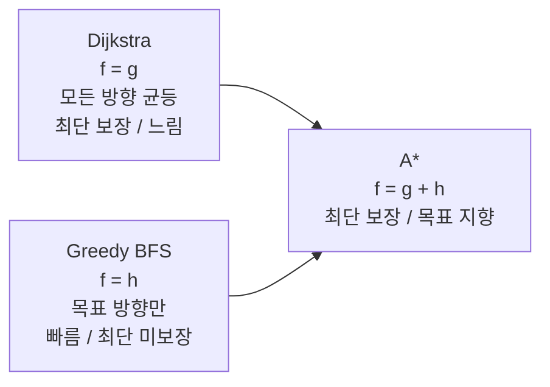
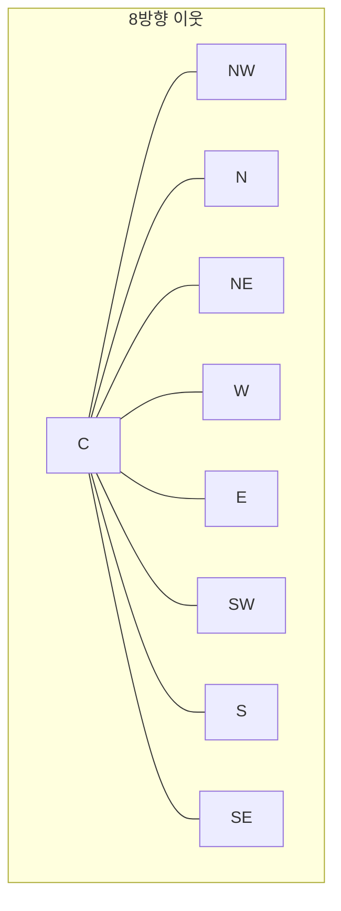
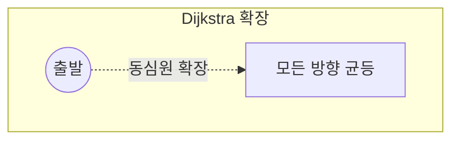
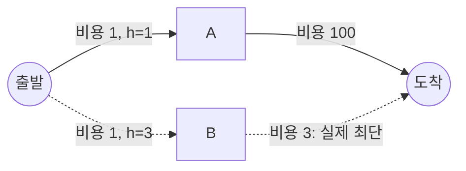

## 들어가며

NPC가 의사결정으로 "저 지점으로 이동한다"를 정하는 것과, 실제로 *어떻게 거기까지 가는가* 는 완전히 별개의 문제다. FSM·행동 트리·계획 같은 의사결정 구조는 "무엇을 할까"를 정하고, 길찾기(pathfinding)는 "정해진 목적지까지 장애물을 피해 어떤 경로로 갈까"를 계산한다. 이 문제는 그래프 위 *최단 경로 탐색* 으로 환원된다.

게임 월드를 그래프로 보는 순간 문제는 잘 정의된 형태가 된다. 정점(노드)과 가중치 간선이 있고, 출발점에서 도착점까지 가중치 합이 최소인 경로를 찾는다. 2D 그리드라면 각 셀이 정점, 인접 셀로의 이동이 간선이다. 이 추상화 위에서 Dijkstra가 모든 방향으로 균등하게 퍼지며 최단 경로를 보장하고, Greedy Best-First Search가 목표 방향으로만 빠르게 돌진하며, A*가 둘을 결합해 *최단성을 유지하면서 목표 지향적* 으로 탐색한다.

이 글은 그래프 표현에서 출발해 Dijkstra → Greedy → A*로 이어지는 흐름을 추적한다. 단순히 "A*는 $g + h$다"에서 멈추지 않고, A*가 최단 경로를 *왜* 보장하는지를 admissibility로 증명하고, consistency가 closed set 재방문을 *왜* 불필요하게 만드는지를 단조성 보조정리로 증명한다. 그 위에서 그리드 형태별 휴리스틱(Manhattan/Octile/Euclidean)의 유도, 경로 복원과 closed set·open set 자료구조, 같은 비용 경로들 사이의 tie-breaking을 손으로 따라가는 트레이스 예제와 함께 다룬다. 마지막으로 weighted A*의 부분 최적성 한계, A*가 닿지 못하는 영역까지 짚는다.



이 글의 목표.

1. **그래프 표현** — 그리드를 정점·간선으로, corner cutting과 비용 모델.
2. **Dijkstra** — 단일 출발 최단 경로의 기준과 정확성 증명.
3. **Greedy Best-First** — 휴리스틱만으로 가는 빠른 탐색과 그 실패 모드.
4. **A*** — $f = g + h$의 결합과 일반 탐색 골격.
5. **admissibility와 consistency** — 최단성을 보장하는 조건과 그 증명.
6. **휴리스틱 선택** — 그리드 형태에 맞는 거리 함수의 유도.
7. **경로 복원과 closed set** — parent 추적, reopening, open set 자료구조.
8. **tie-breaking** — 같은 비용 경로의 효율과 자연스러움.
9. **weighted A*와 경계** — 정확성을 속도와 맞바꾸는 지점, A*의 한계.


---

## 목차
1. [그래프 표현과 그리드](#1-그래프-표현과-그리드)
2. [Dijkstra의 단일 출발 최단 경로](#2-dijkstra의-단일-출발-최단-경로)
3. [Greedy Best-First Search](#3-greedy-best-first-search)
4. [A*: f = g + h](#4-a-f--g--h)
5. [Admissibility와 Consistency](#5-admissibility와-consistency)
6. [휴리스틱 선택](#6-휴리스틱-선택)
7. [경로 복원과 Closed Set](#7-경로-복원과-closed-set)
8. [Tie-breaking과 자연스러운 경로](#8-tie-breaking과-자연스러운-경로)
9. [Weighted A\*와 A\*가 닿지 못하는 영역](#9-weighted-a와-a가-닿지-못하는-영역)


---

## 1. 그래프 표현과 그리드

### 그래프로의 환원

길찾기의 첫 단계는 게임 월드를 *그래프* 로 보는 것이다. 그래프는 정점 집합 $V$와 가중치 간선 집합 $E \subseteq V \times V$로 구성되고, 각 간선 $(u, v)$는 비용 $c(u, v) \ge 0$를 가진다. 길찾기는 출발 정점 $s$에서 도착 정점 $t$까지, 경로상 간선 비용의 합이 최소인 경로 $\pi = (s, \dots, t)$를 찾는 문제다.

$$\text{cost}(\pi) = \sum_{i} c(v_i, v_{i+1}), \qquad \pi^* = \arg\min_{\pi: s \rightsquigarrow t} \text{cost}(\pi)$$

이 글이 다루는 모든 알고리즘은 *음이 아닌 가중치* 를 전제한다. 음수 간선이 있으면 Dijkstra와 A*의 핵심 가정("한 번 확정한 거리는 줄지 않는다")이 깨지고, Bellman-Ford 계열로 넘어가야 한다. 게임의 이동 비용은 거리·지형 페널티 모두 양수이므로 이 전제는 자연스럽다.

### 2D 그리드와 인접 정의

2D 그리드는 가장 흔한 표현이다. 각 셀이 정점이 되고, 인접 셀로의 이동이 간선이 된다. 인접 정의는 두 가지다.

- *4-방향(von Neumann)*: 상하좌우. 모든 간선 비용 1.
- *8-방향(Moore)*: 대각선 포함. 직선 비용 1, 대각선 비용 $\sqrt{2} \approx 1.41421$.



대각선 비용을 $\sqrt{2}$로 두는 것이 핵심이다. 1로 두면 대각선 이동이 직선보다 부당하게 싸진다. 한 칸을 대각선으로 가는 것이 가로 한 칸 + 세로 한 칸(비용 2)보다 싸지므로, 경로가 가능한 한 대각선만 타려는 지그재그가 된다. $\sqrt{2}$를 주면 대각선 한 번과 "가로 한 칸 + 세로 한 칸"이 비용 $1.41 < 2$로 여전히 대각선이 유리하되, 유클리드 기하와 일치하는 합리적 비율이 된다.

### corner cutting 차단

8-방향 이동에는 함정이 하나 있다. 대각선으로 이동할 때 *모서리 통과(corner cutting)* 가 생길 수 있다. 두 직교 셀이 모두 장애물인데 그 사이 대각선 이동을 허용하면, 캐릭터가 벽 모서리를 뚫고 지나가는 것처럼 보인다.

```cpp
// (x,y)에서 (x+dx, y+dy) 대각선 이동이 유효한지 (dx,dy ∈ {-1,+1})
bool DiagonalOk(const Grid& g, int x, int y, int dx, int dy) {
    if (g.Blocked(x + dx, y + dy)) return false;   // 목적지가 벽
    // 두 직교 이웃 중 하나라도 막혀 있으면 모서리 통과 — 금지
    if (g.Blocked(x + dx, y))      return false;   // 가로 이웃
    if (g.Blocked(x,      y + dy)) return false;   // 세로 이웃
    return true;
}
```

이 한 줄짜리 규칙의 유무가 "벽을 스치며 지나가는" 부자연스러운 경로와 자연스러운 경로를 가른다. 더 느슨한 변형(둘 중 하나만 막혀도 허용)도 있지만, 게임에서는 충돌 모양 때문에 둘 다 비어야만 허용하는 엄격한 규칙이 안전하다.

### 그리드 너머의 표현

그리드 외에 *내비게이션 그래프* (웨이포인트), *폴리곤 메시* (NavMesh) 도 같은 그래프 추상으로 환원된다. NavMesh는 폴리곤이 정점, 인접 폴리곤 사이의 공유 간선이 그래프 간선이 된다. 이 글의 알고리즘들은 표현과 무관하게 "정점, 가중치 간선, 휴리스틱"만 주어지면 동작한다.

```cpp
struct Edge { int to; float cost; };
struct Graph {
    int numNodes;
    std::vector<std::vector<Edge>> adj;          // 인접 리스트
    const std::vector<Edge>& Neighbors(int u) const { return adj[u]; }
};
```

그리드를 예로 쓰지만 본질은 그래프 탐색이다. 그리드는 인접 리스트를 명시적으로 저장할 필요 없이 좌표 산술로 이웃을 즉석에서 생성할 수 있어 메모리가 적게 든다는 차이만 있다.

## 2. Dijkstra의 단일 출발 최단 경로

### 알고리즘

Dijkstra 알고리즘은 음이 아닌 가중치 그래프에서 *한 출발점부터 모든 정점까지의 최단 거리* 를 구한다. 매 단계 "아직 확정 안 된 정점 중 출발점에서 가장 가까운 것"을 골라 확정(settle)하고, 그 이웃들의 잠정 거리를 갱신(relax)한다.

```cpp
std::vector<float> Dijkstra(const Graph& g, int start) {
    std::vector<float> dist(g.numNodes, INF);
    dist[start] = 0.0f;
    using PQ = std::pair<float, int>;          // (거리, 노드)
    std::priority_queue<PQ, std::vector<PQ>, std::greater<>> open;
    open.push({0.0f, start});

    while (!open.empty()) {
        auto [d, u] = open.top(); open.pop();
        if (d > dist[u]) continue;             // 낡은(stale) 항목 무시
        for (const Edge& e : g.Neighbors(u)) {
            float nd = dist[u] + e.cost;
            if (nd < dist[e.to]) {             // 더 짧은 경로 발견 — relax
                dist[e.to] = nd;
                open.push({nd, e.to});
            }
        }
    }
    return dist;
}
```

`if (d > dist[u]) continue;`가 lazy deletion 패턴이다. 한 노드의 거리가 갱신될 때마다 큐에 새 항목을 push하므로 큐에는 같은 노드의 낡은 항목이 여럿 남는다. 우선순위 큐는 임의 원소의 키 감소(decrease-key)를 직접 지원하지 않으므로, 꺼낼 때 거리가 현재 확정값보다 크면 그냥 버린다.

### 정확성: 왜 최단을 보장하는가

Dijkstra의 정확성은 다음 불변식에 기댄다.

> **보조정리.** 노드 $u$를 큐에서 꺼내 확정하는 순간, $dist[u]$는 $s$에서 $u$까지의 진짜 최단 거리다.

증명의 핵심은 음이 아닌 가중치다. $u$를 꺼낼 때 $dist[u]$가 최단이 아니라고 가정하자. 그러면 더 짧은 경로 $\pi$가 존재하고, $\pi$를 따라가다 보면 *아직 확정 안 된 첫 노드* $y$가 있다. $y$의 직전 노드는 이미 확정되었으므로 $dist[y]$는 $\pi$를 따른 값으로 이미 relax되어 있다. 그런데 $y$가 $\pi$ 위에서 $u$보다 앞이고 간선 비용이 음이 아니므로 $dist[y] \le \text{cost}(\pi) < dist[u]$. 그렇다면 우선순위 큐는 $u$보다 $y$를 먼저 꺼냈어야 한다 — 모순이다. 따라서 확정 시점의 $dist[u]$가 최단이다.

이 보조정리가 의미하는 바는 음이 아닌 간선 비용에서 Dijkstra가 최소 거리로 꺼낸 노드를 다시 완화할 필요가 없다는 점이다. A*에서도 휴리스틱이 consistent하면 감소 비용 $c'(u,v)=c(u,v)+h(v)-h(u)\ge0$인 Dijkstra로 해석할 수 있어 같은 closed-set 성질을 얻는다.

### 복잡도와 약점

decrease-key 없는 위 lazy deletion 구현은 한 노드가 여러 번 큐에 들어가고 낡은 항목도 pop되므로, 큐 항목 수를 기준으로 보면 $O(E \log E)$다. 단순 그래프에서는 $E \le V^2$라 흔히 쓰는 $O((V + E)\log V)$ 표기와 같은 점근 범주로 정리된다. decrease-key를 지원하는 힙에서는 각 정점을 한 번 추출하고 각 간선을 relax해 $O((V + E)\log V)$로 설명할 수 있다. 구현의 큐 정책과 복잡도 설명을 섞지 않는 것이 중요하다.

Dijkstra의 강점은 *최단 경로 보장* 이고, 약점은 *목표를 모른다* 는 점이다. 한 도착점만 필요한데도 출발점 주변 *모든 방향* 으로 균등하게 퍼져 나간다. $dist$가 출발점 거리만의 함수이므로, 도착점이 출발점 바로 옆이어도 같은 거리에 있는 반대 방향의 정점들을 먼저 확정한 뒤에야 도착점에 닿는다.



빈 100×100 4방향 그리드에서 대각선 반대편 코너로 가는 경로 하나를 찾으면, Dijkstra는 *그리드의 거의 모든 노드* 를 확정한다. 도착점의 거리가 그리드에서 가능한 최대 Manhattan 거리이므로, 그보다 작은 거리의 모든 노드를 먼저 확정하기 때문이다. 도착점과 거리가 같은 노드의 처리 수는 우선순위 큐의 동률 정책에 따라 달라질 수 있다. 이 "목표를 향한 방향성 부재"가 다음 두 절의 동기다. 도착점 정보를 탐색에 넣으면 어떻게 될까?

## 3. Greedy Best-First Search

### 휴리스틱만으로

Greedy Best-First Search는 Dijkstra의 정반대 극단이다. 출발점부터의 실제 비용 $g$를 무시하고, *도착점까지의 추정 거리(휴리스틱) $h$* 만으로 다음 노드를 고른다. 우선순위 키가 $f(n) = h(n)$이다.

```cpp
// Dijkstra 골격에서 큐 우선순위만 h(목표까지 추정)로 교체
open.push({ Heuristic(start, goal), start });
// ... 이웃 확장 시 ...
open.push({ Heuristic(e.to, goal), e.to });   // g 무시, h만
```

휴리스틱이 좋으면(장애물이 적으면) Greedy는 거의 직선으로 목표를 향해 돌진해 매우 빠르다. 탐색하는 노드 수가 Dijkstra의 일부에 불과하다. 빈 그리드에서는 거의 경로 길이에 비례하는 노드만 확장한다.

### 실패 모드: 막다른 우회

하지만 Greedy는 *최단 경로를 보장하지 않는다.* $g$를 무시하므로, 지금까지 큰 비용을 지불한 경로라도 도착점에 조금 더 가까워 보이면 계속 그쪽으로 간다. 다음 가중 그래프가 작은 반례다.

```text
          100
     A ----------> G
    /               ^
  1/                /3
  /                /
 S ------1------> B

h(A)=1, h(B)=3, h(G)=0
```

S에서 Greedy는 $h(A)=1 < h(B)=3$이므로 A를 먼저 선택한다. A에서 보이는 G의 휴리스틱은 0이므로 곧바로 G를 선택하고 총비용 101의 경로를 반환한다. 그러나 최단 경로는 S→B→G이며 비용은 4다. 격자에서는 목표를 감싼 U자형 장애물이나 막다른 통로가 같은 현상을 만든다. 목표에 가까워지는 방향으로 깊이 들어간 뒤에야 되돌아 나오기 때문이다.



Greedy의 또 다른 위험은 *경로 품질의 비결정성* 이다. 휴리스틱 값이 같은 노드가 여럿이면 임의로 골라, 같은 맵에서도 우회 방향이 들쭉날쭉하다. Dijkstra는 $g$만 봐서 *느리지만 정확* 하고, Greedy는 $h$만 봐서 *빠르지만 부정확* 하다. 두 정보를 합치면 어떨까?

## 4. A*: f = g + h

### 두 정보의 결합

A*는 두 정보를 더한다.

$$f(n) = g(n) + h(n)$$

- $g(n)$: 출발점부터 노드 $n$까지의 *실제* 누적 비용 (Dijkstra의 정보).
- $h(n)$: $n$부터 도착점까지의 *추정* 비용 (Greedy의 정보).
- $f(n)$: $n$을 거치는 경로의 *추정 총비용*.

매 단계 $f$가 가장 작은 노드를 확장한다. $g$가 있어 "이미 멀리 돌아온" 경로를 억제하고, $h$가 있어 "목표 방향"을 선호한다. 이 둘의 균형이 핵심이다 — $f$는 "이 노드를 거치는 최선의 완전한 경로가 대략 얼마짜리일지"의 추정이며, A*는 가장 유망한 추정부터 펼친다.

```cpp
struct Node { float g = INF; int parent = -1; bool closed = false; };

std::vector<int> AStar(const Graph& gr, int start, int goal) {
    std::vector<Node> nodes(gr.numNodes);
    nodes[start].g = 0.0f;
    using PQ = std::pair<float, int>;          // (f, 노드)
    std::priority_queue<PQ, std::vector<PQ>, std::greater<>> open;
    open.push({ Heuristic(start, goal), start });

    while (!open.empty()) {
        int u = open.top().second; open.pop();
        if (u == goal) return Reconstruct(nodes, goal);
        if (nodes[u].closed) continue;         // 낡은 항목
        nodes[u].closed = true;

        for (const Edge& e : gr.Neighbors(u)) {
            float ng = nodes[u].g + e.cost;
            if (ng < nodes[e.to].g) {          // 더 나은 경로 — relax
                nodes[e.to].g = ng;
                nodes[e.to].parent = u;
                open.push({ ng + Heuristic(e.to, goal), e.to });
            }
        }
    }
    return {};   // 경로 없음
}
```

### 두 극단의 일반화

A*는 두 극단의 특수 경우를 정확히 포함한다.

- $h \equiv 0$이면 $f = g$가 되어 정확히 Dijkstra다. $h = 0$은 항상 admissible하다(실제 거리를 절대 넘지 않는다). Dijkstra는 "휴리스틱 없는 A*"다.
- $g$를 무시하고 $f = h$면 Greedy다.

$h$가 실제 거리에 가까울수록 A*는 Dijkstra의 정확성을 유지하며 Greedy의 속도에 다가간다. 극한으로 $h = h^*$(완벽한 휴리스틱)이면, A*는 *최단 경로 위의 노드만* 확장한다 — 곁길로 한 발짝도 새지 않는다. 현실의 휴리스틱은 그 사이 어딘가에 있고, "얼마나 $h^*$에 가까운가"가 곧 탐색 효율을 결정한다.

### 같은 맵에서의 비교

3절의 빈 그리드를 셋으로 돌려 보면, 확장 노드 수가 알고리즘의 성격을 그대로 보여준다.

| 알고리즘 | 우선순위 $f$ | 빈 그리드 확장 노드 | 최단 보장 |
|---|---|---|---|
| Dijkstra | $g$ | 도착 거리 이내 거의 전부 | 보장 |
| Greedy | $h$ | 경로 길이에 근접 | 미보장 |
| A* | $g + h$ | 경로 주변 좁은 띠 | 보장(admissible 시) |

A*는 정보가 풍부한 휴리스틱일수록 목표와 무관한 노드 확장을 줄일 수 있다. 최단 경로 보장은 그래프 탐색 구현, 종료 조건과 휴리스틱 조건에 달려 있다. admissible 휴리스틱은 목표 비용을 과대평가하지 않으며, 노드를 다시 열지 않는 closed-set 구현에는 보통 consistent 조건까지 필요하다. 장애물이 많거나 휴리스틱이 약하면 확장 양상은 Dijkstra에 가까워진다.

## 5. Admissibility와 Consistency

A*가 *최단 경로를 보장* 하는지는 전적으로 휴리스틱 $h$의 성질에 달렸다. 두 성질을 구분한다.

### Admissibility (허용성)

$h$가 admissible하려면 *실제 최단 거리를 과대평가하지 않아야* 한다. 이 정의는 간선 비용이 음이 아니고(2절의 전제), $h(n) \ge 0$이며, 목표 노드 $t$에서 $h(t) = 0$이라는 통상 전제 위에서 쓴다.

$$h(n) \le h^*(n) \quad \text{(모든 } n \text{에 대해)}, \qquad h(n) \ge 0, \qquad h(t) = 0$$

조건 $h(n) \ge 0$, $h(n) \le h^*(n)$, $h(t)=0$을 함께 둬야 한다. 상한 조건만 만족하고 $h(t)$가 0이 아니면, 목표를 꺼내자마자 종료하는 구현이 잘못된 비용을 반환할 수 있다.

여기서 $h^*(n)$은 $n$부터 도착점까지의 실제 최단 거리다. 직관적으로, $h$가 실제보다 작으면 A*는 "혹시 더 나을지 모르는" 경로를 성급히 버리지 않는다. 반대로 $h$가 실제를 과대평가하면(non-admissible) A*는 더 빠를 수 있지만 최단성을 잃는다 — 실제로 더 짧은 경로를 "추정상 비싸 보여서" 건너뛸 수 있다.

#### 최적성 증명

위의 $0 \le h \le h^*$와 $h(t)=0$을 전제로, admissible 휴리스틱에서 A*가 찾은 경로가 최단임을 증명한다. A*가 도착점 $t$를 *최적이 아닌* 비용 $g(t) > h^*(s)$로 확정했다고 가정하자(여기서 $h^*(s)$가 진짜 최단 거리다). 큐에는 진짜 최단 경로 위의 어떤 노드 $n$이 아직 들어 있다(최적 경로가 어딘가에서 끊겼다면, 그 끊긴 직전 노드 다음의 노드가 큐에 있다). 이 $n$에 대해

$$f(n) = g(n) + h(n) \le g(n) + h^*(n) = h^*(s)$$

마지막 등식은 $n$이 최적 경로 위에 있어 $g(n) + h^*(n)$이 정확히 최적 총비용이기 때문이다. 한편 A*가 $t$를 $n$보다 먼저 꺼냈다면 $f(t) \le f(n)$이어야 한다. 그런데 $h(t) = 0$(도착점에서 도착점까지 거리는 0)이므로 $f(t) = g(t) > h^*(s) \ge f(n)$. 모순이다. 따라서 A*는 $t$를 최적 비용으로만 확정한다.

이 증명에서 admissibility($h \le h^*$)가 결정적으로 쓰인 곳은 $f(n) \le h^*(s)$ 부등식 한 줄이다. 휴리스틱이 과대평가하면 이 부등식이 깨지고 최적성도 무너진다. 증명은 $h(t)=0$도 사용하므로 상한 조건과 목표 기준을 함께 명시해야 한다. 또한 admissibility는 최적성의 필요조건일 뿐, 노드를 다시 열지 않는 closed-once 구현에는 별도로 consistency가 필요하다(아래 절).

### Consistency (일관성, monotonicity)

더 강한 조건이다. 모든 간선 $(n, n')$에 대해

$$h(n) \le c(n, n') + h(n')$$

즉 한 칸 이동의 휴리스틱 감소량이 그 이동 비용을 넘지 않는다. 삼각 부등식의 형태다. 그리고 $h(t) = 0$을 함께 요구한다.

#### consistent ⟹ admissible

consistent하면 admissible이다(역은 아니다). $n$에서 도착점까지의 최단 경로 $n = v_0, v_1, \dots, v_k = t$를 따라 consistency를 전개하면

$$h(v_0) \le c(v_0, v_1) + h(v_1) \le c(v_0,v_1) + c(v_1,v_2) + h(v_2) \le \dots \le \sum_i c(v_i, v_{i+1}) + h(t) = h^*(n)$$

마지막에 $h(t) = 0$을 썼다. 따라서 $h(n) \le h^*(n)$, 즉 admissible이다.

#### consistency ⟹ closed 노드의 $g$는 최적

consistency의 실용적 가치는 *closed set 재방문이 불필요* 하다는 것이다. 핵심은 다음 보조정리다.

> consistent 휴리스틱에서 A*가 노드들을 확정하는 순서로 $f$값은 단조 비감소(non-decreasing)다.

$u$를 확정한 뒤 그 이웃 $v$를 relax해 큐에 넣는다고 하자. 새 $f(v) = g(u) + c(u,v) + h(v)$다. consistency에서 $h(u) \le c(u,v) + h(v)$이므로

$$f(v) = g(u) + c(u,v) + h(v) \ge g(u) + h(u) = f(u)$$

즉 자식의 $f$는 부모의 $f$ 이상이다. 따라서 확정 순서의 $f$가 절대 줄지 않고, 한 노드를 closed로 확정하는 순간 그 노드의 $g$는 이미 최적이다(이후에 더 작은 $f$, 따라서 더 작은 $g$로 다시 도달하는 일이 없다). 이는 2절 Dijkstra 보조정리의 A* 판이다.

### reopening: admissible하지만 inconsistent할 때

휴리스틱이 admissible하지만 inconsistent하면, closed로 확정한 노드에 나중에 *더 짧은 경로* 로 다시 도달할 수 있다. 이 경우 그 노드를 closed에서 빼내 다시 open으로 넣어야(reopening) 최적성이 유지된다.

```cpp
for (const Edge& e : gr.Neighbors(u)) {
    float ng = nodes[u].g + e.cost;
    if (ng < nodes[e.to].g) {
        nodes[e.to].g = ng;
        nodes[e.to].parent = u;
        nodes[e.to].closed = false;          // reopening: 다시 열어준다
        open.push({ ng + Heuristic(e.to, goal), e.to });
    }
}
```

`closed` 체크를 relax보다 *앞* 에 두어 닫힌 노드를 무조건 건너뛰면, inconsistent 휴리스틱에서는 최적성이 깨진다. 위처럼 `ng < g`일 때 무조건 relax하고 closed를 풀어주면(이른바 *lazy A* with reopening*) admissible 휴리스틱이기만 하면 최적성이 보장된다. 다행히 게임에서 쓰는 거리 기반 휴리스틱(Manhattan/Octile/Euclidean)은 대부분 자연스럽게 consistent하므로, 보통 reopening을 신경 쓰지 않아도 된다. consistency를 깨는 전형적 사례는 사람이 손으로 만든 패턴 데이터베이스나 여러 휴리스틱의 부정확한 조합이다.

## 6. 휴리스틱 선택

그리드의 이동 규칙에 *맞는* 휴리스틱을 써야 admissible하면서 최대한 정확하다. 핵심 원칙은 "휴리스틱은 *그 그리드에서 장애물이 전혀 없다고 가정할 때의 최단 거리* 여야 한다"는 것이다. 장애물을 무시한 거리는 항상 실제 거리 이하이므로(장애물은 거리를 늘리기만 한다) admissible이 보장되고, 장애물이 없을 때 *정확히 일치* 하므로 가능한 한 타이트하다.

| 그리드 | 휴리스틱 | 식 |
|---|---|---|
| 4-방향 | Manhattan | $h = \lvert dx\rvert + \lvert dy\rvert$ |
| 8-방향 | Octile | $h = \max(dx,dy) + (\sqrt{2}-1)\min(dx,dy)$ |
| 자유 이동 | Euclidean | $h = \sqrt{dx^2 + dy^2}$ |

여기서 $dx = |x_n - x_t|$, $dy = |y_n - y_t|$다.

### Octile 거리의 유도

8-방향 그리드에서 장애물이 없을 때 최적 이동을 직접 세어 보면 Octile이 나온다. $dx \ge dy$라 하자(아니면 대칭). 최적 전략은 *대각선으로 갈 수 있는 만큼 가고, 나머지를 직선으로* 가는 것이다.

- 대각선 이동 $dy$번: $x$와 $y$를 동시에 한 칸씩 줄인다. 비용 $\sqrt{2} \cdot dy$.
- 직선 이동 $dx - dy$번: 남은 $x$ 차이를 채운다. 비용 $1 \cdot (dx - dy)$.

합치면 $(dx - dy) + \sqrt{2}\, dy = dx + (\sqrt{2}-1) dy = \max(dx,dy) + (\sqrt{2}-1)\min(dx,dy)$. 이것이 Octile 식이다.

```cpp
float Octile(int dx, int dy) {
    dx = std::abs(dx); dy = std::abs(dy);
    int lo = std::min(dx, dy), hi = std::max(dx, dy);
    return hi + (std::sqrt(2.0f) - 1.0f) * lo;   // ≈ hi + 0.41421 * lo
}
```

### 잘못된 짝의 결과

선택 기준은 *그리드에서 실제로 가능한 이동* 이다. 휴리스틱과 이동 규칙을 잘못 짝지으면 둘 중 하나가 망가진다.

- *4-방향 그리드에 Euclidean*: 과소평가가 너무 심하다. 대각선 이동이 불가능한데 직선거리($\sqrt{dx^2+dy^2}$)로 추정하므로, 실제 거리($dx+dy$)보다 한참 작은 값이 나온다. admissible하긴 하나 0에 가까운 휴리스틱처럼 작동해 탐색이 Dijkstra만큼 느려진다. Manhattan이 맞다.
- *8-방향 그리드에 Manhattan*: *과대평가* 다. 대각선으로 한 번에 갈 수 있는데 직각 두 번($dx + dy$)으로 가정하므로 실제(Octile)보다 큰 값이 나와 admissibility를 깬다. 예로 $dx = dy = 1$이면 Manhattan은 2, 실제 대각선 비용은 $\sqrt 2 \approx 1.41$ — 과대평가다. 최단성이 깨진다.

수치 예로 $dx = 4, dy = 3$일 때를 셋으로 보면 차이가 분명하다.

| 휴리스틱 | 값 | 8방향 실제 거리와 비교 |
|---:|---:|---|
| Manhattan | $7$ | 과대평가 (admissible 아님) |
| Octile | $4 + 0.41421 \times 3 \approx 5.243$ | 정확 (장애물 없을 때 $h^*$와 일치) |
| Euclidean | $\sqrt{25} = 5$ | 과소평가 (admissible, 약간 느슨) |

8-방향에서 Octile은 장애물 없는 최단과 정확히 일치하므로 가장 타이트한 admissible 휴리스틱이다. Euclidean도 admissible하지만 약간 작아 더 많은 노드를 펼친다. 휴리스틱이 실제 거리에 가까울수록 A*가 확장하는 노드가 줄어 빨라지므로, 그리드에 맞는 가장 *타이트한* admissible 휴리스틱을 고르는 것이 성능의 첫걸음이다.

### 스케일 정합

함정 하나. 휴리스틱의 단위가 간선 비용의 단위와 *같아야* 한다. 간선 비용이 "타일당 10"으로 정수 스케일되어 있는데 휴리스틱은 "타일당 1"로 두면, $h$가 실제의 $1/10$이라 사실상 Dijkstra가 된다(admissible하지만 매우 느슨). 반대로 비용은 1인데 휴리스틱에 10을 곱하면 과대평가로 최단성이 깨진다. 비용 스케일을 바꾸면 휴리스틱 스케일도 같이 맞춘다.

## 7. 경로 복원과 Closed Set

### parent 추적

A*가 도착점에 닿으면 *경로 자체* 를 복원해야 한다. 거리뿐 아니라 "어디서 왔는지"가 필요하다. 각 노드가 부모를 가리키는 `parent` 포인터를 저장하고, 도착점에서 출발점까지 역추적한 뒤 뒤집는다.

```cpp
std::vector<int> Reconstruct(const std::vector<Node>& nodes, int goal) {
    std::vector<int> path;
    for (int n = goal; n != -1; n = nodes[n].parent)
        path.push_back(n);
    std::reverse(path.begin(), path.end());
    return path;
}
```

`parent`는 그 노드의 $g$가 갱신될 때 함께 갱신된다(4절 코드의 `nodes[e.to].parent = u`). 더 짧은 경로가 발견되면 부모도 그 짧은 경로 쪽으로 바뀐다. 이 동기화가 깨지면 — 예컨대 $g$만 갱신하고 parent를 안 바꾸면 — 복원된 경로가 실제 거리와 다른 엉뚱한 길이 된다.

### A* 한 번 손으로 따라가기

작은 4-방향 그리드에서 A*가 어떤 순서로 노드를 확정하는지 트레이스한다. S에서 G까지, 가운데에 벽 한 칸.

```text
좌표 (열,행), 모든 간선 비용 1, h = Manhattan
. . G        (0,2)=S 시작, (2,0)=G 목표
. # .        (1,1)=벽
S . .
```

행을 위에서 아래로 0,1,2로, S=(0,2), G=(2,0)이라 하자. 초기 $h(S) = |0-2| + |2-0| = 4$.

| 단계 | 확정 노드 | $g$ | $h$ | $f$ | open에 새로 들어간 이웃 |
|---|---|---:|---:|---:|---|
| 1 | (0,2) S | 0 | 4 | 4 | (1,2) f=4, (0,1) f=4 |
| 2 | (1,2) | 1 | 3 | 4 | (2,2) f=4 |
| 3 | (0,1) | 1 | 3 | 4 | (0,0) f=4 |
| 4 | (2,2) | 2 | 2 | 4 | (2,1) f=4 |
| 5 | (0,0) | 2 | 2 | 4 | (1,0) f=4 |
| 6 | (2,1) | 3 | 1 | 4 | (2,0) G f=4 |
| 7 | (2,0) G | 4 | 0 | 4 | 종료 |

벽 (1,1)은 확장 대상이 아니다. 이 예에서 최적 경로 위 노드의 $g+h$가 모두 4인 것은 Manhattan 휴리스틱이 해당 경로의 남은 비용과 정확히 일치하기 때문이다. 같은 최소 $f$를 가진 노드가 여러 개면 우선순위 큐의 2차 키가 실제 확장 순서를 바꾸지만, 올바른 tie-breaking은 최적 비용 자체를 바꾸지 않는다.

### Closed set과 reopening

*Closed set* 은 이미 최적 비용으로 확정된 노드들의 집합이다. 위 구현에서는 `closed` 플래그로 표현했다. closed 노드를 다시 큐에서 꺼내면 무시한다(낡은 항목). consistent 휴리스틱(5절)에서는 closed로 확정된 노드의 $g$가 이미 최적이므로 재방문이 불필요하다 — 이 성질이 closed set을 안전하게 만든다. closed set이 없으면 같은 노드를 여러 번 확장해 탐색이 비효율적이 되고, 그래프에 사이클이 있으면 무한 루프 위험도 생긴다.

5절에서 본 대로, inconsistent하지만 admissible한 휴리스틱이라면 closed 노드의 reopening이 필요할 수 있다. 거리 기반 휴리스틱은 consistent하므로 게임에서는 단순 closed 플래그로 충분하다.

### open set 자료구조

A* 성능의 상당 부분이 open set 자료구조에서 나온다. open set은 "아직 확정 안 됐고 한 번 이상 발견된" 노드들을 $f$ 순으로 관리한다.

| 자료구조 | extract-min | decrease-key | 비고 |
|---|---|---|---|
| 정렬 안 된 배열 | $O(n)$ | $O(1)$ | 작은 그래프 |
| 이진 힙 (`priority_queue`) | $O(\log n)$ | 미지원 → lazy push | 게임 표준 |
| 이진 힙 + 위치 추적 | $O(\log n)$ | $O(\log n)$ | 메모리 더 듦 |
| 버킷 큐 | $O(1)$ 평균 | $O(1)$ | 정수 비용일 때 |

`std::priority_queue`는 decrease-key를 지원하지 않으므로 위 코드들은 lazy push(같은 노드를 여러 번 push하고 꺼낼 때 낡은 항목 버리기)를 쓴다. 간선 비용이 정수 + 작은 범위면 *버킷 큐*(거리별 양동이)가 $\log$ 인자를 없애 빠르다. 그리드 A*의 흔한 최적화다.

### 메모리

메모리 관점에서 A*의 비용은 *open + closed에 든 노드 수* 에 비례한다. 위 구현은 `std::vector<Node> nodes(numNodes)`로 *전체 그래프* 만큼 미리 잡는다. 1000×1000 그리드면 노드당 16바이트라도 16MB다. 큰 그리드에서 이것이 부담이면, 노드 데이터를 해시맵으로 *방문한 노드만* 희소하게 저장하거나, 대칭 제거·계층화·사전 계산으로 탐색 자체를 줄인다. 매 탐색마다 전체 배열을 INF로 초기화하는 비용을 피하려고, 노드마다 "마지막으로 사용된 탐색 ID"를 두어 ID가 다르면 미초기화로 간주하는 generation 트릭도 흔하다.

## 8. Tie-breaking과 자연스러운 경로

A*는 $f$가 최소인 노드를 고르는데, *$f$가 같은 노드가 여럿* 인 경우가 흔하다(7절 트레이스에서 본 $f = 4$ 더미). 특히 균일 그리드에서는 출발-도착 사이에 같은 비용의 경로가 수없이 많다. 어떤 것을 고르느냐가 두 가지에 영향을 준다 — 탐색 효율과 경로의 시각적 자연스러움.

### h 우선 tie-break

$f$가 같으면 $h$가 작은 노드(도착점에 더 가까운 노드)를 우선한다. $f = g + h$가 같은데 $h$가 작다는 건 $g$가 크다는 것, 즉 *더 깊이 진행한* 노드다. 깊이 진행한 쪽을 먼저 펼치면 탐색이 도착점 쪽으로 집중되어 확장 노드 수가 준다. 우선순위 큐 비교에 $h$를 부차 키로 넣어 구현한다.

```cpp
struct Key {
    float f, h;
    bool operator>(const Key& o) const {     // greater → min-heap
        if (f != o.f) return f > o.f;
        return h > o.h;                       // f 동률이면 h 작은 쪽 우선
    }
};
```

이 부차 키는 같은 $f$ 등고선에서 목표에 더 가까운 노드를 먼저 확장하므로, 타이트한 휴리스틱과 열린 공간에서는 확장 수를 줄일 수 있다. 감소 폭은 장애물 배치와 휴리스틱에 따라 달라지며 최악 복잡도를 바꾸지는 않는다.

### 격자 경로 문제와 cross-product tie-break

균일 그리드의 A*는 같은 비용 경로 중 *계단 모양* 을 고를 수 있다. 직선으로 보일 경로가 "오른쪽-위-오른쪽-위" 식으로 꺾인다. 비용은 같지만 시각적으로 부자연스럽다. 이를 완화하는 한 방법은 현재 노드와 시작-도착 직선 사이의 편차를 나타내는 외적 크기를 *진짜 tie-break 키* 로 쓰는 것이다. $f$보다 앞에 섞지 않고 $f$가 같은 후보끼리만 비교하면 A*가 정렬하는 주 비용을 바꾸지 않는다.

```cpp
// 간선 비용은 고정소수점 정수로 스케일했다고 가정한다.
struct OpenKey {
    int     f;
    int64_t cross;  // 시작-목표 직선에서 벗어난 정도
    int     h;
    int     nodeId; // 완전한 결정성과 strict weak ordering

    bool operator>(const OpenKey& o) const {
        return std::tie(f, cross, h, nodeId)
             > std::tie(o.f, o.cross, o.h, o.nodeId);
    }
};
```

이 비교는 비용이 같은 후보 중 시작-목표 직선에 더 가까운 쪽을 먼저 확장한다. 정수 또는 고정소수점 키를 쓰면 부동소수점 epsilon 비교로 우선순위 큐의 strict weak ordering을 깨는 문제도 피할 수 있다.

### 휴리스틱 보정과 tie-break는 다르다

외적 항에 작은 계수를 곱해 $h$나 $f$에 더하는 구현도 있지만, 이는 더 이상 순수한 tie-break가 아니다. 맵 좌표가 커지면 외적 값도 커지므로 `0.001` 같은 고정 계수가 주 비용 차이보다 작다는 보장은 없다. 양의 항이 휴리스틱을 과대평가하면 admissibility와 최단성 증명을 잃는다. 근사 경로를 의도한 경우에만 별도의 weighted heuristic으로 취급하고, 최단성이 계약이면 위처럼 lexicographic 부차 키를 사용한다.

근본적으로 격자 경로를 없애려면 tie-break로는 부족하다. 경로 후처리(path smoothing)로 직선 가시성(line-of-sight)이 확보되는 구간을 곧게 펴거나, 처음부터 임의 각도를 허용하는 시야 기반 알고리즘이 필요하다 — 이는 그리드 표현 자체의 한계이지 A* 알고리즘의 한계가 아니다.

## 9. Weighted A\*와 A\*가 닿지 못하는 영역

### 정확성을 속도와 맞바꾸기

A*가 최단을 보장하지만 노드를 너무 많이 펼친다면, 휴리스틱에 가중치를 곱해 일부러 과대평가하는 *weighted A** 가 있다.

$$f(n) = g(n) + w \cdot h(n), \qquad w \ge 1$$

$w = 1$이면 보통의 A*, $w \to \infty$면 Greedy에 가까워진다. $w > 1$이면 휴리스틱이 과대평가되어 admissibility가 깨지지만, 대신 도착점 쪽으로 더 공격적으로 탐색해 확장 노드가 줄고 빨라진다.

그 대가는 *부분 최적성(bounded suboptimality)* 이다. weighted A*가 찾은 경로의 비용은 최단의 $w$배를 넘지 않음이 증명되어 있다.

$$\text{cost}(\pi_{\text{found}}) \le w \cdot \text{cost}(\pi^*)$$

즉 $w = 1.5$면 "최단보다 최대 50% 길 수 있지만 훨씬 빠른" 경로다. 게임에서는 5% 더 긴 경로를 두 배 빠르게 찾는 거래가 종종 합리적이다 — 플레이어는 5% 차이를 눈치채지 못한다. 이 *정확성 ↔ 속도* 손잡이가 weighted A*의 핵심 가치다.

| $w$ | 성격 | 경로 품질 | 속도 |
|---:|---|---|---|
| 1.0 | 표준 A* | 최단 보장 | 기준 |
| 1.1 ~ 1.5 | 약한 weighted | 최대 $w$배 길이 | 빠름 |
| 큰 값 | Greedy 근접 | 보장 거의 없음 | 가장 빠름 |

### w배 한계는 어디서 오는가 — 부분 최적성의 증명

위 표는 "$w$배를 넘지 않는다"를 결과로만 적었다. 이 한계가 어디서 나오고, 어떤 전제에서 성립하며, 실제로 얼마나 느슨한지를 본다. 최적 비용을 $C^* = h^*(s)$로 둔다.

먼저 *열린 집합에 최적 경로 노드가 남아 있다는 보조정리* 가 필요하다. weighted A*가 도착점 $t$를 꺼내기 전 어느 시점에도, $s$에서 $t$로 가는 어떤 최적 경로 위에 $g(n) = g^*(n)$인 노드 $n$이 open에 들어 있다. 최적 경로를 $s$부터 따라가며 *아직 확정 안 된 첫 노드* 를 잡으면, 그 직전 노드까지는 모두 최적 $g$로 확정되어 있어 첫 노드가 정확히 최적 $g$로 relax되어 open에 있기 때문이다. 이 보조정리는 closed 노드를 더 짧은 경로로 다시 열어줄 때(admissible 휴리스틱의 reopening) 성립한다. $h$가 consistent해도 $w>1$이면 $f=g+w\,h$의 단조성이 깨져 closed 노드의 $g$가 최적이 아닐 수 있고(아래 예에서 $A$가 $g=3$으로 닫힌다), reopening 없는 consistent $h$의 $w$ 한계는 별도 증명이 필요하다(ARA*, Likhachev·Gordon·Thrun 2003).

이제 한계를 유도한다. $t$를 꺼내는 순간 그 open 노드 $n$보다 $t$가 먼저 뽑혔으므로 $f(t) \le f(n)$이다. $h(t) = 0$이라 $f(t) = g(t)$이고, 전개하면

$$g(t) = f(t) \le f(n) = g(n) + w\,h(n) = g^*(n) + w\,h(n) \le g^*(n) + w\,h^*(n) \le w\bigl(g^*(n) + h^*(n)\bigr) = w\,C^*$$

차례로 (i) $t$ 우선 추출, (ii) admissibility $h(n) \le h^*(n)$, (iii) $w \ge 1$이라 $g^*(n) \le w\,g^*(n)$, (iv) $n$이 최적 경로 위에 있어 $g^*(n) + h^*(n) = C^*$를 썼다. 따라서 도착 확정 비용 $g(t)$는 최단의 $w$배를 넘지 못한다. $w = 1$이면 부등식 사슬이 $g(t) \le C^*$로 닫혀 5절의 admissible 최적성 증명과 정확히 일치한다 — weighted A*의 한계 증명은 그 최적성 증명에 $w$를 끼운 일반화다.

한계가 *얼마나 느슨한가* 는 작은 그래프로 보인다. $S \to A$ 비용 3, $S \to P$ 비용 1, $P \to A$ 비용 1, $A \to G$ 비용 1, 휴리스틱은 정확($h = h^*$)이라 하자. 최단 경로는 $S\,P\,A\,G$로 비용 3이다. $w = 3$이면 출발점 확장 직후 직접 간선 $S \to A$의 $f = 3 + 3{\cdot}1 = 6$이 $P$의 $f = 1 + 3{\cdot}2 = 7$보다 작아, $A$가 비싼 경로의 $g = 3$으로 *먼저* 닫히고 곧장 $G$를 $g = 4$로 밀어 도착이 $S\,A\,G$(비용 4)로 끝난다. 실현 비율은 $4/3 \approx 1.33$으로 한계 $w = 3$보다 한참 작다. 반면 $w = 1$과 $w = 1.5$에서는 같은 그래프가 여전히 최단 3을 낸다 — 약한 인플레이션은 자주 손해가 없다.

이 느슨함은 우연이 아니다. 무작위 장애물 그리드(20×20·25% 차단·consistent octile·reopening 없음) 192판에서 weighted A* 실현 비율의 최댓값은 $w = 1.5$에서 1.13, $w = 3$에서 1.29였고 한계 $w$를 넘은 판은 한 번도 없었다. $w$는 *최악 보장* 이지 전형값이 아니다. 게임에서 $w = 1.1 \sim 1.5$가 흔한 선택인 이유가 여기 있다 — 한계는 10~50%를 약속하지만 실제 경로는 보통 몇 % 안쪽이고 확장 노드 수는 크게 준다.

경계 조건 셋을 짚는다. 첫째, 한계는 *도착 확정* 비용에 대한 것이다. weighted A*는 도착점을 *처음 꺼내는 순간* 종료하므로, 인플레이션이 도착점을 나쁜 경로로 일찍 꺼내게 만들 수 있다. 위 예에서 $G$가 비용 4로 일찍 확정되며, reopening을 켜도 결과가 같은 이유는 종료가 중간 노드가 아니라 도착점 추출에서 일어나 중간 노드를 다시 여는 것이 무의미하기 때문이다. 둘째, reopening 없이 $h$가 *inconsistent* 하면 보조정리의 "open에 최적 $g$ 노드" 전제가 깨져 실현 한계가 $w$보다 나빠질 수 있다. consistent $h$는 reopening 없이도 $w$ 한계를 지키며(ARA*가 이 사실 위에 선다), 거리 기반 게임 휴리스틱은 보통 consistent하므로 단순 closed 플래그로 충분하다. 셋째, $w$를 키울수록 한계는 선형으로 헐거워지지만 확장 노드 감소는 체감하므로, 더 키워도 속도 이득은 줄고 경로 품질만 빠르게 나빠지는 무릎 구간이 있다.

### A*가 닿지 못하는 영역

표준 A*는 강력하지만 세 가지 한계가 있고, 각각이 다른 알고리즘의 출발점이다.

- *대칭 폭발*: 균일 그리드에서 같은 비용 경로가 조합적으로 많아, A*가 사실상 동등한 경로들을 중복 평가한다. 빈 공간에서 같은 $f$ 노드가 무더기로 쌓이는 것이 8절에서 본 현상이다. 이 대칭을 그래프 차원에서 깨 불필요한 노드를 건너뛰는 것이 Jump Point Search다.
- *격자 경로*: tie-break로 완화해도 본질적으로 8-방향에 갇혀, 자연스러운 임의 각도 경로가 나오지 않는다. 탐색 중 부모와의 직선 가시성을 검사해 각도를 자유롭게 푸는 시야 기반 알고리즘(Theta*)이 이 영역을 다룬다.
- *정적 가정*: A*는 그래프가 고정이라고 본다. 문이 열리거나 다리가 무너지는 등 장애물이 동적으로 바뀌면 매번 처음부터 다시 계산해야 한다. 변경된 부분만 점진적으로 갱신해 이전 탐색 결과를 재활용하는 알고리즘(D* Lite)이 이 영역을 다룬다.

이 한계들이 고급 길찾기 알고리즘과 NavMesh 같은 다른 표현이 출발하는 지점이다. 그러나 그 모든 변형의 *기반* 은 여전히 $f = g + h$와 admissible 휴리스틱이다. 무엇을 개선했는지는 항상 "이 식의 어느 부분을, 어떤 가정 아래에서 바꿨는가"로 읽힌다.


---

## 결론

길찾기는 게임 월드를 그래프로 추상화하면 음이 아닌 가중치 위의 최단 경로 탐색이 된다. Dijkstra는 $g$만 보고 모든 방향으로 퍼져 최단을 보장하되 느리고, Greedy는 $h$만 보고 목표로 돌진해 빠르되 막다른 우회에 빠진다. A*는 $f = g + h$로 둘을 결합해, admissible 휴리스틱 아래에서 최단성을 유지하며 목표 지향적으로 탐색한다. $h \equiv 0$이면 Dijkstra, $g$를 무시하면 Greedy — A*는 두 극단의 일반화다.

최적성은 공짜가 아니라 휴리스틱의 성질에서 나온다. admissibility($h \le h^*$)가 최단성을 보장하고, 그보다 강한 consistency가 $f$의 단조성을 통해 closed set 재방문을 불필요하게 만든다. 그리드 형태에 맞는 휴리스틱 — 4-방향 Manhattan, 8-방향 Octile — 을 "장애물 없을 때의 최단 거리"로 유도하면 admissible하면서 타이트하다. parent 추적으로 경로를 복원하고, open set 자료구조와 closed 플래그가 탐색의 시간·공간 비용을 결정하며, tie-breaking으로 같은 비용 경로 중 효율적이고 자연스러운 것을 고른다.

A*의 정확성은 weighted A*로 속도와 맞바꿀 수 있고($w$배 부분 최적성), 그 한계 — 대칭 폭발, 격자 경로, 정적 가정 — 는 각각 JPS, any-angle 알고리즘, 점진적 재계획의 동기가 된다. 그러나 이 모든 발전은 $f = g + h$라는 같은 토대 위에 서 있다. 그래프 탐색의 이 핵심과 그것이 최단을 보장하는 이유를 이해하면, 그 위의 모든 변형이 "어느 가정을 어떻게 풀었는가"로 읽힌다.

## 더 읽을거리

- Hart, Nilsson & Raphael, "A Formal Basis for the Heuristic Determination of Minimum Cost Paths" (1968) — A*의 원논문. admissibility와 최적성 증명의 출처.
- Amit Patel, "Introduction to A*" 및 "Heuristics" (Red Blob Games) — 시각적 직관과 휴리스틱·tie-break·스케일 정합 정리.
- Ian Millington, *AI for Games*, 4장 "Pathfinding" — 구현과 휴리스틱 선택, open/closed 자료구조의 실무.
- Steve Rabin & Nathan Sturtevant, "Pathfinding Architecture Optimizations" (*Game AI Pro* 1권) — 큰 그리드에서의 메모리·버킷 큐·generation 트릭.
- Dijkstra, "A Note on Two Problems in Connexion with Graphs" (1959) — Dijkstra 알고리즘 원전.
- Russell & Norvig, *AIMA*, "Informed Search" 장 — admissibility·consistency·weighted A*의 형식적 증명과 부분 최적성 한계.
- Pohl, "Heuristic Search Viewed as Path Finding in a Graph" (1970) — weighted A*와 $w$배 한계의 기초.
- Likhachev, Gordon & Thrun, "ARA*: Anytime A* with Provable Bounds on Sub-Optimality" (NIPS 2003) — consistent 휴리스틱에서 reopening 없는 weighted A*의 $w$배 보장과 인플레이션 점감을 이용한 anytime 재사용.
