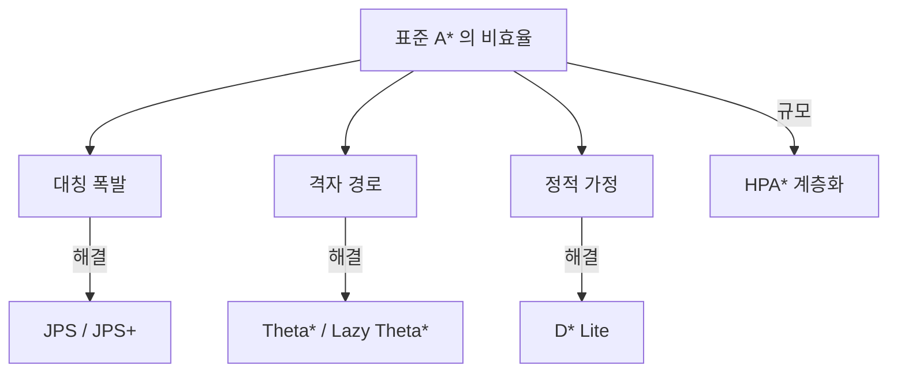
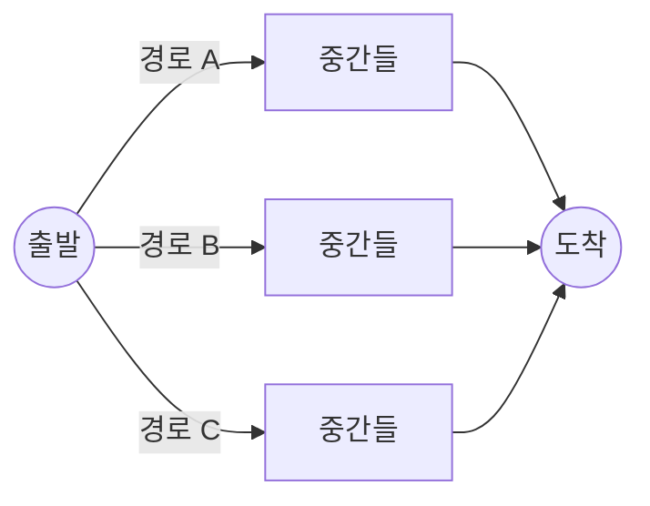
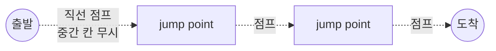
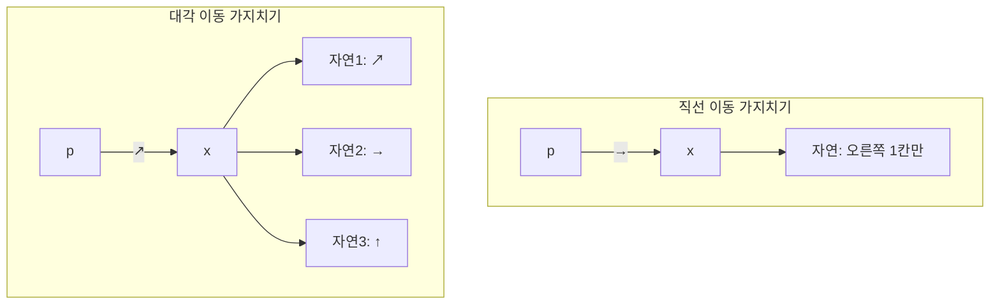
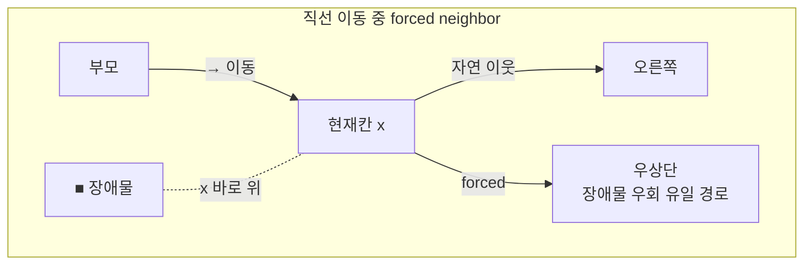
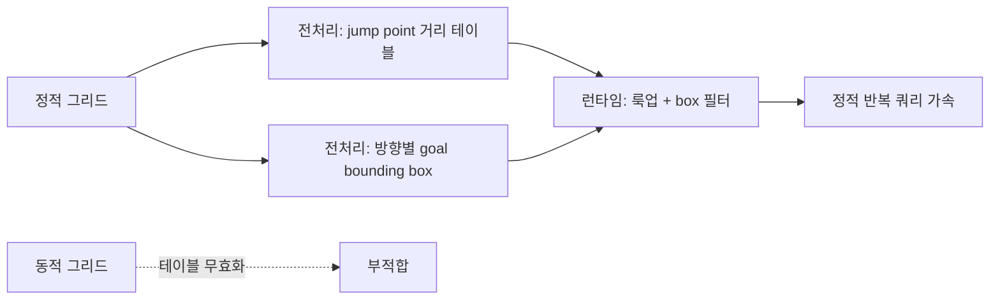
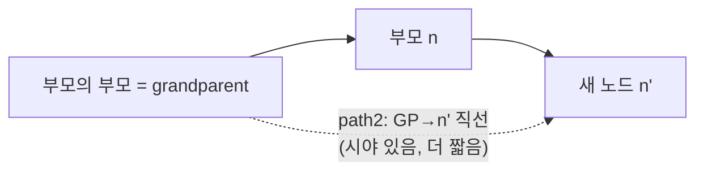
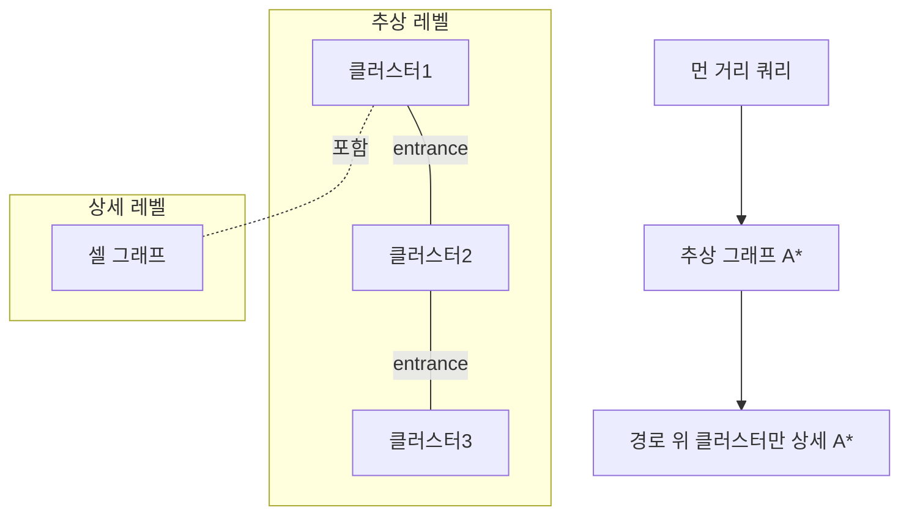
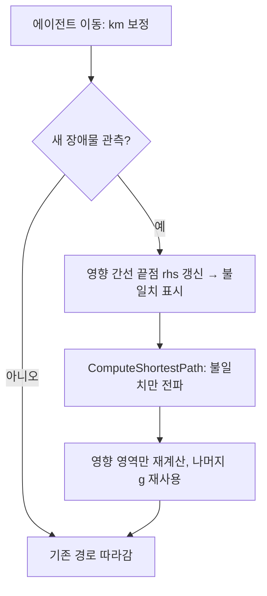
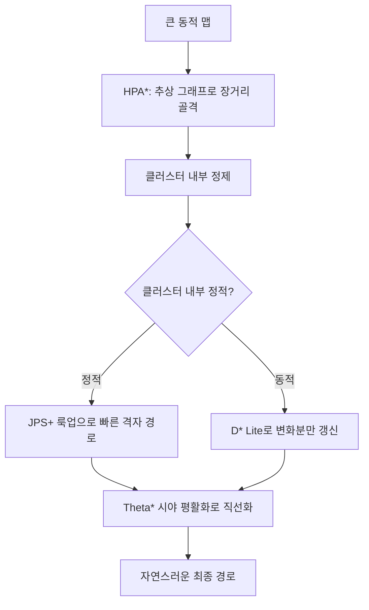

## 들어가며

표준 A*는 $f = g + h$라는 견고한 토대 위에 서 있지만, 균일 그리드에서 세 가지 비효율을 드러낸다. 첫째, 같은 비용의 대칭 경로를 구분하지 못해 동등한 경로의 노드를 많이 확장할 수 있다. 둘째, 결과 경로가 허용한 이웃 방향에 갇혀 계단 모양으로 꺾인다. 셋째, 장애물이 동적으로 바뀌면 기본 구현은 새 탐색을 시작한다. 실제 확장 수는 장애물 배치, tie-breaking, 휴리스틱과 시작·목표 위치에 따라 달라지므로 격자 크기만으로 정해지지 않는다.

*Jump Point Search(JPS)* 는 균일 비용 그리드의 대칭성을 제거해 중간 노드를 건너뛴다. 감소 폭은 맵 구조에 따라 달라지고 좁은 통로나 장애물이 조밀한 맵에서는 이득이 작을 수 있다. *Theta*\* 는 부모 노드와의 직선 시야를 활용해 격자 방향에 덜 묶인 경로를 만들고, *D\* Lite* 는 간선 비용 변경 뒤 필요한 부분을 점진적으로 갱신한다. *HPA\** 는 큰 맵을 클러스터로 나눠 추상 그래프에서 먼저 탐색한다. 각 기법은 정확성·경로 품질·전처리·동적 갱신 비용의 서로 다른 계약을 선택한다.

이 알고리즘들은 모두 A*를 *대체* 하지 않는다. A*의 골격 위에서 "어느 노드를 큐에 넣을지(JPS)", "부모를 누구로 둘지(Theta\*)", "무엇을 재계산할지(D\* Lite)"를 바꾼 변형이다. 그래서 $f = g + h$ 구조를 기준으로 보면 각 기법이 *무엇을 개선했는가* 가 선명해진다. 이 글의 코드는 의사코드가 아니라 동작 가능한 밀도로 적고, 알고리즘마다 작은 그리드 위의 *트레이스 예제* 를 함께 둔다.



이 글의 목표.

1. **A*의 대칭 비효율** — 같은 비용 경로의 중복 평가를 정량화한다.
2. **JPS** — 점프와 jump point, 가지치기 규칙의 유도.
3. **forced neighbor** — jump point가 생기는 조건과 직선·대각 점프의 워크스루.
4. **JPS+** — 정적 그리드의 사전 계산과 goal bounding.
5. **Theta*** — grandparent 시야로 임의 각도 경로, 시야 검사 알고리즘.
6. **Lazy Theta*** — 시야 검사 지연과 정확성 절충.
7. **HPA*** — 클러스터 기반 계층 길찾기, entrance·추상 그래프 구성.
8. **D* Lite** — 동적 환경의 점진적 재계산, key·rhs 트레이스.
9. **비교와 조합** — 어느 축에서 무엇을 쓰는가.


---

## 목차
1. [표준 A*의 대칭 비효율](#1-표준-a의-대칭-비효율)
2. [JPS의 발상과 가지치기 규칙](#2-jps의-발상과-가지치기-규칙)
3. [Forced Neighbor와 Jump Point 워크스루](#3-forced-neighbor와-jump-point-워크스루)
4. [JPS+ 전처리와 goal bounding](#4-jps-전처리와-goal-bounding)
5. [Theta*의 임의 각도 경로](#5-theta의-임의-각도-경로)
6. [Lazy Theta*](#6-lazy-theta)
7. [HPA*: 계층적 길찾기](#7-hpa-계층적-길찾기)
8. [D* Lite와 동적 환경](#8-d-lite와-동적-환경)
9. [비교와 조합](#9-비교와-조합)


---

## 1. 표준 A*의 대칭 비효율

### 경로 대칭의 정의

균일 그리드의 본질적 문제는 *경로 대칭(path symmetry)* 이다. 장애물이 없는 영역에서 한 점에서 다른 점으로 가는 같은 길이의 경로는 무수히 많다 — "오른쪽 3칸 후 위 2칸"과 "위 2칸 후 오른쪽 3칸"은 비용이 같다. A*는 이 동등한 경로들을 *서로 다른 노드 전개* 로 취급해, 사실상 같은 결과를 향해 여러 번 탐색한다.

대칭의 규모는 조합으로 정량화된다. 8-방향 그리드에서 dx 칸 오른쪽, dy 칸 위로(둘 다 양수, $dx \ge dy$ 가정) 가는 최단 경로는, $dy$번의 대각 이동과 $dx - dy$번의 직선 이동을 *어떤 순서로* 배치하든 길이가 같다. 그 배치 가짓수는

$$
\binom{dx}{dy}
$$

이다. $dx = 10, dy = 5$면 $\binom{10}{5} = 252$가지의 *동일 비용* 최단 경로가 존재한다. A*는 이 경로들이 지나는 대칭인 중간 격자 상태를 open list에서 일일이 처리한다.



빈 공간에서는 같은 최단 비용을 만드는 이동 순서가 많다. 그러나 이 조합 수가 A\*의 확장 수와 곧바로 같아지는 것은 아니다. 옥타일 휴리스틱은 장애물이 없는 8방향 균일 격자에서 정확하고, 같은 $f$ 안에서 큰 $g$를 우선하는 tie-break를 쓰면 목표 방향의 좁은 집합만 확장할 수도 있다. 반대로 tie-break가 불리하거나 장애물이 휴리스틱의 정보를 약하게 만들면 넓은 $f$ 등고선을 확장한다. JPS가 제거하는 것은 가능한 경로 문자열을 모두 열거하는 비용이 아니라, 대칭인 중간 격자 상태를 open list에서 명시적으로 처리하는 비용이다.

### 확장 노드 수의 규모

확장 수는 격자 크기만으로 정해지지 않는다. 시작·목표 방향, 장애물, 코너 통과 정책, 휴리스틱, tie-break, open list 구현을 고정한 뒤 측정해야 한다. 핵심 관찰은 빈 직선 구간의 모든 셀을 독립적인 분기점으로 다룰 필요가 없다는 것이다. 장애물이나 목표가 진행 선택을 바꾸기 전까지는 대칭인 이동 순서 중 정준(canonical)한 순서만 남길 수 있다. JPS는 이 통찰을 이웃 가지치기와 점프로 구현한다.

## 2. JPS의 발상과 가지치기 규칙

### 점프와 jump point

Jump Point Search(Harabor & Grastien, 2011)의 핵심은 *직선 방향으로 가능한 한 멀리 점프하면서, 의미 있는 분기점만 open 큐에 넣는* 것이다. 한 칸씩 이웃을 큐에 넣는 대신, "여기서 경로가 꺾일 이유가 생기는 지점"까지 건너뛴다.

그 "꺾일 이유가 생기는 지점"이 *jump point* 다. 빈 직선 구간의 중간 칸들은 큐에 넣지 않는다 — 어차피 직진할 뿐 분기하지 않기 때문이다. 장애물 때문에 새로운 이웃이 강제로 고려돼야 하는 칸(forced neighbor가 생기는 칸)에서만 멈춰 큐에 넣는다.



결과적으로 open 큐에 드는 노드 수가 극적으로 줄어든다. 빈 영역을 가로지를 때 A*가 수백 노드를 전개한다면, JPS는 jump point 몇 개만 전개한다. 그러면서도 *최단 경로는 그대로 보장* 한다 — 건너뛴 중간 칸들은 어차피 최단 경로의 일부이고, 단지 큐에 명시적으로 넣지 않았을 뿐이다. JPS는 그리드 위에서, 전처리 없이, 같은 최단 경로를 더 적은 작업으로 찾는다.

JPS의 전제는 *균일 비용 8-방향 그리드* 다. 간선 비용이 균일해야 "직선 점프 중간 칸은 분기하지 않는다"는 가정이 성립한다. 가중치 지형(늪·도로)이 섞이면 JPS의 가정이 깨진다 — 비용이 다르면 직선 점프 중간 칸이 분기 후보가 될 수 있기 때문이다.

### 자연 이웃과 가지치기

JPS의 정당성은 *이웃 가지치기(neighbor pruning)* 규칙에서 나온다. 부모 $p$에서 현재 칸 $x$로 방향 $d$로 들어왔다고 하자. $x$의 8개 이웃 중 대부분은 "$p$를 거쳐 $x$를 지나지 않고도 같거나 더 짧게 닿을 수 있는" 칸이다. 그런 이웃은 $x$에서 전개할 필요가 없다 — 이미 다른 경로가 그 칸을 더 잘 처리한다. 가지치기 후 남는 이웃을 *자연 이웃(natural neighbor)* 이라 한다.

직선 이동의 자연 이웃은 *진행 방향 한 칸* 뿐이다. 오른쪽으로 들어왔으면 다음 자연 이웃은 오른쪽 한 칸이다. 위·아래·대각으로 가는 것은 모두 $p$에서 직접 가는 게 같거나 짧다.

대각 이동의 자연 이웃은 *세 칸* 이다. 우상향 대각으로 들어왔으면, (1) 같은 우상향 대각, (2) 오른쪽 직선, (3) 위 직선. 이 셋만 남고 나머지 다섯 이웃은 가지친다.



이 가지치기가 1절의 252개 동등 경로를 *하나의 정준 경로* 로 강제한다. 가지치기 규칙은 "대각을 먼저 다 가고 그 다음 직선" 같은 한 가지 순서만 살아남게 만든다. 그래서 빈 공간에서는 jump point가 거의 생기지 않고 — 자연 이웃만 따라 끝까지 직진한다 — 장애물 근처에서만 분기가 부활한다. 그 부활을 다루는 것이 forced neighbor다.

## 3. Forced Neighbor와 Jump Point 워크스루

### forced neighbor의 정의

가지치기는 "장애물이 없다"는 가정에서 안전하다. 장애물이 끼면 가지쳐 버린 이웃이 *되살아난다*. 어떤 칸 $x$를 방향 $d$로 지날 때, 가지치기로 버렸어야 할 이웃이 *장애물 때문에 $x$를 거쳐야만 최단으로 닿는* 칸이 되면, 그 이웃을 forced neighbor라 한다. forced neighbor를 하나라도 가진 칸이 jump point다.



직선 이동의 forced neighbor 조건을 정확히 적으면 이렇다. 오른쪽($d = (1,0)$)으로 $x$에 들어왔을 때,

- $x$의 *바로 위* 칸이 장애물이고, $x$의 *우상단* 칸이 열려 있으면 → 우상단이 forced neighbor.
- $x$의 *바로 아래* 칸이 장애물이고, $x$의 *우하단* 칸이 열려 있으면 → 우하단이 forced neighbor.

이유는 명확하다. 우상단 칸은 평소라면 $x$의 부모 쪽에서 대각으로 더 짧게 닿는다. 그런데 그 사이(바로 위)가 막혀 있으면, 우상단으로 가는 최단 경로가 *$x$를 반드시 경유* 한다. 그래서 $x$에서 우상단을 새 분기로 큐에 넣어야 하고, $x$는 jump point가 된다.

### 직선 점프 트레이스

작은 그리드에서 직선 점프를 따라가 본다. `.`은 통행 가능, `#`은 장애물, `S`는 점프 시작, 화살표는 진행 방향이다. 오른쪽으로 점프한다.

```text
열:  0 1 2 3 4 5 6
행0: . . . # . . .
행1: S → → → → . .      ← 행1을 오른쪽으로 점프
행2: . . . . . . .
```

점프는 (1,0)에서 시작해 한 칸씩 오른쪽으로 전진한다. (1,1), (1,2)에서는 위·아래가 모두 열려 forced neighbor가 없다 — 직진한다. (1,3)에 도달하면 *바로 위* 인 (0,3)이 `#`이고 우상단 (0,4)는 열려 있다. 앞에서 정의한 코너 컷 허용 규칙과 `HasForcedNeighbor` 코드에 그대로 대입하면 (0,4)가 forced neighbor이고, 현재 칸 (1,3)이 jump point가 된다.

```text
열:  0 1 2 3 4 5 6
행0: . . . # X . .      X=(0,4) forced neighbor
행1: S → → J . . .      J=(1,3) jump point
행2: . . . . . . .
```

(1,3)에서 forced neighbor (0,4)가 확인되므로 점프를 멈추고 (1,3)을 open 큐에 넣는다. (1,1)~(1,2)의 중간 칸은 큐에 들어가지 않는다. A*였다면 이 중간 칸도 각각 노드로 전개했을 것이다.

### 대각 점프의 미묘함

대각 점프에는 추가 규칙이 있다. 대각으로 한 칸 움직일 때마다, *두 직선 성분으로도 먼저 점프를 시도* 해야 한다. 그 직선 점프 중 하나라도 jump point를 찾으면, 현재 대각 칸이 jump point가 된다. 이유는 대각 경로에서 직선으로 갈라질 기회를 놓치지 않기 위함이다 — 대각으로만 계속 가면 직선 쪽에 숨은 jump point를 영영 못 본다.

점프 함수는 이 모든 규칙을 재귀로 표현한다.

```cpp
// 방향 d로 점프, jump point를 만나면 그 좌표 반환 (없으면 실패)
std::optional<Cell> Jump(Cell c, Dir d, const Grid& g, Cell goal) {
    Cell n = c + d;
    if (!g.Walkable(n)) return std::nullopt;     // 벽 → 점프 종료
    if (n == goal) return n;                      // 도착 → jump point
    if (HasForcedNeighbor(n, d, g)) return n;     // forced → jump point

    if (d.IsDiagonal()) {
        // 대각 점프 중에는 두 직선 성분도 먼저 점프해 본다
        if (Jump(n, Dir{d.x, 0}, g, goal)) return n;  // 가로 성분
        if (Jump(n, Dir{0, d.y}, g, goal)) return n;  // 세로 성분
    }
    return Jump(n, d, g, goal);                   // 같은 방향 계속 점프
}
```

`HasForcedNeighbor`는 방향별로 위에서 유도한 조건을 그대로 검사한다.

```cpp
bool HasForcedNeighbor(Cell n, Dir d, const Grid& g) {
    if (d.IsStraight()) {
        // 진행 방향에 수직인 두 측면을 검사
        Dir perp = d.Rotate90();                   // 예: → 이면 ↑
        if (!g.Walkable(n - perp) && g.Walkable(n - perp + d)) return true;
        if (!g.Walkable(n + perp) && g.Walkable(n + perp + d)) return true;
        return false;
    }
    // 대각: 두 성분 각각의 측면 장애물을 본다
    Dir dx{d.x, 0}, dy{0, d.y};
    if (!g.Walkable(n - dx) && g.Walkable(n - dx + dy)) return true;
    if (!g.Walkable(n - dy) && g.Walkable(n - dy + dx)) return true;
    return false;
}
```

A* 본체는 이웃 전개 시 `Neighbors` 대신 이 `Jump`를 호출해, 반환된 jump point만 큐에 넣는다. 점프로 건너뛴 직선 거리만큼 $g$ 비용을 누적한다.

```cpp
void ExpandJPS(Node x, const Grid& g, Cell goal, OpenList& open) {
    for (Dir d : PrunedDirections(x)) {            // 가지치기된 방향만
        if (auto jp = Jump(x.cell, d, g, goal)) {
            float ng = x.g + Octile(x.cell, *jp);  // 점프 거리만큼 비용 누적
            float nf = ng + Octile(*jp, goal);
            open.PushOrImprove(*jp, ng, nf, x.cell);  // jump point만 큐에
        }
    }
}
```

### 대각 점프 트레이스

대각 점프가 직선 jump point를 회수하는 과정을 본다. 우상향 대각으로 점프한다.

```text
열:  0 1 2 3 4
행0: . . . # .
행1: . . . . .
행2: . . . . .
행3: S . . . .       S=(3,0), ↗ 방향 점프
```

(3,0)에서 ↗로 (2,1)에 간다. (2,1)에서 가로(→)와 세로(↑)로 직선 점프를 시도한다 — 둘 다 forced neighbor 없이 경계까지 가므로 실패한다. 같은 대각으로 (1,2)로 전진한다. 여기서 가로(→) 점프의 첫 칸 (1,3)은 바로 위 (0,3)이 막혀 있고 우상단 (0,4)가 열려 있으므로 jump point다. 가로 성분 점프가 성공했으므로 대각 칸 (1,2)도 jump point가 되어 open 큐에 들어간다. 대각 진행 자체는 다음 칸 (0,3)이 장애물이라 막히지만, 직선 성분 검사가 그 전에 필요한 분기를 보존한 것이다.

대각 점프가 jump point를 *생성* 하는 더 명확한 예는 장애물이 대각 진행의 측면에 붙는 경우다.

```text
열:  0 1 2 3 4
행0: . . . . .
행1: . . # . .       (1,2)에 장애물
행2: . J . . .       J=(2,1) ← 여기가 jump point가 된다
행3: S . . . .       S=(3,0), ↗ 점프
```

(3,0)→(2,1)로 대각 전진. (2,1)에서 세로(↑) 점프를 시도하면 (1,1)로 간다. (1,1)의 forced 조건: 진행 ↑일 때 좌측 (1,0)·우측 (1,2)를 본다. (1,2)가 `#`이고 그 위 (0,2)가 열려 있으면 forced neighbor 발생 → (1,1)이 직선 jump point. 따라서 (2,1)의 세로 점프가 성공하고, *대각 칸 (2,1)이 jump point* 로 큐에 들어간다. 이것이 대각 점프가 직선 성분을 검사해야 하는 이유다 — (2,1)을 큐에 넣지 않으면 (1,1)의 분기를 영영 못 잡는다.

### 복잡도와 함정

JPS의 직선 점프는 최악의 경우 한 방향으로 그리드 너비 $N$만큼 진행하므로 $O(N)$이고, 대각 점프는 대각 한 칸마다 두 직선 성분을 다시 점프하므로 빈 격자에서 최악 $O(N^2)$이다. 하지만 그 점프가 다수의 A* 노드 전개를 대체하므로, 전체적으로는 open 큐 연산이 크게 줄어 순이득이다. 실측에서 빈 영역이 많은 맵일수록 이득이 커진다. 함정은 셋이다.

- *균일 비용 가정*: 가중치 지형에서는 정확성이 깨진다. JPS는 모든 통행 칸의 비용이 같아야 한다.
- *대각 코너 컷 정책*: "대각으로 모서리를 자를 수 있는가"(두 직선 칸 중 하나만 막혀도 대각 통과 허용 여부)에 따라 forced neighbor 규칙이 달라진다. 코너 컷 금지면 forced 조건과 walkable 검사가 더 엄격해진다 — 이 정책을 점프와 `HasForcedNeighbor` 양쪽에서 *일관* 되게 적용하지 않으면 경로가 벽을 뚫는다.
- *경로 복원*: 큐에는 jump point만 들어가므로, 최종 경로는 jump point 사이를 직선 보간해 채워야 한다. 인접 jump point 사이는 항상 한 방향 직선이므로 보간은 단순하다.

## 4. JPS+ 전처리와 goal bounding

### 점프를 사전 계산한다

JPS는 런타임에 매번 점프를 계산한다. 그리드가 *정적* 이라면, 이 점프 결과를 *미리 계산* 해 테이블에 저장할 수 있다. 이것이 Harabor와 Grastien이 ICAPS 2014에서 제시한 JPS+이며, Rabin의 GDC 2015 발표를 통해 게임 개발 실무에 널리 알려졌다.

JPS+는 각 칸에서 8방향 각각으로 다음 값을 사전 계산해 둔다.

- 그 방향에 jump point가 있으면, *jump point까지의 거리*(양수).
- jump point가 없고 벽으로 막히면, *벽까지의 거리*(음수로 인코딩).

```cpp
struct JumpTable {
    // [cell][8 directions] = 그 방향 jump point까지 거리 (음수면 벽까지)
    std::vector<std::array<int, 8>> dist;
};
```

전처리는 맵의 모든 칸을 한 번씩 훑어 각 방향의 distant jump point를 채운다. 직선 방향은 벽이나 jump point를 만날 때까지 스캔하며 거리를 역으로 전파하고, 대각 방향은 두 직선 성분의 결과를 합성한다. 전처리 복잡도는 $O(N^2)$ (셀 수 × 상수), 메모리는 셀당 8개 정수다.

```cpp
// 런타임: 재귀 점프 대신 테이블 룩업 한 번
std::optional<Cell> JumpFast(Cell c, int dirIdx, const JumpTable& jt, Cell goal) {
    int d = jt.dist[Index(c)][dirIdx];
    Cell delta = kDir[dirIdx];

    // 대각 이동: 목표의 행/열에 닿는 중간 target jump (Game AI Pro 2 Listing 14.3)
    if (delta.x != 0 && delta.y != 0) {
        int dx = goal.x - c.x, dy = goal.y - c.y;
        if (dx * delta.x > 0 && dy * delta.y > 0) {       // 목표가 이동 사분면 안
            int n = std::min(std::abs(dx), std::abs(dy)); // 목표의 행/열 도달 거리
            int reach = (d > 0) ? d : -d;                 // jump(양수) 또는 벽(음수)까지
            // 벽으로 막히기 전이면(음수 d는 벽 칸 직전까지) 중간 점 반환
            if (d > 0 ? n <= reach : n < reach) return c + delta * n;
        }
    }

    // goal이 점프 경로 위에 있으면 goal을 우선 반환 (target jump)
    if (GoalOnRay(c, delta, goal, std::abs(d))) return goal;
    if (d > 0) return c + delta * d;               // jump point 발견
    return std::nullopt;                            // 벽까지만 — 분기 없음
}
```

대각 방향에서는 목표의 행 또는 열에 닿는 지점 `c + delta·min(|dx|,|dy|)`을 먼저 본다. 이 지점이 사전 계산된 벽/jump 거리보다 앞에 있으면 그곳을 target jump로 반환해, 목표가 대각선 위가 아니라 행/열 방향으로 비껴 있어도 successor가 생긴다. 사전 계산 거리의 부호(양수=jump, 음수=벽)와 통로 한계를 함께 검사하며, corner cutting 정책은 전처리 테이블과 같은 규칙을 써야 한다. Listing 14.3의 대각 목표 처리 분기와 직접 대조한다.

런타임에는 재귀 점프 대신 테이블 룩업으로 jump point를 얻는다. 점프 스캔을 전처리로 옮기므로 정적 맵을 반복 질의할 때 유리하다. 공개된 JPS+ 발표에는 해당 benchmark 설정에서 표준 A\*보다 100배를 넘긴 사례가 있지만, 이는 알고리즘의 보편적 배율이 아니다. 맵 구조, 쿼리 분포, A\* 기준 구현, 캐시와 전처리 메모리에 따라 이득은 달라진다.

### goal bounding

JPS+에 *goal bounding* 을 더하면 무효한 방향 탐색까지 쳐낸다. 발상은 전처리 단계에서 각 칸의 각 *나가는 방향* 에 대해, "그 방향으로 나가서 최단 경로로 도달 가능한 목표 칸들의 경계 상자(bounding box)"를 함께 저장하는 것이다.

런타임에 현재 칸에서 어떤 방향으로 점프할지 고를 때, 목표가 그 방향의 bounding box 안에 없으면 *그 방향 점프 자체를 건너뛴다*. 목표와 무관한 방향을 큐에 넣지 않으므로 탐색이 목표 쪽으로 더 날카롭게 집중된다.



전처리로 각 방향의 도달 가능 목표 집합을 구하는 방법은, 각 칸을 시작으로 *역방향 Dijkstra* 를 돌려 "이 칸에서 어느 방향으로 첫발을 떼면 어느 칸들이 최단 경로상에 오는가"를 모아 경계 상자로 압축하는 것이다. 이 전처리는 비싸지만(맵당 한 번), 런타임 이득이 크다.

### 대가

대가는 명확하다. *전처리 시간과 메모리* 가 든다(셀당 8 방향 거리 + 8 방향 bounding box). 그리고 *그리드가 바뀌면 관련 테이블이 무효화된다*. JPS+는 맵이 고정되고 같은 맵에서 길찾기를 반복하는 경우에 적합하다. 비용 변경이 잦다면 전처리 갱신 비용과 D\* Lite 같은 증분 탐색의 상태 유지 비용을 비교해야 한다.

## 5. Theta*의 임의 각도 경로

### 격자 경로 문제

JPS는 *속도* 를 개선했지만 경로는 여전히 8-방향 격자 위에 있다. 출발에서 목표로 가는 직선이 격자 대각선과 어긋나면, JPS가 찾은 경로도 계단 모양으로 꺾인다. 시각적으로 부자연스럽고, 실제로도 진짜 직선보다 길다 — 옥타일 거리는 유클리드 거리보다 최대 약 8% 길다.

Theta*(Daniel et al., 2010)는 *경로 품질* 을 개선한다. 격자에 갇히지 않은 임의 각도(any-angle) 경로를 만든다.

### 격자 경로가 직선보다 얼마나 더 긴가 — 옥타일/유클리드 비의 최악각

위에서 "옥타일 거리는 유클리드보다 최대 약 8% 길다"고 했는데, 이 8%는 어디서 나오고 어느 방향에서 최악인지 닫힌 형태로 유도된다. 이 값이 Theta\*가 *최대로 이득을 보는 방향* 과 *전혀 이득이 없는 방향* 을 동시에 알려준다.

8-방향 격자에서 변위 $(dx, dy)$($dx \ge dy \ge 0$)의 옥타일 거리는 대각 $dy$번·직선 $dx - dy$번이므로

$$
d_{\text{oct}} = (dx - dy) + \sqrt2\,dy = dx + (\sqrt2 - 1)\,dy.
$$

유클리드 거리는 $d_{\text{euc}} = \sqrt{dx^2 + dy^2}$다. 방향만 남기려 기울기 $t = dy/dx = \tan\theta \in [0, 1]$로 정규화하면 비는

$$
\rho(t) = \frac{d_{\text{oct}}}{d_{\text{euc}}} = \frac{1 + (\sqrt2 - 1)\,t}{\sqrt{1 + t^2}}.
$$

$a = \sqrt2 - 1$로 두고 미분하면

$$
\rho'(t) = \frac{a - t}{(1 + t^2)^{3/2}},
$$

분자가 $t = a = \sqrt2 - 1$에서만 0이고 그 전후로 부호가 양에서 음으로 바뀌므로 유일한 최대점이다. $\tan\theta = \sqrt2 - 1$은 정확히 $\theta = 22.5°$다(반각 항등식 $\tan 22.5° = \sqrt2 - 1$). 최댓값은

$$
\rho^\star = \rho(\sqrt2 - 1) = \sqrt{1 + (\sqrt2 - 1)^2} = \sqrt{4 - 2\sqrt2} \approx 1.0824.
$$

즉 빈 공간에서 격자 경로는 직선보다 *최대 8.24%* 길고, 그 최악은 축에서 $22.5°$ 어긋난 방향에서 난다. 양 끝은 둘 다 정확히 1이다 — $\theta = 0°$(순수 직선)와 $\theta = 45°$(순수 대각)에서 $\rho = 1$이라 격자 경로가 이미 최단이다($\rho(1) = (1 + a)/\sqrt2 = \sqrt2/\sqrt2 = 1$). 비는 이 두 정각 사이에서 부풀어 $22.5°$에서 최댓값을 갖는다.

이 곡선이 Theta\*의 손익을 정확히 예고한다. 목표가 축이나 대각에 놓이면 격자 경로가 곧 최단이라 임의 각도화로 얻을 게 없다. 목표가 $22.5°$ 부근일 때 격자 계단이 가장 손해이고 Theta\*의 직선 단축이 최대 8% 남짓을 회수한다. 수치 예로 $100$칸 거리의 목표가 $22.5°$ 방향이면($dx \approx 92.4$, $dy \approx 38.3$) 유클리드 $100$에 옥타일 약 $108.2$ — 약 8칸을 격자 계단으로 헛걷는 셈이다.

경계 조건 하나. 이 $8.24\%$는 *빈 공간 한 구간* 의 상한이다. 장애물이 끼면 실제 초과는 이보다 커질 수 있다 — 격자 경로는 코너를 이산 셀 경계로 우회하지만 임의 각도 경로는 가시선이 허용하는 지점으로 더 짧게 끊을 수 있기 때문이다. 한 구간 안에서는 어떤 방향이어도 $\rho \le \sqrt{4 - 2\sqrt2}$이므로, 이 값은 "빈 공간 계단 효과"의 상한으로만 읽는다.

### grandparent 단축

핵심 변경은 단 한 가지다. A*에서 이웃 $n'$의 부모를 항상 현재 노드 $n$으로 두지만, Theta\*는 *$n$의 부모(즉 $n'$ 입장에서 grandparent)와 $n'$ 사이에 직선 시야가 있으면, $n'$의 부모를 그 grandparent로 직접 연결* 한다.



```cpp
void UpdateVertex(Node n, Node neighbor) {
    Node gp = parent[n];                            // n의 부모 = grandparent
    if (gp.valid && LineOfSight(gp, neighbor)) {
        // path 2: grandparent에서 직접 연결 (격자 우회 없이 직선)
        float ng = g[gp] + EuclidDistance(gp, neighbor);
        if (ng < g[neighbor]) {
            g[neighbor] = ng;
            parent[neighbor] = gp;                  // 부모를 grandparent로
            open.PushOrImprove(neighbor, ng + h(neighbor));
        }
    } else {
        // path 1: 표준 A* 갱신
        float ng = g[n] + EuclidDistance(n, neighbor);
        if (ng < g[neighbor]) {
            g[neighbor] = ng;
            parent[neighbor] = n;
            open.PushOrImprove(neighbor, ng + h(neighbor));
        }
    }
}
```

거리 함수가 옥타일이 아니라 *유클리드* 라는 점에 주목한다. grandparent에서 임의 각도 직선으로 잇기 때문에, 비용도 실제 직선 거리여야 한다. 휴리스틱 $h$도 유클리드 거리를 쓴다(허용 가능).

### 시야 검사

`LineOfSight`는 두 칸 사이에 장애물이 없는지를 검사한다. 그리드에서는 셀을 하나씩 고르는 Bresenham 표본열 대신, 선분이 실제로 지나는 *모든* 셀을 훑는 supercover/DDA(Amanatides–Woo)로 벽을 확인한다. Bresenham 표본열의 통과 가능성은 실제 충돌 없는 선분과 다른 뜻이다.

```cpp
// 셀 중심을 잇는 선분이 통과하는 셀 전체를 검사한다 (Amanatides–Woo DDA).
bool LineOfSight(Cell a, Cell b, const Grid& g) {
    float x = a.x + 0.5f, y = a.y + 0.5f;              // 셀 중심
    const float x1 = b.x + 0.5f, y1 = b.y + 0.5f;
    const float dx = x1 - x, dy = y1 - y;

    const int   stepX = (dx > 0) - (dx < 0);
    const int   stepY = (dy > 0) - (dy < 0);
    const float tDeltaX = (dx != 0) ? std::abs(1.0f / dx) : INF;
    const float tDeltaY = (dy != 0) ? std::abs(1.0f / dy) : INF;
    float tMaxX = (dx != 0) ? (stepX > 0 ? (std::floor(x) + 1 - x) : (x - std::floor(x))) * tDeltaX : INF;
    float tMaxY = (dy != 0) ? (stepY > 0 ? (std::floor(y) + 1 - y) : (y - std::floor(y))) * tDeltaY : INF;

    int cx = a.x, cy = a.y;
    while (cx != b.x || cy != b.y) {
        if (!g.Walkable({cx, cy})) return false;        // 지나는 모든 셀 검사
        if (tMaxX < tMaxY) { cx += stepX; tMaxX += tDeltaX; }
        else               { cy += stepY; tMaxY += tDeltaY; }
    }
    return g.Walkable(b);
}
```

선분이 셀 *내부*를 지나는 것과 경계·꼭짓점에 닿기만 하는 것은 정책 문제다. 경계 접촉을 통과로 볼지, 대각 꼭짓점 접촉을 금지할지, 에이전트 반경을 셀 크기에 대해 어떻게 볼지를 먼저 고정한 뒤 그 규칙을 코드에 반영한다. 위 코드는 셀 중심을 잇는 선분 기준이며, 반경을 반영하려면 셀 확장 판정이나 실제 collision sweep을 쓴다. 일반 Bresenham 표본열은 선분이 실제로 지나는 셀을 모두 검사하지 않으므로 기하학적 LoS로 쓸 수 없다.

### 후처리 평활화와의 차이

시야가 있으면 grandparent에서 *대각선이든 임의 각도든 직선* 으로 잇는다. 결과 경로는 모서리(코너)에서만 꺾이는 자연스러운 직선 구간들이 된다 — 격자의 계단 모양이 사라진다.

후처리 path smoothing(완성된 격자 경로를 받아 보이는 구간끼리 직선으로 잇는 것)과의 차이가 중요하다. 후처리 평활화는 *이미 정해진 격자 경로* 의 노드 순서를 따라가며 직선화하므로, 그 격자 경로가 우회한 더 짧은 길을 찾지 못한다. Theta\*는 *탐색 도중* 시야를 반영하므로, $g$ 값 자체가 직선 거리로 계산되어 단순 평활화가 놓치는 더 짧은 경로를 탐색 단계에서 선택한다.

```text
출발 S, 목표 G, 가운데 작은 장애물 #

A* 격자 경로:   S → → ↗ → → G   (계단, 길이 ≈ 옥타일)
후처리 평활화:  격자 경로 위에서만 직선화 — 우회한 형태 유지
Theta*:        S ──(직선)── 코너 ──(직선)── G   (코너에서만 꺾임, 최단에 근접)
```

비용은 `LineOfSight` 검사다. 노드를 전개할 때마다 격자선을 따라 검사하는 기본 구현은 선분이 지나는 셀 수에 비례하므로, 표준 A\*보다 노드당 비용이 커진다. Lazy Theta\*는 이 검사를 후보 생성이 아니라 노드 확정 쪽으로 지연해 불필요한 검사를 줄인다.

## 6. Lazy Theta*

### 시야 검사 지연

Theta*는 *모든 노드 전개 시* grandparent 시야 검사를 한다. 그런데 전개된 노드의 상당수는 최종 경로에 쓰이지 않는다 — 그 노드들에 대한 시야 검사는 낭비다. Lazy Theta*는 시야 검사를 *지연(lazy)* 시킨다.

발상은 "일단 grandparent와 시야가 있다고 *낙관적으로 가정* 하고 path 2로 진행하다가, 그 노드를 실제로 큐에서 꺼내 *확정(expand)* 하는 시점에만 시야를 검사"하는 것이다.

```cpp
// 갱신 시: 시야 검사 없이 무조건 path 2 가정
void UpdateVertexLazy(Node n, Node neighbor) {
    Node gp = parent[n];
    float ng = g[gp] + EuclidDistance(gp, neighbor);  // 시야 검사 생략
    if (ng < g[neighbor]) {
        g[neighbor] = ng;
        parent[neighbor] = gp;                         // 낙관적으로 grandparent
        open.PushOrImprove(neighbor, ng + h(neighbor));
    }
}

// 확정 시: 지연된 시야 검사로 가정을 검증
void SetVertex(Node n) {
    if (!LineOfSight(parent[n], n)) {
        // 가정이 틀렸음 → 실제 이웃 중 g가 최소인 가시 이웃으로 부모 재설정
        float best = INF; Node bp;
        for (Node nb : VisibleNeighbors(n)) {
            float c = g[nb] + EuclidDistance(nb, n);
            if (c < best) { best = c; bp = nb; }
        }
        parent[n] = bp;
        g[n] = best;                                   // path 1로 폴백
    }
}
```

### 검사 횟수의 차이

낙관적 가정 덕분에 *전개되지만 확정되지 않는* 노드들의 시야 검사를 통째로 건너뛴다. 확정되는 노드(최종 경로에 가까운 노드)에서만 검사하므로, 시야 검사 횟수가 크게 준다. Theta\*가 노드 전개마다(중복 갱신 포함) 시야를 보는 데 비해, Lazy Theta\*는 *큐에서 꺼내 확정하는 횟수* 만큼만 본다 — 보통 후자가 훨씬 적다.

| 항목 | Theta* | Lazy Theta* |
|---|---|---|
| 시야 검사 시점 | 모든 이웃 갱신 | 큐에서 꺼내 확정할 때만 |
| 시야 검사 횟수 | 많음(중복 갱신 포함) | 확정 노드 수만큼 |
| 노드당 비용 | 높음 | 낮음 |
| 경로 품질 | 동등 | 거의 동등(낙관 폴백) |

시야 검사가 비싼 환경(큰 맵, 복잡한 장애물)에서 Lazy Theta\*는 Theta\*보다 빠르면서 비슷한 품질의 경로를 낸다. 다만 any-angle 계열은 grid graph의 *엄밀한* 최단 경로 보장이 아니라, 자연스러운 직선 경로와 실용 성능을 우선하는 절충으로 이해해야 한다 — 낙관 가정이 틀려 path 1로 폴백할 때 약간의 차선 경로가 나올 수 있으나, 실측 품질 손실은 작다.

## 7. HPA*: 계층적 길찾기

### 규모의 축

HPA*(Hierarchical Path-Finding A*, Botea et al., 2004)는 개별 노드 확장 비용보다 *큰 맵의 탐색 규모* 를 줄인다. 맵을 클러스터로 나누고 클러스터 간 추상 그래프에서 경로를 찾은 뒤 필요한 내부 구간을 구체화한다.



### 추상 그래프 구성

구성은 다음 네 요소다.

- *클러스터*: 맵을 고정 크기 블록으로 분할(예: 10×10).
- *entrance*: 인접 클러스터 경계의 통과 가능 구간. 경계를 따라 벽이 아닌 칸이 연속으로 이어지는 구간을 하나의 entrance로 묶고, 그 대표 칸(transition point)에 추상 노드를 둔다. 긴 entrance는 양 끝에 노드를 두기도 한다.
- *intra-edge*: 한 클러스터 내 entrance 노드들 사이의 거리. 클러스터 내부에서 A*를 돌려 사전 계산한다.
- *inter-edge*: 인접 클러스터의 마주 보는 entrance 노드 간 간선. 경계를 가로지르므로 비용은 1(또는 $\sqrt 2$)이다.

```cpp
struct AbstractGraph {
    std::vector<Node> nodes;                       // entrance transition points
    // intra: 같은 클러스터 내 노드쌍의 사전 계산된 클러스터내 거리
    std::unordered_map<NodePair, float> intraEdge;
    // inter: 인접 클러스터 경계를 가로지르는 간선
    std::unordered_map<NodePair, float> interEdge;
};
```

전처리는 (1) 모든 경계를 스캔해 entrance와 추상 노드를 만들고, (2) inter-edge를 연결하고, (3) 각 클러스터 안에서 entrance 노드쌍마다 A*를 돌려 intra-edge 거리를 채운다. 이 전처리 비용은 클러스터 크기에 좌우된다 — 클러스터가 크면 노드는 적지만 intra-edge A*가 비싸고, 작으면 그 반대다.

### 쿼리: 삽입·추상 탐색·정제

먼 거리 쿼리 $(s, t)$의 처리는 세 단계다.

```cpp
Path HPAStar(Cell s, Cell t, AbstractGraph& ag, const Grid& g) {
    // 1) 시작/목표를 추상 그래프에 임시 삽입: 각자 속한 클러스터의
    //    entrance 노드들과 intra-edge(클러스터 내 A*)로 연결
    Node ns = InsertTemp(s, ag, g);
    Node nt = InsertTemp(t, ag, g);
    // 2) 추상 그래프에서 A* — 노드가 훨씬 적어 빠르다
    std::vector<Node> absPath = AStar(ns, nt, ag);
    // 3) 추상 경로가 지나는 각 클러스터 내부만 상세 A*로 채움
    Path detailed;
    for (size_t i = 0; i + 1 < absPath.size(); ++i)
        detailed += AStarInCluster(absPath[i], absPath[i+1], g);
    RemoveTemp(ns, nt, ag);
    return detailed;
}
```

추상 그래프는 노드가 훨씬 적어(셀 수가 아니라 entrance 수) 탐색이 빠르다. 그다음 경로가 지나는 각 클러스터 *내부에서만* 상세 A*를 돌려 실제 셀 경로를 채운다. 전체 셀 그래프를 한 번에 탐색하지 않으므로, 맵 크기에 대한 확장이 훨씬 완만하다.

### 최적성 손실과 절충

대가는 *최적성 손실* 과 *전처리* 다. 추상 경로는 entrance를 거치도록 강제되어 진짜 최단보다 길 수 있고, 손실 폭은 클러스터 크기·entrance 배치·지역 지형에 따라 달라진다. 클러스터가 크면 추상 노드가 적어 빠르지만 손실이 커지고, 작으면 최적에 가깝지만 추상 그래프가 커진다.

손실을 줄이는 표준 보강은 *path smoothing* 이다 — 완성된 상세 경로 위에서 시야가 보이는 구간끼리 직선으로 이어 entrance를 우회하는 불필요한 꺾임을 편다(5절의 시야 검사 재사용). 또 클러스터를 여러 단계로 쌓아(클러스터의 클러스터) 더 큰 맵에 다층 추상화를 적용할 수 있다.

RTS처럼 *거대 맵 + 다수 유닛 + 잦은 장거리 쿼리* 환경에서 이 절충이 큰 이득이 된다. 추상 경로는 유닛 무리가 공유하고, 상세 정제는 각 유닛이 자기 위치 근처만 그때그때 채우는 식으로 비용을 분산할 수도 있다.

## 8. D* Lite와 동적 환경

### 정적 가정의 한계

앞의 모든 기법은 *그래프가 고정* 이라고 가정한다. 하지만 게임 월드는 변한다 — 문이 닫히고, 다리가 무너지고, 새 장애물이 생긴다. 표준 A*는 변화가 생기면 *처음부터 다시* 계산한다. 경로 끝자락의 작은 변화에도 전체 재탐색은 낭비다.

D* Lite(Koenig & Likhachev, 2002)는 *변화의 영향을 받은 부분만 점진적으로 갱신* 한다. 핵심 발상 셋.

- *역방향 탐색*: 목표에서 출발 쪽으로 탐색한다. 에이전트가 이동하며 새로 관측한 장애물은 *에이전트 근처* 에서 생기는데, 역방향이면 목표 쪽 대부분의 계산을 재사용할 수 있다.
- *rhs 값*: 각 노드에 $g$ 외에 "한 단계 앞을 본 추정치(one-step lookahead)" $rhs$를 둔다. 목표의 $rhs$는 0이고, 그 외 노드는 후속자들의 $g$로부터 계산한다.
- *국소 전파*: $g \ne rhs$인 노드를 *불일치(inconsistent)* 노드라 하고, 이들만 우선순위 큐에서 처리한다. 변화와 무관한 영역은 손대지 않는다.

### rhs와 key

$rhs$(right-hand side)는 노드 $u$가 후속자(succ)들을 통해 목표로 갈 때의 한 단계 lookahead 비용이다.

$$
rhs(u) = \begin{cases} 0 & u = goal \\ \min_{s' \in succ(u)} \big(c(u, s') + g(s')\big) & \text{그 외} \end{cases}
$$

$g(u) = rhs(u)$면 *일치(consistent)*, 다르면 *불일치* 다. 불일치 노드만 처리하면 변화의 영향만 전파된다. 우선순위 큐의 key는 두 성분의 사전식 순서다.

$$
k(u) = \big[\, \min(g(u), rhs(u)) + h(start, u) + k_m,\;\; \min(g(u), rhs(u)) \,\big]
$$

$k_m$은 에이전트가 이동할 때 휴리스틱 기준점이 바뀌는 것을 보정하는 누적 상수다. 이 보정 덕분에 에이전트가 움직여도 큐를 통째로 재정렬하지 않고 재사용한다.

```cpp
void UpdateVertex(Node u) {
    if (u != goal)
        rhs[u] = MinOverSucc(u, [u](Node s){ return cost(u,s) + g[s]; });
    queue.Remove(u);
    if (g[u] != rhs[u]) queue.Insert(u, CalcKey(u));   // 불일치만 큐에
}

Key CalcKey(Node u) {
    float m = std::min(g[u], rhs[u]);
    return { m + h(start, u) + km, m };
}
```

### ComputeShortestPath

핵심 루프는 큐에서 key가 가장 작은 노드를 꺼내, 과대평가(overconsistent, $g > rhs$)면 $g$를 낮추고, 과소평가(underconsistent, $g < rhs$)면 $g$를 무한대로 올린 뒤 자신과 선행자들을 다시 갱신한다.

```cpp
void ComputeShortestPath() {
    while (queue.TopKey() < CalcKey(start) || rhs[start] != g[start]) {
        Node u = queue.Top();
        Key kOld = queue.TopKey();
        Key kNew = CalcKey(u);
        if (kOld < kNew) {                  // key가 낡음 → 재삽입
            queue.Update(u, kNew);
        } else if (g[u] > rhs[u]) {         // overconsistent
            g[u] = rhs[u];                  // g를 rhs로 낮춤
            queue.Remove(u);
            for (Node p : pred(u)) UpdateVertex(p);
        } else {                            // underconsistent
            g[u] = INF;                     // g를 올리고
            UpdateVertex(u);
            for (Node p : pred(u)) UpdateVertex(p);
        }
    }
}
```

### 변화 대응 트레이스

작은 1차원 복도로 흐름을 따라간다. 칸 0(start)~5(goal)가 일렬이고 비용은 칸당 1이다. 초기 계산 후 각 칸의 $g$는 목표까지 거리다.

```text
칸:   0   1   2   3   4   5(goal)
g :   5   4   3   2   1   0
경로: 0 → 1 → 2 → 3 → 4 → 5
```

에이전트가 0→1로 이동한 뒤, 칸 3과 4 사이가 막혔다고 관측한다(간선 비용이 ∞로 변경). D* Lite는 *전체* 를 다시 풀지 않는다.

```cpp
// 에이전트 이동 시: km 보정 + 기준점 이동
km += h(last, start);
last = start;
// 간선 변화 관측: 영향받은 칸의 rhs만 갱신 후 큐 처리
for (Edge e : changedEdges) {
    UpdateRHSForEndpoints(e);
    UpdateVertex(e.from); UpdateVertex(e.to);
}
ComputeShortestPath();
```

간선 (3,4)가 끊기면 칸 3의 $rhs$가 후속자 4를 통한 경로를 잃는다. 칸 3은 불일치가 되어 큐에 들어가고, 그 영향이 *칸 3과 그 선행자(칸 2, 1)* 로만 전파된다. 만약 칸 4 너머로 우회로가 없으면 칸 0~3의 $g$가 ∞로 갱신되며 경로 실패가 즉시 드러난다. 우회로가 있으면 그 분기만 새로 계산되고, 변화와 무관한 목표 쪽 칸들의 $g$는 *그대로 재사용* 된다. 핵심은 칸 5(goal) 근처 계산을 다시 만지지 않는다는 점이다 — 역방향 탐색과 국소 전파의 효과다.



### 게임에서의 트레이드오프

D* Lite는 로봇 공학(미지의 환경을 이동하며 지도를 만드는 SLAM)에서 나왔지만, 게임의 동적 장애물에도 적용된다. 다만 게임에서는 트레이드오프를 따져야 한다.

| 조건 | D* Lite 유리 | 그냥 A* 재실행 유리 |
|---|---|---|
| 변화 빈도 | 잦음 | 드묾 |
| 경로 길이 | 김 | 짧음 |
| 목표 안정성 | 같은 목표 유지 | 목표 자주 바뀜 |
| 상태 유지 비용 | 감수 가능 | 부담 |

D* Lite의 상태 유지(노드별 $g$, $rhs$, 큐) 비용이 작지 않아, *변화가 잦고 경로가 길며 같은 목표로 계속 가는* 경우에 이득이 크다. 변화가 드물거나 경로가 짧으면, 그냥 A*를 다시 돌리는 편이 단순하고 빠를 수 있다. 또 *목표가 자주 바뀌면* D* Lite의 재사용 이점이 사라진다 — 목표 기준으로 계산을 재사용하기 때문이다. 다수 유닛이 같은 목표로 몰리는 RTS 집결이나, 긴 호송 경로에서 산발적 봉쇄가 생기는 상황이 전형적인 적합 사례다.

## 9. 비교와 조합

### 어느 축을 맡는가

네 계열의 알고리즘은 서로 다른 비효율을 표적한다. 한 표에 정리하면 선택이 명확해진다.

| 기법 | 개선 축 | 전제 | 전처리 | 동적 대응 | 경로 품질 |
|---|---|---|---|---|---|
| JPS | 속도(대칭) | 균일 8-방향 | 없음 | 가능 | 격자 최단 |
| JPS+ | 속도(극대) | 균일 + 정적 | 큼 | 불가 | 격자 최단 |
| Theta* | 품질(각도) | 시야 검사 | 없음 | 가능 | 임의 각도 |
| Lazy Theta* | 품질 + 속도 | 시야 검사 | 없음 | 가능 | 거의 임의 각도 |
| HPA* | 규모(맵 크기) | 클러스터화 | 중간 | 부분 | 차선(평활화로 보강) |
| D* Lite | 동적성 | 점진 갱신 | 없음 | 핵심 강점 | A*와 동등 |

### 조합

실전에서는 이들을 *조합* 한다. 축이 서로 다르므로 충돌하지 않고 쌓인다.



전형적 조합은 이렇다. 거대 맵의 장거리 골격은 HPA\*의 추상 그래프로 잡는다. 골격이 지나는 각 클러스터의 상세 경로는, 그 클러스터가 정적이면 JPS+ 룩업으로 즉시 채우고 동적이면 D* Lite로 변화분만 갱신한다. 마지막으로 완성된 셀 경로 위에 Theta\* 계열의 시야 평활화를 한 번 돌려 격자 계단과 entrance 우회 꺾임을 펴 직선으로 만든다.

### 공통 한계: 표현

이 모든 변형의 공통 한계는 *그리드(또는 명시 그래프)* 라는 표현 자체에 있다. 셀 크기 선택은 정밀도와 메모리의 정면 충돌이다 — 작은 셀은 정밀하지만 셀 수가 제곱으로 늘고, 큰 셀은 가볍지만 좁은 통로를 표현 못 한다. 3D 경사면, 다층 구조, 비정형 지형은 균일 그리드로 표현하기 어렵다. 이 셀 크기·메모리·표현의 문제는 알고리즘이 아니라 *표현* 의 문제다. 걸을 수 있는 표면을 볼록 폴리곤으로 직접 분해하는 NavMesh가 이 표현의 한계를 다른 방식으로 푼다 — 그 위에서도 결국 A*(또는 그 변형)가 돌지만, *무엇 위에서 도는가* 가 달라진다.


---

## 결론

고급 길찾기는 표준 A*를 대체하지 않고, A*의 특정 비효율을 표적해 개선한다. JPS는 그리드 대칭($\binom{dx}{dy}$개의 동등 경로)을 이웃 가지치기로 하나의 정준 경로로 묶고, forced neighbor가 생기는 jump point만 큐에 넣어 같은 최단 경로를 훨씬 적은 노드로 찾는다. JPS+는 정적 그리드에서 점프 거리와 goal bounding을 사전 계산해 룩업 한 번으로 가속한다. Theta\*는 grandparent 시야로 격자를 벗어난 임의 각도 경로를 탐색 도중 만들고, Lazy Theta\*는 시야 검사를 확정 시점으로 지연해 그 비용을 줄인다.

HPA\*는 맵을 클러스터로 계층화해 거대 맵의 장거리 쿼리를 추상 그래프에서 먼저 풀고 경로가 지나는 클러스터만 정제한다. D\* Lite는 역방향 탐색과 $rhs$ 기반 불일치 전파로 동적 환경의 변화분만 재계산하며, $k_m$ 보정으로 에이전트 이동에도 큐를 재사용한다. 각 기법은 속도(JPS), 품질(Theta\*), 규모(HPA\*), 동적성(D\* Lite)이라는 서로 다른 축을 맡으며, 축이 직교하므로 한 파이프라인에 함께 쌓을 수 있다.

이 모든 변형의 공통 한계는 그리드라는 표현 자체에 있다. 셀 크기 선택, 메모리, 3D 경사면 표현의 어려움은 알고리즘이 아니라 표현의 문제다. 걸을 수 있는 표면을 볼록 폴리곤으로 직접 분해하는 NavMesh가 이 표현의 한계를 다른 방식으로 푼다 — 그 위에서도 결국 A*가 돌지만, 무엇 위에서 도는가가 달라진다.

## 더 읽을거리

- Daniel Harabor & Alban Grastien, "Online Graph Pruning for Pathfinding on Grid Maps" (AAAI 2011) — JPS 원논문, 가지치기와 forced neighbor 정의.
- Daniel Harabor & Alban Grastien, "Improving Jump Point Search" (ICAPS 2014) — JPS+ 전처리와 bounding box 가지치기 도입.
- Steve Rabin, "JPS+: Over 100x Faster than A*" (GDC 2015) — JPS+를 게임 개발 관점에서 정리하고 대중화한 발표.
- Kenny Daniel, Alex Nash, Sven Koenig & Ariel Felner, "Theta*: Any-Angle Path Planning on Grids" (JAIR 2010) — Basic Theta\*와 AP Theta\*.
- Alex Nash et al., "Lazy Theta*: Any-Angle Path Planning and Path Length Analysis in 3D" (AAAI 2010) — 시야 검사 지연.
- Alex Nash & Sven Koenig, "Any-Angle Path Planning" (AI Magazine 34(4), 2013) — 격자 경로의 차선성과 임의 각도 계획의 경로 길이 분석.
- Adi Botea, Martin Müller & Jonathan Schaeffer, "Near Optimal Hierarchical Path-Finding" (J. Game Dev. 2004) — HPA\* 원논문.
- Sven Koenig & Maxim Likhachev, "D* Lite" (AAAI 2002) — 점진적 재계산, key·rhs 정의.
- Amit Patel, Red Blob Games — JPS와 any-angle 길찾기의 시각적 설명.
- Nathan Sturtevant, *Game AI Pro* 시리즈의 길찾기 챕터들 — JPS+·goal bounding·계층화의 실전 측정.
