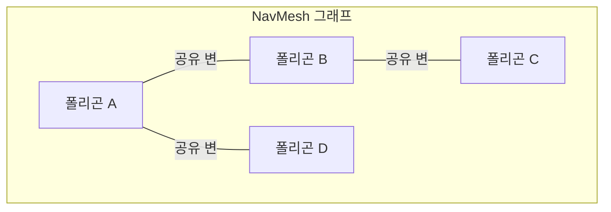
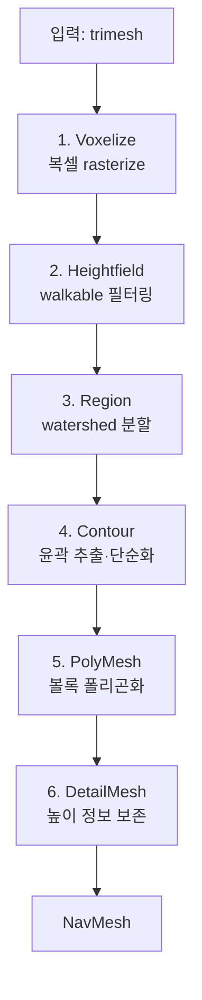
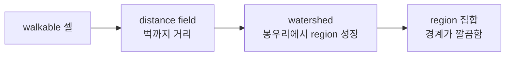
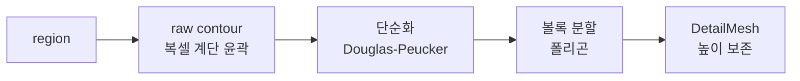
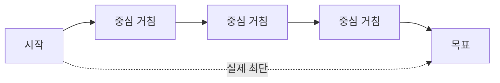
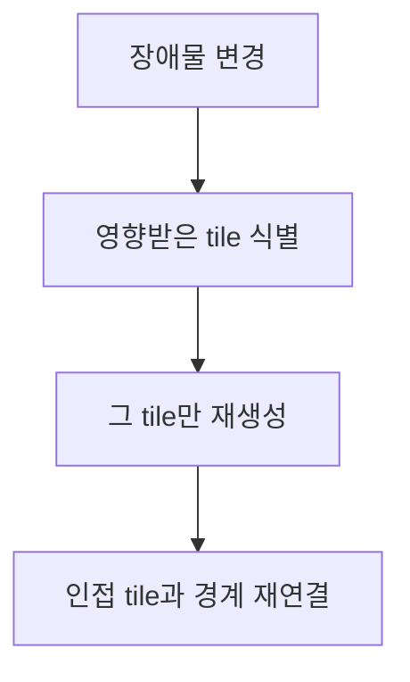

## 들어가며

그리드 길찾기는 단순하고 강력하지만, 3D 환경에서 한계가 분명하다. 셀 크기를 작게 하면 메모리와 탐색 비용이 폭증하고, 크게 하면 좁은 통로를 표현하지 못한다. 경사면·계단·다층 구조는 2D 격자에 자연스럽게 담기지 않는다. 무엇보다 그리드는 *걸을 수 있는 공간을 균일하게 쪼갠다* — 넓은 평지든 좁은 복도든 같은 해상도로 나누어, 평지에서 막대한 수의 동등한 셀을 만든다. 100m × 100m 평지를 0.25m 셀로 덮으면 16만 개의 노드가 생기는데, 그 평지를 가로지르는 데 필요한 정보는 "어디든 직진 가능"이라는 한 문장뿐이다.

NavMesh(Navigation Mesh)는 발상을 바꾼다. 걸을 수 있는 표면을 연결된 다각형 셀로 표현하며, 많은 런타임은 셀 내부의 직선 이동과 portal 처리를 단순하게 만들기 위해 볼록 다각형을 사용한다. 넓은 평지는 큰 폴리곤으로, 복잡한 구역은 작은 폴리곤 여러 개로 표현해 공간의 기하 복잡도에 해상도를 배분한다. 폴리곤이 그래프의 노드, 인접 폴리곤이 간선이 되어 그 위에서 A\*가 돈다. 같은 월드에서도 그리드 해상도와 지형 형상에 따라 노드 감소 폭은 크게 달라지지만, 균일 셀을 모두 저장하지 않는다는 구조적 이점이 있다. Mikko Mononen의 Recast/Detour 계열은 공개된 대표 구현이다.

이 글은 NavMesh의 정의와 특성에서 시작해, Recast가 임의의 3D 메시로부터 NavMesh를 *자동 생성* 하는 파이프라인 — voxel화, region 분할, contour 추출, 폴리곤화, detail mesh — 을 단계별로 따라간다. 생성된 폴리곤 그래프 위 A\*와, 폴리곤 시퀀스를 매끄러운 직선 경로로 바꾸는 Funnel 알고리즘(string pulling)을 *수치 트레이스* 까지 따라가며 다루고, 동적 장애물 처리(tile cache)와 비연속 이동(off-mesh link), 그리고 생성 결과를 검증하는 디버깅 도구로 마무리한다. 알고리즘의 골격뿐 아니라 *왜 그 단계가 그 순서로 필요한지*, *각 단계가 어떤 결함을 막는지* 를 함께 본다.


이 글의 목표.

1. **NavMesh의 정의** — 볼록 폴리곤 분해와 그래프, 볼록성이 왜 핵심인지.
2. **Recast 파이프라인** — 자동 생성의 6단계와 왜 voxel을 경유하는가.
3. **voxel화와 heightfield** — 메시를 복셀 기둥으로, walkable 필터링의 정확한 의미.
4. **region 분할** — distance field, watershed, monotone/layer 대안.
5. **contour와 폴리곤화** — 윤곽 추출, Douglas-Peucker 단순화, 볼록 분할, detail mesh.
6. **폴리곤 그래프 A\*** — 폴리곤 위 탐색, portal 비용, 휴리스틱.
7. **Funnel 알고리즘** — string pulling의 좌/우 깔때기와 수치 워크스루.
8. **동적 처리와 off-mesh link** — tile, tile cache, 국소 회피, 비연속 이동.
9. **디버깅과 검증** — 생성 파라미터, 흔한 결함, 시각화.


---

## 목차
1. [NavMesh의 정의와 특성](#1-navmesh의-정의와-특성)
2. [Recast 생성 파이프라인](#2-recast-생성-파이프라인)
3. [Voxel화와 Heightfield](#3-voxel화와-heightfield)
4. [Region 분할](#4-region-분할)
5. [Contour 추출과 폴리곤 생성](#5-contour-추출과-폴리곤-생성)
6. [폴리곤 그래프 위 A*](#6-폴리곤-그래프-위-a)
7. [Funnel 알고리즘과 String Pulling](#7-funnel-알고리즘과-string-pulling)
8. [동적 Obstacle과 Off-Mesh Link](#8-동적-obstacle과-off-mesh-link)
9. [디버깅과 검증](#9-디버깅과-검증)


---

## 1. NavMesh의 정의와 특성

### 볼록 폴리곤 분해

여기서는 Recast/Detour처럼 걸을 수 있는 표면을 *볼록 다각형으로 분해한* NavMesh를 사용한다. 각 폴리곤이 그래프의 노드이고, 변을 공유하는 인접 폴리곤이 간선으로 연결된다. 두 폴리곤 사이에서 통과 가능한 공유 경계를 *portal* 이라 부르며, 폴리곤 경로가 정해진 뒤 이 portal 열을 따라 실제 코너 경로를 계산한다.



자료구조로 옮기면 폴리곤은 정점 인덱스 목록과 인접 정보를 갖는다. Detour의 실제 포맷은 정점·폴리곤·링크를 분리한 SoA에 가깝지만, 개념 골격은 다음과 같다.

```cpp
struct NavPoly {
    uint16_t vertCount;            // 보통 3~6 (상한이 있다)
    uint16_t verts[6];             // 정점 인덱스 (시계/반시계 일관)
    int32_t  neighbors[6];         // i번째 변을 공유하는 인접 폴리곤 (-1이면 경계)
    uint16_t flags;                // walkable/door/swim 등 영역 플래그
    uint8_t  area;                 // 영역 타입 (비용 가중에 사용)
};

struct NavMesh {
    std::vector<float>   verts;    // x,y,z 연속 저장
    std::vector<NavPoly> polys;
};
```

### 볼록성이 왜 핵심인가

폴리곤이 *볼록* 이어야 하는 이유는 폴리곤 내부 이동을 단순화하기 위해서다. 볼록 폴리곤 내부에서는 *임의의 두 점이 폴리곤을 벗어나지 않는 직선으로 연결* 된다. 에이전트 반지름만큼 경계를 erosion했고 폴리곤 내부에 별도의 동적 장애물이나 위치별 비용이 없다면, 진입점과 진출점을 직선으로 연결해도 정적 기하를 침범하지 않는다. 볼록성만으로 동적 충돌 회피나 비용 최적화까지 해결되는 것은 아니다.

오목(concave) 폴리곤이면 이 성질이 깨진다. ㄷ자 모양 방의 한쪽 끝에서 다른 쪽 끝으로 가는 직선은 벽을 관통한다. 그러면 폴리곤 내부에서도 다시 길찾기가 필요해지고, "폴리곤 = 직진 가능 영역"이라는 전제가 무너진다. 그래서 Recast 파이프라인의 마지막 단계가 *볼록 분할* 이다 — 어떤 오목한 walkable 영역이든 볼록 조각들로 쪼개야 한다.

이 성질의 귀결로, 길찾기 문제가 두 층으로 분리된다.

- *전역(global)*: "어느 폴리곤들을 거치는가" — 폴리곤 그래프 위의 A\*.
- *국소(local)*: "그 폴리곤들 안에서 어떤 코너를 통과하는가" — portal corridor 위의 Funnel.

이 분리가 NavMesh를 그리드보다 빠르게 만든다. 그리드는 직진 가능 평지조차 셀 단위로 한 칸씩 탐색해야 하지만, NavMesh는 그 평지가 폴리곤 하나라 A\*가 한 노드로 통과한다.

### 그리드와의 정량 비교

그리드와 NavMesh의 특성을 정리한다.

| 축 | 그리드 | NavMesh |
|---|---|---|
| 노드 수 | 면적에 비례 (많음) | 기하 복잡도에 비례 (적음) |
| 표면 표현 | 균일 셀 | 적응적 폴리곤 |
| 경사·다층 | 어려움 | 자연스러움 |
| 경로 품질 | 8방향/계단 현상 | 임의 각도 직선 |
| 생성 | 거의 불필요 | 사전 생성 필요 |
| 동적 변경 | 셀 토글 (싸다) | tile 재생성 (비싸다) |

구체적 수치로 차이를 보면, 100m × 100m 평지를 0.25m 그리드로 덮을 때 저장 후보는 16만 셀이다. 같은 영역의 NavMesh 폴리곤 수는 장애물·경사·윤곽 단순화 허용 오차에 따라 수십 개일 수도, 훨씬 많을 수도 있다. 노드 수가 줄면 A\*가 확장할 수 있는 상태와 open list 크기도 대체로 줄지만, 실행 시간은 같은 비율로 감소하지 않는다. 실제 확장 수, 폴리곤 차수, portal 비용 계산, 캐시 배치, 휴리스틱 품질과 Funnel 후처리 비용이 함께 결정한다.

NavMesh의 대가는 *생성 비용* 이다. 그리드는 월드를 격자로 덮으면 기본 표현을 얻지만, NavMesh는 임의의 3D 지오메트리에서 걷기 가능 표면을 분류하고, agent 반지름만큼 침식하고, 영역을 분할해 단순한 볼록 폴리곤으로 근사해야 한다. Recast는 이 과정을 voxelization 기반 파이프라인으로 자동화한다.

## 2. Recast 생성 파이프라인

### 왜 자동 생성인가

수작업으로 NavMesh를 그리는 것은 큰 레벨에서 비현실적이다. 레벨 디자이너가 수천 개 폴리곤을 손으로 배치하고, 레벨이 바뀔 때마다 다시 손보는 비용은 감당 불가능하다. Recast는 레벨의 충돌 메시(trimesh)를 입력받아 NavMesh를 *자동 생성* 한다. 입력은 정렬되지 않은 삼각형 더미 — "삼각형 수프(triangle soup)" — 이고, 출력은 깔끔한 볼록 폴리곤 그래프다.

파이프라인은 여섯 단계다.



### 왜 voxel을 경유하는가

핵심 통찰은 *문제를 voxel 공간으로 옮긴 뒤 다시 폴리곤으로 되돌린다* 는 것이다. 임의의 삼각형 수프에서 직접 "걸을 수 있는 영역"을 추론하는 것은 기하학적으로 까다롭다 — 삼각형들이 겹치고, 교차하고, 다층으로 쌓이고, 법선 방향이 제각각이다. 두 삼각형이 살짝 겹쳐 있을 때 그 사이로 걸을 수 있는지를 연속 기하로 따지는 일은 수치 오차에 취약하다.

일단 복셀로 rasterize하면 이 모든 복잡성이 *국소적·이산적* 검사로 환원된다. "이 복셀 위에 에이전트가 설 수 있는가"는 그 복셀 주변만 보면 답이 나온다 — 위로 충분한 빈 공간이 있는가, 바닥의 경사가 완만한가, 옆 복셀과 높이 차가 작은가. 연속 기하의 교차 판정 대신, 격자 위의 이웃 검사로 바뀐다.

복셀 공간에서 walkable 영역을 정제(필터링, region 분할)한 뒤, 마지막에 다시 깔끔한 폴리곤으로 추출한다. 이 "래스터화 → 정제 → 벡터화" 패턴은 이미지 처리의 발상과 같다 — 벡터 도형을 픽셀로 그린 뒤 처리하고, 다시 벡터 외곽선을 뽑는다. 각 단계를 차례로 본다.

## 3. Voxel화와 Heightfield

### 삼각형 래스터화

첫 단계는 입력 메시를 *균일 복셀 그리드* 로 rasterize하는 것이다. 복셀 크기는 두 파라미터로 정한다 — 수평 해상도 `cs`(cell size, 예: 0.3m)와 수직 해상도 `ch`(cell height, 예: 0.2m). 각 삼각형을 이 해상도로 voxelize해, 공간을 "solid(막힘) / empty(빈 공간)" 복셀로 채운다.

삼각형 하나를 래스터화하는 방식은 그 삼각형을 (x, z) 평면에 투영해 덮이는 셀 열들을 찾고, 각 열에서 삼각형이 가지는 y 범위를 복셀 단위로 변환해 그 구간을 solid로 채우는 것이다. 한 삼각형은 보통 한 열에서 얇은 한 칸을 채운다(바닥 표면). 두꺼운 벽이나 경사면은 여러 복셀에 걸친다.

### Heightfield: 열 단위 span

이 복셀들을 그대로 3D 비트맵으로 들고 있으면 메모리가 막대하다. 100m × 100m × 30m를 0.3m / 0.2m 해상도로 채우면 $333 \times 333 \times 150 \approx 1,660$만 복셀이다. 대부분은 빈 공간이라 낭비다.

그래서 *heightfield* 로 조직한다 — 각 (x, z) 열(column)마다, 그 위로 쌓인 solid 복셀 구간(span)들을 연결 리스트로 기록한다. 빈 공간은 저장하지 않는다. 한 열에 여러 span이 있을 수 있다(다리 위와 아래, 다층 건물의 각 층).

```cpp
struct Span {
    uint16_t smin, smax;   // solid 구간의 아래·위 높이 (복셀 단위)
    uint8_t  area;         // 이 span이 walkable 영역 타입인가
    Span*    next;         // 같은 열의 위쪽 span (smin 오름차순)
};
// Heightfield: 2D 격자, 각 칸이 Span 연결 리스트
struct Heightfield {
    int      width, depth;     // (x, z) 격자 크기
    float    bmin[3], bmax[3]; // 월드 AABB
    float    cs, ch;           // 셀 크기, 셀 높이
    std::vector<Span*> spans;  // width*depth개 열의 리스트 헤드
};
```

새 span을 삽입할 때, 같은 열에서 겹치거나 인접한 span들과 병합한다. 두 span이 닿거나 겹치면 하나로 합쳐 리스트를 단순하게 유지한다. 이 병합이 없으면 살짝 겹친 삼각형들이 수많은 미세 span을 만들어 이후 단계를 망친다.

### Walkable 필터링

래스터화 직후의 heightfield는 "물리적으로 막힌 곳"만 안다. 여기서 *에이전트가 실제로 설 수 있는 표면* 만 남기는 것이 walkable 필터링이다. 네 가지 검사가 에이전트의 물리적 크기를 NavMesh에 새긴다.

- *경사 검사(walkable slope)*: 표면 법선의 기울기가 에이전트 한계(예: 45도)를 넘으면 walkable 아님. 너무 가파른 비탈은 미끄러져 못 선다. 래스터화 시 삼각형 법선의 y 성분으로 판정한다.
- *높이 간격(walkable height)*: 어떤 span의 윗면(`smax`)에서 위쪽 span의 아랫면(`next->smin`)까지의 빈 공간이 에이전트 키(예: 2.0m → `ceil(2.0/ch)` 복셀) 이상이어야 walkable. 낮은 천장(테이블 밑, 낮은 통로) 아래에는 설 수 없다.
- *오르기 한계(walkable climb)*: 인접 열의 span 윗면끼리 높이 차가 에이전트가 오를 수 있는 한계(예: 0.4m, 계단 한 단) 이하면 *연결된* 표면으로 본다. 이 검사가 계단을 하나의 연속 표면으로 묶는다.
- *반지름 침식(erosion)*: 에이전트 반지름(예: 0.6m → `ceil(0.6/cs)` 셀)만큼 walkable 경계에서 안쪽으로 깎아낸다. 에이전트는 점이 아니라 원기둥이므로, 벽에 딱 붙은 셀에는 중심이 설 수 없다.

높이 간격과 오르기 검사를 코드로 보면 인접 span 검사가 핵심이다.

```cpp
// 같은 열에서 위 span 바닥까지의 빈 높이 검사
void FilterLowCeiling(Heightfield& hf, int walkableHeight) {
    for (int i = 0; i < hf.width * hf.depth; ++i) {
        for (Span* s = hf.spans[i]; s; s = s->next) {
            int top = s->smax;
            int ceil = s->next ? s->next->smin : 0xffff;  // 위가 없으면 무한
            if (ceil - top < walkableHeight)
                s->area = RC_NULL_AREA;   // 천장이 낮다 — walkable 제거
        }
    }
}
```

반지름 침식은 거리 변환의 일종으로, 모든 walkable 셀에서 가장 가까운 non-walkable 셀까지의 이산 거리를 계산해 agent 반지름보다 가까운 셀을 제거한다. 같은 거리장은 영역의 내부와 경계를 구분해 분할 seed와 watershed 확장 우선순위를 정하는 데도 재사용할 수 있다.

### Compact Heightfield

필터링 후 Recast는 span 리스트를 *compact heightfield* 로 변환한다. walkable 표면(span의 윗면)만 모아 셀 인덱스로 압축하고, 각 셀에 인접 셀로의 연결 정보를 미리 계산해 둔다. 이후 region 분할과 contour 추출이 이 compact 표현 위에서 이웃 순회를 $O(1)$로 한다. 연결 리스트를 매번 따라가는 대신, "이 셀의 동쪽 이웃은 인덱스 k"가 배열에 박혀 있다.

이 필터들이 에이전트의 물리적 크기(키, 반지름, 오르기 능력)를 NavMesh에 반영한다. 큰 적과 작은 적이 *다른 NavMesh* 를 쓰는 이유가 여기 있다 — 거인은 좁은 문을 못 지나가야 하므로 더 큰 반지름으로 침식한 별도 mesh가 필요하다.

## 4. Region 분할

### 왜 region을 먼저 나누는가

walkable 복셀 표면을 그대로 폴리곤화하면 모양이 지저분하다. 표면 전체를 한 번에 외곽선 따라 폴리곤화하면, 길쭉하게 휘어진 복도와 넓은 방이 하나의 거대한 오목 폴리곤으로 묶이고, 이걸 볼록 분할하면 가늘고 뾰족한 *나쁜 폴리곤(sliver)* 이 쏟아진다. 가는 폴리곤은 Funnel에서 수치 오차를 키우고 A\* 비용 모델을 왜곡한다.

그래서 먼저 표면을 깔끔한 *region(영역)* 들로 나눈다. 각 region은 내부가 단순하고 경계가 매끈해, 이후 한 region에서 하나의 contour를 뽑고 그 contour를 소수의 볼록 폴리곤으로 분할할 수 있다. region 경계가 곧 NavMesh 폴리곤들의 경계가 된다.

### Distance Field

Recast의 기본 분할은 *distance field 기반 watershed* 다. 먼저 각 walkable 셀에 *가장 가까운 경계(non-walkable 셀 또는 mesh 가장자리)까지의 거리* 를 계산해 distance field를 만든다.

이 거리는 두 번의 패스로 근사 계산한다. 첫 패스는 좌상에서 우하로, 이미 계산된 위·왼쪽 이웃의 거리에 보폭을 더해 최소를 취하고, 둘째 패스는 우하에서 좌상으로 같은 연산을 반복한다(chamfer distance transform). 대각 이동에 약간 큰 가중을 주어 유클리드 거리를 근사한다.

```cpp
// 2-pass chamfer distance: 경계로부터의 근사 거리
// (보폭: 직선 2, 대각 3으로 두면 유클리드를 더 잘 근사한다)
void BuildDistanceField(CompactHeightfield& chf) {
    // 경계 인접 셀을 0, 나머지를 큰 값으로 초기화 후
    // forward pass (위/왼쪽 이웃 참조)
    for (int y = 0; y < chf.h; ++y)
      for (int x = 0; x < chf.w; ++x) {
        int d = chf.dist[idx(x,y)];
        if (x > 0)
            d = std::min(d, chf.dist[idx(x-1,y)] + 2);
        if (x > 0 && y > 0)
            d = std::min(d, chf.dist[idx(x-1,y-1)] + 3);
        if (y > 0)
            d = std::min(d, chf.dist[idx(x,  y-1)] + 2);
        if (x + 1 < chf.w && y > 0)
            d = std::min(d, chf.dist[idx(x+1,y-1)] + 3);
        chf.dist[idx(x,y)] = d;
      }
    // backward pass (아래/오른쪽 이웃 참조) — 대칭으로 반복
}
```

distance field의 의미는 "이 셀이 벽에서 얼마나 떨어져 있는가"다. region 중심(넓은 곳)은 값이 크고, 벽 근처와 좁은 통로는 값이 작다.

### Watershed

distance field를 지형의 "높이"로 본다. 거리가 큰 곳을 봉우리, 작은 곳을 골짜기로 삼아, *물이 차오르듯* region을 키운다. 가장 높은 거리값에서 시작해 수위를 한 단계씩 낮추면서, 각 수위에서 노출된 셀을 인접한 기존 region에 흡수시키거나, 어느 region에도 닿지 않으면 새 region을 만든다.



watershed의 결과는 *내부가 단순하고 경계가 매끈한* region들이다. 봉우리(넓은 영역의 중심)마다 하나의 region이 자라나, 넓은 방은 큰 region 하나로, 통로는 별도 region으로 자연스럽게 갈린다. 두 봉우리 사이의 분수계(watershed line)가 region 경계가 된다.

### Region 후처리

watershed 직후의 region은 잡티가 있다. 두 가지 후처리를 한다.

- *고립된 작은 region 제거*: 면적이 `minRegionArea` 미만이고 다른 타일이나 유효 region과 연결되지 않은 작은 섬을 제거한다.
- *작은 region 병합*: 면적이 `mergeRegionArea` 미만인 region은 경계 조건이 허용하는 인접 region에 병합한다. 이 값은 큰 region을 분할하는 상한이 아니다.

### 대안 분할: monotone과 layer

watershed는 *좁은 통로에서 region을 부자연스럽게 자르는* 약점이 있다. 통로 폭이 거리값의 봉우리를 만들 만큼 넓지 않으면, 통로가 잘게 쪼개져 짧은 폴리곤이 연달아 생긴다. 그래서 Recast는 대안을 제공한다.

| 분할 방식 | 특징 | 적합 상황 |
|---|---|---|
| watershed | region 품질 최상, 경계 매끈 | 일반적 실내·실외 |
| monotone | 빠르고 단순, 길쭉한 region 허용 | 생성 속도 우선, 단순 지형 |
| layer | 다층 구조를 층별로 분할 | tile cache, 다층 건물 |

monotone 분할은 셀을 한 방향으로 스윕하며 단조(monotone) 영역으로 나눈다 — watershed보다 빠르지만 region이 길쭉해질 수 있다. layer 분할은 같은 (x, z)에 쌓인 여러 층을 분리해 동적 tile cache가 층별 heightfield를 독립적으로 다시 만들기 좋게 한다. 어느 방식이든 목표는 *폴리곤화하기 좋은 연결 영역* 을 만드는 것이다.

## 5. Contour 추출과 폴리곤 생성

### Raw Contour

region이 정해지면 각 region의 *윤곽(contour)* 을 추출한다. region 경계를 따라 셀의 모서리를 한 칸씩 돌며 외곽선을 폴리라인으로 뽑는다(경계 추적, contour tracing). 진행하면서 각 정점에 그 변이 어느 이웃 region과 맞닿는지(또는 mesh 경계인지)를 기록한다 — 이 인접 정보가 나중에 폴리곤 간 portal을 잇는 데 쓰인다.

이 raw contour는 복셀 해상도의 *계단 모양* 이라 정점이 과도하게 많다. 45도 경사 벽 하나가 수십 개의 계단 정점으로 표현된다.

### Douglas-Peucker 단순화

그래서 *단순화(simplification)* 한다. Douglas-Peucker 알고리즘으로, 원래 윤곽에서 허용 오차(maxSimplificationError) 안에 드는 중간 정점들을 제거해 폴리라인을 간결하게 만든다.

알고리즘은 재귀적이다. 폴리라인의 양 끝점을 잇는 직선을 긋고, 그 직선에서 가장 멀리 떨어진 중간 정점을 찾는다. 그 거리가 허용 오차보다 크면 그 정점을 유지점으로 확정하고 양쪽 구간을 각각 재귀 처리한다. 작으면 그 사이 모든 정점을 버린다.

```cpp
// Douglas-Peucker: [lo, hi] 구간을 tol 오차로 단순화, keep에 유지 정점 표시
void Simplify(const std::vector<Vec2>& pts, int lo, int hi,
              float tol, std::vector<bool>& keep) {
    if (hi <= lo + 1) return;
    float maxD = 0; int idx = -1;
    for (int i = lo + 1; i < hi; ++i) {
        float d = PerpDistance(pts[i], pts[lo], pts[hi]);  // 직선까지 수직 거리
        if (d > maxD) { maxD = d; idx = i; }
    }
    if (maxD > tol) {            // 가장 먼 정점이 오차를 넘으면 유지
        keep[idx] = true;
        Simplify(pts, lo, idx, tol, keep);
        Simplify(pts, idx, hi, tol, keep);
    }   // 넘지 않으면 lo~hi 사이 정점은 모두 버린다
}
```

계단 모양 윤곽이 몇 개의 직선 변으로 줄어든다. 단, region 경계가 *다른 region과 맞닿는 변* (portal이 될 변)은 양쪽 region이 같은 정점을 공유해야 하므로, 그런 변의 단순화는 양쪽에서 일관되게 처리해야 한다 — 한쪽만 정점을 지우면 두 폴리곤 사이에 틈(T-junction)이 생겨 에이전트가 빠진다.



### 볼록 분할과 폴리곤 병합

단순화된 윤곽(오목할 수 있는 단일 폴리곤)을 *볼록 폴리곤들로 분할* 한다. Recast의 실제 방식은 두 단계다.

1. 윤곽을 *삼각화(triangulation)* 한다 — 단조 폴리곤 삼각화 또는 ear clipping으로 삼각형 집합을 만든다.
2. 인접 삼각형들을 *병합* 하되, 병합 결과가 볼록이고 정점 수가 상한(`nvp`, 보통 6) 이하인 한에서만 합친다. 두 폴리곤을 합쳐 만든 변의 양쪽 내각이 모두 180도 미만이면 볼록이 유지된다.

병합을 욕심껏(greedy) 진행하면, 넓은 평지의 수십 개 삼각형이 육각형 몇 개로 합쳐진다. 정점 상한을 두는 이유는 그래프 노드의 크기를 균일하게 유지하고 portal 처리를 단순화하기 위해서다 — 임의 정점 수 폴리곤을 허용하면 인접 배열 크기가 들쭉날쭉해진다.

이 폴리곤들이 NavMesh의 노드다. 폴리곤끼리 공유하는 변(portal)으로 인접 정보를 채우면 A*가 탐색할 폴리곤 그래프가 완성된다.

### DetailMesh: 높이 정보 보존

단순화 과정에서 폴리곤은 평평해진다 — 볼록 다각형은 평면을 가정하기 때문이다. 하지만 실제 지형은 폴리곤 내부에서도 기복이 있다(완만한 언덕, 울퉁불퉁한 바닥). 이 높이 정보를 버리면 에이전트가 지형을 뚫거나 공중에 뜬다.

그래서 마지막에 *DetailMesh* 를 만든다. 각 폴리곤에 대해, 원래 heightfield의 실제 높이 샘플을 가져와 폴리곤 내부를 세밀한 삼각형 메시로 다시 채운다. 샘플 거리(detailSampleDist)와 최대 높이 오차(detailSampleMaxError)로 정밀도를 조절한다.

```cpp
struct PolyDetail {
    uint32_t vertBase;   // 이 폴리곤의 detail 정점 시작 인덱스
    uint32_t triBase;    // detail 삼각형 시작 인덱스
    uint8_t  vertCount;
    uint8_t  triCount;
};
// detail 정점은 폴리곤 평면 위에 실제 지형 높이를 얹은 것
```

두 표현을 분리한 설계의 핵심은 *역할 분담* 이다.

| 표현 | 용도 | 정밀도 |
|---|---|---|
| PolyMesh(볼록 폴리곤) | A\* 그래프, Funnel corridor | 거칠다 (소수 정점) |
| DetailMesh(삼각형) | 에이전트 Y 좌표, 지면 스냅 | 세밀하다 |

경로 계산은 단순 폴리곤으로 빠르게(노드 적음), 실제 에이전트 배치는 DetailMesh의 삼각형 위 높이로 정확하게. 길찾기는 폴리곤이 평면이어도 무방하고(어느 폴리곤을 거치는가만 중요), 렌더링·배치는 실제 높이가 필요하다는 두 요구를 각자에게 맞는 표현으로 푼다.

## 6. 폴리곤 그래프 위 A*

### 노드가 폴리곤일 뿐, 구조는 동일

NavMesh가 완성되면 길찾기는 *폴리곤 그래프 위의 A\** 다. A\*의 골격 — open list(우선순위 큐), closed set, $f = g + h$ 평가 — 은 그리드와 완전히 동일하다. 달라지는 것은 노드가 셀이 아니라 폴리곤이고, 간선이 격자 인접이 아니라 portal(공유 변)이라는 점뿐이다.

```cpp
// 노드 = 폴리곤, 간선 = 공유 변(portal)
struct NavPoly {
    std::vector<int> verts;        // 정점 인덱스
    std::vector<int> neighbors;    // i번째 변을 공유하는 인접 폴리곤
    uint8_t area;                  // 영역 타입 (비용 가중에 사용)
};

struct AStarNode {
    int    poly;        // 폴리곤 인덱스
    float  g, f;        // 누적 비용, f = g + h
    int    parent;      // 경로 역추적
    Vec3   entryPoint;  // 이 폴리곤에 진입한 지점 (비용 계산용)
};
```

### Portal 비용과 "어디서 폴리곤에 들어왔는가"

그리드 A\*에서 간선 비용은 셀 중심 간 거리로 고정이다. NavMesh에서는 미묘하다 — 폴리곤은 면적을 가지므로, "폴리곤 A에서 B로 가는 비용"은 A의 어느 지점에서 B의 어느 지점으로 가느냐에 따라 다르다.

가장 단순한 모델은 폴리곤 중심(centroid) 간 거리다. 구현이 쉽지만 경로가 부정확하다 — 넓은 폴리곤의 중심을 굳이 거치는 비용으로 계산하면, Funnel이 실제로 만들 직선 경로와 어긋난다.

더 나은 모델은 *진입 지점 누적* 이다. 부모 폴리곤에 들어온 지점에서, 다음 폴리곤과의 공유 변(portal) 위의 가장 가까운 점까지의 거리를 비용으로 쓴다. portal의 중점을 쓰는 변형도 흔하다.

```cpp
// A* 확장: 현재 폴리곤 cur에서 인접 폴리곤들로
for (int nb : poly[cur.poly].neighbors) {
    if (nb < 0 || closed[nb]) continue;
    Vec3 portalMid = PortalMidpoint(cur.poly, nb);     // 공유 변 중점
    float stepCost = Distance(cur.entryPoint, portalMid)
                     * areaCost[poly[nb].area];        // 영역 가중 (늪=느림 등)
    float g = cur.g + stepCost;
    if (g < gScore[nb]) {
        gScore[nb] = g;
        float h = Distance(portalMid, goalPos);        // Euclidean 휴리스틱
        open.push({ nb, g, g + h, cur.poly, portalMid });
    }
}
```

`areaCost`는 영역 타입별 가중치다 — 물·늪·용암을 일반 지면보다 비싸게 두면 A\*가 그런 지형을 우회한다. 이 가중이 1절에서 정의한 polygon `area` 필드가 길찾기에 작용하는 지점이다.

### 휴리스틱

휴리스틱은 보통 *현재 탐색 상태의 대표 위치에서 목표 위치까지의 유클리드 거리* 다. 모든 이동 비용이 실제 거리 이상이고 상태의 `g` 비용도 같은 대표 위치 사이의 이동으로 정의되어 있다면, 직선 거리는 실제 남은 경로보다 길 수 없으므로 admissible(과대평가하지 않음)하다. `areaCost`에 1보다 작은 값을 허용한다면 그 최솟값을 직선 거리에 곱하거나, 최적성 보장을 포기해야 한다.

대표 위치를 무엇으로 잡는지도 비용 모델과 함께 정해야 한다. portal 중점을 그래프 노드로 삼아 `g`도 중점 사이 거리로 누적한다면 중점에서 `goalPos`까지의 직선 거리를 쓸 수 있다. 반대로 상태가 폴리곤 전체를 뜻하는데 특정 portal 중점을 휴리스틱 시작점으로 임의 선택하면, 실제 경로가 portal의 다른 지점을 통과할 수 있어 과대평가할 수 있다. 휴리스틱의 admissibility는 NavMesh라는 표현 자체가 아니라 *상태와 간선 비용의 정의* 에 달려 있다.

### 탐색 비용 비교

NavMesh A\*가 유리해질 수 있는 주된 이유는 열린 공간을 적은 노드로 표현하기 때문이다. 다만 A\*는 전체 노드 수가 아니라 실제로 확장한 상태 수만큼 일하고, 각 상태의 간선 차수와 비용 계산도 다르다. 따라서 "노드가 1,000배 적으면 시간도 1,000배" 같은 비례식은 성립하지 않는다. 두 표현의 확장 수·heap 연산·후처리를 같은 쿼리 집합에서 따로 계측해야 한다.

| 항목 | 그리드 A\* | NavMesh A\* |
|---|---|---|
| 노드 수 | 면적 ∝ (수만~수십만) | 폴리곤 (수십~수천) |
| 간선 차수 | 4 또는 8 | 폴리곤 변 수 (3~6) |
| 경로 형태 | 셀 시퀀스 (계단형) | 폴리곤 시퀀스 |
| 후처리 | path smoothing 필요 | Funnel 필요 |

### A*의 출력은 경로가 아니다

A\*의 출력은 *폴리곤 시퀀스* — "폴리곤 A → B → C →... → 목표 폴리곤"이다. 이것이 곧 경로는 아니다. 폴리곤 시퀀스는 "어느 방들을 거치는가"만 알려줄 뿐, 그 방들 안에서 정확히 어디로 걸을지는 정하지 않았다. 이 폴리곤들의 연속을 *corridor(복도)* 라 부른다.

corridor의 폴리곤 중심들을 이으면 경로가 부자연스럽게 꺾인다 — 넓은 폴리곤의 중심을 굳이 거칠 이유가 없고, 인접 폴리곤 중심을 잇는 선은 portal을 비스듬히 통과해 지그재그가 된다.



corridor 안에서 *직선 구간으로 이루어진 측지 최단 경로* 를 뽑는 알고리즘이 Funnel이다. A\*가 폴리곤 corridor를 고르고, Funnel은 그 고정된 corridor 안에서 경로를 당긴다. 전역 최단성은 A\* 상태·간선 비용 모델까지 정확해야 얻을 수 있으며, Funnel만으로 보장되지 않는다.

## 7. Funnel 알고리즘과 String Pulling

### 직관: 팽팽한 끈

폴리곤 시퀀스를 *매끄러운 경로* 로 바꾸는 것이 Funnel 알고리즘(string pulling)이다. 직관은 이름 그대로다 — 폴리곤들이 연결된 corridor를 따라 팽팽한 끈(string)을 통과시키고, 양 끝을 당기면 끈이 corridor의 안쪽 코너들에 걸린다. 그 걸린 형태가 corridor 안에서의 최단 경로다. 물리적으로는 좌우 벽 사이를 지나는 고무줄을 당기는 것과 같다.

corridor에서 인접 폴리곤이 공유하는 변이 portal이다. 각 portal은 진행 방향 기준 *왼쪽 끝점(left)* 과 *오른쪽 끝점(right)* 을 가진다. corridor의 portal들을 순서대로 나열하면, 경로는 이 portal들을 차례로 통과한다.

### 좌/우 깔때기

Funnel은 현재 확정된 경로점인 *apex(꼭짓점)* 를 두고, apex에서 본 *좌측 경계* 와 *우측 경계* 가 이루는 깔때기를 관리한다. 처음 apex는 시작점이고, 좌·우 경계는 시작점에서 출발한다. portal을 하나씩 처리하며 깔때기를 좁혀 간다.


규칙은 좌·우 대칭이다. 우측을 기준으로 서술하면(좌측은 거울 대칭).

- 새 portal의 우측 끝점이 깔때기를 *좁히면*(현재 우측 경계보다 안쪽이면) 우측 경계를 그 점으로 갱신한다.
- 좁히려는 우측 끝점이 *좌측 경계를 넘어가면* — 깔때기가 교차하면 — 더 좁힐 수 없다. 이때 *현재 좌측 경계점이 최단 경로의 코너* 로 확정된다. 그 좌측점을 경로에 추가하고 새 apex로 삼아, 깔때기를 그 apex에서 다시 시작한다.

좌우 판정의 핵심은 *부호 있는 삼각형 면적(2D cross product)* 이다. 세 점 $a, b, c$에 대해 $\text{TriArea2}(a,b,c) = (c_x-a_x)(b_z-a_z) - (b_x-a_x)(c_z-a_z)$의 부호로 $c$가 유향 선분 $\vec{ab}$의 어느 쪽인지 판정한다 — 이 정의에서 양수면 오른쪽, 음수면 왼쪽이다. 이는 Mononen 원본의 `triarea2`와 같은 부호 규약이라, 아래 SSF 코드의 비교 부호가 그대로 성립한다(표준 수학 관례의 cross product는 이 식의 부호를 뒤집은 것이므로, 정의와 비교 부호를 같은 규약으로 맞추는 것이 코드 정확성의 전제다).

```cpp
inline float TriArea2(Vec2 a, Vec2 b, Vec2 c) {
    // 양수: c가 ab의 오른쪽. Mononen triarea2와 동일 부호.
    return (c.x - a.x) * (b.y - a.y) - (b.x - a.x) * (c.y - a.y);
}
```

### Simple Stupid Funnel Algorithm

Mononen의 "Simple Stupid Funnel Algorithm" 골격이다. portal 리스트는 시작점과 끝점을 각각 좌=우인 degenerate portal로 양 끝에 둔다.

```cpp
std::vector<Vec2> StringPull(const std::vector<Portal>& portals) {
    std::vector<Vec2> path;
    Vec2 apex  = portals[0].left;             // 시작점 (left==right)
    Vec2 left  = portals[0].left;
    Vec2 right = portals[0].right;
    int apexIdx = 0, leftIdx = 0, rightIdx = 0;
    path.push_back(apex);

    for (int i = 1; i < (int)portals.size(); ++i) {
        Vec2 pl = portals[i].left, pr = portals[i].right;

        // --- 우측 경계 갱신 ---
        if (TriArea2(apex, right, pr) <= 0.0f) {        // pr이 우측을 좁히거나 같음
            if (apex == right || TriArea2(apex, left, pr) > 0.0f) {
                right = pr; rightIdx = i;               // 좁힘 (좌측 안 넘음)
            } else {                                    // 좌측을 넘음 → 좌측이 코너
                path.push_back(left);
                apex = left; apexIdx = leftIdx;
                left = right = apex;
                leftIdx = rightIdx = apexIdx;
                i = apexIdx;                            // apex 다음부터 재시작
                continue;
            }
        }
        // --- 좌측 경계 갱신 (우측의 거울 대칭) ---
        if (TriArea2(apex, left, pl) >= 0.0f) {
            if (apex == left || TriArea2(apex, right, pl) < 0.0f) {
                left = pl; leftIdx = i;
            } else {
                path.push_back(right);
                apex = right; apexIdx = rightIdx;
                left = right = apex;
                leftIdx = rightIdx = apexIdx;
                i = apexIdx;
                continue;
            }
        }
    }
    path.push_back(portals.back().left);   // 끝점
    return path;
}
```

좌·우 사슬을 deque로 유지하는 고전적 Funnel은 $O(n)$이다($n$ = portal 수). 위 Simple Stupid Funnel 구현은 코너가 확정될 때 `apexIdx`로 되감아 같은 portal을 다시 검사할 수 있으므로, 실용적으로는 빠른 경우가 많아도 최악 시간은 $O(n^2)$이다.

### 수치 워크스루

말로는 추상적이니 작은 corridor로 직접 트레이스한다. 좌표는 (x, y) 2D 평면이고, 에이전트가 +x 방향으로 진행하며 살짝 위(+y)로 꺾어야 하는 corridor를 가정한다.

| 단계 | portal left | portal right | 설명 |
|---|---|---|---|
| 시작 | (0, 0) | (0, 0) | apex = 시작점 |
| portal 1 | (2, 1) | (2, -3) | 첫 문, 넓게 열림 |
| portal 2 | (4, -1) | (4, -3) | 좌측 벽이 아래로 돌출 |
| portal 3 | (6, 1) | (6, -3) | 좌측 벽이 다시 올라감 |
| 끝 | (8, 0) | (8, 0) | 목표점 |

apex = (0,0)에서 시작한다. 좌측 경계(corridor 위쪽 벽)와 우측 경계(아래쪽 벽)를 apex에서 본 가장 안쪽 끝점으로 잡고, portal을 하나씩 처리하며 좁힌다. 좌우 판정은 위 $\text{TriArea2}$ 부호(양수=오른쪽)로 한다.

- **portal 1 처리.** left=(2,1), right=(2,-3)으로 깔때기를 연다. apex (0,0)에서 (2,1)은 위쪽(좌), (2,-3)은 아래쪽(우)이다. 깔때기 = apex (0,0), 좌 (2,1), 우 (2,-3).
- **portal 2 처리.** 좌측 후보 pl=(4,-1)은 현재 좌측 경계 (0,0)→(2,1)보다 안쪽(아래)이라 좌측을 좁힌다: $\text{TriArea2}((0,0),(2,1),(4,-1)) = 6 \ge 0$ → (4,-1)이 좌측 경계의 오른쪽(안쪽). 우측 후보 pr=(4,-3)도 현재 우측 (0,0)→(2,-3)보다 안쪽(위)이라 우측을 좁힌다. 둘 다 상대 경계를 넘지 않는다. 깔때기 = apex (0,0), 좌 (4,-1), 우 (4,-3).
- **portal 3 처리.** 우측 후보 pr=(6,-3)은 우측을 조금 더 좁힌다(여전히 좌측 안 넘음). 좌측 후보 pl=(6,1)은 현재 좌측 경계 (0,0)→(4,-1)보다 *바깥(위)* 이라 좁히지 못하므로 무시. 깔때기 = apex (0,0), 좌 (4,-1), 우 (6,-3).
- **끝점 처리.** 목표 (8,0). 우측 경계 (0,0)→(6,-3) 기준 (8,0)은 위쪽이라 좁히려는데, 좌측 경계 (0,0)→(4,-1)을 *넘는다*: 코드의 내부 검사 $\text{TriArea2}((0,0),(4,-1),(8,0)) = -8$이 `> 0` 조건을 만족하지 못한다(= (8,0)이 좌측 경계의 왼쪽). 깔때기 교차 발생. 따라서 *현재 좌측점 (4,-1)이 코너로 확정* 된다. (4,-1)을 경로에 추가하고 새 apex = (4,-1)로 재시작.
- **재시작 후.** apex (4,-1)에서 남은 끝점 (8,0)까지 직선으로 막힘이 없다. 끝점 (8,0)을 추가.

최종 경로: **(0,0) → (4,-1) → (8,0)**. corridor를 통과하되 좌측 벽이 아래로 돌출한 코너 (4,-1)에서 한 번만 꺾인다. 길이는 $2\sqrt{17} \approx 8.25$로, portal 중점 열 $(0,0)\to(2,-1)\to(4,-2)\to(6,-1)\to(8,0)$을 이은 경로($4\sqrt{5}\approx 8.94$)보다 짧다. 중간 waypoint는 3개에서 1개로 줄지만, 이 중점 경로도 실제 진행 방향이 바뀌는 곳은 (4,-2) 한 곳뿐이다. 직선 $(0,0)\to(8,0)$(길이 8)은 $x{=}4$ 부근에서 좌측 벽 $y{=}-1$ 위로 나가 corridor를 벗어나므로, $(4,-1)$을 도는 이 경로가 corridor 안의 진짜 최단이다 — 코너가 *강제* 되는 예시다. (만약 직선이 corridor 안에 들어오면 Funnel은 코너 없이 그 직선을 그대로 낸다.)

### 왜 당긴 끈이 corridor 최단인가 — 불변식과 구현별 시간 복잡도

워크스루는 "당긴 끈이 최단"을 보여 줄 뿐 *왜* 그런지, *왜 한 번 훑어* 끝나는지는 아직 논증하지 않았다. corridor는 portal(폴리곤이 공유하는 대각선)으로 이어 붙인 폴리곤들의 띠(sleeve)이고, 자기교차가 없으면 그 합집합은 하나의 단순 다각형 $P$다. 팽팽한 끈 직관의 근거는 단순 다각형의 측지 최단경로 정리다 — 단순 다각형 안 두 점의 최단경로는 *유일* 하고, 꺾이는 내부 정점은 모두 $P$의 reflex(내각이 180도를 넘는) 정점이며, 좌우 벽 사이에 끈을 걸어 당긴 모양과 같다(Lee & Preparata 1984). Funnel은 이 측지 경로를 sleeve를 따라 한 번 훑어 계산하는 알고리즘이다.

**깔때기 불변식.** apex $a$와 좌·우 두 사슬을 유지한다(SSF는 이를 명시적으로 들지 않고 양 끝 광선만 들지만, 정확성 논증은 사슬로 한다). 좌측 사슬 $a{=}u_0,u_1,\dots,u_p$는 apex에서 현재 좌측 portal 끝점까지의 *측지 최단경로* 이고 우측 사슬도 같다(불변식 I1). 두 사슬은 각각 깔때기 안쪽으로 볼록하다 — 좌측 사슬의 연속 세 점은 항상 같은 방향으로만 돈다(I2). 시작점에서 아직 통과하지 않은 corridor 내 임의 점까지의 측지 경로는 반드시 apex를 먼저 지난다(I3). 처음 apex는 시작점, 두 사슬은 비어 있다.

**갱신과 apex 전진.** 새 끝점 $p$(우측이라 하자)를 우측 사슬에 붙일 때, 사슬 꼬리에서 $p$와 볼록성을 깨는 정점을 pop하고 $p$를 push한다(I2 유지). pop이 우측 사슬을 다 비우고 apex에 닿은 뒤에도 $p$가 더 안쪽이면 *좌측* 사슬을 마저 pop하기 시작하는데, 이때 지나친 좌측 정점들이 *영구 확정된 최단경로 정점* 이 되고 apex가 그 정점으로 전진한다(워크스루의 "교차 → 코너 확정"이 바로 이 경우다). 확정의 근거: 좌·우 경계가 모두 어떤 정점 $w$의 한쪽으로만 지나가도록 강제되면, $w$는 끈이 감는 $P$의 reflex 정점이고 sleeve가 단순·단조하게 진행하므로 이후 어떤 portal도 $w$를 되감지 못한다. 따라서 한 번 확정된 정점은 다시 수정되지 않는다 — Lee-Preparata의 "reflex 정점에서만, 유일하게 꺾인다"와 정확히 일치한다. 워크스루의 $(4,-1)$이 바로 끈이 감는 단 하나의 reflex 정점이다.

**시간 복잡도.** 좌·우 사슬을 deque로 유지하는 고전적 funnel 구현은 각 portal 끝점을 한 번 push하고 한 번 pop하므로 $O(n)$이다. 퍼텐셜 $\Phi$를 두 사슬 위 정점 수로 두면 push 총합과 pop 총합이 모두 portal 수에 비례한다. 반면 위의 Simple Stupid Funnel 코드는 사슬을 저장하지 않고 apex가 확정될 때 `i = apexIdx`로 되감는다. 구현은 짧고 실용적으로 빠른 경우가 많지만, 같은 뒤쪽 portal을 여러 apex에서 다시 훑을 수 있어 최악 시간은 $O(n^2)$까지 갈 수 있다. corridor가 길거나 선형 상한이 계약이라면 deque 기반 구현을 사용하고, SSF를 쓴다면 재검사 횟수를 프로파일링한다.

**실패 경계.** 이 보장은 portal 열이 단순한 sleeve를 정의할 때만 성립한다. corridor가 자기교차하거나 portal의 좌·우 끝점 방향이 일관되지 않으면 불변식이 깨져 결과가 최단이 아니거나 경로가 자기교차한다. sliver 폴리곤에서는 양 끝점이 거의 일직선이라 $\text{TriArea2}$ 부호가 수치 오차에 민감하다. 부호 규약을 정의와 비교에서 일관되게 맞추고, 거의 공선인 portal과 corridor 내부성, 각 출력 선분의 통과 가능성을 검증해야 한다. 최단성은 전체 NavMesh가 아니라 *주어진 corridor 안에서만* 성립한다.

### Funnel의 범위와 한계

결과는 corridor 안을 지나면서 *안쪽 코너에서만 꺾이는* 경로다. 주의할 점은 Funnel의 최단성이 *주어진 corridor 안에서만* 보장된다는 것이다. corridor 자체가 최단이 아니면(A\*가 portal 중점 비용으로 약간 다른 폴리곤 묶음을 골랐다면) Funnel도 그 corridor 안의 최단만 낸다. 전역 최단성은 A\*의 비용 모델에 달렸다 — 이것이 6절에서 portal 비용 모델을 신중히 골라야 하는 이유다.

또 하나, Funnel은 에이전트를 점으로 본다. 에이전트가 폭을 가지면 portal 끝점을 반지름만큼 안쪽으로 당겨야(portal shrinking) 벽에 끼지 않는다. 3절의 erosion이 NavMesh 경계를 이미 반지름만큼 깎았으므로 보통은 충분하지만, 코너를 빡빡하게 도는 경우 추가 여유가 필요할 수 있다. 폴리곤이 볼록이기에 funnel이 유효한 직선 구간을 만들 수 있다는 점(1절)이 여기서 다시 작용한다 — 오목 폴리곤이면 좌/우 경계 판정 자체가 성립하지 않는다.

## 8. 동적 Obstacle과 Off-Mesh Link

### 동적 장애물과 Tile

NavMesh는 사전 생성되므로, 런타임에 문이 닫히거나 잔해가 쌓이거나 건물이 부서지면 갱신이 필요하다. 전체 NavMesh 재생성은 비싸므로(전 단계 파이프라인을 다시 돌려야 한다), Recast/Detour는 NavMesh를 *tile* 단위로 분할한다. 월드를 격자 타일로 나눠 각 타일을 독립적으로 생성·교체할 수 있게 한다.



장애물이 바뀌면 *영향받은 타일만* 재생성하고 인접 타일과 경계를 다시 잇는다. 타일 경계에서 폴리곤이 잘리므로, 인접 타일의 경계 변끼리 portal을 다시 연결하는 *stitching* 이 필요하다. 타일 크기는 트레이드오프다 — 작으면 갱신이 빠르지만 경계 stitching이 잦고 폴리곤이 잘게 쪼개지며, 크면 갱신 단위가 커진다.

### Tile Cache

타일을 매번 voxel부터 다시 만드는 것도 비싸다. *Tile Cache* 는 각 타일의 중간 표현(압축된 compact heightfield, layer 단위)을 캐싱해 둔다. 임시 장애물(원기둥·박스 obstacle)을 추가·제거할 때, 처음부터가 아니라 *캐시된 heightfield에 장애물을 마킹* 한 뒤 그 지점부터 region→contour→poly를 다시 돌린다. voxel화와 walkable 필터링을 건너뛰므로 훨씬 빠르다.

```cpp
// Tile Cache 흐름: 캐시된 layer에 obstacle을 새기고 폴리곤만 재생성
void AddObstacle(TileCache& tc, Vec3 center, float radius, float height) {
    Box bounds = ComputeBounds(center, radius, height);
    for (int tileRef : tc.TilesTouching(bounds)) {
        tc.MarkObstacle(tileRef, center, radius, height);  // layer에 마킹
        tc.RequestRebuild(tileRef);    // region~poly만 다시 (캐시 heightfield 사용)
    }
}
```

### 국소 회피와의 분담

tile cache로 빨라져도 그리드의 셀 토글($O(1)$)보다는 비싸다. 그래서 동적 변경의 *빈도와 종류* 로 도구를 나눈다.

| 변경 종류 | 빈도 | 처리 |
|---|---|---|
| 문 개폐, 다리 붕괴 | 가끔 | tile 재생성 |
| 임시 바리케이드 | 종종 | tile cache obstacle |
| 다른 에이전트, 군중 | 매 프레임 | 국소 회피 (NavMesh 안 건드림) |

가장 잦은 동적 요소는 *다른 에이전트* 다. 군중이 서로 비키는 것을 NavMesh 재생성으로 처리하면 매 프레임 mesh를 다시 만드는 셈이라 불가능하다. 대신 NavMesh는 정적 환경만 표현하고, 에이전트 간 회피는 그 위에 *국소 회피(local avoidance)* 를 얹어 처리한다 — Detour Crowd의 속도 공간 기반 회피(RVO/ORCA 계열)가 대표적이다. 에이전트는 NavMesh가 준 경로를 따라가되, 매 프레임 주변 에이전트의 속도를 보고 충돌하지 않는 속도로 미세 조정한다. NavMesh는 "어디로 갈 수 있는가"(정적 가능 공간)를, 국소 회피는 "지금 누구와 부딪히지 않는가"(동적 충돌)를 맡는 분담이다.

### Off-Mesh Link

NavMesh는 *연속적으로 걸을 수 있는* 표면만 표현한다. 점프, 사다리, 텔레포터, 낙하처럼 *비연속* 이동은 두 폴리곤이 변을 공유하지 않으므로 portal로 표현되지 않는다. 절벽 위와 아래는 인접하지 않지만, 에이전트는 뛰어내릴 수 있다. 이를 *off-mesh link* 로 따로 둔다.

```cpp
struct OffMeshLink {
    Vec3  start, end;          // 연결 두 점
    float radius;              // link 진입 판정 반경
    float cost;                // 길찾기 비용 (보통 일반 이동보다 비쌈)
    bool  bidirectional;       // 양방향(사다리) vs 단방향(절벽 낙하)
    int   actionType;          // 점프/사다리/낙하 — 실행 콜백 구분
};
```

off-mesh link는 길찾기 그래프에 *추가 간선* 으로 들어간다. A\*가 노드를 확장할 때, 일반 polygon 이웃에 더해 그 폴리곤에 붙은 off-mesh link도 이웃으로 본다 — "여기서 점프하면 저기로 갈 수 있다"가 경로에 포함된다.

```cpp
// A* 확장 시 off-mesh link도 간선으로 추가
for (const OffMeshLink& link : LinksOnPoly(cur.poly)) {
    int destPoly = PolyAt(link.end);
    if (closed[destPoly]) continue;
    float g = cur.g + link.cost;        // 보통 일반 이동보다 큰 고정 비용
    if (g < gScore[destPoly]) {
        gScore[destPoly] = g;
        open.push({ destPoly, g, g + Distance(link.end, goalPos),
                    cur.poly, link.end });
    }
}
```

경로 실행 시 에이전트가 link의 start 지점(반경 안)에 도달하면, `actionType`에 맞는 동작(점프 애니메이션 + 포물선 이동, 사다리 오르기 보간, 낙하)을 트리거하고 link가 끝나면 end 지점에서 일반 NavMesh 추종을 재개한다.

비용 설계가 중요하다. link 비용을 높게 두면 일반 경로가 가능할 때는 점프를 피하고, 지름길 이득이 비용보다 클 때만 link를 쓴다. 절벽 낙하는 단방향(`bidirectional=false`)으로 둬야 한다 — 떨어질 순 있어도 거슬러 올라가지는 못한다. link는 디자이너가 레벨에 수동 배치하거나, 생성 단계에서 폴리곤 가장자리 간 점프 가능성(높이 차·수평 거리가 점프 능력 안)을 자동 탐지해 만든다.

## 9. 디버깅과 검증

### 생성 파라미터가 결과를 좌우한다

NavMesh 품질의 절반은 생성 파라미터에서 결정된다. 결과가 이상하면 알고리즘이 아니라 파라미터부터 의심한다.

| 파라미터 | 의미 | 너무 작으면 | 너무 크면 |
|---|---|---|---|
| `cs` (cell size) | 수평 복셀 크기 | 생성 느림·메모리↑ | 가는 통로 누락 |
| `ch` (cell height) | 수직 복셀 크기 | 생성 느림 | 낮은 단차 무시 |
| `walkableClimb` | 오르기 한계 | 계단 끊김 | 못 오를 턱 연결 |
| `walkableRadius` | 침식 반경 | 벽에 끼임 | 좁은 길 막힘 |
| `maxSimplificationError` | 윤곽 단순화 오차 | 정점 과다 | 벽 모양 뭉개짐 |
| `maxEdgeLen` | 변 최대 길이 | 폴리곤 과다 | 긴 변·detail 부정확 |

가장 흔한 증상과 원인의 대응은 명확하다 — 에이전트가 좁은 문을 못 지나면 `walkableRadius`가 크거나 `cs`가 거칠다. 계단을 못 오르면 `walkableClimb`가 작다. 평지에 폴리곤이 지저분하면 `maxSimplificationError`가 작다.

### 흔한 생성 결함

생성된 NavMesh에서 반복적으로 나타나는 결함들이다.

- *섬(island)*: 본체와 연결되지 않은 고립 폴리곤 덩어리. erosion이나 좁은 통로 누락으로 corridor가 끊긴 결과. A\*가 목표 폴리곤에 도달 못 한다.
- *T-junction / 틈(gap)*: 인접 폴리곤이 변을 정확히 공유하지 못해 portal이 안 생긴 경우. 5절의 단순화에서 양쪽 region이 공유 변을 일관되게 처리하지 못하면 발생. 에이전트가 그 틈으로 빠진다.
- *sliver 폴리곤*: 극단적으로 가늘고 긴 삼각형. Funnel에서 좌/우 끝점이 거의 일직선이라 수치 오차로 좌우 판정이 흔들린다.
- *떠 있는 폴리곤*: DetailMesh가 실제 지형보다 위에 생성되어 에이전트가 공중에 뜸. detail 샘플 오차나 입력 메시 누락.

### 도달성 검사

생성 직후 *연결 컴포넌트(connected component)* 를 계산해 섬을 찾아낸다. 폴리곤 그래프에서 BFS/union-find로 연결 컴포넌트를 나누고, 가장 큰 컴포넌트가 아닌 작은 조각들을 경고한다.

```cpp
// 폴리곤 그래프의 연결 컴포넌트 — 섬 탐지
std::vector<int> LabelComponents(const NavMesh& nm) {
    std::vector<int> comp(nm.polys.size(), -1);
    int next = 0;
    for (int s = 0; s < (int)nm.polys.size(); ++s) {
        if (comp[s] != -1) continue;
        std::vector<int> stack{ s };
        comp[s] = next;
        while (!stack.empty()) {
            int p = stack.back(); stack.pop_back();
            for (int nb : nm.polys[p].neighbors)
                if (nb >= 0 && comp[nb] == -1) { comp[nb] = next; stack.push_back(nb); }
        }
        ++next;
    }
    return comp;   // 컴포넌트가 2개 이상이면 섬이 있다 — 검토 대상
}
```

빌드 시 이 검사를 돌려 *예상치 못한 섬이 0개인지* 단언하면, 디자이너가 통로를 막아 영역을 고립시킨 실수를 출시 전에 잡는다. 의도적으로 분리된 영역(off-mesh link로만 연결되는 곳)은 화이트리스트로 둔다.

### 시각화

NavMesh 디버깅은 그림이 압도적이다. 생성 단계마다 중간 결과를 시각화하면 어느 단계에서 결함이 생겼는지 바로 보인다.

- *복셀/heightfield 오버레이*: solid span을 박스로 그려 walkable 필터가 무엇을 남겼는지 확인.
- *region 색칠*: region마다 다른 색으로 채워 watershed가 통로를 부자연스럽게 잘랐는지 확인.
- *폴리곤 와이어프레임*: 최종 폴리곤 경계와 portal을 그려 틈·sliver를 확인. 폴리곤마다 인접 수를 표시하면 고립 폴리곤이 드러난다.
- *경로 오버레이*: A\*가 고른 corridor(폴리곤 시퀀스)를 반투명으로, Funnel이 뽑은 직선 경로를 선으로 겹쳐 그려, Funnel이 코너를 제대로 당겼는지 비교.

```cpp
void NavDebugDraw(DebugRenderer& dr, const NavMesh& nm,
                  const std::vector<int>& comp) {
    for (size_t i = 0; i < nm.polys.size(); ++i) {
        Color c = ComponentColor(comp[i]);              // 컴포넌트별 색
        dr.FillPolygon(PolyVerts(nm, i), c.WithAlpha(0.3f));
        for (int e = 0; e < nm.polys[i].vertCount; ++e)
            if (nm.polys[i].neighbors[e] < 0)           // 경계 변
                dr.DrawEdge(EdgeVerts(nm, i, e), Color::Red);  // 빨강 = 외곽
    }
}
```

경계 변(인접 폴리곤 없음)을 빨강으로 그리면 NavMesh의 윤곽이 한눈에 보이고, 본체 한가운데 빨간 변이 보이면 그곳에 틈이 있다는 신호다. 이 시각화 인프라가 "NavMesh는 자동 생성된다"는 약속을 실제로 신뢰 가능하게 만든다 — 자동 생성은 파라미터를 잘못 주면 조용히 잘못된 결과를 내므로, 눈으로 검증하는 도구 없이는 출시 직전에야 버그가 드러난다.


---

## 결론

NavMesh는 걸을 수 있는 표면을 *볼록 폴리곤* 으로 적응적 분해해, 균일 그리드와 다른 메모리·표현 절충을 택한다. 정적 장애물과 에이전트 여유 공간이 생성 과정에 반영되어 있다면 볼록 폴리곤 내부를 직선으로 연결할 수 있고, 길찾기는 "어느 폴리곤을 거치는가"라는 전역 그래프 문제와 "그 corridor 안에서 어떻게 잇는가"라는 국소 문제로 분리된다. 노드 감소 폭과 성능 이득은 월드 기하, 그리드 해상도와 생성 파라미터에 따라 측정해야 한다.

Recast 파이프라인은 임의의 3D 메시를 복셀로 rasterize해 문제를 국소·이산 검사로 환원하고, walkable 필터로 에이전트의 키·반지름·오르기 능력을 새기며, distance field watershed로 깨끗한 region을 나누고, contour를 Douglas-Peucker로 단순화한 뒤 볼록 폴리곤으로 병합한다. 단순화로 잃은 높이는 DetailMesh로 따로 보존해, 경로는 거친 폴리곤으로 빠르게·배치는 세밀한 삼각형으로 정확하게 푼다. 생성된 폴리곤 그래프 위에서 A\*가 portal 비용으로 corridor를 찾고, Funnel 알고리즘이 좌/우 깔때기를 좁혀 가며 corridor를 코너만 남는 직선 경로로 $O(n)$에 당긴다.

대가는 생성 비용과 동적 변경의 부담이다. tile 단위 재생성과 tile cache로 정적 장애물 변경을 다루되, 매 프레임 변하는 에이전트 간 충돌은 NavMesh를 건드리지 않고 국소 회피로 분담한다. 점프·사다리·낙하 같은 비연속 이동은 off-mesh link로 그래프에 간선을 더한다. 생성은 자동이지만 파라미터에 민감하므로, 연결 컴포넌트 검사와 단계별 시각화로 섬·틈·sliver를 출시 전에 잡는 검증 인프라가 함께 가야 한다. NavMesh는 3D 게임 길찾기의 대표 표현이며, 그 위에서 도는 것은 여전히 — 표현만 폴리곤으로 바뀐 — A\*다.

## 더 읽을거리

- Mikko Mononen, "Recast & Detour" (github.com/recastnavigation) — 대표적인 오픈소스 NavMesh 구현과 문서. 생성 파라미터와 tile cache의 레퍼런스.
- Mikko Mononen, "Simple Stupid Funnel Algorithm" (블로그) — Funnel/string pulling의 간결한 설명과 원본 코드.
- D. T. Lee & F. P. Preparata, "Euclidean shortest paths in the presence of rectilinear barriers" (*Networks* 14(3), 1984) — 다각형 장애물 사이의 유클리드 최단경로 알고리즘에 관한 고전 연구. 동일 길이 경로가 여럿일 수 있으므로 최단경로의 유일성을 일반적으로 보장하지는 않는다.
- J. Hershberger & S. Snoeyink, "Computing minimum length paths of a given homotopy class" (*Computational Geometry* 4(2), 1994) — sleeve를 따라 funnel을 선형 시간에 도는 deque 기반 분할상환 논법.
- Greg Snook, "Simplified 3D Movement and Pathfinding Using Navigation Meshes" (*Game Programming Gems*) — NavMesh 개념의 고전.
- Douglas & Peucker, "Algorithms for the reduction of the number of points required to represent a digitized line" (1973) — 윤곽 단순화의 원전.
- Steve Rabin (ed.), *Game AI Pro* 1권, "Tactical Pathfinding on a NavMesh" — NavMesh 위 전술 길찾기와 영역 비용.
- Elijah Emerson, "Crowd Pathfinding and Steering Using Flow Field Tiles" (*Game AI Pro* 1권) — NavMesh와 군중 이동·국소 회피의 결합.
- Jur van den Berg et al., "Reciprocal n-body Collision Avoidance" (ORCA, 2011) — Detour Crowd가 쓰는 속도 공간 국소 회피의 이론.
- Recast 기반 GDC 발표들(Halo·Killzone 등) — 상용 NavMesh 운용 사례와 파이프라인 튜닝.
