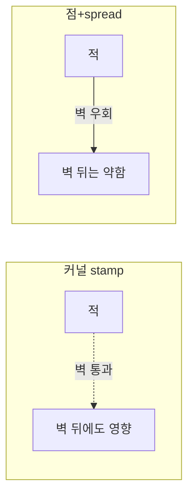
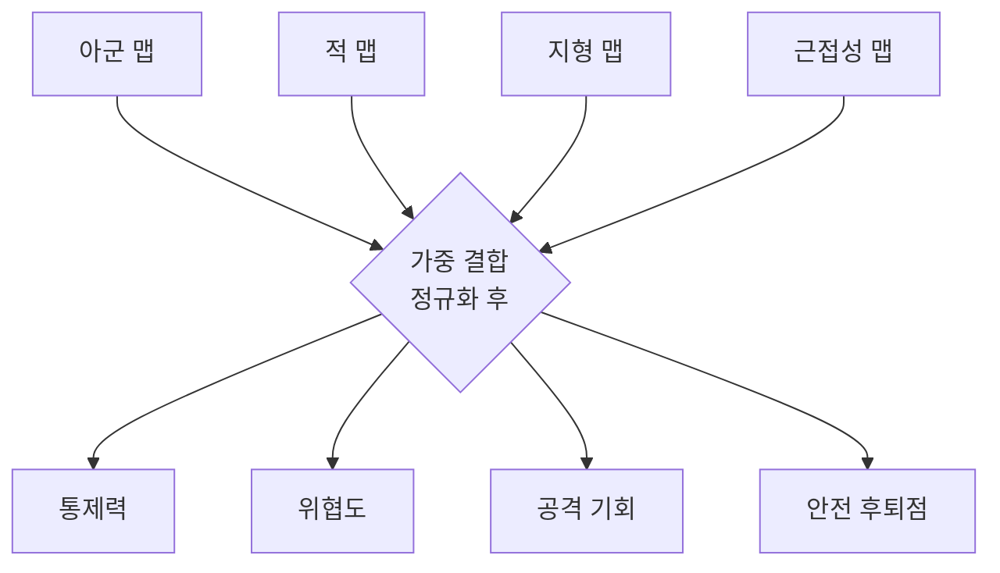

## 들어가며

개별 에이전트의 센서와 상태만으로는 "전선이 어디에 형성됐는가", "어느 지역이 위험한가", "적 방어가 약한 측면은 어디인가"처럼 공간 전체를 요약하는 질문에 답하기 어렵다. 이런 *공간적·전술적 정보* 를 정량화하는 도구가 영향력 맵(Influence Map)이다.

영향력 맵은 월드를 격자로 나누고, 각 셀에 *영향력 값* 을 부여한다. 아군 유닛은 자기 위치에 양의 영향력을, 적 유닛은 음의 영향력을 "찍고(stamp)", 그 값이 주변으로 *번지면서(spread)* 거리에 따라 감쇠한다. 결과는 "이 지점이 누구의 통제 아래 있는가, 얼마나 강하게"를 나타내는 연속적 장(field)이다. 두 진영의 영향력이 비슷한 곳이 전선이고, 한쪽이 압도하는 곳이 안전지대다. 이 장에서 NPC는 "가장 안전한 후퇴 지점", "가장 약한 공격 지점", "통과하면 위험한 길목"을 *읽어낸다*.

영향력 맵이 개별 에이전트 AI와 결정적으로 다른 점은 *전역 상태를 한 자료구조에 모은다* 는 것이다. 유한 상태 기계나 행동 트리가 "이 에이전트가 무엇을 하는가"를 다룬다면, 영향력 맵은 "이 공간이 어떤 상태인가"를 다룬다. 수십~수백 에이전트가 각자 raycast로 주변을 훑어 같은 위협을 중복 계산하는 대신, 영향력 맵은 그 정보를 *한 번 합산해 격자에 캐싱* 한다. 에이전트는 자기 셀의 값을 $O(1)$로 읽기만 하면 된다. 이 "비싼 공간 추론을 격자에 미리 적분해 두고 다수가 공유"하는 패턴은 흐름장(flow field) 길찾기, 내비게이션 거리장과 같은 계열의 발상이다.

이 글은 영향력의 stamping과 spreading, 시간적 감쇠(decay), 여러 맵을 합치는 다층 결합, 그리고 결합된 맵에서 tension·vulnerability·choke 같은 *파생 정보* 를 추출하는 방법을 다룬다. 단순 반복 확산이 왜 비등방성(anisotropic) 결함을 내는지, 분리 가능 가우시안(separable Gaussian)과 거리장 기반 전파가 그것을 어떻게 푸는지를 알고리즘 수준에서 본다. 공개된 StarCraft 봇 연구와 Total War 캠페인 위협 평가를 적용 사례로 구분하고, 셀 크기·갱신 주기·시간 분할이라는 성능 절충과 디버깅·시각화 방법을 정리한다.


이 글의 목표.

1. **기본 발상** — 공간을 격자 장으로 정량화, 좌표·자료구조·복잡도.
2. **stamping** — 유닛이 초기 영향력을 찍는다. 점/커널/누적 방식.
3. **spreading** — 거리 감쇠 전파. 반복 확산의 결함과 분리 가능 커널·거리장 대안.
4. **decay** — 과거 정보의 시간적 망각, 지수 감쇠의 의미.
5. **다층 결합** — 아군·적·지형 맵의 합성과 가중치 튜닝.
6. **파생 정보** — tension/vulnerability/choke 추출과 경사 기반 의사결정.
7. **실제 사례** — StarCraft와 Total War.
8. **성능과 디버깅** — 셀 크기, 시간 분할, 더티 영역, 시각화.


---

## 목차
1. [영향력 맵의 발상](#1-영향력-맵의-발상)
2. [Stamping과 초기 영향력](#2-stamping과-초기-영향력)
3. [Spreading 알고리즘](#3-spreading-알고리즘)
4. [Decay와 시간적 감쇠](#4-decay와-시간적-감쇠)
5. [다층 맵의 결합](#5-다층-맵의-결합)
6. [Tension·Vulnerability·Choke 추출](#6-tensionvulnerabilitychoke-추출)
7. [공개된 적용 사례](#7-공개된-적용-사례)
8. [성능과 디버깅](#8-성능과-디버깅)


---

## 1. 영향력 맵의 발상

### 격자 이산화와 자료구조

영향력 맵의 핵심 발상은 *공간을 격자로 이산화하고, 각 셀에 스칼라 값을 두어 전술적 의미를 정량화* 하는 것이다. 이 값을 "영향력(influence)"이라 부르며, 보통 아군은 양(+), 적은 음(−)으로 둔다.

```cpp
struct InfluenceMap {
    int   width, height;       // 셀 단위 격자 크기
    float cellSize;            // 한 셀이 덮는 월드 거리 (m)
    float originX, originY;    // 격자 (0,0)의 월드 좌표
    std::vector<float> cells;  // 행 우선(row-major), [y*width + x]

    float At(int x, int y) const { return cells[y * width + x]; }
    bool  InBounds(int x, int y) const {
        return x >= 0 && x < width && y >= 0 && y < height;
    }
    // 월드 좌표 → 셀 인덱스. 유한성·cellSize 양수·범위를 검사하고 음수도 올바르게 내림.
    bool WorldToCell(float wx, float wy, int& cx, int& cy) const {
        cx = cy = -1;
        if (!std::isfinite(wx) || !std::isfinite(wy) ||
            !std::isfinite(originX) || !std::isfinite(originY) ||
            !std::isfinite(cellSize) || !(cellSize > 0.f)) return false;
        double x = std::floor((double(wx) - originX) / cellSize);
        double y = std::floor((double(wy) - originY) / cellSize);
        if (!(x >= 0 && x < width && y >= 0 && y < height)) return false;
        cx = int(x); cy = int(y); // int 범위를 벗어난 float를 변환하기 전에 격자 범위 검사
        return true;
    }
};
```

이후 격자 코드는 양의 크기와 셀 간격, 크기에 맞는 저장소, `int`로 표현 가능한 선형 인덱스를 전제로 한다.

자료구조는 `std::vector<float>` 한 줄이 본질이다. 2차원 격자를 1차원 배열에 *행 우선* 으로 펴서 담고, `y * width + x`로 인덱싱한다. spread·decay가 행 방향으로 순회하면 연속 접근이라 cache line 활용과 hardware prefetch에 유리하다. 다만 여러 channel을 같은 loop에서 읽는지, stencil이 이웃 행을 얼마나 재사용하는지, map이 매우 희소한지에 따라 AoS/SoA, tile layout 또는 sparse representation이 더 나을 수 있다. dense map의 기본값으로 평면 배열을 택하고 target workload에서 cache miss와 memory bandwidth를 측정한다.

한 셀의 값이 0보다 크면 아군 우세, 0보다 작으면 적 우세, 0 근처면 경합(전선)이다. 이 단순한 부호 규칙 위에서 풍부한 전술 정보가 파생된다.

### 단일 부호 맵 vs 분리 맵

부호 하나로 두 진영을 표현하는 방식(아군 +, 적 −)은 메모리를 아끼지만, 정보를 잃는다. "아군 영향력 5, 적 영향력 5"인 격전지와 "아무도 없는" 빈 지역이 *둘 다 0* 으로 합쳐져 구분되지 않는다.

| 표현 방식 | 메모리 | 격전지 vs 무인지대 구분 | 비고 |
|---|---|---|---|
| 단일 부호 맵 (friendly − enemy) | 1배 | 불가 (둘 다 0) | 통제력만 필요할 때 |
| 분리 맵 (friendly, enemy 따로) | 2배 | 가능 | tension/vulnerability 추출에 필수 |

`friendly + enemy`는 총 전력 밀도를, `abs(friendly - enemy)`가 작은 고밀도 지역은 경합도를, `enemy - friendly`는 적 우세도를 나타낼 수 있다. 이런 파생량을 얻으려면 두 진영을 *따로* 저장하고 읽는 시점에 결합해야 한다. 단일 부호 맵은 "통제선이 어디인가"처럼 순 영향력 하나만 필요한 경우에 쓴다.

### 비용의 구조

비용은 격자와 유닛 양쪽에 의존한다. decay는 $O(WH)$, 점 stamp는 유닛 수 $U$에 대해 $O(U)$, spread는 방식에 따라 $O(WH \cdot I)$(반복 $I$회) 또는 $O(WH \cdot r)$(반경 $r$ 분리 커널)다. 따라서 전체는 대략 $O(U+WHI)$ 또는 $O(U+WHr)$다. 전체 격자 spread가 지배적인 구성에서는 유닛 수가 늘어도 증가분이 stamp 비용에 제한되지만, $U$가 매우 크거나 커널 stamp $O(Ur^2)$를 쓰면 유닛 수가 다시 병목이 된다. 영향력 맵의 이득은 각 에이전트가 동일한 공간 추론을 반복하는 대신, 한 번 만든 장을 공유한다는 데 있다.

영향력 맵은 전략 게임과 RTS 봇 연구에서 오래 사용된 공간 요약 기법이다. 모든 상용 RTS가 같은 구조를 쓰는 표준이라고 단정할 수는 없지만, 위협·통제·밀집도를 격자 장으로 캐싱하는 대표적 선택지다.

## 2. Stamping과 초기 영향력

영향력 맵을 채우는 첫 단계는 *stamping* — 각 유닛이 자기 위치(또는 근처)에 초기 영향력 값을 찍는 것이다.

### 강도는 전투력을 인코딩한다

```cpp
void StampPoint(InfluenceMap& m, float wx, float wy, float strength) {
    int cx, cy;
    if (m.WorldToCell(wx, wy, cx, cy))            // 유한·범위 검사 + floor 변환
        m.cells[cy * m.width + cx] += strength;   // 누적: 같은 셀 여러 유닛 합산
}
```

찍는 값(strength)은 유닛의 *전투력* 을 반영한다. 강한 유닛은 큰 값을, 약한 유닛은 작은 값을 찍는다. 단순한 머릿수가 아니라 *위협의 크기* 를 인코딩하는 것이 핵심이다. 강도를 정하는 흔한 공식.

$$
\text{strength} = (\text{DPS} \times \text{유효사거리계수}) \times \frac{\text{현재HP}}{\text{최대HP}}
$$

부상한 유닛은 줄어든 값을, 화력이 높은 유닛은 큰 값을 찍는다. 사거리가 긴 유닛은 spread 반경이나 kernel 모양에 사거리 효과를 반영한다. `+=` 누적을 쓰면 같은 셀의 여러 source가 합쳐지지만, 전투력의 선형 합이 실제 교전 결과를 잘 근사하는지는 집중 사격·충돌·사거리 포화까지 포함해 검증해야 한다.

### 점 stamp, 커널 stamp, 누적의 차이

stamping 방식에는 세 갈래가 있다.

- *점 stamp + spread*: 유닛 위치에 값을 찍고 spreading으로 주변 셀에 전파한다. 장애물·거리 비용을 포함할 수 있지만, 결과의 정확성은 선택한 전파 모델과 실제 전투 규칙의 일치에 달렸다. 비용은 stamp $O(U)$와 spread 비용의 합이다.
- *커널 stamp(splatting)*: 미리 만든 영향력 커널(가우시안 등)을 유닛 위치에 직접 합산한다. spread 단계 없이도 부드러운 분포를 얻는다. 비용은 커널 반경 $r$에 대해 $O(U \cdot r^2)$.
- *원거리 합산*: spread도 커널도 없이, 매 셀에서 모든 유닛까지 거리를 계산해 falloff를 합산한다. $O(WH \cdot U)$로 가장 비싸 거의 쓰지 않는다.

커널 stamp의 함정은 *장애물을 무시* 한다는 것이다. 가우시안 커널을 그대로 더하면 영향력이 벽을 통과해 새 나간다 — 적이 벽 너머에 있어도 마치 벽이 없는 듯 위협이 내게 미친다. 다음 도식은 같은 적 위치에서 두 방식의 차이를 보인다.



점 stamp 후 그래프·격자 비용에 따라 전파하면 장애물과 우회 거리를 반영할 수 있다. 고정 커널 stamp는 source마다 같은 형태를 빠르게 더할 수 있지만 벽과 이동 비용을 별도 mask로 처리해야 한다. 선택은 위협이 실제 이동 비용을 따라 전파되는지, 단순한 밀도 평활이 필요한지와 갱신 예산에 달려 있다.

### 갱신 주기와 stamp의 재수행

stamping은 갱신 시점의 source 상태를 반영해야 한다. 완전 재구성은 맵을 초기화한 뒤 현재 source를 다시 찍어 오래된 위치가 남지 않게 한다. 시간적 기억이 필요한 맵은 이전 값을 decay한 뒤 현재 source를 더하되, source 이동의 흔적과 의도한 기억을 구분해야 한다. `decay → stamp → spread`와 `stamp → spread → decay`는 현재 입력의 크기까지 다르게 만들므로 갱신 순서를 계약으로 고정한다.

## 3. Spreading 알고리즘

stamping이 찍은 점 영향력을 주변으로 *번지게(spread)* 하는 단계다. 영향력은 거리가 멀수록 약해져야 한다 — 유닛 바로 옆은 강하게, 멀수록 약하게. 이 절은 단순한 방식에서 시작해 그 결함을 짚고, 결함을 푸는 두 대안으로 넘어간다.

### 반복 확산과 그 결함

가장 단순한 방식은 *반복 확산(iterative spreading)* 이다. 매 셀이 이웃 중 최대 영향력을 받아, 감쇠율을 곱해 자기 값으로 삼는다.

```cpp
void SpreadIterative(InfluenceMap& m, float decay, int iterations) {
    InfluenceMap next = m;
    for (int it = 0; it < iterations; ++it) {
        for (int y = 0; y < m.height; ++y)
        for (int x = 0; x < m.width; ++x) {
            if (m.IsWall(x, y)) { next.cells[y * m.width + x] = 0.f; continue; }
            float best = m.At(x, y);
            for (auto [dx, dy] : kNeighbors8) {          // 8방향 이웃
                int nx = x + dx, ny = y + dy;
                if (!m.InBounds(nx, ny) || m.IsWall(nx, ny)) continue;
                if (dx && dy && (m.IsWall(x + dx, y) || m.IsWall(x, y + dy))) continue;
                float incoming = m.At(nx, ny) * decay;   // 감쇠해 들어온 양
                if (std::abs(incoming) > std::abs(best)) best = incoming;
            }
            next.cells[y * m.width + x] = best;
        }
        std::swap(m.cells, next.cells);                  // 더블 버퍼
    }
}
```

아래 감쇠 거리식은 `0 < decay < 1`과 양의 소스 강도를 전제로 한다. 대각 전파는 양옆 직교 셀이 모두 열려 있을 때만 허용해 벽 모서리를 통과하지 않는다.

감쇠율 `decay`(예: 0.7)와 반복 횟수 `iterations`가 영향력이 퍼지는 *반경* 을 정한다. `decay`가 클수록 멀리 번지고, 반복이 많을수록 넓게 퍼진다. 한 점에서 $n$칸 떨어진 셀의 값은 대략 $\text{strength} \times \text{decay}^n$이 되므로, 영향력이 무시할 수준($\epsilon$)으로 떨어지는 반경은 $n \approx \log_{\text{decay}}(\epsilon/\text{strength})$이다. 이 점이 *벽을 우회* 한다는 게 결정적 장점이다 — `IsWall` 검사로 영향력이 장애물을 통과하지 못하게 하면, 적이 벽 너머에 있을 때 그 위협은 벽을 돌아온 거리만큼만 미친다.

반복 확산에는 *두 가지 결함* 이 있다. 첫째, *비등방성(anisotropic) 왜곡* 이다. "이웃 중 최대"를 쓰면 영향력이 8방향 격자를 따라 축에 정렬된 사각형 등고선으로 번진다 — 원형 falloff가 아니다. 둘째, *반복 비용* 이다. 한 번 spread에 $O(WH)$이고, 넓게 번지려면 $I$번 반복하므로 $O(WH \cdot I)$다. 반경을 키우면 비용이 선형으로 는다.

다음은 한 점 영향력 100을 `decay=0.6`, 8방향 max로 3회 확산했을 때 소스를 지나는 축 방향 한 행의 값 변화다.

```text
초기:    0    0    0  100    0    0    0
1회:     0    0   60  100   60    0    0
2회:     0   36   60  100   60   36    0
3회:    21.6 36   60  100   60   36  21.6
```

### 반복 확산이 만드는 거리 척도 — 왜 등고선이 원이 아니라 사각형인가

한 행의 표만으로는 대각 방향의 비등방성을 관찰할 수 없다. max-multiply 확산이 *어떤 거리 척도를 암묵적으로 계산하는지* 를 2차원에서 유도하면 결함의 정체와 크기가 드러난다.

장애물이 없는 격자에서 한 점 소스(강도 $s$)로 반복을 충분히 돌린 고정점은

$$
\text{value}(x,y) = s \cdot \text{decay}^{\,d_\infty\!\big((x,y),\text{src}\big)}, \qquad d_\infty(\Delta x,\Delta y)=\max(|\Delta x|,|\Delta y|)
$$

이다. 여기서 $d_\infty$는 *체비쇼프(Chebyshev) 거리* , 즉 $L^\infty$ 거리다. 유도는 간단하다. $h$번 홉을 거쳐 들어온 양은 $s\cdot\text{decay}^h$이고 $\text{decay}\in(0,1)$이라 *홉 수가 가장 적은 경로* 가 max로 선택된다. 8연결 격자에서 $(\Delta x,\Delta y)$까지의 최소 홉 수는 정확히 $\max(|\Delta x|,|\Delta y|)$다 — 대각 이동이 한 홉에 $x$와 $y$를 동시에 1씩 줄이기 때문이다. 따라서 max-multiply 확산은 *대각 홉을 축 홉과 똑같이 한 걸음으로 친다* . 코너 $(3,3)$도 같은 법칙에 따라 축 방향 $(3,0)$과 똑같이 $100\cdot0.6^3=21.6$이 된다(시뮬레이션 고정점이 $s\cdot\text{decay}^{d_\infty}$와 $10^{-15}$까지 일치).

그러므로 등영향력 집합 $\{\text{value}=c\}$는 $\{d_\infty=\text{const}\}$, 곧 *축에 정렬된 정사각형* 이지 원이 아니다. 별 모양·다이아몬드 모양은 서로 다른 확산 알고리즘에서 나타나는 일반적인 격자 이방성의 예이며, 여기 8연결 max-multiply의 등고선은 정사각형이다.

비등방성의 크기는 척도 변환으로 못 박는다. 같은 임계 $c$에 도달하는 거리를 보면, 축 방향은 유클리드 거리 $R_{\text{axis}}=\log_{\text{decay}}(c/s)$에서 닿고, 대각(45°) 방향은 같은 홉 수 $n$이 유클리드 거리 $n\sqrt2$에 해당하므로 $R_{\text{diag}}=\sqrt2\,R_{\text{axis}}$다. 즉 영향력이 대각으로 *항상 $\sqrt2\approx1.414$배 멀리* 새 나간다 — 41.4% 과도 도달이며, $\text{decay}$ 값과 임계 $c$에 *무관* 한 고정 상수다. 값 영역으로 보면, 셀 $(4,4)$(유클리드 $4\sqrt2\approx5.66$)는 $\text{decay}^4=0.130$인데 같은 유클리드 거리의 축 셀은 $\text{decay}^{5.66}=0.056$이라, 대각의 영향력이 *2.33배 과대* 하다.

반대 편향도 같은 틀로 나온다. 4연결(폰 노이만) 이웃을 쓰면 척도는 *맨해튼($L^1$)* 이 되고 등고선은 축을 가리키는 다이아몬드다. $(k,k)$까지 맨해튼 거리는 $2k$, 유클리드는 $\sqrt2\,k$라 대각의 영향력이 $\text{decay}^{(2-\sqrt2)k}$만큼 *지나치게 약해진다* ($(4,4)$에서 $0.0168$ 대 $0.056$). 8연결은 대각 과잉, 4연결은 대각 결핍 — 둘 다 격자의 인공물이다.

해법은 *대각 한 걸음의 비용을 $\sqrt2$로 매기는* 것이다. 거리장 Dijkstra 코드의 `1.41421f` 보정이 바로 이 *chamfer/octile 거리* 이고, 그 잔여 비등방성은 octile 거리가 유클리드를 최대 약 8.24%만 과대평가하는 잘 알려진 상한($\sqrt{4-2\sqrt2}\approx1.0824$, 최악각 22.5°)으로 줄어든다 — 8연결 max의 41.4%에서 한 자릿수로 떨어진다. 완전한 등방성이 필요하면 정확한 *유클리드 거리 변환(EDT)* 을 쓰며, 두 번의 1D 패스로 $O(WH)$에 정확한 유클리드 거리를 준다(Felzenszwalb-Huttenlocher). 이는 장애물을 무시한 직선 거리이며, 벽을 돌아가는 최단 경로 거리를 대신하지는 않는다. 비등방성-비용 위계는 다음과 같다.

| 척도 | 등고선 | 방향별 오차(빈 공간) | 비용 |
|---|---|---|---|
| $L^\infty$ (8연결 max) | 정사각형 | $+41.4\%$ 과도 도달 | $O(WH\cdot I)$ |
| $L^1$ (4연결 max) | 다이아몬드 | 대각 결핍 | $O(WH\cdot I)$ |
| octile (대각 $\sqrt2$) | 팔각형 | $+8.24\%$ (22.5°) | $O(WH)$ chamfer / $O(WH\log WH)$ wavefront |
| 정확 EDT | 원 | 0 | $O(WH)$ |

경계 조건 둘에 주의한다. 첫째, chamfer 2패스 래스터는 $O(WH)$로 가장 싸지만 *단조 전파* 를 가정해 오목한(non-convex) 장애물을 돌아가지 못한다 — 벽을 정확히 우회하려면 파면(wavefront) BFS/Dijkstra의 $O(WH\log WH)$가 필요하다(거리장 코드가 우선순위 큐를 쓰는 이유). 둘째, max-multiply는 합이 아니라 *최댓값* 을 취하므로 "가장 강한 stamp 셀" 장이다(같은 셀의 유닛은 stamp 단계에서 이미 합산될 수 있다). 약한 유닛 둘이 인접해도 원거리에서 서로를 *보강하지 않는다* — 위협을 "가장 가까운 강한 적까지의 거리"로 읽을 때는 옳지만, 밀집도처럼 *가산적* 영향력이 필요하면 합산 커널(분리 가능 가우시안)을 써야 한다.

### 분리 가능 가우시안

원형에 가까운 부드러운 falloff가 필요하면 *가우시안 블러* 가 정답이고, 가우시안은 *분리 가능(separable)* 이라는 결정적 성질을 가진다 — 2D 블러를 가로 1D 패스 + 세로 1D 패스로 쪼갤 수 있다. 반경 $r$ 커널의 2D 직접 합산이 셀당 $O(r^2)$인데, 분리하면 $O(2r)$로 떨어진다.

```cpp
// 1D 가우시안 가중치를 가로/세로 두 패스로 적용 (장애물 없을 때)
void SpreadGaussianSeparable(InfluenceMap& m, const std::vector<float>& k) {
    // k는 비어 있지 않은 홀수 길이의 유한한 비음수 가중치이며 합이 1인 커널이다.
    int r = int(k.size()) / 2;
    InfluenceMap tmp = m;
    // 가로 패스
    for (int y = 0; y < m.height; ++y)
    for (int x = 0; x < m.width; ++x) {
        float acc = 0;
        for (int i = -r; i <= r; ++i)
            if (m.InBounds(x + i, y)) acc += m.At(x + i, y) * k[i + r];
        tmp.cells[y * m.width + x] = acc;
    }
    // 세로 패스 (가로 결과 위에)
    for (int y = 0; y < m.height; ++y)
    for (int x = 0; x < m.width; ++x) {
        float acc = 0;
        for (int i = -r; i <= r; ++i)
            if (m.InBounds(x, y + i)) acc += tmp.At(x, y + i) * k[i + r];
        m.cells[y * m.width + x] = acc;
    }
}
```

분리 가능 블러의 한계는 *장애물을 못 다룬다* 는 것이다. 1D 패스가 벽을 가로지르면 커널이 벽 반대편 source를 읽어 영향력이 새 나간다. 결과에서 벽 셀을 0으로 지워도 커널이 이미 넘겨준 반대편 셀의 누적은 취소되지 않으므로, 벽 차단이 목적이면 *walkable 그래프 위의 거리나 연결성* 을 반영한 전파(거리장 기반)를 써야 한다. 분리 가능 가우시안은 *개활지 위주* 의 밀도 평활에 두고, "부드럽고 빠르되 장애물에 둔감"이 이 방식의 성격이다.

### 거리장 기반 전파

장애물을 정확히 우회하면서 falloff도 정확하려면, *Dijkstra/BFS로 장애물을 우회한 실제 거리* 를 구해 falloff를 그 거리에 적용한다. 내비게이션의 거리장(integration field)과 같은 발상이다. 여러 소스(유닛)에서 동시에 출발하는 *다중 소스 Dijkstra*로 각 셀까지의 최단 우회 거리를 구한다(모든 간선 비용이 같을 때만 FIFO BFS로 단순화한다).

```cpp
// 다중 소스 Dijkstra: sources는 범위 안의 통행 가능 셀, maxDist는 유한한 양수.
// 모든 유닛 셀에서 동시 출발, 각 셀까지 우회 거리 → falloff
void SpreadByDistance(InfluenceMap& m, const std::vector<Cell>& sources,
                      float maxDist) {
    std::vector<float> dist(m.cells.size(), maxDist);
    std::priority_queue<DistCell, std::vector<DistCell>,
                        std::greater<>> pq;   // 최소 거리 우선
    for (Cell s : sources) {
        int idx = s.y * m.width + s.x;
        dist[idx] = 0; pq.push({0.f, s});
    }
    while (!pq.empty()) {
        auto [d, c] = pq.top(); pq.pop();
        int idx = c.y * m.width + c.x;
        if (d > dist[idx]) continue;          // 낡은 항목 스킵
        for (auto [dx, dy] : kNeighbors8) {
            int nx = c.x + dx, ny = c.y + dy;
            if (!m.InBounds(nx, ny) || m.IsWall(nx, ny)) continue;
            if (dx && dy && (m.IsWall(c.x + dx, c.y) || m.IsWall(c.x, c.y + dy))) continue;
            float step = (dx && dy) ? 1.41421f : 1.0f;   // 대각 보정
            float nd = d + step * m.cellSize;
            int nidx = ny * m.width + nx;
            if (nd < dist[nidx]) { dist[nidx] = nd; pq.push({nd, {nx, ny}}); }
        }
    }
    for (size_t i = 0; i < m.cells.size(); ++i)
        m.cells[i] = (dist[i] < maxDist) ? Falloff(dist[i]) : 0.f;
}
```

`Falloff`는 거리를 영향력으로 바꾸는 함수다 — 선형 $\max(0, 1 - d/r)$, 지수 $e^{-d/\sigma}$, 역제곱 $1/(1+d^2)$ 등을 쓴다. 이 거리장은 *가장 가까운 소스* 까지의 거리 하나만 담으므로 source별 강도·부호가 같고 falloff가 거리에 따라 감소할 때 가장 가까운 소스의 영향력, 곧 개별 영향력의 최댓값을 구한다. 동질 소스라도 여러 소스의 합을 복원하지는 않는다 — 강도·부호가 다른 이질 소스는 최단거리 하나로 나타낼 수 없으므로 동질 채널로 나누거나 가중 누적 전파를 써야 한다. 이 방식은 대각 $\sqrt 2$ 보정 덕에 비등방성이 octile 잔여분(최대 약 8.24%)으로 줄고(거리는 그래프 위의 진짜 측지 거리), 장애물을 정확히 우회한다. 비용은 우선순위 큐 때문에 $O(WH \log WH)$로 반복 확산보다 무겁지만, 한 번에 정확한 거리를 얻는다. 세 방식의 절충은 다음과 같다.

| 방식 | 복잡도 | 장애물 | 등방성 | 적합 |
|---|---|---|---|---|
| 반복 확산 (max) | $O(WH \cdot I)$ | 우회함 | 나쁨 (L∞ 사각형 등고선) | 거친 위협 맵, 작은 반경 |
| 분리 가우시안 | $O(WH \cdot r)$ | 무시 | 좋음 (원형) | 개활지, 밀집도 맵 |
| 거리장 Dijkstra | $O(WH \log WH)$ | 정확히 우회 | 좋음 | 동질 소스 위협·접근 맵 |

## 4. Decay와 시간적 감쇠

영향력 맵은 *현재* 만이 아니라 *기억* 도 표현한다. 적을 마지막으로 본 지점의 위협은, 적이 시야에서 사라져도 잠시 남아야 한다 — 적이 거기서 순간이동하지 않았을 테니. 이를 *시간적 감쇠(temporal decay)* 로 처리한다.

### 지수 감쇠와 반감기

```cpp
void Decay(InfluenceMap& m, float momentum) {
    // momentum=0.9 → 매 갱신 값의 10%씩 사라짐 (과거 망각)
    for (float& c : m.cells) c *= momentum;
}
```

매 갱신 모든 셀에 `momentum`을 곱하므로, $n$번 갱신 뒤 값은 $\text{value} \times \text{momentum}^n$이다. 이 지수 감쇠는 *반감기(half-life)* 로 직관을 잡는 게 편하다. 값이 절반이 되는 갱신 횟수는

$$
n_{1/2} = \frac{\ln 0.5}{\ln(\text{momentum})}
$$

`momentum=0.9`면 약 6.6회, `0.95`면 약 13.5회 만에 절반이 된다. 갱신이 초당 4회라면 `0.9`는 약 1.6초 반감기다. 디자이너는 "적 목격 기억이 몇 초 남길 원하는가"로부터 거꾸로 momentum을 정한다. 갱신 주기가 바뀌면 *프레임 독립* 을 위해 $\text{momentum} = e^{-\lambda \Delta t}$로 시간 기반 보정을 넣기도 한다 — 그래야 갱신 빈도를 바꿔도 망각 속도가 일정하다.

### 갱신 루프의 순서

갱신 루프는 보통 다음 순서다.


순서가 중요하다. Decay를 *stamp 전* 에 해야 현재 관측이 감쇠되지 않고 온전히 들어간다. 만약 stamp 후 decay하면, 방금 찍은 최신 정보까지 깎여 항상 한 박자 흐려진 맵이 된다. 또 spread를 매번 처음부터 다시 하는 대신, *decay된 이전 spread 결과 위에 새 stamp를 얹어 한두 번만 spread* 하는 변형도 있다 — 영향력이 천천히 변한다는 점을 이용해 spread 비용을 줄인다.

### 불완전 정보의 모델

decay의 전술적 가치는 *불완전 정보의 표현* 이다. "여기 적이 있었다"는 기억이 시간에 따라 흐려지며, NPC는 "최근 적이 목격된 위험 지역"과 "오래전 정보라 불확실한 지역"을 구분한다. 안개 속(fog of war) 전략 게임에서 이 시간 감쇠가 *적 위치 추정* 의 기반이 된다. 마지막 목격 지점에서 영향력이 *서서히 번지며 흐려지는 것* 은, "적이 그 지점에서 어디로든 이동했을 수 있다"는 불확실성의 자연스러운 모델이다 — 시간이 지날수록 위협의 봉우리가 낮아지고(decay) 동시에 넓게 퍼진다(spread). 봉우리가 낮아지는 것은 확신의 감소, 넓어지는 것은 가능 위치의 확산을 나타낸다. 이 둘을 합치면 정찰 AI가 "적이 있을 법한 곳"으로 수색 범위를 좁히는 휴리스틱이 된다.

## 5. 다층 맵의 결합

하나의 영향력 맵은 한 종류의 정보만 담는다. 실제 전술 판단은 여러 맵을 *결합* 해 얻는다. 흔한 층 구성.

- *아군 영향력 맵*: 아군 유닛이 양의 값을 찍은 맵.
- *적 영향력 맵*: 적 유닛이 (별도로) 양의 값을 찍은 맵.
- *지형 맵*: 엄폐·고지·통행 난이도 같은 정적 정보(매 프레임 갱신 불필요).
- *근접성 맵*: 자원·목표·아군 기지까지의 거리장.

### 결합의 의미

각 층은 따로 들고, 읽는 시점에 결합한다. 결합은 단순 산술이지만 *조합의 의미* 가 풍부하다.

```cpp
// 통제력 맵: 아군 − 적 (부호가 통제 진영)
float Control(int x, int y) {
    return friendly.At(x, y) - enemy.At(x, y);
}
// 위협 맵: 적 영향력만 (후퇴 경로 평가용)
float Threat(int x, int y) {
    return enemy.At(x, y);
}
// 기회 맵: 적 가치는 높은데 적 방어는 약한 곳
float Opportunity(int x, int y) {
    float defense = std::clamp(enemy.At(x, y), 0.f, 1.f);
    return enemyValue.At(x, y) * (1.0f - defense);
}
// 안전 후퇴점: 아군 우세 + 위협 낮음 + 기지 가까움
float RetreatScore(int x, int y) {
    return wA * Control(x, y) - wT * Threat(x, y) - wD * baseDist.At(x, y);
}
```

아군−적의 차이는 "통제선"을, 적 영향력의 절댓값은 "위험도"를, 적 가치와 적 방어의 곱·차는 "공격 기회"를 만든다. 각 층은 단순하지만, 결합이 복합적 전술 질문에 답한다.

### 가중치 튜닝과 정규화

결합 가중치($w_A, w_T, w_D$)가 AI의 *성향* 을 정한다. 위협 가중치를 키우면 소심한 AI가, 기회 가중치를 키우면 공격적 AI가 된다. 디자이너는 코드 빌드 없이 이 가중치만 데이터로 조정해 난이도·진영별 성격을 만든다.

가중 결합에서 주의할 함정은 *스케일 불일치* 다. 영향력 값(0~수십)과 거리(0~수백 m)를 그냥 더하면 큰 스케일 항이 결과를 지배한다. 각 층을 결합 전에 *정규화* (예: 해당 층의 최댓값으로 나눠 0~1로, 또는 미리 정한 기준값으로 스케일)해 가중치가 의도대로 먹게 한다.



층을 따로 들고 읽을 때 결합하는 *모듈식 설계* 가 핵심이다. 새 전술 질문이 생기면 새 층을 추가하거나 결합식만 바꾸면 되고, 기존 stamp/spread 코드는 건드리지 않는다.

## 6. Tension·Vulnerability·Choke 추출

결합된 맵에서 *파생 지표* 를 추출하면, 더 직접적인 전술 정보가 된다. 다음 세 지표가 대표적이다.

### 세 지표의 정의

- *Tension(긴장도)* $= |\text{friendly}| + |\text{enemy}|$. 두 진영 영향력의 *합*. 양쪽 모두 강하게 존재하는 곳 — 격전지. 높은 tension은 "전투가 격렬한 지역"을 표시한다.

- *Vulnerability(취약도)* $= \text{tension} - |\text{friendly} - \text{enemy}|$. 두 진영 차이(우세도, dominance)가 작을수록 커진다. 양쪽 세력이 비슷해 *균형이 무너지기 쉬운* 곳 — 작은 증원으로 전세를 뒤집을 수 있는 결정적 지점.

- *Choke(길목)*: 지형 맵에서 통행 가능 폭이 좁은 곳. 영향력과 결합하면 "적이 반드시 지나야 하는 좁은 길"이 되어, 매복·방어의 핵심 지점이 된다.

```cpp
float Tension(int x, int y) {
    return std::abs(friendly.At(x, y)) + std::abs(enemy.At(x, y));
}
float Dominance(int x, int y) {
    return std::abs(friendly.At(x, y) - enemy.At(x, y));
}
float Vulnerability(int x, int y) {
    return Tension(x, y) - Dominance(x, y);   // 클수록: 강하게 경합 + 균형
}
```

vulnerability 식의 직관은 다음 수치 예로 명확해진다. friendly와 enemy 값에 따라 두 지표가 어떻게 갈리는지 본다.

| friendly | enemy | tension | dominance | vulnerability | 해석 |
|---:|---:|---:|---:|---:|---|
| 0 | 0 | 0 | 0 | 0 | 무인지대 — 관심 없음 |
| 10 | 0 | 10 | 10 | 0 | 아군 완전 장악 — 안전 |
| 5 | 5 | 10 | 0 | 10 | 팽팽한 격전 — 결정적 |
| 8 | 2 | 10 | 6 | 4 | 아군 우세하나 경합 잔존 |

tension이 같은 10이라도 vulnerability는 0에서 10까지 갈린다. "강하게 맞붙되 균형인 곳"만 vulnerability가 치솟는다 — 이것이 "지금 증원을 보내면 전세를 가를 수 있는 지점"이다.

### choke 검출

choke는 영향력 값이 아니라 *지형의 협소함* 에서 나온다. 각 통행 가능 셀에서 가장 가까운 벽까지의 거리(distance transform)를 구하면, 그 거리가 작은 곳이 좁은 길이다. 거기에 "양쪽이 통행 가능"하고 "이동 경로가 집중"되는 조건을 더하면 진짜 길목이 된다.

```cpp
// 협소도: 가장 가까운 벽까지 거리가 작을수록 choke 후보
float ChokeScore(int x, int y, const InfluenceMap& clearance) {
    if (IsWall(x, y)) return 0.f;
    float c = clearance.At(x, y);          // 벽까지 거리 (작을수록 좁음)
    float traffic = pathDensity.At(x, y);  // 경로가 얼마나 지나는가
    return traffic / (1.0f + c);           // 좁고 + 통행 많음 = 높은 choke
}
```

### 경사 기반 의사결정

파생 지표는 단순히 "최댓값 셀"을 고르는 데만 쓰이지 않는다. 영향력 장의 *경사(gradient)* 를 따라가면 부드러운 이동 명령이 된다. 위협 맵의 음의 경사를 따르면 "위험에서 멀어지는 방향", 기회 맵의 양의 경사를 따르면 "기회로 다가가는 방향"이다.

```cpp
Vec2 Gradient(const InfluenceMap& m, int x, int y) {
    // 내부는 중앙 차분, 경계 표본 좌표는 유효 범위로 클램프
    auto Sample = [&](int px, int py) {
        px = std::clamp(px, 0, m.width - 1);
        py = std::clamp(py, 0, m.height - 1);
        return m.At(px, py);
    };
    int xm = std::max(x - 1, 0), xp = std::min(x + 1, m.width - 1);
    int ym = std::max(y - 1, 0), yp = std::min(y + 1, m.height - 1);
    float gx = xp > xm ? (Sample(xp, y) - Sample(xm, y)) / ((xp - xm) * m.cellSize) : 0.f;
    float gy = yp > ym ? (Sample(x, yp) - Sample(x, ym)) / ((yp - ym) * m.cellSize) : 0.f;
    return {gx, gy};
}
// 후퇴: 위협 경사의 반대 방향으로 이동
Vec2 g = Gradient(threatMap, cx, cy);
Vec2 FleeDir = LengthSq(g) > 1e-12f ? -Normalize(g) : Vec2{0, 0};
```

이 지표들은 영향력 맵을 *행동 가능한 정보* 로 바꾼다. AI는 vulnerability가 가장 높은 셀로 증원을 보내(전세 결정), 위협 경사를 따라 안전지대로 부상병을 후퇴시키며(안전 후퇴), choke에 방어 유닛을 배치한다(길목 통제). 개별 유닛 AI(FSM/행동 트리)가 "어디로?"를 물을 때, 영향력 맵의 파생 지표가 그 답을 *공간적으로* 제공한다.

## 7. 공개된 적용 사례

### StarCraft 봇 연구 — kiting과 경로 비용

StarCraft를 실험 환경으로 사용한 공개 연구에서는 적의 사거리와 위치를 영향력 맵에 반영해 이동 후보의 위험을 평가하고, 원거리 유닛의 *공격 후 이탈(kiting)* 경로를 선택했다. 여기서 셀 값은 실제 피해량의 정확한 예측이 아니라, 적 사거리·화력·접근 가능성을 압축한 비용이다. 어떤 특성을 stamp하고 falloff를 어떻게 잡느냐에 따라 같은 맵도 전혀 다른 전술을 만든다.

같은 표현을 자원 채집 회피, 진입 경로 비용, 아군 밀집도 기반 산개에도 적용할 수 있지만, 이는 설계 패턴이지 모든 대회 봇이 채택했다는 뜻은 아니다. 공개 논문은 특정 봇과 특정 과제에서의 구현·평가를 뒷받침한다. 대회 순위만으로 참가 봇 대부분의 내부 자료구조를 일반화해서는 안 된다.

### Total War: Warhammer III — 캠페인 위협 범위

Creative Assembly가 공개한 Total War: Warhammer III 캠페인 AI 설명에는 외국 세력의 위협을 찾는 두 메커니즘 중 하나로, 각 군대의 이동 범위와 자산에 대한 상호작용 강도를 나타내는 influence map이 등장한다. 이는 군대가 어느 정착지나 목표에 위협이 되는지를 캠페인 지도에서 요약하는 사례다.

통제선, 측면 취약도, 고지대 보너스를 별도 채널로 결합하는 것은 이 문서의 일반 설계로 구현할 수 있다. 그러나 공개 자료가 확인하지 않는 실시간 전투 AI의 내부 로직까지 Total War의 실제 구현으로 귀속하지 않는다. 제품 사례에서 확인된 사실과 영향력 맵으로 가능한 설계를 분리하는 것이 중요하다.

## 8. 성능과 디버깅

영향력 맵은 매 갱신 전체 격자를 순회(decay·stamp·spread)하므로 비용이 크다. 셀 크기·갱신 주기·갱신 범위 세 축으로 비용을 다루고, 시각화 도구로 정확성을 검증한다.

### 셀 크기

| 셀 크기 | 효과 |
|---|---|
| 작음 (고해상도) | 정밀한 공간 정보, 큰 메모리·갱신 비용 |
| 큼 (저해상도) | 빠름, 거친 정보 (좁은 길목 놓침) |

전술 판단은 보통 *거친 해상도* 로 충분하다 — "어느 지역이 위험한가"는 픽셀 단위 정밀도가 필요 없다. 그래서 영향력 맵의 셀은 길찾기 그리드보다 훨씬 크게(예: 길찾기 셀 4×4를 영향력 셀 하나로) 두는 것이 일반적이다. 셀 크기를 2배로 키우면 격자 셀 수가 1/4로 줄어 decay·spread 비용이 1/4이 되므로, 해상도와 비용의 절충이 직접적이다. 단, choke처럼 *좁은 폭* 에 의존하는 지표는 셀이 너무 크면 길목 자체가 한 셀에 묻혀 사라진다 — 지표별로 다른 해상도의 맵을 따로 두기도 한다.

### 갱신 주기와 시간 분할

필요한 갱신률은 가장 빠른 영향원과 질의의 허용 오차로 정한다. 전술 판단처럼 변화가 느린 채널은 여러 프레임에 한 번 갱신할 수 있지만, 빠른 투사체 회피나 즉시 피해 예측에는 같은 stale 허용치를 적용할 수 없다. 비싼 spread를 다음 기법으로 분산한다.

- *시간 분할(time-slicing)*: 맵을 가로 띠로 나눠 매 프레임 일부 행만 갱신, N프레임에 걸쳐 전체를 돈다. 프레임당 비용을 1/N로 평탄화한다.
- *더티 영역(dirty region)*: 유닛이 움직인 셀 주변만 다시 stamp·spread한다. 정적인 후방은 그대로 둔다.
- *비동기 갱신*: 영향력 맵 갱신을 별도 잡(job)/스레드로 빼고, 전술 AI는 *직전 완성본* 을 읽게 한다(더블 버퍼). 독자가 다 읽기 전에는 그 버퍼를 다음 write용으로 재사용하지 않는다.

```cpp
// published는 읽기 전용 완성본, building은 다음 세대의 작업 버퍼다.
// 공개(publish) → 독자 읽기 완료(reader-complete) → 재사용(reuse) 순서를 지킨다.
void TickSliced(const InfluenceMap& published, InfluenceMap& building,
                int& band, int bandCount, int stencilRadius) {
    int y0 = building.height * band / bandCount;
    int y1 = building.height * (band + 1) / bandCount;
    int halo0 = std::max(0, y0 - stencilRadius);
    int halo1 = std::min(building.height, y1 + stencilRadius);

    BuildRowsFromSnapshot(published, building, y0, y1, halo0, halo1);

    if (++band == bandCount) {
        PublishCompletedGeneration(building); // release 저장으로 새 핸들 공개
        WaitForReadersOfRetiredBuffer();      // 독자 pin/refcount/epoch·job 완료 대기
        band = 0;
        BeginNextGeneration(building);        // 읽기 완료 후에만 이전 버퍼를 덮는다
    }
}
```


영향력 맵은 보통 정밀한 물리 상태가 아니라 전술적 근사다. 허용 가능한 stale 시간은 유닛 속도와 질의 계약으로 정한다. 띠별 갱신은 같은 공개 버퍼를 직접 덮으면 서로 다른 시점의 행이 섞이고, spread stencil이 띠 경계를 넘을 때 수치 결과도 순서에 의존한다. halo 영역을 포함해 작업 버퍼에 쓰고, 한 세대가 완성된 뒤 버퍼를 교환하면 독자는 일관된 스냅숏만 본다. 즉 시간 분할은 프레임 비용을 평탄화하지만 전체 작업량을 자동으로 줄이지 않으며, 완성까지의 지연을 늘린다. 이때 출판은 release/acquire로 짝지어야 하고, 폐기된 이전 버퍼는 *독자들이 읽기를 마쳤다는 완료 신호* 이후에만 다음 write용으로 재사용한다 — 포인터만 교환하면 독자가 보유한 버퍼를 writer가 다음 프레임에 덮어쓸 수 있다. 단일 스레드나 프레임 job completion barrier, reader pin/refcount/epoch 같은 reclamation 장치가 이 재사용 게이트를 제공한다.

### 디버깅과 시각화

영향력 맵은 *눈에 보이지 않는* 추상 자료구조라, 시각화 없이는 버그를 찾기 어렵다. "왜 AI가 저기로 후퇴했지?"의 답은 거의 항상 *그 시점의 영향력 분포* 에 있다.

가장 강력한 도구는 *히트맵 오버레이* 다. 각 셀의 값을 색으로 매핑해(아군 파랑, 적 빨강, 경합 노랑) 월드 위에 반투명으로 그린다. 멀리서 한눈에 전선·안전지대·격전지가 보인다.

```cpp
void DebugDrawHeatmap(const InfluenceMap& m, DebugRenderer& dr) {
    for (int y = 0; y < m.height; ++y)
    for (int x = 0; x < m.width; ++x) {
        float v = m.At(x, y);
        Color c = (v > 0) ? Lerp(Color::Clear, Color::Blue, v / kMaxAbs)
                          : Lerp(Color::Clear, Color::Red, -v / kMaxAbs);
        dr.DrawCellQuad(m.originX + x * m.cellSize,
                        m.originY + y * m.cellSize, m.cellSize, c);
    }
}
```

히트맵에 더해 검증할 항목.

- *경사 화살표*: 각 셀에 gradient 방향 화살표를 그려, 후퇴·접근 흐름이 의도대로 흐르는지 본다. 화살표가 벽을 뚫고 가면 spread의 장애물 처리가 깨진 것이다.
- *파생 지표 토글*: tension·vulnerability·choke를 개별 채널로 따로 그려, 증원·매복 결정이 어느 셀을 골랐는지 확인한다.
- *경계값 점검*: 최대·최소·0등고선을 강조해, decay momentum이나 결합 가중치가 의도한 범위를 벗어났는지(예: 값이 폭주하거나 전부 0으로 죽었는지) 본다.

이 시각화 인프라가 영향력 맵의 "전장을 한눈에 평가한다"는 약속을 *개발자에게도* 지킨다. 도구 없는 영향력 맵은 숫자 배열일 뿐이고, 잘못 튜닝된 가중치 하나가 전 부대를 엉뚱한 곳으로 보내도 원인을 찾기 어렵다.


---

## 결론

영향력 맵은 공간을 격자로 이산화하고 각 셀에 영향력 값을 두어, 개별 에이전트가 직접 계산하기 어려운 *전장 전체의 전술 정보* 를 정량화한다. 유닛이 전투력에 비례한 값을 stamp하고, 그 값이 장애물과 거리 모델에 따라 spread하며, 시간에 따라 decay한다. 비용은 $U+WHI$처럼 유닛 수와 격자 갱신 양쪽에 의존하지만, 완성된 장을 여러 에이전트가 공유해 중복 공간 질의를 줄일 수 있다.

spread는 구현에 따라 성격이 갈린다. 반복 확산은 단순하고 장애물을 우회하지만 비등방성 왜곡이 있고, 분리 가능 가우시안은 빠르고 부드럽지만 장애물에 둔감하며, 거리장 기반 전파는 선택한 거리 척도와 그래프 비용을 반영한다. 여러 맵(아군·적·지형·근접성)을 정규화해 결합하면 통제력·위협·기회 같은 복합 정보가 나오고, 거기서 tension·vulnerability·choke를 추출하면 "어디로 증원할지, 어디로 후퇴할지, 어디를 막을지"라는 행동 가능한 답이 된다. StarCraft 봇의 kiting 연구와 Total War 캠페인의 세력 위협 범위는 같은 자료구조가 서로 다른 질의를 지원하는 공개 사례다.

대가는 갱신 비용이며, 거친 셀 크기·낮은 갱신 주기·시간 분할·더티 영역·비동기 더블 버퍼로 다룬다. 영향력 맵은 정밀한 실시간 데이터가 아니라 전술적 근사이고, 그 근사로 충분하다는 점이 비용을 감당 가능하게 만든다. 히트맵·경사 화살표·지표 토글 같은 시각화가 그 근사의 정확성을 검증한다. 개별 AI가 "무엇을"과 "어떻게"를 정한다면, 영향력 맵은 "어디서"라는 공간적 차원을 더해 전략 수준의 의사결정을 완성한다.

## 더 읽을거리

- Kevin Dill, "Spatial Reasoning for Strategic Decision Making" (*Game AI Pro* 2권) — 영향력 맵 위에서 지역·chokepoint를 추론하는 전략 수준 공간 추론.
- Alex Champandard, "The Mechanics of Influence Mapping" (AiGameDev) — stamp/spread/decay의 실무.
- Steve Rabin (ed.), *Game AI Pro* 2권, "Modular Tactical Influence Maps" — 다층 결합·정규화 아키텍처.
- Chris Crawford, 초기 전략 게임 AI 저작 — 영향력 맵 개념의 기원.
- Paul Tozour, "Influence Mapping" (*Game Programming Gems* 2) — 고전적 정리.
- Ian Millington, *AI for Games*, 3rd Ed., "Tactical and Strategic AI" — 영향력 맵·전술 분석 정리.
- Alberto Uriarte & Santiago Ontañón, "Kiting in RTS Games Using Influence Maps" (AIIDE 2012) — StarCraft 봇에서 영향력 맵을 kiting에 적용하고 평가한 사례.
- Creative Assembly, "Total War: WARHAMMER III — Improving AI in Campaign" — 군대의 범위와 상호작용 강도를 나타내는 캠페인 influence map 설명.
- Gunilla Borgefors, "Distance Transformations in Digital Images" (Computer Vision, Graphics, and Image Processing 34(3), 1986) — chamfer 거리 변환과 격자 거리 척도의 비등방성 한계.
- Per-Erik Danielsson, "Euclidean Distance Mapping" (Computer Graphics and Image Processing 14(3), 1980) — 벡터 전파 기반 근사 유클리드 거리 변환의 고전(ITK는 Danielsson 계열을 pixel accuracy의 approximate Euclidean distance로 설명한다). 정확한 EDT는 아래 Felzenszwalb–Huttenlocher를 본다.
- Pedro F. Felzenszwalb & Daniel P. Huttenlocher, "Distance Transforms of Sampled Functions" (Theory of Computing 8(1), Article 19, 2012, pp. 415–428) — 정확한 EDT의 선형 시간 알고리즘.
