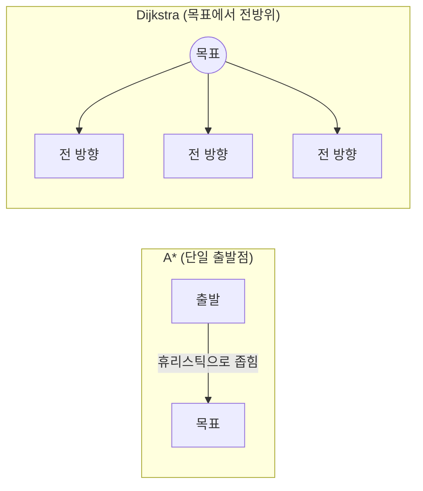
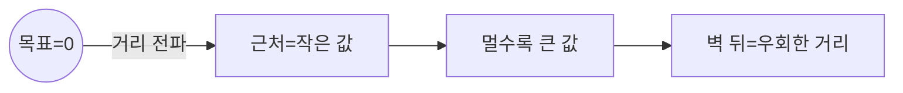
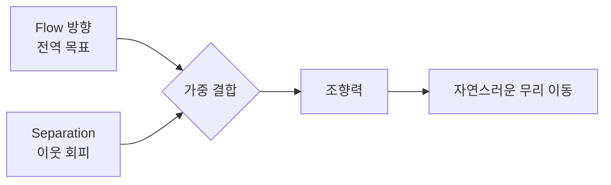
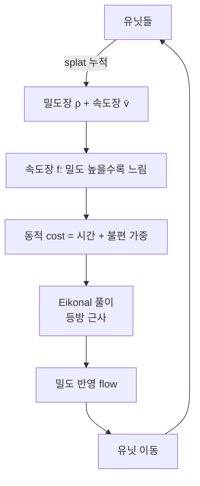
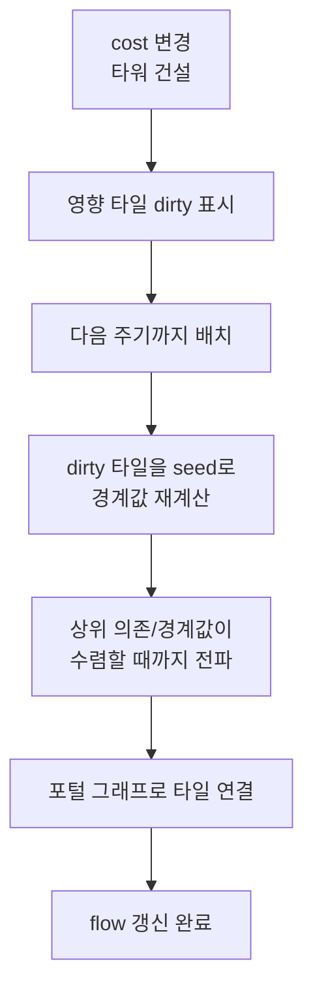

## 들어가며

많은 유닛이 같은 목표를 향할 때 유닛별 A\*는 상당한 탐색을 중복할 수 있다. 작은 국소 쿼리 몇 개라면 전체 격자 거리장을 만드는 편이 오히려 비싸지만, 같은 넓은 영역과 목표를 반복 탐색하면 공유할 정보가 커진다. Flow Field는 이 공통 부분을 유닛이 아니라 공간에 저장한다.

Flow Field는 발상을 뒤집는다. 유닛마다 경로를 계산하는 대신, *맵 전체에 대해 "이 셀에서는 어느 방향으로 가야 목표에 가까워지는가"를 나타내는 방향 벡터장* 을 한 번 계산한다. 그러면 각 유닛은 자기가 선 셀의 벡터를 읽어 그 방향으로 움직인다. 거리장 생성 비용은 같은 목표를 공유하는 유닛 수와 무관하고, 유닛이 늘 때 추가되는 비용은 벡터 샘플링·steering·국소 회피다. 즉 길찾기의 큰 고정비를 목표 단위로 공유하되, 유닛당 이동 비용까지 사라지는 것은 아니다.

이 글은 Flow Field를 만드는 세 단계 — cost field(지형 비용), integration field(목표까지의 거리, Dijkstra), flow field(거리 경사를 따르는 방향) — 를 따라가되, 각 단계의 알고리즘을 워크스루로 추적하고 복잡도·메모리·수치 정밀도까지 분해한다. 그 위에 격자 편향을 푸는 Eikonal/Fast Marching, 벡터장을 부드럽게 따르는 steering, 밀도를 되먹이는 Continuum Crowds, 그리고 cost가 바뀔 때의 동적 갱신 전략을 다룬다. 마지막으로 캐시 친화적 메모리 레이아웃과 디버그 시각화까지 정리한다.


이 글의 목표.

1. **기본 발상** — 경로 대신 벡터장, 비용의 유닛 수 독립, 포텐셜 함수로서의 거리장.
2. **cost field** — 지형 통행 비용 격자, 정적·동적 합성, 해상도·자료형 트레이드오프.
3. **integration field** — 목표에서 바깥으로 거리를 전파하는 Dijkstra, 왜 A*가 아닌가, 워크스루.
4. **flow field** — 거리 경사에서 방향 추출, 최소 이웃 대 중심 차분, 양자화 오차.
5. **Eikonal 근사** — 격자 거리의 구조적 오차와 Fast Marching Method의 2차 방정식 풀이.
6. **유닛 steering** — 벡터장을 부드럽게 따르기, separation, 셀 경계 양자화 완화.
7. **Continuum Crowds** — 밀도-속도장을 cost에 되먹여 차선 형성을 창발시키기.
8. **사례와 동적 갱신** — 상용 적용, tile 분할 갱신, 캐싱, 메모리 레이아웃, 디버그 시각화.


---

## 목차
1. [Flow Field의 발상](#1-flow-field의-발상)
2. [Cost Field 빌드](#2-cost-field-빌드)
3. [Integration Field와 Dijkstra](#3-integration-field와-dijkstra)
4. [Flow Field 생성](#4-flow-field-생성)
5. [Eikonal 근사](#5-eikonal-근사)
6. [유닛별 Steering 적용](#6-유닛별-steering-적용)
7. [Continuum Crowds](#7-continuum-crowds)
8. [사례와 동적 갱신](#8-사례와-동적-갱신)


---

## 1. Flow Field의 발상

### 경로를 유닛에 저장하느냐, 공간에 저장하느냐

Flow Field(흐름 장, vector field pathfinding)의 핵심은 *길찾기 결과를 유닛이 아니라 공간에 저장* 하는 것이다. A*가 "출발점에서 목표까지의 경로(셀 시퀀스)"를 유닛별로 만든다면, Flow Field는 "모든 셀에서 목표를 향하는 방향 벡터"를 공간 전체에 만든다.

```cpp
struct FlowField {
    int width, height;
    float cellSize = 1.0f;
    std::vector<Vec2> dir;     // 각 셀의 정규화된 이동 방향
    bool InBounds(int x, int y) const {
        return x >= 0 && y >= 0 && x < width && y < height;
    }
    Vec2 At(int x, int y) const { return dir[y * width + x]; }
};
```

이후 격자 예제는 양의 크기·셀 간격과 크기에 맞는 저장소, `int` 범위 안의 인덱스 산술, 유효한 통행 가능 목표를 전제로 한다. `Neighbors4/8`은 범위 안의 이웃만 반환한다.

이 구조체에 길찾기의 방향 결과가 담긴다. 유닛은 자기 위치를 셀 좌표로 바꿔 `At(x, y)`를 한 번 읽으면 "지금 어느 쪽으로 가야 목표에 가까워지는가"를 즉시 안다. 출발점이 어디였는지, 경로의 몇 번째 칸인지 같은 *유닛별 상태가 필요 없다*. 벡터장은 모든 출발점을 동시에 처리하는 *전역 해(global solution)* 이기 때문이다.

### 비용 구조의 역전

이 차이가 비용 구조를 근본적으로 바꾼다.

| 방식 | 사전 계산 | 유닛당 런타임 | 유닛 N에 대한 총비용 |
|---|---|---|---|
| 유닛별 A* | 없음 | 경로 탐색 + 추적 | $O(N \cdot E \log V)$ |
| Flow Field | 격자 전체 1회 | 셀 벡터 룩업 O(1) | $O(V \log V + N)$ |

여기서 $V$는 격자 셀 수, $E$는 간선 수(8방향 격자면 $E \approx 8V$)다. 표의 A* 항은 탐색이 그래프 대부분을 확장하는 상한에 가까운 표현이며, 실제 비용은 휴리스틱과 장애물 배치에 따라 확장한 노드 수로 정해진다. Flow Field도 유닛당 벡터 샘플링과 이동 갱신 때문에 총비용에 $O(N)$ 항이 남는다. 다음 계산은 특정 작업량을 가정한 손익분기 예시다.

- 격자 $128 \times 128 = 16,384$ 셀, Dijkstra 생성 비용을 이 예에서는 약 230,000 작업 단위로 가정한다.
- 유닛별 A*가 평균 200셀을 펼친다면, 유닛 1마리당 이웃 검사 약 $200 \times 8 \approx 1,600$회에 해당하는 총비용을 1,600 작업 단위로 가정한다.
- 손익분기 $N \approx 230{,}000 / 1{,}600 \approx 144$ 마리.

230,000과 1,600은 같은 비용 단위로 환산됐다는 가정이다. $V\log V$와 이웃 검사 횟수를 그대로 나누면 힙 연산·간선 완화 비용이 서로 달라 손익분기가 되지 않는다. 이 예의 비용 가정에서는 약 144마리에서 거리장 생성 비용을 상쇄한다. 그러나 보편적인 "100마리 기준"은 없다. A*의 평균 확장 수, 격자 크기, 목표 변경 빈도, flow 갱신 주기, 유닛별 회피 비용을 같은 플랫폼에서 측정해 손익분기를 구해야 한다. 유닛 수가 늘어도 격자 생성 비용은 그대로지만 $O(N)$인 샘플링과 steering 비용은 계속 증가한다.

### 특화된 도구라는 점

반대로 유닛이 *각자 다른 목표* 로 가면 목표마다 Flow Field가 필요해 이점이 사라진다. 목표 $M$개면 격자를 $M$번 채워야 하므로 $O(M \cdot V \log V)$가 되어, $M \approx N$이면 유닛별 A*와 다를 바 없거나 더 나쁘다. Flow Field는 "다수가 소수의 공통 목표로"라는 패턴에 특화된 도구다.

- RTS의 "선택한 유닛 무리를 한 지점으로 이동" — 목표 1개, 유닛 수십~수천.
- 타워 디펜스의 "모든 적이 기지로" — 목표 1개, 적이 끝없이 spawn.
- 군중 시뮬의 "출구로 대피" — 목표 소수(출구), 군중 수만.

### 거리장은 포텐셜 함수다

Flow Field 생성은 세 개의 격자(field)를 순차로 만드는 파이프라인이다. cost → integration → flow. 이 셋의 관계는 물리의 포텐셜·힘 관계와 정확히 대응한다.

- *cost field* 는 매질의 저항(통행 난이도).
- *integration field* 는 목표까지의 거리 — 목표를 향한 *포텐셜 함수* $\phi$.
- *flow field* 는 포텐셜의 음의 경사 $-\nabla\phi$ — 포텐셜이 가장 빨리 줄어드는 방향, 즉 힘(이동 방향).

정확한 보장은 이산 그래프에서 설명해야 한다. 모든 통행 간선 비용이 양수이고, 목표에 도달 가능한 각 비목표 셀이 *integration 값이 엄격히 작은 최단경로 선행 셀* 을 선택한다면, 포인터를 한 번 따라갈 때마다 값이 감소하므로 유한 번 안에 목표에 도달한다. 이 조건에서는 임의의 힘을 합성한 포텐셜 필드와 달리 가짜 국소 최소가 생기지 않는다. 반면 중심 차분, 양선형 보간, separation 합성, 동적 비용의 오래된 스냅샷까지 포함한 연속 이동은 정지점·진동·벽 밀착을 만들 수 있다. 도달 불가 셀은 값이 INF이고, 다중 목표에서는 0인 최소점도 여러 개다. 따라서 보장은 *이산 최단경로 포인터* 에 대한 것이며 최종 steering 궤적 전체에 자동으로 확장되지 않는다.

## 2. Cost Field 빌드

### 통행 비용의 인코딩

첫 격자는 *cost field* — 각 셀을 *통과하는 비용* 이다. 단순히 "벽인가 아닌가"를 넘어, 지형의 통행 난이도를 인코딩한다.

```cpp
struct CostField {
    int width, height;
    std::vector<uint8_t> cost;   // 1=평지, 높을수록 느림, 255=통행불가(벽)
    uint8_t At(int x, int y) const { return cost[y * width + x]; }
};

static constexpr uint8_t kImpassable = 255;
```

- *평지*: 비용 1 (기본). Dijkstra 자체는 0 비용 간선도 처리할 수 있지만, 0 비용 영역은 같은 integration 값의 plateau를 만들어 "항상 더 작은 이웃"이라는 flow 추출 규칙을 깨뜨린다. Eikonal 표현에서 cost를 속도의 역수로 해석할 때도 0은 사용할 수 없다. 이 구현은 엄격한 감소와 단순한 방향 추출을 위해 통행 비용을 양수로 제한한다.
- *늪·진흙·얕은 물*: 비용 3~10 (느린 통행).
- *벽·장애물*: 비용 255 (통행 불가) — 특수값으로 빼서 거리 전파에서 건너뛴다.

### 정적 비용과 동적 비용의 합성

cost field는 두 가지 정보를 합친다. *정적 지형* (맵 디자인)과 *동적 요소* (일시적 장애물, 유닛 밀집, 화염 같은 위험 지역).

```cpp
void RebuildCost(CostField& cf, const StaticTerrain& terrain,
                 const DynamicLayer& dyn) {
    for (int i = 0; i < cf.width * cf.height; ++i) {
        // 입력 세 층은 각각 0..65535 범위, 통행 가능한 baseCost는 1 이상이다.
        uint32_t base = terrain.baseCost[i];
        uint32_t add  = uint32_t(dyn.hazard[i]) + uint32_t(dyn.crowd[i]);
        uint32_t sum  = base + add; // 좁은 합이 wrap한 뒤 clamp하는 실수를 피함
        cf.cost[i] = (terrain.wall[i]) ? kImpassable
                                       : (uint8_t)std::min<uint32_t>(sum, 254);
        // 254 로 클램프해 동적 가산이 벽(255)을 침범하지 않게 한다
    }
}
```

동적 요소를 cost에 더하면, 거리 전파가 자연스럽게 그 비용을 우회한다 — 혼잡한 지역의 비용을 높이면 흐름이 그곳을 피해 분산된다. 가산 결과를 *254로 클램프* 하는 한 줄이 미묘하다. 동적 가산이 255에 닿으면 멀쩡한 통로가 갑자기 "벽"으로 인식되어 흐름이 끊기고, 유닛이 도달 불가 셀로 판정될 수 있다. 통행 가능 셀의 비용은 비싸더라도 254를 넘지 않게 막는다.

### 자료형과 해상도의 트레이드오프

cost field의 해상도와 값 범위가 이후 모든 단계의 정밀도와 메모리를 정한다.

| 자료형 | 셀당 메모리 | 표현 범위 | 적합 |
|---|---:|---|---|
| `uint8_t` | 1 byte | 1~254 + 벽 | RTS 거친 통행 등급 |
| `uint16_t` | 2 byte | 1~65534 | 세밀한 위험·혼잡 가산 |
| `float` | 4 byte | 연속 | 군중 시뮬, Eikonal 정밀 |

$256 \times 256$ 격자를 uint8로 두면 cost field는 64KB이고, 같은 격자를 float로 두면 256KB로 4배다. 어느 캐시 계층에 들어가는지는 대상 CPU의 캐시 용량과 다른 작업 집합에 달려 있다. 거친 통행 등급만 필요하면 uint8이 충분할 수 있지만, 동적 가산 범위가 크거나 연속 속도를 풀면 16비트 이상 또는 float가 필요하다. 해상도는 별개 축이다. 셀이 작을수록 좁은 통로와 비용 경계를 더 세밀하게 표현하지만 셀 수와 메모리·전파 비용은 2D에서 셀 간격의 역제곱으로 증가한다. 셀 크기는 에이전트 직경, 최소 통로 폭, 장애물 rasterization 오차, 목표 갱신 예산을 함께 놓고 정한다. 반지름의 0.5~1배는 가능한 초기 실험값이지 일반 최적값이 아니다.

## 3. Integration Field와 Dijkstra

### 목표에서 바깥으로

두 번째 격자는 *integration field* — *각 셀에서 목표까지의 누적 최소 비용* 이다. 이 예는 간선 `u→v`의 비용을 `cost[u] × StepLen(u,v)`로 정한다. 목표에서 역방향으로 전파할 때는 원래 간선 `n→c`의 비용을 더하므로 아래의 `cost[n]`이 된다. 진입 셀 비용 규약을 택한다면 integration과 flow 양쪽 식을 함께 바꿔야 한다. 이것이 Flow Field의 심장이다.

목표 셀에서 시작해 *바깥으로 거리를 전파* 하는 Dijkstra(또는 균일 비용이면 BFS)를 돌린다. 목표는 0, 거기서 멀어질수록 누적 cost가 커진다.

```cpp
struct IntegrationField {
    int width, height;
    std::vector<float> value;    // 목표까지 누적 최소 비용, 초기 INF
};

static constexpr float INF = std::numeric_limits<float>::infinity();

void BuildIntegration(const CostField& cf, IntegrationField& f, Cell goal) {
    std::fill(f.value.begin(), f.value.end(), INF);
    f.value[Idx(goal)] = 0.0f;

    using Node = std::pair<float, Cell>;  // (누적비용, 셀)
    std::priority_queue<Node, std::vector<Node>, std::greater<>> open;
    open.push({0.0f, goal});

    while (!open.empty()) {
        auto [d, c] = open.top(); open.pop();
        if (d > f.value[Idx(c)]) continue;          // 낡은 항목 폐기 (lazy delete)
        for (Cell n : Neighbors8(c)) {
            if (!CanTraverse(cf, n, c)) continue; // 원래 그래프의 n→c 합법 간선만 역전파
            float step = cf.At(n.x, n.y) * StepLen(c, n);      // 대각은 ×√2
            float nd = d + step;
            if (nd < f.value[Idx(n)]) {
                f.value[Idx(n)] = nd;
                open.push({nd, n});                  // decrease-key 대신 재삽입
            }
        }
    }
}
```

`CanTraverse`는 범위·벽·대각 모서리 규칙을 검사하는 보조 함수다. 이 예는 양옆 직교 셀 중 하나라도 막히면 대각 이동을 금지한다. `StepLen`은 셀 단위 거리로 직교 이웃에 1, 대각 이웃에 $\sqrt 2 \approx 1.414$를 돌려준다. 대각 보정을 빼면 대각 이동이 직교 이동과 같은 비용으로 평가되어, 흐름이 대각 방향으로 부당하게 쏠린다. 대각 통행 정책은 에이전트의 크기와 장애물 표현에 맞춰 정하고 integration과 flow 추출에서 같게 적용한다.

### 왜 A*가 아니라 Dijkstra인가

A*가 아니라 *Dijkstra* 인 이유가 중요하다. A*는 *하나의 출발점* 을 향한 휴리스틱으로 탐색을 좁힌다. 하지만 Flow Field는 *모든 셀* 에서의 거리가 필요하므로 휴리스틱으로 좁힐 대상이 없다 — 전 격자를 채워야 한다.



A*에 휴리스틱 $h=0$을 주면 Dijkstra가 된다. Flow Field의 거리 전파는 정확히 "모든 목적지가 균등하게 중요한" 탐색이므로 휴리스틱이 의미를 잃는다. 또 하나의 핵심: Dijkstra를 *목표에서 출발* 시킨다. 단일 출발점 A*는 "출발→목표" 방향이지만, Flow Field는 "목표→모든 곳"이라 방향이 뒤집힌다. 목표에서 거리를 채우면, 각 셀의 값은 "여기서 목표까지 최소 비용"이 되고 이 값이 곧 포텐셜 함수가 된다.

### 워크스루: 작은 격자의 거리 전파

5×1 한 줄짜리 격자에서 추적해 본다. cost는 `[1, 1, 5, 1, 1]`(가운데가 늪), 목표는 인덱스 4(오른쪽 끝).

| 단계 | open 큐 (비용, 셀) | value 갱신 |
|---|---|---|
| 초기 | (0, 4) | v=[∞,∞,∞,∞,0] |
| pop 4 | (1, 3) push | v[3]=1 |
| pop 3 | (6, 2) push | v[2]=1+5=6 |
| pop 2 | (7, 1) push | v[1]=6+1=7 |
| pop 1 | (8, 0) push | v[0]=7+1=8 |
| pop 0 | (빔) | 종료 |

결과 거리장은 `[8, 7, 6, 1, 0]`이다. 늪(인덱스 2, cost 5)을 통과하는 비용이 그대로 누적되어, 늪의 왼쪽 셀들은 거리가 크게 점프한다. 만약 늪을 우회하는 다른 경로가 있었다면 Dijkstra가 자동으로 더 싼 쪽을 골랐을 것이다. 거리장은 항상 *실제로 갈 수 있는 가장 싼 경로의 비용* 을 담는다.

### 균일 비용일 때의 단순화

통행 가능한 모든 *간선* 비용이 같으면 우선순위 큐 없이 BFS로 충분하다. 아래는 4방향·단위 비용이다. 셀 cost가 모두 1이어도 대각 비용이 $\sqrt2$인 8방향 그래프에는 이 FIFO BFS를 그대로 적용하지 않는다. 거리가 단조 증가하는 정수이므로, 단순 큐(FIFO)로 파면을 한 겹씩 넓혀도 최적이 보장된다.

```cpp
void BuildIntegrationBFS(const CostField& cf, IntegrationField& f, Cell goal) {
    std::fill(f.value.begin(), f.value.end(), INF);
    std::queue<Cell> q;
    f.value[Idx(goal)] = 0.0f; q.push(goal);
    while (!q.empty()) {
        Cell c = q.front(); q.pop();
        float d = f.value[Idx(c)];
        for (Cell n : Neighbors4(c)) {                   // 4방향이면 √2 문제도 없음
            if (cf.At(n.x, n.y) == kImpassable) continue;
            if (f.value[Idx(n)] == INF) {                // 처음 도달이 곧 최소
                f.value[Idx(n)] = d + 1.0f;
                q.push(n);
            }
        }
    }
}
```

BFS는 $O(V)$로 Dijkstra의 $O(V \log V)$보다 빠르다. 가중치 없는 격자(타워 디펜스에서 흔하다)는 BFS로 충분하고, 가중치가 있으면 Dijkstra가 필요하다. 둘 사이에 *0/1 BFS*(deque의 앞/뒤에 넣어 비용 0 간선과 1 간선을 구분)나 *버킷 큐* 같은 중간 절충도 있다. 비용 범위가 작은 정수(uint8, 1~254)이면 버킷 큐가 $\log$ 인자를 없애 실측 성능이 좋다.



## 4. Flow Field 생성

### 거리 경사가 곧 방향

세 번째 격자는 *flow field* — 각 셀의 *이동 방향 벡터* 다. integration field의 값이 "목표까지 거리"이므로, *거리가 가장 빨리 줄어드는 방향* (음의 경사, gradient descent)이 목표로 가는 방향이다.

### 최소 이웃 방식

가장 단순한 구현은 각 셀에서 *integration 값이 가장 작은 이웃* 을 찾아 그쪽을 가리키는 것이다.

```cpp
void BuildFlowMinNeighbor(const CostField& cf, const IntegrationField& f, FlowField& flow) {
    for (int y = 0; y < flow.height; ++y)
    for (int x = 0; x < flow.width; ++x) {
        float here = f.value[Idx(x,y)];
        if (here == INF || here == 0.f) { flow.dir[Idx(x,y)] = {0,0}; continue; } // 불가/목표
        float best = INF;
        Vec2 bestDir{0,0};
        for (auto [dx,dy] : kNeighbors8) {
            int nx=x+dx, ny=y+dy;
            if (!flow.InBounds(nx,ny)) continue;
            // integration과 같은 합법 간선 집합을 쓴다. 유한한 값만 보고 고르면
            // corner-cutting 금지 등 이동 규칙이 integration과 어긋난다.
            if (!CanTraverse(cf, Cell{x,y}, Cell{nx,ny})) continue;
            // 이웃 값만 비교하면 안 된다 — 이 셀을 떠나는 간선 비용(대각 ×√2)을 더해야
            // 최단경로 선행 셀이 뽑힌다. here와 재계산한 합의 반올림 차이에 의존하지 않는다.
            if (!(f.value[Idx(nx,ny)] < here)) continue; // 엄격히 감소하는 이웃만
            float step = cf.At(x,y) * StepLen(Cell{x,y}, Cell{nx,ny});
            float v = f.value[Idx(nx,ny)] + step;
            if (v <= best) { best = v; bestDir = Normalize(Vec2{(float)dx,(float)dy}); }
        }
        flow.dir[Idx(x,y)] = bestDir;   // 최소값 이웃이 없으면 {0,0} (목표/우물)
    }
}
```

이 방식은 셀당 8회 비교로 $O(V)$다. 양의 간선 비용이 float 해상도보다 작아 누적값에 반영되지 않는 큰 거리에서는 plateau가 생길 수 있으므로, 그 범위는 double·정수 비용 또는 저장한 선행 포인터로 다뤄야 한다. 빠르고 견고하다 — integration이 INF인 셀(도달 불가)을 자연스럽게 정지(`{0,0}`)로 두고, 목표 셀(자기보다 작은 이웃 없음)도 정지로 둔다. integration이 대각 이동을 막는 corner-cutting 규칙을 쓴다면 flow 추출도 같은 `CanTraverse(from,to)`를 통과한 간선만 봐야 한다 — 최단 우회로 도달 가능하다는 전역 사실과 현재 셀에서 그 방향으로 바로 이동 가능하다는 것은 다르다. 단점은 방향이 8방향으로 *양자화* 된다는 것이다. 유닛이 8개 방향으로만 움직여 흐름이 각져 보이고, 넓은 평지에서 사선으로 가야 할 곳을 계단처럼 꺾어 간다.

### 중심 차분 방식

더 부드러운 방향은 integration field의 *연속 경사(gradient)* 를 중심 차분으로 계산해 얻는다. 음의 경사가 거리 감소 방향이다.

```cpp
void BuildFlowGradient(const IntegrationField& f, FlowField& flow) {
    auto sample = [&](int sx, int sy, float fallback) {
        sx = std::clamp(sx, 0, flow.width-1);   // 격자 경계 좌표 클램프
        sy = std::clamp(sy, 0, flow.height-1);
        float v = f.value[Idx(sx,sy)];
        return (v == INF) ? fallback : v;       // 벽·도달 불가는 중심값 사용
    };
    for (int y = 0; y < flow.height; ++y)
    for (int x = 0; x < flow.width; ++x) {
        float center = f.value[Idx(x,y)];
        if (center == INF) { flow.dir[Idx(x,y)] = {0,0}; continue; }
        float gx = sample(x+1,y,center) - sample(x-1,y,center);   // ∂T/∂x
        float gy = sample(x,y+1,center) - sample(x,y-1,center);   // ∂T/∂y
        Vec2 g{-gx, -gy};                            // 음의 경사
        flow.dir[Idx(x,y)] = (LengthSq(g) > 1e-12f) ? Normalize(g) : Vec2{0,0};
    }
}
```

중심 차분은 임의 각도의 방향을 만들어 흐름이 매끄러워진다. 위 코드는 INF(도달 불가) 이웃을 중심 셀 값으로 대체해 비정상적인 무한 경사를 막는다. 실전 구현은 흔히 *혼합* 한다 — 내부 평지 셀은 중심 차분으로 매끄럽게, 벽·도달불가에 인접한 경계 셀은 최소 이웃으로 안전하게.

### 양자화 오차의 정량화

두 방식의 차이를 수치로 본다. 격자는 x가 오른쪽, y가 아래로 증가하고 각도는 +x축에서 잰다. 목표가 셀 (10, 0)에 있고 유닛이 (0, 3)에 있으면, *유클리드 해석 거리*를 미분한 이상적 방향은 $\text{atan2}(0-3, 10-0) = \text{atan2}(-3, 10) \approx -16.7°$다(화면에서 목표가 위쪽이라 음수).

| 방식 | 만드는 방향(부호 통일) | 유클리드 해석 방향과의 오차 |
|---|---|---|
| 4방향 최소 이웃 | 동(0°) 또는 북(−90°) | 최대 45° |
| 8방향 최소 이웃 | 동(0°) 또는 북동(−45°) | 16.7° 또는 28.3° |
| 해석적 유클리드 중심 차분 | $\approx -16.7°$ | 0° |
| 옥타일 거리장 중심 차분 | $\approx -22.5°$ | $\approx 5.8°$ |

최소 이웃의 양자화 오차(위 예에서 16.7° 또는 28.3°)는 좁은 통로에서는 통로 방향에 가려질 수 있지만, 넓은 평지에서는 유닛 무리가 사선 대신 "동→북동→동"으로 지그재그 이동하는 원인이 된다. 중심 차분은 *integration field 자체의 격자 오차* 를 물려받으므로 해석적 유클리드 경사와 같지 않다 — 옥타일 거리장의 중심 차분은 위 예에서 약 $-22.5°$로 해석적 $-16.7°$와 약 $5.8°$ 차이가 난다. 방향 샘플링과 거리장 이산화는 따로 평가해야 한다.

이렇게 만든 flow field는 한 장의 "이 격자 위 어디서든 목표로 흐르는 방향 지도"다. 유닛은 어느 셀에 있든 자기 셀 벡터만 읽으면 된다.

## 5. Eikonal 근사

### 격자 거리의 구조적 오차

8방향 그리드의 거리 전파에는 구조적 오차가 있다. Dijkstra로 구한 거리는 *그리드 간선을 따라간 거리* 라, 대각선으로 가로지르는 *실제 직선 거리* 와 다르다.

예를 들어 목표에서 동쪽으로 1칸, 북쪽으로 1칸 떨어진 대각 셀까지의 실제 직선 거리는 $\sqrt 2 \approx 1.414$다. 8방향 격자는 이를 정확히 표현하지만, 격자 정렬이 *45°의 배수가 아닌* 방향에서는 오차가 누적된다. 목표에서 (2, 1) 떨어진 셀의 실제 거리는 $\sqrt 5 \approx 2.236$인데, 8방향 격자 최단 경로는 "대각 1 + 직교 1 = $1.414 + 1 = 2.414$"로 약 8% 길다. 이 8% 편향이 방향에 따라 다르게 쌓여, flow가 격자축 방향으로 당겨진다 — 자연스러운 직선 흐름 대신 계단 모양 편향이 생긴다.

### Eikonal 방정식과 Fast Marching Method

이를 푸는 것이 *Eikonal 방정식* 의 수치해다. Eikonal 방정식

$$
|\nabla T(\mathbf{x})| = \frac{1}{F(\mathbf{x})}
$$

는 "위치마다 전파 속도 $F$로 퍼지는 파면의 도달 시간 $T$"를 기술한다 — 정확히 "목표에서 퍼지는 거리장"이 필요한 상황과 맞아떨어진다. $F$를 통행 속도(=cost의 역수)로 두면, $T$가 곧 비용 가중 거리장이 된다. 균일 매질($F=1$)에서 해는 단순한 유클리드 거리이고, 그래서 격자축에 묶이지 않는다.

이것을 격자에서 푸는 *Fast Marching Method(FMM)* 는, Dijkstra처럼 파면을 바깥으로 전파하되, 각 셀의 도달 시간을 *이웃들의 값으로부터 2차 방정식을 풀어* 계산한다. 핵심은 셀의 값을 "최소 이웃 + cost"가 아니라, *직교하는 두 축의 이웃을 동시에 고려한 등방적 추정* 으로 정하는 것이다.

```cpp
// FMM 갱신: x축 최소이웃 a, y축 최소이웃 b, 셀 비용 cost(=1/F)로 도달 시간 풀기
float SolveEikonal(float a, float b, float cost) {
    // a, b 중 INF 는 그 축을 무시 (1D 경우로 강등)
    if (a == INF) return b + cost;
    if (b == INF) return a + cost;
    if (std::abs(a - b) >= cost) return std::min(a, b) + cost;  // 한 축만 기여
    // 2D: (T-a)^2 + (T-b)^2 = cost^2 의 큰 근
    float sum = a + b;
    float disc = 2.0f * cost * cost - (a - b) * (a - b);        // 이 분기(|a-b|<cost)에서 ≥ 0
    return 0.5f * (sum + std::sqrt(disc));
}
```

두 축이 함께 기여하는 것은 *업윈드 인과성* `T >= max(a,b)`를 만족할 때뿐이고, 그 조건이 정확히 `|a-b| <= cost`다. 인과성이 깨지면 한 축이 너무 멀어 1차 갱신(`min(a,b)+cost`)으로 강등된다. 판별식 비음수는 이보다 약한 `|a-b| <= √2·cost`로, 실근이 존재한다는 것과 인과적이라는 것은 다른 조건이다. 이 분기가 FMM의 정확성을 지킨다 — 무작정 2차 공식을 쓰면 인과성을 깨는 작은 근을 고르거나 `|a-b| > √2·cost`에서 판별식이 음수가 되어 NaN이 나온다.

### 국소 풀이의 유도 — 업윈드 이산화, 큰 근, 인과성 조건

`SolveEikonal`이 푸는 2차 방정식 $(T-a)^2+(T-b)^2=\text{cost}^2$는 어디서 오는가. 이것은 Eikonal 방정식 $|\nabla T|=\text{cost}$의 *업윈드(upwind) 이산화* 다. 격자 간격을 1로 두고, 한쪽 차분으로 경사를 근사하되 정보가 *값이 더 작은(이미 확정된) 이웃에서 흘러든다* 는 원리(Godunov 상류 차분, Rouy-Tourin 1992)를 강제한다.

$$
\max(T-a,\,0)^2 + \max(T-b,\,0)^2 = \text{cost}^2,
$$

여기서 $a=\min(T_{i-1,j},T_{i+1,j})$는 가로축 최소 이웃, $b=\min(T_{i,j-1},T_{i,j+1})$는 세로축 최소 이웃이다. $\max(\cdot,0)$는 "자기보다 큰 이웃은 상류가 아니므로 무시"를 뜻한다. 두 축이 함께 기여하는($T>a$ 이고 $T>b$) 경우 max가 벗겨져 $(T-a)^2+(T-b)^2=\text{cost}^2$가 되고, 전개하면

$$
2T^2-2(a+b)T+(a^2+b^2-\text{cost}^2)=0.
$$

근의 공식의 판별식은 $(a+b)^2-2(a^2+b^2-\text{cost}^2)=2\,\text{cost}^2-(a-b)^2$로, 코드의 `disc = 2*cost*cost - (a-b)*(a-b)`와 정확히 일치한다. 두 근은

$$
T_\pm=\frac{(a+b)\pm\sqrt{2\,\text{cost}^2-(a-b)^2}}{2}.
$$

**왜 큰 근인가.** 두 축이 모두 상류이려면 해가 $T\ge\max(a,b)$여야 한다(파면은 두 이웃 *뒤에* 도달한다). $a\le b$로 두고 $\delta=b-a\ge0$이라 하면

$$
T_+-b=\frac{-\delta+\sqrt{2\,\text{cost}^2-\delta^2}}{2}\ge0
\;\iff\; \sqrt{2\,\text{cost}^2-\delta^2}\ge\delta
\;\iff\; \delta\le\text{cost}.
$$

즉 *큰 근이 인과적(causal)으로 유효한 것은 정확히 $|a-b|\le\text{cost}$일 때* 이고, 이것이 코드 분기 `if (abs(a-b) >= cost) ... min(a,b)+cost`가 갈라지는 지점이다. 판별식 $2\,\text{cost}^2-(a-b)^2\ge0$의 비음수 조건은 이보다 약한 $|a-b|\le\sqrt2\,\text{cost}$다 — 실근이 존재하는 것과 인과적인 큰 근이 존재하는 것은 다르다. 예를 들어 $a{=}0,b{=}1.2,\text{cost}{=}1$이면 판별식 $2-1.44=0.56>0$으로 실근이 있지만 $T_+\approx0.974<1.2=\max(a,b)$라 2축 해가 성립하지 않는다. 경계 $|a-b|=\text{cost}$에서는 $T_+=\min(a,b)+\text{cost}$가 되어 1차 분기와 *연속* 으로 이어지므로, 분기 전환에 값 점프가 없다.

작은 근 $T_-$는 가짜다. $a{=}0,b{=}0.6,\text{cost}{=}1$에서 $T_+{=}0.940$, $T_-{=}-0.340<\max(a,b)$로 업윈드 조건을 깨므로 버린다. 또 분기 없이 2D 공식을 무조건 쓰면 $|a-b|>\sqrt2\,\text{cost}$일 때 판별식이 음수가 되어($a{=}0,b{=}2,\text{cost}{=}1$이면 $2-4=-2$) $\sqrt{\;}$에서 NaN이 난다. `|a-b|>=cost` 분기는 *정확성(올바른 근)과 수치 안정성(NaN 회피)을 동시에* 지킨다.

**기하적 의미.** 2D 갱신은 업윈드 경사 $\nabla T=(T-a,\;T-b)$가 $|\nabla T|=\text{cost}$를 *정확히* 만족하도록 $T$를 놓는 것이다(국소적으로 파면을 평면으로 본다). 특성(characteristic) 방향각 $\arctan\frac{T-b}{T-a}$는 $|a-b|$가 $0\to\text{cost}$로 갈 때 $45°\to0°$로 두 축이 이루는 사분면을 쓸고 지나간다($a{=}0,\text{cost}{=}1$에서 $b{=}0\to45.0°$, $b{=}0.6\to19.9°$, $b{=}1\to0°$). $|a-b|>\text{cost}$면 특성이 그 사분면을 *벗어나야* 하므로 비물리적이고, 그래서 파면이 한 축만 따라 도달하는 1D 갱신으로 강등된다.

**오차의 실제 모습(정정).** 두 척도의 오차는 성질이 다르다. Dijkstra의 격자(옥타일) 척도는 *방향 의존 체계적 편향* 이다 — 격자 길찾기 차선성에서 유도되듯 22.5°에서 최대 $\sqrt{4-2\sqrt2}\approx1.0824$(약 8.24% 과대)이고, 이 편향은 거리가 멀어져도 줄지 않는 고정 비율이다. 반면 1차 FMM은 평면 파면 근사라 *소스 근방과 대각에서 오차가 더 크고* 멀어질수록 파면이 평평해져 감소한다.

| 셀 | 유클리드 | Dijkstra8 (오차) | 1차 FMM (오차) |
|---|---:|---|---|
| (1,1) | 1.4142 | 1.4142 (0%) | 1.7071 (+20.7%) |
| (2,1) | 2.2361 | 2.4142 (+7.97%) | 2.5453 (+13.8%) |
| (10,3) | 10.4403 | 11.2426 (+7.68%) | 10.8401 (+3.83%) |
| (20,8) | 21.5407 | 23.3137 (+8.23%) | 22.1717 (+2.93%) |

핵심은 *대각이 FMM의 최악이자 Dijkstra의 최선* 으로 정반대라는 점이다. Dijkstra는 격자 대각을 $\sqrt2$로 정확히 밟지만(오차 0), 1차 FMM은 같은 대각을 평면 파면으로 근사해 $1+\tfrac1{\sqrt2}\approx1.707$로 20% 부풀린다. 따라서 "(2,1) 셀에서 FMM이 약 $2.236$으로 거의 일치한다(오차 8%→1% 미만)"는 1차 FMM에는 성립하지 않는다 — 그 수준의 정밀도는 2차 차분 FMM이나 고차 스킴이라야 한다. 1차 FMM은 유한 격자에서 방향 의존 오차가 남지만, 격자를 세분하면 등방 Eikonal 해로 수렴한다. 이 점이 옥타일 척도의 고정 비율 편향과 다르며, 흐름이 읽는 것은 바로 그 경사 방향이다.

### 전체 행진 루프

FMM은 Dijkstra와 같은 골격(최소 힙으로 가장 가까운 셀부터 확정)이되, 갱신식만 `SolveEikonal`로 바뀐다.

```cpp
void BuildIntegrationFMM(const CostField& cf, IntegrationField& f, Cell goal) {
    std::fill(f.value.begin(), f.value.end(), INF);
    std::vector<uint8_t> frozen(cf.width * cf.height, 0);   // 확정 여부
    using Node = std::pair<float, Cell>;
    std::priority_queue<Node, std::vector<Node>, std::greater<>> open;
    f.value[Idx(goal)] = 0.0f; open.push({0.0f, goal});

    while (!open.empty()) {
        Cell c = open.top().second; open.pop();
        if (frozen[Idx(c)]) continue;
        frozen[Idx(c)] = 1;                                  // 최소값으로 확정
        for (Cell n : Neighbors4(c)) {                       // FMM 은 4방향 갱신
            if (cf.At(n.x,n.y) == kImpassable || frozen[Idx(n)]) continue;
            float a = AxisMin(f, frozen, n.x, n.y, /*horizontal*/true);   // 좌우 이웃 최소
            float b = AxisMin(f, frozen, n.x, n.y, /*horizontal*/false);  // 상하 이웃 최소
            float t = SolveEikonal(a, b, (float)cf.At(n.x,n.y));
            if (t < f.value[Idx(n)]) { f.value[Idx(n)] = t; open.push({t, n}); }
        }
    }
}
```

`AxisMin`은 한 축의 두 이웃 중 `frozen`인 통행 가능 이웃의 최솟값만 돌려주고, 없으면 INF를 준다. 이 FMM 식은 격자 간격 1을 전제로 하며 간격이 $h$라면 `SolveEikonal`의 마지막 인자에 $h/F$를 전달한다. FMM은 4방향 이웃만으로 갱신하면서도 2차 풀이 덕분에 *임의 방향의 거리* 를 등방적으로 근사한다.

### 비용과 선택 기준

FMM은 등방 Eikonal 해를 근사하며 그 경사에서 임의 각도 방향을 추출할 수 있다. 유한 격자의 오차와 장애물 경계는 남는다. 위에서 유도했듯 1차 FMM의 이점은 "모든 셀에서 거리가 더 정확해진다"가 아니라 "Dijkstra의 거리 무관 8% 축편향이 사라진다"이다 — 1차 FMM은 소스 근방과 대각에서 오히려 오차가 크고 멀어질수록 줄어든다. 흐름이 읽는 중·원거리 경사가 등방적이 되는 것이 핵심 이득이다.

| 방법 | 셀당 비용 | 거리 정확도 | 흐름 매끄러움 |
|---|---|---|---|
| BFS (균일) | 가장 쌈 | 격자축에 강하게 묶임 | 거침 |
| Dijkstra (가중) | 보통 | 약 8% 격자 편향 | 보통 |
| FMM (Eikonal) | 셀당 sqrt 1회 + 분기 | 1차 정확도 스킴, 격자 세분 시 수렴 | 상대적으로 매끄러움 |

비용은 FMM이 Dijkstra보다 셀당 계산이 무겁다는 것(sqrt와 분기)이다. 그래서 정밀한 흐름이 중요한 군중 시뮬에서는 FMM을, 거친 흐름으로 충분한 RTS 유닛 이동에서는 단순 Dijkstra + 경사를 쓰는 식으로 나눈다. 정밀도가 더 필요하면 1차 FMM 대신 2차 차분 FMM이나, 정렬 없이 격자를 여러 번 휩쓰는 *Fast Sweeping Method(FSM)* 를 쓴다 — FSM은 힙이 없어 캐시 친화적이고 GPU 병렬화에 유리하다.

## 6. 유닛별 Steering 적용

### 벡터장을 즉시 따르면 생기는 문제

flow field가 주는 것은 각 셀의 *목표 방향* 이다. 유닛이 이 방향으로 *즉시 순간이동* 하면 부자연스럽고, 셀 경계에서 방향이 튄다. 인접한 두 셀의 방향이 30° 다르면, 유닛이 경계를 넘는 순간 속도가 꺾여 무리 전체가 경련하듯 보인다. 그래서 유닛은 flow 벡터를 *steering* 으로 부드럽게 따른다.

```cpp
void FollowFlow(Unit& u, const FlowField& flow, float dt) {
    Vec2 desired = SampleBilinear(flow, u.position) * u.maxSpeed; // 셀 경계 완화
    Vec2 accel = (desired - u.velocity) / u.responseTime;
    accel = Truncate(accel, u.maxAccel);
    u.velocity = Truncate(u.velocity + accel * dt, u.maxSpeed);
    u.position += u.velocity * dt;
}
```

flow 방향을 *원하는 속도(desired velocity)* 로 삼고, 속도 오차를 응답 시간으로 나눈 가속도를 적용한다. `responseTime > 0`이어야 하며 `maxAccel`이 방향 전환율을 제한한다. 이렇게 하면 방향을 즉시 덮어쓰지 않고 셀 경계를 지나며 점진적으로 선회한다.

### 양선형 보간으로 셀 경계 완화

`SampleBilinear`는 유닛 위치 주변 네 셀의 flow 벡터를 양선형 보간해, 셀 경계의 불연속을 없앤다.

```cpp
Vec2 SampleBilinear(const FlowField& flow, Vec2 p) {
    float fx = p.x / flow.cellSize - 0.5f, fy = p.y / flow.cellSize - 0.5f;
    fx = std::clamp(fx, 0.0f, float(flow.width  - 1));
    fy = std::clamp(fy, 0.0f, float(flow.height - 1));
    int x0 = (int)std::floor(fx), y0 = (int)std::floor(fy);
    int x1 = std::min(x0 + 1, flow.width  - 1);
    int y1 = std::min(y0 + 1, flow.height - 1);
    float tx = fx - x0, ty = fy - y0;
    Vec2 v00 = flow.At(x0, y0), v10 = flow.At(x1, y0);
    Vec2 v01 = flow.At(x0, y1), v11 = flow.At(x1, y1);
    Vec2 a = Lerp(v00, v10, tx), b = Lerp(v01, v11, tx);
    Vec2 v = Lerp(a, b, ty);
    return LengthSq(v) > 1e-12f ? Normalize(v) : Vec2{0, 0};
}
```

보간 후 *재정규화* 가 중요하다. 방향이 다른 두 단위 벡터를 선형 보간하면 길이가 1보다 짧아진다(특히 거의 반대 방향일 때). 재정규화하지 않으면 그런 셀에서 유닛이 느려진다. 보간은 흐름을 매끄럽게 하지만, 거의 정반대인 두 벡터 사이(예: 좁은 벽 양쪽)에서는 보간값이 0에 가까워져 방향이 불안정해질 수 있으므로, 도달 불가 셀이 보간에 끼면 가장 가까운 유효 셀로 클램프한다.

### Separation을 더한 무리 이동

여기에 *유닛 간 분리(separation)* steering을 더하는 것이 핵심이다. flow field만 따르면 모든 유닛이 같은 벡터를 따라 한 점·한 줄로 겹친다. 분리 힘 — 가까운 이웃 유닛에서 멀어지려는 힘 — 을 flow 추종에 더하면, 유닛들이 흐름을 따르면서도 서로 비키며 *무리로* 이동한다.

```cpp
Vec2 Separation(const Unit& u, const SpatialHash& hash, float radius) {
    Vec2 push{0, 0};
    int count = 0;
    for (const Unit* other : hash.Query(u.position, radius)) {
        if (other == &u) continue;
        Vec2 away = u.position - other->position;
        float d = Length(away);
        if (d > 0 && d < radius) {
            push += away / (d * d);   // 벡터 크기는 1/d: 가까울수록 강한 반발
            ++count;
        }
    }
    return LengthSq(push) > 1e-12f ? Normalize(push) : Vec2{0, 0}; // 대칭 반발은 상쇄될 수 있음
}

Vec2 combined = flowDir * wFlow + Separation(u, hash, sepR) * wSep;
Vec2 desired = LengthSq(combined) > 1e-12f ? Normalize(combined) * u.maxSpeed : Vec2{0,0};
```

flow field(전역 방향) + separation(국소 회피)의 결합이 대량 유닛 이동의 표준 조합이다. 가중치 $w_\text{flow}$, $w_\text{sep}$로 "목표 추종 대 충돌 회피"의 균형을 맞춘다. separation에는 *공간 해시(spatial hash)* 등으로 가까운 이웃만 찾는다. 유계 밀도·고정 반경에서 평균 후보 수가 제한되면 유닛당 비용을 상수에 가깝게 줄일 수 있지만, 밀집한 한 셀의 이웃을 모두 반환하면 여전히 선형 후보 수가 든다. 전수 비교는 전체 $O(N^2)$다.



### 막힘과 도착 처리

두 가지 실전 보강이 필요하다. 첫째, *도착 감속(arrival)*: 목표 근처(integration 값이 작은 셀)에서 desired 속도를 거리에 비례해 줄여, 유닛이 목표를 지나쳐 진동하지 않게 한다. 둘째, *교착 해소*: separation이 너무 강하면 좁은 통로에서 유닛들이 서로 밀어내며 정체된다. flow 방향으로의 진행이 일정 시간 0에 가까우면 separation 가중치를 일시적으로 낮춰 "비집고 들어가게" 한다. 이 두 보강이 없으면 무리가 목표 앞에서 뭉치거나 입구에서 영원히 막힌다.

## 7. Continuum Crowds

### 밀도를 cost에 되먹이다

정적 cost로 만든 flow field는 다른 유닛이 만드는 시간 변화 혼잡을 경로 비용에 반영하지 않는다. separation steering은 국소 회피이므로 먼 병목을 미리 우회하는 전역 판단을 제공하지 않는다. Continuum Crowds는 밀도·속도·통과 비용이 결합된 동적 흐름으로 이 문제를 모델링한다.

핵심 발상은 군중을 *개별 에이전트가 아니라 연속적 밀도장(density field)으로* 보는 것이다. 매 프레임 유닛들의 밀도와 평균 속도를 격자에 누적하고, 이 동적 정보를 cost field에 반영한다.



### 밀도 누적과 속도장

각 유닛을 한 셀에 점으로 찍지 않고, 주변 네 셀에 *양선형으로 분산(splat)* 한다. 그래야 밀도장이 매끄럽고, 유닛이 셀 경계를 넘을 때 밀도가 튀지 않는다.

```cpp
void SplatDensity(const std::vector<Unit>& units, DensityField& rho, VelField& vbar) {
    rho.Clear(); vbar.Clear(); // 양의 유한 cellSize. Add는 격자 밖 좌표를 무시한다.
    for (const Unit& u : units) {
        if (!std::isfinite(u.position.x) || !std::isfinite(u.position.y)) continue;
        // SampleBilinear와 같은 cell-centered 변환(셀 중심이 정수 격자점)
        double fx = double(u.position.x) / cellSize - 0.5, fy = double(u.position.y) / cellSize - 0.5;
        // rho.width/height는 격자 크기. int 변환 전에 겹치는 splat 영역인지 확인한다.
        if (!(fx >= -1 && fx < rho.width && fy >= -1 && fy < rho.height)) continue;
        int x0 = (int)std::floor(fx), y0 = (int)std::floor(fy);
        float tx = fx - x0, ty = fy - y0;
        float w00=(1-tx)*(1-ty), w10=tx*(1-ty), w01=(1-tx)*ty, w11=tx*ty;
        rho.Add(x0,y0,w00); rho.Add(x0+1,y0,w10);
        rho.Add(x0,y0+1,w01); rho.Add(x0+1,y0+1,w11);
        vbar.Add(x0,y0, u.velocity*w00);  /* ... 네 셀 동일 ... */
    }
    for (int i=0;i<rho.size;++i) if (rho.v[i]>1e-4f) vbar.v[i] /= rho.v[i]; // 가중평균
}
```

밀도 $\rho$가 높은 셀일수록 통행 속도 $f$가 떨어진다. Continuum Crowds는 속도를 밀도의 함수로 정의한다 — 밀도가 임계 이하면 지형 최고 속도, 임계를 넘으면 선형으로 감속하다 군중 밀집 한계에서 0에 수렴한다. 또 이동 방향이 군중 흐름($\bar v$)과 같으면 빠르고, 거스르면 느리게 두어 *흐름을 거스르는 비용* 을 만든다. 이 글의 축약 스케치는 `FollowFlow`가 고정 `maxSpeed`를 쓰므로 방향별 속도 보정·속도장 sampling은 생략되어 있다.

### 동적 cost와 Eikonal 재풀이

이동 비용을 단순 거리가 아니라 "*도착 시간* + *불편(discomfort)*"의 가중합으로 둔다.

$$
C = \alpha \cdot (\text{거리}) + \beta \cdot (\text{시간} = \tfrac{\text{거리}}{f(\rho)}) + \gamma \cdot (\text{불편})
$$

속도 $f$가 밀도에 의존하므로 시간 항이 혼잡 지역에서 커지고, 거기에 Eikonal(5절)을 풀면 flow가 대안 경로로 분산되는 경향이 나온다. 다만 이 스케치는 scalar cost·등방 Eikonal·고정 maxSpeed 조향만 쓰는 *등방성 교육용 근사* 다. 원 논문은 밀도·방향별 속도 제약과 속도장 sampling을 함께 풀어 마주 오는 두 군중의 *차선 형성(lane formation)* 같은 현상을 얻지만, 이 축약 구현이 그 현상들을 모두 재현한다고 보장하지 않는다 — 밀도-비용-흐름 피드백으로 혼잡을 우회하는 거시적 경향까지만 기대한다.

```cpp
void StepContinuum(std::vector<Unit>& units, /* 목표별 */ Goal goal, float dt) {
    SplatDensity(units, rho, vbar);            // 1) 밀도·속도장 누적
    BuildSpeedField(rho, vbar, speed);         // 2) 밀도→속도 f(ρ)
    BuildDynamicCost(speed, discomfort, cost); // 3) 시간+불편 cost
    BuildIntegrationFMM(cost, integ, goal);    // 4) Eikonal 거리장 (목표별 1회)
    BuildFlowGradient(integ, flow);            // 5) 경사→흐름
    for (Unit& u : units) FollowFlow(u, flow, dt);  // 6) 유닛 이동
}
```

### 비용과 실전 단순화

Continuum Crowds는 개별 충돌 회피로는 얻기 어려운 *대규모 군중의 거시적 자연스러움* 을 만든다. 비용은 매 프레임 밀도장 누적 + Eikonal 재풀이라, 격자당 수만 셀이면 프레임 예산을 크게 잡아먹는다.

| 단계 | 프레임당 비용 |
|---|---|
| 밀도 splat | $O(N)$ (유닛 수) |
| 속도·cost 빌드 | $O(V)$ (셀 수) |
| Eikonal 재풀이 | $O(V \log V)$ × 목표 그룹 수 |
| 유닛 이동 | $O(N)$ |

지배 항은 목표 그룹마다 한 번씩 도는 Eikonal이다. 그래서 정밀 군중 시뮬(영화, 대피 시뮬)에 주로 쓰이고, 실시간 게임에서는 단순화한 변형을 쓴다 — Eikonal 대신 Dijkstra, 매 프레임 대신 N프레임마다 재풀이, 밀도장을 거친 저해상도 격자로 두기, 목표 그룹 수 제한. 핵심 아이디어(밀도→cost 되먹임)만 살리고 정밀도를 낮춰 게임 예산에 맞춘다.

## 8. 사례와 동적 갱신

### Supreme Commander 2와 RTS

Elijah Emerson의 [Game AI Pro 원문](https://www.gameaipro.com/GameAIPro/GameAIPro_Chapter23_Crowd_Pathfinding_and_Steering_Using_Flow_Field_Tiles.pdf)은 Supreme Commander 2의 이동·길찾기 개선을 배경으로 flow field tile을 설명한다. 목표까지 필요한 타일의 장을 공유하고 steering·물리와 결합하는 사례다. 이 출처를 원작 Supreme Commander나 이후 모든 RTS의 내부 구현으로 확대하지 않는다. 목표·이동 유형·타일별 공유로 반복 탐색을 줄이되, 유닛별 조향 비용은 남는다.

### Plants vs Zombies와 타워 디펜스

다수의 적이 같은 기지나 출구로 향하고 플레이어 배치가 통행 비용을 바꾸는 타워 디펜스는 flow field와 잘 맞는다. 기지를 목표로 한 거리장을 공유하면 새 적마다 A*를 다시 실행할 필요가 없다. 대신 각 적의 벡터 샘플링·이동·충돌 회피 비용은 남고, 타워가 경로를 바꾸면 영향 범위의 거리장을 갱신해야 한다. 적별 재탐색을 목표별 거리장 갱신으로 바꾼다는 것이 이 설계의 정확한 이득이다.

### 동적 갱신 전략

flow field의 약점은 *cost가 바뀌면 재계산* 이 필요하다는 것이다. 전체 재계산은 $O(V \log V)$로 비싸므로 다음 전략을 쓴다.

- *tile 분할*: 맵을 고정 크기 타일(예: $32 \times 32$)로 나누고, 타일 경계에 *포털* 을 둔다. 변경된 타일은 *시작점(seed)* 일 뿐이다 — 그 타일과 포털 경계 값을 다시 계산한 뒤, 경계 값이 달라진 상위 타일로 전파를 이어 *상위 의존 그래프/경계 값이 수렴할 때까지* 반복한다. 비용 *감소* 는 완화(relaxation)로 국소 전파되지만 *증가* 는 이미 작아진 값을 올려야 하므로 영향받는 타일을 무효화하고 다시 계산한다. 유일한 병목이 닫히면 멀리 떨어진 upstream 타일의 거리도 달라지므로 '이웃 타일만'으로 끝낼 수 없다.
- *목표 캐싱*: 자주 쓰이는 목표(기지, 거점, 자원)의 flow field를 캐싱해 재사용한다. LRU로 캐시 한도를 관리한다.
- *지연·배치 갱신*: cost 변경 즉시가 아니라 다음 갱신 주기에 모아서 한 번 재계산한다. 한 프레임에 타워 5개를 세워도 재빌드는 1회.
- *증분 갱신*: 비용 *감소* 는 영향받은 셀을 시작점으로 최소 힙에 넣어 값이 더 작아지면 완화(relaxation)를 전파한다. 비용 *증가* 는 min-relaxation으로 이미 작아진 값을 올릴 수 없으므로 영향받는 영역을 무효화하고 경계 값이 수렴할 때까지 다시 완화하는 dynamic Dijkstra(D* 계열) 변형을 쓴다. 다만 구현이 복잡해 게임에서는 타일 재빌드가 더 흔하다.
- *계층 결합*: 광역 이동은 flow field로, 국소 정밀 이동은 유닛별 steering/회피로 분리한다.



### 메모리 레이아웃과 캐시

세 격자(cost/integration/flow)는 모두 같은 인덱싱 `y * width + x`를 공유하므로, 같은 셀의 세 값이 서로 다른 배열의 같은 인덱스에 있다. 한 셀을 처리할 때 세 배열을 모두 건드리면 캐시 라인이 흩어진다. BuildFlow는 integration·cost를 읽고 flow를 쓰지만 각 배열을 조밀하게 유지할 수 있어 SoA(배열별 분리)가 자연스럽고, 행 우선(row-major)으로 두면 BFS/Dijkstra의 이웃 접근이 같은 행에서 인접한다.

```cpp
// 캐시 친화 인덱싱: 행 우선, 셀 좌표 → 선형 인덱스
inline int Idx(int x, int y, int width) { return y * width + x; }
// 8이웃 오프셋도 미리 선형 델타로 둬 매번 곱셈 피함
const int kNeighborDelta[8] = { -W-1,-W,-W+1, -1,+1, +W-1,+W,+W+1 }; // W=width
```

방향 벡터를 `Vec2`(8 byte)로 두면 $256\times256$ flow field가 512KB다. 메모리가 빠듯하면 방향을 *각도 1바이트* 나 *8/16방향 인덱스* 로 압축해 64~128KB로 줄인다 — 룩업 시 테이블에서 단위 벡터를 복원한다. 군중 규모에서는 이 압축이 캐시 적중률을 끌어올려 실측 이득이 크다.

### 디버그 시각화

flow field 버그는 거의 항상 *눈으로* 잡힌다. 세 격자를 화면에 겹쳐 그리는 디버그 뷰가 개발의 마지막 조각이다.

- *cost field*: 셀을 비용에 따라 명암으로(밝을수록 비쌈), 벽은 단색으로. 동적 가산이 의도대로 쌓였는지 본다.
- *integration field*: 거리를 등고선이나 히트맵으로. 도달 불가(INF) 셀이 검게 남으면 "벽으로 둘러싸인 섬"이 보인다.
- *flow field*: 각 셀 중심에서 방향 화살표를 그린다. 화살표가 목표로 수렴하지 않거나 한 곳에서 빙빙 돌면(국소 우물) 거리장 빌드 버그다.

```cpp
void DebugDrawFlow(const FlowField& flow, const IntegrationField& integ,
                   DebugRenderer& dr) {
    for (int y=0; y<flow.height; ++y)
    for (int x=0; x<flow.width; ++x) {
        Vec2 c = CellCenter(x, y);
        float t = integ.value[Idx(x,y,flow.width)];
        if (t == INF) { dr.FillCell(c, Color::Black); continue; }   // 도달 불가
        dr.FillCell(c, HeatColor(t / maxT));                        // 거리 히트맵
        dr.DrawArrow(c, c + flow.At(x,y) * (flow.cellSize*0.4f), Color::White);
    }
}
```

이 뷰가 있으면 "유닛이 왜 저 벽에 끼었지?"의 답이 즉시 보인다 — 그 셀의 화살표가 벽을 향하거나, integration이 INF로 끊겨 있거나 둘 중 하나다. 도구 없는 flow field는 격자가 작을 때만 디버깅이 쉽고, 커지면 어디서 흐름이 깨졌는지 코드만으로 추적하기 어렵다.

### 절충의 정리

핵심 절충은 명확하다. *목표가 적고 유닛이 많으며 목표가 자주 안 바뀌면* flow field가 압도적이다. *목표가 유닛마다 다르거나 자주 바뀌면* 유닛별 길찾기가 낫다.

| 상황 | 권장 |
|---|---|
| 다수 유닛 → 공통 목표, cost 고정 | flow field 1장 |
| 공통 목표, cost 가끔 변경 | flow field + tile 재빌드 |
| 대규모 군중, 혼잡 분산 필요 | Continuum Crowds (단순화 변형) |
| 유닛마다 다른 목표 | 유닛별 A* |
| 무리 광역 + 개별 정밀 | flow field + 국소 steering 혼합 |

많은 게임이 둘을 혼합한다 — 무리 이동은 flow field, 개별 추격은 A*. flow field는 만능 길찾기가 아니라 *특정 패턴을 극단적으로 잘 푸는* 도구이며, 그 패턴을 알아보고 적용하는 것이 설계의 핵심이다.


---

## 결론

Flow Field는 길찾기 결과를 유닛이 아니라 *공간* 에 저장한다. 목표당 거리장 생성 비용을 한 번 지불하고, 모든 유닛이 그 결과를 공유한다. 유닛 수와 무관한 것은 거리장 생성 항이며, 벡터 샘플링·steering·국소 회피는 유닛 수에 비례한다. 따라서 채택 기준은 고정된 개체 수가 아니라 목표 공유율, 격자 크기, 갱신 빈도와 실제 프로파일이다.

생성은 세 격자의 파이프라인이다. cost field가 정적 지형과 동적 요소를 합쳐 통행 비용을 인코딩하고, integration field가 목표에서 Dijkstra(또는 균일 비용이면 BFS)로 최소 비용을 전파하며, flow field가 값이 감소하는 방향을 추출한다. 양수 간선과 엄격히 감소하는 이웃 선택 아래에서는 이산 포인터가 가짜 국소 최소 없이 목표에 도달한다. 그러나 보간과 steering을 합친 연속 궤적은 별도 검증이 필요하다. 8방향 격자의 방향 의존 오차가 문제면 Eikonal 방정식의 Fast Marching으로 격자 세분 시 유클리드 해에 수렴하는 거리장을 만들 수 있다. Continuum Crowds는 밀도를 cost에 되먹여 혼잡을 분산하지만, 그 결과 역시 이산화·갱신 주기·국소 회피와 함께 측정해야 한다.

Supreme Commander 2의 공유 타일 기법, 타워 디펜스의 끝없는 적 물결이 이 모델의 산물이다. 약점인 동적 갱신은 tile 분할·캐싱·배치 갱신으로 국소화하고, 캐시 친화적 메모리 레이아웃과 세 격자 디버그 뷰가 규모를 떠받친다. flow field는 "다수가 소수의 공통 목표로"라는 패턴에 특화된 도구이며, 그 바깥(개별 목표, 잦은 변경)에서는 유닛별 길찾기와 혼합해 쓴다. 길찾기를 공간의 문제로 재구성한 이 관점이, 대량 유닛 시대의 핵심 기법이 됐다.

## 더 읽을거리

- Elijah Emerson, "Crowd Pathfinding and Steering Using Flow Field Tiles" (*Game AI Pro* 1권) — Supreme Commander류 flow field tile 구현과 동적 갱신.
- Treuille, Cooper & Popović, "Continuum Crowds" (SIGGRAPH 2006) — 밀도-속도장 기반 군중 흐름과 차선 형성.
- James A. Sethian, *Level Set Methods and Fast Marching Methods* — Eikonal 방정식과 FMM·Fast Sweeping의 수치해.
- James A. Sethian, "A fast marching level set method for monotonically advancing fronts" (*PNAS* 93(4), 1996) — FMM 원전, 힙 기반 단조 전파.
- Elisabeth Rouy & Agnès Tourin, "A Viscosity Solutions Approach to Shape-from-Shading" (*SIAM Journal on Numerical Analysis* 29(3), 1992) — Eikonal의 업윈드 Godunov 이산화와 점성해 수렴.
- John N. Tsitsiklis, "Efficient Algorithms for Globally Optimal Trajectories" (*IEEE Transactions on Automatic Control* 40(9), 1995) — Dijkstra형 연속 최단시간(FMM과 독립 발견).
- Leif Erkenbrach, "Flow Field Pathfinding" (leifnode.com, 2013) — cost/integration/flow 단계별 구현.
- Craig Reynolds, "Steering Behaviors for Autonomous Characters" (GDC 1999) — separation·arrival 등 조향 행동의 원전.
- Ian Millington, *AI for Games*, 3rd Ed. — Dijkstra/A* 비교와 격자 길찾기 기반.
- Supreme Commander 길찾기 GDC 발표 자료 — 대규모 유닛 이동 사례.
