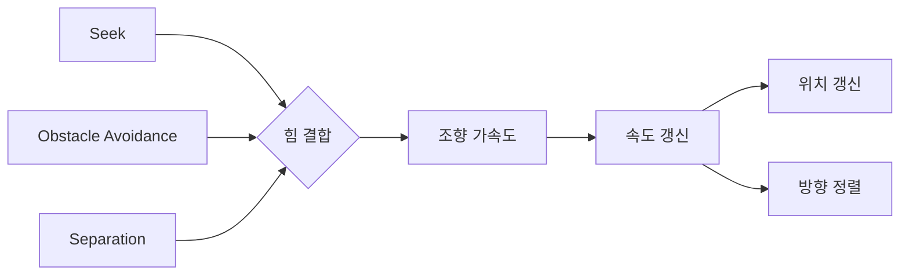
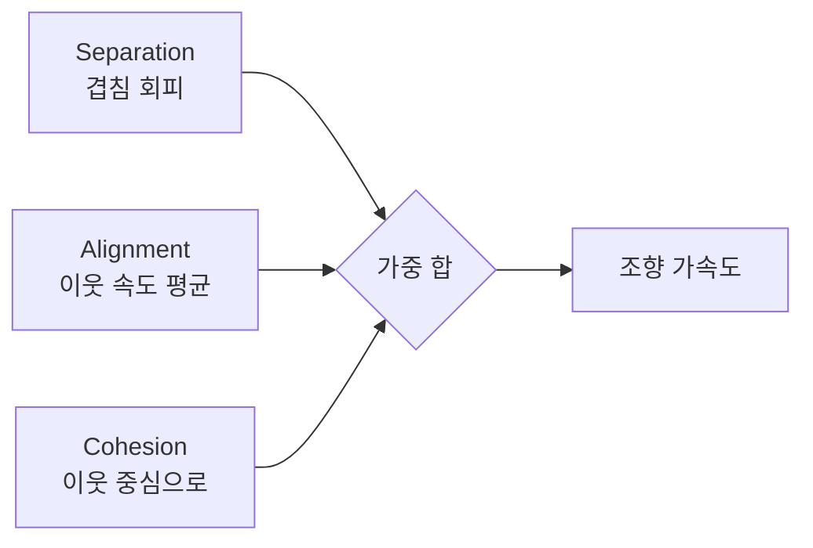

## 들어가며

길찾기가 "어디로 갈지"라는 전역 결정이라면, Steering Behaviors는 "지금 이 순간 어떻게 움직일지"라는 국소 결정이다. A*가 만든 경로는 셀이나 폴리곤의 시퀀스일 뿐, 그것을 *부드럽고 그럴듯한 움직임* 으로 바꾸는 것은 별개의 문제다. 캐릭터가 경로의 다음 점으로 순간이동하듯 꺾이면 기계처럼 보인다. 관성과 방향 전환의 한계를 가진 *물리적 존재* 처럼 움직여야 살아 있어 보인다.

Craig Reynolds가 1999년 GDC에서 체계화한 Steering Behaviors는 이 국소 운동을 *단순한 조향 명령의 합성* 으로 모델링한다. 에이전트는 위치·속도를 가진 점 질량이고, 각 행동은 목표 속도나 가속도를 계산한다. Seek, Flee, Arrive, Wander, Pursue, Obstacle Avoidance 같은 행동의 가속도 명령을 결합해 최종 운동을 얻는다.

이 글은 steering의 기본 운동 모델을 *수치적분 안정성* 까지 파고든 뒤 개별 행동들을 하나씩 구성하고, 각 행동의 *실패 모드* 와 *매개변수 민감도* 를 따진다. 그리고 그 힘들을 *어떻게 결합* 하는가 — 단순 합산의 상쇄·포화 함정, 우선순위·절단 기법, 그리고 상쇄를 구조적으로 없애는 컨텍스트 스티어링 — 라는 실전 문제를 다룬다. 마지막으로 회전·정렬, 군집(flocking)으로의 확장, 그리고 *디버깅·성능* 까지 정리한다. 거의 모든 현대 게임 NPC의 이동이 이 모델 위에 서 있다.



이 글의 목표.

1. **기본 모델** — desired velocity, 조향력, 적분 안정성과 kinematic/dynamic의 구분.
2. **Seek과 Flee** — 가장 기본적인 끌림·밀침과 오버슈트의 정량 분석.
3. **Arrive** — 감속 프로파일과 적분기와의 상호작용.
4. **Wander** — 1차 마르코프 각도 누적과 스펙트럼.
5. **Pursue와 Evade** — 미래 위치 예측, 정면 충돌 보정, intercept의 기하.
6. **Obstacle Avoidance와 Wall Following** — feeler 투사, 가장 위협적인 장애물 선택, 데드락.
7. **Path Following** — 관 기반 추종, 코너 컷, 진행 방향 보장.
8. **행동 결합** — 합산·우선순위·중재·컨텍스트의 절충.
9. **회전·정렬과 군집** — heading 분리, boids 세 규칙의 창발.
10. **디버깅·성능** — 시각화, 공간 분할, SoA 핫 루프.


---

## 목차
1. [Steering의 기본 모델](#1-steering의-기본-모델)
2. [Seek과 Flee](#2-seek과-flee)
3. [Arrive](#3-arrive)
4. [Wander](#4-wander)
5. [Pursue와 Evade](#5-pursue와-evade)
6. [Obstacle Avoidance와 Wall Following](#6-obstacle-avoidance와-wall-following)
7. [Path Following](#7-path-following)
8. [행동 결합 전략](#8-행동-결합-전략)
9. [회전·정렬과 군집](#9-회전정렬과-군집)
10. [디버깅과 성능](#10-디버깅과-성능)


---

## 1. Steering의 기본 모델

### 점 질량과 두 한계

Steering의 운동 모델은 의도적으로 단순하다. 에이전트는 위치, 속도, 그리고 최대 속도·최대 조향 가속도를 가진 점 질량이다. 문헌에서는 관습적으로 출력 벡터를 `steering force`라 부르지만, 아래 구현은 물리적 힘이 아니라 *가속도 명령* 으로 해석한다. 실제 힘을 모델링하려면 마지막에 질량을 곱해 힘을 만들고 다시 $F/m$으로 가속도를 구분해야 한다.

```cpp
struct Agent {
    Vec2  position;
    Vec2  velocity;
    Vec2  facing{1, 0};  // heading — 속도 방향과 분리해 유지하는 상태
    float maxSpeed;      // 속도 상한 (m/s)
    float maxAccel;      // 조향 가속도 상한 (m/s^2)
    float responseTime;  // 목표 속도에 접근하는 시정수 (s), > 0
    float radius;        // 충돌·회피 판정에 쓰는 몸 반경 (m)
    float lookAhead = 1.0f;    // Path Following의 예측 거리 (m)
    float wanderAngle = 0.0f;  // Wander의 지속적인 각도 상태
};
```

모든 dynamic steering 행동은 먼저 목표 속도를 만든 뒤, 속도 오차를 응답 시간으로 나눠 가속도 명령으로 바꾼다.

$$
\mathbf a_\text{cmd}
= \frac{\mathbf v_\text{desired}-\mathbf v}{\tau},
\qquad \tau=\text{responseTime}>0
$$

속도 오차의 단위는 m/s이므로 그대로 적분하면 차원이 맞지 않는다. $\tau$로 나눠 m/s²인 가속도로 만든 뒤 적분해야 한다. $\tau$가 작을수록 목표 속도를 빠르게 추종하고, `maxAccel`이 실제 변화율을 제한한다. `velocity = desired`로 덮어쓰는 kinematic 방식과 달리 한 스텝에 일부만 반영되므로 방향과 속도가 점진적으로 바뀐다.

### 적분: 왜 절단이 두 번인가

```cpp
void Integrate(Agent& a, Vec2 steeringAccel, float dt) {
    Vec2 accel = Truncate(steeringAccel, a.maxAccel);            // (1) 가속도 제한
    a.velocity = Truncate(a.velocity + accel * dt, a.maxSpeed); // (2) 속도 제한
    a.position += a.velocity * dt;
}
```

두 절단(truncate)이 자연스러움의 핵심이다. *maxAccel* 제한은 급격한 방향 전환을 막고, *maxSpeed* 제한은 속도 상한을 정한다. 작은 `maxAccel`과 큰 `responseTime`은 둔한 선회를, 큰 `maxAccel`과 작은 `responseTime`은 빠른 추종을 만든다.

`Truncate`는 벡터의 방향을 보존하면서 크기만 상한으로 자른다. 성분별 clamp가 아니라 *크기* clamp라는 점이 중요하다 — 대각선 이동에서 속도가 $\sqrt{2}$배 빨라지는 버그를 막는다.

```cpp
Vec2 Truncate(Vec2 v, float maxLen) {
    float len2 = Dot(v, v);
    if (len2 > maxLen * maxLen) {
        float inv = maxLen / std::sqrt(len2);
        return v * inv;               // 방향 유지, 크기만 maxLen
    }
    return v;
}
```

### 적분기와 dt 의존성

위 코드는 *세미-임플리시트 오일러(symplectic Euler)* 다. 위치 갱신에 방금 갱신된 속도를 쓴다. 보존계에서는 명시적 오일러보다 장기 에너지 거동이 나은 경우가 많지만, 이것만으로 안정성이 보장되지는 않는다. Arrive에는 속도 피드백과 가속도 절단이 있고, 안정성은 $\tau$, 감속 반경, `maxAccel`, $dt$의 조합에 달려 있다.

문제는 *가변 dt* 다. steering 출력이 가속도라면 속도는 `accel * dt`만큼 변한다. dt가 프레임마다 출렁이면 같은 행동도 다른 이산 궤적을 그린다. 두 가지 완화책이 있다.

- *고정 타임스텝*: 물리 갱신을 고정 dt로 누적 실행하고 렌더만 보간한다. 입력 tick과 연산 순서를 고정하기 쉬워지지만, 부동소수점 환경·병렬 순서·난수·플랫폼 차이까지 통제해야 비트 단위 결정론을 얻는다.
- *프레임 시간 상한과 catch-up 정책*: 한 렌더 프레임의 누적 시간을 제한하면 폭주를 막을 수 있다. 남은 시간을 버리면 시뮬레이션 시간이 느려지고, 모두 따라잡으면 spiral of death가 생길 수 있으므로 최대 substep 수와 지연 처리 정책을 명시한다.

수치 예시로 차이를 보자. maxSpeed 5m/s, maxAccel 20m/s²이고 가속도가 상한에 걸린다면 dt=16ms에서 한 스텝의 속도 변화 상한은 0.32m/s, dt=33ms에서는 0.66m/s다. 연속 시간의 최소 가속 시간은 $5/20=0.25$s지만 이산 궤적과 절단 시점은 dt에 따라 달라진다. 빠른 선회와 회피일수록 고정 스텝과 충분한 충돌 검사가 중요하다.

### kinematic과 dynamic의 구분

steering에는 두 추상화 층이 있다. *kinematic* 은 속도를 직접 다룬다 — "이번 프레임 목표 속도는 이것"이라고 정하고 곧장 적용한다. 가속이 없어 즉시 최대 속도로 출발하고 즉시 멈춘다. 군중 배경 캐릭터나 단순 잡몹처럼 관성이 중요하지 않은 경우에 값싸다.

*dynamic steering*은 가속도를 다룬다. 속도가 점진적으로 변해 방향 전환 한계가 생긴다.

| 구분 | 출력 | 관성 | 비용 | 적합 |
|---|---|---|---|---|
| kinematic | 목표 속도 | 없음 | 낮음 | 군중, 단순 추격 |
| dynamic | 목표 가속도 | 있음 | 보통 | 주역, 정밀 회피 |

이 모델은 *물리적으로 엄밀하지 않다* — 마찰·토크·각운동량을 직접 풀지 않는다. 대신 값싸고 합성 가능하다. 단, 여러 가속도 명령을 더하는 순간 각 행동의 우선순위와 포화 의미까지 함께 설계해야 한다.

## 2. Seek과 Flee

### 끌림과 밀침

가장 기본적인 두 행동. *Seek* 은 목표 지점으로 끌리고, *Flee* 는 멀어진다.

```cpp
Vec2 Seek(const Agent& a, Vec2 target) {
    Vec2 delta = target - a.position;
    if (LengthSq(delta) < 1e-12f) return -a.velocity / a.responseTime; // 목표점: 제동
    Vec2 desired = Normalize(delta) * a.maxSpeed;  // 목표로 최대 속도
    return (desired - a.velocity) / a.responseTime;               // 가속도 명령
}

Vec2 Flee(const Agent& a, Vec2 target) {
    Vec2 delta = a.position - target;
    if (LengthSq(delta) < 1e-12f) return Vec2{0, 0}; // 방향 미정: 별도 겹침 해소 정책
    Vec2 desired = Normalize(delta) * a.maxSpeed;  // 반대 방향
    return (desired - a.velocity) / a.responseTime;
}
```

desired velocity는 "목표를 향해 최대 속도로"이고, 가속도 명령은 그 속도 오차를 `responseTime`으로 나눈 값이다. 에이전트가 이미 목표 쪽으로 가고 있으면 보정이 작고, 다른 방향으로 가고 있으면 큰 보정이 들어가 선회한다.

### 왜 호를 그리는가 — 트레이스

에이전트가 목표의 *왼쪽 아래* 에서 오른쪽으로 빠르게 지나가는 중이라고 하자. 위치 $(0,0)$, 속도 $(5, 0)$, maxSpeed 5, maxAccel 20, responseTime 1s, 목표 $(0, 10)$(바로 위). dt=16ms.

- desired = $\text{Normalize}((0,10)) \times 5 = (0, 5)$.
- velocity error = $(0,5) - (5,0) = (-5, 5)$m/s. responseTime이 1s이므로 가속도 명령도 수치상 $(-5,5)$m/s²이고, 크기 $7.07 < 20$이라 절단되지 않는다.
- 새 속도 = $\text{Truncate}((5,0) + (-5,5) \times 0.016, 5) = \text{Truncate}((4.92, 0.08), 5) = (4.92, 0.08)$.

한 프레임에 속도의 y성분이 0→0.08로 조금 위로 틀어진다. 매 프레임 보정이 누적되며 속도 벡터가 목표 방향으로 회전한다. 가속도 명령이 `maxAccel`에 걸리는 구간과 속도 오차가 지배하는 구간의 곡률은 서로 다르다. `maxAccel`을 키우거나 `responseTime`을 줄이면 더 날카롭게 목표 속도를 추종한다.

### 오버슈트와 진동

Seek의 약점은 *목표에서 멈추지 못한다* 는 것이다. 항상 최대 속도로 향하므로 목표를 지나쳐 방향을 뒤집는다. 목표 통과 순간 속력이 $v$이고 반대 방향으로 `maxAccel`을 계속 낼 수 있다고 단순화하면 제동 거리는 $v^2/(2\,\text{maxAccel})$다. maxSpeed 5, maxAccel 20이면 0.625m다. 실제 궤적은 응답 시간, 가속도 포화와 이산 적분 때문에 이 근사와 달라질 수 있다.

Seek는 목표 근처에서도 목표 속력의 크기를 줄이지 않으므로 안정된 정지점이 없다. 수치 적분기의 에너지 보존 여부가 원인이 아니라 제어 법칙 자체가 정지를 명령하지 않는 것이 원인이다. 목표에서 멈추려면 거리와 함께 목표 속력을 낮추는 Arrive 같은 규칙이 필요하다.

Flee에는 대칭적인 함정이 있다. 거리가 멀어져도 *항상 최대 속도로 도망* 친다는 점이다. 위협이 화면 밖 멀리 있어도 전속력으로 달아나면 부자연스럽다. 실전에서는 Flee에 *유효 반경(panic distance)* 을 둬서, 그 밖이면 힘을 0으로 만든다.

```cpp
Vec2 FleeWithRadius(const Agent& a, Vec2 target, float panicDist) {
    if (DistanceSq(a.position, target) > panicDist * panicDist)
        return Vec2{0, 0};        // 충분히 멀면 도망치지 않는다
    return Flee(a, target);
}
```

## 3. Arrive

### 감속 프로파일

Arrive는 Seek과 같지만, 목표 근처의 *감속 반경(slowing radius)* 안에서 속도를 줄여 부드럽게 멈춘다.

```cpp
Vec2 Arrive(const Agent& a, Vec2 target, float slowRadius) {
    Vec2  toTarget = target - a.position;
    float dist = Length(toTarget);
    if (dist < 0.001f) {
        // 목표 위 — desiredVelocity=0을 추종하는 제동 가속도를 반환한다.
        Vec2 brake = (Vec2{0, 0} - a.velocity) / a.responseTime;
        return Truncate(brake, a.maxAccel);
    }

    float desiredSpeed = a.maxSpeed;
    if (dist < slowRadius)                            // 감속 반경 안
        desiredSpeed = a.maxSpeed * (dist / slowRadius);  // 거리에 선형 비례 감속

    Vec2 desired = (toTarget / dist) * desiredSpeed;
    return (desired - a.velocity) / a.responseTime;
}
```

핵심은 desired *speed* 를 거리에 비례시키는 것이다. 감속 반경 밖에서는 최대 속도로 Seek하다가, 반경 안으로 들어오면 목표 속력을 줄인다. 도착 반경 안에서도 `desiredVelocity=0`을 두고 속도 오차를 `responseTime`으로 나눈 제동 가속도를 반환한 뒤 `maxAccel`로 제한하므로, 목표에 이미 도달했어도 남은 속도는 정지할 때까지 줄어든다. 가속도를 0으로 반환해 "이미 멈췄다"고 가정하지 않는다. 연속 모델의 감쇠비와 이산 적분 조건이 적절하면 부드럽게 수렴하지만, 감속 반경이 작거나 응답이 공격적이면 Arrive도 오버슈트할 수 있다.


### 선형 감속과 물리적 감속

위 구현은 속도를 거리에 *선형* 으로 줄인다($v \propto d$). 이는 직관적이지만 물리적으로는 *일정 감속도* 가 아니다. 일정 감속도로 멈추려면 $v = \sqrt{2 a d}$ 즉 속도가 거리의 *제곱근* 에 비례해야 한다. 두 프로파일의 체감 차이는 분명하다.

| 프로파일 | desiredSpeed | 정지 직전 감속 | 느낌 |
|---|---|---|---|
| 선형 ($v \propto d$) | `maxSpeed * d/r` | 점점 부드러워짐 | 살짝 질질 끌며 멈춤 |
| 제곱근 ($v \propto \sqrt{d}$) | `maxSpeed * sqrt(d/r)` | 일정 | 일정 감속으로 멈춤 |

선형은 마지막 순간에 속도가 거리에 비례해 한없이 작아져 *목표에 닿기까지 시간이 길다* — 끝없이 다가가지만 좀처럼 안 멈추는 꼬리가 생긴다. 그래서 실전에서는 정지 임계(예: `dist < 0.1`이면 속도 0, 도착 처리)를 같이 둔다. 차량처럼 일정 제동을 원하면 제곱근 프로파일을 쓴다.

### 적분기와의 상호작용

Arrive는 감속 반경 안에서 위치와 속도를 되먹이는 2차계처럼 동작한다. 적분기 선택은 안정 영역을 바꾸지만, 세미-임플리시트라는 이유만으로 진동이 항상 줄어드는 것은 아니다. 감속 반경이 한 스텝 이동 거리와 제동 거리에 비해 너무 작으면 반경 안에서 충분히 감속하지 못한다. 초기값은 `maxSpeed * dt`뿐 아니라 $v^2/(2\,\text{maxAccel})$, 응답 시간과 허용 정착 시간을 기준으로 정하고 실제 dt에서 검증한다.

Arrive는 거의 모든 "지점으로 이동" 행동의 기본이 된다. 길찾기 경로의 마지막 지점, 정찰 포인트, 대형 위치로의 이동에 Seek 대신 Arrive를 써야 자연스럽게 멈춘다. 감속 반경의 크기가 "얼마나 멀리서부터 속도를 줄이기 시작하는가"를 정해, 급정거와 부드러운 정지 사이를 조절한다.

### Arrive는 감쇠 조화 진동자다 — 감속 반경과 임계 감쇠

감속 반경 안에서 선형 프로파일을 쓰고 가속도 절단이 걸리지 않는다고 가정하면 Arrive는 *감쇠 조화 진동자(damped harmonic oscillator)* 로 분석할 수 있다. 감쇠 특성은 감속 반경뿐 아니라 응답 시간에도 의존한다. 이 선형 연속 모델은 튜닝의 출발점을 주지만, 포화와 이산 적분까지 포함한 완전한 보장은 아니다.

목표를 원점에 두고 목표까지의 변위를 $x = \text{pos} - \text{target}$라 하자. 감속 반경 $r$ 안에서 desired speed는 거리에 비례하므로($\text{maxSpeed}\cdot d/r$), desired velocity는 변위에 *선형* 이다.

$$\mathbf{v}_\text{des} = \frac{\text{maxSpeed}}{r}\,(\text{target} - \text{pos}) = -k\,x, \qquad k \equiv \frac{\text{maxSpeed}}{r}$$

가속도 명령은 속도 오차를 응답 시간 $\tau$로 나눈 값이다. 가속도 절단이 걸리지 않는 연속 시간 구간에서는

$$
\dot v=\frac{-kx-v}{\tau},\qquad \dot x=v
\quad\Longrightarrow\quad
\ddot x+\frac{1}{\tau}\dot x+\frac{k}{\tau}x=0
$$

표준형 $\ddot x + 2\zeta\omega_n \dot x + \omega_n^2 x = 0$과 대조하면

$$
\omega_n=\sqrt{\frac{k}{\tau}}
=\sqrt{\frac{\text{maxSpeed}}{r\tau}},
\qquad
\zeta=\frac{1}{2\sqrt{k\tau}}
=\frac{1}{2}\sqrt{\frac{r}{\text{maxSpeed}\tau}}
$$

감속 반경 $r$이 클수록 감쇠비가 커지고, responseTime $\tau$가 클수록 속도 보정은 느려지지만 위치 피드백 대비 감쇠비는 작아진다. 특성방정식의 판별식은 세 거동을 가른다.

- $r < 4\,\text{maxSpeed}\,\tau$: *과소 감쇠*. 연속·비포화 선형 모델에서 목표를 지나 진동하며 수렴한다.
- $r = 4\,\text{maxSpeed}\,\tau$: *임계 감쇠*. 같은 모델에서 오버슈트 없이 가장 빠른 비진동 응답이다.
- $r > 4\,\text{maxSpeed}\,\tau$: *과대 감쇠*. 진동은 없지만 느린 극이 정착 시간을 지배한다.

예를 들어 maxSpeed $=5$m/s, $\tau=0.25$s면 임계 반경은 $r=5$m다. $r=2$m라면 $\zeta=\tfrac12\sqrt{2/(5\cdot0.25)}\approx0.632$이고, 선형 모델의 단위 계단 오버슈트 비율은 $M_p=\exp(-\pi\zeta/\sqrt{1-\zeta^2})\approx0.077$이다. 이 값은 가속도 절단이 걸리지 않고 연속 시간으로 적분한다는 조건의 예측이다. 실제 코드에서는 `maxAccel`, dt, 반경 진입 시 속도와 정지 임계가 결과를 바꾼다.

실제 Arrive의 응답은 선형 해와 다를 수 있다. 진입 순간 감속 명령이 `maxAccel`에 걸리면 시스템이 비선형이 되고, 도착 임계는 작은 잔여 오차를 강제로 종료한다. 되돌아옴이 거슬리는 경우에는 $r=4\,\text{maxSpeed}\,\tau$를 비포화 연속 모델의 출발점으로 삼되, 예상 최대 진입 속도에서 제동 거리와 이산 시간 안정성을 함께 확인해야 한다. 이 식 하나가 모든 dt에서 무진동을 보장하지는 않는다.

이 분석은 선형 프로파일이 긴 정착 꼬리를 만드는 이유도 설명한다. 안정한 선형계의 상태는 지수적으로 0에 접근하지만 유한 시간에 정확히 0이 되지는 않는다. 감쇠율은 $r$, maxSpeed와 $\tau$가 정하는 극에 달려 있으므로 고정된 $e^{-t/2}$가 아니다. 게임 상태 전이를 위해서는 위치와 속도에 각각 도착 임계를 두는 편이 안전하다. 제곱근 목표 속력은 일정 감속 궤적을 의도할 수 있지만, 여기에 다시 속도 추종기와 가속도 절단을 붙이면 실제 감속이 자동으로 일정해지는 것은 아니다.

```cpp
// 가속도 포화가 없는 연속 선형 모델의 감쇠 특성.
float DampingRatio(float maxSpeed, float slowRadius, float responseTime) {
    float k = maxSpeed / slowRadius;       // 1/s
    return 0.5f / std::sqrt(k * responseTime);
}
float CriticalSlowRadius(float maxSpeed, float responseTime) {
    return 4.0f * maxSpeed * responseTime;
}
```

## 4. Wander

### 떨림의 원인

Wander는 *자연스러운 배회* 를 만든다. 단순히 매 프레임 무작위 방향을 고르면 에이전트가 부들부들 떨며 제자리를 맴돈다 — 방향이 매 프레임 *독립적* 으로 균등 분포에서 뽑히기 때문이다. 독립 표본의 기댓값은 한 곳에 머무르므로(평균 방향이 0), 알짜 변위가 거의 생기지 않고 미세하게 떤다. 자연스러운 배회의 조건은 *방향의 시간적 상관(temporal correlation)* — 다음 방향이 이전 방향과 비슷해야 한다는 것이다.

### 1차 마르코프 각도 누적

Reynolds의 해법은 각도를 *누적* 하며 매 프레임 작은 변화량만 더하는 것이다. 에이전트 앞에 가상의 원을 두고, 그 원 위에 목표점을 둔다. 매 프레임 이 목표점을 원 둘레를 따라 *조금씩만* 이동시킨다.

```cpp
Vec2 Wander(Agent& a, float circleDist, float circleRadius, float jitter) {
    a.wanderAngle += RandRange(-jitter, jitter);            // 각도를 조금씩만 변화 (누적)
    Vec2 forward = (LengthSq(a.velocity) > 1e-6f)
                 ? Normalize(a.velocity) : a.facing;        // 정지 시 방향 보호
    Vec2 circleCenter = a.position + forward * circleDist;  // 앞쪽 원의 중심
    Vec2 offset = { std::cos(a.wanderAngle) * circleRadius,
                    std::sin(a.wanderAngle) * circleRadius };
    Vec2 target = circleCenter + offset;
    return Seek(a, target);
}
```

`wanderAngle`을 누적하며 매 프레임 작은 변화량(jitter)만 더하는 것이 비결이다. 이는 1차 마르코프 과정 — 다음 각도가 현재 각도에 작은 노이즈를 더한 값 — 이라, 방향이 무작위로 튀지 않고 *연속적으로 흔들리며* 변한다. 결과는 목적 없이 어슬렁거리는 자연스러운 궤적이다.

주의할 함정 하나. `forward`를 `Normalize(a.velocity)`로만 구하면, 에이전트가 정지(속도 0)했을 때 0벡터 정규화로 NaN이 터진다. 위 코드처럼 정지 시 마지막 `facing`을 쓰는 보호가 필요하다.

### 세 매개변수의 스펙트럼

세 매개변수가 배회의 성격을 정한다.

| 매개변수 | 의미 | 크게 하면 | 작게 하면 |
|---|---|---|---|
| circleDist | 원 중심까지 거리 | 방향 변화에 둔감, 직진 경향 | 급격한 방향 전환 |
| circleRadius | 원 반경 | 최대 선회각 증가 | 거의 직진 |
| jitter | 프레임당 각도 변화 상한 | 변덕스러움 | 느긋한 곡선 |

직관은 이렇다. circleDist가 클수록 원이 멀리 있어 같은 offset이라도 진행 방향과의 각도가 작아져 완만해진다. circleRadius는 한 번에 틀 수 있는 최대 각의 천장이다. jitter는 그 천장 안에서 *얼마나 빨리* 흔드는가다. 큰 jitter는 변덕스러운 움직임을, 작은 jitter는 느긋한 곡선을 만든다. jitter가 dt에 비례하지 않으면 프레임레이트에 따라 배회 속도가 달라지므로, `jitter * sqrt(dt)`처럼 스케일하면 프레임레이트 독립성에 가까워진다(랜덤워크의 분산이 스텝 수에 비례하므로 표준편차는 $\sqrt{dt}$).

Wander는 한가한 NPC, 동물, 군중 배경 캐릭터의 불규칙한 배회에 쓰인다. 다른 목적 행동이 없을 때 기본 운동으로 사용하거나, 목적 행동보다 낮은 우선순위·가중치로 결합할 수 있다.

## 5. Pursue와 Evade

### 미래 위치 예측

Seek/Flee는 목표의 *현재 위치* 를 향한다. 움직이는 목표를 Seek하면, 에이전트는 항상 목표가 *방금 있던 곳* 을 쫓아 뒤를 따라가는 비효율적 추격(꼬리 추격)이 된다. Pursue는 목표의 *미래 위치를 예측* 해 그쪽으로 Seek한다.

```cpp
Vec2 Pursue(const Agent& a, const Agent& target) {
    Vec2  toTarget = target.position - a.position;
    float dist = Length(toTarget);
    // 예측 시간: 거리가 멀수록, 합산 속도가 느릴수록 더 멀리 예측
    float predictTime = dist / (a.maxSpeed + Length(target.velocity) + 0.001f);
    Vec2 futurePos = target.position + target.velocity * predictTime;
    return Seek(a, futurePos);    // 미래 위치로 Seek
}

Vec2 Evade(const Agent& a, const Agent& threat) {
    Vec2  toThreat = threat.position - a.position;
    float dist = Length(toThreat);
    float predictTime = dist / (a.maxSpeed + Length(threat.velocity) + 0.001f);
    Vec2 futurePos = threat.position + threat.velocity * predictTime;
    return Flee(a, futurePos);    // 미래 위치에서 Flee
}
```

예측 시간(predictTime)이 핵심이다. 목표가 멀수록 더 먼 미래를 예측하고, 가까우면 거의 현재 위치를 향한다. 분모는 두 속력의 합으로 상대 속력의 상한을 근사한다. 방향을 입력으로 쓰지 않으므로 같은 속력이라면 마주 오든 같은 방향이든 같은 예측 시간을 준다. 정확한 차이는 아래 intercept 방정식에서 다룬다.

### intercept의 기하

이 적응적 예측이 *길목을 가로막는(intercept)* 추격을 만든다 — 포식자가 먹이의 뒤가 아니라 *앞으로 끼어드는* 것처럼. 왜 그런지는 기하로 본다. 목표가 일정 속도로 직선 이동하면, 추격자가 *미래 교차점* 으로 향할 때 둘의 경로가 한 점에서 만난다. 위 근사는 정확한 교차점을 풀지 않지만(2차 방정식의 해), predictTime을 거리에 비례시켜 그 점을 *추적* 한다. 매 프레임 갱신되므로, 목표가 방향을 바꾸면 예측 지점도 따라 움직여 자연스럽게 보정된다.

정확한 intercept를 원하면 "목표를 따라잡는 시간 $t$"를 직접 푼다. 추격자가 maxSpeed로 직선 이동한다고 가정하면 $|P_{target} + V_{target} t - P_{self}| = \text{maxSpeed} \cdot t$이고, 이는 $t$에 대한 2차식이다. 양수 최소 해가 충돌 시간이다. 다만 게임에서는 근사가 시각적으로 충분하고 분기·제곱근 비용이 없어 위 단순식을 더 많이 쓴다.

### 정면 충돌 보정

순수 Pursue에는 결함이 있다. 목표가 *정면으로 다가올* 때다. 정확히 정면에서 서로 접근하는 경우에는 예측 위치가 현재 위치와 다르더라도 두 위치를 향하는 방향은 같을 수 있다. Reynolds의 단축은 이 조건에서 현재 위치를 Seek하는 것이며, 이것만으로 충돌 회피가 되지는 않는다.

```cpp
Vec2 PursueCorrected(const Agent& a, const Agent& target) {
    Vec2  toTarget = target.position - a.position;
    Vec2  myForward = LengthSq(a.velocity) > 1e-12f ? Normalize(a.velocity) : a.facing;
    Vec2  tgtForward = LengthSq(target.velocity) > 1e-12f ? Normalize(target.velocity) : target.facing;
    float facing = Dot(myForward, tgtForward);     // 같은 방향이면 +1, 마주보면 -1

    // 목표가 내 앞에 있고(toTarget·myForward>0) 거의 정면으로 마주 옴(facing<-0.95)
    if (Dot(toTarget, myForward) > 0 && facing < -0.95f)
        return Seek(a, target.position);           // 예측 생략

    float dist = Length(toTarget);
    float predictTime = dist / (a.maxSpeed + Length(target.velocity) + 0.001f);
    return Seek(a, target.position + target.velocity * predictTime);
}
```

미래 위치 예측이라는 작은 추가로, 추격이 훨씬 영리해 보인다. Evade는 그 반대로 위협의 예상 위치를 피해 달아나며, 위협의 panic distance 밖이면 힘을 0으로 두는 것은 Flee와 같다.

## 6. Obstacle Avoidance와 Wall Following

### feeler 투사

steering이 목표를 향하더라도 장애물에 부딪히면 소용없다. *Obstacle Avoidance* 는 진행 경로상의 장애물을 회피하는 힘을 낸다. 핵심 기법은 에이전트 앞으로 뻗은 *탐지 더듬이(feeler)* 다. 진행 방향으로 짧은 선분(또는 박스)을 투사해, 그 안에 들어온 장애물에 대해 *옆으로 비키는* 힘을 낸다.

원형 장애물에 대한 충돌 검사는 ahead 선분과 원의 거리로 한다. 정확하게는 에이전트 로컬 좌표로 변환해 검사하는 편이 깔끔하지만, 여기서는 월드 공간에서 직관적으로 본다.

```cpp
// 선분(position→ahead)과 장애물 원의 최근접점으로 충돌을 검사한다.
const Obstacle* MostThreatening(const Agent& a, Vec2 ahead,
                                const std::vector<Obstacle>& obs) {
    const Obstacle* worst = nullptr;
    float worstDist = FLT_MAX;
    Vec2  seg = ahead - a.position;                 // feeler 선분 전체
    float segLen2 = Dot(seg, seg);
    for (const Obstacle& o : obs) {
        float expanded = o.radius + a.radius;       // agent 반경 포함
        // 선분 위 최근접점 (선분이 퇴화하면 agent 위치로 축소)
        float u = (segLen2 > 1e-12f)
                ? std::clamp(Dot(o.center - a.position, seg) / segLen2, 0.0f, 1.0f)
                : 0.0f;
        Vec2 closest = a.position + seg * u;
        if (DistanceSq(o.center, closest) > expanded * expanded) continue;
        // 중심을 선분에 투영한 위치가 가까운 후보를 고르는 휴리스틱
        float entry = DistanceSq(a.position, closest);
        if (entry < worstDist) { worstDist = entry; worst = &o; }
    }
    return worst;
}
```

위 코드는 `ahead` 한 점이 아니라 *에이전트 위치에서 `ahead`까지의 선분 전체* 와 원의 최근접점을 검사하고, 원 반경에 `a.radius`를 더한다. 따라서 선분을 가로지르는 장애물을 끝점 하나만 보는 방식보다 잘 찾는다. 중심 투영 거리 순서는 반지름이 다른 원의 실제 첫 접촉 순서와 다를 수 있으므로 정확한 우선순위가 필요하면 선분-원 진입 시각을 계산한다. 선분이 퇴화하는(`ahead == position`) 경우와 수치 오차도 `segLen2` 하한과 제곱거리 비교로 처리한다.

### 횡방향 회피력

```cpp
Vec2 AvoidObstacles(const Agent& a, const std::vector<Obstacle>& obs) {
    float speed = Length(a.velocity);
    if (speed < 1e-5f) return Vec2{0, 0};                // 0벡터 정규화 방지
    float aheadLen = speed * 0.5f;                       // 0.5초 앞의 이동 거리
    Vec2  dir = a.velocity / speed;
    Vec2  ahead = a.position + dir * aheadLen;
    const Obstacle* threat = MostThreatening(a, ahead, obs);
    if (!threat) return Vec2{0, 0};
    // 진행선 기준 장애물의 수직 성분을 반대로 써서 좌/우 회피 방향을 정한다
    Vec2  toThreat = threat->center - a.position;
    Vec2  perp = toThreat - dir * Dot(toThreat, dir);    // forward 수직 성분
    Vec2  avoid = -perp;                                 // 장애물 반대쪽
    if (LengthSq(avoid) < 1e-4f) {                       // 정면 정중앙 — 방향 모호
        float side = Cross(dir, toThreat);              // 부호로 좌/우 결정
        Vec2 sidePerp = (side > 0) ? Vec2{ dir.y, -dir.x }  // 오른쪽 법선
                                   : Vec2{-dir.y,  dir.x }; // 왼쪽 법선
        return sidePerp * a.maxAccel;
    }
    return Normalize(avoid) * a.maxAccel;                // 회피는 강하게
}
```

탐지 거리를 *현재 속력에 비례* 시키는 것이 중요하다. 빠를수록 더 멀리 내다봐야 제때 피한다. 현재 속력이 5m/s이면 위 코드의 탐지 거리는 2.5m이고, 정지에 가까우면 거의 0이라 멈춰 있을 때 헛회피하지 않는다.

회피 가속도는 장애물 중심을 진행 방향에 투영해 얻은 *수직 성분* 을 반대로 사용한다. `ahead - center`처럼 검출점 사이 벡터를 그대로 쓰면 그 방향이 진행 방향과 평행할 때 횡성분이 사라진다. 정면 감속만 주면 장애물 앞에서 멈출 수 있으므로, 횡방향 성분과 제동 성분을 상황에 맞게 분리하는 편이 안전하다. 여기서는 `maxAccel`을 사용해 회피가 가속도 예산을 우선 차지하게 한다.

### 실패 모드: 대칭 데드락

feeler 회피의 고전적 함정은 *정면 정중앙* 장애물이다. 장애물 중심이 진행선과 거의 일직선이면 위 수직 성분이 0에 가까워 회피 방향이 불안정해진다 — 왼쪽으로 갈지 오른쪽으로 갈지 못 정하고 떨거나, 매 프레임 방향이 바뀌어 정면으로 직진한다. 두 가지 보정이 흔하다.

- *결정론적 측면 선택*: 회피 벡터가 너무 작으면, 장애물 중심에 대한 진행 방향의 *외적 부호* 로 좌/우를 강제로 정한다. `cross(dir, center - pos)`의 부호로 항상 같은 쪽으로 비킨다.
- *살짝 비대칭 feeler*: feeler를 정확히 정면이 아니라 미세하게 한쪽으로 틀어, 정중앙 대칭이 깨지게 한다.

```cpp
if (LengthSq(avoid) < 1e-4f) {                 // 정면 정중앙 — 회피 방향 모호
    Vec2 toObs = threat->center - a.position;
    float side = Cross(dir, toObs);            // 부호로 좌/우 결정
    Vec2 perp = (side > 0) ? Vec2{ dir.y, -dir.x }  // 오른쪽 법선
                           : Vec2{-dir.y,  dir.x }; // 왼쪽 법선
    return perp * a.maxAccel;
}
```

또 다른 실패 모드는 *국소 최소(local minima)* 다. ㄷ자 막다른 구조에 들어가면 회피력이 안쪽으로 계속 밀어 빠져나오지 못한다. 순수 steering으로는 풀 수 없고, 전역 길찾기(NavMesh)가 막다른 곳을 애초에 경로에서 배제하거나, "갇힘 감지 후 후진" 같은 상위 로직이 개입해야 한다. steering은 *국소* 회피만 책임진다는 경계가 여기서 분명해진다.

### Wall Following

*Wall Following* 은 벽을 따라 이동하는 행동이다. 벽 법선 방향의 탐지선으로 벽까지 거리를 재고, 일정 거리를 유지하며 벽과 평행한 힘을 낸다. 벽의 법선 $n$과 진행 방향에서, 벽 접선 방향 $t = (-n_y, n_x)$로 추진하되, 벽과의 거리가 목표 간격보다 가까우면 법선 방향으로 밀어내고 멀면 끌어당기는 성분을 더한다. 순찰 경로가 벽을 따라가거나, 막힌 곳에서 벽을 더듬어 출구를 찾는 행동에 쓰인다. Obstacle Avoidance가 "부딪히지 않기"라면 Wall Following은 "벽을 가이드로 삼기"다.

## 7. Path Following

### 관(tube) 기반 추종

길찾기가 만든 경로(웨이포인트 시퀀스)를 *부드럽게* 따르는 행동이다. 단순히 각 웨이포인트를 차례로 Seek하면, 에이전트가 점마다 정확히 찍고 가느라 각진 궤적을 그린다. Path Following은 경로를 *허용 폭을 가진 관(tube)* 으로 보고, 그 관 안에 머무는 것을 목표로 한다.

```cpp
Vec2 FollowPath(Agent& a, const Path& path) {
    // 1) 약간 앞의 미래 위치 예측
    Vec2 forward = (LengthSq(a.velocity) > 1e-6f) ? Normalize(a.velocity) : a.facing;  // 정지 시 방향 보호
    Vec2 future = a.position + forward * a.lookAhead;
    // 2) 경로상 가장 가까운 점과 그 점이 속한 구간의 진행 방향 찾기
    auto result = path.ClosestPoint(future);
    if (!result) return Vec2{0, 0}; // 유효한 선분이 없는 경로
    auto [closest, segDir, segIdx] = *result;
    // 3) 미래 위치가 경로 관을 허용 폭 이상 벗어났으면 경로로 복귀
    if (DistanceSq(future, closest) > path.radius * path.radius) {
        Vec2 target = closest + segDir * a.lookAhead;   // 경로 따라 약간 앞
        return Seek(a, target);
    }
    return Vec2{0, 0};   // 관 안 — 이 함수는 이탈 보정 전용 (전진은 별도 행동)
}
```

발상은 "*미래 위치가 경로 관을 벗어날 때만* 복귀 힘을 낸다"는 것이다. 관 안에 있으면 그냥 진행하고, 벗어나려 할 때만 경로 방향의 약간 앞 지점으로 Seek해 부드럽게 끌어들인다. 이렇게 하면 에이전트가 웨이포인트를 정확히 밟지 않고 *경로의 흐름을 따라 매끄럽게* 이동한다. 곡선 구간에서 안쪽으로 자연스럽게 깎으며 도는 궤적이 나온다. 이 함수는 관 이탈 *보정* 전용이므로, 관 안에서의 전진 속도는 별도의 cruise/progress 행동이나 상위 이동기가 담당한다는 계약을 전제한다 — 정지했거나 경로 반대 방향으로 움직이는 에이전트는 이 보정만으로 스스로 나아가지 못한다.

### 가장 가까운 점 계산

`ClosestPoint`는 모든 선분에 대해 점-선분 최근접점을 구해 그중 가장 가까운 것을 고른다. 점 $p$를 선분 $AB$에 투영하는 표준 계산이다.

```cpp
struct ClosestResult { Vec2 point; Vec2 dir; int seg; };

std::optional<ClosestResult> Path::ClosestPoint(Vec2 p) const {
    ClosestResult best{}; float bestD2 = FLT_MAX;
    for (int i = 0; i + 1 < (int)pts.size(); ++i) {
        Vec2 A = pts[i], B = pts[i+1];
        Vec2 ab = B - A;
        float len2 = Dot(ab, ab);
        if (len2 < 1e-12f) continue;  // 중복 waypoint는 방향을 정의하지 못한다
        float t = Dot(p - A, ab) / len2;
        t = std::clamp(t, 0.0f, 1.0f);          // 선분 양 끝으로 제한
        Vec2 proj = A + ab * t;
        float d2 = DistanceSq(p, proj);
        if (d2 < bestD2) { bestD2 = d2; best = { proj, Normalize(ab), i }; }
    }
    if (bestD2 == FLT_MAX) return std::nullopt;
    return best;
}
```

매 프레임 전체 선분을 도는 것은 짧은 경로면 무시할 비용이지만, 긴 경로(수백 점)에서는 *현재 구간 인덱스를 캐싱* 해 그 주변 몇 개만 검사하는 최적화를 쓴다. 에이전트는 경로를 단조롭게 진행하므로 보통 한두 구간 앞뒤만 보면 된다.

### 진행 방향 보장과 코너 컷

`closest + segDir * lookAhead`에서 `segDir`를 *경로의 진행 방향* 으로 두는 것이 미묘하지만 중요하다. 단순히 closest 점만 Seek하면 에이전트가 경로에 *수직으로* 붙고 진행하지 않는다(경로에 달라붙어 멈춤). segDir만큼 앞을 보게 해야 경로를 *따라* 흐른다. 다만 `closest + segDir * lookAhead`는 마지막 웨이포인트를 지나칠 수 있으므로 경로 끝으로 clamp하고, 마지막 구간에서는 Arrive로 전환해 목적지에 부드럽게 정지시키는 정책이 필요하다.

lookAhead(미래 예측 거리)와 path radius(허용 폭)가 추종의 엄밀함을 정한다. lookAhead가 크면 코너를 더 일찍 보고 미리 꺾어 *안쪽으로 크게 깎고*, 작으면 경로에 바짝 붙는다. 좁은 통로는 작은 radius와 작은 lookAhead로 정확히, 넓은 평지는 큰 radius로 느슨하게 따르게 한다. 전역 경로는 길찾기가 정하고, 국소 추종은 steering이 맡는다는 분업의 구체적 구현이다.

## 8. 행동 결합 전략

steering의 진짜 힘은 *여러 행동을 동시에* 쓰는 데 있다. "경로를 따르면서(Path Following) 장애물을 피하고(Avoidance) 다른 유닛과 겹치지 않는다(Separation)". 문제는 이 힘들을 *어떻게 합치는가* 다.

### 단순 합산 (weighted sum)

각 행동의 힘에 가중치를 곱해 더한다.

```cpp
Vec2 total = w1 * Seek(a, goal)
           + w2 * AvoidObstacles(a, obs)
           + w3 * Separation(a, neighbors);
total = Truncate(total, a.maxAccel);
Integrate(a, total, dt);
```

단순하고 대부분 잘 동작하지만 두 가지 함정이 있다.

첫째, *상쇄(cancellation)*. 반대 방향 힘들이 더해져 0이 되면 에이전트가 멈춘다. "왼쪽 장애물 회피"와 "오른쪽 장애물 회피"가 정확히 상쇄되면 정면 장애물로 직진하는 어이없는 결과가 난다. 두 적을 동시에 Evade하는데 둘이 정반대 쪽에 있으면 가운데 끼여 못 움직이는 것도 같은 문제다.

둘째, *maxAccel 포화*. 여러 가속도의 합이 상한을 넘어 절단되면, 중요한 회피가 덜 중요한 wander와 섞일 수 있다. 예를 들어 회피 가속도 크기 18, wander 크기 6, maxAccel 20이면 합 벡터 절단 뒤 회피 방향이 온전히 보존되지 않는다. 가중치만으로는 모든 상황의 우선순위를 표현하기 어렵다.

### 우선순위 결합 (priority truncation)

행동을 우선순위 순으로 정렬하고, *높은 우선순위부터* 가속도를 누적하다 maxAccel 예산을 채우면 멈춘다.

```cpp
Vec2 Prioritized(const Agent& a) {
    Vec2 accum{0, 0};
    float budget = a.maxAccel;
    for (Behavior* b : behaviorsByPriority) {     // 회피 > 분리 > seek > wander
        Vec2 f = b->Compute(a);
        float mag = Length(f);
        if (mag > budget) {
            accum += Truncate(f, budget);          // 남은 예산만큼만
            break;                                 // 예산 소진 — 이하 행동 무시
        }
        accum += f;
        budget -= mag;
    }
    return accum;
}
```

충돌 회피처럼 반드시 반영돼야 할 가속도를 앞에 두면 조향 예산을 먼저 차지한다. 덜 중요한 행동은 남는 예산만 쓴다. 위 코드는 누적 크기가 아니라 *남은 예산(budget)* 을 추적한다.

이 방식의 변형이 *우선순위 중재(priority arbitration)* 다 — 정렬된 행동을 위에서부터 검사해 처음 *0이 아닌* 힘을 내는 행동을 골라 그 힘만 적용한다. 회피력이 0이면 분리, 그것도 0이면 seek으로 내려간다. 앞 행동이 0이면 다음 행동을 검사하므로 평가 횟수는 0이 아닌 행동을 만날 때까지 늘어날 수 있지만, 적용은 한 행동만 해 비용이 가장 싸다. 확률적으로 행동을 평가하는 dithering과 달리 결정론적 중재이며, 행동 간 전환이 급격해질 수 있다.

### 결합 전략 비교

| 전략 | 상쇄 내성 | 포화 처리 | 비용 | 적합 |
|---|---|---|---|---|
| 가중 합산 | 약함 | 절단으로 섞임 | 낮음 | 일반, 군중 |
| 우선순위 절단 | 보통 | 예산 배분 | 보통 | 안전 우선 소수 |
| 우선순위 중재 | 약함 | 단일 선택 | 가장 낮음 | 대규모 군중 |
| 컨텍스트 | 강함 | 구조적 회피 | 높음 | 정밀 회피 |

### 컨텍스트 스티어링

상쇄 문제를 *구조적으로* 없애는 현대적 기법이 컨텍스트 스티어링(context steering)이다. 힘을 더하는 대신, 에이전트 주위를 N개 방향(예: 8 또는 16 슬롯)으로 양자화해 두 배열을 채운다 — 방향별 *흥미도(interest)* 와 *위험도(danger)*. Seek은 목표 방향 슬롯에 높은 흥미를, 회피는 장애물 방향 슬롯에 높은 위험을 기록한다.

```cpp
constexpr int N = 16;
float interest[N] = {0};
float danger[N]   = {0};

void AddInterest(Vec2 dir, float weight) {
    for (int i = 0; i < N; ++i) {
        Vec2 slot = SlotDir(i);                    // i번째 슬롯의 단위 벡터
        interest[i] += std::max(0.0f, Dot(slot, dir)) * weight;  // 정렬도만큼 기여
    }
}

Vec2 ChooseDirection() {
    // 1) 위험이 있는 슬롯은 흥미를 무시 (마스킹)
    float bestDanger = *std::min_element(danger, danger + N);
    float masked[N];
    for (int i = 0; i < N; ++i)
        masked[i] = (danger[i] <= bestDanger + 1e-3f) ? interest[i] : -1.0f;
    // 2) 마스킹 후 가장 흥미로운 슬롯 선택
    int best = (int)(std::max_element(masked, masked + N) - masked);
    return SlotDir(best);
}
```

핵심은 *더하지 않고 고른다* 는 점이다. 두 회피 방향이 반대라도, 흥미가 살아 있는 가장 안전한 슬롯을 *선택* 하므로 0벡터가 나오지 않는다. 정면이 막혔으면 위험 마스킹으로 정면 슬롯이 배제되고, 좌우 중 흥미가 높은 쪽을 고른다. 슬롯 해상도(N)와 보간 방식이 품질·비용을 정한다. 16슬롯이면 방향 분해능이 22.5도라, 부드러운 결과를 위해 슬롯 간 보간이나 인접 슬롯으로의 흥미 확산을 더하기도 한다.

결합 전략의 선택은 *상황의 안전 요구와 유닛 수* 에 달렸다. 정밀한 회피가 생명인 소수 에이전트는 우선순위/컨텍스트를, 대량 군중은 값싼 가중 합 + 우선순위 중재를 쓴다. 어느 경우든 핵심은 "여러 단순 행동의 합성으로 복잡한 움직임을 만든다"는 steering의 근본 철학이다.

## 9. 회전·정렬과 군집

### heading은 속도와 분리한다

heading과 속도 방향은 서로 다른 상태다. 옆으로 비키면서 시선은 적을 향하는 스트레이프, 진행 방향과 차체 방향이 바로 일치하지 않는 차량이 그렇다. 목표 heading은 이동·조준 계약에서 정하고 각속도·각가속도 한계로 추종한다.

```cpp
void UpdateHeading(Agent& a, float dt, float turnRate) {
    if (LengthSq(a.velocity) < 1e-4f) return;       // 정지 시 방향 유지
    Vec2 desired = Normalize(a.velocity);
    float current = std::atan2(a.facing.y, a.facing.x);
    float target  = std::atan2(desired.y, desired.x);
    float delta = WrapAngle(target - current);       // [-pi, pi]로 정규화
    float step = std::clamp(delta, -turnRate * dt, turnRate * dt);  // 각속도 제한
    float ang = current + step;
    a.facing = { std::cos(ang), std::sin(ang) };
}
```

`WrapAngle`로 각도 차를 $[-\pi, \pi]$에 넣는 것이 중요하다 — 그래야 350도 회전 대신 -10도로 *짧은 쪽* 으로 돈다. turnRate는 초당 회전 가능 각으로, 큰 적은 천천히(작은 turnRate) 도는 무게감을 준다. heading을 속도와 별도 각속도로 돌리면 회피로 속도가 출렁여도 시선은 매끄럽게 유지된다.

### boids 세 규칙

개별 에이전트의 조향 모델은 군집(flocking)으로 확장할 수 있다. Reynolds의 boids는 *지역 이웃만 보는* 세 규칙의 합이다.



- *Separation(분리)*: 가까운 이웃에서 멀어진다. 이웃까지 거리에 *반비례* 하는 밀침력의 합이라, 가까울수록 강하게 민다.
- *Alignment(정렬)*: 이웃들의 *평균 속도* 에 자기 속도를 맞춘다. 무리가 같은 방향으로 흐르게 한다.
- *Cohesion(응집)*: 이웃들의 *평균 위치(질량 중심)* 로 Seek한다. 무리가 흩어지지 않게 모은다.

```cpp
Vec2 Separation(const Agent& a, const std::vector<Agent*>& nb) {
    Vec2 push{0, 0};
    for (const Agent* o : nb) {
        Vec2 away = a.position - o->position;
        float d = Length(away);
        if (d > 1e-4f) push += (away / d) / d;      // 방향 / 거리 — 가까울수록 강함
    }
    if (LengthSq(push) < 1e-12f) return {0, 0};
    Vec2 desired = Normalize(push) * a.maxSpeed;    // 밀침 방향으로 최대 속도
    return (desired - a.velocity) / a.responseTime; // 속도 오차 → 가속도
}
Vec2 Alignment(const Agent& a, const std::vector<Agent*>& nb) {
    if (nb.empty()) return {0, 0};
    Vec2 avg{0, 0};
    for (const Agent* o : nb) avg += o->velocity;
    avg /= (float)nb.size();
    Vec2 desired = LengthSq(avg) > 1e-12f
                 ? Normalize(avg) * a.maxSpeed : Vec2{0, 0};
    return (desired - a.velocity) / a.responseTime;  // 속도 오차 → 가속도
}
Vec2 Cohesion(const Agent& a, const std::vector<Agent*>& nb) {
    if (nb.empty()) return {0, 0};
    Vec2 center{0, 0};
    for (const Agent* o : nb) center += o->position;
    return Seek(a, center / (float)nb.size());       // 평균 위치로 Seek
}
```

세 규칙을 가중 합으로 더하면 중앙 경로 없이도 군집 패턴이 나타날 수 있다. Separation을 무조건 가장 높여야 하는 것은 아니며, 가중치·이웃 반경·최대 가속도와 경계 조건이 밀집도·응집력·반응성을 함께 정한다. 성능은 이웃 탐색이 지배하기 쉬우므로 공간 분할의 셀 크기와 점유 분포를 함께 측정한다.

## 10. 디버깅과 성능

### 시각화

steering은 *벡터의 합* 이라 화면에 그리면 즉시 이해된다. 디버깅의 핵심은 각 행동의 힘 벡터를 색을 달리해 에이전트에서 그려 내는 것이다.

```cpp
struct SteeringDebug {            // 프레임마다 기록해 두는 마지막 힘들
    Vec2  lastSeekForce, lastAvoidForce, lastTotalForce;
    float neighborRadius;
};

void DebugDraw(DebugRenderer& dr, const Agent& a, const SteeringDebug& d) {
    const Vec2 p = a.position;
    dr.DrawArrow(p, p + a.velocity, Color::White);           // 현재 속도
    dr.DrawArrow(p, p + d.lastSeekForce,  Color::Green);     // Seek
    dr.DrawArrow(p, p + d.lastAvoidForce, Color::Red);       // 회피
    dr.DrawArrow(p, p + d.lastTotalForce, Color::Yellow);    // 합력
    dr.DrawCircle(p, d.neighborRadius, Color::Gray);         // 이웃 반경
    // feeler 시각화 — 회피가 무엇을 보는지
    float speed = Length(a.velocity);
    if (speed > 1e-5f)
        dr.DrawLine(p, p + a.velocity * 0.5f, Color::Cyan);
}
```

이 그림 하나로 대부분의 버그가 드러난다. 합력(노랑)이 거의 0인데 에이전트가 멈춰 있으면 *상쇄 문제* 다. 회피력(빨강)이 장애물 정면을 향하면 횡방향 보정이 빠진 것이다. 이웃 반경(회색) 안에 아무도 없는데 분리력이 크면 반경 계산 버그다. *왜 저렇게 움직이지?* 의 답이 화면에 벡터로 떠 있다.

추가로 궤적을 *링 버퍼* 로 남겨 그리면, 진동·오버슈트가 잔상으로 보인다 — Arrive가 목표를 중심으로 진자처럼 떨면 그 패턴이 한눈에 잡힌다.

### 이웃 탐색과 공간 분할

군집·분리의 비용은 전부 *이웃 탐색* 에 있다. N마리 각각이 다른 N-1마리와의 거리를 보면 $O(N^2)$다 — 1,000마리면 프레임당 100만 번 거리 계산이다. 이웃은 반경 안에 든 소수뿐이므로, *공간 분할(spatial hashing)* 로 후보를 줄인다.

```cpp
struct SpatialHash {
    float cell;                                       // 이웃 반경 정도로
    std::unordered_map<int64_t, std::vector<int>> grid;

    int64_t Key(Vec2 p) const {
        int gx = (int)std::floor(p.x / cell);
        int gy = (int)std::floor(p.y / cell);
        // 음수 cell 좌표도 안전하도록 unsigned 비트 결합으로 만든다
        return (int64_t)((uint64_t)(uint32_t)gx << 32 | (uint32_t)gy);
    }
    void Insert(int id, Vec2 p) { grid[Key(p)].push_back(id); }

    void Query(Vec2 p, std::vector<int>& out) const {  // 3x3 셀만 검사
        int gx = (int)std::floor(p.x / cell);
        int gy = (int)std::floor(p.y / cell);
        for (int dx = -1; dx <= 1; ++dx)
        for (int dy = -1; dy <= 1; ++dy) {
            int64_t k = (int64_t)((uint64_t)(uint32_t)(gx+dx) << 32 | (uint32_t)(gy+dy));
            if (auto it = grid.find(k); it != grid.end())
                out.insert(out.end(), it->second.begin(), it->second.end());
        }
    }
};
```

셀 크기를 이웃 반경과 같게 두면, 반경 안 이웃은 반드시 3×3 셀 안에 있다. 균등 분포에서 셀당 평균 밀도가 상수면 한 질의는 $O(1)$에 가깝고, 전체는 $O(N)$으로 떨어진다. 1,000마리에서 100만 → 약 1만 번 수준으로 줄어든다. 매 프레임 그리드를 다시 채우는 비용($O(N)$)이 있지만, 거리 계산 폭증을 막는 이득이 압도적이다.

### 핫 루프와 SoA

수천 에이전트를 매 프레임 갱신할 때는 메모리 레이아웃이 캐시 성능을 가른다. 에이전트를 AoS(객체 배열)로 두면 한 에이전트의 위치만 읽어도 속도·heading·wanderAngle이 같은 캐시 라인에 끌려와 *쓰지 않을 데이터로 라인을 오염* 시킨다. SoA(배열의 구조)로 위치만 연속 배열에 두면, 이웃 탐색처럼 위치만 대량으로 훑는 패스가 캐시를 꽉 채워 쓴다.

```cpp
struct AgentsSoA {
    std::vector<Vec2>  pos;     // 연속 — 이웃 탐색이 이 배열만 스캔
    std::vector<Vec2>  vel;
    std::vector<float> maxSpeed, maxAccel;

    void Integrate(int i, Vec2 accel, float dt) {
        accel = Truncate(accel, maxAccel[i]);
        vel[i] = Truncate(vel[i] + accel * dt, maxSpeed[i]);
        pos[i] += vel[i] * dt;
    }
};
```

분담은 대상 하드웨어와 밀도에 따라 정한다. 많은 에이전트는 SoA와 공간 분할로 이웃 후보를 줄이고, 행동 합성·갱신 빈도·SIMD 효율을 계측한다. 소수의 주역은 더 많은 후보와 풍부한 디버그 정보를 사용할 수 있지만, 소수라는 이유만으로 비용이 무의미해지는 것은 아니다. Boids 계열도 전체 쌍을 검사하면 $O(n^2)$이므로 대규모 실시간 처리는 공간 해시나 균일 격자와 제한된 인접 반경에 의존한다.


---

## 결론

Steering Behaviors는 국소 운동을 목표 속도와 조향 가속도의 합성으로 모델링한다. 속도 오차를 `responseTime`으로 나눠 차원이 맞는 가속도 명령을 만들고, `maxAccel`과 `maxSpeed`로 변화율과 속도를 제한한다. 세미-임플리시트 오일러와 고정 타임스텝은 재현성과 안정 영역을 개선하지만, 결정론이나 Arrive의 무진동을 단독으로 보장하지 않는다.

Seek/Flee의 기본 끌림·밀침과 오버슈트($v^2/2a$ 만큼 지나침), Arrive의 선형·제곱근 감속 프로파일, Wander의 1차 마르코프 각도 누적, Pursue/Evade의 미래 위치 예측과 정면 충돌 보정, Obstacle Avoidance의 feeler 회피와 대칭 데드락, Path Following의 관 기반 추종 — 각 행동은 단순한 벡터 연산이지만 고유한 실패 모드와 매개변수 민감도를 가진다. 이 행동들을 조합하면 생생한 움직임이 되고, 그 합성 가능성이 steering의 핵심 가치다.

힘의 결합은 단순 합산의 상쇄·포화 함정과, 그것을 푸는 우선순위·중재, 그리고 더하지 않고 *고르는* 컨텍스트 스티어링 사이의 절충이다. heading을 속도와 분리해 회전을 다루고, 같은 모델을 분리·정렬·응집 세 규칙으로 확장하면 중앙 제어 없는 군집이 창발한다. 공간 분할로 이웃 탐색을 $O(N^2)$에서 $O(N)$으로 낮추고 SoA로 핫 루프를 캐시에 맞추면, 이 모델은 수천 에이전트 규모까지 실시간으로 확장된다. steering은 길찾기가 정한 전역 경로를 *그럴듯한 국소 운동* 으로 옮기는 마지막 층이다.

## 더 읽을거리

- Craig Reynolds, "Steering Behaviors for Autonomous Characters" (GDC 1999) — steering 모델의 원전, desired velocity와 개별 행동 정의.
- Craig Reynolds, "Flocks, Herds, and Schools: A Distributed Behavioral Model" (SIGGRAPH 1987) — boids 세 규칙과 창발의 뿌리.
- Mat Buckland, *Programming Game AI by Example*, Ch. 3 — 모든 steering 행동의 단계별 구현과 결합 전략.
- Ian Millington, *AI for Games*, 3rd Ed., "Movement" 장 — kinematic/dynamic steering, 회전, 적분의 체계적 정리.
- Andrew Fray, "Context Behaviours Know How to Share" (context steering) — 상쇄 문제의 구조적 해법.
- Fernando Bevilacqua, "Understanding Steering Behaviors" (Envato Tuts+ 시리즈) — 각 행동의 시각적 직관.
- Reynolds의 OpenSteer 라이브러리 문서 — feeler 회피·경로 추종의 참조 구현.
- Katsuhiko Ogata, *Modern Control Engineering*, 5th Ed., "Transient and Steady-State Response Analysis" — 2차계의 감쇠비·고유진동수와 최대 오버슈트 $M_p = \exp(-\pi\zeta/\sqrt{1-\zeta^2})$, 임계 감쇠의 유도.
- Karl J. Åström & Richard M. Murray, *Feedback Systems: An Introduction for Scientists and Engineers*, 2nd Ed. — 2차 선형계의 극 배치와 과소·임계·과대 감쇠 거동(온라인 공개).
