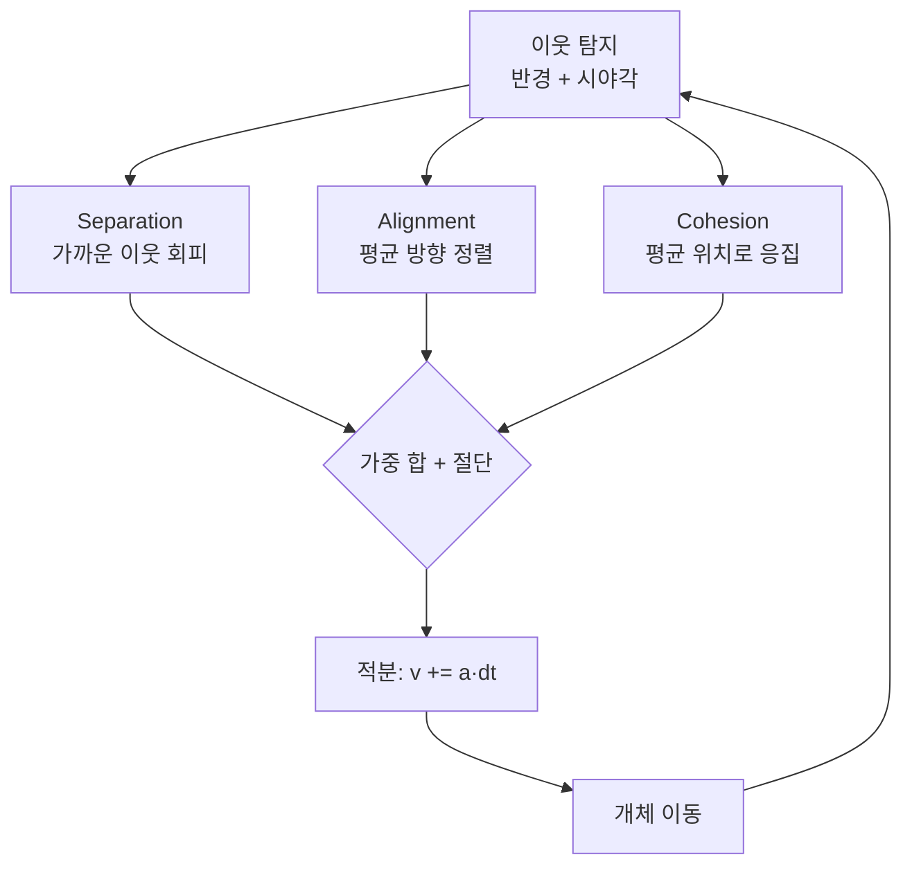
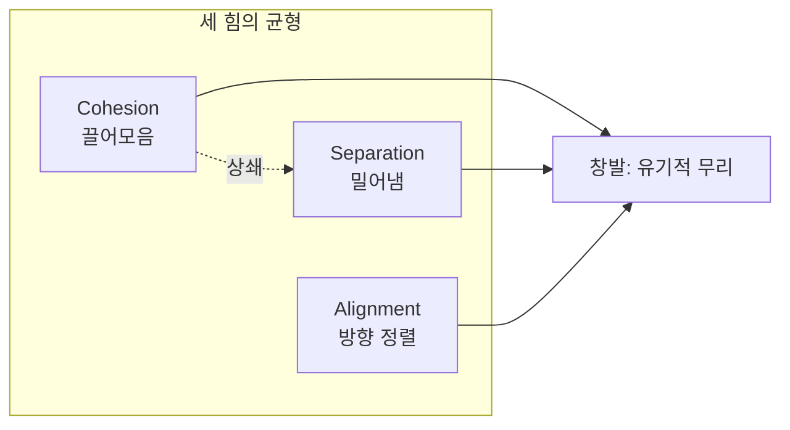
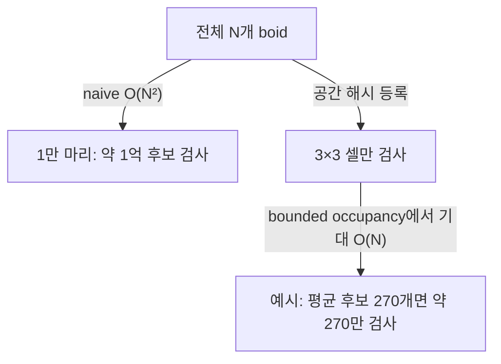

## 들어가며

새 떼는 리더 없이 움직인다. 수천 마리가 한 몸처럼 선회하고 갈라지고 다시 합치지만, 어떤 새도 전체를 지휘하지 않는다. 각 새는 *가까운 이웃 몇 마리만 보고* 단순한 규칙에 따라 반응할 뿐이다. 1986년 Craig Reynolds가 고안하고 1987년(SIGGRAPH) 발표한 *Boids* 모델은 이 현상을 단 세 개의 규칙으로 재현했다. 중앙 통제 없이, 국소 규칙만으로 거시적 질서가 *창발(emergence)* 하는 것을 보인 컴퓨터 그래픽스의 이정표다.

Boids의 세 규칙은 모두 "주변 이웃에 대한 반응"이다. *Separation* 은 너무 가까운 이웃에게서 멀어지고(충돌 회피), *Alignment* 는 이웃들의 평균 진행 방향에 맞추며(속도 정렬), *Cohesion* 은 이웃들의 평균 위치로 끌린다(무리 응집). 이 셋의 균형에서 새 떼의 유기적 움직임이 나온다. 어느 새도 "무리를 만들자"고 의도하지 않지만, 세 규칙의 상호작용이 무리를 형성하고 유지한다.

이 모델은 steering behaviors의 직접적 확장이다 — 세 규칙은 각각 steering 힘이고, 합성 방식도 같다. 게임에서 Boids는 좀비 무리, 동물 떼, 군중, 기병 돌격, 물고기 군영 등 *다수의 자율 개체가 무리로 움직이는* 거의 모든 상황의 기반이 됐다. 이 글은 세 규칙을 하나씩 *수식과 적분기까지* 구성하고, 지각 반경과 시야각의 정확한 정의, 이웃 탐색을 $O(N^2)$에서 $O(N)$으로 낮추는 공간 해시, 리더 추종·포식자 회피 같은 확장, 그리고 1만 마리를 한 프레임 예산 안에 돌리기 위한 SoA·병렬·LOD까지를 다룬다. 패딩 없이, 실제로 동작하는 밀도로 간다.



이 글의 목표.

1. **세 규칙** — steering 형식, 가중 합과 절단, double-buffer 적분.
2. **Separation** — 충돌 회피 힘, 1/dist 가중과 그 함정.
3. **Alignment** — 속도 정렬 힘과 국소 전파.
4. **Cohesion** — 무리 응집 힘과 경계 boid.
5. **지각 모델** — 반경, 시야각, 거리 제곱 비교.
6. **공간 분할** — 공간 해시로 $O(N)$ 이웃 탐색과 트레이스.
7. **확장** — 리더 추종, 포식자 회피, 경계·장애물.
8. **성능** — SoA, 병렬, LOD로 1만 마리 실시간.


---

## 목차
1. [Boids의 세 규칙](#1-boids의-세-규칙)
2. [Separation: 충돌 회피](#2-separation-충돌-회피)
3. [Alignment: 속도 정렬](#3-alignment-속도-정렬)
4. [Cohesion: 무리 응집](#4-cohesion-무리-응집)
5. [지각 반경과 시야각](#5-지각-반경과-시야각)
6. [공간 분할 가속](#6-공간-분할-가속)
7. [Leader Following과 Predator Avoidance](#7-leader-following과-predator-avoidance)
8. [성능: 1만 마리 시뮬레이션](#8-성능-1만-마리-시뮬레이션)


---

## 1. Boids의 세 규칙

### boid는 steering 에이전트다

Boids의 각 개체(boid)는 위치 $\mathbf{p}$, 속도 $\mathbf{v}$, 최대 속도 $v_{\max}$, 최대 가속도 $a_{\max}$와 속도 응답 시정수 $\tau$를 가진다. 세 규칙은 원하는 속도 $\mathbf{v}_{des}$를 만들고, 속도 차를 시간으로 나눠 가속도 명령으로 바꾼다.

$$
\mathbf{a}_{cmd}
= \text{truncate}\left(\frac{\mathbf{v}_{des}-\mathbf{v}}{\tau}, a_{\max}\right),
\qquad
\mathbf{v}_{t+\Delta t} = \text{truncate}(\mathbf{v}_t + \mathbf{a}_{cmd}\,\Delta t,\ v_{max}), \qquad
\mathbf{p}_{t+\Delta t} = \mathbf{p}_t + \mathbf{v}_{t+\Delta t}\,\Delta t
$$

`desired velocity - current velocity`의 단위는 속도이지 힘이나 가속도가 아니다. 이를 가속도로 사용할 때는 응답 시간 $\tau$로 나눠야 한다. $\tau$가 작으면 빠르게 방향을 바꾸고, 크면 완만하게 추종한다.

```cpp
struct Boid {
    uint64_t id;             // 개체별 고유 ID
    Vec2 position, velocity;
    float maxSpeed;
    float maxAccel;
    float responseTime;
};

Vec2 TrackVelocity(const Boid& b, Vec2 desiredVelocity) {
    float tau = std::max(b.responseTime, 1e-3f);
    return (desiredVelocity - b.velocity) / tau;
}

Vec2 Seek(const Boid& b, Vec2 target) {
    Vec2 delta = target - b.position;
    if (LengthSq(delta) < 1e-12f) return Vec2{0, 0}; // 방향 없음: 응집 명령 없음
    Vec2 desired = Normalize(delta) * b.maxSpeed;
    return TrackVelocity(b, desired);
}
```

세 규칙은 원하는 속도를 서로 다르게 계산한다. Separation은 이웃에게서 멀어지는 속도, Alignment는 이웃 평균 속도, Cohesion은 이웃 무게중심으로 향하는 속도다. 각 결과를 `TrackVelocity`로 가속도 후보로 바꾼 뒤 결합한다.

### 가중 합과 절단

세 가속도 후보는 서로 다른 크기로 나오므로 가중치를 곱해 합치고, 합을 $a_{\max}$로 절단한다. 절단은 물리적 회전·가속 능력을 제한하지만 수치 안정성을 자동으로 보장하지는 않는다. `dt`, 응답 시정수, 가중치와 적분기를 함께 검증해야 한다.

```cpp
Vec2 Truncate(Vec2 v, float maxLen) {
    float len2 = Dot(v, v);                       // 길이 제곱 — sqrt 회피
    if (len2 > maxLen * maxLen)
        return v * (maxLen / std::sqrt(len2));
    return v;
}

Vec2 Flock(const Boid& b, const std::vector<const Boid*>& neighbors) {
    Vec2 sep = Separation(b, neighbors) * wSep;   // 회피
    Vec2 ali = Alignment(b, neighbors)  * wAli;   // 정렬
    Vec2 coh = Cohesion(b, neighbors)   * wCoh;   // 응집
    return Truncate(sep + ali + coh, b.maxAccel);
}
```

각 후보를 따로 절단한 뒤 합치는 방식과 합친 뒤 한 번 절단하는 방식은 결과가 다르다. 전자는 합이 $a_{\max}$를 넘을 수 있고, 후자는 강한 항이 최종 방향을 지배할 수 있다. 충돌 회피가 다른 선호보다 우선해야 한다면 separation에 먼저 가속도 예산을 배정하고 남은 크기를 다른 항에 주는 prioritized allocation을 사용할 수 있다. 단순 가중 합과 우선순위 배분 중 어느 쪽이 맞는지는 게임플레이 계약으로 정한다.

### 세 규칙은 서로 다른 거리 스케일에서 작동한다

세 규칙이 *서로 다른 거리 스케일* 에서 작동한다는 점이 균형의 핵심이다.

- *Separation* 은 *아주 가까운* 이웃에만 강하게 반응한다 (충돌 직전).
- *Alignment* 와 *Cohesion* 은 *지각 반경 전체* 의 이웃에 반응한다 (무리 합류).

Separation이 없으면 Cohesion이 모두를 한 점으로 뭉쳐 버리고, Cohesion이 없으면 무리가 흩어진다. Alignment가 없으면 방향이 제각각이라 무리가 한 방향으로 흐르지 않는다. 세 힘의 *가중치(wSep, wAli, wCoh)* 가 무리의 성격을 정한다. 대표적인 튜닝 프리셋을 표로 정리한다.

| 무리 유형 | wSep | wAli | wCoh | 지각 반경 | 인상 |
|---|---:|---:|---:|---:|---|
| 빽빽한 물고기 떼 | 1.5 | 1.0 | 1.2 | 작음 | 밀집, 빠른 동기화 |
| 느슨한 새 떼 | 1.0 | 1.2 | 0.8 | 큼 | 넓게 퍼진 V자 흐름 |
| 질서 있는 행군 | 1.2 | 2.0 | 0.6 | 중간 | 방향 일관, 대형 유지 |
| 패닉 군중 | 2.5 | 0.3 | 0.4 | 작음 | 회피 우세, 흩어짐 |

이 가중치 튜닝이 Boids 연출의 거의 전부다. 알고리즘은 고정이고, 성격은 네 숫자에서 나온다.

### 동시성: double-buffer 적분

규칙의 입력은 *이웃의 위치와 속도* 다. 한 boid를 갱신하면서 그 결과를 곧바로 다음 boid의 입력으로 쓰면, 갱신 순서에 따라 결과가 달라진다 — 배열 앞쪽 boid가 이미 움직인 위치를 뒤쪽 boid가 보게 된다. 이는 시뮬레이션을 *순서 의존* 으로 만들고 병렬화를 불가능하게 한다.

해법은 *double buffer* 다. 모든 boid의 가속도를 이전 프레임 스냅숏에서 계산해 새 버퍼에 쓰고, 한 번에 교체한다. 이는 "앞에서 갱신된 boid를 뒤 boid가 읽는" 의미론적 순서 의존을 없애 병렬화의 전제가 된다. 교체 후 `next`가 다음 프레임의 입력이 되므로, 두 버퍼의 같은 인덱스는 같은 entity의 불변 설정(maxSpeed·maxAccel·responseTime 등)을 유지해야 한다 — 매 스텝 `next[i]=cur[i]`로 설정까지 복사한 뒤 위치·속도 같은 동적 필드만 덮어쓴다. 다만 이웃 합산 순서가 달라지면 부동소수점 반올림이 달라질 수 있으므로 비트 단위 결정론까지 자동으로 얻는 것은 아니다.

```cpp
void StepFlock(std::vector<Boid>& cur, std::vector<Boid>& next, float dt) {
    next.resize(cur.size());                             // 재배열·크기 변경 동기화
    for (size_t i = 0; i < cur.size(); ++i) {
        next[i] = cur[i];                                // 설정 필드(maxSpeed/τ 등)까지 복사
        auto neighbors = FindNeighbors(cur, i);         // cur(이전 상태)만 읽음
        Vec2 accel = Flock(cur[i], neighbors);
        next[i].velocity = Truncate(cur[i].velocity + accel * dt, cur[i].maxSpeed);
        next[i].position = cur[i].position + next[i].velocity * dt;
    }
    std::swap(cur, next);                                // 한 번에 교체
}
```

## 2. Separation: 충돌 회피

### 1/dist 가중의 회피 방향

Separation은 가까운 이웃에게서 멀어지는 원하는 속도를 만든다. 각 반대 방향을 거리에 반비례해 합치면 가까운 이웃이 회피 방향과 긴급도에 더 크게 기여한다.

$$
\mathbf{d}_{sep} = \frac{1}{k}\sum_{j \in \text{near}} \frac{\mathbf{p} - \mathbf{p}_j}{\lVert \mathbf{p} - \mathbf{p}_j \rVert^2}
$$

분모가 거리의 제곱인 이유는 분자의 정규화($1/\lVert\cdot\rVert$)에 가중($1/\lVert\cdot\rVert$)을 한 번 더 곱하기 때문이다. 코드로 옮기면 다음과 같다.

```cpp
constexpr float kMinDistSq = 1e-6f;
constexpr float kDesiredSeparation = kSeparationRadius * 0.25f;

Vec2 Separation(const Boid& b, const std::vector<const Boid*>& neighbors) {
    Vec2 away{0, 0};
    int count = 0;
    for (const Boid* n : neighbors) {
        Vec2  diff = b.position - n->position;
        float distSq = LengthSq(diff);
        if (distSq <= kMinDistSq) {
            // 같은 ID 쌍 양쪽에서 반대인 단위 방향을 주는 결정적 함수.
            away += PairSeparationDirection(b.id, n->id) / std::sqrt(kMinDistSq);
            ++count;
        } else if (distSq < kSeparationRadius * kSeparationRadius) {
            away += diff / distSq;               // 크기는 1/dist
            ++count;
        }
    }
    if (count == 0) return Vec2{0, 0};

    away /= static_cast<float>(count);
    float magnitude = Length(away);              // 단위 1/distance
    if (magnitude <= 0.0f) return Vec2{0, 0};

    // 반경 경계의 1/r은 0, 원하는 최소 간격의 1/d_min은 1로 사상한다.
    float farMagnitude  = 1.0f / kSeparationRadius;
    float nearMagnitude = 1.0f / kDesiredSeparation;
    float urgency = std::clamp(
        (magnitude - farMagnitude) / (nearMagnitude - farMagnitude),
        0.0f, 1.0f);
    Vec2 desired = (away / magnitude) * (b.maxSpeed * urgency);
    return TrackVelocity(b, desired);
}
```

`1/dist` 항은 가까운 이웃을 더 크게 반영한다. 합을 마지막에 무조건 정규화하면 이 정보는 방향에만 남고 회피 속도 크기는 항상 `maxSpeed`가 된다. 위 코드는 반경 경계의 크기 $1/r$부터 원하는 최소 간격의 크기 $1/d_{min}$까지를 0~1로 사상한다. 이웃의 각도 배치를 고정하고 거리를 줄이면 원하는 회피 속도가 커지며, 반대편 이웃들의 벡터가 상쇄되면 순 회피 속도는 작아진다. Separation 반경은 보통 Alignment/Cohesion 반경보다 작게 두지만, 실제 간격은 세 가중치·시정수·속도·이웃 분포가 함께 결정한다.

### 0으로 나누기와 발산

`diff/dist²`의 크기는 `1/dist`이므로 `dist → 0`에서 발산한다. 두 boid가 정확히 같은 위치면 방향도 정의되지 않는다. 최소 거리와 최종 가속도 제한이 필요하지만, 정확히 겹친 두 점에는 임의의 분리 축이나 충돌 시스템의 penetration normal을 별도로 공급해야 한다.

```cpp
// distSq <= kMinDistSq이면 안정적인 pair-id 기반 분리 방향을 사용한다.
// 결합한 가속도는 Flock에서 maxAccel로 제한한다.
```

스폰 시 두 boid가 같은 좌표에 겹치면 `diff`가 0이라 Separation 방향을 만들 수 없다. 스폰 위치에 작은 오프셋을 주거나, 두 entity ID의 해시로 결정적인 반대 방향을 만들어 겹침을 해소한다. 멀티플레이 결정론이 필요하면 실행마다 달라지는 난수보다 후자가 안전하다.

### 밀도를 결정하는 매개변수

Separation이 약하면 개체가 겹치고, 너무 강하면 무리가 흩어진다. 단순한 대칭·정상 상태에서는 Separation과 Cohesion의 균형점으로 대표 간격을 설명할 수 있지만, 실제 Boids는 이웃 집합이 바뀌고 속도 제한·Alignment·경계가 개입하는 비선형 시스템이다. `wSep/wCoh`가 밀도의 중요한 손잡이인 것은 맞지만 두 배 조정이 평형 간격을 일정 비율로 바꾼다고 보장할 수 없다. 최근접 거리의 평균·p5와 겹침 횟수를 측정해 튜닝한다.

## 3. Alignment: 속도 정렬

### 평균 속도로의 정렬

Alignment는 이웃들의 평균 속도에 자기 속도를 맞추는 가속도다. 무리가 한 방향으로 함께 흐르게 하는 규칙이며 desired velocity는 이웃 속도의 평균이다.

$$
\mathbf{d}_{ali} = \frac{1}{k}\sum_{j \in \text{near}} \mathbf{v}_j
$$

```cpp
Vec2 Alignment(const Boid& b, const std::vector<const Boid*>& neighbors) {
    Vec2 avgVel{0, 0};
    int count = 0;
    for (const Boid* n : neighbors) {
        avgVel += n->velocity;          // 이웃 속도 누적
        ++count;
    }
    if (count == 0) return Vec2{0, 0};
    avgVel /= (float)count;             // 평균 속도(방향 + 크기)
    Vec2 desired = Truncate(avgVel, b.maxSpeed);
    return TrackVelocity(b, desired);
}
```

위 구현은 방향과 속력 모두를 평균에 맞추는 순수 velocity consensus다. 평균을 정규화해 항상 `maxSpeed`로 바꾸는 변형도 가능하지만, 그 경우 정지한 무리가 스스로 최대 속도로 가속하고 아래의 선형 평균 합의 모델과 달라진다. 속력 유지가 별도 규칙이라면 desired의 방향만 Alignment에서 얻고, 목표 속력은 locomotion 계층에서 합성한다.

### 국소 전파가 전역 선회를 만든다

결과는 boid가 주변 무리의 *흐름에 합류* 하는 것이다. 한 boid가 방향을 틀면 그 이웃들이 조금씩 따라 틀고, 그 변화가 *파동처럼* 무리 전체로 전파된다 — 새 떼가 한 몸처럼 선회하는 인상이 여기서 나온다. 어떤 boid도 "모두 왼쪽으로 돌자"고 명령하지 않지만, Alignment의 국소 전파가 전역 선회를 만든다.

이 현상을 정확히 분석하려면 실제 코드와 가정을 분리해야 한다. 고정된 무방향 이웃 그래프에서 가속도 포화가 없고 Alignment만 작동하며, 각 boid가 이웃 평균 속도 $P\mathbf{v}$를 시정수 $\tau$로 추종한다고 하자. $P=D^{-1}A$는 행 확률 행렬이고 $\alpha=\Delta t/\tau$라 두면

$$
\mathbf{v}^{t+1}
= \mathbf{v}^{t}+\alpha(P\mathbf{v}^{t}-\mathbf{v}^{t})
= \bigl(I-\alpha L_{\mathrm{rw}}\bigr)\mathbf{v}^{t},
\qquad
L_{\mathrm{rw}}=I-D^{-1}A.
$$

이것이 코드의 *이웃 평균* 과 대응하는 random-walk normalized Laplacian이다. 평균이 아니라 이웃 차이의 합을 사용해야 비정규화 라플라시안 $L=D-A$가 나온다.

연결된 무방향 그래프에서 $L_{\mathrm{rw}}$의 고유값은 $0=\lambda_1\le\cdots\le\lambda_n\le2$다. 각 비합의 모드는 한 스텝에 $1-\alpha\lambda_k$배가 되므로

$$
|1-\alpha\lambda_k|<1
\quad\Longleftrightarrow\quad
0<\alpha<\frac{2}{\lambda_{\max}}.
$$

$0<\alpha<1$은 모든 이런 그래프에 대한 간단한 충분조건이다. 이 범위에서는 양의 self-weight 덕분에 이분 그래프의 감쇠하지 않는 부호 교대를 피하지만, 감쇠하는 교대 모드는 남을 수 있다. 이산 갱신에서 수렴 *속도*는 가장 작은 비영 고유값 $\lambda_2$가 아니라 모든 비합의 모드의 최대 감쇠율, 곧 SLEM $\max_{k\ge2}|1-\alpha\lambda_k|$로 정해진다. $0<\alpha\le1/\lambda_{\max}$처럼 모든 모드가 음수가 아니어서 $\max_{k\ge2}|1-\alpha\lambda_k|=1-\alpha\lambda_2$가 되는 조건에서는 $\lambda_2$가 속도를 지배한다. $\alpha$가 커져 큰 $\lambda_k$에서 $1-\alpha\lambda_k$가 음수가 되면(예: 3정점 star, $\alpha=0.99$에서 모드 $1,.01,-.98$) 고주파 모드가 더 느리게 줄어들어 $\lambda_2$만으로는 속도를 설명할 수 없다. 수렴 *여부*의 조건 $0<\alpha<2/\lambda_{\max}$와 수렴 *속도*의 지배 모드를 구분해야 한다. 비정규 그래프에서 최종값은 단순 산술평균이 아니라 차수에 비례한 가중평균이다. 정규 그래프에서만 둘이 같다.

전파에는 두 시간척도가 있다. 한 스텝은 그래프 한 홉 밖의 정보에 의존할 수 없으므로, 한쪽 끝의 변화가 반대쪽에 *처음 영향을 주는* 데에는 적어도 그래프 지름만큼의 스텝이 필요하다. 반면 오차가 충분히 작아지는 혼합 시간은 spectral gap에 의존한다. 길이 $n$인 사슬 계열에서는 $\lambda_2=\Theta(n^{-2})$이므로 고정 $\alpha$에서 완화 시간은 대략 $\Theta(n^2\log(1/\varepsilon))$로 증가한다. 최초 도달이 $O(n)$인 것과 전체 정렬이 $O(n^2)$인 것은 다른 주장이다.

이 증명을 실제 Boids 전체에 그대로 적용할 수는 없다.

- 시야각은 이웃 관계를 비대칭인 방향 그래프로 만들 수 있다.
- boid가 움직이면 그래프가 매 스텝 바뀐다.
- Separation·Cohesion·속도 정규화·가속도 포화는 시스템을 비선형으로 만든다.
- 병렬 reduction 순서와 부동소수점은 동일한 스냅숏에서도 비트 단위 결과를 달리할 수 있다.

시간 변화·방향 그래프의 합의에는 일정 시간 구간마다의 joint connectivity, 양의 self-weight와 확률 가중치 같은 추가 조건이 필요하다. 두 무리가 지각 범위 밖으로 완전히 분리되면 각 연결 성분은 서로 다른 속도로 수렴할 수 있고 전역 합의는 없다. `maxAccel` 절단은 출력 크기만 제한할 뿐 $\alpha=\Delta t/\tau$를 안정 범위에 넣어 주지 않는다. 따라서 고정 timestep에서 $\Delta t/\tau$와 Alignment 가중치를 먼저 설계하고, 포화가 자주 걸리는 비선형 영역은 시뮬레이션과 회귀 테스트로 확인한다. Vicsek·Cucker–Smale 모형은 관련 집단 운동 이론이지만 가정과 갱신식이 다르므로 이 코드의 수렴 증명으로 대신 인용할 수 없다.

### 방향 일관성

Alignment는 무리의 *방향 일관성* 을 만든다. 약하면 boid들이 제각기 흩어진 방향으로 움직여 무리가 형태 없이 뭉치고, 강하면 너무 경직되게 같은 방향만 본다. 행군이나 기병 돌격처럼 *대형* 이 중요한 연출은 wAli를 높이고, 자유로운 물고기 떼는 wAli를 낮춘다.

## 4. Cohesion: 무리 응집

### 무게중심으로의 Seek

Cohesion은 *이웃들의 평균 위치(무리 중심)로 끌리는* 힘이다. 무리가 흩어지지 않고 뭉쳐 있게 하는 규칙이다. desired는 무게중심을 향한 Seek다.

$$
\mathbf{c} = \frac{1}{k}\sum_{j \in \text{near}} \mathbf{p}_j, \qquad
\mathbf{d}_{coh} = \text{Seek}(\mathbf{p}, \mathbf{c})
$$

```cpp
Vec2 Cohesion(const Boid& b, const std::vector<const Boid*>& neighbors) {
    Vec2 center{0, 0};
    int count = 0;
    for (const Boid* n : neighbors) {
        center += n->position;          // 이웃 위치 누적
        ++count;
    }
    if (count == 0) return Vec2{0, 0};
    center /= (float)count;             // 이웃들의 무게중심(local center of mass)
    return Seek(b, center);             // 그 중심으로 가속
}
```

이웃들의 평균 위치를 구해 그쪽으로 Seek한다. 각 boid가 자기 주변 무리의 중심으로 끌리므로, 무리 전체가 *응집* 한다. 가장자리의 boid는 안쪽으로 당겨지고, 떨어져 나간 boid는 무리로 복귀한다. 주의할 점은 *자기 자신을 평균에 넣지 않는* 것이다 — `neighbors`에 자기가 포함되면 무게중심이 자기 쪽으로 편향되어 끌림이 약해진다. 이웃 탐색에서 자기 인덱스를 배제해야 한다.

### 경계 boid와 비대칭

Cohesion은 무리 내부와 가장자리에서 다르게 작동한다. 무리 *내부* boid는 이웃이 사방에 고르게 있어 무게중심이 거의 자기 위치라 Cohesion 힘이 작다. 무리 *가장자리* boid는 이웃이 한쪽(안쪽)에만 있어 무게중심이 안쪽으로 치우치고, 따라서 강하게 안으로 당겨진다. 이 비대칭이 무리를 *둥근 형태로 수렴* 시키는 메커니즘이다 — 가장자리는 끌려 들어오고 내부는 가만히 있으므로, 무리는 자연히 표면적을 줄이는 방향으로 모인다.

세 규칙의 상호작용을 보면 창발의 본질이 드러난다. Cohesion이 끌어모으고, Separation이 너무 가까워지는 것을 막고, Alignment가 방향을 맞춘다. 이 셋이 *동시에, 국소적으로* 작동하면, 결과는 어느 규칙에도 명시되지 않은 *유기적 무리 행동* — 갈라짐, 합쳐짐, 장애물 주위로 흐름, 선회 — 이 된다. 단순한 규칙에서 복잡한 패턴이 나오는 이 현상이 Boids가 *창발의 교과서적 사례* 로 불리는 이유다.



## 5. 지각 반경과 시야각

### 무엇을 이웃으로 보는가

세 규칙 모두 "이웃"을 입력으로 받는다. *무엇을 이웃으로 볼 것인가* 가 무리 행동의 질을 좌우한다. 두 매개변수가 이웃을 정의한다.

- *지각 반경(perception radius)*: 이 거리 안의 boid만 이웃으로 본다.
- *시야각(field of view)*: 진행 방향 기준 일정 각도 안의 boid만 본다. 뒤쪽 boid는 무시.

```cpp
// fovCos = cos(반각). 예: 전방 270도 → 반각 135도 → cos(135°) ≈ -0.707
bool IsNeighbor(const Boid& b, const Boid& other, float radiusSq, float fovCos) {
    if (b.id == other.id) return false;
    Vec2  toOther = other.position - b.position;
    float distSq  = LengthSq(toOther);
    if (distSq > radiusSq) return false;
    if (distSq < 1e-6f) return true; // 다른 개체와 겹침: 분리 정책에 넘긴다
    float speedSq = LengthSq(b.velocity);
    if (speedSq < 1e-6f) return true;                         // 정지 시 방향 제한 없음
    Vec2  forward = b.velocity / std::sqrt(speedSq);
    float cosAngle = Dot(forward, toOther) / std::sqrt(distSq);
    return cosAngle >= fovCos;                               // 경계 포함
}
```

### 거리 제곱으로 비교한다

반경 비교에서 `Length`(sqrt)를 쓰지 않고 `LengthSq`와 `radiusSq`를 비교하는 것이 핵심 최적화다. $\sqrt{}$는 비싸고, 이 비교는 boid 쌍마다 일어난다 — 1만 마리에 방문 셀당 평균 후보 30개라면 3×3 셀에서 프레임당 약 270만 번이다. $a < b \iff a^2 < b^2$ (양수일 때)를 이용해 sqrt를 통째로 제거한다. 시야각 검사의 `cosAngle`은 방향 정규화에 sqrt 하나가 불가피하지만, 반경 밖 후보는 그 전에 이미 걸러지므로 sqrt가 실제 이웃에만 적용된다.

```cpp
// radiusSq, fovCos 는 미리 계산해 둔다
const float radiusSq = kPerceptionRadius * kPerceptionRadius;
const float fovCos    = std::cos(kFovHalfAngleRad);
```

### 시야각이 자연스러움을 만든다

시야각이 자연스러움에 중요하다. 동물은 *뒤를 보지 못한다*. 시야각을 제한하면(예: 전방 270도) boid가 뒤쪽 이웃을 무시해, 무리가 한 방향으로 흐를 때 더 그럴듯하다. 전방위(360도) 지각은 계산이 단순하지만, 무리가 비현실적으로 대칭적인 모양을 띤다. 시야각 값에 따른 인상을 정리한다.

| 시야각(전체) | fovCos | 인상 | 비고 |
|---|---:|---|---|
| 360도 | -1.0 | 대칭적, 비현실적 | 뒤 이웃까지 반응 |
| 270도 | -0.71 | 자연스러운 무리 | 동물 시야 근사 |
| 180도 | 0.0 | 전방만, 추진력 강함 | 측면 이웃 무시 시작 |
| 90도 | 0.71 | 좁은 시야, 무리 깨짐 | 측면 이웃 대부분 무시 |

시야각에는 한 가지 함정이 있다. boid가 *정지* 하면(velocity가 0) forward 방향이 정의되지 않아 모든 시야각 검사가 무의미해진다. 정지 상태의 boid는 무리에서 분리되기 쉬우므로, velocity가 거의 0이면 시야각 검사를 건너뛰고 전방위로 처리하는 폴백을 둔다.

### 결속 스케일

지각 반경은 상호작용의 공간 척도를 정한다. 크면 먼 boid까지 결합하고 작으면 연결 그래프가 여러 군집으로 갈라질 수 있다. 균일한 2D 밀도에서는 반경 원의 면적이 $r^2$에 비례하므로 반경을 두 배로 할 때 기대 이웃 수가 약 네 배가 된다. 비균일 분포와 경계에서는 이 비율이 달라지며, 공간 분할은 후보 열거 비용을 실제 근처 밀도에 비례시키기 위해 사용한다.

## 6. 공간 분할 가속

### O(N²)의 벽

Boids의 가장 큰 비용은 흔히 *이웃 탐색* 이다. 단순하게 구현하면 각 boid가 다른 모든 boid와의 거리를 검사해 $N(N-1)=O(N^2)$다. N=1,000이면 약 100만 후보쌍, N=10,000이면 약 1억 후보쌍이다. 실제 시간은 데이터 배치·SIMD·스레드·메모리 대역폭에 따라 달라지지만, 개체 수를 두 배로 할 때 후보쌍이 약 네 배가 되는 성장률 자체가 확장성 문제다.

해법은 *공간 분할(spatial partitioning)* 이다. boid들을 격자 셀에 등록해, 이웃 탐색을 *주변 셀로 제한* 한다. 여기서는 무한히 펼쳐진 월드에도 쓸 수 있는 *공간 해시(spatial hash)* 를 쓴다 — 셀 좌표를 정수 키로 해시해 `unordered_map`에 담는다.

```cpp
struct SpatialHash {
    float cellSize;        // 보통 지각 반경 크기
    std::unordered_map<uint64_t, std::vector<int>> cells;

    static uint64_t Key(int cx, int cy) {
        // signed << 대신 unsigned 비트 결합 — 음수 cell 좌표에서도 규약이 안전하다
        return (uint64_t(uint32_t(cx)) << 32) | uint32_t(cy);
    }
    void Clear() { for (auto& kv : cells) kv.second.clear(); }   // 용량 보존

    void Insert(int id, Vec2 p) {
        int cx = (int)std::floor(p.x / cellSize);
        int cy = (int)std::floor(p.y / cellSize);
        cells[Key(cx, cy)].push_back(id);
    }
    // 주변 9셀(3×3)의 boid id 를 후보로 모은다
    void Query(Vec2 p, std::vector<int>& out) const {
        int cx = (int)std::floor(p.x / cellSize);
        int cy = (int)std::floor(p.y / cellSize);
        for (int dy = -1; dy <= 1; ++dy)
        for (int dx = -1; dx <= 1; ++dx) {
            auto it = cells.find(Key(cx + dx, cy + dy));
            if (it != cells.end())
                out.insert(out.end(), it->second.begin(), it->second.end());
        }
    }
};
```

### 왜 3×3 셀이면 충분한가

셀 크기를 지각 반경 $r$과 *같게* 두면, 한 boid에서 거리 $r$ 안의 모든 점은 자기 셀과 인접 8셀(3×3) 안에 반드시 들어간다. boid가 셀의 어디에 있든 반경 $r$인 원은 셀 경계에서 최대 한 셀 폭만큼 벗어나므로 한 칸 너머 셀까지만 닿는다. 따라서 그 9셀의 boid만 거리 검사하면 이웃을 놓치지 않는다. $h=r$은 3×3 이웃만 보면 되는 편리한 기준점이지 보편적인 최적값은 아니다. $h<r$이면 더 많은 셀을 방문하고 $h>r$이면 셀당 후보가 늘어난다. 최적 $h$는 밀도 분포, 해시 조회 비용과 메모리 레이아웃을 함께 측정해 정한다.

boid들이 공간에 고르게 퍼져 셀당 평균 boid 수가 $N$과 무관한 상수 $c$로 제한되면, 각 boid는 기대상 $9c$개의 후보만 검사한다. 전체 기대 비용은 $N \times 9c = O(N)$이다. 예를 들어 1만 마리에서 방문한 9개 셀의 후보 합이 평균 270개라면 후보 검사는 약 270만 회다. 그러나 모든 boid가 한 셀에 몰리면 후보 수가 다시 $N$이 되어 최악 비용은 $O(N^2)$다.



### 트레이스: 한 boid의 이웃 탐색

셀 크기 $r=4$, boid B가 위치 $(9.3, 5.1)$, 속도 $(1, 0)$이라 하자.

1. 셀 좌표: $cx = \lfloor 9.3/4 \rfloor = 2$, $cy = \lfloor 5.1/4 \rfloor = 1$.
2. 후보 셀: $(1,0)(2,0)(3,0)\ (1,1)(2,1)(3,1)\ (1,2)(2,2)(3,2)$ — 9개.
3. 각 셀의 boid id를 `out`에 모은다. 가령 후보가 28개 나왔다.
4. 28개 각각에 대해 `IsNeighbor` — 거리 제곱 $\le 16$ 이고 시야각 안인지 검사. 18개가 반경 통과, 그중 13개가 시야각(전방 270도) 통과.
5. 최종 이웃 13개로 Separation/Alignment/Cohesion 계산.

핵심은 4단계에서 *N−1=9999개가 아니라 28개* 만 검사했다는 점이다. 셀 점유가 제한된 분포에서는 거리 검사 횟수가 국소 밀도에 비례하므로 전체 개체 수에 대한 기대 선형 비용을 얻는다.

### 매 프레임 재구축과 함정

boid가 움직이므로 그리드는 매 step 재구축한다. 구축 자체는 평균적인 해시 연산을 가정하면 $O(N)$이지만, 이웃 질의까지 포함한 기대 선형성은 셀 점유가 제한될 때만 성립한다. `Clear`가 각 셀 벡터의 capacity를 남기면 재할당은 줄지만, 무한 월드를 이동하며 한 번 방문한 셀을 map에서 영원히 지우지 않아 메모리가 계속 늘 수 있다. bounded world에서는 재사용하고, streaming world에서는 오래 빈 셀을 주기적으로 제거하거나 정렬된 `(cellKey, boidId)` 배열을 매 step 다시 만든다.

또 하나의 함정은 *셀 경계의 중복* 이다. 같은 boid가 서로 다른 boid의 후보 목록에 나타나는 것은 정상이지만, 한 후보 목록 안에 *자기 자신* 이 들어가면 Separation의 `diff`가 0이 되거나 Cohesion 무게중심이 편향된다. `IsNeighbor`에서 자기 id를 명시적으로 배제하고, 서로 다른 두 boid가 같은 위치에 있는 경우에는 별도의 겹침 해소 방향을 정해야 한다. 단순히 `distSq < 1e-6f`인 후보를 모두 버리면 실제 중복 개체가 영원히 겹친 채 남을 수 있다.

## 7. Leader Following과 Predator Avoidance

기본 세 규칙에 행동을 더하면 더 풍부한 무리가 된다. 두 확장이 대표적이고, 경계·장애물 처리까지 더하면 실전에 쓸 만한 무리가 완성된다.

### Leader Following

무리에 *리더* 를 두고 나머지 boid가 리더를 따른다. 단순히 리더를 Seek하면 모두 리더 위에 겹치므로, 리더의 *진행 방향 약간 뒤* 지점을 목표로 하고 boid 간 Separation을 유지한다. 추가로, 리더 *바로 앞* 에 끼어든 boid는 리더의 진로를 막으므로 옆으로 비키게 한다.

```cpp
Vec2 FollowLeader(const Boid& b, const Boid& leader,
                  const std::vector<const Boid*>& flock) {
    Vec2 leaderDir = LengthSq(leader.velocity) > 1e-6f
                   ? Normalize(leader.velocity)
                   : Vec2{1, 0}; // 또는 리더의 마지막 유효 방향
    Vec2 behind = leader.position - leaderDir * kFollowDist;     // 리더 뒤 지점
    Vec2 accel  = Arrive(b, behind, kSlowRadius);                // 가속도 명령

    // 리더 진행 경로(앞쪽)에 끼어들었는지: 리더→나 벡터가 진행방향과 같은 쪽인가
    Vec2  toMe = b.position - leader.position;
    float ahead = Dot(toMe, leaderDir);
    if (ahead > 0 && LengthSq(toMe) < kFollowDist * kFollowDist) {
        Vec2 side = Vec2{-leaderDir.y, leaderDir.x};            // 진행방향 수직
        accel += Flee(b, leader.position) + side * kEvadeAccel;
    }
    accel += Separation(b, flock) * wSep;
    return Truncate(accel, b.maxAccel);
}
```

리더 추종은 군대 행군, 호위 대형, 플레이어를 따르는 동료 무리에 쓰인다. 리더 자신은 길찾기나 플레이어 입력으로 움직이고, 무리는 그 뒤를 자연스러운 대형으로 따른다 — *전역 경로(리더)와 국소 무리 행동(나머지)* 의 결합이다. `Arrive`(목표 근처에서 감속)를 쓰는 이유는, 리더가 멈추면 따르던 boid들이 관성으로 들이받지 않고 부드럽게 멈추게 하기 위함이다.

### Predator Avoidance

무리에 *포식자(위협)* 를 도입하면, boid들이 포식자에게서 달아나는 힘(Evade)을 추가한다. Evade는 단순 Flee와 달리 포식자의 *미래 위치* 를 예측해 그 반대로 달린다 — 포식자가 빠르게 움직일 때 더 그럴듯하다. 포식자 회피는 다른 세 규칙보다 *우선순위가 높게* 가중되어, 위협이 나타나면 무리가 급격히 갈라지며 흩어진다.

```cpp
Vec2 Evade(const Boid& b, const Boid& predator) {
    Vec2  toPred = predator.position - b.position;
    float dist   = std::max(Length(toPred), 0.001f);
    float speed = std::max(b.maxSpeed, 0.001f);
    float lookAhead = std::min(dist / speed, kMaxPrediction);
    Vec2  future = predator.position + predator.velocity * lookAhead;
    return Flee(b, future);                                 // 미래 위치에서 도망
}

Vec2 Steer(const Boid& b, const std::vector<const Boid*>& nbrs, const Boid* predator) {
    Vec2 accel = Flock(b, nbrs);
    if (predator && LengthSq(predator->position - b.position) < kThreatSq) {
        Vec2 flee = Evade(b, *predator) * wPredator;        // 강한 가중치
        accel = flee + accel * 0.3f;                        // 회피 우선, 무리 약화
    }
    return Truncate(accel, b.maxAccel);
}
```

포식자 회피의 묘미는 *창발적 분산 패턴* 이다. 포식자가 무리에 돌진하면, 가까운 boid들이 갈라지며 도망가고 그 움직임이 Alignment를 통해 전파되어, 무리 전체가 포식자를 중심으로 *갈라지는(split) 패턴* 을 그린다 — 실제 새 떼가 매를 피하는 모습 그대로다. 명시적 "흩어져" 규칙 없이, Evade + Alignment의 상호작용만으로 나온다. 위협이 지나가면 회피 힘이 사라지고 Cohesion이 다시 우세해져 무리가 *재합류* 하는 것도 자동이다.

### 경계와 장애물

열린 월드에서 boid는 화면 밖으로 끝없이 날아간다. 경계 처리는 두 방식이 있다.

- *환형(wrap-around)*: 한쪽 끝을 넘으면 반대쪽에서 나온다. 토러스 위상이라 무리가 끊김 없이 순환하지만, 공간 해시의 셀 좌표가 경계에서 불연속이라 이웃 탐색에 보정이 필요하다.
- *부드러운 반사(steer-back)*: 경계 근처에서 안쪽으로 향하는 조향력을 더한다. 벽에 부딪히기 전에 미리 돌아 자연스럽다.

```cpp
Vec2 SteerInsideBounds(const Boid& b, Vec2 bmin, Vec2 bmax, float margin) {
    Vec2 desired = b.velocity;
    if (b.position.x < bmin.x + margin) desired.x =  b.maxSpeed;  // 안쪽으로
    else if (b.position.x > bmax.x - margin) desired.x = -b.maxSpeed;
    if (b.position.y < bmin.y + margin) desired.y =  b.maxSpeed;
    else if (b.position.y > bmax.y - margin) desired.y = -b.maxSpeed;
    return TrackVelocity(b, desired);
}
```

장애물 회피는 진행 방향으로 *전방 탐침(feeler)* 을 쏘아 충돌이 예측되면 법선 방향으로 비키는 힘을 더한다 — 포식자 회피와 같은 우선순위로 무리 힘보다 강하게 둔다. 이 모든 추가 힘은 1절의 가중 합에 항을 더하는 형태로 합류한다.

## 8. 성능: 1만 마리 시뮬레이션

대규모 Boids를 실시간으로 돌리려면 공간 분할로 평균 후보 수를 제한하고, 메모리 레이아웃·병렬화·근사로 실제 작업량과 대역폭을 줄여야 한다. 공간 해시만으로 최악 $O(N^2)$가 사라지지는 않는다.

### 데이터 지향 레이아웃 (SoA)

boid를 객체 배열(Array of Structs, AoS)이 아니라 *속성별 배열(Struct of Arrays, SoA)* 로 두면 캐시 효율과 SIMD 가능성이 오른다.

```cpp
struct BoidsSoA {
    std::vector<float> px, py;     // 위치 x, y 분리
    std::vector<float> vx, vy;     // 속도 x, y 분리
    std::vector<uint64_t> cellOf;  // 각 boid 가 속한 64비트 셀 키 (정렬용)
};
```

AoS에서는 `Boid{pos, vel,...}`가 한 덩어리라, 이웃 거리 계산에서 위치만 필요한데도 속도·기타 필드가 같은 캐시 라인에 따라올 수 있다. SoA는 `px`, `py`를 각각 연속으로 읽어 필요한 필드의 대역폭을 줄이고 자동 벡터화하기 쉬운 루프를 만든다. 다만 두 배열을 모두 읽고 후보 인덱스가 불연속이면 gather나 간접 접근이 필요하므로, 캐시 미스가 고정 비율로 줄거나 SIMD 한 명령만으로 거리 검사가 끝나는 것은 아니다. 셀 키로 정렬해 같은 셀의 위치를 연속 배치하면 이 간접 접근 비용도 줄일 수 있다.

한 단계 더 밀면, boid를 *셀 키로 정렬* 해 같은 셀의 boid가 메모리상 연속이 되게 한다. 이웃 탐색이 같은 셀을 훑을 때 메모리 접근이 순차적이 되어 프리페치가 잘 먹는다 — 이것이 대규모 군중 구현(Reynolds의 PS3 작업)의 핵심 기법이다.

### 병렬화

double buffer로 한 step의 입력 상태와 출력 상태를 분리하면 각 boid의 이웃 조회·힘 계산·적분은 서로 다른 출력 인덱스에 쓸 수 있다. 반면 공간 인덱스 구축은 같은 셀의 count와 offset을 여러 작업이 갱신하므로 prefix sum, 정렬, 원자 연산 또는 스레드별 버퍼 병합이 필요하다. 따라서 파이프라인은 병렬화할 수 있지만 모든 단계가 락이나 동기화 없이 독립인 것은 아니다.


CPU 멀티스레드에서는 boid 배열을 청크로 쪼개 worker에 분배하면 된다 — 읽기는 이전 버퍼, 쓰기는 다음 버퍼라 *락이 필요 없다*. 그리드 구축의 Insert만 같은 셀에 동시 push할 때 경쟁이 있으므로, 스레드별 로컬 그리드를 만든 뒤 병합하거나 셀별 원자적 카운터로 처리한다. GPU에서는 한 boid를 한 스레드에 매핑해 수만 스레드를 띄운다 — 그리드 구축은 카운팅 정렬(counting sort)로, 이웃 탐색은 셀 오프셋 테이블 조회로 구현한다.

### 근사와 LOD

Boids는 개별 궤적의 물리적 정확성보다 군집의 거시적 인상이 중요한 효과에서 근사를 허용하기 쉽다. 그러나 근접 충돌, 경계 통과, 게임플레이 판정에 연결된 개체는 이웃 누락이나 늦은 갱신이 눈에 띄거나 규칙을 깨뜨릴 수 있다. 근사 허용 범위를 시각 효과와 권위 있는 게임플레이 상태에서 분리한다.

- *이웃 수 상한(cap)*: 지각 반경 안 후보 중 최대 $K$개만 사용하면 힘 계산의 상한을 묶을 수 있다. 해시 순회에서 먼저 만난 $K$개를 고르면 컨테이너 순서에 따른 방향 편향이 생기므로 가까운 이웃 선택, reservoir sampling 또는 프레임마다 안정적으로 섞는 정책이 필요하다. $K$는 군집 형태와 실패 장면을 비교해 정한다.
- *갱신 LOD*: 카메라에서 먼 무리는 갱신 빈도를 낮춘다(매 프레임 대신 N프레임마다). 화면에서 작게 보이는 무리는 시뮬레이션이 거칠어도 티가 안 난다.
- *시간 분할(time-slicing)*: 전체 boid를 그룹으로 나눠 매 프레임 한 그룹만 갱신한다. 1만 마리를 4그룹으로 나누면 프레임당 2,500마리만 계산하고 나머지는 직전 속도로 외삽(extrapolate)한다.

### 예산 분석

성능은 개체 수만으로 결정되지 않는다. $N$을 boid 수, $c_i$를 boid $i$가 방문한 셀의 총 후보 수, $k_i$를 실제 채택한 이웃 수라 두면 한 step의 작업량은 대략 다음처럼 분해된다.

| 단계 | 작업량 모델 | 함께 기록할 값 |
|---|---|---|
| 공간 인덱스 구축 | $O(N)$ 또는 정렬 사용 시 $O(N\log N)$ | 셀 수, 최대·p95 점유, 할당 수 |
| 후보 탐색 | $O(\sum_i c_i)$ | 평균·p95·최대 후보 수 |
| 힘 계산 | $O(\sum_i k_i)$ | 채택 이웃 수, cap 도달률 |
| 적분과 출력 | $O(N)$ | 갱신 LOD별 개체 수 |

벤치마크에는 CPU 모델, 컴파일러·최적화 옵션, 스레드 수, 데이터 배치, 월드 분포와 측정 구간을 함께 기록한다. 코어 수만큼 선형으로 빨라진다고 가정하지 않고, 그리드 병합·메모리 대역폭·작업 불균형을 포함한 speedup과 parallel efficiency를 측정한다. GPU도 dispatch, 정렬, barrier, readback을 포함한 종단간 시간을 CPU 경로와 비교한다.


공간 분할은 후보 수를, 데이터 레이아웃은 메모리 비용을, 병렬화는 독립 작업의 실행 시간을, LOD는 실제 갱신량을 줄인다. 이 효과들은 서로 영향을 주며 병목이 이동하므로 단순히 배수를 곱할 수 없다. 각 변경 뒤 같은 대표 장면과 밀집 최악 장면에서 단계별 시간을 다시 측정해야 한다.


---

## 결론

Boids는 중앙 통제 없이 세 국소 규칙 — Separation(회피), Alignment(정렬), Cohesion(응집) — 으로 무리 행동을 만든다. 각 규칙은 원하는 속도를 계산하고, 현재 속도와의 차이를 시정수로 나눠 가속도 명령으로 바꾼다. 가중 합과 `maxAccel` 제한은 운동 능력을 제어하고, double buffer는 동일한 이전 상태를 읽게 한다. 수치 안정성은 여기에 더해 `dt/responseTime`, 가중치와 비선형 포화까지 검증해야 한다.

지각 반경과 시야각이 이웃 그래프를 정의한다. 공간 해시에서 셀 크기를 지각 반경과 같게 두면 3×3 셀만 방문해 이웃을 놓치지 않지만, 기대 $O(N)$은 셀 점유가 전체 개체 수와 함께 증가하지 않는 분포에서만 성립한다. 밀집 최악 장면에서는 후보 수가 다시 제곱으로 커질 수 있으므로 평균뿐 아니라 p95·최대 셀 점유를 계측한다.

대규모 시뮬레이션은 SoA와 셀 정렬, 병렬 인덱스 구축, 이웃 cap, LOD와 시간 분할을 각각 측정해 조합한다. 효과가 단순히 곱해지거나 모든 단계가 lock-free라고 가정할 수 없다. 시각 효과용 boid와 게임플레이 판정 개체의 정확성 계약도 분리해야 한다. Boids의 핵심 교훈은 단순한 국소 규칙이 복잡한 거시 패턴을 만들 수 있지만, 그 패턴과 안정성은 이웃 그래프·단위·시간 이산화에 의해 결정된다는 점이다.

## 더 읽을거리

- Craig Reynolds, "Flocks, Herds, and Schools: A Distributed Behavioral Model" (SIGGRAPH 1987) — Boids 원논문.
- Craig Reynolds, "Steering Behaviors for Autonomous Characters" (GDC 1999) — flocking을 steering으로 통합.
- Mat Buckland, *Programming Game AI by Example*, Ch. 3 — flocking 구현과 공간 분할.
- Craig Reynolds, "Big Fast Crowds on PS3" (Sandbox Symposium 2006) — 대규모 군중의 데이터 지향·병렬 구현.
- M. Ballerini et al., "Interaction ruling animal collective behavior depends on topological rather than metric distance" (PNAS 2008) — 이웃 cap(topological neighbors)의 생물학적 근거.
- T. Vicsek, A. Czirók, E. Ben-Jacob, I. Cohen, O. Shochet, "Novel Type of Phase Transition in a System of Self-Driven Particles" (Phys. Rev. Lett. 75, 1226, 1995) — 자기추진 입자 정렬 모형과 질서-무질서 전이.
- A. Jadbabaie, J. Lin, A. S. Morse, "Coordination of Groups of Mobile Autonomous Agents Using Nearest Neighbor Rules" (IEEE Trans. Automatic Control 48(6), 2003) — 최근접 이웃 선형 합의의 수렴 증명.
- R. Olfati-Saber & R. M. Murray, "Consensus Problems in Networks of Agents with Switching Topology and Time-Delays" (IEEE Trans. Automatic Control 49(9), 2004) — 대수적 연결성 $\lambda_2$와 스위칭 토폴로지·시간 지연 하의 합의 수렴 분석.
- F. Cucker & S. Smale, "Emergent Behavior in Flocks" (IEEE Trans. Automatic Control 52(5), 2007) — 비선형 flocking 수렴 정리.
- Unity DOTS Boids 샘플 — SoA/Job System 기반 대규모 flocking.
- Sebastian Lague, "Coding Adventure: Boids" — 시각적 직관과 GPU 구현.
