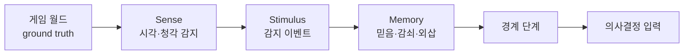
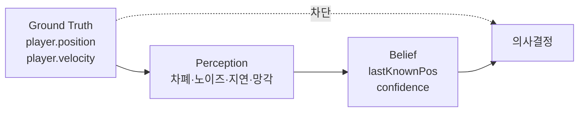
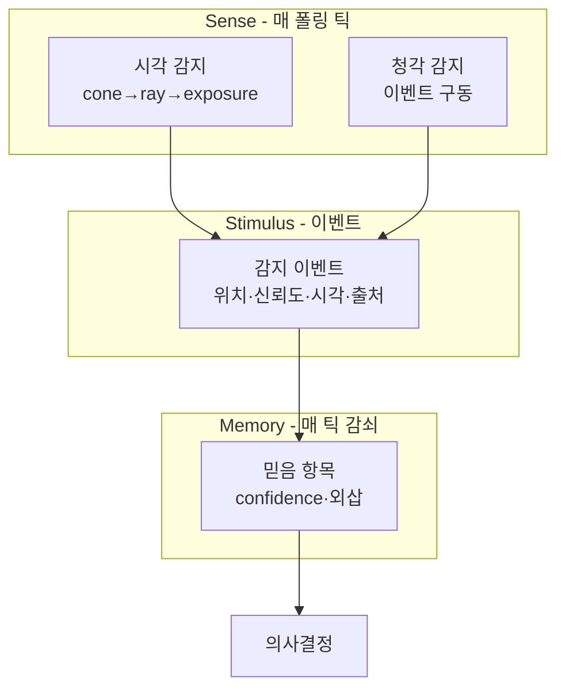
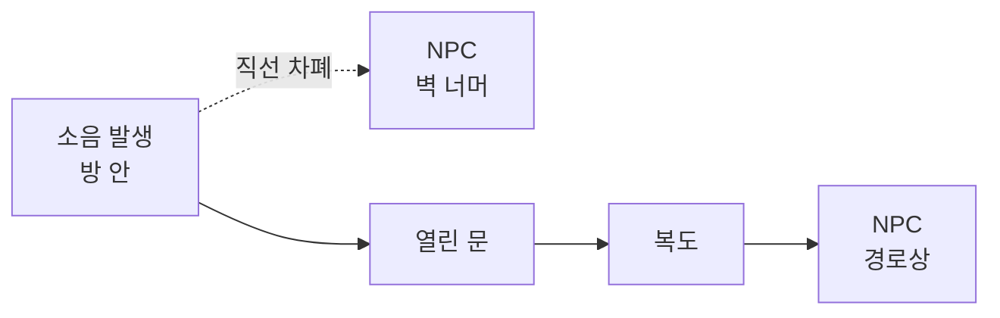
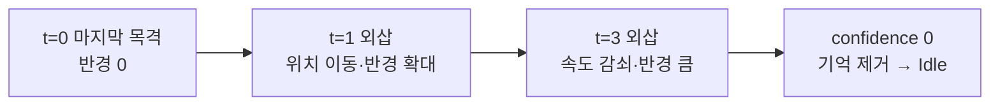
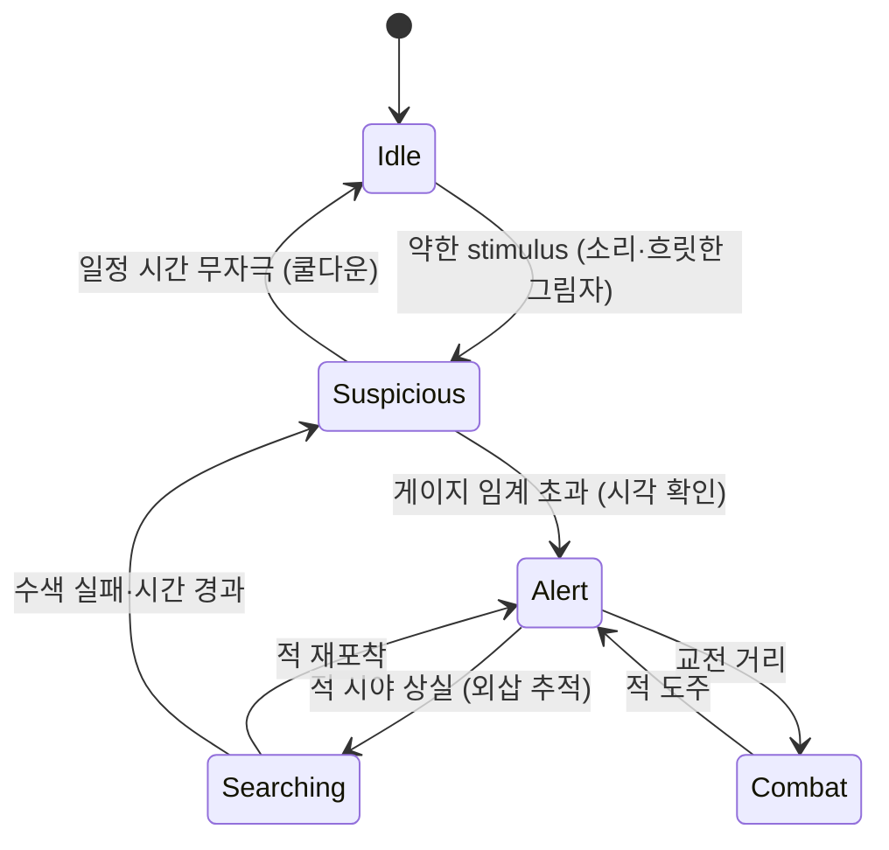

## 들어가며

FSM, 행동 트리, 효용, 계획과 길찾기는 "적이 보이는가", "마지막으로 감지한 위치는 어디인가" 같은 입력을 소비한다. 인지 시스템(Perception)은 월드의 진실(ground truth)을 NPC의 *주관적 믿음(belief)* 으로 변환해 이 입력을 만든다.

인지 시스템의 설계는 단순히 "전지적 NPC"를 만드는 문제가 아니다. 오히려 *제한* 이 핵심이다. NPC가 게임 상태를 직접 읽어 플레이어 위치를 항상 안다면, 잠입(stealth)이라는 장르 자체가 성립하지 않는다. 시야 콘 밖이면 못 보고, 벽 뒤면 가려지고, 어두우면 늦게 알아채고, 소리는 거리에 따라 약해지고, 한 번 본 적도 시간이 지나면 기억이 흐려져야 한다. 이 *인간적 한계의 모델* 이 곧 게임플레이다. Splinter Cell, Metal Gear Solid, Thief는 인지 시스템 그 자체가 게임의 핵심 메커니즘이다.

인지의 가장 어려운 점은 *진실과 믿음의 의도적 분리* 다. 코드는 플레이어의 정확한 좌표를 항상 알 수 있다 — 그저 트랜스폼을 읽으면 된다. 인지 시스템은 그 정확한 좌표를 *일부러 흐리게* 만들어 NPC에게 전달한다. 노이즈를 주고, 지연시키고, 차폐로 가리고, 망각으로 흐린다. 이 "정보를 일부러 나쁘게 만드는" 작업이 인지 엔지니어링의 본질이다. 동시에 그 흐림은 *공정(fair)* 해야 한다 — 플레이어가 "왜 발각됐는지" 이해할 수 있어야 한다. 무작위로 발각되면 게임이 아니라 도박이 된다.

이 글은 인지를 *Sense → Stimulus → Memory* 의 파이프라인으로 보고, 각 단계를 깊이 다룬다. 시야 콘과 거리, raycast 가시성 검사, 부분 가시성과 노출도(어둠·엄폐), 청각과 소음 전파, 이들을 통합하는 stimulus/sense 추상, 본 것을 기억하는 memory model과 속도 외삽, 그리고 경계 단계로 인지가 의사결정과 연결되는 방식이다. 성능(군중 규모의 raycast 예산)과 디버깅·공정성 검증, Splinter Cell 사례로 마무리한다.



이 글의 목표.

1. **인지 파이프라인** — Sense/Stimulus/Memory 구조, 진실 대 믿음, 폴링 스케줄.
2. **시야 콘** — 각도·거리 필터, 주변시·중심시, 수직 FOV의 함정.
3. **raycast 가시성** — 차폐 검사, 자기 차폐, 시간 분할.
4. **부분 가시성** — 어둠·엄폐 노출도, 다중 샘플, 발각 게이지의 동역학.
5. **청각** — 소음 강도, 거리 감쇠 법칙, 경로 기반 전파, 위치 부정확성.
6. **stimulus/sense 추상** — 감각 통합, 감각 융합, 우선순위.
7. **memory model** — 신뢰도 감쇠, 위치 외삽, 다중 대상, 소문 공유.
8. **경계 단계** — 히스테리시스, 조사 행동, 디버깅·공정성, Splinter Cell.


---

## 목차
1. [인지 시스템의 구조](#1-인지-시스템의-구조)
2. [시야 콘과 거리](#2-시야-콘과-거리)
3. [Raycast 가시성 검사](#3-raycast-가시성-검사)
4. [부분 가시성과 노출도](#4-부분-가시성과-노출도)
5. [청각 모델과 소음 전파](#5-청각-모델과-소음-전파)
6. [Stimulus와 Sense 시스템](#6-stimulus와-sense-시스템)
7. [Memory Model](#7-memory-model)
8. [경계 단계와 Splinter Cell](#8-경계-단계와-splinter-cell)


---

## 1. 인지 시스템의 구조

### 진실과 믿음의 분리

인지 시스템의 출발점은 두 개의 세계를 구분하는 것이다. *진실(ground truth)* 은 게임 시뮬레이션이 들고 있는 정확한 상태다 — 플레이어 위치, 속도, 자세. *믿음(belief)* 은 각 NPC가 인지를 통해 구성한 *주관적이고 불완전한* 모델이다. 의사결정은 진실이 아니라 *오직 믿음만* 읽어야 한다. 이 규율을 깨는 한 줄 — 의사결정 코드 어딘가에서 `player.transform.position` 을 직접 읽는 한 줄 — 이 잠입 게임 전체를 무너뜨린다. NPC가 벽 너머의 플레이어를 정확히 조준하는 "치트" 버그는 거의 항상 이 분리가 새는 지점에서 나온다.



진실과 믿음을 코드 구조로 강제하는 방법은 *접근 권한의 분리* 다. 의사결정 컴포넌트는 `World` 핸들을 받지 않고 `const Memory&` 만 받는다. 진실에 접근할 수 있는 것은 인지 컴포넌트뿐이고, 그 출력인 Memory만 의사결정으로 흘러간다. 컴파일러가 이 경계를 지켜 주면, 치트 버그는 "컴파일이 안 되는" 형태로 조기에 잡힌다.

### 세 단계 파이프라인

잘 설계된 인지 파이프라인은 세 단계다. 각 단계는 책임이 다르고, 서로 다른 빈도로 돈다.



- *Sense(감각)*: 각 감각 채널(시각·청각)이 월드를 검사해 무엇을 감지했는지 판단한다. 시각은 *능동적 폴링* (NPC가 매 틱 후보를 훑음), 청각은 *수동적 이벤트* (소리가 발생하면 NPC가 통보받음)로 비대칭이다.
- *Stimulus(자극)*: 감지 결과를 통일된 이벤트로 표현한다 — "위치 P에서 신뢰도 0.7로 적 감지, t=12.3s, 시각 채널". 감각 종류와 무관한 단일 자료형이다.
- *Memory(기억)*: stimulus를 누적해 *믿음* 을 구성하고 시간에 따라 감쇠시킨다. 적이 시야에서 사라져도 마지막 위치를 잠시 기억하고, 그 위치를 속도로 외삽한다.

이 분리가 중요하다. 의사결정은 Memory만 읽고, "방금 봤다"와 "아까 들었다"를 신뢰도와 시간으로 구분한다. 감각이 늘어나도(후각, 진동, 마법 탐지) stimulus 추상이 같으면 의사결정 코드는 바뀌지 않는다. 인지를 이 파이프라인으로 짜면, *불완전하고 시간에 따라 변하는 정보* 를 일관되게 다룰 수 있다.

### 폴링 빈도와 시간 양자화

인지를 매 렌더 프레임 돌릴 필요는 없다. 허용 가능한 감지 지연은 장르, 이동 속도, 엄폐물 크기와 텔레그래프 계약으로 정한다. 시야 후보 생성과 ray query를 별도 주기로 실행하면 비용을 줄일 수 있지만, 폴링 간격만큼 사건 시각이 양자화되고 짧게 나타났다 사라지는 표적을 놓칠 수 있다.

폴링 phase가 렌더 프레임이나 작업 완료 시점에 따라 달라지면 같은 플레이 경로도 발각 시각이 흔들린다. 이것은 난수라기보다 스케줄이 입력 계약에 들어오지 않은 문제다. 재현성이 필요하면 폴링을 정수 시뮬레이션 tick에 배치하고 NPC별 초기 phase도 상태로 고정한다. 노출량은 관측된 구간의 경과 시간에 비례해 적분할 수 있지만, 샘플 사이에 시야가 바뀌면 정확한 적분은 불가능하다. 폴링 빈도를 바꿔도 결과가 같다고 가정하지 말고, 빠른 횡단 표적에는 swept query·이벤트 보조·더 높은 주기를 사용한다.

```cpp
// 고정 시뮬레이션 tick에서 호출한다.
void PerceptionComponent::OnSimTick(const WorldSnapshot& world,
                                    std::uint64_t tick) {
    if (tick >= nextSightTick_) {
        SenseSight(world, sightPeriodTicks_ * kFixedDt);
        do {
            nextSightTick_ += sightPeriodTicks_;
        } while (nextSightTick_ <= tick);
    }
    memory_.Decay(kFixedDt);
}
```

고정 tick은 렌더 프레임 수가 달라도 같은 시뮬레이션 시각에 query를 실행하게 한다. catch-up이 필요하면 각 시뮬레이션 tick에서 월드도 함께 전진해야 하며, 현재 월드 snapshot 하나로 과거 여러 번의 폴링을 반복해서는 안 된다. 기억 감쇠는 매 시뮬레이션 tick 적용하되 UI 게이지의 시각적 부드러움은 렌더 보간으로 분리한다.

## 2. 시야 콘과 거리

### 1차 필터로서의 콘

시각 감지의 1차 필터는 *시야 콘(view cone)* 과 *거리* 다. NPC는 정면 일정 각도, 일정 거리 안만 본다. 이 두 검사는 벡터 내적과 길이 계산으로 처리할 수 있어, 물리 raycast나 여러 표본점의 노출도 계산보다 앞에 둔다. broad phase에서 떨어진 후보에는 비싼 차폐 검사를 시도하지 않는다.

```cpp
bool InViewCone(const Agent& a, Vec3 targetPos, float& outDist) {
    Vec3  toTarget = targetPos - a.eyePos;
    float dist = Length(toTarget);
    outDist = dist;
    if (dist > a.sightRange) return false;             // 거리 밖 — 가장 싼 컷
    if (dist < 1e-3f) return true;                     // 겹침 — 0 나눗셈 방지
    Vec3  dirToTarget = toTarget / dist;
    float cosAngle = Dot(a.facing, dirToTarget);
    return cosAngle > a.cosFovHalf;                    // cos(FOV/2) 미리 계산
}
```

`a.cosFovHalf` 를 *미리 계산* 해 두는 것이 작지만 중요한 최적화다. 매 후보마다 `std::cos` 를 부르는 대신, FOV가 바뀔 때만 한 번 계산한다. 또 비교가 `cosAngle > cosFovHalf` 인 점에 주의한다 — 코사인은 각도가 커질수록 작아지므로, *큰 코사인 = 작은 각도 = 콘 안* 이다. 부등호 방향을 뒤집는 실수가 흔하다.

시야 콘의 매개변수 — 시야각(FOV)과 시야 거리 — 가 NPC의 "주의력"을 정한다. 좁은 콘과 짧은 거리는 둔감한 경비병을, 넓은 콘과 긴 거리는 예민한 정찰병을 만든다. 잠입 게임은 이 콘을 *플레이어에게 시각화* 하기도 한다(미니맵의 부채꼴).

### 중심시와 주변시

단일 콘은 거칠다. 생물학적 시각의 중심와와 주변부는 해상도·민감도가 다르지만, 주변시가 움직임에만 반응한다고 단정할 수는 없다. 게임에서는 이 차이를 단순화해 정면은 높은 감지율, 바깥쪽은 낮은 감지율을 갖는 *동심 콘(nested cones)* 으로 모델링할 수 있다. 아래 각도와 배수는 생리학적 상수가 아니라 디자인 파라미터다.

| 영역 | 반각 | 거리 | 감지 특성 |
|---|---|---|---|
| 중심시 | 30° | 긴 거리 | 정지·이동 모두 즉시 |
| 주변시 | 90° | 중간 거리 | 이동·노출만, 느리게 |
| 사각 | 90° 밖 | — | 청각·접촉만 |

```cpp
float ConeMultiplier(const Agent& a, Vec3 dirToTarget, float dist) {
    float cosAngle = Dot(a.facing, dirToTarget);
    if (cosAngle > a.cosFoveal && dist < a.fovealRange)  return 1.0f;   // 중심시
    if (cosAngle > a.cosPeripheral && dist < a.periphRange) return 0.4f; // 주변시
    return 0.0f;                                                        // 사각
}
```

이 배수를 거리, 조명, 목표의 노출 면적과 함께 감지율에 곱하면 *주변시는 발각이 느리다* 는 동역학을 만들 수 있다. 플레이어가 경비병의 정면이 아니라 시야 가장자리를 스쳐 지나가면 발각 게이지가 천천히 차고, 시야를 벗어나면 감쇠한다. 구체적인 체감은 게이지 적분률과 임계값, 시각 피드백에 달려 있다.

### 수직 FOV의 함정

콘 검사를 수평 각도로만 하면 *위아래* 를 무시한다. 발코니 위 경비병과 바로 아래 플레이어, 천장 환풍구의 플레이어 같은 상황에서 의도와 다른 감지가 나온다. `facing`과 목표 방향을 3D 단위 벡터로 두면 단일 원뿔의 수직 각도도 포함되지만, 게임플레이가 요구하는 위·아래 비대칭과 서로 다른 수평·수직 FOV는 표현하지 못한다. 정밀한 구현은 목표 방향을 NPC 로컬 좌표계로 옮겨 수평·수직 각도를 따로 비교하고, 캐릭터 자세와 카메라 규칙에 맞는 비대칭 한계를 데이터로 둔다.

시야 콘과 거리는 1차 필터일 뿐 — 통과해도 장애물에 가려지면 보이지 않는다.

## 3. Raycast 가시성 검사

### 차폐 검사의 기본형

시야 콘 안에 있어도 *장애물에 가려지면* 보이지 않는다. 이를 검사하는 것이 raycast — NPC의 눈에서 목표로 광선을 쏘아, 중간에 막히는지 보는 것이다.

```cpp
bool HasLineOfSight(Vec3 eye, Vec3 targetPos, const World& world) {
    Vec3  delta = targetPos - eye;
    float dist  = Length(delta);
    if (dist < 1e-3f) return true;
    Vec3  dir   = delta / dist;
    RayHit hit;
    // 목표보다 살짝 짧게 쏜다 — 목표 자신의 콜라이더에 맞는 것을 방지
    float rayLength = std::max(0.0f, dist - kSkin);
    if (rayLength > 0.0f &&
        world.Raycast(eye, dir, rayLength, &hit, kSightMask)) {
        return false;                                  // 중간에 무언가 막음
    }
    return true;                                       // 막힘 없음
}
```

두 가지 함정에 주의한다. 첫째, *목표 자신* 의 콜라이더에 광선이 맞아 "가려졌다"고 오판하는 경우 — 광선 길이를 `dist - kSkin` 으로 살짝 줄이거나 목표 콜라이더를 마스크에서 제외한다. 둘째, *충돌 마스크(kSightMask)* — 시야를 막는 것은 벽·문이지 풀잎·투명 트리거가 아니다. "시야 차폐" 전용 레이어를 두고 그 레이어만 검사한다. 이 마스크를 빠뜨리면 NPC가 풀숲 뒤 플레이어를 못 보거나 유리창 너머를 못 보는 비현실이 생긴다.

### raycast 예산과 단계적 필터

raycast는 인지의 *가장 비싼* 부분이다. 광선이 월드 충돌 지오메트리(BVH·물리 브로드페이즈)와 교차 검사를 하므로, NPC가 많고 후보가 많으면 비용이 누적된다. 정량화하면 다음과 같다.

| 시나리오 | NPC | 후보/NPC | 폴링 Hz | 초당 raycast |
|---:|---:|---:|---:|---:|
| 소규모 | 10 | 1 | 10 | 100 |
| 중규모 | 50 | 4 | 10 | 2,000 |
| 대규모(나이브) | 200 | 8(부위 샘플) | 60 | 96,000 |

나이브한 200마리 × 8부위 × 60fps는 초당 96,000회의 raycast다. 단일 질의 비용은 충돌 월드 구조, 광선 길이, 후보 수, cache warmness, query batching과 엔진 구현에 따라 크게 달라지므로 고정된 ns·μs 값으로 예산을 잡을 수 없다. 전체 query 수와 실제 CPU 시간을 함께 계측한다.

- *단계적 필터*: 거리 → 시야 콘 → raycast 순으로, 값싼 검사로 먼저 거르고 통과한 후보에만 raycast. 대부분의 후보는 거리·콘에서 떨어져 raycast까지 가지 않는다.
- *폴링 빈도 분리*: 감지 지연 계약이 허용하는 주기로 시야 query를 낮춘다. 60Hz에서 10Hz로 낮추면 호출 횟수는 산술적으로 1/6이지만, 후보 캐시·배치 효율과 보조 이벤트 때문에 CPU 시간이 정확히 1/6이 되지는 않는다.
- *시간 분할(time-slicing)*: 모든 NPC가 같은 틱에 검사하지 않고, NPC를 N개 버킷으로 나눠 프레임마다 한 버킷만 처리. 200마리를 4버킷으로 나누면 프레임당 50마리만 검사한다.
- *부위 샘플 LOD*: 가까운/위협적인 목표만 다중 부위(머리·몸통·발), 먼 목표는 단일 중심점 raycast.

```cpp
void SightSystem::Update(float dt) {
    size_t bucket = frameIndex_ % kBuckets_;
    for (size_t i = bucket; i < agents_.size(); i += kBuckets_) {  // 버킷 스트라이드
        Agent& a = agents_[i];
        for (EntityId cand : NearbyCandidates(a)) {     // 공간 분할로 후보 추림
            float dist;
            if (!InViewCone(a, PosOf(cand), dist)) continue;       // 콘 컷
            float exposure = ComputeExposure(a, cand, dist, world_); // raycast 여기서
            if (exposure > 0) a.AddStimulus(MakeSightStimulus(cand, exposure));
        }
    }
    ++frameIndex_;
}
```

`NearbyCandidates` 는 모든 엔티티가 아니라 공간 분할(그리드·옥트리) 또는 물리 오버랩 질의로 *근처 후보만* 반환한다. 200마리가 200명을 서로 검사하면 $O(n^2)$ = 4만 쌍이지만, 공간 질의로 각 NPC당 후보를 상수로 묶으면 $O(n)$ 이 된다.

### raycast가 통과해도 끝이 아니다

raycast가 통과하면 "이 목표를 *볼 수 있다*"가 확정된다. 하지만 *얼마나 잘* 보이는지는 또 다른 문제다 — 어둠 속, 엄폐 뒤로 절반만 노출된 경우. 그래서 단일 raycast의 0/1 결과를 *다중 샘플 + 조명 + 거리* 의 연속값으로 끌어올린다.

## 4. 부분 가시성과 노출도

### 0/1을 0~1로

현실의 시야는 0/1이 아니다. 어두우면 식별이 어려워지고, 엄폐물 뒤로 일부만 드러날 수 있다. 다음 노출도는 *엄폐(cover)·조명(light)·거리(distance)를 독립적인 감쇠 게이트로 근사해 곱하는 게임 모델* 이다. 곱은 어느 한 요소가 0이면 결과도 0이 되는 강한 설계 선택이다. 실루엣, 자발광, 야간투시, 투명 재질처럼 이 가정이 맞지 않는 시각 조건은 별도 채널이나 바닥값을 둬야 한다.

```cpp
float ComputeExposure(const Agent& a, EntityId t, float dist, const World& world) {
    const Target& tgt = world.TargetOf(t);

    // 1) 엄폐 — 목표의 여러 부위로 raycast, 보이는 비율
    int visible = 0;
    for (Vec3 part : tgt.SamplePoints()) {              // 머리, 가슴, 골반, 무릎...
        if (HasLineOfSight(a.eyePos, part, world)) ++visible;
    }
    float coverFactor = float(visible) / tgt.SamplePoints().size();
    if (coverFactor == 0.0f) return 0.0f;               // 완전 차폐 — 조기 종료

    // 2) 조명 — 어두운 곳은 덜 노출
    float lightFactor = world.LightLevelAt(tgt.Center()); // 0(어둠)~1(밝음)

    // 3) 거리 — 멀수록 덜 또렷 (시야 끝에서 0)
    float distFactor = 1.0f - Clamp(dist / a.sightRange, 0.0f, 1.0f);

    // 4) 주변시 배수 (2절)
    Vec3 toCenter = tgt.Center() - a.eyePos;
    float centerDist = Length(toCenter);
    Vec3 centerDir = centerDist > 1e-3f ? toCenter / centerDist : a.facing;
    float coneFactor = ConeMultiplier(a, centerDir, centerDist);

    return coverFactor * lightFactor * distFactor * coneFactor;
}
```

`coverFactor == 0` 일 때의 *조기 종료* 가 중요하다 — 모든 부위가 가려졌으면 조명·거리를 계산할 필요가 없다. 그리고 다중 raycast는 비싸므로, 부위 샘플 수는 3~6개 정도로 제한하고 *몸의 중심선* 을 따라 배치한다(머리만, 발만 보이는 경계 케이스를 잡기 위해).

### 발각 게이지의 동역학

노출도는 *순간값* 이다. 이것을 *시간에 따라 누적* 해 "발각 게이지(awareness)"를 만든다. 핵심은 누적이 $dt$ 비례여야 한다는 점이다(1절의 폴링 비결정성 해소).

```cpp
void UpdateAwareness(Agent& a, float exposure, float dt) {
    if (exposure > 0) {
        // 노출 중 — 노출도에 비례해 차오름
        a.awareness += exposure * a.detectRate * dt;
    } else {
        // 비노출 — 천천히 식음 (즉시 0이 아님 → 히스테리시스)
        a.awareness -= a.coolRate * dt;
    }
    a.awareness = Clamp(a.awareness, 0.0f, 1.0f);
}
```

차오르는 속도 `detectRate` 와 식는 속도 `coolRate` 의 *비대칭* 이 게임 느낌을 결정한다. `detectRate > coolRate` 이면 "한 번 들키기 시작하면 빠르게, 회복은 느리게" — 긴장감이 높다. 반대면 관대하다. 또 식는 속도를 0으로 즉시 떨어뜨리지 않는 것이 중요하다 — 차오른 게이지가 *서서히* 식어야 "거의 들킬 뻔했다"는 여운이 남고, 플레이어가 한 번 더 실수하면 누적되어 발각된다.

발각까지 걸리는 시간을 역산할 수 있다. 노출도가 일정한 $e$ 로 유지될 때, 게이지가 0에서 1까지 차오르는 시간은

$$
t_{\text{detect}} = \frac{1}{e \cdot \text{detectRate}}
$$

예를 들어 `detectRate = 2.0`, 어둠 속 머리만 노출되어 $e = 0.15$ 라면 $t = 1/(0.15 \times 2) \approx 3.3$ 초가 걸린다. 밝은 곳 전신 노출 $e = 1.0$ 이면 $t = 0.5$ 초로 거의 즉시다. 이 *수치적 예측 가능성* 이 디자이너가 난이도를 튜닝하는 손잡이다.

### 단계 임계와 행동

게이지는 단일 임계가 아니라 *여러 임계* 로 단계를 만든다.

| 게이지 구간 | 단계 | NPC 반응 |
|---|---|---|
| 0.0 ~ 0.3 | Idle | 정상 순찰, 미세한 자극 무시 |
| 0.3 ~ 0.7 | Suspicious | 멈춰 두리번, 자극원 응시 |
| 0.7 ~ 1.0 | Investigating | 자극원으로 이동해 확인 |
| 1.0 | Detected | 완전 발각, Alert/Combat 전이 |

이 노출도 + 누적 + 단계 모델이 잠입 게임의 핵심 메커니즘이다. 플레이어는 어둠과 엄폐로 노출도를 낮춰 발각을 늦추고, 게이지가 임계를 넘는 순간 경계 단계가 올라간다. 0/1 가시성으로는 만들 수 없는 그라데이션이다. 게이지를 *UI로 시각화* (Splinter Cell의 광량계, 다수 게임의 발각 인디케이터)하면 메커니즘이 플레이어의 손에 직접 들어온다.

## 5. 청각 모델과 소음 전파

### 시각과 보완 관계

시각만으로는 부족하다. 등 뒤의 발소리, 멀리서 깨진 유리. *청각(hearing)* 은 시각과 보완 관계다 — 시각은 방향성이 있고 차폐되지만, 청각은 전방위이고 벽을 (약하게) 통과한다. 구조적으로도 비대칭이다 — 시각은 NPC가 *능동적으로 폴링* 하지만, 청각은 소리가 발생할 때 NPC가 *수동적으로 통보* 받는 이벤트 구동이다.

```cpp
struct NoiseEvent {
    Vec3      position;
    float     loudness;       // 발생 강도 (속삭임 0.1 ~ 총성 1.0)
    EntityId  instigator;     // 누가 냈는가 (아군 소음 무시용)
    NoiseType type;           // 발소리·총성·물건충돌 — 반응 분기용
};
```

### 거리 감쇠 법칙

청각 모델의 핵심은 *소음 강도* 가 거리에 따라 약해지는 *감쇠* 다. 감쇠 곡선의 선택이 게임 느낌을 좌우한다.

| 모델 | 식 | 특성 |
|---|---|---|
| 선형 | $\max(0, 1 - d/r)$ | 단순, 반경 $r$ 에서 칼같이 0 |
| 역거리 | $1 / (1 + d/k)$ | 가까이서 급감, 멀리 긴 꼬리 |
| 역제곱형 | $1 / (1 + (d/k)^2)$ | 빠른 감쇠, 긴 거리 꼬리 억제 |

자유 음장에서 점음원의 *강도* 는 이상적으로 $1/d^2$, 음압 진폭은 대략 $1/d$로 감소하고 데시벨은 로그 척도다. 실내 반사·흡음·회절과 주파수 의존성까지 고려하면 위의 정규화 곡선 어느 것도 완전한 음향 모델은 아니다. 게임 인지는 플레이어가 예측할 수 있는 감지 반경과 연속성을 우선해 곡선을 고르고, 실제 오디오 렌더링의 물리 모델과 AI 감지 모델을 구분한다.

```cpp
void HearNoise(Agent& a, const NoiseEvent& n, const World& world) {
    if (n.instigator == a.id) return;                  // 자기 소음 무시
    float dist = Distance(a.earPos, n.position);
    float atten = n.loudness / (1.0f + dist / a.hearingFalloff);  // 역거리
    atten *= world.SoundOcclusion(a.earPos, n.position);          // 벽 차폐 0.3~1.0
    if (atten <= a.hearingThreshold) return;           // 들리지 않음
    // 청각 stimulus — 위치는 부정확(소리 위치 + 노이즈)
    Vec3 perceived = n.position + RandomInDisk(a.hearingPosError * (1 - atten));
    a.AddStimulus({ perceived, atten, SenseType::Hearing, Now(), n.instigator });
}
```

### 벽 차폐와 경로 기반 전파

벽은 재질·두께·주파수와 문·환기구 같은 전달 경로에 따라 소리를 감쇠하거나 사실상 차단할 수 있다. 시각도 유리·연기·부분 엄폐처럼 항상 이진 차단은 아니다. 단순한 게임 모델은 직선 raycast로 만난 차폐물의 재질별 감쇠를 곱하지만, 이것은 회절과 반사를 생략한 근사다.

하지만 직선 감쇠는 *현실의 소리 전파* 를 잘못 표현한다. 닫힌 방에서 난 소리는 벽을 직선으로 통과하지 않고 *열린 문을 돌아* 복도로 새어 나간다. 직선 거리는 가깝지만 실제 음향 경로는 멀다. 정밀한 구현은 *내비게이션 그래프나 음향 포털 그래프* 를 따라 소리가 전파되는 *경로 거리* 로 감쇠를 계산한다.



도식에서 직선 경로는 벽으로 강하게 감쇠되지만, 문→복도를 도는 경로는 *경로 거리는 길어도 차폐가 없어* 오히려 더 잘 들릴 수 있다. 이 경로 기반 전파가 "총소리가 어느 방향에서 들리는지"의 단서를 *실제 통로 방향* 으로 만든다 — NPC가 벽이 아니라 문 쪽으로 조사하러 간다.

### 위치 부정확성과 조사

청각 stimulus의 특징은 *위치 부정확성* 을 명시적으로 가질 수 있다는 점이다. 소리 종류와 전파 모델에 따라 방향·거리 추정의 오차가 다르다. 위 코드의 `RandomInDisk`는 단순한 등방성 오차 모델이며, 실제로는 portal 경로 방향이나 차폐에 따라 비등방 오차가 더 적절할 수 있다. 소리만으로 적의 정체와 정확한 위치가 확정되지 않았다면 의사결정은 즉시 공격보다 조사 위치로 이동해 시각으로 확인하는 단계를 선택할 수 있다.

## 6. Stimulus와 Sense 시스템

### 통일된 추상

시각·청각(그리고 후각·진동 등)을 *통일된 추상* 으로 다루는 것이 stimulus/sense 아키텍처다. 각 감각은 stimulus를 생성하고, 의사결정은 감각 종류와 무관하게 stimulus만 소비한다.

```cpp
enum class SenseType { Sight, Hearing, Touch, Smell /* ... */ };

struct Stimulus {
    Vec3       position;     // 감지된 위치 (청각은 부정확)
    float      confidence;   // 신뢰도 0~1 (시각=노출도, 청각=감쇠강도)
    SenseType  sense;
    float      timeStamp;    // 감지 시각
    EntityId   source;       // 무엇을 감지했는가
    EventId    causeEvent;   // 같은 물리 사건에서 나온 자극을 묶는 ID
};

class PerceptionComponent {
public:
    void AddStimulus(const Stimulus& s) { pending_.push_back(s); }
    void Update(float dt) {
        for (const auto& s : pending_) memory_.Integrate(s);  // 믿음에 통합
        pending_.clear();
        memory_.Decay(dt);                                     // 시간 감쇠
    }
    const Memory& GetMemory() const { return memory_; }
private:
    std::vector<Stimulus> pending_;
    Memory                memory_;
};
```

### 감각 융합

이 추상의 가치는 *확장성과 일관성* 이다. 새 감각(마법 탐지, 진동 감지)을 추가해도 stimulus를 생성하면 끝이고, 의사결정은 손대지 않는다. 더 중요한 것은 *감각 융합(sensor fusion)* — 여러 감각이 *같은 대상* 을 가리키면 신뢰도가 강화된다. 소리를 듣고(confidence 0.4) 그쪽을 봐서 확인하면(confidence 0.9), 같은 source에 대한 두 stimulus가 Memory에서 합쳐져 확신이 커진다.

융합의 규칙은 단순 최댓값보다 정교할 수 있다. *서로 다른 감각이 일치* 하면 단일 감각보다 더 확신해야 한다(독립적 증거의 보강). 확률적으로는 두 감각의 신뢰도를 독립 사건의 보수로 결합한다.

$$
c_{\text{fused}} = 1 - (1 - c_{\text{sight}})(1 - c_{\text{hearing}})
$$

시각 0.6, 청각 0.5이면 융합 신뢰도는 $1 - 0.4 \times 0.5 = 0.8$ 로, 어느 한쪽보다 높다. "봤는데 소리도 났으니 확실하다"는 직관과 맞는다.

### 융합 규칙의 확률적 근거 — Noisy-OR과 독립성 가정

위 식은 임의로 고른 결합이 아니라 *noisy-OR* 모델의 정확한 형태다. 왜 이 형태이고, 무엇을 가정하며, 언제 깨지는지를 짚으면 융합 규칙을 안심하고 쓸 수 있다.

각 감각의 신뢰도 $c_i$ 를 "감각 $i$ 가 *단독으로* 대상을 옳게 짚을 확률"로 해석한다. 대상은 *적어도 한 감각이 짚으면* 포착된 것으로 본다. 각 감각의 성패가 독립이라 가정하면, 모두 놓칠 확률은 곱이고 융합 신뢰도는 그 여사건이다.

$$
c_{\text{fused}} = 1 - \prod_{i} (1 - c_i)
$$

여기서 *의심(doubt)* $q_i = 1 - c_i$ 를 도입하면 구조가 선명해진다. 융합 의심은 곱 $q_{\text{fused}} = \prod_i q_i$ 이고, 로그를 취하면 *가법적* 이다.

$$
\ln q_{\text{fused}} = \sum_i \ln q_i
$$

오즈가 가법적인 나이브 베이즈와 달리, noisy-OR에서 가법적인 양은 *로그 의심* 이다. 이 형태에서 두 성질이 곧장 나온다.

- *단조성*: $q_i < 1$ 인 인자를 곱할수록 $q_{\text{fused}}$ 는 줄기만 하므로 $c_{\text{fused}} \ge \max_i c_i$ 다. 융합은 *어느 단일 감각보다 약해질 수 없다*. 등호는 다른 감각이 모두 $c_j = 0$ 이거나, 이미 어떤 감각이 $c_i = 1$ 로 포화된 경우다.
- *포화와 체감*: 감각이 하나 늘 때마다 의심에 $q_i < 1$ 이 곱해져 의심이 *기하적으로* 감소한다. 그래서 신뢰도는 1로 다가가되 절대 증가폭은 점점 줄어든다. 시각 0.6·청각 0.5에 진동 감지 0.4를 더하면 $q = 0.4 \times 0.5 \times 0.6 = 0.12$, 융합 0.88 — 세 번째 증거의 기여(0.8→0.88)가 두 번째(0.6→0.8)보다 작다. "이미 거의 확신할 때 한 증거 더는 별로 안 보탠다"가 곱 구조의 필연이다.

베이즈와의 관계도 분명히 해 둔다. 조건부 독립 관측의 정통 사후확률은 *우도비의 곱* (로그-오즈 가법)으로 갱신되고, noisy-OR은 각 감각을 "탐지" 믿음의 *독립적 충분 원인* 으로 보는 인과 모델이다. 둘 다 독립성을 전제하지만 함수 형태가 다르다. 게임 인지가 noisy-OR을 택하는 이유는 결과가 $[0, 1]$ 에 갇혀 게이지·UI에 바로 쓰이고, 새 증거를 *의심에 곱하기만* 하면 되는 점증 갱신이 싸기 때문이다.

핵심 *실패 경계는 독립성 가정* 이다. 두 감각이 *같은 물리 사건* 에서 비롯하면 오차가 상관되어 noisy-OR이 증거를 *이중 계산* 한다. 플래시뱅 하나가 밝은 섬광(시각 $c = 0.7$)과 큰 폭음(청각 $c = 0.7$)을 *동시에* 낸다고 하자. 독립으로 융합하면 $1 - 0.3 \times 0.3 = 0.91$ 이지만, 둘은 사실 *하나의 증거* 라 참 신뢰도는 약 0.7에 머물러야 한다. 이 과신은 단 하나의 미끼로 NPC를 "확신"시켜 잠입의 공정성을 깬다. 완화책은 융합을 *독립 출처에만* 적용하는 것 — 자극에 원인 사건 ID를 달아 같은 사건에서 온 감각은 최댓값으로만 합치고, 서로 다른 사건일 때만 noisy-OR로 보강한다.

경계 조건 두 가지가 더 있다. $c_i = 1$ 은 *흡수원* 이다 — 확실한 한 감각($q_i = 0$)이 있으면 다른 어떤 증거와 무관하게 $c_{\text{fused}} = 1$ 이다(확정된 목격은 보강이 필요 없다는 올바른 행동). $c_i = 0$ 은 의심에 1을 곱해 *아무 기여도 없다*. 수치적으로는 고신뢰 감각이 여럿 쌓여 $c_{\text{fused}} \to 1$ 로 갈 때 $c$ 를 직접 저장하면 1 근처에서 정밀도를 잃으므로, *의심 공간* $q \mathrel{*}{=} (1 - c)$ 로 누적하고 마지막에 $1 - q$ 로 돌리는 편이 안전하다.

```cpp
// 융합은 의심 공간에서 누적 — 1 근처 정밀도 보존, 점증 갱신 O(1)
float FuseConfidences(std::span<const Stimulus> sameTarget) {
    std::unordered_map<EventId, float> maxByEvent;
    for (const Stimulus& s : sameTarget) {
        float& c = maxByEvent[s.causeEvent];
        c = std::max(c, std::clamp(s.confidence, 0.0f, 1.0f));
    }

    float doubt = 1.0f;
    for (const auto& [event, eventMaxC] : maxByEvent)
        doubt *= (1.0f - eventMaxC);                      // 사건 간 독립 가정
    return 1.0f - doubt;                                  // c_fused = 1 - prod(1-c)
}
```

### 우선순위와 자극 분류

stimulus가 모두 같은 무게는 아니다. 총성은 발소리보다, 전신 노출은 약한 그림자보다 높은 위협도를 가질 수 있다. stimulus에 감각 신뢰도와 별도의 위협 가중치를 두면 "잘 들렸지만 무해한 아군 소리"와 "희미하지만 위험한 총성"을 구분할 수 있다. 분류는 생성 단계에서 완전히 버리기보다 아군·중립 자극에도 필요한 반응이 있는지 정책으로 결정한다. Unreal Engine의 AI Perception도 sense별 자극, affiliation 필터와 자극 수명을 제공하는 같은 계열의 아키텍처 사례다.

## 7. Memory Model

### 순간을 지속으로

stimulus는 순간이다. NPC가 *지속적으로 행동* 하려면 감지한 것을 *기억* 해야 한다. 적이 모퉁이 뒤로 사라졌다고 즉시 잊으면, NPC는 모퉁이 앞에서 멍하니 순찰로 복귀한다. Memory model이 "마지막으로 본 위치", "본 지 얼마나 됐는가", "어디로 갔을 것 같은가"를 유지한다. 이것이 진실에서 분리된 *믿음* 의 실체다(1절).

```cpp
struct MemoryEntry {
    EntityId source;
    Vec3     lastKnownPos;
    Vec3     lastKnownVel;     // 이동 방향 추정 (외삽용)
    float    confidence;        // 시간에 따라 감쇠
    float    lastSeenTime;
    float    searchRadius;      // 외삽 누적에 따른 불확실성 반경
    Vec3     lastSightPos;      // 시각 관측만 갱신 — 속도 추정 기준
    float    lastSightTime;     // 시각 관측만 갱신 — 속도 추정 기준
};

void Memory::Integrate(const Stimulus& s) {
    MemoryEntry& e = entries_[s.source];
    // 직전 시각 관측과의 차이로만 속도 추정 (청각 위치에는 노이즈가 섞여 있음)
    if (s.sense == SenseType::Sight) {
        if (e.lastSightTime > 0) {
            float ddt = s.timeStamp - e.lastSightTime;
            if (ddt > 1e-3f) e.lastKnownVel = (s.position - e.lastSightPos) / ddt;
        }
        e.lastSightPos  = s.position;
        e.lastSightTime = s.timeStamp;
    }
    e.lastKnownPos  = s.position;
    e.confidence    = std::max(e.confidence, s.confidence);   // 감각 융합 강화
    e.lastSeenTime  = s.timeStamp;
    e.searchRadius  = 0.0f;                                    // 갱신 시 불확실성 리셋
}
```

### 신뢰도 감쇠와 위치 외삽

두 가지가 핵심이다. 첫째, *신뢰도 감쇠* — 본 지 오래될수록 confidence가 줄어, 의사결정이 "확실한 적"과 "오래된 정보"를 구분한다. 둘째, *위치 외삽(extrapolation)* — 적이 시야에서 사라진 뒤에도, 마지막 속도로 위치를 추정해 갱신한다. NPC가 "적이 저 모퉁이로 갔으니 그쪽으로 이동했겠지"라고 *추정한 위치* 를 조사하게 만든다. 이 외삽이 NPC를 영리해 보이게 한다 — 사라진 *지점* 이 아니라 *갔을 법한 곳* 을 쫓는다.

```cpp
void Memory::Decay(float dt) {
    for (auto it = entries_.begin(); it != entries_.end(); ) {
        MemoryEntry& e = it->second;
        e.confidence -= kForgetRate * dt;                     // 망각
        // 마지막 속도로 위치 외삽 — 적이 계속 이동했다고 가정
        e.lastKnownPos += e.lastKnownVel * dt;
        // 외삽할수록 불확실 — 탐색 반경이 시간에 비례해 커짐
        e.searchRadius += kSpreadRate * dt;
        // 추정이 오래되면 속도를 감쇠 (영원히 직진한다고 믿지 않음)
        e.lastKnownVel *= std::exp(-kVelDecay * dt);
        if (e.confidence <= 0.0f) it = entries_.erase(it);    // 완전 망각 — 제거
        else ++it;
    }
}
```

외삽에는 세 가지 정교함이 있다. *탐색 반경* `searchRadius` 는 외삽할수록 커진다 — 추정 위치가 정확할 리 없으므로, NPC는 한 점이 아니라 *점점 넓어지는 영역* 을 수색한다. *속도 감쇠* `lastKnownVel *= exp(...)` 는 적이 영원히 직진한다는 비현실을 막는다 — 시간이 지나면 추정 속도가 0으로 수렴해, 막연한 한 영역을 수색하는 행동으로 자연스럽게 전환된다. 그리고 시각 stimulus만 속도 추정에 쓴다 — 청각은 위치가 부정확해 속도를 신뢰할 수 없다.



### 다중 대상과 소문

Memory는 단일 적이 아니라 *여러 대상* 을 동시에 추적한다(`entries_` 맵). 각 대상이 독립적인 confidence와 외삽을 가진다. 한 걸음 더 나아가면 *소문(rumor) 공유* — 한 NPC의 Memory를 동료에게 전파한다. 한 경비병이 플레이어를 보면 무전으로 알려, 다른 경비병들의 Memory에 *낮은 confidence의* 항목을 심는다. 직접 본 것보다 신뢰도가 낮게 들어가, "동료가 저쪽에서 봤다더라" 정도의 약한 단서로 작동한다. 이 공유가 "한 명에게 들키면 부대 전체가 반응"하는 집단 행동을 만든다.

Memory의 confidence를 경계 상태에 직접 연결할 수 있다. 단일 임계값은 경계에서 진동하므로 `Idle → Suspicious`와 `Suspicious → Idle`에 서로 다른 임계값을 두고, 직접 시야·소문·청각처럼 증거 종류별 가중치를 구분한다.

## 8. 경계 단계와 Splinter Cell

### 단계와 히스테리시스

인지의 출력은 *경계 단계(alertness level)* 로 의사결정에 연결된다. 단순한 "봤다/못 봤다"가 아니라, Memory의 confidence와 발각 게이지에 따른 단계적 상태다.



- *Idle*: 정상 순찰. 인지 임계가 낮은 평상 상태.
- *Suspicious(의심)*: 약한 자극(소리, 부분 노출)을 받음. 멈춰 두리번거리며 자극원을 응시한다. confidence가 중간.
- *Alert(경계)*: 적을 확실히 인지. 동료에게 알리고 전투를 준비한다. confidence 높음.
- *Searching(수색)*: 적을 놓침. Memory의 외삽 위치와 점점 넓어지는 탐색 반경(7절)을 수색한다.
- *Combat*: 교전.

단계 전이의 핵심은 *히스테리시스(hysteresis)* 다. 올라가는 임계와 내려가는 임계를 *다르게* 둔다. 게이지 0.7에서 Alert로 올라가지만, 0.7 아래로 떨어진다고 즉시 내려가지 않고 0.4 아래로 내려가야 Searching으로 내려간다. 이 *비대칭 임계* 가 단계가 경계 근처에서 떨리는 "플리커링(flickering)"을 막는다. 히스테리시스가 없으면, 게이지가 임계 근처를 오갈 때 NPC가 Alert↔Searching을 매 틱 깜빡여 동작이 발작적으로 보인다.

```cpp
void UpdateAlertLevel(Agent& a) {
    switch (a.alert) {
    case Alert::Idle:
        if (a.awareness > 0.3f) a.alert = Alert::Suspicious;
        break;
    case Alert::Suspicious:
        if (a.awareness > 0.7f) a.alert = Alert::Alert;       // 상향 임계
        else if (a.awareness < 0.1f) a.alert = Alert::Idle;   // 하향 임계 (낮음)
        break;
    case Alert::Alert:
        if (a.awareness < 0.4f && !HasContact(a))             // 시야 상실 + 게이지 하락
            a.alert = Alert::Searching;
        break;
    case Alert::Searching:
        if (HasContact(a)) a.alert = Alert::Alert;             // 재포착
        else if (a.searchTimer > kSearchTimeout)              // 수색 포기
            a.alert = Alert::Suspicious;
        break;
    }
}
```

이 단계적 전이가 잠입 게임의 긴장 곡선을 만든다. 플레이어가 작은 실수를 하면 Suspicious로 올라가고, 빠르게 숨으면 다시 Idle로 내려간다. 단계마다 NPC 행동이 달라진다 — Suspicious는 "두리번거리며 조사", Alert는 "엄폐하며 경계", Searching은 "추정 위치 수색", Combat은 "교전".

### 디버깅과 공정성 검증

인지 버그는 *재현이 어렵다* — 발각이 폴링 위상·노출도·외삽이 얽힌 결과라 "왜 들켰는지"가 코드만 봐서는 안 보인다. 그래서 인지는 *시각화* 가 필수다.

- *시야 콘·노출도 오버레이*: NPC 머리 위에 발각 게이지(0~1 바)와 현재 단계를, 발 밑에 시야 콘과 중심시/주변시 영역을 디버그 드로우한다.
- *raycast 시각화*: 노출도 계산의 다중 부위 raycast를 선으로 그려, 통과한 광선은 초록·막힌 광선은 빨강으로 표시. "왜 노출도가 0.3인가"가 한눈에 보인다.
- *Memory 외삽 표시*: 마지막 목격 위치, 외삽된 현재 추정 위치, 탐색 반경 원을 그린다. "NPC가 왜 저기를 수색하는지"가 보인다.

```cpp
void Agent::DebugDraw(DebugRenderer& dr) const {
    dr.DrawBar3D(headPos_, awareness_, AlertColor(alert_));    // 게이지 + 단계색
    dr.DrawCone(eyePos_, facing_, fovHalf_, sightRange_, Color::Yellow);
    dr.DrawCone(eyePos_, facing_, fovealHalf_, fovealRange_, Color::Orange);
    for (const auto& [id, e] : mem_.Entries()) {
        dr.DrawSphere(e.lastKnownPos, 0.2f, Color::Red);       // 추정 위치
        dr.DrawCircle(e.lastKnownPos, e.searchRadius, Color::Magenta);  // 탐색 반경
    }
}
```

공정성은 인지 시스템의 *비기능 요구사항* 이다. 발각이 *납득 가능* 해야 한다 — "내가 밝은 곳에 너무 오래 서 있었다", "발소리를 너무 크게 냈다"처럼 플레이어가 자기 실수를 짚을 수 있어야 한다. 이를 위해 두 장치를 둔다. 첫째, *발각 지연(grace period)* — 노출 즉시가 아니라 게이지가 차오를 시간을 줘서 플레이어가 반응할 여지를 만든다. 둘째, *피드백* — 게이지가 차오르는 동안 시각·청각 단서(NPC가 멈칫, 의문 표시, "응?" 음성)를 주어 플레이어가 "지금 들키는 중"임을 알게 한다. 인지가 아무리 정교해도 이 피드백이 없으면 플레이어에겐 무작위 발각으로 느껴진다.

### 잠입 게임에 적용한 설계 해석

Splinter Cell·Thief 같은 잠입 게임은 빛, 소리, 엄폐와 적의 경계 상태를 플레이어가 조작하고 읽는 규칙으로 만든다. 이를 이 글의 모델로 구현한다면 조명·엄폐는 노출도 입력이 되고, 소음은 위치 오차가 있는 stimulus가 되며, 적의 자세·음성·UI는 경계 단계의 피드백이 된다. 이는 관찰 가능한 게임 규칙을 설명하는 설계 해석이지 특정 작품의 내부 코드가 정확히 같은 수식과 자료구조를 쓴다는 주장은 아니다.

상승·하강 임계를 다르게 두고 수색 상태를 별도로 두면, 한 번의 실수가 즉시 영구 전투로 고정되지 않는 회복 가능성을 설계할 수 있다. 다만 상태 전이와 기억 외삽은 작품별 규칙이며, 플레이테스트에서는 "왜 발각됐는지"와 "어떻게 경계를 해제할 수 있는지"가 관찰 가능한지를 검증해야 한다.


---

## 결론

인지 시스템은 게임 월드와 의사결정 사이의 필터다. NPC가 세계를 전지적으로 읽는 대신, Sense → Stimulus → Memory 파이프라인을 통해 *진실에서 분리된 불완전한 믿음* 만 받게 한다. 진실에 접근하는 것은 인지 컴포넌트뿐이고, 의사결정은 Memory만 읽는다 — 이 경계가 새는 한 줄이 잠입 장르 전체를 무너뜨린다. 이 의도적 제한이 게임플레이를 성립시킨다.

시각은 거리·시야 콘으로 값싸게 거른 뒤 raycast로 차폐를 검사하고, 어둠·엄폐·거리·주변시를 곱한 노출도를 $dt$ 비례로 적분해 발각 게이지를 만든다 — 게이지의 차오름/식음 비대칭(히스테리시스)이 긴장의 동역학이다. 청각은 거리 감쇠와 경로 기반 전파로 전방위·관통이라는 시각과 다른 성격을 가지며, 위치 부정확성 때문에 "조사" 행동으로 이어진다. stimulus/sense 추상이 감각들을 통일해 확장성과 확률적 감각 융합을 주고, memory model이 신뢰도 감쇠·속도 외삽·확대되는 탐색 반경으로 NPC를 영리하게 만든다. 성능은 단계적 필터·폴링 분리·시간 분할·공간 질의로 $O(n^2)$ raycast 폭발을 묶는다.

이 모두가 경계 단계(Idle/Suspicious/Alert/Searching/Combat)로 의사결정에 연결되어, 단계적 긴장 곡선을 만든다. 그리고 인지의 마지막 책임은 *공정성* 이다 — 발각이 납득 가능하고, 피드백으로 예고되며, 회복의 여지가 있어야 한다. Splinter Cell이 보여주듯, 잘 설계된 인지 시스템은 단순한 입력 생성기가 아니라 *게임플레이의 핵심 메커니즘* 그 자체다. NPC가 무엇을 아는가를 통제하는 것이, NPC가 무엇을 하는가만큼 중요하다.

## 더 읽을거리

- Steve Rabin (ed.), *Game AI Pro* 1·2·3권, perception/sensory 관련 챕터 — sense/stimulus 아키텍처, 감각 융합, 점유 맵.
- Unreal Engine 공식 문서, "AI Perception System" — sense/stimulus·affiliation 필터·자극 만료의 상용 구현.
- Brian Schwab, *AI Game Engine Programming*, 감각 시스템 장 — 시야·청각 모델의 구현.
- Ian Millington, *AI for Games*, 3rd Ed., "World Interfacing"·"Sensory Systems" — 감지 관리(sense management)와 폴링 스케줄.
- Damián Isla, "Third Eye Crime: Building a Stealth Game on an Occupancy Map" (GDC) — 점유 맵 기반 적 위치 확률 추정과 외삽.
- Splinter Cell·Thief·Metal Gear Solid 디자인 분석 (GDC/postmortem) — 인지 기반 잠입 게임플레이와 공정성.
- Mark Brown, "What Makes a Good Stealth Game?" (Game Maker's Toolkit) — 인지 시스템의 게임플레이 영향과 발각 피드백.
- Judea Pearl, *Probabilistic Reasoning in Intelligent Systems* (Morgan Kaufmann, 1988), §4 — noisy-OR 인과 모델과 독립 원인 결합.
- Richard O. Duda, Peter E. Hart, David G. Stork, *Pattern Classification*, 2nd ed. (Wiley, 2001), Ch.2 — 조건부 독립 관측의 우도비 결합과 나이브 베이즈.
