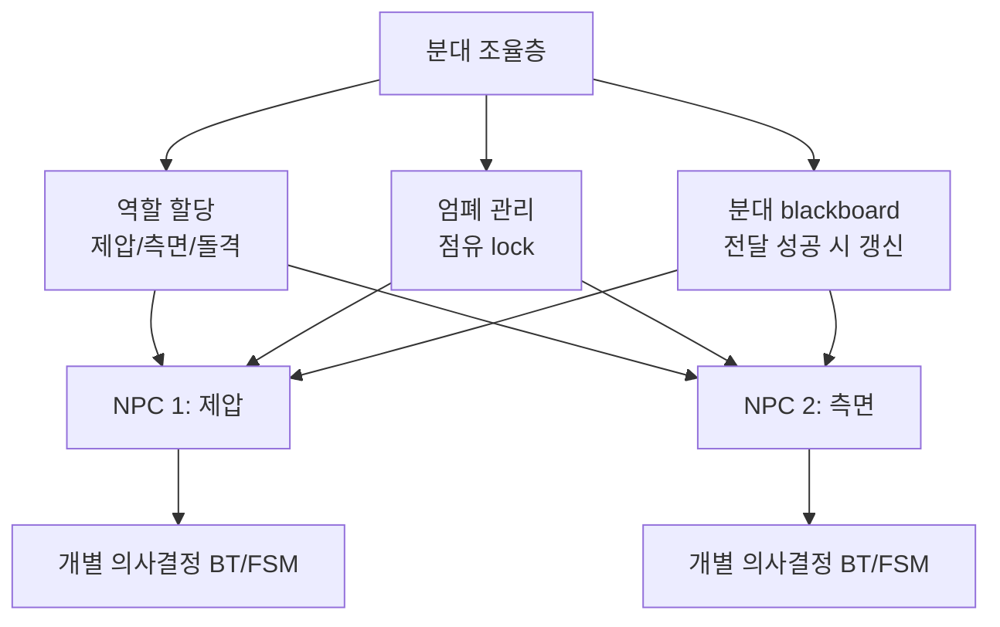
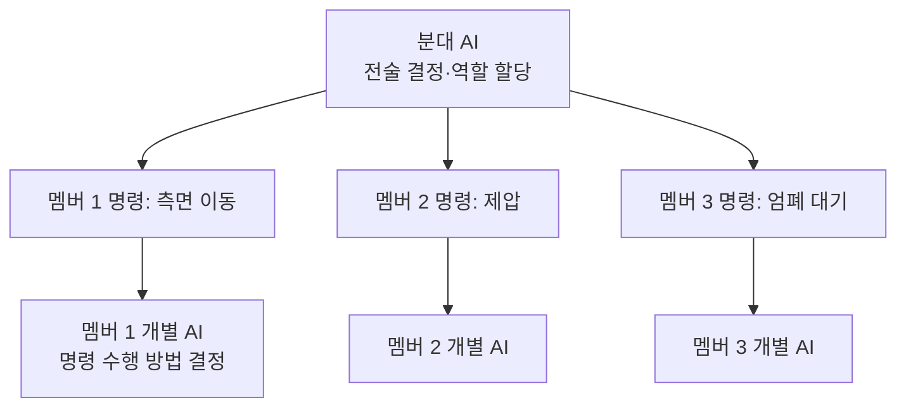
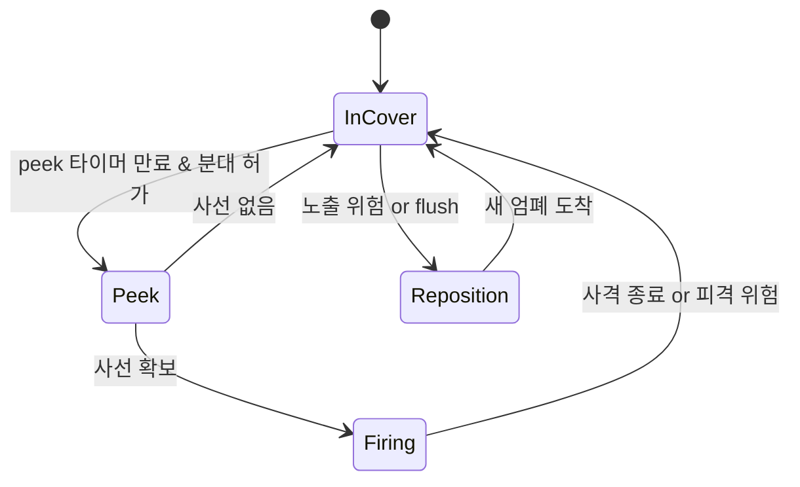
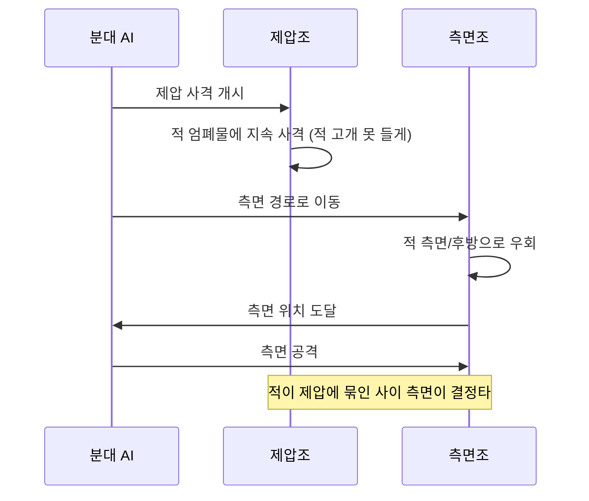

## 들어가며

개별 NPC가 아무리 잘 움직여도, 여럿이 모이면 어색해진다. 모두 같은 엄폐물로 몰리고, 한 줄로 서서 같은 각도로 사격하고, 동시에 같은 문으로 돌진한다. 원인은 단순하다. 개별 AI는 *자기 관점* 만 본다. "나에게 가장 좋은 엄폐물"이라는 동일한 효용 함수를 모두가 독립적으로 평가하면, 입력이 비슷한 NPC들의 답이 같아져 한곳에 뭉친다. 이는 버그가 아니라 *전역 정보의 부재* 라는 구조적 한계의 증상이다. 분대 협력(squad coordination)은 *집단 수준의 조율* 을 더해 이 문제를 푼다.

분대 AI의 핵심은 *역할 분담* 과 *공유 자원 관리* 다. 한 NPC가 제압 사격(suppression)으로 적을 묶는 동안 다른 NPC가 측면을 돈다. 엄폐물은 한 번에 한 명만 점유하도록 잠그고(lock), 여럿이 같은 엄폐물에 몰리지 않게 한다. 이 조율은 개별 NPC 위에 *분대* 라는 의사결정 층을 두어 구현한다 — 분대가 역할과 위치를 *할당* 하면, 개별 NPC는 자기 의사결정(FSM/BT) 안에서 그 할당을 *수행* 한다. 결정 권한이 두 층으로 갈리는 이 구조가 분대 AI 설계의 거의 전부다.

이 글은 분대의 구조와 결정 주기에서 시작해, 역할 할당을 할당 문제(assignment problem)로 정식화하고 그 해법의 복잡도를 따진다. 이어 엄폐 시스템 — cover point 추출, 방향성 판정, 점유 lock과 그 데드락·기아 문제 — 을 다루고, 제압 사격과 측면 우회의 *타이밍 동기화* 를 상태 기계로 구현한다. 분대 blackboard와 통신 모델, 그리고 모든 결정의 바탕이 되는 전술 위치 평가를 효용 함수로 정리한다. Gears of War의 엄폐 메커니즘과 Halo의 fire team 모델을 사례로 들고, 마지막에 분대 조율을 *디버깅* 하는 도구까지 정리한다.



이 글의 목표.

1. **분대 구조** — 개별 위의 조율층, 결정 주기, 권한 분리.
2. **역할 할당** — 할당 문제 정식화, 탐욕 대 헝가리안, 동적 재배분.
3. **cover point** — 엄폐 위치 추출, 방향성 판정, 자동 생성.
4. **점유와 lock** — 엄폐물 독점, 데드락·기아·예약, 이중 검증.
5. **Gears of War** — 엄폐 중심 전투의 리듬.
6. **제압과 측면** — 협동 전술의 타이밍 동기화.
7. **분대 통신** — blackboard, 메시지, 지연과 신뢰도.
8. **전술 위치 평가** — 공간 효용, 후보 생성, 영향력 맵.
9. **Fire Team과 사기** — 비대칭 역할, 창발적 공황.
10. **디버깅과 시각화** — 역할·lock·통신의 가시화.


---

## 목차
1. [분대의 정의와 구조](#1-분대의-정의와-구조)
2. [역할 할당](#2-역할-할당)
3. [Cover Point 추출](#3-cover-point-추출)
4. [Cover 점유와 Lock](#4-cover-점유와-lock)
5. [Gears of War 엄폐 메커니즘](#5-gears-of-war-엄폐-메커니즘)
6. [제압 사격과 측면 우회](#6-제압-사격과-측면-우회)
7. [분대 통신](#7-분대-통신)
8. [전술 위치 평가](#8-전술-위치-평가)
9. [Fire Team과 사기](#9-fire-team과-사기)
10. [디버깅과 시각화](#10-디버깅과-시각화)


---

## 1. 분대의 정의와 구조

### 두 층으로 나뉜 의사결정

분대(squad)는 *함께 행동하도록 묶인 NPC 집단* 이며, 동시에 그들을 조율하는 *의사결정 주체* 다. 핵심은 의사결정이 두 층으로 나뉜다는 점이다.



- *분대 AI(상위)*: "누가 무엇을" 정한다. 역할 할당, 공유 자원 배분, 전술 선택. 개별 NPC가 볼 수 없는 *집단 관점* 의 결정.
- *개별 AI(하위)*: "어떻게" 정한다. 분대가 "측면을 돌아라"는 명령을 주면, 개별 NPC가 경로·엄폐·사격을 자기 BT/FSM으로 수행.

이 *계층 분리* 가 분대 AI의 핵심 패턴이다. 분대 AI는 개별 NPC를 micromanage하지 않는다 — 역할만 주고 수행은 위임한다. 그래야 분대 AI가 단순하게 유지되고(개별 행동의 디테일을 모름), 개별 AI도 재사용 가능해진다(분대에 속하든 단독이든 같은 BT). 권한의 경계는 단순한 규칙으로 표현된다: *분대는 의도(intent)를 주고, 멤버는 행동(action)을 만든다.* 분대가 "저 좌표로 가라"가 아니라 "측면을 잡아라"는 역할을 주면, 정확한 경로·엄폐물·사격 타이밍은 멤버가 결정한다.

### 명령의 입도(granularity)

권한 분리에서 가장 자주 틀리는 지점이 *명령의 입도* 다. 분대가 너무 세밀하게 명령하면(좌표·각도·발사 타이밍까지) 멤버 AI가 무의미해지고 분대 AI가 비대해진다. 너무 추상적이면("이겨라") 멤버가 조율 없이 제각각 움직인다. 실전의 입도는 *역할 + 제약* 수준이다.

| 입도 | 명령 예시 | 문제 |
|---|---|---|
| 너무 세밀 | "(12.3, 0, 4.5)로 이동, 북동 30도 조준" | 멤버 AI 무력화, 분대 AI 폭발 |
| 적절 | "측면 역할, 적 엄폐 우측을 잡아라" | 균형 |
| 너무 추상 | "적을 처치하라" | 조율 안 됨, 몰림 발생 |

적절한 입도는 *역할(role) + 영역 힌트(area hint) + 우선순위(priority)* 정도다. 멤버는 이 세 가지를 받아 자기 BT 안에서 구체화한다.

### 분대 결정 주기

분대 수준의 역할 배정은 개별 조준·회피보다 낮은 빈도로 평가할 수 있다. 다만 안전한 주기는 이동 속도, 엄폐 간격, 공격 텔레그래프와 사건 응답 한계에 따라 달라지므로 `0.2~1초면 충분하다`는 보편값은 없다. 대표 전투의 입력 변화율과 허용 반응 지연을 측정해 주기를 정하고, 즉시 반응해야 하는 사건은 이벤트로 깨운다. 주기 평가는 분대마다 다른 위상(phase)으로 분산시켜 한 프레임에 모두 몰리지 않게 한다.

```cpp
class Squad {
public:
    void Tick(float dt) {
        decisionTimer_ -= dt;
        if (decisionTimer_ <= 0.0f) {
            TacticalContext ctx = GatherContext();   // 적·아군·지형 스냅샷
            UpdateState(ctx);                        // 분대 상태 머신 (교전/후퇴/재집결)
            AssignRoles(ctx);                        // 멤버-역할 적합도로 배정
            AssignCover(ctx);                        // 도달 가능하고 유효한 엄폐 예약
            decisionTimer_ = kDecisionPeriod;        // 예: 0.5s
        }
        // 멤버 개별 AI 는 매 프레임 — 분대 명령은 위에서 갱신된 값을 읽음
        for (Member& m : members_) m.individualAI.Tick(dt);
    }
private:
    float decisionTimer_ = 0.0f;
    std::vector<Member> members_;
    SquadBlackboard blackboard_;
};
```

이 구조의 함의는 *분대 명령이 멤버에게 비동기로 전달* 된다는 점이다. 멤버는 매 프레임 자기 BT를 돌리되, 그 BT가 참조하는 역할·엄폐물·목표 위치는 0.5초마다 한 번 바뀐다. 명령이 바뀌는 순간 멤버가 하던 행동을 *부드럽게 전환* 해야 어색함이 없다 — 역할이 Suppress에서 Flank로 바뀌었을 때 즉시 멈추고 돌아서면 로봇처럼 보인다. 그래서 멤버 BT는 현재 행동의 *완료 지점* 까지는 유지하고 새 명령을 다음 행동에 반영하는 식으로 흡수한다.

분대 크기는 게임의 전투 가독성, 공간, 역할 수, 콘텐츠 제작 비용에 맞춰 정한다. 역할 할당을 dense 헝가리안 구현으로 풀면 계산량은 $O(n^3)$이지만, 소규모 분대에서는 행렬을 만드는 경로·시야 질의가 알고리즘 본체보다 더 비쌀 수 있다. 큰 집단은 여러 분대로 나누고 상위 지휘층을 둘 수 있지만, 계층 간 명령 지연과 충돌 해결 규칙도 함께 필요하다.

## 2. 역할 할당

### 할당 문제로서의 역할 분배

분대 조율의 첫 작업은 *역할 할당* 이다. 전투 상황에서 멤버들에게 제압·측면·돌격·후방 같은 역할을 나눠, 모두가 같은 행동을 하지 않게 한다. 가장 단순한 형태는 탐욕적 배정이다.

```cpp
enum class SquadRole { None, Suppress, Flank, Assault, Reserve };

void Squad::AssignRolesGreedy(const TacticalContext& ctx) {
    for (Member& m : members_) m.role = SquadRole::None;
    Member* closest = NearestTo(ctx.enemyPos);
    closest->role = SquadRole::Suppress;        // 가장 가까운 자가 제압
    Member* flanker = BestFlankCandidate(ctx);  // 측면 경로가 좋은 자
    if (flanker && flanker != closest)
        flanker->role = SquadRole::Flank;
    for (Member& m : members_)
        if (m.role == SquadRole::None)
            m.role = SquadRole::Assault;         // 나머지는 돌격
}
```

이 탐욕적 방식은 단순하고 계산량이 작지만, 품질 보장은 입력 구조에 달려 있으며 *지역 최적의 함정* 이 있다. "가장 가까운 자가 제압"으로 A를 뽑았는데, 사실 A는 유일하게 좋은 측면 경로를 가진 멤버였다고 하자. A를 제압에 묶으면 측면조는 형편없는 경로를 쓰게 된다. 즉 각 역할을 독립적으로 최적화하면 *전체 합* 이 나빠질 수 있다. 모든 (멤버, 역할) 쌍의 적합도를 점수화한 뒤 *전체 점수 합을 최대화* 하는 배정은 고전적 *할당 문제(assignment problem)* 다.

### 적합도 행렬과 헝가리안 알고리즘

멤버 $i$가 역할 $j$를 맡을 때의 적합도 $C_{ij}$로 행렬을 만든다. 목표는 각 멤버에 정확히 하나의 역할을, 각 역할에 정확히 하나의 멤버를 배정해 $\sum_{i} C_{i,\sigma(i)}$를 최대화하는 순열 $\sigma$를 찾는 것이다.

```cpp
// 적합도 행렬: cost[member][role]. 점수가 높을수록 적합.
float RoleFitness(const Member& m, SquadRole role, const TacticalContext& ctx) {
    switch (role) {
    case SquadRole::Suppress:
        // 사선이 트이고, 탄약이 많고, 적과 적당한 거리일수록 좋음
        return LineOfFire(m.pos, ctx.enemyPos) * 0.5f
             + AmmoRatio(m) * 0.3f
             - Penalty(DistanceTo(m.pos, ctx.enemyPos), kIdealSuppressDist) * 0.2f;
    case SquadRole::Flank:
        // 측면 경로가 짧고 안전할수록 좋음
        return FlankPathQuality(m.pos, ctx) * 0.7f + Mobility(m) * 0.3f;
    case SquadRole::Assault:
        return AssaultReadiness(m, ctx);
    case SquadRole::Reserve:
        return (1.0f - HealthRatio(m)) * 0.6f;   // 부상자가 예비에 적합
    default: return 0.0f;
    }
}
```

표준적인 dense 헝가리안 구현은 $O(n^3)$에 정확한 최적 배정을 구한다. $n=6$에서 $n^3=216$은 성장률의 척도일 뿐 실제 명령어나 연산 횟수가 아니다. 적합도에 path query나 raycast가 들어가면 비용 행렬 구축이 지배할 수 있으므로, 배정기와 특징 계산을 함께 프로파일링해야 한다.

| 방식 | 복잡도 | 최적성 | 적합 규모 |
|---|---|---|---|
| 탐욕적 | $O(n \cdot r)$ | 지역 최적 | 어디서나, 빠른 근사 |
| 완전 탐색 | $O(n!)$ | 전역 최적 | $n \le 4$ |
| 헝가리안 | $O(n^3)$ | 전역 최적 | $n \le$ 수십 |

여기서 한 가지 주의할 점은 *역할 수와 멤버 수가 다를* 때다. 멤버 6명에 핵심 역할이 3개(제압·측면·돌격)뿐이면, 같은 역할을 여러 멤버가 맡거나 일부는 Reserve가 된다. 이를 할당 문제로 풀려면 역할을 *슬롯(slot)* 으로 펼친다 — "제압 슬롯 1개, 측면 슬롯 2개, 돌격 슬롯 무제한"처럼 역할별 정원을 둔 뒤 슬롯을 열(column)로 깔아 $n \times m$ 직사각 행렬로 만들고, 남는 슬롯은 0-비용 가상 슬롯으로 채워 정방 행렬화한다.

### 왜 헝가리안은 최적이고 탐욕은 못 미더운가 — 할당 다면체의 정수성·LP 쌍대성·탐욕 한계

헝가리안 알고리즘이 $O(n^3)$에 정확한 최적해를 주는 이유는 두 단계로 설명된다. (1) 이 문제의 LP 완화가 정수 꼭짓점을 갖는 구조, (2) 그 위에서 최적성을 인증하는 LP 쌍대성이다.

먼저 역할 할당을 선형 계획으로 적는다. 배정 변수 $x_{ij}\in\{0,1\}$($i$가 역할 $j$를 맡으면 1)에 대해

$$\max \sum_{i,j} C_{ij}\,x_{ij}\quad\text{s.t.}\quad \sum_j x_{ij}=1\ (\forall i),\ \ \sum_i x_{ij}=1\ (\forall j),\ \ x_{ij}\in\{0,1\}.$$

행 제약은 "멤버는 정확히 한 역할", 열 제약은 "역할은 정확히 한 멤버"다. 어려움은 마지막 $x_{ij}\in\{0,1\}$의 정수 제약에 있다. 이걸 $x_{ij}\ge 0$으로 *완화* 하면 일반적으로 LP 최적해가 분수가 되어 "멤버를 반쪽씩 쪼개는" 무의미한 답이 나오기 쉽다. 그런데 할당 문제는 그렇지 않다.

완화한 제약 집합 $\{x:\sum_j x_{ij}=1,\ \sum_i x_{ij}=1,\ x\ge 0\}$은 *이중 확률 행렬(doubly stochastic matrix)* 의 집합, 곧 **버코프 다면체(Birkhoff polytope)** 다. 버코프–폰 노이만 정리는 이 다면체의 꼭짓점(extreme point)이 정확히 *순열 행렬* 들임을 말한다. 유계이고 실행 가능한 LP에는 꼭짓점인 최적해가 하나 이상 존재하므로, 완화 문제에서도 정수인 최적 배정을 선택할 수 있다. 분수 최적해가 함께 존재할 수 있어도 최적값의 integrality gap은 0이다. 같은 사실을 이분 그래프 결합 행렬의 *전 단위모듈성(total unimodularity)* 으로도 본다. 제약 행렬이 TU이고 우변이 정수이면 모든 기저 실행 가능해가 정수다. 이것이 $n!$개의 배정을 열거하지 않고도 최적값을 찾을 수 있는 구조적 이유다.

두 번째로, *어떻게* 그 최적해를 찾고 *최적임을 어떻게 아는가*. 위 LP의 쌍대(dual)는 각 멤버 $i$와 역할 $j$에 잠재값(potential) $u_i,v_j$를 두어

$$\min \sum_i u_i + \sum_j v_j\quad\text{s.t.}\quad u_i+v_j\ge C_{ij}\ (\forall i,j).$$

약한 쌍대성으로 임의의 배정값은 임의의 쌍대 실행가능값 이하다. 강한 쌍대성은 둘이 만나는 점이 양쪽 최적임을 보장하고, 그 접점의 조건이 *상보 여유(complementary slackness)* 다: $x_{ij}>0\Rightarrow u_i+v_j=C_{ij}$. 즉 *실제로 쓰는 (멤버, 역할) 쌍은 잠재값 부등식이 등호인 변(tight edge)이어야 한다.* 최대화 형태의 헝가리안 알고리즘은 쌍대 실행가능성($u_i+v_j\ge C_{ij}$)을 유지하면서 tight edge의 매칭을 늘리고, 막히면 잠재값을 조정한다. 완전 매칭과 같은 값의 쌍대 해를 얻으면 약한 쌍대성만으로도 최적성 인증서가 된다. 전형적인 dense 구현은 $n$번의 증대 단계마다 $O(n^2)$ 작업을 해 $O(n^3)$이다. 실제 호출 주기와 분대 크기에서의 비용은 행렬 구축·동점 처리·할당까지 포함해 측정한다.

이제 탐욕이 왜 못 미더운지를 정량화한다. 코드의 `AssignRolesGreedy`는 *역할을 고정 순서로* 처리하며 각 역할에 그 시점의 최적 멤버를 준다. 본문의 2×2 적합도(행 = 멤버 A·B, 열 = Suppress·Flank)

$$C=\begin{pmatrix}10 & 9\\ 8 & 0\end{pmatrix}$$

에서 Suppress를 먼저 채우면 A(10)를 가져가고, 남은 B는 Flank에 0으로 묶여 합 $10$이다. 그러나 최적은 A→Flank(9) + B→Suppress(8) = $17$이다. 더 일반적으로

$$C=\begin{pmatrix}1&H\\0&1\end{pmatrix}$$

에서 역할 0을 먼저 채우면 합이 2지만 최적 합은 $H$다. 비율 $2/H$는 $H\to\infty$에서 0으로 가므로 역할 순서 탐욕에는 일반적인 상수 근사 보장이 없다. 점수 0인 배정을 허용하지 않는 도메인이라면 작은 양수 $\varepsilon$이나 dummy 슬롯으로 같은 반례를 만들 수 있다.

비음수 가중치의 일반 matching이라면 *변 단위 탐욕(edge greedy)* 에 $1/2$ 근사 보장이 있다. 모든 $(i,j)$ 쌍을 적합도 내림차순으로 보고 양 끝이 비었을 때 채택하면, 탐욕 변 하나가 막을 수 있는 최적 변은 최대 둘이다. 따라서 $w(\text{OPT})\le2w(\text{greedy})$다. 음수 가중치, 반드시 채워야 하는 역할, 역할별 정원·우선순위 같은 추가 제약에서는 이 보장을 그대로 쓸 수 없다. dummy 슬롯과 금지 비용을 포함해 실제 문제가 어떤 matching인지 먼저 고정해야 한다.

```python
import numpy as np
from scipy.optimize import linear_sum_assignment

def opt_max(C):                      # 헝가리안 (최대화)
    r, c = linear_sum_assignment(-C)
    return C[r, c].sum()

def role_order_greedy(C):            # 코드의 역할-순서 탐욕
    n = C.shape[0]; used = set(); tot = 0.0
    for j in range(n):               # 역할(열)을 고정 순서로 처리
        i = max((i for i in range(n) if i not in used), key=lambda i: C[i, j])
        used.add(i); tot += C[i, j]
    return tot

C = np.array([[10., 9.], [8., 0.]])  # 행 A·B, 열 Suppress·Flank
assert role_order_greedy(C) == 10 and opt_max(C) == 17   # 0.588
H = 100.0; M = np.zeros((3, 3)); M[0, 0] = 1; M[0, 1] = H; M[1, 1] = M[2, 2] = 1
assert abs(role_order_greedy(M) / opt_max(M) - 3 / (H + 1)) < 1e-9  # 비율 0으로
```

### 동적 재배분과 히스테리시스

역할은 *동적* 이다. 제압 담당이 쓰러지면 다른 멤버가 그 역할을 넘겨받고, 측면 우회가 완료되면 그 멤버는 돌격으로 전환한다. 분대 AI는 매 결정 주기마다 상황을 평가해 역할을 재할당한다. 이 동적 재배분이 분대를 *유기적으로* 보이게 한다 — 한 명이 빠지면 나머지가 자연스럽게 메운다.

문제는 *진동(thrashing)* 이다. 두 멤버의 적합도가 거의 같으면, 미세한 변화에 매 주기 역할이 뒤바뀌어 둘 다 우왕좌왕한다. 이를 막으려면 *히스테리시스(hysteresis)* 를 넣는다 — 현재 역할을 유지하는 데 보너스를 주어, 새 후보가 *충분히 더 나아야만* 역할을 빼앗는다.

```cpp
float RoleFitnessWithHysteresis(const Member& m, SquadRole role,
                                const TacticalContext& ctx) {
    float base = RoleFitness(m, role, ctx);
    if (m.role == role)
        base += kRoleStickiness;   // 현재 역할 유지 보너스 (예: 0.15)
    return base;
}
```

`kRoleStickiness`는 "역할을 바꿀 만큼의 이득 임계값"이다. 너무 크면 상황 변화에 둔감해지고(쓰러진 제압수의 역할을 늦게 메움), 너무 작으면 진동한다. 이 값과 결정 주기(1절)가 함께 분대의 *반응성과 안정성* 의 균형을 잡는다. 안전 관련 전환(부상자 → Reserve로 후퇴)은 히스테리시스를 우회해 즉시 적용하는 예외를 둔다.

## 3. Cover Point 추출

### 사전 배치와 런타임 추출

엄폐 기반 전투의 전제는 *cover point* — 엄폐 가능한 위치들의 집합이다. 이를 어떻게 찾는가가 첫 문제다. 두 접근이 있다.

- *사전 배치(offline)*: 레벨 디자이너가 엄폐 지점을 수동으로 찍거나 레벨 빌드 시 자동 생성해 저장한다. 후보 생성과 기하 검증 비용을 빌드 단계로 옮기고 디자이너가 결과를 검수할 수 있다. 런타임에는 로딩·메모리·공간 질의와 현재 시야·점유 재검증 비용이 남고, 동적 환경 변화에 자동 대응하지 못한다.
- *런타임 추출(online)*: 장애물의 가장자리에서 동적으로 cover point를 찾음. 파괴되는 엄폐물·이동하는 차량 같은 동적 환경에 대응. 비용이 있어 보통 갱신을 분산시키거나 캐싱한다.

정적 레벨에서는 사전 생성한 후보를 기본 집합으로 두고 동적 오브젝트 주변만 런타임에 보강하는 혼합형을 고려할 수 있다. 어느 쪽이 적합한지는 파괴 가능한 환경 비율, 메모리 예산, 레벨 빌드 시간과 런타임 갱신 지연으로 결정한다.

### 가장자리 검출과 법선 결정

자동 생성은 보통 *장애물 가장자리* 를 따라 점을 배치하고, 각 점이 어느 방향으로부터 엄폐를 제공하는지 검사한다. 가장자리 검출의 핵심은 NavMesh의 *경계 에지(border edge)* — 걸을 수 있는 영역과 장애물이 만나는 선분 — 를 따라 일정 간격으로 후보점을 깔고, 각 후보의 *엄폐 법선* 을 에지 방향에 수직으로 잡는 것이다.

```cpp
struct CoverClaim {
    Member* owner = nullptr;
    float   reservedAt = 0.0f;
    bool    arrived = false;
};

struct CoverPoint {
    Vec3 position;
    Vec3 coverNormal;     // 에이전트 위치에서 장애물 쪽을 향하는 보호 방향
    bool isLow;           // 낮은 엄폐(앉아야 함) / 높은 엄폐(서서 가능)
    bool leansLeft;       // 좌측으로 기대어 사격 가능
    bool leansRight;      // 우측으로 기대어 사격 가능
    CoverClaim claim;
};

// NavMesh 경계 에지를 따라 cover point 후보 생성
void GenerateCoverPoints(const NavMeshEdge& edge, std::vector<CoverPoint>& out) {
    Vec3 dir = Normalize(edge.b - edge.a);
    Vec3 normal = Cross(dir, Vec3::Up());          // 에지 winding에 따른 법선 후보
    float len = Length(edge.b - edge.a);
    for (float t = kSpacing * 0.5f; t < len; t += kSpacing) {
        Vec3 p = edge.a + dir * t;
        // 법선 방향으로 살짝 물러서서 NavMesh 위에 안착
        Vec3 cp = p - normal * kCoverInset;
        if (!OnNavMesh(cp)) {                      // 반대 winding도 처리
            normal = -normal;
            cp = p - normal * kCoverInset;
            if (!OnNavMesh(cp)) continue;
        }
        CoverPoint c;
        c.position = cp;
        c.coverNormal = normal;
        c.isLow      = ObstacleHeightAt(p) < kStandHeight;  // 높이로 자세 결정
        c.leansLeft  = CanLeanShoot(cp, normal, +dir);      // 좌측 사격 검사
        c.leansRight = CanLeanShoot(cp, normal, -dir);
        out.push_back(c);
    }
}
```

`leansLeft`/`leansRight`는 *엄폐하면서 사격 가능한 방향* 을 사전 계산한 것이다. 좋은 엄폐물은 숨을 뿐 아니라, 모서리로 기대어(lean) 적을 쏠 수 있어야 한다. 모서리 좌우 어느 쪽으로 lean이 가능한지를 빌드 시 검사해 저장하면, 런타임에 "여기 숨으면 적을 쏠 수 있나?"를 즉시 알 수 있다.

### 방향성 엄폐 판정

각 cover point는 *어느 방향으로부터의 위협을 막는지* (coverNormal)를 안다. 한 위치가 모든 방향을 막는 게 아니라, 장애물 뒤쪽에서 오는 사격만 막는다.

```cpp
bool ProvidesCover(const CoverPoint& cp, Vec3 threatPos) {
    Vec3 toThreat = Normalize(threatPos - cp.position);
    // 위협이 엄폐 법선 쪽(장애물 너머)에 있어야 엄폐됨
    return Dot(toThreat, cp.coverNormal) > kCoverThreshold;  // 예: 0.3 (약 72도)
}
```

내적(`Dot`) 기반 판정의 함의는 엄폐가 *각도 범위* 를 갖는다는 점이다. `kCoverThreshold`가 1.0이면 법선과 정확히 일치하는 방향만, 0이면 90도 범위, 음수면 측면까지 일부 막는 것으로 해석된다. 임계값을 0.3 정도로 두면 정면에서 약 ±72도 범위의 위협을 막는 것으로 모델링된다. 위협이 측면으로 이동해 `toThreat`가 법선과 수직에 가까워지면 내적이 임계값 아래로 떨어지고 기존 엄폐는 무효가 된다. 측면 우회는 이 방향 의존성을 이용해 상대 엄폐의 보호각 밖으로 이동하는 전술이다.

여러 위협이 있으면 판정이 까다로워진다. 한 엄폐물이 위협 A는 막지만 위협 B에는 노출될 수 있다. 이때는 *모든 위협에 대해 막는지* 를 AND로 묶거나, *가장 위험한 위협* 하나에 대해서만 판정하는 근사를 쓴다.

```cpp
bool ProvidesCoverFromAll(const CoverPoint& cp, const std::vector<Vec3>& threats) {
    for (Vec3 t : threats)
        if (!ProvidesCover(cp, t)) return false;   // 하나라도 노출되면 부적합
    return true;
}
```

낮은/높은 엄폐 구분은 NPC가 앉아서 숨을지, 어느 방향으로 peek할지, 사격 중 얼마나 노출될지를 정한다. 실제 보호 여부는 높이 분류 하나가 아니라 캐릭터 capsule, 카메라·총구 위치, 위협점까지의 visibility query로 검증해야 한다.

## 4. Cover 점유와 Lock

### 공유 자원으로서의 엄폐물

cover point가 있어도, *여럿이 같은 엄폐물에 몰리는* 문제가 남는다. 개별 NPC가 각자 "가장 좋은 엄폐물"을 고르면 답이 같아진다. 해법은 엄폐물을 *공유 자원* 으로 보고 *점유 lock* 을 두는 것이다.

```cpp
class CoverManager {
public:
    CoverPoint* Claim(Member* m, Vec3 threatPos, float now) {
        CoverPoint* best = nullptr;
        float bestScore = -1.0f;
        for (CoverPoint& cp : points_) {
            if (cp.claim.owner != nullptr && cp.claim.owner != m) continue;
            if (!ProvidesCover(cp, threatPos))         continue;  // 이 위협에 무효
            float s = ScoreCover(cp, m, threatPos);
            if (s > bestScore) { bestScore = s; best = &cp; }
        }
        if (best) {
            Release(m->claimedCover);   // 이전 점유 해제 (한 명은 하나만)
            best->claim = CoverClaim{m, now, false};
            m->claimedCover = best;
        }
        return best;
    }
    void Release(CoverPoint* cp) {
        if (!cp) return;
        if (cp->claim.owner && cp->claim.owner->claimedCover == cp)
            cp->claim.owner->claimedCover = nullptr;
        cp->claim = {};
    }
private:
    std::vector<CoverPoint> points_;
};
```

`claim.owner`는 논리적 점유를 나타낸다. 한 직렬화된 `CoverManager`가 선택과 기록을 원자적인 명령으로 처리한다는 조건에서 다른 멤버는 같은 점을 선택하지 않는다. 여러 job이 동시에 `Claim`을 호출한다면 이 포인터만으로는 data race와 이중 성공을 막지 못한다. 후보 점수를 병렬 계산한 뒤 한 단계에서 중재하거나, 안정 ID와 compare-exchange·명시적 lock으로 commit해야 한다. NPC가 떠나거나 죽으면 release하고, 한 멤버가 동시에 두 점을 점유하지 않도록 이전 점유와 새 점유의 갱신 순서도 하나의 트랜잭션처럼 다룬다.

### 기아와 데드락

lock은 *기아(starvation)* 위험을 동반한다. 모든 좋은 엄폐물이 점유되면 늦게 도착한 멤버가 갈 곳이 없다. 진짜 데드락(서로 상대의 자원을 기다리며 멈춤)은 엄폐물 점유에서 잘 일어나지 않지만 — 멤버는 점유를 기다리지 않고 다른 후보로 넘어가므로 — 기아는 흔하다. 후순위 멤버가 영영 좋은 자리를 못 잡고 노출된 채 방황한다.

해법은 *폴백 계층* 이다.

- *근접 폴백*: 점유된 엄폐물 근처의 임시 위치(엄폐물 옆, 약간 노출되지만 이동 중)로 보낸다.
- *우선순위 양보*: 점유에 우선순위를 두어, 부상병이나 제압수가 더 좋은 자리를 가져간다. 이미 점유된 자리라도 우선순위가 높으면 *선점(preempt)* 하고, 밀려난 멤버는 재배치한다.
- *재평가 트리거*: 점유 못 한 멤버가 발생하면 다음 결정 주기에 강제로 재평가해, 누군가 엄폐물을 떠나는 순간 빈자리를 채운다.

```cpp
CoverPoint* CoverManager::ClaimWithFallback(Member* m, Vec3 threatPos, float now) {
    CoverPoint* cp = Claim(m, threatPos, now);
    if (cp) return cp;
    // 1차 실패: 점유된 좋은 엄폐물의 근처 임시 위치
    CoverPoint* occupied = BestOccupied(threatPos);
    if (occupied) {
        m->fallbackPos = NearbyNavPoint(occupied->position, kFallbackRadius);
        return nullptr;   // 정식 점유는 없지만 갈 곳은 정해짐
    }
    // 2차 실패: 가장 덜 노출된 NavMesh 위치
    m->fallbackPos = LeastExposedPoint(m->pos, threatPos);
    return nullptr;
}
```

### 예약과 타임아웃

점유에는 *시간 차원* 이 있다. 멤버가 엄폐물을 claim하고 그곳으로 *이동하는 중* 에는, 아직 도착하지 않았어도 그 자리를 잡아 둬야 한다(예약, reservation). 그렇지 않으면 다른 멤버가 같은 곳으로 출발해 둘이 충돌한다. 반대로 예약만 하고 가지 않으면(경로가 막혔거나 상황이 바뀌어 도중에 다른 행동을 함) 자리가 영영 묶인다. 그래서 예약에 *타임아웃* 을 둔다.

```cpp
void CoverManager::UpdateClaims(float now) {
    for (CoverPoint& cp : points_) {
        if (!cp.claim.owner) continue;
        // 도착 전인데 예약이 오래됐으면 자동 해제 (이동 실패로 간주)
        if (!cp.claim.arrived && now - cp.claim.reservedAt > kReserveTimeout) {
            Release(&cp);
            continue;
        }
        // 점유자가 죽었거나 분대를 떠났으면 해제
        if (!cp.claim.owner->IsAlive() || cp.claim.owner->squad != this->squad_)
            Release(&cp);
    }
}
```

타임아웃과 도착 상태의 조합은 경로 실패로 예약이 무기한 남는 것을 막는다. 타임아웃은 벽시계가 아니라 권위 시뮬레이션 시간으로 평가하고, 긴 경로의 정상 이동을 오인하지 않도록 예상 이동 시간·경로 진행도와 함께 정한다. 이 점유는 OS mutex와 비슷한 획득·해제 용어를 쓰지만, 메모리 상호 배제를 자동으로 제공하지 않는 게임플레이 예약이다. 잘못된 중재는 겹침뿐 아니라 영구 기아와 잘못된 선점으로 이어질 수 있으므로 소유자·예약 시각·해제 이유를 추적한다.

## 5. Gears of War 엄폐 메커니즘

### 엄폐가 중심인 전투

Gears of War 시리즈는 엄폐가 전투의 *중심 메커니즘* 인 대표 사례다. 플레이어와 적 AI 모두 엄폐 기반으로 싸우며, 적 AI의 엄폐 활용이 게임의 긴장을 만든다. 적 AI의 엄폐 행동은 다음 요소로 구성된다.

- *엄폐 선택*: 위협 방향에 유효하고(coverNormal 검사), 플레이어를 사격할 각도가 나오며(lean 검사), 너무 노출되지 않은 cover point를 효용으로 고른다. 4절의 점유 lock으로 적들이 엄폐물을 나눠 갖는다.
- *엄폐-사격 사이클*: 엄폐 뒤에 숨었다가, 잠깐 일어나(peek) 사격하고, 다시 숨는다. 이 peek 타이밍이 플레이어에게 *사격 기회 윈도우* 를 준다 — 너무 오래 숨으면 비겁하고, 너무 자주 나오면 쉽다.
- *엄폐 이동(cover-to-cover)*: 한 엄폐물에서 다른 엄폐물로, 노출을 최소화하며 이동. 분대가 *전진하는 압박* 을 만든다.
- *엄폐 강제(flush out)*: 플레이어가 한 엄폐물에 너무 오래 있으면, 수류탄이나 측면 이동으로 *몰아낸다*. 정적인 교착을 깨는 장치.

### 엄폐-사격 사이클의 상태 기계

엄폐-사격 사이클은 개별 멤버 차원의 작은 상태 기계로 구현된다. peek의 *주기와 위상* 을 분대 차원에서 어긋나게 조절하는 것이 핵심이다.



```cpp
void CombatMember::UpdateCoverCycle(float dt) {
    switch (coverState_) {
    case CoverState::InCover:
        peekTimer_ -= dt;
        // 분대가 동시에 모두 peek 하지 않도록 허가를 받는다
        if (peekTimer_ <= 0.0f && squad_->RequestPeekToken(this)) {
            coverState_ = CoverState::Peek;
            // 다음 peek 주기에 무작위성을 더해 기계적 반복을 깬다
            peekTimer_ = kBasePeek + RandRange(-kPeekJitter, kPeekJitter);
        }
        break;
    case CoverState::Peek:
        if (HasLineOfFire()) coverState_ = CoverState::Firing;
        else { coverState_ = CoverState::InCover; squad_->ReturnPeekToken(this); }
        break;
    case CoverState::Firing:
        Fire(dt);
        if (UnderHeavyFire() || BurstDone()) {
            coverState_ = CoverState::InCover;
            squad_->ReturnPeekToken(this);   // 토큰 반납 — 다른 멤버 차례
        }
        break;
    }
}
```

`RequestPeekToken`이 분대 조율의 접점이다. 모든 멤버가 동시에 고개를 들면 플레이어가 한 번에 여러 표적을 만나 과부하되고, 반대로 아무도 안 나오면 압박이 사라진다. 분대가 *동시 peek 인원 수를 토큰으로 제한* 하면(예: 6명 중 2명만 동시에 노출), "엇갈려 고개 드는" 자연스러운 교전 리듬이 나온다. 이는 4절의 점유 lock과 같은 *공유 자원 토큰* 패턴이다 — 엄폐물 대신 "노출 권한"을 분배한다.

### 리듬의 설계

Gears of War가 보여준 핵심은 엄폐 AI가 단순히 "숨기"가 아니라 *플레이어와의 리듬* 을 만드는 것이라는 점이다. peek 타이밍에 무작위성(`kPeekJitter`)을 넣어 기계적 반복을 깨고, 전진 압박으로 플레이어를 한 자리에 머물지 못하게 하며, flush out으로 교착을 강제로 푼다. 이 셋이 결합해 "엄폐하고, 노리고, 압박받고, 이동하는" 전투 흐름이 나온다. 개별 엄폐 행동 위에 분대 조율(누가 제압, 누가 측면, 누가 지금 peek)이 얹혀 이 리듬을 집단 차원으로 확장한다. peek 토큰과 점유 lock이라는 두 개의 공유 자원이, 개별적으로는 단순한 엄폐 행동을 *조율된 압박* 으로 바꾸는 장치다.

## 6. 제압 사격과 측면 우회

### 고전 보병 전술의 AI 구현

분대 전술의 정수는 *제압(suppression)과 측면 우회(flank)의 조합* 이다. 고전적 보병 전술 — 한 요소가 적을 묶는 동안 다른 요소가 측면을 잡는다 — 을 AI로 구현한다.



### 제압의 모델링

*제압 사격* 은 적을 *맞히는 것보다 묶는 것* 이 목적이다. 적 엄폐물 방향으로 지속 사격해, 적이 고개를 들고 반격하지 못하게 한다. 구현에서 제압은 "적 위치 근처를 지속 사격"이고, 제압받는 적은 *제압 수치(suppression value)* 가 누적되어 인지·사격 효율이 떨어지도록 모델링한다.

```cpp
// 제압받는 쪽: 근처를 스치는 탄에 제압 수치가 쌓이고 시간에 따라 감소
void Member::ApplySuppression(float incoming, float dt) {
    suppression_ = Clamp(suppression_ + incoming - kSuppressDecay * dt, 0.0f, 1.0f);
}

// 제압 수치가 행동에 미치는 영향
bool Member::WantsToPeek() const {
    // 제압이 높을수록 고개를 들 확률이 낮아짐 (엄폐에 웅크림)
    return suppression_ < kPeekSuppressThreshold;
}
float Member::AimError() const {
    return kBaseAimError + suppression_ * kSuppressAimPenalty;  // 조준 흔들림
}
```

제압을 *맞히지 않아도 효과가 있는 수치* 로 만든 것이 핵심이다. 제압수는 적을 죽일 필요 없이 *근처에 탄을 퍼부어* `suppression_`을 높이면 되고, 그 사이 측면조가 일한다. 이 모델 없이 "맞혀야만 효과"라면 제압은 그냥 비효율적인 사격일 뿐이다.

### 측면 우회와 각도 탐색

*측면 우회* 는 제압이 적을 묶은 사이, 다른 멤버가 적의 *유효 엄폐가 무너지는 각도* 로 이동하는 것이다. 3절에서 봤듯 엄폐는 방향성이 있어, 측면에서 보면(`Dot(toThreat, coverNormal)`이 임계값 아래로 떨어지면) 적의 엄폐물이 무용해진다. 측면조는 "적 엄폐가 약한 위치"를 찾아 경로를 잡는다.

```cpp
// 적의 엄폐 법선에 수직인 방향이 측면. 그쪽 NavMesh 위치를 후보로 평가.
std::optional<Vec3> FindFlankPosition(Vec3 enemyPos, Vec3 enemyCoverNormal,
                                      Vec3 squadPos, const NavMesh& nav) {
    Vec3 side = Cross(enemyCoverNormal, Vec3::Up());   // 엄폐 법선에 수직 = 측면 축
    std::optional<Vec3> best;
    float bestScore = -std::numeric_limits<float>::infinity();
    for (int s = -1; s <= 1; s += 2) {                 // 좌/우 측면 둘 다 검토
        for (float d = kFlankMin; d <= kFlankMax; d += kFlankStep) {
            Vec3 cand = enemyPos + side * (float)s * d;
            cand = nav.NearestPoly(cand);              // NavMesh 위로 보정
            if (!nav.HasPath(squadPos, cand)) continue;
            // 적 엄폐가 무너지는 각도이고, 경로가 짧고, 도중 노출이 적을수록 좋음
            float angleBreak = 1.0f - Dot(Normalize(cand - enemyPos), enemyCoverNormal);
            float score = angleBreak * 0.6f
                        - PathExposure(squadPos, cand) * 0.3f
                        - nav.PathLength(squadPos, cand) * 0.1f;
            if (score > bestScore) { bestScore = score; best = cand; }
        }
    }
    return best;
}
```

`angleBreak`가 측면의 정의를 정량화한다 — 후보 위치에서 적을 봤을 때 적 엄폐 법선과 이루는 각이 클수록(내적이 작을수록) 적의 엄폐가 무너진다. 이를 경로 길이와 도중 노출에 결합해 측면 후보를 평가한다. 경로 안전성은 경로 표본점의 가시성·피격 가능성을 직접 검사하거나, 같은 위협 계산을 미리 격자에 집계한 영향력 맵을 적분해 근사할 수 있다.

### 타이밍 동기화

이 조합의 묘미는 *타이밍 조율* 이다. 측면조가 위치에 도달하기 전에 제압이 멈추면 적이 측면조를 발견해 위험하고, 측면조가 너무 늦으면 제압 탄약이 떨어진다. 분대 AI가 이 동기화를 분대 상태 기계로 관리한다.

```cpp
void Squad::UpdateFlankManeuver(const TacticalContext& ctx) {
    switch (maneuver_) {
    case Maneuver::Setup:
        if (SuppressorInPosition() && FlankerHasPath())
            maneuver_ = Maneuver::Execute;
        break;
    case Maneuver::Execute:
        suppressor_->orderFire = true;          // 제압 유지 명령
        flanker_->orderMoveTo = flankPos_;      // 측면 이동
        // 측면조가 도달할 때까지 제압을 끊지 않는다
        if (Arrived(flanker_, flankPos_)) maneuver_ = Maneuver::Strike;
        // 단, 제압조 탄약이 바닥나면 기동 중단·재계획
        if (AmmoRatio(suppressor_) < kAmmoAbort) maneuver_ = Maneuver::Abort;
        break;
    case Maneuver::Strike:
        flanker_->orderEngage = true;           // 측면에서 결정타
        suppressor_->orderFire = false;         // 제압 해제 (아군 오사 방지)
        break;
    case Maneuver::Abort:
        ReplanTactics(ctx);                     // 2절 역할 재할당으로 복귀
        break;
    }
}
```

핵심 불변식은 *"측면 도달까지 제압 유지"* 와 *"측면 결정타 시점에 제압 해제(아군 오사 방지)"* 다. `Abort` 분기는 기동이 실패할 조건(탄약 소진, 측면 경로 차단, 제압조 사망)을 명시적으로 처리한다 — 이 분기가 없으면 분대가 실패한 기동에 매달려 멈춘다. 잘 조율된 제압+측면은 플레이어에게 "적이 협동한다"는 강한 인상을 준다. 그 인상의 정체는 결국 이 상태 기계가 *두 멤버의 행동에 시간적 의존성* 을 건다는 것이다.

## 7. 분대 통신

### 분대 blackboard

분대 조율은 멤버 간 *정보 공유* 를 전제한다. 한 멤버가 본 적을 다른 멤버도 알아야 협동이 가능하다. 이를 *분대 blackboard* 로 구현한다.

```cpp
struct SquadBlackboard {
    EntityId          knownEnemy = kInvalidEntity;
    Vec3              enemyLastPos;
    float             enemyConfidence = 0.0f;   // 시간에 따라 감쇠
    float             lastSeenTime = 0.0f;
    SquadState        state = SquadState::Patrol;
    Maneuver          maneuver = Maneuver::None;
    int               peekTokens = kMaxConcurrentPeek;  // 5절 동시 노출 제한
    bool              leaderAlive = true;      // 9절 사기 계산
    int               casualties = 0;          // 9절 누적 사상자
};

// 멤버가 적을 보면 자기 로컬 belief 를 먼저 갱신하고 메시지를 보낸다.
// 분대 공유 blackboard 는 이 메시지가 실제로 전달된 수신자가 갱신한다.
void Member::OnEnemySpotted(EntityId enemy, Vec3 pos, float now) {
    memory_.Remember(enemy, pos, now);          // 발견자 로컬 belief — 전달 실패와 무관
    squad_->BroadcastMessage({ MsgType::EnemySpotted, pos, this->id, enemy });
}
```

분대 blackboard는 개별 NPC의 memory를 *집단 차원* 으로 올린 것이다. 한 멤버의 인지가 분대 전체의 정보가 되어, 적을 직접 못 본 멤버도 "동료가 본 적"을 향해 행동할 수 있다. 이것이 "한 명이 발견하면 전 분대가 반응"하는 협동의 기반이다. 다만 이 승격은 *메시지 전달에 성공했을 때* 일어난다 — 발견자의 로컬 belief 는 즉시 갱신되지만, 분대 공유 blackboard 는 수신자가 지연 큐에서 메시지를 처리한 뒤에 바뀐다. `enemyConfidence`는 시간에 따라 감쇠해, 오래 못 본 적의 위치 정보는 신뢰도가 떨어진다 — 분대는 마지막 목격 위치를 중심으로 *수색* 으로 전환한다.

### blackboard와 메시지의 역할 분담

blackboard(공유 상태)와 메시지(이벤트)는 다른 일을 한다. 둘을 혼동하면 설계가 꼬인다.

| 구분 | blackboard | 메시지 |
|---|---|---|
| 성격 | 지속 상태(현재 적 위치) | 순간 이벤트(적 발견!) |
| 읽기 | 누구나 언제든 polling | 구독자에게 한 번 전달 |
| 적합 | "적이 어디 있나" | "방금 누가 쓰러졌다" |
| 비유 | 칠판에 적힌 현황 | 무전 한 마디 |

지속 정보(적 위치, 분대 상태, 토큰 수)는 blackboard에 두고 멤버가 polling한다. 순간 이벤트(적 발견, 아군 사망, 수류탄 투척)는 메시지로 한 번 발행한다. 지연이 지나 메시지가 실제 전달된 수신자는 `HandleMessage`에서 blackboard를 갱신하거나 자기 행동을 전환한다 — 즉 메시지는 *blackboard 갱신의 트리거* 이며, 전달에 실패하면 갱신도 일어나지 않는다.

### 지연과 신뢰도

통신에는 *지연과 신뢰도* 를 넣어 자연스러움을 더한다. 적 발견을 즉시 전 분대가 텔레파시처럼 아는 것보다, "외친다 → 동료가 듣는다(거리·반응 지연)"로 모델링하면 더 그럴듯하다.

```cpp
void Squad::BroadcastMessage(const Message& msg) {
    const Member* sender = FindMember(msg.senderId);
    if (!sender) return;
    Vec3 origin = sender->pos;
    for (Member& m : members_) {
        if (&m == sender) continue;
        float dist = Distance(origin, m.pos);
        if (dist > kVoiceRange) continue;                  // 너무 멀면 못 들음
        float delay = dist / kSoundSpeed + kReactionDelay; // 거리 + 반응 지연
        m.inbox.PushDelayed(msg, delay);                   // 지연 큐에 적재
    }
    PlayVoiceLine(origin, msg.type);   // 게임플레이 신호로도 노출 — "적 발견!"
}

// 지연 큐에서 메시지가 실제 적용될 때(전달 성공 시)만
// 수신자가 공유 blackboard 를 갱신한다. 전달되지 않으면 갱신되지 않는다.
void Member::HandleMessage(const Message& msg) {
    auto& bb = squad_->blackboard_;
    switch (msg.type) {
    case MsgType::EnemySpotted:
        bb.knownEnemy      = msg.enemy;
        bb.enemyLastPos    = msg.pos;
        bb.enemyConfidence = 1.0f;
        bb.lastSeenTime    = Now();
        break;
    // ... 아군 사망·수류탄 등 다른 메시지 처리
    }
}
```

지연 모델의 부수 효과가 *게임플레이 메커니즘* 이 된다. NPC가 "적 발견!"이라고 외치는 음성이 곧 통신 이벤트이며, 플레이어에게 "발각됐다"를 알린다. 이 통신을 *막으면* — 잠입에서 외치기 전에 은밀 처치하면 — blackboard가 갱신되지 않아 분대 조율이 무력화된다. 한 명을 조용히 제거하면 나머지가 그를 본 적 없는 것처럼 행동하는 잠입 메커니즘이 여기서 나온다. 통신을 명시적 모델로 두면, 이런 메커니즘이 *통신 그래프의 자연스러운 결과* 로 떨어진다.

## 8. 전술 위치 평가

### 공간에 적용한 효용

분대 AI의 많은 결정 — 어디로 이동할지, 어느 엄폐물을 고를지, 어디서 측면을 잡을지 — 은 *위치의 전술적 가치* 를 정량화하는 데 귀결된다. *전술 위치 평가(tactical position evaluation)* 가 이를 점수화한다. 이는 효용 AI를 *공간* 에 적용한 것이다.

```cpp
float EvaluatePosition(Vec3 pos, const Member& m, const TacticalContext& ctx) {
    float score = 0.0f;
    score += CoverValue(pos, ctx.threats)      * m.weights.cover;   // 엄폐 제공도
    score += ShootingValue(pos, ctx.enemyPos)  * m.weights.shoot;   // 적 사격 가능성
    score -= ExposureValue(pos, ctx.threats)   * m.weights.expose;  // 노출 위험(감점)
    score += ProximityValue(pos, ctx.squadPos) * m.weights.squad;   // 분대 응집
    score += FlankValue(pos, ctx.enemyPos)     * m.weights.flank;   // 측면 각도
    score -= TravelCost(m.pos, pos)            * m.weights.travel;  // 이동 비용(감점)
    return score;
}
```

핵심 고려요소는 "엄폐는 되는가, 적을 쏠 수 있는가, 너무 노출되지 않는가, 분대와 가까운가, 측면 각도가 나오는가, 가기 쉬운가"이고, 가중치(`m.weights`)로 AI 성향을 조절한다 — 공격적 AI는 `shoot`·`flank`를 높이고, 방어적 AI는 `cover`·`expose`를 높인다. 같은 평가 함수에 가중치만 바꿔 다른 성격을 만드는 것은 효용 AI의 표준 패턴이다.

### 후보 위치 생성

평가 함수가 좋아도 *어디를 평가할지* 가 결정의 질을 좌우한다. 후보 위치는 보통 다음에서 가져온다.

- *cover point*: 3절에서 추출한 엄폐 지점들. 가장 흔한 후보.
- *NavMesh 폴리곤 중심·정점*: 엄폐물이 없는 개활지 이동 시.
- *적 주위 그리드 샘플*: 측면 각도를 찾을 때, 적 주변 반경에 방사형으로 점을 깐다.
- *현재 위치*: "지금 이대로가 더 나은가"를 비교해 불필요한 이동을 막는다.

후보가 많으면 평가 비용이 커진다. cover point 수십 개에 각 평가가 raycast(노출·사선 검사)를 포함하면 비용이 쌓인다. 그래서 *2단계 필터* 를 쓴다 — 값싼 기준(거리, 점유 여부, 방향성)으로 후보를 추리고, 살아남은 소수에만 비싼 raycast 평가를 한다.

```cpp
CoverPoint* SelectBestCover(const Member& m, const TacticalContext& ctx,
                            CoverManager& cm) {
    std::vector<CoverPoint*> shortlist;
    // 1단계: 값싼 필터 — 점유 안 됨, 방향 유효, 거리 적당
    for (CoverPoint& cp : cm.points()) {
        if (cp.claim.owner) continue;
        if (!ProvidesCoverFromAll(cp, ctx.threats)) continue;
        if (DistanceSq(cp.position, m.pos) > kMaxConsiderSq) continue;
        shortlist.push_back(&cp);
    }
    // 2단계: 비싼 평가 — shortlist 에만 raycast 포함 점수
    CoverPoint* best = nullptr;
    float bestScore = -std::numeric_limits<float>::infinity();
    for (CoverPoint* cp : shortlist) {
        float s = EvaluatePosition(cp->position, m, ctx);  // 내부에서 raycast
        if (s > bestScore) { bestScore = s; best = cp; }
    }
    return best;
}
```

### 영향력 맵

위치 평가의 한 축은 *위험* 이고, 이를 점별 raycast로 매번 계산하면 비싸다. *영향력 맵(influence map)* 은 공간을 격자로 나눠 각 셀에 아군·적군의 *영향력* 을 미리 쌓아 둔 자료구조다. 적 하나가 주변에 위협을 방사하고, 거리에 따라 감쇠한다.

```cpp
// 적 위치를 중심으로 위협 영향력을 격자에 누적 (감쇠 포함)
void InfluenceMap::AddThreat(Vec3 enemyPos, float strength) {
    Cell c = WorldToCell(enemyPos);
    int r = (int)(kThreatRadius / cellSize_);
    for (int dy = -r; dy <= r; ++dy)
        for (int dx = -r; dx <= r; ++dx) {
            int x = c.x + dx, y = c.y + dy;
            if (!InBounds(x, y)) continue;
            float dist = std::sqrt((float)(dx*dx + dy*dy)) * cellSize_;
            threat_[y * w_ + x] += strength * std::max(0.0f, 1.0f - dist / kThreatRadius);
        }
}

float InfluenceMap::ThreatAt(Vec3 pos) const {
    Cell c = WorldToCell(pos);
    return InBounds(c.x, c.y) ? threat_[c.y * w_ + c.x] : 0.0f;
}
```

영향력 맵의 함의는 개별 장애물·공격원을 매번 다시 검사하는 대신 *미리 집계한 셀 값* 을 읽어 위험을 근사할 수 있다는 것이다. `ExposureValue`나 측면 경로의 안전성을 매번 raycast로 합산하는 대신, 경로상의 셀 위협값을 읽어 더한다. 갱신 주기는 유닛 속도와 셀 크기, 허용 가능한 정보 지연으로 정하고, 급격한 위협 변화는 해당 타일을 즉시 더럽히거나 이벤트로 재계산한다. 측면 경로 선택, 후퇴 방향 결정, "가장 안전한 집결지" 찾기는 모두 낮은 위협 영역을 읽는 질의로 통일할 수 있다. 적 영향력에서 아군 영향력을 빼면 영향력 값이 0을 지나는 *전선(front line)* 후보가 드러나며, 이 경계는 전진·후퇴 판단의 한 입력이 된다.

## 9. Fire Team과 사기

### Halo의 비대칭 fire team

Halo 시리즈의 적(Covenant)은 *fire team* — 종족 혼성 소집단 — 단위로 행동한다. Halo의 fire team은 *역할의 비대칭성* 이 특징이다. 모든 멤버가 동등한 게 아니라, 종족별로 다른 역할을 맡아 *조합으로* 전술을 만든다.

| 종족 | 역할 | 행동 성향 |
|---|---|---|
| Elite | 지휘·돌격 | 엄폐·측면 주도, 강한 개체 |
| Grunt | 수적 압박 | Elite를 따름, 단독 시 약함 |
| Jackal | 방패 엄폐 | 방패로 정면 방어, 측면에 취약 |
| Hunter | 중화기 | 느리지만 강력, 후방 약점 |

분대 AI가 이 비대칭 역할을 조율해, 같은 적 구성이라도 지형과 상황에 따라 다른 전투 양상이 나온다. 2절의 역할 할당이 *종족 제약* 을 포함하는 형태다 — Grunt는 Suppress 슬롯에 높은 적합도를 갖지만 Flank 슬롯에는 낮고, Elite는 어느 역할이든 가능하다. 적합도 행렬에 이 종족별 가중치를 넣으면 비대칭 조합이 자연스럽게 떨어진다.

### 사기와 창발적 공황

fire team의 압권은 *사기(morale)* 시스템이 만드는 창발적 행동이다. *지휘관의 생존이 분대 사기에 영향* 을 준다. Elite가 죽으면 Grunt들이 공황(panic)에 빠져 도망치는 행동이 나온다 — 개별 Grunt AI에 "지휘관 사망 시 사기 저하" 규칙을 넣고, 분대 blackboard로 지휘관 상태를 공유해 구현한다.

```cpp
void Member::UpdateMorale(float dt) {
    const auto& bb = squad_->blackboard_;
    float target = baseMorale_;
    if (!bb.leaderAlive)      target -= kLeaderDeathPenalty;   // 지휘관 사망
    target -= bb.casualties * kCasualtyPenalty;                // 누적 사상자
    target += NearbyAllies() * kAllyMoraleBonus;               // 곁에 아군 있으면 안심
    target -= suppression_ * kSuppressMoralePenalty;           // 제압당하면 위축

    // 사기는 즉시가 아니라 서서히 변한다 (히스테리시스)
    float alpha = 1.0f - std::exp(-kMoraleLerp * dt);
    morale_ = Lerp(morale_, Clamp(target, 0.0f, 1.0f), alpha);

    if (morale_ < kPanicThreshold && behavior_ != Behavior::Flee)
        behavior_ = Behavior::Flee;        // 공황 — 도주로 전환
    else if (morale_ > kRallyThreshold && behavior_ == Behavior::Flee)
        behavior_ = Behavior::Fight;       // 사기 회복 — 재전투
}
```

이 코드는 "지휘관이 죽으면 즉시 도망"이라는 단일 전이를 직접 두지 않고, 지휘관 사망·사상자·주변 아군·제압을 연속적인 사기 값에 합성한다. 지휘관 사망 페널티 자체는 명시적으로 설계된 규칙이지만, 실제 공황 여부와 회복 시점은 다른 요인 및 히스테리시스와의 결합에서 결정된다. 곁에 아군이 많으면 버티고, 혼자 남으면 무너지는 행동도 같은 수식에서 나온다 — 동료가 죽을수록 `NearbyAllies`가 줄어 사기가 연쇄적으로 낮아질 수 있다. 단순한 사기 규칙을 분대 정보와 결합하면 개별 적의 단순함을 집단의 풍부함으로 보완할 수 있다.

## 10. 디버깅과 시각화

### 보이지 않는 결정을 보이게

분대 AI의 결정 — 역할 할당, 점유 lock, 통신, 사기 — 은 대부분 *공간에 드러나지 않는 내부 상태* 다. NPC가 "왜 저기로 갔지?", "왜 둘이 한 엄폐물에 겹쳤지?", "왜 갑자기 도망쳤지?"의 답은 코드 안에 숨어 있다. 분대 AI 개발의 마지막 조각은 이 보이지 않는 결정을 *화면에 띄우는* 도구다.

```cpp
void Squad::DebugDraw(DebugRenderer& dr) const {
    for (const Member& m : members_) {
        // 멤버 머리 위에 역할·사기 표시
        dr.DrawText3D(m.headPos, RoleName(m.role) + " M:" + Fmt(m.morale_),
                      RoleColor(m.role));
        // 점유한 엄폐물로 선을 그어 lock 가시화
        if (m.claimedCover)
            dr.DrawLine(m.pos, m.claimedCover->position, Color::Cyan);
        // 역할별 명령 방향 (측면 목표, 제압 대상)
        if (m.role == SquadRole::Flank)
            dr.DrawArrow(m.pos, m.orderMoveTo, Color::Magenta);
        if (m.role == SquadRole::Suppress && m.orderFire)
            dr.DrawArrow(m.firePos, blackboard_.enemyLastPos, Color::Red);
    }
    // 공유 정보: 마지막 목격 위치와 신뢰도
    dr.DrawSphere(blackboard_.enemyLastPos, 0.5f,
                  Color::Yellow.WithAlpha(blackboard_.enemyConfidence));
}
```

색으로 역할을 구분하면(제압=빨강, 측면=자홍, 돌격=주황, 예비=회색) *멀리서 한눈에* 분대의 전술 의도가 보인다. "측면조가 왜 안 움직이지?" 하면 자홍 화살표가 가리키는 곳이 도달 불가능한지 확인하고, "둘이 겹쳤다"면 두 cyan 선이 같은 점을 가리키는지 — 즉 lock이 실패했는지 — 본다.

### 점유 맵과 통신 그래프

공유 자원과 통신은 별도 오버레이로 본다.

- *점유 맵*: 모든 cover point를 점으로 그리되, 점유된 것은 owner의 색으로, 가용한 것은 흰색으로, 예약 중인 것은 깜박임으로 표시한다. 기아(아무도 못 잡은 멤버)와 lock 누수(점유자가 죽었는데 안 풀린 자리)를 즉시 잡는다.
- *통신 그래프*: 메시지가 오갈 때 발신자→수신자로 선을 잠깐 그린다. 7절의 지연·거리 모델이 의도대로 작동하는지(먼 동료에게 늦게 도달하는지), 통신이 끊긴 멤버(고립)가 있는지 본다.
- *영향력 맵 히트맵*: 8절의 격자 위협값을 반투명 색으로 깐다. 측면 경로가 정말 저위협 영역을 지나는지, 전선이 어디인지 시각으로 확인한다.

### 결정 로그와 단언

공간 시각화에 더해, *결정 로그* 로 시간축의 결정을 추적한다. 역할 재할당·기동 전환·공황을 타임스탬프와 함께 링 버퍼에 남기면, "10초 전에 무슨 일이 있었기에 분대가 무너졌나"를 거슬러 본다.

```cpp
void Squad::LogDecision(const char* what, const Member* who) {
    log_.push_back({ Now(), what, who ? who->id : kInvalidEntity });
    if (log_.size() > kMaxLog) log_.pop_front();
}
// 호출 예: LogDecision("role: Flank", flanker);  LogDecision("maneuver: Abort", nullptr);
```

여기에 런타임 단언으로 *불변식* 을 지킨다 — 한 멤버가 두 엄폐물을 점유하지 않는지, 점유 합이 멤버 수를 넘지 않는지, peek 토큰이 음수가 아닌지, 모든 멤버가 정확히 하나의 역할을 갖는지. 4절에서 봤듯 분대 AI의 자원 관리는 운영체제의 락 관리와 같은 구조이므로, *불변식 위반* 이 곧 버그의 신호다. 이 시각화·로그·단언이 분대 AI의 "의도적으로 움직이는 것처럼 보인다"는 약속을 *실제로* 지키게 만든다. 도구 없는 분대 AI는 멤버가 적을 때만 디버깅이 쉽고, 6명이 얽히면 어느 멤버의 어떤 결정이 문제인지 추적 불가능해진다.


---

## 결론

분대 협력은 개별 AI 위에 *집단 조율층* 을 두어, 여럿이 모일 때 생기는 어색함 — 한곳에 몰리고, 같은 행동을 하고, 협동하지 않는 — 을 푼다. 그 핵심은 권한의 두 층 분리다. 분대는 *의도(역할·영역·우선순위)* 를 주고, 멤버는 그것을 자기 BT/FSM으로 *행동* 으로 구체화한다. 명령의 입도를 역할 수준으로 잡고, 분대 결정을 낮은 빈도 주기로 돌려 비용을 누른다.

역할 할당은 적합도 행렬 위의 할당 문제이며, 작은 분대에서 헝가리안 알고리즘이 $O(n^3)$로 최적해를 주되 진동을 막는 히스테리시스가 필요하다. 엄폐 시스템은 NavMesh 경계에서 cover point를 추출하고, 내적 기반 방향성 판정으로 측면 우회의 물리적 근거를 만들며, 점유 lock·예약·타임아웃으로 "한 엄폐물에 한 명"과 기아 방지를 동시에 해결한다 — 본질적으로 운영체제의 자원 락과 같은 구조다. 제압은 맞히지 않아도 효과가 있는 수치로 모델링하고, 측면은 적 엄폐 법선에 수직인 각도에서 찾으며, 분대 상태 기계가 "측면 도달까지 제압 유지, 결정타 시 제압 해제"라는 타이밍 불변식을 건다.

Gears of War의 엄폐 리듬은 peek 토큰이라는 공유 자원으로 동시 노출을 제한해 만들어지고, Halo의 비대칭 fire team은 종족별 역할 조합과 사기 시스템이 결합해 공황을 *창발* 시킨다. 분대 blackboard가 한 멤버의 인지를 집단 정보로 올려 이 모든 조율을 가능하게 하고, 전술 위치 평가와 영향력 맵이 "좋은 위치"와 "안전한 경로"를 효용으로 정량화한다. 핵심은 개별 NPC를 똑똑하게 만드는 것이 아니라, 공유 자원과 공통 정보를 통해 집단이 의도적으로 움직이는 것처럼 *보이게* 만드는 데 있다. 그리고 그 의도가 실제로 작동하는지는, 보이지 않는 결정을 화면에 띄우는 디버그 도구가 있어야만 지켜진다.

## 더 읽을거리

- Steve Rabin (ed.), *Game AI Pro* 1·2·3권, squad/tactical 관련 챕터 — 역할 할당과 전술 위치 평가, 영향력 맵.
- Matthew Jack, "Tactical Pathfinding and Cover" — 엄폐 추출과 전술 길찾기.
- Damián Isla, "Handling Complexity in the Halo 2 AI" (GDC 2005) — 계층적 행동과 fire team 구조의 산업 공개.
- Chris Jurney, "Company of Heroes Squad Formations" (*AI Game Programming Wisdom* 4) — 분대 대형과 이동 조율.
- William van der Sterren, "Tactical Path-Finding with A*" (*Game Programming Gems* 3) — 전술 비용(노출·위협)을 반영한 길찾기.
- Dave Mark, *Behavioral Mathematics for Game AI* — 효용 함수와 가중치 설계, 위치 평가의 정량화.
- Damián Isla & Bungie, Halo AI 발표들 — 사기 시스템과 비대칭 역할의 창발적 행동.
- Kuhn-Munkres(헝가리안) 알고리즘 — 할당 문제의 다항 시간 최적해. CLRS 또는 표준 조합최적화 교재.
- H. W. Kuhn, "The Hungarian Method for the Assignment Problem" (Naval Research Logistics Quarterly 2, 1955) — 헝가리안 원전.
- J. Munkres, "Algorithms for the Assignment and Transportation Problems" (Journal of the SIAM 5, 1957) — 헝가리안 방법의 엄밀한 형식화.
- Jack Edmonds & Richard Karp, "Theoretical Improvements in Algorithmic Efficiency for Network Flow Problems" (JACM 19, 1972), Nobuaki Tomizawa, "On Some Techniques Useful for Solution of Transportation Network Problems" (Networks 1, 1971) — 헝가리안 계열의 $O(n^3)$ 개선.
- A. Schrijver, *Combinatorial Optimization: Polyhedra and Efficiency* (Springer, 2003) — 버코프–폰 노이만 정수성, 전 단위모듈성, 쾨니그 정리, 할당 LP 쌍대성.
- D. Avis, "A Survey of Heuristics for the Weighted Matching Problem" (Networks 13, 1983) — 탐욕 매칭의 $1/2$ 근사 한계.
