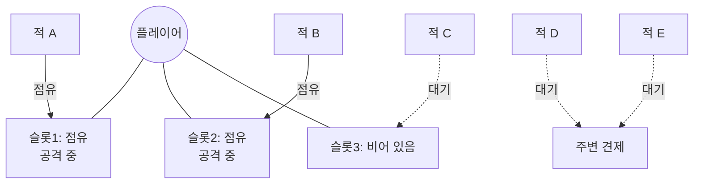
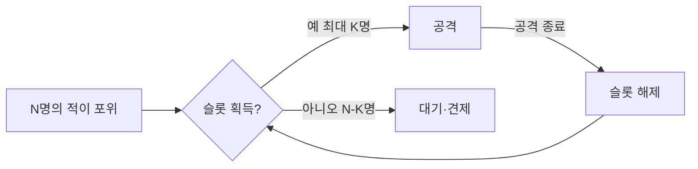
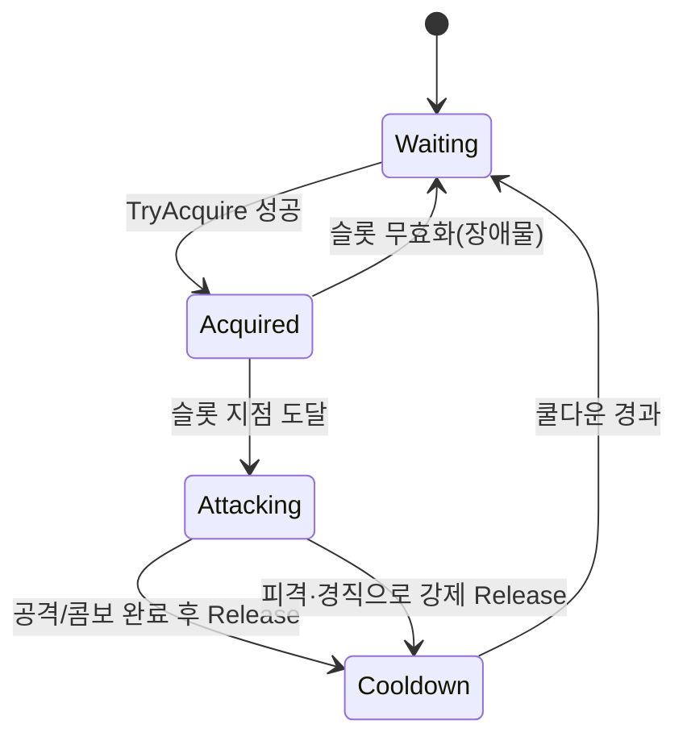
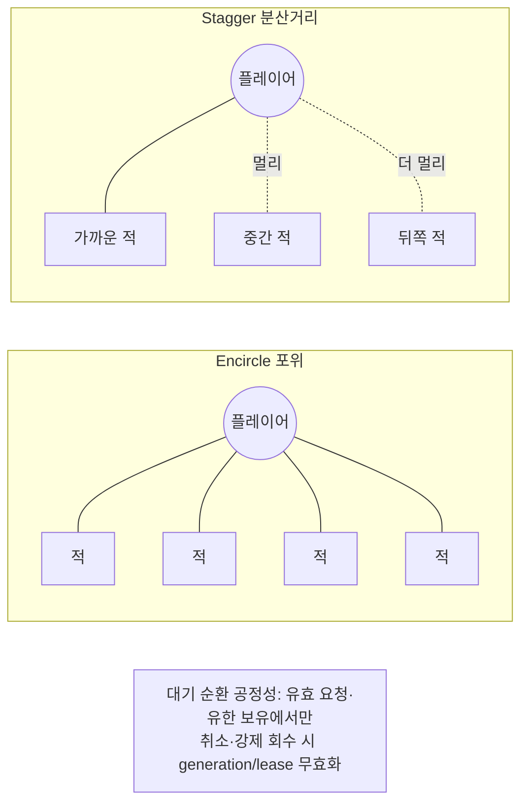

## 들어가며

플레이어가 적 열 명에게 둘러싸였다고 하자. 모든 적이 *동시에 최선을 다해* 공격하면, 플레이어는 회피할 틈 없이 즉사한다. 개별 적 AI 관점에서는 모두 옳은 행동을 했는데, 결과는 불가능한 난이도다. 반대로 적들이 머뭇거리면 멍청해 보인다. 이 딜레마 — *개별적으로 합리적인 행동의 집단적 비합리성* — 가 다수 대 일(many-vs-one) 전투의 근본 문제다.

문제의 본질은 *조율(coordination)의 부재* 다. 각 적이 독립적으로 "사거리 안이고 쿨다운이 끝났으니 공격한다"는 합리적 결정을 내리면, 그 결정들이 시간축에서 겹쳐 동시 공격이 된다. 어느 한 적도 잘못하지 않았는데 집단의 출력이 망가진다. 이것은 공유 자원에 대한 경쟁(contention)이 조율 없이 일어날 때 시스템 전체가 무너지는, 동시성 문제의 게임플레이 버전이다. 여기서 공유 자원은 메모리나 락이 아니라 *플레이어의 주의(attention)* 와 *반응 가능한 입력 대역폭* 이다.

이 문제를 푸는 한 가지 설계가 *Attack Slot System* 이다. 플레이어 주변에 한정된 수의 "공격 슬롯"을 정의하고, *슬롯을 점유한 적만 공격 위치에 진입* 하게 한다. 별도의 공격 토큰까지 두면 위치 점유와 실제 공격 권한을 분리할 수 있다. 둘러싼 적 중 일부만 공격 준비 또는 공격 상태에 들어가고 나머지는 견제·재배치하므로, 포위의 시각적 압박과 대응 가능한 위협량을 따로 조절할 수 있다.

이 글은 attack slot의 발상에서 출발해, 플레이어 주변 슬롯 배치의 기하학, 점유와 해제의 lock 생명주기, 이를 중재하는 reservation manager의 할당 알고리즘과 그 일반화인 *공격 토큰* 시스템을 다룬다. 슬롯 배정을 전역 최적화로 보는 관점과 그 비용·근사, 전술·서사 신호를 배정 점수에 결합하는 방법, encircle/stagger 대기 전략, 점유자와 대기자의 행동 차별화, 디버깅·튜닝 도구까지 정리한다. 핵심은 "공격 권리"를 공유 자원으로 보고 동시에 활성화되는 위협의 수와 방향을 의도적으로 제한하는 것이다.



이 글의 목표.

1. **발상** — 공격 권리를 희소 자원으로, 동시성 문제로서의 동시 공격.
2. **슬롯 배치** — 플레이어 기준 좌표계, 방향 슬롯의 기하학, 장애물에 의한 무효화.
3. **점유와 해제** — 슬롯 lock 생명주기, 쿨다운, 끊긴 해제(orphan)의 함정.
4. **reservation manager** — 적합도 점수, 전역 매칭, starvation 방지.
5. **공격 토큰** — 슬롯의 일반화, 슬롯×토큰 조합, 토큰 유형 분리.
6. **배정 우선순위** — 전술·서사 신호의 결합과 정책 경계.
7. **encircle vs stagger** — 대기자 배치와 진입 시간차.
8. **차별화** — 점유자/대기자 행동, "살아 있는 포위".
9. **디버깅과 튜닝** — 슬롯 시각화, 동시 공격자 그래프, 난이도 다이얼.


---

## 목차
1. [Attack Slot의 발상](#1-attack-slot의-발상)
2. [슬롯 배치 모델](#2-슬롯-배치-모델)
3. [슬롯 점유와 해제](#3-슬롯-점유와-해제)
4. [Slot Reservation Manager](#4-slot-reservation-manager)
5. [공격 토큰 시스템](#5-공격-토큰-시스템)
6. [배정 우선순위와 정책 결합](#6-배정-우선순위와-정책-결합)
7. [Encircle vs Stagger](#7-encircle-vs-stagger)
8. [점유자와 대기자의 차별화](#8-점유자와-대기자의-차별화)
9. [디버깅과 튜닝](#9-디버깅과-튜닝)


---

## 1. Attack Slot의 발상

### 공격을 희소 자원으로

Attack slot의 핵심 발상은 *공격할 권리를 희소 자원으로 만드는* 것이다. 적이 플레이어 사거리 안에 있다고 아무 때나 공격하는 게 아니라, *슬롯을 획득해야만* 공격한다. 슬롯 수 $K$가 동시 공격자 수의 상한이 된다.



이 단순한 제약이 두 문제를 동시에 푼다.

- *난이도 제어*: 슬롯 점유가 공격 권한과 결합돼 있을 때 동시 공격 후보 수를 제한할 수 있다. 위치 슬롯만 예약하고 공격은 별도 토큰 없이 허용한다면 이 보장은 성립하지 않는다.
- *가독성*: 플레이어가 동시에 신경 쓸 공격이 적어, 어디서 공격이 오는지 읽고 대응할 수 있다. 열 방향의 동시 공격은 인지 불가능하지만, 두세 방향은 가능하다.

### 인지 부하의 정량화

"가독성"은 텔레그래프 식별 시간, 시선 이동, 선택 수, 입력 지연과 캐릭터의 방어 발동 시간을 함께 측정해야 한다. Hick-Hyman 법칙은 통제된 선택 반응 과제에서 선택지 수가 늘수록 평균 결정 시간이 증가하는 경향을 다음처럼 모델링한다.

$$
T = a + b \log_2(n + 1)
$$

계수 $a,b$는 과제, 숙련도, 자극과 입력 장치에 따라 달라지며 이 식만으로 “두 명까지 대응 가능” 같은 보편 상한을 얻을 수는 없다. 게임에서는 공격 방향, 신호 유사도, 카메라 밖 위협, 방어 동작의 범위와 취소 가능성까지 결과에 영향을 준다. 슬롯과 토큰 수는 이 복합 과제에 들어오는 동시 신호 수를 제한하는 손잡이다. 적정값은 대표 플레이어 집단의 성공률·피격 원인·시선 추적·입력 시각 분포로 정한다.

### 공격 권한 상한과 동시 텔레그래프 중첩 확률

슬롯 또는 토큰을 점유한 공격 후보가 $K$명이고 각 후보가 주기 $C$로 공격을 반복한다고 하자. 한 번의 공격은 길이 $w$의 텔레그래프와 그 뒤의 회복·쿨다운으로 이루어진다. 먼저 서로 조율되지 않은 공격 위상이 얼마나 자주 겹치는지 기준선을 만들 수 있다.

정상상태에서 한 적이 임의의 순간에 텔레그래프를 보이고 있을 확률은 점유율

$$
p = \frac{w}{C} \qquad (w < C)
$$

이다 — 한 공격 주기 중 텔레그래프가 차지하는 시간 비율. 각 적의 공격 *위상* 이 서로 독립이라 가정하면, 임의의 순간에 동시에 활성인 텔레그래프 수 $N$은 이항분포를 따른다.

$$
N \sim \mathrm{Binomial}(K, p), \qquad \mathbb{E}[N] = Kp = \frac{Kw}{C}
$$

두 개 이상의 텔레그래프가 동시에 활성인 *중첩 사건* 은 $N\ge 2$이고, 그 확률은 이항 꼬리다.

$$
P_{\text{ovw}} = \Pr(N\ge 2) = 1 - (1-p)^K - Kp(1-p)^{K-1}
$$

팀이 플레이테스트로 정한 허용 평균 중첩량을 $r$이라 하면 다음은 평균에 대한 필요 조건으로 쓸 수 있다.

$$
\mathbb{E}[N] = \frac{Kw}{C} \le r \quad\Longrightarrow\quad K \le \frac{rC}{w}
$$

이 부등식은 평균만 제한한다. $r$은 인간에게 고정된 물리 상수가 아니라 공격 집합과 대상 플레이어에 대해 선택한 설계 목표이고, 이항 꼬리와 최악 중첩도 별도로 확인해야 한다. 또한 슬롯이 위치만 예약하고 공격 토큰이 따로 있다면 $K$는 슬롯 수가 아니라 공격 후보 또는 토큰 수를 뜻한다.

수치를 넣자. 텔레그래프 $w=0.25$s, 공격 주기 $C=2$s면 $p=0.125$다. $K$명이 모두 무조율로 독립 공격한다는 가상 모델에서의 *순간 중첩 확률* 은 다음과 같다.

| 공격 후보 $K$ | 평균 활성 $\mathbb{E}[N]$ | $P_{\text{ovw}}=\Pr(N\ge2)$ |
|---:|---:|---:|
| 1 | 0.125 | 0% |
| 2 | 0.250 | 1.6% |
| 3 | 0.375 | 4.3% |
| 4 | 0.500 | 7.9% |
| 6 | 0.750 | 16.7% |
| 8 | 1.000 | 26.4% |

이 예에서 후보 수가 2이면 임의 순간의 텔레그래프 중첩 확률은 약 1.6%, 8이면 약 26%다. 중첩이 곧 피격 불가피를 뜻하지는 않는다. 범위 공격으로 함께 회피할 수 있는지, 두 신호가 같은 방향인지, 방어 동작에 무적·가드 범위가 있는지에 따라 플레이 결과가 달라진다.

$K$가 크고 $p$가 작은 극한($Kp=\mu$ 고정)에서 $N$은 포아송 $\mathrm{Poisson}(\mu)$으로 수렴하고

$$
P_{\text{ovw}} \to 1 - e^{-\mu}(1+\mu), \qquad \mu=\frac{Kw}{C}
$$

이 되어 독립·희박 사건 근사에서는 중첩 확률이 *평균 동시 텔레그래프 $\mu$* 로 표현됨을 보여준다. 실제 공격 스케줄러는 독립성을 깨뜨리므로 이 식은 구현 검증용 기준선이지 완성된 난이도 모델이 아니다.

경계 조건과 실패 모드.

- *위상 독립 가정의 양면*: 이항 모델은 텔레그래프 위상이 독립일 때의 기준선이다. stagger는 진입·공격 위상을 의도적으로 분리해 중첩을 기준선보다 낮출 수 있다. 주기가 고정되고 간격 $C/K \ge w$이며 지연이나 패턴 길이 변화가 없다면 등간격 스케줄에서 같은 종류의 텔레그래프가 겹치지 않는다. 반대로 함께 사거리에 진입한 적의 쿨다운이 동기화되면 중첩은 기준선보다 커진다.
- *회복 없는 공격($C\le w$)*: 독립 균일 위상 모델의 $p=w/C$ 전제가 깨진다. 텔레그래프가 계속 이어지는 패턴은 이항 점유 모델 대신 상태 기계의 실제 시간 구간을 겹쳐 계산한다.
- *평균은 tail을 숨긴다*: $\mathbb{E}[N]\le r$여도 드문 세 겹·네 겹 중첩이 남을 수 있다. 평균, 중첩 확률, 최대 연속 압박 시간과 피격 원인을 함께 본다.
- *강공격 토큰*: 특정 공격 부류의 토큰 상한을 1로 두면 그 부류끼리 동시 활성화되지 않는다는 시스템 불변식을 직접 만들 수 있다. 이 보장은 확률 모델이 아니라 획득·반납 코드와 테스트에서 나온다.

### 동시성 문제로서의 동시 공격

이 문제를 시스템 관점에서 다시 보면, 공유 자원에 대한 무조율 접근(unsynchronized access)과 정확히 같은 구조다. $N$명의 적이 각자 독립적으로 "공격 가능 조건"을 평가하고 참이면 공격에 들어간다. 조율이 없으면 이 결정들이 시간축에서 겹친다.

```cpp
// 조율 없는 적 AI — 각자 독립적으로 결정 (동시 공격 폭발)
void Enemy::Update(float dt) {
    if (InRange(player_) && attackCooldown_ <= 0) {
        StartAttack();           // 모두가 동시에 이 분기에 들어온다
        attackCooldown_ = kAttackCooldown;
    }
    attackCooldown_ -= dt;
}
```

쿨다운만으로는 동시성을 막지 못한다. 적들이 비슷한 시점에 사거리에 진입하면 쿨다운도 비슷한 위상(phase)으로 동기화되어, 같은 순간에 함께 풀린다. 멀티스레드에서 락 없이 공유 카운터를 증가시키면 망가지는 것과 같다. 해결의 방향도 같다 — *공유 자원에 대한 접근을 중앙에서 직렬화/제한* 한다. 슬롯이 바로 그 자원이고, slot manager가 그 중재자다. 차이가 있다면 목적이 정확성이 아니라 *체감 난이도와 리듬* 이라는 점이다.

attack slot은 *현실성을 의도적으로 희생* 한다 — 실제 열 명이 둘러싸면 동시에 칠 것이다. 하지만 게임은 *재미있고 공정한 전투* 가 목적이고, slot은 그 목적에 맞춘 추상이다. 영화의 액션 장면에서 악당들이 주인공을 한 명씩 공격하는 "할리우드 규칙"을 시스템화한 것이라 볼 수 있다. 핵심은 이것이 *버그가 아니라 설계* 라는 점이다.

## 2. 슬롯 배치 모델

### 플레이어 기준 좌표계

슬롯을 *플레이어 주변 어디에 둘 것인가* 가 다음 문제다. 가장 흔한 모델은 플레이어를 중심으로 한 *방향 슬롯* 이다. 핵심 결정은 슬롯 좌표를 *월드 고정* 으로 둘지 *플레이어 상대* 로 둘지다.

```cpp
struct AttackSlot {
    float  angle;        // 플레이어 기준 방향 (라디안, 0 = 정면)
    float  radius;       // 플레이어로부터 거리
    Agent* occupant;     // 점유자 (없으면 nullptr)
    float  cooldownUntil; // 이 시각 이전엔 재배정 금지
    bool   blocked;      // 장애물로 무효화됨
};

// 플레이어 주변 N방향에 슬롯을 균등 배치
void BuildSlots(std::vector<AttackSlot>& slots, int n, float radius) {
    slots.clear();
    for (int i = 0; i < n; ++i) {
        float a = (2.0f * float(M_PI) * i) / n;
        slots.push_back({ a, radius, nullptr, 0.0f, false });
    }
}

Vec3 SlotWorldPos(const AttackSlot& s, Vec3 playerPos, float playerFacing) {
    float a = s.angle + playerFacing;     // 플레이어 기준 → 월드
    return playerPos + Vec3{ std::cos(a), 0, std::sin(a) } * s.radius;
}
```

슬롯 위치를 *플레이어 기준 상대 좌표* 로 두면, 플레이어가 회전할 때 슬롯도 함께 돈다 — "플레이어의 정면 슬롯"은 항상 플레이어가 보는 쪽이다. 이렇게 하면 플레이어가 돌아설 때 공격자들이 그에 맞춰 재배치된다. 반대로 월드 고정 좌표로 두면 플레이어가 돌아도 슬롯이 그대로라, 공격이 등 뒤에서 오는 상황이 자연스럽게 생긴다. freeflow류는 가독성을 위해 *전방 가중 + 플레이어 상대* 를, 스텔스·서바이벌류는 긴장을 위해 *월드 고정 + 전방위* 를 택하는 경향이 있다.

### 방향 슬롯의 기하학

슬롯을 균등 배치하면 인접 슬롯 사이 각도는 $2\pi / n$이다. 슬롯 수와 각 간격, 그리고 그 각도가 인간에게 어떻게 읽히는지는 다음과 같다.

| 슬롯 수 | 인접 각도 | 체감 | 적합 장르 |
|---:|---:|---|---|
| 2 | 180° | 정면/배후 양분 | 듀얼, 보스 |
| 3 | 120° | 명료한 삼각 압박 | freeflow 카운터 |
| 4 | 90° | 사방 포위 시작 | 표준 군중전 |
| 6 | 60° | 빽빽한 포위 | 난전·하이엔드 |
| 8 | 45° | 거의 연속 | 대규모 물량전 |

슬롯 수가 늘수록 인접 각도가 좁아지지만, `8개부터 가독성이 무너진다`는 보편 경계는 없다. 카메라 FOV, 공격 텔레그래프 크기, 적의 화면 점유율과 플레이어 이동성에 따라 달라진다. 위치 슬롯 수와 실제 동시 발동 수를 별도 공격 토큰으로 분리하면 포위 밀도와 위협 총량을 독립적으로 조절할 수 있다.

### 배치 변형과 장애물 무효화

균등 배치는 출발점일 뿐이고, 실전에서는 여러 변형을 쓴다.

- *전방 가중*: 슬롯을 플레이어 전방에 더 많이 둬, 공격이 주로 보이는 쪽에서 오게 한다(가독성 ↑). 정면 $\pm 60°$에 슬롯 밀도를 높이고 후방은 성기게 둔다.
- *근접/원거리 분리*: 근접 슬롯(칼)과 원거리 슬롯(총·활)을 다른 반경에 둔다. 근접 반경 2m, 원거리 반경 8m 식이다.
- *동적 무효화*: 지형(벽, 장애물)으로 일부 슬롯을 무효화한다. 벽을 등지면 등 뒤 슬롯이 사라져 플레이어에게 유리해진다.

장애물 무효화는 슬롯 월드 좌표와 플레이어 사이에 가시선(line of sight)이나 통행 가능성이 있는지를 검사해 정한다.

```cpp
void UpdateSlotValidity(std::vector<AttackSlot>& slots, Vec3 playerPos,
                        float playerFacing, const NavWorld& nav) {
    for (AttackSlot& s : slots) {
        Vec3 wp = SlotWorldPos(s, playerPos, playerFacing);
        // 슬롯 지점이 통행 가능하고, 플레이어까지 막힘이 없어야 유효하다
        s.blocked = !nav.IsReachable(wp) || nav.RaycastBlocked(wp, playerPos);
        if (s.blocked && s.occupant) {
            s.occupant->NotifySlotLost();   // 점유 중이던 슬롯이 막히면 통보
            s.occupant = nullptr;
        }
    }
}
```

이 검사 비용이 무시할 수 없다 — 슬롯 $n$개 × raycast 한 번 × NPC 그룹 수다. 보통 슬롯 유효성은 매 틱이 아니라 N틱마다(예: 5틱) 갱신하고, 플레이어가 크게 움직였을 때만 강제 갱신한다. 슬롯 수와 배치가 전투의 성격을 정한다. 적은 슬롯 + 전방 배치는 쉽고 명료한 전투를, 많은 슬롯 + 전방위 배치는 어렵고 정신없는 전투를 만든다.

## 3. 슬롯 점유와 해제

### lock 생명주기

슬롯은 *공유 자원* 이다. 적이 공격하려면 슬롯을 claim하고, 공격이 끝나면 release한다. 이 획득-사용-반납의 사이클은 락의 생명주기와 동형이다.



```cpp
bool Agent::TryAcquireSlot(SlotManager& mgr, float now) {
    AttackSlot* s = mgr.RequestSlot(this, now); // 가장 적합한 빈 슬롯 요청
    if (!s) return false;                     // 가용 슬롯 없음 → 대기
    s->occupant = this;
    mySlot_ = s;
    return true;
}

void Agent::ReleaseSlot(SlotManager& mgr, float now) {
    if (!mySlot_) return;
    mySlot_->occupant = nullptr;
    mySlot_->cooldownUntil = now + kSlotReuseCooldown;  // 즉시 재배정 방지
    mySlot_ = nullptr;
}
```

### 해제 시점의 트레이드오프

해제 시점을 정하는 것이 핵심이다. 너무 늦게 해제하면(공격 애니메이션이 다 끝난 뒤) 슬롯이 오래 묶여 대기자들이 답답하게 멈춰 있고, 너무 빨리 해제하면 한 적이 연속 공격을 못 하고 슬롯을 뺏긴다. 보통 다음 시점에 해제한다.

- *공격 완료*: 한 번의 공격(또는 콤보) 후 release.
- *피격/경직*: 적이 맞아 비틀거리면 즉시 release(공격 불가 상태).
- *거리 이탈*: 적이 슬롯 위치에서 너무 멀어지면 release.
- *쿨다운*: release 후 일정 시간 재획득 금지 — 같은 적이 슬롯을 독점하지 않게 *순환* 을 강제.

슬롯이 포화돼 있고 점유 시간이 평균 $T_{hold}$인 단순 fluid 근사에서 슬롯 $K$개의 처리율은 $K/T_{hold}$다. 따라서 대기 작업 $W$개를 모두 서비스에 진입시키는 데 걸리는 *backlog 처리 시간의 척도* 는

$$
T_{\text{clear}} \approx \frac{W}{K / T_{hold}} = \frac{W \cdot T_{hold}}{K}
$$

대기자 6명, 슬롯 2개, 점유 시간이 정확히 1.5초이고 두 슬롯의 남은 점유 시간도 1.5초라고 하자. FIFO에서 대기 순번 1~6의 시작 대기는 `1.5, 1.5, 3.0, 3.0, 4.5, 4.5`초다. 평균은 3초이고 마지막 대기자의 값이 4.5초다. 즉 $WT_{hold}/K=4.5$초를 *평균 대기* 라 부르면 틀린다. 일반적인 평균 대기시간은 도착률, 점유 시간 분포, 현재 서비스의 잔여 시간, 우선순위·재진입 정책에 좌우되며 M/G/K 또는 시뮬레이션으로 구한다. $T_{hold}$, $K$, 쿨다운은 처리량뿐 아니라 대기시간의 평균과 tail을 함께 조절한다.

### 끊긴 해제(orphan slot)의 함정

가장 흔한 버그는 *슬롯을 잡은 채 적이 사라지는* 경우다. 적이 죽거나, 처형(takedown)당하거나, 스턴 상태로 멀리 날아가거나, 풀에 반납되어 비활성화되었는데 release를 호출하지 않으면, 슬롯은 *이미 존재하지 않는 점유자* 를 가리킨 채 영영 비지 않는다. 락을 잡은 스레드가 죽어 다른 스레드가 영원히 대기하는 데드락과 같다.

```cpp
// 함정: 적이 죽을 때 슬롯을 반납하지 않으면 슬롯이 영구 점유된다
void Agent::OnDeath(SlotManager& mgr) {
    // ReleaseSlot(mgr, now); 를 빠뜨리면 → orphan slot
    isDead_ = true;
}
```

방어책은 두 가지다. 첫째, 점유자의 모든 종료 경로(사망·처형·기절·풀 반납)에서 release를 *반드시* 거치도록 강제한다. 둘째, slot manager가 *주기적으로 점유자의 유효성을 검사* 해 끊긴 점유를 회수한다 — 락의 타임아웃이나 lease 만료와 같은 발상이다.

아래 회수 코드는 앞의 설명용 `Agent* occupant`를 제품용 `EntityHandle occupantHandle`로 교체했다고 가정한다.

```cpp
// 방어: manager가 끊긴 점유를 주기적으로 회수
void SlotManager::ReclaimOrphans(float now) {
    for (AttackSlot& s : slots_) {
        if (!s.occupantHandle.IsValid()) continue; // 이미 빈 슬롯은 건드리지 않는다
        Agent* a = Resolve(s.occupantHandle);      // generation이 포함된 안정 handle
        if (!a || a->IsPermanentlyRemoved() || s.leaseDeadline < now) {
            s.occupantHandle = {};                 // 점유 → 빈 전이에서만 쿨다운 설정
            s.cooldownUntil = now + kSlotReuseCooldown;
        }
    }
}
```

raw pointer를 저장한 채 대상이 파괴되면 유효성 검사 자체가 use-after-free가 될 수 있으므로 generation이 있는 entity handle이나 중앙 registry를 사용한다. 또한 `CanAttack()==false`는 재장전·경직·공격 애니메이션 중에도 일시적으로 참일 수 있어 orphan 판정으로 부적절하다. 영구 제거 상태와 갱신 가능한 lease 만료를 구분한다. 빈 `occupantHandle`은 회수 대상이 아니므로 건너뛰고, 쿨다운은 실제 *점유 → 빈* 전이에서만 설정해 재회수가 멱등이 되게 한다. `IsValid`는 구조 예시 helper로, 비어 있는 handle과 generation이 만료된 비어 있지 않은 handle을 구분해 빈 슬롯을 다시 건드리지 않게 한다. 정상 경로는 명시적 release로, 빠진 경로는 회수 스윕으로 막는다.

이 쿨다운과 회수가 합쳐져 *공격자 순환* 을 만든다. 한 적이 공격하고 물러나면 슬롯이 비고, 대기하던 다른 적이 들어와 공격한다. 플레이어 입장에서는 "여러 적이 번갈아 덤비는" 자연스러운 전투가 된다 — 같은 적만 계속 치지 않는다.

## 4. Slot Reservation Manager

### 적합도 점수와 탐욕 배정

슬롯 할당을 중재하는 것이 *reservation manager* 다. 여러 적이 동시에 슬롯을 요청할 때, 누구에게 어느 슬롯을 줄지 결정한다. 가장 단순한 정책은 요청한 적에게 *가장 적합한 빈 슬롯* 을 즉시 주는 탐욕(greedy) 방식이다.

```cpp
class SlotManager {
public:
    AttackSlot* RequestSlot(Agent* requester, float now) {
        AttackSlot* best = nullptr;
        float bestScore = -FLT_MAX;
        for (AttackSlot& s : slots_) {
            if (s.occupant || s.blocked) continue;       // 점유·무효
            if (s.cooldownUntil > now) continue;          // 재사용 쿨다운 중
            float score = ScoreSlotFor(s, requester);
            if (score > bestScore) { bestScore = score; best = &s; }
        }
        return best;
    }
private:
    float ScoreSlotFor(const AttackSlot& s, Agent* a) {
        Vec3 slotPos = SlotWorldPos(s, player_->pos, player_->facing);
        float dist = Distance(a->pos, slotPos);
        float score = -dist;                              // 가까운 슬롯 선호
        if (a->IsRanged())   score += s.radius * 0.5f;    // 원거리 적은 먼 슬롯 선호
        score += a->threatToPlayer * kThreatWeight;       // 위협적 적 우선
        return score;
    }
    std::vector<AttackSlot> slots_;
    Agent* player_;
};
```

기본 신호는 *이동 비용* 이지만, 점수 함수에 무기 유형, 경로 가시성, 위협도, 최근 공격 이력과 서사적 우선순위를 더해 정책을 정교화할 수 있다. 점수 함수가 곧 "어떤 적이 어디서 공격해 오는가"의 디자인이며, 금지 조건은 점수에 섞지 않고 eligibility 단계에서 제거한다.

### 탐욕 배정의 한계

탐욕 배정은 빠르지만 전역 최적이 아니다. 요청이 들어오는 순서에 의존해, 먼저 요청한 적이 가까운 슬롯을 채가면 나중 적이 *불필요하게 먼 슬롯* 으로 밀린다. 두 적 A, B와 두 슬롯 1, 2가 있고 거리가 다음과 같다고 하자.

| | 슬롯1 | 슬롯2 |
|---|---:|---:|
| 적 A | 2m | 9m |
| 적 B | 3m | 4m |

A가 먼저 요청하면 슬롯1(2m)을 갖고, B는 남은 슬롯2(4m)를 받아 총 이동 6m. 그런데 B가 먼저 요청하면 B가 슬롯1(3m)을 채가고 A는 슬롯2(9m)로 밀려 총 12m가 된다. 순서 하나로 두 배 차이가 난다. 적들이 멀리 우회하면 포위가 느슨해지고 진입이 늦어 리듬이 깨진다.

### 전역 매칭

이를 제대로 풀려면 *전역 관점* 에서 적-슬롯을 한꺼번에 매칭한다. "총 이동 비용 최소" 같은 목적이면 이는 가중 이분 매칭(weighted bipartite matching)이고, 헝가리안 알고리즘(Hungarian algorithm)으로 $O(V^3)$에 최적해를 구한다. 적 $m$명, 슬롯 $k$개에서 $V = \max(m, k)$다.

```cpp
// 전역 배정: 적-슬롯 비용 행렬을 만들고 최적 매칭을 구한다
void SlotManager::AssignGlobally(std::vector<Agent*>& contenders, float now) {
    int m = (int)contenders.size();
    int k = (int)slots_.size();
    // cost[i][j] = 적 i 가 슬롯 j 를 쓰는 비용 (낮을수록 좋음)
    std::vector<std::vector<float>> cost(m, std::vector<float>(k, kInf));
    for (int i = 0; i < m; ++i)
        for (int j = 0; j < k; ++j) {
            if (slots_[j].occupant || slots_[j].blocked ||
                slots_[j].cooldownUntil > now) continue;
            cost[i][j] = -ScoreSlotFor(slots_[j], contenders[i]); // 점수→비용
        }
    std::vector<int> match = HungarianMatch(cost);  // match[i] = 적 i 의 슬롯, 없으면 -1
    for (int i = 0; i < m; ++i)
        if (match[i] >= 0) {
            slots_[match[i]].occupant = contenders[i];
            contenders[i]->AssignSlot(&slots_[match[i]]);
        }
}
```

전형적인 dense 매칭 구현의 비용은 $O(V^3)$이다. $V=8$에서 $V^3=512$는 실제 연산 횟수가 아니라 성장률의 척도이며, 경로 비용·시야·도달 가능성을 채우는 행렬 구축이 더 비쌀 수 있다. 매칭을 대기열 변경 시점에만 다시 풀거나, 특징을 캐시하거나, 탐욕 배정 뒤 일부 쌍만 교환하는 근사를 사용할 수 있다. 선택은 배정기만이 아니라 특징 계산과 재배치로 생기는 행동 취소 비용까지 측정해 정한다.

작은 그룹에서도 요청 순서가 전투 리듬이나 이동 거리를 크게 바꾸면 전역 매칭이 의미가 있고, 큰 그룹이라도 점수 차이가 작고 재계획 비용이 크면 안정적인 탐욕 정책이 나을 수 있다. 중앙 manager의 목적은 특정 알고리즘을 강제하는 것이 아니라 경쟁 요청을 한 곳에서 직렬화하고, 공정성·가독성·이동 비용의 우선순위를 명시하는 것이다.

### starvation 방지

마지막 함정은 *기아(starvation)* 다. 점수 함수가 "위협적 적 우선"이거나 "가까운 적 우선"이면, 약하거나 먼 적은 영원히 슬롯을 못 받고 평생 대기자로 남는다. 한 NPC가 30초째 한 번도 공격을 못 했다면 플레이어는 그 적을 "장식"으로 인식한다. 해법은 운영체제 스케줄러의 *나이 먹이기(aging)* 와 같다 — 대기 시간이 길수록 우선권을 얻게 한다.

주의할 점은 aging을 *슬롯 적합도 함수 안* 에 더하는 것으로는 요청자 사이의 중재 순서가 바뀌지 않는다는 것이다. 한 요청자의 후보 슬롯 평가는 $\arg\max_{\text{slot}}(f(\text{slot},\text{agent})+c(\text{agent}))=\arg\max_{\text{slot}} f(\text{slot},\text{agent})$이므로, 요청자 공통 상수 $c$는 그 요청자의 슬롯 선택만 바꾸지 않고 요청자 간 순서에는 영향을 주지 않는다. aging은 *요청 큐와 agent-slot 중재 사이* 단계에서 적용해, 먼저 처리할 요청자를 정하는 데 써야 한다.

```cpp
// 요청 큐에서 처리 우선순위를 정한다 — 슬롯 적합도와 분리된 단계.
void SlotManager::ArbitrateQueue(std::vector<Agent*>& queue) {
    std::stable_sort(queue.begin(), queue.end(), [](const Agent* x, const Agent* y) {
        return x->WaitingTime() * kAgingWeight + x->BasePriority()
             > y->WaitingTime() * kAgingWeight + y->BasePriority();
    });
}
// 이후 정렬된 순서대로 각 요청자의 최적 슬롯을 배정한다.
```

aging 가중치가 너무 크면 전술 적합도를 압도하고, 너무 작으면 기아가 남는다. 최대 대기시간을 넘긴 적에게는 *자격 조건을 만족하는 다음 슬롯* 의 우선권을 줄 수 있다. 도달 불가능·공격 금지·안전 토큰 충돌까지 무시하는 강제 배정은 불변식을 깨므로, 공정성도 eligibility 경계 안에서 적용한다.

## 5. 공격 토큰 시스템

### 위치를 떼어 낸 권리

attack slot을 일반화하면 *공격 토큰(attack token)* 시스템이 된다. 슬롯은 "위치 + 점유"였지만, 토큰은 위치를 떼어 낸 *순수한 공격 권리* 다. 카운팅 세마포어(counting semaphore)와 정확히 같은 구조다 — 동시에 자원에 접근할 수 있는 수를 정수 하나로 제한한다.

```cpp
class AttackTokenPool {
public:
    explicit AttackTokenPool(int count) : available_(count) {}
    bool TryAcquire(EntityHandle a) {
        if (holders_.find(a) != holders_.end()) return true; // idempotent acquire
        if (available_ <= 0) return false;
        holders_.insert(a);
        --available_;
        return true;
    }
    void Release(EntityHandle a) {
        if (holders_.erase(a)) ++available_;   // 이중 반납 방지
    }
    void ReclaimOrphans(const EntityRegistry& registry) {
        for (auto it = holders_.begin(); it != holders_.end(); ) {
            if (!registry.Resolve(*it)) {      // 파괴·generation 불일치
                it = holders_.erase(it); ++available_;
            } else ++it;
        }
    }
private:
    int available_;
    std::unordered_set<EntityHandle, EntityHandleHash> holders_;
};
```

`holders_`로 보유자를 추적하는 이유는 이중 획득·이중 반납으로 카운터가 틀어지거나, 끊긴 토큰으로 가용량이 영영 줄어드는 것을 막기 위해서다. generation이 붙은 handle을 쓰고 agent 파괴 경로에서 먼저 토큰을 반납한다. 회수 sweep은 누락을 감지하는 보조 안전망이다. 공격 쿨다운이나 일시 경직은 entity lifetime과 다르므로 토큰을 회수할지 정책을 별도 상태로 정의한다.

### 슬롯과 토큰의 조합

토큰과 슬롯은 다른 추상 수준이라, 둘을 조합하면 *방향* 과 *총량* 을 따로 제어할 수 있다.

- *슬롯*: 위치 + 권리. "플레이어 정면에서 공격할 권리". 공간적.
- *토큰*: 권리만. "지금 공격할 권리". 비공간적.

예컨대 "슬롯은 6개지만 동시 공격 토큰은 2개"면, 6방향에 적을 배치하면서 토큰이 필요한 공격의 동시 활성 수를 최대 2개로 제한할 수 있다. 이 상한은 모든 피해 경로가 토큰 획득을 거치고 토큰 생명주기가 정확할 때만 성립한다. 적은 먼저 슬롯을 잡아 *자리* 를 확보하고, 공격 직전에 토큰을 잡아 *발동* 권리를 얻는다. 슬롯이 빽빽한 포위감을 주고 토큰이 동시 공격 총량을 묶는다.

```cpp
void Agent::UpdateCombat(SlotManager& slots, AttackTokenPool& tokens, float dt) {
    if (!mySlot_ && !TryAcquireSlot(slots, Now())) {
        MoveToWaitPosition(dt);
        return;
    }
    ApproachSlot(dt);
    if (!AtSlot()) return;
    // 슬롯엔 도달했지만, 실제 공격은 토큰을 잡아야 시작
    if (!hasToken_ && tokens.TryAcquire(handle_)) hasToken_ = true;
    if (hasToken_) {
        PerformAttack(dt);                 // 텔레그래프 → 타격
        if (AttackFinished()) {
            tokens.Release(handle_); hasToken_ = false; // 토큰 먼저 반납
            ReleaseSlot(slots, Now());                 // 슬롯도 반납 → 순환
        }
    }
}
```

### 토큰 유형 분리

토큰을 *공격 유형별* 로 나누면 압박의 종류를 따로 제어한다 — "근접 공격 토큰 2개 + 원거리 토큰 3개"면 근접과 원거리의 동시 압박이 독립적으로 묶인다.

| 풀 | 토큰 수 | 효과 |
|---|---:|---|
| 근접 | 2 | 둘러싸도 칼은 둘만 |
| 원거리 | 3 | 사격은 셋까지 동시 |
| 강공격(중단 불가) | 1 | 위험한 큰 공격은 항상 하나만 |

강공격을 별도 풀로 묶고 용량을 1로 두면, 그 풀에 속하며 토큰 계약을 지키는 강공격끼리는 동시에 활성화되지 않는다. 그러나 개별 공격의 회피 가능성은 텔레그래프, 판정 범위, 카메라, 이동 제약과 다른 공격 부류의 조합에도 달려 있으므로 토큰 하나만으로 공정성이 보장되지는 않는다. 토큰 용량은 난이도와 동시 압박을 조정하는 입력이다.

공격 토큰은 attack slot의 핵심 통찰 — *공격을 희소 자원으로* — 을 위치와 분리해 표현한다. 명시적 위치 슬롯이 필요 없는 전투에서도 토큰만으로 특정 공격 부류의 동시 활성 상한을 구현할 수 있다.

## 6. 배정 우선순위와 정책 결합

### 하드 제약과 소프트 점수의 분리

슬롯 배정은 먼저 *불가능한 후보를 제거* 하고, 남은 후보를 점수로 정렬해야 한다. 벽 뒤의 슬롯, 도달할 수 없는 agent, 이미 다른 공격에 묶인 agent, 같은 공격 부류의 토큰 상한은 하드 제약이다. 거리, 방향 다양성, 대기 시간, 전술적 위협도와 서사적 중요도는 차선 후보가 될 수 있는 소프트 점수다. 하드 제약을 큰 음수 가중치로 흉내 내면 다른 항의 큰 값이 금지 상태를 이겨 버릴 수 있다.

```cpp
std::optional<float> SlotManager::ScoreSlotFor(
    const AttackSlot& slot, const Agent& agent) const {
    Vec3 wp = SlotWorldPos(slot, player_->pos, player_->facing);
    if (slot.blocked || !agent.CanReach(wp)) return std::nullopt;
    if (!TokenClassAllows(agent.NextAttack())) return std::nullopt;

    float score = 0.0f;
    score += DistanceUtility(agent, slot) * weights_.distance;
    score += DirectionDiversity(slot) * weights_.direction;
    // 대기 시간(aging)은 요청자 공통 상수라 슬롯 간 비교를 바꾸지 않으므로
    // 여기서 더하지 않고 요청 큐 중재 단계(4절 ArbitrateQueue)에서 적용한다.
    score += TacticalPriority(agent) * weights_.tactical;
    score += NarrativePriority(agent) * weights_.narrative;
    return score;
}
```

점수 항은 단위를 그대로 더하지 않고 정의역을 정규화한다. 미터 단위 거리와 임의 범위의 서사 점수, 큐 중재에 쓰는 대기 시간을 그대로 합하면 레벨 크기나 콘텐츠 데이터 범위가 바뀔 때 정책이 무너진다. 각 utility를 $[0,1]$ 같은 공통 범위로 매핑하고, 항별 기여도와 최종 선택 이유를 디버그 UI에 기록한다.

### 정책 우선순위와 공정성

전술 점수만 높이면 가장 가까운 강한 적이 계속 공격하고 나머지는 굶을 수 있다. aging만 높이면 위험과 무관한 순환이 되어 전투가 기계적으로 보인다. 서사 점수는 중요한 agent가 눈에 띄는 순간을 만들 수 있지만, 안전 제약이나 최대 대기 시간을 덮어서는 안 된다. 따라서 우선순위는 다음처럼 계층화한다.

1. 도달 가능성, 생존 상태, 토큰 상한 같은 안전·유효성 제약.
2. 공격 방향 중복, 최근 공격자 재선택 금지 같은 전투 가독성 제약.
3. 최대 대기 시간과 aging을 통한 기아 방지.
4. 거리, 무기 궁합, 전술 역할과 서사 신호를 이용한 품질 최적화.

정책 변경은 평균 공격 횟수만 보지 않는다. agent별 대기 시간 분포, 방향별 동시 텔레그래프, 같은 agent의 연속 선택률, 토큰 활용률과 공격 취소 이유를 함께 비교한다. 이 계측이 있어야 “중요한 적을 우선한다”가 다른 적의 영구 대기나 회피 불가능한 방향 중첩으로 바뀌지 않았음을 확인할 수 있다.

큐 fairness는 *유효한 요청* 과 *유한한 보유 시간* 을 전제로만 보장된다. 대기 중 요청이 취소되면 큐에서 제거되어야 하고, 승인 후 강제 회수(eviction)되면 이전 owner의 lease generation을 올려 토큰을 무효화하고 실제 액션 취소를 통보해야 한다. 그렇지 않으면 자리가 났을 때 유령 요청이 승인되거나, 회수된 owner가 새 owner와 자원을 겹쳐 사용한다.

```cpp
// 대기 요청 취소: 큐에서 제거하고, 승인된 lease 라면 generation 을 무효화한다.
void SlotManager::CancelRequest(RequestId id) {
    waiting_.erase(id);                         // 유령 요청 방지
    if (Lease* lease = FindLease(id); lease && lease->generation == currentGen_)
        Revoke(lease);
}
// 강제 회수: generation 을 올려 기존 토큰을 무효화하고 owner 에게 취소를 통보한다.
void SlotManager::Revoke(Lease* lease) {
    lease->generation = ++generationCounter_;
    NotifyOwner(lease->owner, LeaseRevoked{lease->slotId, lease->generation});
}
```

## 7. Encircle vs Stagger

### 두 대기 전략

슬롯을 *점유하지 못한 대기자* 들을 어떻게 배치하는가도 전투의 인상을 좌우한다. 두 전략이 대립한다.



- *Encircle(포위)*: 대기자들이 플레이어를 *둥글게 둘러싼다*. 시각적으로 위협적이고 "포위당했다"는 압박을 준다. 대기자들은 원을 유지하며 슬롯이 비기를 기다린다. 플레이어가 도망갈 곳이 없다는 인상.
- *Stagger(분산)*: 대기자들을 *서로 다른 거리* 에 둔다. 일부는 가까이서 곧 공격할 듯, 일부는 멀리서 접근 중. 공격이 *물결처럼* 들어오는 리듬을 만든다. 모두가 같은 거리면 공격 타이밍이 겹치므로, 거리를 흩어 시간차를 둔다.

### 진입 시간차의 산술

stagger의 핵심은 대기자들이 슬롯이 비는 순간 *동시에 몰려들지 않게* 하는 것이다. 슬롯이 비면 가장 적합한 대기자 하나만 즉시 진입시키고, 나머지에게는 진입 지연을 줘 물결을 만든다. 대기 반경을 다르게 두면 이 시간차가 자연히 생긴다 — 이동 속도 $v$로 슬롯까지 거리 $d$를 좁히는 데 $d/v$가 걸리므로, 가까운 대기자가 먼저 도착한다.

```cpp
void WaitingAgent::Update(float dt, SlotManager& slots) {
    // 대기 반경을 슬롯 진입 반경보다 약간 크게 유지 (stagger)
    float ring = kAttackRadius + slotIndexOffset_ * kRingSpacing;
    HoldRing(ring, dt);                 // 자기 링 위에서 견제 이동
    if (slots.HasOpenSlot() && entryDelay_ <= 0) {
        if (TryAcquireSlot(slots, Now())) // 진입 — 거리만큼 접근 시간 발생
            return;
    }
    entryDelay_ -= dt;                  // 진입 후보 사이 시간차
}
```

링 간격 $kRingSpacing$과 진입 지연 $entryDelay$가 동시 진입을 흩어, 슬롯이 두 개 동시에 비어도 두 적이 같은 프레임에 타격을 넣지 않게 한다.

두 정책은 배타적이지 않다. encircle로 공간적 포위 압박을 만들고 공격 진입은 stagger로 시간차를 두면, 배치와 발동 리듬을 독립적으로 조절할 수 있다. 대기자에게 *재배치 행동* 을 주면 플레이어가 한쪽으로 돌 때 빈 쪽으로 슬롯이 이동하며 적들이 따라 움직인다. 이 동적 재배치는 적들이 정지한 대기열처럼 보이는 문제를 줄인다.

## 8. 점유자와 대기자의 차별화

### 살아 있는 포위

attack slot 시스템의 성패는 *대기자가 멍청해 보이지 않는가* 에 달렸다. 슬롯을 못 잡은 적이 가만히 서 있으면, 플레이어는 "쟤네 왜 안 덤비지?"라고 느끼고 몰입이 깨진다. 핵심은 점유자와 대기자의 행동을 *명확히 차별화* 하되, 대기자도 *능동적으로* 만드는 것이다.

```cpp
void Agent::UpdateCombat(float dt) {
    if (mySlot_) {
        // 점유자: 실제 공격 수행
        ApproachSlot(dt);
        if (AtSlot()) PerformAttack(dt);   // 텔레그래프 → 공격 → 슬롯 해제
    } else {
        // 대기자: 위협적이되 공격하지 않음
        CirclePlayer(dt);                  // 주변을 돌며 견제
        FeintOccasionally(dt);             // 가끔 공격하는 척 (페인트)
        BlockPlayerEscape(dt);             // 플레이어 도주로 차단
        if (CanReachOpenSlot()) TryAcquireSlot(slotMgr_, Now());
    }
}
```

대기자에게 주는 능동 행동들.

- *견제 이동(circling)*: 플레이어 주변을 돌며 자세를 잡는다. 멈춰 있지 않고 끊임없이 움직여 "기회를 노린다"는 인상.
- *페인트(feint)*: 가끔 공격하는 척 동작을 취한다. 슬롯이 없어 실제 공격은 안 하지만, 플레이어를 긴장시킨다.
- *도주로 차단*: 플레이어가 도망가려는 방향을 막아선다. 포위의 압박을 유지.
- *위협 자세*: 무기를 들거나 으르렁대는 등, 공격 직전처럼 보이는 자세.

### 페인트가 깨면 안 되는 계약

페인트는 강력하지만 위험하다. 페인트가 *진짜 타격으로 이어지면* — 토큰 없이 데미지를 넣으면 — 동시 공격 제한이라는 시스템의 계약이 깨진다. 플레이어는 "막을 수 없는 공격을 맞았다"고 느끼고, 1절에서 세운 인지 윈도우 보장이 무너진다. 그래서 페인트는 *반드시 비살상* 이어야 하고, 데미지 판정은 토큰/슬롯을 가진 점유자의 공격에서만 발생해야 한다.

```cpp
void Agent::FeintOccasionally(float dt) {
    feintTimer_ -= dt;
    if (feintTimer_ > 0) return;
    PlayFeintAnimation();           // 공격 모션의 앞부분만
    // 데미지 히트박스는 절대 활성화하지 않는다 — 시스템 계약
    feintTimer_ = RandRange(kFeintMin, kFeintMax);
}
```

이 차별화의 목표는 *"공격하는 소수"와 "위협하는 다수"의 명확한 구분* 이다. 플레이어는 텔레그래프를 주는 점유자에게 집중하면서도, 견제하는 대기자들 때문에 긴장을 늦추지 못한다. 슬롯이 순환하며 점유자와 대기자가 계속 바뀌므로, 전투 내내 "누가 다음에 덤빌까"를 읽는 긴장이 유지된다. 잘 만든 attack slot 전투에서 플레이어는 *동시 공격이 제한된다는 사실을 의식하지 못한다* — 그저 "포위당했지만 받아칠 만한, 리듬감 있는 전투"를 경험할 뿐이다.

## 9. 디버깅과 튜닝

### 슬롯 상태 시각화

attack slot 시스템의 가장 큰 디버깅 난점은 *왜 저 적이 공격하지 않는가* 다. 슬롯 점유와 토큰 보유는 보이지 않는 상태라, 화면에 그려 주지 않으면 추적이 어렵다. 가장 기본은 슬롯 월드 위치와 점유 상태를 디버그 드로우로 표시하는 것이다.

```cpp
void SlotManager::DebugDraw(DebugRenderer& dr) const {
    for (const AttackSlot& s : slots_) {
        Vec3 wp = SlotWorldPos(s, player_->pos, player_->facing);
        Color c = s.blocked      ? Color::Gray
                : s.occupant      ? Color::Red       // 점유 중
                : Color::Green;                       // 비어 있음
        dr.DrawCircle(wp, 0.4f, c);
        if (s.occupant) dr.DrawLine(wp, s.occupant->pos, Color::Red);
    }
}
```

점유 슬롯을 빨강, 빈 슬롯을 초록, 무효 슬롯을 회색으로 칠하고 점유자와 슬롯을 선으로 이으면, "슬롯이 다 찼는데 대기자가 줄 서 있다"인지 "슬롯은 비었는데 아무도 못 들어온다(경로 막힘)"인지가 한눈에 갈린다. 후자라면 슬롯 유효성 검사나 경로 탐색을 의심한다.

### 동시 공격자 그래프

튜닝의 핵심 지표는 *시간에 따른 동시 공격자 수* 다. 이 값이 의도한 상한($K$)을 넘는 순간이 있는지, 평균이 너무 낮아 전투가 심심한지를 그래프로 본다.

```cpp
struct CombatTelemetry {
    // 함수명을 Sample 에서 분리하고 자료형은 전역 ::Sample 로 한정한다
    void RecordSample(float now, int attacking, int waiting) {
        samples_.push_back({now, attacking, waiting});
        peakConcurrent_ = std::max(peakConcurrent_, attacking);
    }
    // 출력: 시간축 동시 공격자 수, 피크, 평균 대기열 길이
    int   peakConcurrent_ = 0;
    std::vector<::Sample> samples_;
};
```

피크 동시 공격자가 설계값을 넘으면 토큰 반납 누락이나 페인트의 데미지 누출(8절)을 의심한다. 평균 대기열이 길고 대기 시간이 길면 3절에서 본 대로 $T_{hold}$를 줄이거나 슬롯을 늘려 순환을 빠르게 한다.

### 난이도 다이얼 정리

attack slot 시스템이 노출하는 튜닝 손잡이는 모두 *체감 난이도와 리듬* 으로 직결된다. 디자이너가 코드 빌드 없이 조정할 수 있도록 데이터로 빼 둔다.

| 파라미터 | 늘리면 | 줄이면 |
|---|---|---|
| 슬롯 수 $K$ | 더 어렵고 정신없음 | 쉽고 명료 |
| 슬롯 묶임 $T_{hold}$ | 순환 느림, 대기자 답답 | 빠른 순환 |
| 재사용 쿨다운 | 같은 적 독점 방지 강함 | 같은 적이 연타 가능 |
| 강공격 토큰 | 해당 공격 부류의 동시 활성 상한이 큼 | 해당 부류의 동시 활성 상한이 작음 |
| aging 가중치 | 순환 무작위적 | 기아 발생 |
| 대기 링 간격 | 진입 시간차 큼(stagger) | 동시 진입(겹침) |

이 표가 곧 전투 페이싱(pacing)의 제어판이다. 슬롯 수 하나만 1에서 4로 바꿔도 같은 적 배치가 "1대1 결투"에서 "사방 난전"으로 변한다. 시스템의 가치는 이 손잡이들이 *서로 직교* 한다는 데 있다 — 방향(슬롯 배치)과 총량(토큰), 순환 속도($T_{hold}$·쿨다운), 공정성(aging·강공격 토큰)을 독립적으로 조정할 수 있다.


---

## 결론

Attack slot 시스템은 *공격을 희소 자원으로 만들어* 다수 대 일 전투의 근본 딜레마 — 개별적으로 합리적인 동시 공격의 집단적 비합리성 — 를 푼다. 이 문제는 공유 자원에 대한 무조율 접근이라는 동시성 문제와 동형이고, 해법 또한 같다 — 중앙 중재자가 접근을 제한·직렬화한다. 다만 목적은 정확성이 아니라 플레이어의 인지 윈도우 안에 위협을 묶는 것이며, 슬롯 수 $K$가 그 윈도우의 상한이자 난이도 다이얼이다.

슬롯은 플레이어 기준 좌표계에 방향별로 배치되고 장애물로 무효화되며, 락의 생명주기처럼 점유·해제된다. 끊긴 점유(orphan)는 명시적 반납과 주기적 회수 스윕으로 함께 막는다. reservation manager는 적합도 점수로 탐욕 배정하되, 순서 의존을 피하려면 헝가리안 전역 매칭으로, 기아를 피하려면 aging으로 보강한다. 슬롯을 위치에서 떼어 낸 공격 토큰은 카운팅 세마포어처럼 동시 공격 총량을 제어하고, 슬롯×토큰 조합과 유형별 토큰으로 방향·총량·공격 종류를 직교적으로 묶는다.

잘 설계된 slot 시스템은 기계적 상한을 넘어 전투의 리듬과 우선순위를 만든다. 하드 제약과 소프트 점수를 분리하면 전술·서사 신호를 배정에 넣으면서도 도달 가능성, 방향 중첩과 기아 방지 계약을 지킬 수 있다. 그 성패는 대기자를 능동적으로 — 견제·페인트·도주 차단으로 — 만들되 페인트가 시스템 계약(토큰 없는 피해 금지)을 깨지 않게 하는 데 있다. 슬롯 상태 시각화와 동시 공격자 그래프로 보이지 않는 상태를 드러내고, 직교하는 난이도 다이얼로 페이싱을 조율해야 한다.

## 더 읽을거리

- Steve Rabin (ed.), *Game AI Pro* / *Game AI Pro 2* — 다수 대 일 전투, attack token, 그룹 조율 관련 챕터.
- Damian Isla, "Handling Complexity in the Halo 2 AI" (GDC 2005) — 그룹 행동 조율과 우선순위 기반 행동 선택.
- Batman: Arkham 시리즈 freeflow 전투 디자인 분석 (GDC·postmortem) — 동시 공격 제한과 카운터 리듬.
- Monolith Productions, "Shadow of Mordor: The Nemesis System" (GDC 발표) — 서사와 전투 시스템의 결합.
- Mike Lewis & Dave Mark, "Building a Better Centaur: AI at Massive Scale" (GDC AI Summit) — 대규모 다수 에이전트 조율.
- H. W. Kuhn, "The Hungarian Method for the Assignment Problem" (1955) — 가중 이분 매칭 최적 배정의 원전.
- William Edmund Hick, "On the Rate of Gain of Information" (1952) — 선택 반응 시간(Hick's Law)의 원전.
- Zenon W. Pylyshyn & Ron W. Storm, "Tracking multiple independent targets: Evidence for a parallel tracking mechanism" (Spatial Vision 3(3), 1988) — 다중 대상 동시 추적 용량(약 4~5개)의 근거.
