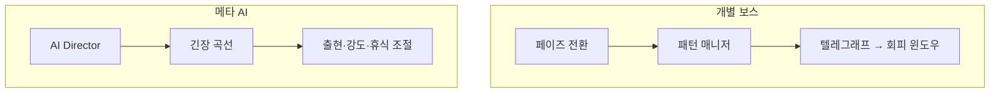
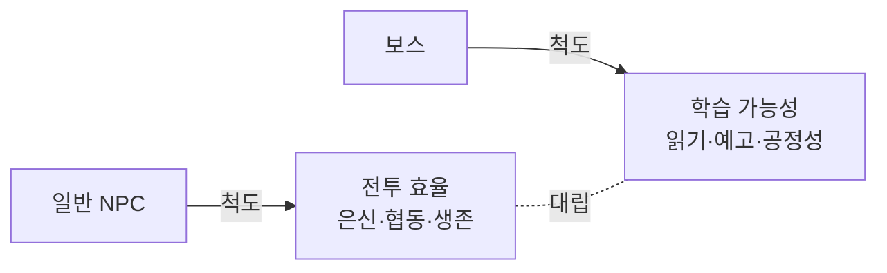
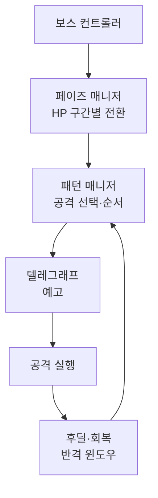
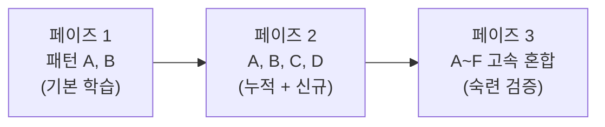
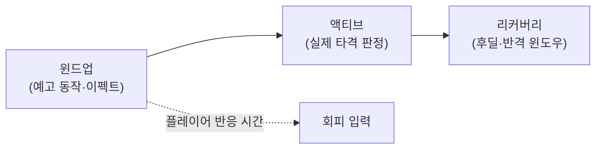
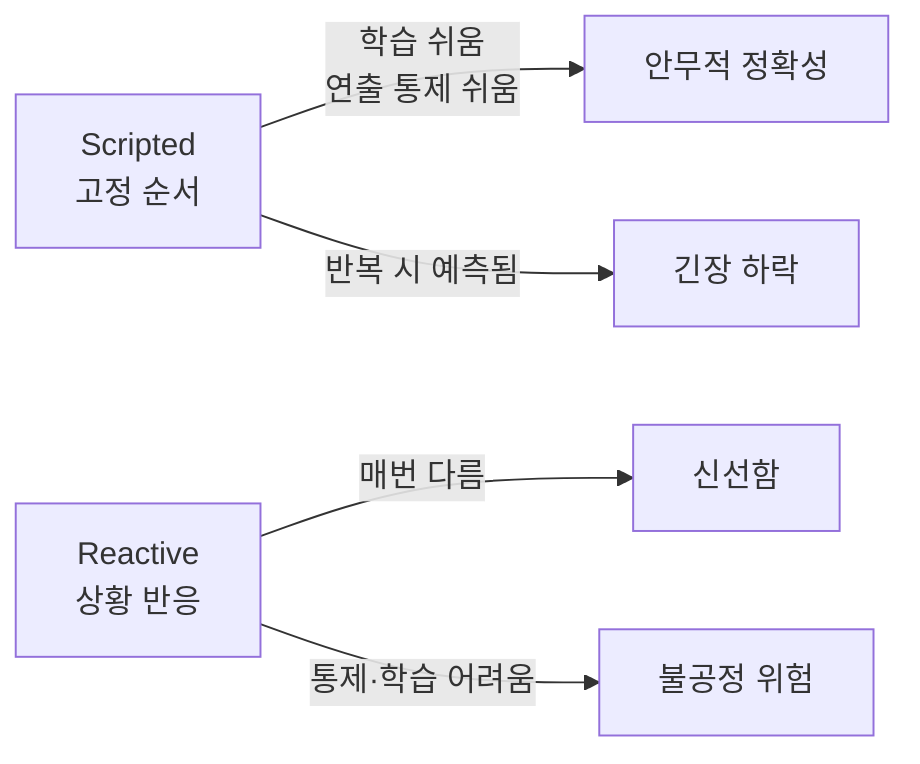
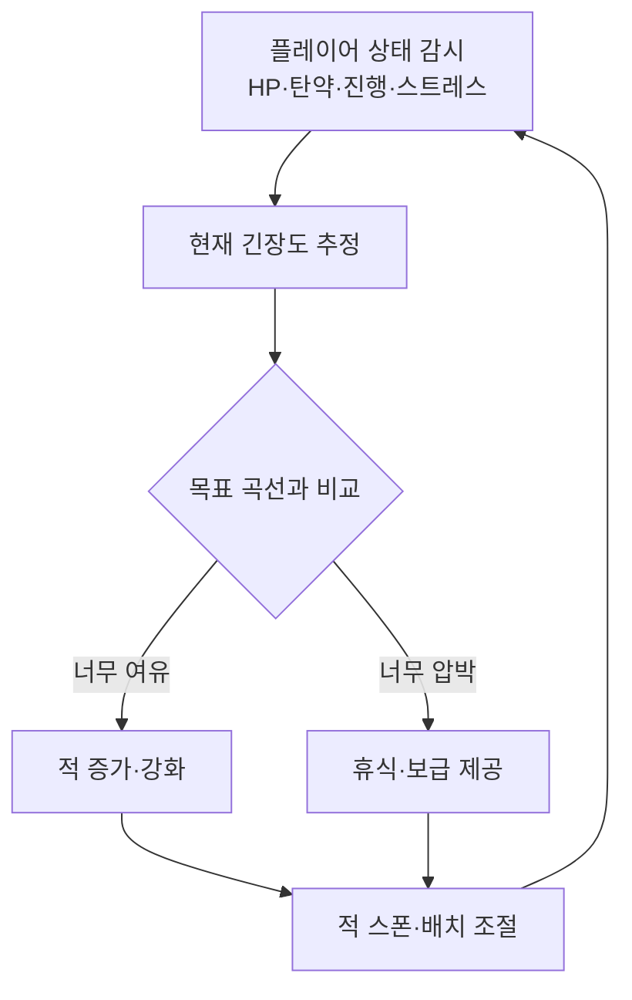
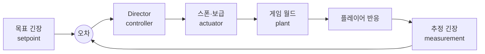
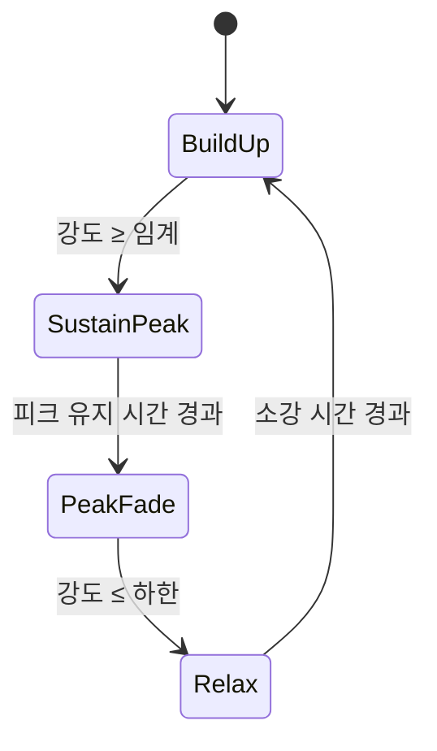
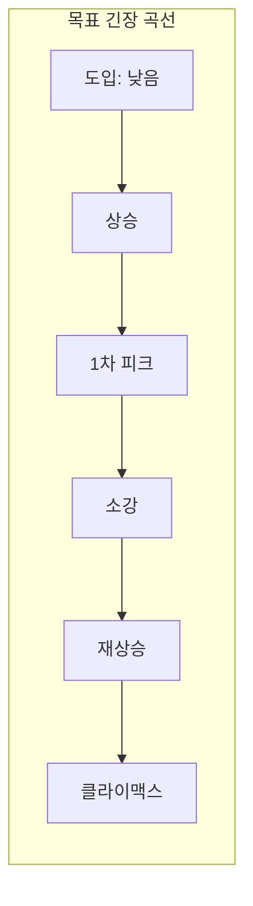

## 들어가며

보스 AI는 자율적 전투 효율만이 아니라 *연출된 학습 경험* 을 소유한다. 플레이어가 패턴을 관측하고 가설을 세우며 대응을 숙달할 수 있어야 한다. 승률만으로는 이 품질을 설명할 수 없고, cue 식별 시간·대응 가능성·실패 원인·숙련에 따른 성공률 변화가 함께 필요하다.

이 글은 두 개의 다른 층을 함께 다룬다. 하나는 *개별 보스* 의 구조다 — HP 구간별 페이즈 전환, 공격 패턴 매니저, 그리고 보스 AI의 핵심인 *텔레그래프(telegraph)*. 공격을 윈드업(windup)·액티브(active)·리커버리(recovery)의 세 국면으로 쪼개고, 신호를 구별할 수 있는 시점부터 입력·simulation·방어 발동을 거쳐 피해 판정에 이르는 종단간 시간을 설계해야 한다. 다른 하나는 그보다 한 층 위에서 게임 전체의 페이싱을 조율하는 *AI Director* 다. Left 4 Dead의 공개 사례처럼 이 메타 AI는 적의 출현, 강도와 휴식을 동적으로 조절해 긴장 곡선을 만들 수 있다.

두 층은 같은 철학을 공유한다 — *AI의 목적이 이기는 것이 아니라 좋은 경험을 만드는 것* 이라는 점이다. 보스는 일부러 텔레그래프로 약점을 노출하고, Director는 일부러 플레이어가 잘하면 압박하고 못하면 숨 돌릴 틈을 준다. 이 글은 보스 패턴 설계와 AI Director의 동적 페이싱을 차례로 보고, 텔레그래프의 정량 설계, 패턴 선택의 가중·쿨다운 알고리즘, 긴장도 추정의 신호 처리, 그리고 동적 난이도가 들키지 않게 하는 방법까지 "재미를 위한 AI"라는 관점을 정리한다.



이 글의 목표.

1. **보스 AI 구조** — 자율성보다 연출, 학습 가능성이라는 척도.
2. **페이즈 전환** — HP/기믹 구간별 행동 변화와 전환 연출의 기능.
3. **패턴 매니저** — 쿨다운·반복 금지·가중 선택의 제약 만족 문제.
4. **텔레그래프** — 윈드업·액티브·리커버리의 정량 설계와 반응 시간.
5. **reactive vs scripted** — 각본형·반응형 스펙트럼과 혼합 전략.
6. **AI Director** — 메타 페이싱의 발상과 피드백 루프.
7. **Left 4 Dead** — Director의 정석, 감정 강도와 페이싱 상태 기계.
8. **긴장 곡선과 난이도** — 동적 페이싱, 추정·조절·은폐.


---

## 목차
1. [보스 AI의 구조](#1-보스-ai의-구조)
2. [페이즈 전환](#2-페이즈-전환)
3. [패턴 매니저](#3-패턴-매니저)
4. [텔레그래프와 회피 윈도우](#4-텔레그래프와-회피-윈도우)
5. [Reactive vs Scripted 패턴](#5-reactive-vs-scripted-패턴)
6. [AI Director의 발상](#6-ai-director의-발상)
7. [Left 4 Dead의 Director](#7-left-4-dead의-director)
8. [긴장 곡선과 난이도 조절](#8-긴장-곡선과-난이도-조절)


---

## 1. 보스 AI의 구조

보스 AI는 일반 NPC AI와 *목적이 다르다*. 일반 적은 "그럴듯하게 행동"하면 되지만, 보스는 *기억에 남는 도전* 을 제공해야 한다. 이 차이가 구조를 바꾼다.

### 척도가 다르다 — 학습 가능성

일반 NPC AI의 척도는 "지능"이다 — 얼마나 잘 엄폐하고, 측면을 노리고, 시야를 활용하는가. 보스 AI의 척도는 *학습 가능성(learnability)* 이다 — 플레이어가 몇 번의 시도 안에 패턴을 읽고 대응법을 찾아낼 수 있는가.

이 둘은 종종 충돌한다. 최적으로 행동하는 적은 텔레그래프 없이 즉시 공격하고, 빈틈을 보이지 않으며, 플레이어의 회복을 모두 방해한다. 이런 적은 "똑똑"하지만 *배울 수 없어* 불공정하게 느껴진다. 보스 AI는 의도적으로 비최적이어야 한다 — 강한 공격 전에 자세를 잡고, 공격 후 경직되고, 같은 공격을 연속하지 않는다. 이 *의도적 비최적성* 이 학습 곡선을 만든다.



학습 가능성을 정량화하면 *읽기 가능 신호 대 잡음 비율* 이다. 공격 직전 신호(자세·이펙트·소리)가 명확할수록, 그리고 그 신호가 결과(어떤 공격이 오는가)와 일관되게 대응될수록 학습이 빠르다. 무작위로 섞인 신호나 가짜 신호(페인트)가 많으면 학습이 느려지고, 이는 의도된 난이도일 수도 불공정일 수도 있다 — 그 경계를 디자이너가 명시적으로 잡는다.

### 컨트롤러의 계층 구조

보스 AI의 핵심 요소는 자율 의사결정이 아니라 *연출된 시퀀스* 다. 보스 컨트롤러는 보통 세 층으로 분리된다.



- *페이즈*: HP나 시간, 기믹 달성에 따라 보스의 행동 집합이 바뀐다. "단계가 올라간다"는 진행감을 만든다.
- *패턴*: 각 페이즈의 공격 레퍼토리. 플레이어가 배워야 할 "수".
- *텔레그래프*: 공격 예고. 공정성의 핵심.
- *후딜(recovery)*: 공격 후 보스가 빈틈을 보이는 시간. 플레이어의 반격 윈도우.

이 세 층의 분리는 우연이 아니다. *페이즈 매니저는 큰 단위의 상태* 를 관리하고(어떤 패턴 풀을 쓸지), *패턴 매니저는 그 풀 안에서 매 결정을* 내리며(다음에 무엇을 쏠지), *텔레그래프/실행은 한 패턴의 시간선* 을 진행한다(윈드업→액티브→리커버리). 각 층은 아래 층에 위임하고, 아래 층이 끝나면 위 층으로 제어가 돌아온다. 이 구조 덕분에 한 패턴의 타이밍을 고쳐도 페이즈 로직은 건드릴 필요가 없고, 페이즈 임계값을 바꿔도 패턴 정의는 그대로다.

### 컨트롤러를 코드로

위 세 층을 한 컨트롤러로 묶으면 매 틱의 흐름이 다음과 같다.

```cpp
class BossController {
public:
    void Tick(float dt) {
        phaseMgr_.Update(hp_ / maxHp_);          // 1) 페이즈 전환 검사
        if (phaseMgr_.InTransition()) return;     // 전환 연출 중이면 무적·대기

        if (activePattern_) {
            activePattern_->Update(dt, *this);    // 2) 진행 중 패턴 갱신
            if (activePattern_->Done()) {
                patternMgr_.NotifyFinished(activePattern_->Id());
                activePattern_ = nullptr;
            }
        } else {
            int id = patternMgr_.SelectNext(context_);  // 3) 다음 패턴 결정
            activePattern_ = patterns_.Instantiate(id);
        }
        patternMgr_.TickCooldowns(dt);            // 4) 쿨다운 감소
    }
private:
    PhaseManager   phaseMgr_;
    PatternManager patternMgr_;
    PatternLibrary patterns_;                 // id → Pattern 인스턴스 생성
    Pattern*       activePattern_ = nullptr;
    BossContext    context_;
    float hp_, maxHp_;
};
```

주목할 점은 *패턴이 진행 중이면 새 결정을 내리지 않는다* 는 것이다. 한 번 시작한 공격은 윈드업·액티브·리커버리를 모두 마쳐야 끝난다. 이것이 보스를 "읽을 수 있게" 만드는 첫 번째 구조적 약속이다 — 보스는 공격을 *취소* 하지 않으므로, 플레이어는 윈드업을 보면 무엇이 올지 확신하고 대응할 수 있다. (취소 가능한 페인트 공격은 이 약속을 의도적으로 깨는 고급 기법이며, 후술한다.)

## 2. 페이즈 전환

보스 전투의 *진행감* 은 페이즈에서 나온다. HP가 줄어들수록 보스가 새 공격을 꺼내고, 더 위협적으로 변한다. 페이즈는 보통 HP 임계값으로 전환된다.

### HP 임계값과 역방향 검사

페이즈 전환의 흔한 버그는 *임계값을 여러 개 한꺼번에 건너뛰는* 경우다. 한 틱에 큰 피해를 받아 HP가 70%에서 20%로 떨어지면, 50%와 30% 임계값을 모두 지나친다. 어느 페이즈로 가야 하는가? 답은 "도달한 가장 낮은 페이즈"다 — 이를 위해 임계값을 *높은 인덱스(낮은 HP)부터 역방향으로* 검사한다.

```cpp
struct BossPhase {
    float            hpThreshold;     // 이 HP 비율 이하로 떨어지면 진입
    std::vector<int> patternIds;      // 이 페이즈의 공격 패턴들
    bool             onceOnly = true; // 한 번만 진입 (HP 회복 시 역행 방지)
};

void PhaseManager::Update(float hpRatio) {
    // 높은 인덱스(낮은 임계값)부터 검사 → 여러 임계 동시 통과 시 최저 페이즈로
    for (int i = (int)phases_.size() - 1; i > currentPhase_; --i) {
        if (hpRatio <= phases_[i].hpThreshold) {
            EnterPhase(i);
            return;
        }
    }
}

void PhaseManager::EnterPhase(int i) {
    currentPhase_ = i;
    inTransition_ = true;
    PlayTransitionCinematic(i);    // 무적·대사·환경 변화
    patternMgr_.SetPatterns(phases_[i].patternIds);
    patternMgr_.ResetCooldowns();  // 새 페이즈에서 모든 패턴 즉시 사용 가능
}
```

`i > currentPhase_` 조건이 *페이즈는 전진만 한다* 는 불변식을 강제한다. 보스가 HP를 회복하더라도(일부 보스는 회복 기믹이 있다) 페이즈가 역행하지 않는다 — 역행하면 플레이어가 이미 본 패턴으로 돌아가 진행감이 깨지기 때문이다. 1편(FSM·HFSM)에서 본 FSM 관점에서 보면 이는 *단방향(monotone) 상태 기계* 다.

### 전환 연출의 두 기능

페이즈 전환에는 보통 *전환 연출* 이 붙는다 — 보스가 포효하고, 무적이 되며, 환경이 바뀌고, 새 패턴을 예고한다. 이 연출은 두 기능을 한다.

| 기능 | 내용 | 없으면 생기는 문제 |
|---|---|---|
| 서사적 | "이제 더 강해진다"를 선언 | 페이즈 변화가 밋밋, 긴장 고조 실패 |
| 기능적 | 플레이어에게 페이즈 전환을 명확히 통지 | 새 패턴에 무방비로 피격, 불공정 |

기능적 측면이 특히 중요하다. 전환 순간 보스가 *무적이 되고 플레이어 입력을 잠시 무시* 하는 이유는 두 가지다. 첫째, 전환 직전 플레이어가 누적한 공격이 새 페이즈로 "넘쳐 들어가" 페이즈 2를 즉시 스킵하는 것을 막는다. 둘째, 플레이어에게 *리셋 신호* 를 줘 새 패턴 세트를 인지하고 거리를 재조정할 시간을 준다. 이 짧은 무적 구간은 공정성을 위한 의도적 비최적성의 한 예다.

### 계단식 학습 설계

페이즈 설계의 핵심은 *난이도의 계단식 상승* 이다. 1페이즈에서 기본 패턴을 가르치고, 2페이즈에서 새 패턴을 추가하며, 마지막 페이즈에서 모든 패턴을 빠르게 섞는다. 플레이어가 각 페이즈에서 배운 것이 다음 페이즈에 누적되도록 설계한다.



이 누적 설계의 핵심은 *기존 패턴을 버리지 않는다* 는 것이다. 페이즈 2에서 패턴 C, D를 추가하되 A, B를 유지하면, 1페이즈에서 배운 A·B 대응은 그대로 쓸모가 있고 새로 배울 것은 C·D뿐이다. 만약 페이즈마다 패턴을 완전히 교체하면 플레이어는 매 페이즈를 처음부터 다시 배워야 해 학습 곡선이 *리셋* 된다 — 이는 누적 학습의 만족감을 파괴한다.

일부 보스는 HP가 아니라 *기믹*(특정 부위 파괴, 환경 활용) 달성으로 페이즈를 넘기게 해, 전투에 퍼즐 요소를 더한다. 기믹 페이즈의 트리거는 HP 임계값과 달리 *플레이어의 능동적 행동* 이므로, 페이즈 매니저는 HP 외에 임의의 부울 조건도 트리거로 받을 수 있어야 한다.

```cpp
struct PhaseTrigger {
    enum Kind { HpBelow, PartDestroyed, EnvActivated, Composite } kind;
    float    hpRatio;          // HpBelow 용
    int      partId;           // PartDestroyed 용
    std::function<bool(const BossContext&)> custom;  // Composite 용
};
```

## 3. 패턴 매니저

각 페이즈 안에서 *어떤 공격을 언제 할지* 정하는 것이 패턴 매니저다. 단순히 무작위로 고르면 같은 패턴이 연속되거나 불공정한 조합이 나온다. 패턴 매니저는 본질적으로 *제약 만족 + 가중 선택* 문제를 푼다.

### 제약 만족으로서의 패턴 선택

선택은 두 단계다. 먼저 모든 후보에서 *제약을 위반하는 것을 거른다*(필터링). 그다음 남은 후보 중에서 *가중치에 따라 하나를 뽑는다*(가중 샘플링).

```cpp
class PatternManager {
public:
    int SelectNext(const BossContext& ctx) {
        std::vector<int> candidates;
        for (int id : availablePatterns_) {
            const Pattern& p = patterns_[id];
            if (cooldowns_[id] > 0.0f)             continue;  // 쿨다운 중
            if (id == lastPattern_ && !p.allowRepeat) continue;  // 직전 반복 금지
            if (recentWindow_.Count(id) >= p.maxInWindow) continue; // 최근 빈도 상한
            if (!p.IsValid(ctx))                   continue;  // 거리·상황 조건
            candidates.push_back(id);
        }
        if (candidates.empty()) {                            // 모두 막히면
            Commit(fallbackPattern_);                        // 공통 이력 경로를 건너뛰지 않는다
            return fallbackPattern_;                         // 안전한 기본기
        }

        int chosen = WeightedPick(candidates, ctx, fallbackPattern_); // 가중 샘플링
        Commit(chosen);
        return chosen;
    }
    int SelectHybrid(const BossContext& ctx);  // 각본+반응 혼합 (아래 5절 정의)
private:
    int WeightedPick(const std::vector<int>& cand, const BossContext& ctx,
                     int fallbackPattern);     // 가중 샘플링 (아래 정의)
    void Commit(int id) {
        lastPattern_ = id;
        cooldowns_[id] = patterns_[id].cooldown;
        recentWindow_.Push(id);
    }
    std::vector<Pattern> patterns_;        // id로 인덱싱
    std::vector<int>     availablePatterns_;
    std::vector<float>   cooldowns_;       // id로 인덱싱
    int                  lastPattern_ = -1;
    int                  fallbackPattern_;
    RingHistogram        recentWindow_;    // 최근 N개 패턴의 히스토그램
};
```

`candidates.empty` 분기가 중요하다. 모든 패턴이 쿨다운·반복 금지·조건으로 막혀 *선택지가 없는* 순간이 실전에서 생긴다 — 이때 fallback 없이 빈 선택을 반환하면 보스가 멍하니 서 있는 버그가 난다. fallback은 쿨다운도 조건도 없는 가벼운 기본 공격(약한 베기 등)으로, "항상 둘 곳이 있다"를 보장한다. fallback도 실제 공격이므로 다른 선택과 같은 `Commit` 경로를 지나 cooldown·lastPattern·recentWindow에 기록한다. 의도적으로 무제약 대기 패턴을 fallback으로 쓴다면 집계에서 제외한다는 정책을 명시해야 한다.

### 네 가지 제약의 역할

패턴 선택의 제약은 각각 다른 문제를 푼다.

| 제약 | 막는 것 | 없으면 |
|---|---|---|
| 쿨다운 | 강한 패턴의 잦은 사용 | 필살기 연발, 회복 불가 |
| 반복 금지 | 같은 패턴 즉시 반복 | 단조로움, 연속 회피 불가 |
| 빈도 상한 | 최근 N회 내 같은 패턴 과다 | 특정 패턴 편중 |
| 상황 조건 | 부적절한 거리·상태의 패턴 | 근접기를 원거리서 헛침 |

쿨다운과 반복 금지는 비슷해 보이지만 다르다. *반복 금지* 는 직전 패턴만 막는 단기 제약이고, *쿨다운* 은 절대 시간 기반의 장기 제약이다. 강한 패턴은 둘 다 적용한다 — 직후에도 못 쓰고(반복 금지), 시간이 지나도 한동안 못 쓴다(쿨다운). 빈도 상한은 둘 사이의 중기 제약으로, "최근 5개 공격 중 돌진은 최대 2번"처럼 슬라이딩 윈도우로 편중을 막는다.

### 가중 샘플링의 구현

가중 선택은 누적 가중치 위에서 균등 난수를 뽑는 표준 기법이다. 가중치는 정적일 수도, 상황(거리·HP)에 따라 동적일 수도 있다.

```cpp
int PatternManager::WeightedPick(const std::vector<int>& cand, const BossContext& ctx,
                                 int fallbackPattern) {
    float total = 0.0f;
    std::vector<float> cum;
    cum.reserve(cand.size());
    for (int id : cand) {
        float w = std::max(0.0f, patterns_[id].WeightFor(ctx));
        total += w;                              // 상황 의존 가중치
        cum.push_back(total);
    }
    if (total <= 0.0f) return fallbackPattern;
    float r = RandFloat() * total;                // [0, total)
    auto it = std::upper_bound(cum.begin(), cum.end(), r); // 0 가중치 건너뜀
    return cand[it - cum.begin()];
}
```

`WeightFor(ctx)`가 동적 가중을 가능하게 한다. 예컨대 플레이어가 멀면 거리 좁히기 패턴의 가중치를 올리고, 가까우면 근거리 패턴의 가중치를 올린다. 하드 조건은 후보를 제거하고, 동적 가중치는 남은 후보의 확률만 바꾼다. 즉 같은 입력에 항상 같은 패턴을 강제하는 명시적 분기와 달리, 반응 경향을 확률 분포로 표현한다.

### 워크스루 — 다섯 번의 선택

페이즈 2에 패턴 A(약베기, w=4, cd=0), B(돌진, w=2, cd=3s), C(광역, w=1, cd=6s, 반복금지)가 있고 모두 쿨다운 0에서 시작한다고 하자. 선택 시퀀스를 추적한다.

```text
t=0.0  후보 {A,B,C}  가중[4,2,1]  → C 당첨 (운)   cd: C=6
t=1.2  후보 {A,B}    C 쿨다운     가중[4,2]  → A
t=2.0  후보 {A,B}                 가중[4,2]  → B   cd: B=3
t=2.8  후보 {A}      B 쿨다운     → A
t=3.6  후보 {A}      C 아직 쿨다운(6) → A
...
t=6.0  후보 {A,C}    C 쿨다운 해제 가중[4,1]  → A
```

쿨다운이 강한 패턴(C: 6초)을 희소하게 만들어, 전투의 대부분이 약한 A로 채워지고 C는 가끔 등장하는 "위협적 순간"이 된다. 이 *밀도 분포* 가 학습을 돕는다 — 자주 보는 A는 빨리 익히고, 드물게 보는 C는 등장할 때마다 긴장한다. 패턴 매니저는 결국 *학습 빈도를 시간축에 분배* 하는 스케줄러다.

핵심은 *예측 가능성과 변주의 균형* 이다. 너무 예측 가능하면 지루하고, 너무 무작위면 배울 수 없다. 쿨다운과 반복 금지로 변주를 주되, 가중치로 "주력 패턴"을 자주 보여 학습을 돕는다.

## 4. 텔레그래프와 회피 윈도우

텔레그래프는 보스 AI에서 *가장 중요한 요소* 다. 보스가 공격하기 *전에* 그 공격을 예고하는 신호다. 텔레그래프가 없으면 플레이어는 반응할 수 없고, 게임은 외워서 푸는 암기 게임이 된다. 텔레그래프가 있으면 *읽고 반응하는* 전투가 된다.



### 세 국면의 시간 모델

공격은 세 국면으로 나뉜다. 각 국면은 *서로 다른 누구의 시간* 인지가 핵심이다.

- *윈드업(windup)*: 공격 예고. 보스가 무기를 치켜들고, 이펙트가 차오르고, 효과음이 난다. *플레이어가 반응할 시간* 이다.
- *액티브(active)*: 실제 타격 판정이 활성인 짧은 구간. *위험한 시간* — 이때 그 공간에 있으면 피해를 입는다.
- *리커버리(recovery)*: 공격 후 보스의 경직. *플레이어의 반격 시간*.

```cpp
struct AttackTiming {
    float windup;    // 예고 길이 (s)
    float active;    // 타격 판정 길이 (s)
    float recovery;  // 후딜 길이 (s)
};

void Pattern::Update(float dt, Boss& boss) {
    timer_ += dt;
    for (;;) {                                   // 큰 dt의 남은 시간도 다음 국면에 전달
        if (phase_ == Windup) {
            if (!phaseEntered_) {
                boss.PlayTelegraph(telegraphVfx_, telegraphSfx_);
                phaseEntered_ = true;
            }
            if (timer_ < t_.windup) return;
            timer_ -= t_.windup;
            phase_ = Active;
            phaseEntered_ = false;
            boss.EnableHitbox(hitbox_);
        } else if (phase_ == Active) {
            if (timer_ < t_.active) return;
            timer_ -= t_.active;
            phase_ = Recovery;
            boss.DisableHitbox();
            boss.SetVulnerable(true);
        } else if (phase_ == Recovery) {
            if (timer_ < t_.recovery) return;
            timer_ -= t_.recovery;
            boss.SetVulnerable(false);
            phase_ = Done;
            return;
        } else {
            return;
        }
    }
}
```

### 종단간 반응 예산

회피 가능성을 윈드업 한 값으로 판정하면 안 된다. 실제 가용 시간은 플레이어가 신호를 *구별할 수 있게 된 시점* 부터 피해 판정이 방어 동작을 이기는 시점까지다. 여기에 지각·선택 시간뿐 아니라 입력 장치 보고, 이벤트 수집, simulation tick 대기, 네트워크 지연, 애니메이션의 회피 효력 발동 시간이 들어간다.

$$
T_{\text{available}}
= t_{\text{hit deadline}}-t_{\text{cue identifiable}}
$$

성공에 필요한 시간은 다음 항의 합으로 모델링할 수 있다.

$$
T_{\text{required}}
=T_{\text{perceive+decide}}
+T_{\text{device+sample}}
+T_{\text{network}}
+T_{\text{simulation}}
+T_{\text{defense startup}}
$$

공격이 반응형이어야 한다면 목표 플레이어 코호트에서

$$
\Pr(T_{\text{required}}\le T_{\text{available}})
$$

가 의도한 성공률에 도달해야 한다. 단순 반응 실험에서 보고되는 평균값은 출발점일 뿐 하한 상수가 아니다. 예상 가능한 리듬, 사운드 선행 신호와 학습된 패턴은 반응을 빠르게 하고, 비슷한 실루엣·카메라 밖 신호·여러 선택지는 느리게 한다. 디스플레이와 입력 설정, 연령, 숙련도와 접근성 요구도 분포를 바꾼다.

측정은 cue onset, cue identifiable, 입력 발생, 서버 수신, 방어 상태 진입과 hit 판정을 같은 trace에 기록한다. 중앙값만 맞추지 않고 실패한 시도의 p75·p90 구간과 원인을 본다. 의도적으로 암기·예측을 요구하는 공격이라면 반응형 공격과 다른 규칙으로 표시하고, 첫 노출에서 피할 수 있는 것처럼 오해시키지 않아야 한다.

### 윈드업·액티브·리커버리의 트레이드오프

세 국면의 길이가 전투의 성격을 결정한다.

| 변수 | 짧으면 | 길면 |
|---|---|---|
| 윈드업 | 압박·고난도, 반응 어려움 | 여유·저난도, 읽기 쉬움 |
| 액티브 | 정확한 타이밍 회피만 통함 | 회피 지속 시간 길어야 함, 위험 |
| 리커버리 | 반격 기회 적음, 인내전 | 반격 기회 큼, 공방 교환 |

리커버리(후딜)는 플레이어에게 *공격 기회* 를 줘, 전투를 "회피만 하는 인내"가 아니라 "읽고 받아치는 교환"으로 만든다. 리커버리가 0이면 보스는 쉴 새 없이 공격해 플레이어가 딜할 틈이 없는 *벽* 이 된다. 반대로 리커버리가 과하면 보스가 멍청해 보인다. 소울류 게임의 보스 전투가 이 윈드업-액티브-리커버리 리듬의 정교한 설계로 유명하다.

### 신호의 명료성과 페인트

텔레그래프는 *시각적으로 명확* 해야 한다 — 색, 이펙트, 자세로 "어떤 공격인지"까지 구분되면, 플레이어가 패턴별로 다른 회피를 배운다. 격투 게임에서 잡기는 한 색, 중단 공격은 다른 색으로 표시하는 식의 *컬러 코딩* 이 대표적이다.

고급 기법으로 *페인트(feint)* 가 있다 — 윈드업을 시작했다가 액티브로 넘어가지 않고 취소한다. 이는 1절의 "보스는 공격을 취소하지 않는다"는 약속을 의도적으로 깨, 플레이어의 *조건반사적 회피* 를 역으로 이용한다.

```cpp
void Pattern::Update(float dt, Boss& boss) {
    timer_ += dt;
    if (phase_ == Windup && isFeint_ && timer_ >= feintPoint_) {
        boss.PlayFeintCancel();    // 윈드업 취소 모션
        phase_ = Recovery;          // 액티브 건너뜀 — 헛회피 유도
        timer_ = 0.0f;
        return;
    }
    // ... 일반 윈드업/액티브/리커버리 ...
}
```

페인트는 강력하지만 *남용하면 불공정* 하다. 페인트가 진짜 공격과 윈드업 초반이 동일하면, 플레이어는 "회피하면 페인트에 당하고, 안 하면 진짜에 당하는" 풀 수 없는 상황에 빠진다. 공정한 페인트는 *진짜와 구분되는 후기 신호* 를 두거나(페인트는 중간에 멈칫), 페인트의 빈도를 낮게 유지한다. 페인트는 학습 가능성과 예측 불가능성 사이의 줄타기다.

## 5. Reactive vs Scripted 패턴

보스 패턴은 *각본형(scripted)* 과 *반응형(reactive)* 의 스펙트럼에 놓인다. 양 극단은 서로 다른 것을 희생한다.



### 두 극단의 비용

- *Scripted*: 정해진 순서로 패턴을 실행한다. "1페이즈는 항상 A→B→C". 플레이어가 *외울 수 있어* 안무처럼 느껴진다. 연출 통제가 쉽고 디자이너가 난이도 곡선을 정밀하게 조각할 수 있지만, 반복하면 예측 가능해 긴장이 떨어진다.
- *Reactive*: 플레이어 행동에 반응해 패턴을 고른다. "플레이어가 멀면 돌진, 가까우면 광역, 회복 중이면 방해". 매번 다르게 전개되어 신선하지만, *학습 가능성* 을 해치기 쉽다 — 같은 상황이 같은 반응을 부르지 않으면 플레이어는 규칙을 찾지 못한다.

반응형 보스가 학습 가능하려면 플레이어가 관측 가능한 조건과 결과 사이에 안정된 통계적 규칙이 있어야 한다. 반드시 결정론적일 필요는 없다. “회복 중이면 높은 확률로 방해하되, 명확한 전조와 쿨다운이 있다”처럼 확률 분포·텔레그래프·예외 조건이 일관되면 플레이어는 위험을 학습할 수 있다. 반대로 같은 가시 상태에서 숨은 난수만으로 전혀 다른 즉사 패턴이 나오면 원인을 추론하기 어렵다. 신선함은 난수 유무보다 **관측 가능한 규칙과 대응 가능성**으로 통제한다.

### 혼합 — 각본 골격에 반응형 끼어들기

두 방식을 혼합하면 각본형 골격으로 학습 가능한 순서를 유지하면서, 제한된 *반응형 끼어들기(interrupt)* 로 상황 대응성을 더할 수 있다. 혼합이 항상 우월한 것은 아니며, 퍼즐형 보스처럼 정확한 순서 학습이 핵심이면 각본 비중을 높이고 대전형 조우처럼 상호작용이 핵심이면 반응 규칙의 비중을 높인다.

```cpp
int PatternManager::SelectHybrid(const BossContext& ctx) {
    // 1) 우선순위 반응 — 결정론적 끼어들기 (즉시 처리)
    if (ctx.playerHealing && !OnCooldown(kInterrupt)) {
        Commit(kInterrupt); return kInterrupt;   // 회복하면 항상 방해
    }
    if (ctx.playerFarAway && !OnCooldown(kGapCloser)) {
        Commit(kGapCloser); return kGapCloser;   // 멀면 항상 거리 좁히기
    }
    if (ctx.playerStaggered) {
        Commit(kPunish); return kPunish;         // 경직 상태면 항상 응징
    }

    // 2) 평상시 — 각본 시퀀스 진행
    int next = scriptedSequence_.Next();
    Commit(next);
    return next;
}
```

이 예제는 반응 조건을 우선순위 게이트로 처리하는 결정론적 변형이다. 특정 상황에서는 각본을 중단하고 정해진 반응을 내며, 그 외에는 각본을 따른다. 실제 설계에서는 거리·시야·현재 animation cancel 가능 여부와 최근 반복 횟수도 commit 조건에 넣고, 반응을 확률적으로 만들면 seed와 확률, 텔레그래프를 관측 가능한 계약으로 관리한다.

반응 조건에도 쿨다운을 두면 반복 방해 빈도에 상한을 줄 수 있다. 그러나 쿨다운 하나만으로 다음 회복의 성공을 보장하지는 않는다. 다른 패턴의 범위 공격, 회복 시간, 공간 압박이 여전히 실패를 만들 수 있다. 회복 가능 창을 계약하려면 방해 패턴의 cooldown뿐 아니라 최소 안전 구간, 이동·회복 duration과 다른 패턴의 중첩을 상태 공간에서 검증한다.

### 게임 장르별 스펙트럼 위치

스펙트럼의 선택은 게임의 의도에 달렸다.

| 장르/의도 | 스펙트럼 위치 | 이유 |
|---|---|---|
| 패턴 암기형 슈팅(탄막) | scripted 극단 | 정밀 안무, 결정론적 회피 경로 |
| 소울류 액션 | 중앙 (각본+반응) | 읽기 가능 + 플레이어 응징 |
| 격투 게임 AI | reactive 강함 | 즉흥 대결, 적응 |
| 리듬형 보스 | scripted 극단 | 음악 동기화 필수 |

안무적 정확성이 중요한 게임은 scripted 쪽으로, 즉흥적 대결이 중요한 게임은 reactive 쪽으로 기운다. 핵심은 *어느 쪽이든 플레이어가 패턴을 읽고 배울 수 있어야* 한다는 것이다.

## 6. AI Director의 발상

보스가 *한 전투* 의 경험을 설계한다면, AI Director는 *게임 전체* 의 페이싱을 설계한다. 한 층 위의 메타 AI다. Director는 개별 적이 아니라 *적의 출현·강도·타이밍* 을 조율해, 전체 플레이 경험의 *긴장 곡선* 을 만든다.



### 폐루프 제어로서의 Director

Director의 핵심 발상은 *고정 난이도 대신 동적 페이싱* 이다. 전통적 게임은 적 배치가 고정이라, 잘하는 플레이어에겐 쉽고 못하는 플레이어에겐 어렵다. Director는 *플레이어 상태를 실시간으로 감시* 해 현재 "스트레스 수준"을 추정하고, 그것을 *목표 긴장 곡선* 에 맞춰 적 출현을 조절한다.

이 구조는 제어 이론의 *폐루프 피드백 제어(closed-loop feedback control)* 로 유용하게 추상화할 수 있다. 목표값과 대리 측정값의 오차를 이용해 스폰·보급을 조절한다는 신호 구조는 같지만, 사람을 포함한 plant는 비선형·시변이고 긴장 자체도 직접 관측되지 않는다. 아래 선형 모델의 게인 한계는 특정 근사 모델의 결과이지 모든 Director의 보편 상수가 아니다.



이 유비가 유용한 이유는, 제어 이론이 지적하는 *불안정성* 이 Director에도 그대로 나타나기 때문이다. 게인(반응 강도)이 너무 크면 *진동(oscillation)* 한다 — 잘하면 갑자기 대군을 쏟고, 죽을 뻔하면 갑자기 텅 비우는 식의 널뛰기가 플레이어에게 들킨다(고무줄 난이도). 게인이 너무 작으면 *느려서* 긴장 곡선을 못 따라간다. Director 튜닝은 본질적으로 이 게인 조절이다.

### 긴장은 직접 측정할 수 없다 — 대리 신호

Director의 근본 난제는 *긴장(tension)은 플레이어 머릿속의 감정* 이라 직접 측정할 수 없다는 점이다. Director는 측정 가능한 *대리 신호(proxy signal)* 로 긴장을 추정한다.

- *HP*: 낮을수록 긴장 높음. 가장 강한 신호.
- *최근 받은 피해율*: 짧은 시간에 많이 맞으면 긴장 급상승.
- *적 근접도*: 둘러싸이거나 추격당하면 긴장 상승.
- *탄약·자원*: 부족하면 긴장(취약감) 상승.
- *마지막 위협 이후 경과 시간*: 길수록 긴장 하강(이완).

이 대리 신호들의 가중 합이 추정 긴장이다. 어떤 신호를 얼마나 반영할지가 게임의 *감정 모델* 을 정의한다. 생존 호러는 탄약·고립을, 액션 슈터는 피해율·근접도를 더 무겁게 둔다.

Director는 단순히 적을 약하게/강하게 하는 시스템이 아니라 *경험의 리듬* 을 설계하는 시스템이다. 긴장-이완-긴장의 *파동* 을 만드는 것이 목표다. 끊임없는 고강도는 지치게 하고, 끊임없는 저강도는 지루하므로, Director는 의도적으로 *완급* 을 준다.

## 7. Left 4 Dead의 Director

Valve의 Left 4 Dead는 AI Director를 *게임의 중심 시스템* 으로 만든 결정적 사례다. 협동 좀비 슈터에서, Director가 매 플레이를 다르게 만든다.


### 감정 강도 추적

Left 4 Dead Director는 각 생존자의 *감정 강도(emotional intensity)* 를 추정한다. 피해를 받거나, 특수 좀비에 잡히거나, 둘러싸이면 강도가 오른다. 핵심 설계는 이 강도가 *천천히 감쇠* 한다는 것이다 — 위협이 사라져도 즉시 0이 되지 않고 서서히 식는다. 이는 실제 사람의 긴장이 위협 직후에도 한동안 남는다는 점을 모델링한 것이다.

```cpp
void IntensityTracker::Update(float dt, const SurvivorEvents& ev) {
    // 위협 이벤트로 강도 상승
    if (ev.tookDamage)   intensity_ += ev.damage * kDamageScale;
    if (ev.grabbed)      intensity_ += kGrabSpike;       // 특수 좀비에 잡힘
    if (ev.surrounded)   intensity_ += kSurroundRate * dt;

    // 위협이 없으면 시간에 따라 감쇠 (지수 감쇠)
    if (!ev.underThreat)
        intensity_ *= std::exp(-kDecayRate * dt);

    intensity_ = Clamp(intensity_, 0.0f, kMaxIntensity);
}
```

파티 강도를 한 값으로 줄이는 집계 방식도 설계 변수다. 최대값은 한 명의 위기를 즉시 반영하지만 이상치 하나가 전체 페이싱을 지배한다. 평균은 집단의 전반적 상태를 반영하지만 고립된 플레이어의 위기를 숨길 수 있다. 상위 분위수, 가중 평균, `max`와 평균의 혼합도 가능하며, 구조·회복 규칙과 목표 페이싱에 맞춰 선택한다.

### 페이싱 상태 기계

Director는 *Build Up(점증) → Sustain Peak(절정 유지) → Peak Fade(절정 종료) → Relax(소강)* 의 사이클을 돈다. 이는 1편(FSM·HFSM)에서 본 FSM이며, 각 상태의 전이 조건이 명확하다.



- *Build Up*: 적을 점진적으로 늘려 강도를 끌어올린다. 강도가 임계에 도달하면 Peak로.
- *Sustain Peak*: 대규모 습격·특수 좀비로 절정을 *짧게* 유지한다. 무한히 유지하면 지친다.
- *Peak Fade*: 절정을 의도적으로 끝낸다 — 새 적 스폰을 멈춘다.
- *Relax*: 좀비를 줄이고 보급(탄약·치료제)을 풀어 *숨 돌릴 틈* 을 준다. 일정 시간 후 다시 Build Up으로.

이 상태 기계가 *긴장-이완의 파동* 을 강제한다. 강도가 임계에 도달하면 *반드시* Peak를 지나 Relax로 가므로, 끝없는 고강도가 구조적으로 불가능하다. Relax의 최소 지속 시간이 "쉴 틈"을 보장한다.

### 동적 스폰과 자원 배치

Director는 적의 *수·위치·특수 좀비 출현* 을 실시간으로 조절한다. 스폰 위치 선택이 특히 정교하다 — 생존자의 *시야 밖*, 진행 경로상의 적절한 거리에 스폰해 "어디서 왔는지 모르게" 압박한다. 생존자가 뭉쳐 있으면 측면에서, 흩어지면 각개 압박한다.

```cpp
std::optional<SpawnPoint> Director::PickSpawn(const Party& party) {
    std::optional<SpawnPoint> best;
    float bestScore = -std::numeric_limits<float>::infinity();
    for (const SpawnPoint& sp : candidates_) {
        if (party.AnyHasLineOfSight(sp.pos)) continue;   // 시야 안이면 제외
        float dist = party.MinDistanceTo(sp.pos);
        if (dist < kMinSpawnDist || dist > kMaxSpawnDist) continue; // 너무 가깝/멀면 제외
        float score = ScoreFlanking(sp, party);          // 측면·진행방향 가산
        if (score > bestScore) { bestScore = score; best = sp; }
    }
    return best;
}
```

탄약·치료제도 Director가 상황에 따라 배치한다. 위급하면 보급을, 여유로우면 절제한다. 자원이 *Relax 국면의 도구* 라는 점이 중요하다 — 보급은 단순히 아이템을 주는 게 아니라 긴장을 낮추는 페이싱 액추에이터다.

### 반복 플레이성이라는 결과

Left 4 Dead의 Director는 같은 맵에서도 적 배치와 페이싱을 변화시켜 고정 스폰 암기의 효과를 줄인다. 공개된 설계의 핵심은 단순히 플레이어 실력에 반비례해 난이도를 고무줄처럼 바꾸는 것이 아니라, 생존자 intensity와 페이싱 상태에 따라 Build Up·Peak·Relax의 리듬을 만드는 데 있다. 실제 경험이 언제나 "아슬아슬하게 해낼 만한" 수준으로 유지된다고 보장하는 시스템은 아니다.

## 8. 긴장 곡선과 난이도 조절

AI Director의 핵심은 *목표 긴장 곡선* 의 설계와 추적이다. 좋은 경험은 평탄한 강도가 아니라 *파동* 이다 — 영화의 3막 구조처럼, 긴장과 이완이 교차하며 점증한다.



### 추정·비교·조절의 루프

Director는 매 순간 *현재 추정 긴장* 과 *목표 곡선의 그 시점 값* 을 비교해 행동한다. 6절의 폐루프 제어를 코드로 옮기면 다음과 같다.

```cpp
void Director::Update(float dt) {
    float current = EstimateIntensity();        // 플레이어 스트레스 추정
    float target  = curve_.ValueAt(progress_);  // 목표 곡선의 현재 값
    float error   = target - current;

    if (error > kTolerance) {
        IncreasePressure(error);   // 오차 비례 압박 (적 추가·강화)
    } else if (error < -kTolerance) {
        EaseOff(-error);           // 오차 비례 완화 (소강·보급)
    }
    // |error| ≤ kTolerance 이면 데드존 — 아무것도 안 함 (진동 방지)
    progress_ += dt;
}

float Director::EstimateIntensity() {
    float intensity = 0.0f;
    intensity += (1.0f - avgPlayerHP_) * wHP;          // HP 낮음 → 긴장 ↑
    intensity += recentDamageRate_     * wDamage;       // 최근 피해 → 긴장 ↑
    intensity += enemyProximity_       * wProximity;    // 적 근접 → 긴장 ↑
    intensity -= timeSinceLastThreat_  * wRelief;       // 위협 없는 시간 → 긴장 ↓
    return Clamp(intensity, 0.0f, 1.0f);
}
```

`kTolerance`로 정의되는 *데드존(deadzone)* 이 중요하다. 오차가 작을 때 아무것도 하지 않으면, 추정 긴장이 목표 근처에서 미세하게 흔들려도 Director가 과민 반응하지 않는다. 데드존이 없으면 매 틱 압박/완화를 번갈아 발동해 6절에서 경고한 진동에 빠진다.

### 신호의 평활화

긴장 추정의 입력은 *노이즈가 많다*. 한 번 크게 맞으면 `recentDamageRate_`가 순간적으로 치솟는다. 이 생값을 그대로 쓰면 Director가 단발성 사건에 과민 반응한다. 그래서 추정 긴장은 보통 *지수 이동 평균(EMA)* 으로 평활화한다.

```cpp
// 생 추정값을 그대로 쓰지 않고 평활화 — 단발 노이즈 억제
void Director::Update(float dt) {
    float raw = EstimateIntensity();
    float alpha = 1.0f - std::exp(-dt / kSmoothTime);   // 평활 상수
    smoothed_ = smoothed_ + alpha * (raw - smoothed_);   // EMA
    // 이후 비교·조절에는 raw 대신 smoothed_ 를 쓴다
}
```

평활 시간 `kSmoothTime`은 또 하나의 게인 노브다. 짧으면 Director가 민첩하지만 노이즈에 흔들리고, 길면 안정적이지만 둔하다. 이 값과 데드존, 압박 게인이 Director 튜닝의 세 손잡이다.

### Director는 왜 진동하는가 — 폐루프의 1차 모델과 게인 한계

6절은 Director를 폐루프 제어에 비유하고 "게인이 크면 진동(고무줄 난이도)"이라고만 했다. 이 절은 그 진술을 차분방정식으로 형식화해, *진동이 시작되는 게인의 정확한 문턱* 을 닫힌 형태로 유도한다. Director는 동적 난이도·페이싱 이론의 소유 문서이므로 이 제어 모델은 여기서 한 번 깊게 적는다.

가장 단순한 비례 제어를 1차 플랜트 위에 세운다. 틱 $k$의 추정 긴장을 $x_k$, 목표를 $r$, 오차를 $e_k=r-x_k$라 하자. 액추에이터는 $u_k=K e_k$를 내고, 플랜트는 압박을 게인 $g$로 긴장에 주입하며 긴장은 자연 이완율 $d$로 줄어든다고 근사한다. 아래 구간 분류는 $g>0$, $K>0$, $0<d<1$인 무지연·무포화 모델에 한정한다.

$$x_{k+1} = x_k + gK(r-x_k) - d\,x_k = a\,x_k + gKr,\qquad a = 1-gK-d.$$

루프 게인 $\kappa \equiv gK$로 묶으면 $a=1-\kappa-d$인 1차 선형 점화식 $x_{k+1}=a x_k + \kappa r$이다. 제어 이론의 결과가 이 한 줄에서 모두 따라 나온다.

*고정점과 비례 드룹(droop)*. 평형 $x^\star=a x^\star+\kappa r$를 풀면

$$x^\star = \frac{\kappa}{\kappa+d}\,r,\qquad r-x^\star = \frac{d}{\kappa+d}\,r.$$

이 누설 플랜트의 순수 비례 제어는 $\frac{d}{\kappa+d}r$만큼 정상 상태 오프셋을 남긴다. $d{=}0.1$에서 $\kappa{=}0.3$이면 목표의 25% 아래, $\kappa{=}0.8$이면 약 11% 아래다. 적분항은 일정한 모델 오차와 누설에 의한 오프셋을 제거할 수 있지만, actuator 포화에서는 windup이 생기므로 anti-windup과 별도의 안정성 검토가 필요하다.

*안정성과 세 영역*. 1차 이산 시스템은 극 $a$가 단위원 안($|a|<1$)일 때만 수렴한다.

- $a<1 \Leftrightarrow \kappa+d>0$ — 양의 게인에서 항상 성립.
- $a>-1 \Leftrightarrow \kappa < 2-d$ — 이것이 깨지면 발산.

부호까지 보면 세 영역으로 갈린다.

| 영역 | 조건($\kappa{=}gK$) | 극 $a$ | 거동 |
|---|---|---|---|
| 단조 수렴 | $0<\kappa<1-d$ | $0<a<1$ | 선형 모델에서 오차 부호를 바꾸지 않음 |
| 감쇠 진동 | $1-d<\kappa<2-d$ | $-1<a<0$ | 오차 부호를 번갈아 바꾸며 감소 |
| 불안정 | $\kappa>2-d$ | $a<-1$ | 선형 모델의 진폭 발산 |

즉 "게인이 크면 진동한다"의 정확한 의미는 *진동 문턱이 $\kappa=1-d$, 불안정 문턱이 $\kappa=2-d$* 라는 것이다. $d{=}0.1$ 수치로 확인하면 $\kappa{=}0.5\,(a{=}0.40)$는 단조, $\kappa{=}0.95\,(a{=}-0.05)$는 약한 감쇠 진동, $\kappa{=}1.5\,(a{=}-0.6)$는 강한 감쇠 진동, $\kappa{=}1.9\,(a{=}-1)$은 지속 진동, $\kappa{=}1.95\,(a{=}-1.05)$는 발산이다. 6절이 경고한 "잘하면 대군, 죽을 뻔하면 텅 빔"의 널뛰기는 곧 $\kappa>1-d$로 감쇠 진동 영역에 들어간 상태다.

*데드존은 다른 채터를 줄인다*. 코드의 `IncreasePressure`/`EaseOff`가 고정 단계 명령이라면 제어기는 비례 제어가 아니라 데드밴드가 있는 릴레이에 가깝다. 지연·양자화·고정 actuator step이 있으면 setpoint 주변에서 명령이 번갈아 바뀌는 limit cycle이 생길 수 있다. 데드존은 작은 오차에서 명령을 내지 않아 전환 빈도를 줄이는 대신 허용 정상 오차를 늘린다. 한계 주기의 진폭은 tolerance 하나가 아니라 plant 지연, actuator step, 포화, 히스테리시스에 좌우되므로 보편적인 닫힌 상한으로 단정할 수 없다. 데드존은 큰 비례 게인 때문에 생긴 불안정을 고치는 장치도 아니다.

*EMA는 1차 저역통과 필터*. 평활식 $s_k=(1-\alpha)s_{k-1}+\alpha x_k$는 극이 $z=1-\alpha$인 1차 IIR 저역통과로, 시간 상수 $\tau=-\Delta t/\ln(1-\alpha)\approx \Delta t/\alpha$를 가진다. 두 효과가 정량화된다.

- *노이즈 억제*: 입력이 분산 $\sigma^2$인 백색 잡음이면 출력 분산은 $\frac{\alpha}{2-\alpha}\sigma^2$, 표준편차는 $\sqrt{\alpha/(2-\alpha)}$배로 준다. $\alpha{=}0.1$이면 0.23배(약 4.4배 감쇠) — "단발 노이즈 억제"의 정량 근거.
- *대가는 지연*: 저주파에서의 군지연은 $\frac{1-\alpha}{\alpha}$ 샘플이다. $\alpha=0.1$이면 약 9샘플이다. 연속 시간 상수 $\tau_c=-\Delta t/\ln(1-\alpha)$와는 단위와 값이 다르므로 둘을 그대로 같다고 쓰면 안 된다. 측정 필터를 폐루프에 넣으면 시스템 차수가 늘고 위상 지연이 생긴다. 위의 무지연 1차 극 $a=1-\kappa-d$만으로 새 안정 한계를 계산할 수 없으며, 필터 상태를 포함한 모델이나 step-response 측정이 필요하다.

```python
# 1차 폐루프: x_{k+1} = (1-kappa-d) x_k + kappa*r,  a=1-kappa-d
def step(kappa, d, r=1.0, x0=0.0, n=200):
    a = 1 - kappa - d; x = x0
    for _ in range(n):
        x = a * x + kappa * r
    return x, a
# 드룹: d=0.1, kappa=0.3 -> x*=0.75 (목표의 25% 미달)
assert abs(step(0.3, 0.1)[0] - 0.3/(0.3+0.1)) < 1e-9
# 진동 문턱 kappa=1-d, 불안정 문턱 kappa=2-d (d=0.1 -> 0.9, 1.9)
assert step(0.5, 0.1)[1] > 0      # 단조
assert -1 < step(1.5, 0.1)[1] < 0 # 감쇠 진동
assert step(1.95, 0.1)[1] < -1    # 발산
# EMA 분산비 alpha/(2-alpha): alpha=0.1 -> 0.0526, std 0.229배
assert abs(0.1/(2-0.1) - 0.05263) < 1e-4
```

*실패 경계*. 포화가 있으면 선형 모델의 발산이 무한대로 이어지지는 않지만, 경계 고착·limit cycle·불규칙한 스위칭 중 무엇이 나타날지는 비선형 actuator와 지연에 달렸다. 또 같은 압박에 약한 플레이어의 tension 반응이 더 크다면 그 플레이어의 plant gain $g$가 더 크다. 따라서 작은 $g$의 숙련자에게 맞춘 고정 $K$가 큰 $g$의 취약 플레이어에서 $\kappa=gK$를 진동·불안정 영역으로 넘길 수 있다. gain scheduling을 쓰려면 플레이어별 $g$ 추정 오차와 급격한 스케줄 전환도 검증해야 한다.

### 동적 난이도의 윤리 — 들키지 않기

난이도 조절의 윤리적 경계도 중요하다. 동적 조절이 *너무 노골적* 이면 — 플레이어가 잘할 때마다 갑자기 어려워지면 — 플레이어는 "고무줄 난이도(rubber-banding)"를 눈치채고 성취감을 잃는다.

좋은 Director는 *보이지 않게* 조절한다. 무엇을 조절하느냐가 가시성을 좌우한다.

| 조절 대상 | 가시성 | 효과 |
|---|---|---|
| 적의 직접 강화(HP·공격력 ↑) | 높음 (들킴) | 성취감 훼손 |
| 적의 수 | 중간 | 체감되기 쉬움 |
| 스폰 타이밍·위치 | 낮음 | 자연스러운 압박 |
| 자원 배치(탄약·치료) | 낮음 | 은밀한 완화 |
| 환경적 압박(소리·진행 유도) | 낮음 | 분위기로 작동 |

적의 *수*보다 *타이밍과 배치* 를, 직접적 강화보다 *환경적 압박* 을 조절해, 플레이어가 자기 실력으로 해냈다고 느끼게 한다. 핵심은 Director가 플레이어를 *이기려는* 게 아니라 *최적의 긴장에 머물게* 하려 한다는 점이다.

이 "최적의 긴장"은 심리학의 *몰입(flow)* 개념과 닿는다. 도전이 능력보다 너무 높으면 불안, 너무 낮으면 지루함이고, 둘이 균형을 이루는 좁은 띠가 몰입이다. Director의 목표 곡선은 이 몰입의 띠를 시간축에 그린 것이며, 동적 조절은 능력이 다른 플레이어 각각을 그 띠 안에 머물게 하는 장치다. 그 의도가 드러나지 않을수록 좋은 Director다.


---

## 결론

보스 AI와 AI Director는 자율적 최적화보다 *연출된 경험의 제약* 을 우선하는 시스템이다. 보스는 페이즈 매니저로 학습의 진행감을, 제약 만족과 가중 샘플링으로 학습 가능한 변주를, 윈드업-액티브-리커버리로 의도한 회피 윈도우를 만든다. 텔레그래프는 고정된 인간 반응 시간 하나가 아니라 cue 식별부터 입력·simulation·방어 발동까지의 종단간 분포로 튜닝해야 한다. 페인트도 학습 가능성과 예측 불가능성의 경계를 건드리되 판정 계약을 바꾸어서는 안 된다.

AI Director는 한 층 위에서 게임 전체의 페이싱을 조율한다. 긴장은 직접 측정할 수 없으므로 HP·피해율·근접도 같은 대리 신호의 가중 합으로 추정하고, 이를 목표 긴장 곡선과 비교하는 폐루프 피드백으로 적의 출현·강도·휴식을 조절한다. 이 제어 루프는 게인이 과하면 진동(고무줄 난이도)하고 부족하면 둔해진다. 데드존은 작은 오차의 채터를, 지수 평활은 측정 노이즈를 줄이지만 큰 게인의 불안정을 자동으로 고치지 않으며 평활 지연은 안정 한계를 바꾼다. 따라서 게인·필터·지연·포화를 함께 넣은 step response와 플레이테스트로 폐루프를 검증해야 한다. Left 4 Dead가 보여주듯, 감정 강도 추적과 Build Up→Peak→Relax 페이싱 상태 기계는 매 플레이를 다르게 만들어 반복 플레이성을 준다. 좋은 Director는 적의 직접 능력치보다 타이밍·배치·자원을 자연스럽게 조절해, 플레이어가 자기 실력으로 해냈다고 느끼게 한다.

두 층이 공유하는 철학은 명확하다. *AI의 목적은 플레이어를 이기는 것이 아니라 좋은 경험을 만드는 것* 이다. 보스가 일부러 빈틈을 보이고 Director가 일부러 숨통을 틔우는 것은, AI 기술의 정점이 "최강의 적"이 아니라 "최고의 상대"라는 사실을 드러낸다. 이 목적은 결국 몰입의 좁은 띠 안에 플레이어를 머물게 하는 일로 수렴하며, 의사결정·인지·협동을 다룬 모든 기법이 그 봉사에 동원된다.

## 더 읽을거리

- Michael Booth, "The AI Systems of Left 4 Dead" (AIIDE 2009 기조연설) — AI Director의 감정 강도·페이싱 상태 기계 설계.
- Karl J. Åström & Richard M. Murray, *Feedback Systems: An Introduction for Scientists and Engineers* (Princeton University Press, 2008) — 폐루프 안정성, 비례 제어 드룹, 게인과 진동·한계 주기. Director 게인 한계 유도의 근거.
- Gene F. Franklin, J. David Powell & Abbas Emami-Naeini, *Feedback Control of Dynamic Systems* (Pearson) — 이산 시간 시스템의 극·단위원 안정성. 1차 차분방정식 $|a|<1$ 조건의 출처.
- Hassan K. Khalil, *Nonlinear Systems* (3rd ed., Prentice Hall, 2002) — 릴레이 피드백의 한계 주기와 묘사 함수. 데드밴드 릴레이 채터 분석의 근거.
- Valve, Left 4 Dead 인게임 Developer Commentary — Director의 의도와 동적 스폰·보급 구현.
- Steve Rabin (ed.), *Game AI Pro* 시리즈 — 보스 패턴 매니저·동적 난이도·페이싱 관련 챕터.
- 소울류 보스 디자인 분석 (GDC/영상) — 윈드업·액티브·리커버리 프레임 데이터와 텔레그래프.
- Mihaly Csikszentmihalyi, *Flow: The Psychology of Optimal Experience* — 도전·능력 균형과 몰입의 원전.
- Jenova Chen, "Flow in Games" (MFA thesis, USC) — 동적 난이도와 몰입(flow)의 게임 적용.
- Mark Brown, "What Makes a Good Boss Fight?" (Game Maker's Toolkit) — 보스 패턴과 학습 곡선의 사례 분석.
- William Edmund Hick, "On the Rate of Gain of Information" (1952), Ray Hyman, "Stimulus Information as a Determinant of Reaction Time" (1953) — 선택지와 선택 반응 시간 관계의 고전적 실험. 실제 게임의 종단간 회피 시간은 별도 계측이 필요하다.
