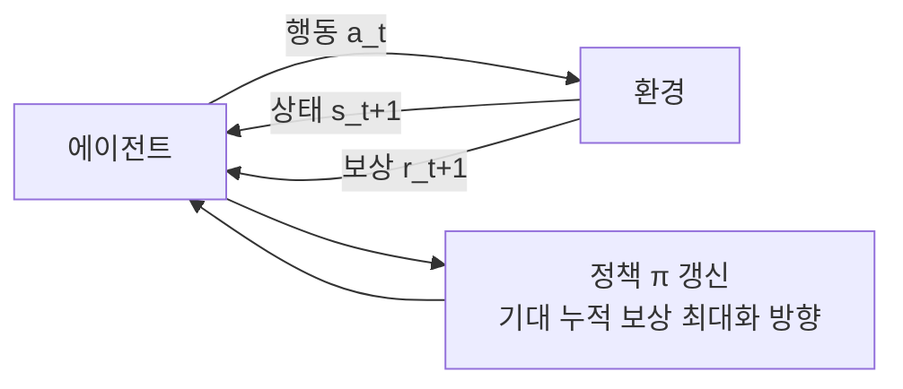
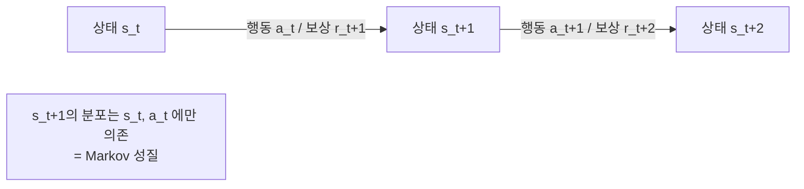
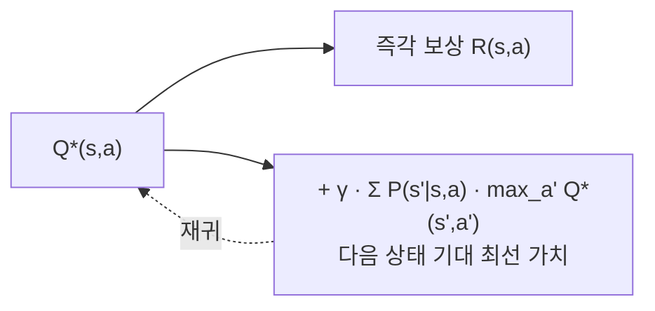
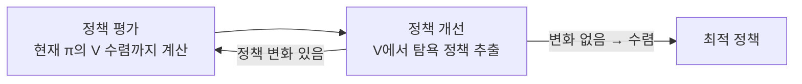
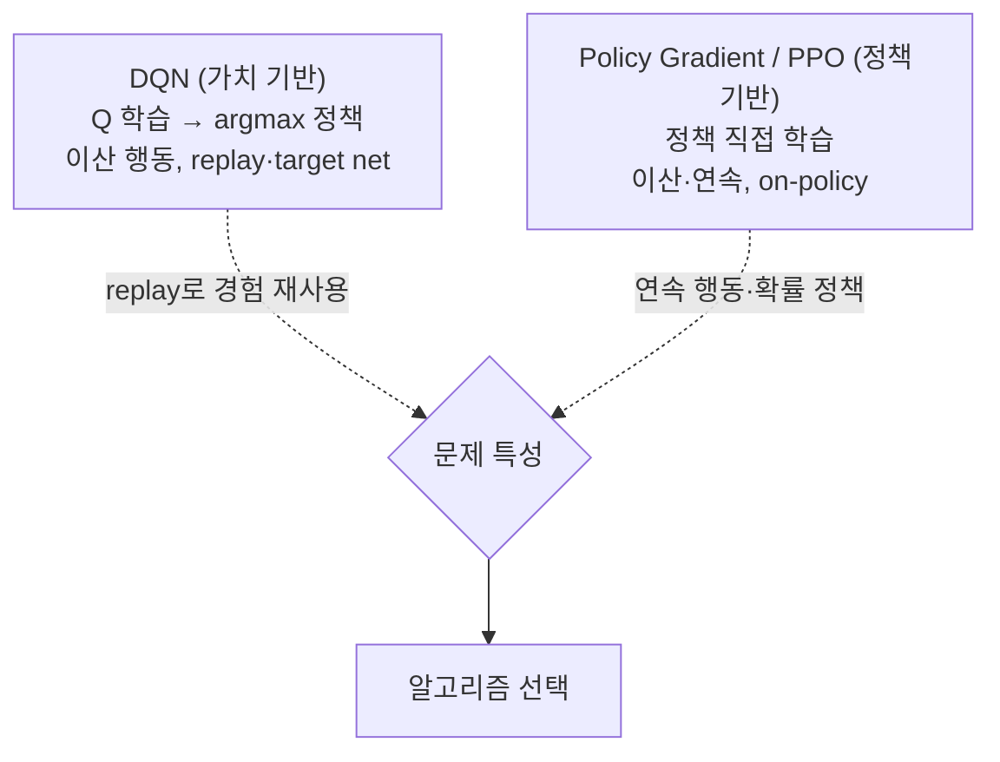
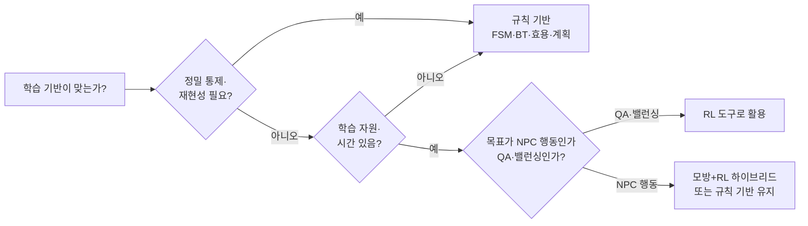

## 들어가며

규칙 기반 AI는 상태 전이, 행동 트리의 가지, 효용 곡선, 계획기의 행동 모델처럼 의사결정 구조를 사람이 명시한다. 강화학습(Reinforcement Learning, RL)은 규칙을 직접 적는 대신 *보상을 정의* 하고, 에이전트가 환경과 상호작용하며 *시행착오로* 기대 누적 보상을 최대화하는 정책을 찾는다. 의사결정 로직 자체가 학습의 산물이 된다.

이 패러다임 전환은 강력하다. AlphaGo가 바둑에서, OpenAI Five가 Dota 2에서, AlphaStar가 StarCraft II에서 인간 최상위권에 가까운 성과를 보인 것이 RL의 위력을 증명했다. 디자이너가 상상하지 못한 전략을 에이전트가 발견하고, 명시적 규칙으로는 다루기 힘든 고차원 상태 공간에서 작동한다. 그러나 같은 위력이 게임 *제작* 에서는 양날의 검이다 — 학습에 막대한 연산이 들고, 결과 정책을 통제·예측·디버깅하기 어렵다.

이 글은 RL의 수학적 기반인 Markov Decision Process에서 출발한다. 상태·행동·보상·정책을 정의하고, 가치를 재귀적으로 표현하는 Bellman 방정식을 *축약 사상(contraction)* 의 관점에서 *유도* 한다. 모델을 아는 경우의 value/policy iteration, 모델 없이 배우는 Q-learning과 그 수렴 조건, 탐험과 활용의 균형, 신경망 확장인 DQN과 Policy Gradient/PPO를 다룬다. 상용 게임 NPC에 적용할 때 생기는 비용·통제·재미·검증의 트레이드오프도 함께 분석한다.



이 글의 목표.

1. **MDP** — RL 문제의 수학적 틀과 Markov 성질의 의미.
2. **상태·행동·보상·정책** — RL의 기본 구성요소와 보상 설계의 함정.
3. **Bellman 방정식** — 가치의 재귀적 정의를 축약 사상으로 유도.
4. **value/policy iteration** — 모델 기반 풀이와 수렴 속도 비교.
5. **Q-learning** — 모델 없이 가치를 배우는 TD 학습과 수렴 조건.
6. **exploration vs exploitation** — 탐험과 활용의 균형 전략들.
7. **DQN과 PPO** — 함수 근사가 깨뜨리는 안정성과 그 복구 기법.
8. **게임 AI에서의 한계** — RL이 NPC에 드문 이유의 정량적 분석.


---

## 목차
1. [Markov Decision Process](#1-markov-decision-process)
2. [상태·행동·보상·정책](#2-상태행동보상정책)
3. [Bellman 방정식](#3-bellman-방정식)
4. [Value Iteration과 Policy Iteration](#4-value-iteration과-policy-iteration)
5. [Q-learning](#5-q-learning)
6. [Exploration vs Exploitation](#6-exploration-vs-exploitation)
7. [DQN과 Policy Gradient](#7-dqn과-policy-gradient)
8. [게임 AI에서 RL의 한계](#8-게임-ai에서-rl의-한계)


---

## 1. Markov Decision Process

### 5-튜플과 상호작용 루프

RL 문제는 *Markov Decision Process(MDP)* 로 형식화된다. MDP는 5-튜플 $(S, A, P, R, \gamma)$다.

- $S$: 상태 집합. 에이전트가 처한 상황의 표현.
- $A$: 행동 집합. 에이전트가 할 수 있는 선택. 상태마다 가능한 행동이 다르면 $A(s)$로 쓴다.
- $P(s' \mid s, a)$: 전이 확률. 상태 $s$에서 행동 $a$를 하면 $s'$로 갈 확률. 모든 $s'$에 대해 합하면 1이다.
- $R(s, a)$: 기대 즉시 보상. 전이 뒤 보상이 달라지면 $R(s,a,s')$나 보상 분포로 정의할 수 있다.
- $\gamma \in [0, 1]$: 할인 인자(discount factor). 이 글의 무한 지평 수렴·축약 논증은 $\gamma<1$을 가정한다. 종료가 보장되는 유한 에피소드에서는 $\gamma=1$도 사용할 수 있지만 같은 축약 증명을 그대로 적용할 수는 없다.

에이전트와 환경은 이산 시간 스텝 $t = 0, 1, 2, \dots$로 상호작용한다. 시점 $t$에 에이전트는 상태 $s_t$를 관측하고 행동 $a_t$를 고른다. 환경은 다음 상태 $s_{t+1} \sim P(\cdot \mid s_t, a_t)$와 보상 $r_{t+1} = R(s_t, a_t)$를 돌려준다. 이 루프가 끝나지 않거나(연속 과업, continuing task) 종료 상태(terminal state)에 닿을 때까지(에피소드 과업, episodic task) 반복된다.

### Markov 성질

MDP의 이름이 가리키는 핵심은 *Markov 성질* 이다. 다음 상태와 보상은 *현재 상태와 행동에만* 의존하고, 그 이전의 이력 전체와는 무관하다.

$$P(s_{t+1},r_{t+1} \mid s_t, a_t, s_{t-1}, a_{t-1}, \dots, s_0, a_0) = P(s_{t+1},r_{t+1} \mid s_t, a_t)$$

"지금 어디 있고 무엇을 하는가"만 알면 미래를 예측하는 데 충분하다는 가정이다. 이 가정이 문제를 다루기 쉽게 만든다 — 정책과 가치 함수가 *과거 전체의 함수* 가 아니라 *현재 상태의 함수* 면 되므로, 학습할 대상의 차원이 폭발하지 않는다.



문제는 *실제 게임 상태가 Markov가 아닌 경우* 가 흔하다는 점이다. 화면 한 프레임만으로는 공의 *속도* 를 알 수 없다(위치만 보인다). 적의 다음 행동은 그 적의 *내부 쿨다운 타이머* 에 달렸는데 그게 관측에 없다. 이런 부분 관측(partially observable) 환경은 엄밀히는 POMDP다. 실전의 우회책은 상태를 *증강* 하는 것이다 — 최근 $k$프레임을 쌓거나(프레임 스태킹), 순환 신경망으로 이력을 요약한다. DQN이 Atari에서 연속 4프레임을 한 상태로 묶은 것이 정확히 이 처리다. 상태에 무엇을 넣느냐가 Markov 가정의 성립 여부를 결정하고, 그것이 곧 학습의 성패를 가른다.

### 할인 인자와 시간 지평

할인 인자 $\gamma$는 미래 보상에 대한 시간 선호를 표현하고, 연속 과업에서 무한 합을 다루기 쉽게 만든다. 환경의 확률적 불확실성은 이미 기댓값과 전이 확률 $P$에 들어 있으므로, 할인 자체를 반드시 "미래를 덜 신뢰한다"는 뜻으로 해석할 필요는 없다. 보상이 유계이고 $\gamma < 1$이면 할인된 합 $\sum_t \gamma^t r_t$가 수렴하고 Bellman 연산자가 축약 사상이 된다.

MDP의 목표는 *기대 누적 할인 보상(expected return)* 을 최대화하는 정책을 찾는 것이다.

$$G_t = \sum_{k=0}^{\infty} \gamma^k r_{t+k+1}, \qquad \text{목표: } \max_\pi \; \mathbb{E}_\pi[G_0]$$

$\gamma$의 값은 *유효 시간 지평(effective horizon)* 의 척도를 정한다. 할인 가중치가 의미 있게 남는 범위는 대략 $1/(1-\gamma)$ 스텝이지만, 이는 정확한 절단 깊이가 아니다. 임계값 $\delta$ 아래로 작아지는 깊이는 $\lceil\log\delta/\log\gamma\rceil$처럼 어떤 기준을 쓰는지에 따라 달라진다.

| $\gamma$ | $1/(1-\gamma)$ | 성격 | 게임 예시 |
|---:|---:|---|---|
| 0.9 | 10 | 근시안적 | 즉각 반응형 액션 NPC |
| 0.99 | 100 | 중기 | 한 교전 단위의 전술 |
| 0.999 | 1000 | 장기 | 자원 관리·전략 게임 |

"지금 손해를 보더라도 나중에 이기는" 전략은 장기 결과를 충분히 반영하는 $\gamma$를 요구한다. $\gamma$가 1에 가까우면 return의 크기와 유효 지평이 커지고 Bellman 축약이 약해져 추정과 최적화가 어려워질 수 있다. 분산과 학습 안정성은 보상 상관, 에피소드 길이, 부트스트래핑, 함수 근사에도 좌우되므로 $\gamma$ 하나의 보편 결과로 단정할 수 없다.

## 2. 상태·행동·보상·정책

### 네 구성요소의 구체화

MDP의 추상 요소를 게임 맥락에서 구체화하면 다음이다.

- *상태(state)*: 게임 상황의 표현. 그리드 위치, 체력, 적 위치, 보유 자원. 무엇을 상태에 넣을지가 학습의 성패를 가른다 — 너무 많으면 차원이 폭발해 학습이 느리고, 너무 적으면(중요 정보 누락) 어떤 정책으로도 좋은 성과가 불가능하다.
- *행동(action)*: 에이전트의 선택. 이산(discrete) 행동(상하좌우, 스킬 슬롯)과 연속(continuous) 행동(조향 각도, 가속도 크기)으로 나뉜다. 이 구분이 알고리즘 선택을 좌우한다 — Q-learning 계열은 이산에, Policy Gradient 계열은 연속에 자연스럽다.
- *보상(reward)*: 정책을 어느 방향으로 개선할지 정하는 *목적 신호*. "골 넣으면 +1, 실점하면 −1". 에이전트는 상태·행동·종료 여부도 관측하지만, 무엇을 선호해야 하는지는 보상이 정한다.
- *정책(policy) $\pi$*: 상태에서 행동으로의 매핑. 결정적 정책은 $\pi(s) = a$, 확률적 정책은 $\pi(a \mid s)$ — 상태마다 행동의 확률 분포다. RL이 학습하려는 대상이 바로 이것이다.

```cpp
// RL 인터페이스의 골격. 환경/정책 분리는 거의 모든 RL 프레임워크의 공통 형태다.
struct Transition { State s; Action a; float reward; State next; bool done; };

class Environment {
public:
    State      Reset();                 // 에피소드 시작 — 초기 상태 반환
    Transition Step(Action a);          // 행동 → (보상, 다음 상태, 종료 여부)
    int        ActionCount() const;     // 이산 행동 수
};

class Policy {
public:
    Action Select(const State& s);      // π(s) → 행동
    void   Update(const Transition& t); // 한 전이로 정책/가치 개선
};
```

이 인터페이스의 핵심은 *환경이 보상을 정의* 하고 *정책이 그것을 최대화* 한다는 분리다. 환경은 게임 규칙(이기면 +1)을, 정책은 그 규칙 아래 최선의 행동을 담당한다. 둘 사이를 흐르는 유일한 정보가 `Transition`이다.

### 보상 설계의 함정

"무엇을 보상하는가"가 곧 "에이전트가 무엇을 하는가"다. 에이전트는 *정확히 보상한 것만* 최적화하므로, 보상이 의도와 어긋나면 의도를 배신하는 행동(reward hacking)을 기어이 찾아낸다.

레이싱 게임에서 코스 진척 대신 게임 내 점수(코스에 배치된 타깃 타격)를 보상으로 주면, 에이전트가 결승선으로 가는 대신 *고립된 구역에서 원을 그리며 재생성되는 타깃을 반복 타격* 해 점수를 쌓는 사례가 OpenAI의 CoastRunners 관측에서 실제로 나왔다. 의도는 "빨리 완주"였지만 보상은 "점수 누적"이었고, 에이전트는 후자에 정직했다.

```cpp
// 함정: 대리 보상(proxy)이 진짜 목표와 어긋난다.
float RewardBad(const GameState& g) {
    return g.hitsOnEnemy;   // "많이 맞히면 보상" → 이기는 대신 맞히기만 하는 정책
}

// 개선: 희소하지만 정직한 목표 보상 + 작은 형태 보상(shaping)
float RewardGood(const GameState& g, const GameState& prev) {
    float r = 0.0f;
    if (g.won)  r += 1.0f;          // 진짜 목표 (희소)
    if (g.lost) r -= 1.0f;
    r += 0.01f * (g.progress - prev.progress);  // 형태 보상: 전진에 작은 신호
    return r;
}
```

희소 보상(이기거나 지거나)은 정직하지만 학습이 어렵다 — 무작위로 행동하는 초기 에이전트가 "이김"에 닿을 확률이 거의 0이라 학습 신호가 오지 않는다. 형태 보상(reward shaping)은 중간 진척에 작은 신호를 줘 학습을 도울 수 있지만, 잘못 설계하면 위의 reward hacking을 부른다. 할인 MDP에서 *potential-based shaping* 을

$$F(s,a,s') = \gamma \Phi(s') - \Phi(s)$$

로 두면 원래 MDP의 최적 정책 집합을 보존한다. 에피소드 과업은 종료 상태를 흡수 상태로 모델링하고 종료 potential을 일관되게 처리해야 한다. 이 정리는 *정책 불변성* 을 보장할 뿐, 모든 문제에서 학습이 빨라진다는 보장은 아니다.

## 3. Bellman 방정식

### 두 가치 함수

RL의 수학적 심장은 *가치 함수(value function)* 와 그것을 재귀적으로 표현하는 *Bellman 방정식* 이다.

*상태 가치 함수* $V^\pi(s)$는 "상태 $s$에서 정책 $\pi$를 따를 때 기대되는 누적 할인 보상"이다.

$$V^\pi(s) = \mathbb{E}_\pi\!\left[\, G_t \mid s_t = s \,\right] = \mathbb{E}_\pi\!\left[\sum_{k=0}^{\infty} \gamma^k r_{t+k+1} \;\middle|\; s_t = s\right]$$

*행동 가치 함수* $Q^\pi(s, a)$는 "상태 $s$에서 행동 $a$를 먼저 한 뒤 그다음부터 $\pi$를 따를 때의 기대 보상"이다. 둘의 관계는 $V^\pi(s) = \sum_a \pi(a \mid s)\, Q^\pi(s, a)$다.

### 재귀 분해

return의 정의를 한 스텝 풀면 재귀가 드러난다. $G_t = r_{t+1} + \gamma G_{t+1}$이므로, 기댓값을 취하면 다음을 얻는다.

$$V^\pi(s) = \sum_a \pi(a \mid s) \left[ R(s, a) + \gamma \sum_{s'} P(s' \mid s, a)\, V^\pi(s') \right]$$

행동 가치로 쓰면 이렇다.

$$Q^\pi(s, a) = R(s, a) + \gamma \sum_{s'} P(s' \mid s, a) \sum_{a'} \pi(a' \mid s')\, Q^\pi(s', a')$$

최적 정책에 대한 *Bellman 최적 방정식* 은 합 대신 max를 쓴다.

$$Q^*(s, a) = R(s, a) + \gamma \sum_{s'} P(s' \mid s, a) \max_{a'} Q^*(s', a')$$

이 식의 의미는 직관적이다. "지금 행동의 가치 = 즉각 보상 + 할인된 다음 상태의 최선 가치". 미래 전체를 내다보는 문제가, *현재 보상 + 다음 상태 가치* 라는 한 단계 재귀로 분해된다. 이 재귀 구조가 RL 알고리즘 전부의 토대다.



### Bellman 연산자와 축약 사상

Bellman 방정식이 *왜 풀리는가* 를 보려면 그것을 *연산자* 로 보는 시각이 필요하다. 가치 함수 $V$를 받아 새 가치 함수로 보내는 Bellman 최적 연산자 $\mathcal{T}$를 정의한다.

$$(\mathcal{T}V)(s) = \max_a \left[ R(s, a) + \gamma \sum_{s'} P(s' \mid s, a)\, V(s') \right]$$

최적 가치 $V^*$는 이 연산자의 *고정점(fixed point)* 이다 — $\mathcal{T}V^* = V^*$. 핵심 정리는 $\mathcal{T}$가 *$\gamma$-축약 사상(contraction)* 이라는 것이다. 임의의 두 가치 함수 $V, U$에 대해 무한대 노름으로 다음이 성립한다.

$$\lVert \mathcal{T}V - \mathcal{T}U \rVert_\infty \le \gamma\, \lVert V - U \rVert_\infty$$

증명의 핵심은 $\max_a f(a) - \max_a g(a) \le \max_a |f(a) - g(a)|$라는 max의 비확장성과, 전이 확률의 합이 1이라는 사실이다. 두 가치 함수의 차이는 $\mathcal{T}$를 한 번 적용할 때마다 적어도 $\gamma$배로 줄어든다. Banach 고정점 정리에 의해 $\mathcal{T}$의 고정점은 *유일* 하고, 임의의 초기값에서 $\mathcal{T}$를 반복 적용하면 그 고정점으로 *기하급수적으로 수렴* 한다. 이 성질이 value iteration의 수렴 근거다.

$k$번 적용 후 오차의 상한은 다음과 같다.

$$\lVert V_k - V^* \rVert_\infty \le \gamma^k\, \lVert V_0 - V^* \rVert_\infty$$

최적 $Q^*$를 알면 각 상태에서 $Q^*$가 가장 큰 행동을 고르는 greedy 정책을 만들 수 있다($\pi^*(s) \in \arg\max_a Q^*(s, a)$). 동률에서는 최적 행동이 여러 개일 수 있다. 전이 모델을 모를 때는 환경에서 얻은 $(s,a,r,s')$ 표본으로 Bellman optimality target을 근사하는 model-free 시간차 학습을 사용할 수 있다.

## 4. Value Iteration과 Policy Iteration

전이 확률 $P$와 보상 $R$을 *안다면* (모델 기반, model-based), Bellman 방정식을 직접 반복 풀이할 수 있다.

### Value Iteration

Value Iteration은 Bellman 최적 연산자 $\mathcal{T}$를 갱신 규칙으로 삼아 가치를 수렴시킨다. 3절에서 본 축약 성질이 수렴을 보장한다.

```cpp
void ValueIteration(const MDP& mdp, std::vector<float>& V, float gamma) {
    std::vector<float> next(V.size());
    float delta;
    do {
        delta = 0.0f;
        for (State s : mdp.states) {
            float best = -INF;
            for (Action a : mdp.actions) {
                float q = mdp.R(s, a);
                for (State sp : mdp.states)
                    q += gamma * mdp.P(sp, s, a) * V[sp]; // 모두 이전 sweep V_k를 읽는다
                best = std::max(best, q);
            }
            next[s] = best;
            delta = std::max(delta, std::abs(next[s] - V[s]));
        }
        V.swap(next);                                      // V_{k+1} <- T V_k
    } while (delta > kEpsilon);
}
```

각 sweep은 이전 배열 $V_k$만 읽어 $V_{k+1}=\mathcal{T}V_k$를 만든다. 따라서 코드의 `delta`가 아래에서 사용하는 $\lVert V_{k+1}-V_k\rVert_\infty$와 정확히 일치한다. 한 배열을 제자리 갱신하는 Gauss-Seidel 변형도 수렴할 수 있지만, 상태 순서에 의존하며 여기서 유도하는 동기식 잔차 식을 그대로 적용해서는 안 된다.

### 수치 트레이스: 1차원 복도

상태가 5칸인 복도를 보자. 상태 $s_0 \dots s_4$, 행동은 좌/우, 결정적 전이(벽이면 제자리), $s_4$가 보상 +1의 종료 상태, 그 외 보상 0, $\gamma = 0.9$. $V$를 모두 0으로 시작한다.

| sweep | $V(s_0)$ | $V(s_1)$ | $V(s_2)$ | $V(s_3)$ | $V(s_4)$ |
|---:|---:|---:|---:|---:|---:|
| 0 | 0 | 0 | 0 | 0 | 0 |
| 1 | 0 | 0 | 0 | 1.00 | (종) |
| 2 | 0 | 0 | 0.90 | 1.00 | (종) |
| 3 | 0 | 0.81 | 0.90 | 1.00 | (종) |
| 4 | 0.729 | 0.81 | 0.90 | 1.00 | (종) |

가치가 보상이 있는 종료 상태에서 *역방향으로 한 칸씩 전파* 된다. 이것이 동적 계획법의 본질이다 — 먼 미래의 보상 정보가 한 sweep마다 한 스텝씩 거슬러 흐른다. $\gamma = 0.9$가 거리에 따라 가치를 깎아, $s_0$의 최종 가치는 $0.9^4 = 0.6561$이 아니라 위 표의 0.729($0.9^3$, $s_0 \to s_4$가 4스텝이지만 종료 보상 +1은 마지막 전이에서 받으므로)다.

### 얼마나 빠르고, 언제 멈추며, 그 정책은 얼마나 좋은가 — 수렴률·정지 한계·정책 손실

3절은 $\mathcal{T}$가 $\gamma$-축약이라 $\lVert V_k - V^* \rVert_\infty \le \gamma^k \lVert V_0 - V^* \rVert_\infty$로 *수렴함* 만 보였다. 실무는 세 가지 정량적 질문에 답해야 한다 — 목표 정밀도까지 몇 sweep인가, `delta`가 얼마면 멈춰도 되는가, 그렇게 멈춘 가치로 뽑은 정책은 최적에서 얼마나 손해인가.

**(1) 사전 한계와 유효 지평.** 한계 $\gamma^k \lVert V_0-V^* \rVert_\infty \le \epsilon$를 풀면 sweep 수가 나온다.

$$k \ge \frac{\ln\!\big(\lVert V_0-V^* \rVert_\infty / \epsilon\big)}{\ln(1/\gamma)}$$

보상이 $[0, R_{\max}]$면 가치는 $[0, R_{\max}/(1-\gamma)]$에 들어 $\lVert V_0-V^* \rVert_\infty \le R_{\max}/(1-\gamma)$다. 분모 $\ln(1/\gamma) = -\ln\gamma$는 $\gamma$가 1에 가까울 때 $-\ln\!\big(1-(1-\gamma)\big) \approx (1-\gamma)$이므로 $k \approx \frac{1}{1-\gamma}\ln\frac{\lVert V_0-V^* \rVert_\infty}{\epsilon}$다. sweep 수를 지배하는 인자가 $1/(1-\gamma)$ — 이것이 1절에서 말한 *유효 지평* $1/(1-\gamma)$의 출처다(할인 가중 $\gamma^k(1-\gamma)$의 평균 깊이 $\gamma/(1-\gamma)$, 반감기 $\ln 2/(1-\gamma)$도 같은 척도다). 문제는 이 한계가 $V^*$를 알아야 계산된다는 점이다. 실행 중에는 $V^*$를 모른다.

**(2) 계산 가능한 정지 한계 — `delta`의 진짜 의미.** Value Iteration 코드는 sweep당 최대 변화 `delta` $= \lVert V_{k+1}-V_k \rVert_\infty$가 `kEpsilon` 아래면 멈춘다. 이 *Bellman 잔차* 는 계산 가능하고, 축약성만으로 실제 거리를 묶는다. $V^* = \mathcal{T}V^*$와 $V_{k+1}=\mathcal{T}V_k$에서

$$\lVert V_{k+1}-V^* \rVert_\infty = \lVert \mathcal{T}V_k - \mathcal{T}V^* \rVert_\infty \le \gamma \lVert V_k-V^* \rVert_\infty \le \gamma\big(\lVert V_k-V_{k+1} \rVert_\infty + \lVert V_{k+1}-V^* \rVert_\infty\big)$$

이를 정리하면 정지 시점의 거리가 잔차로 묶인다.

$$\lVert V_{k+1}-V^* \rVert_\infty \le \frac{\gamma}{1-\gamma}\,\lVert V_{k+1}-V_k \rVert_\infty = \frac{\gamma}{1-\gamma}\,\texttt{delta}$$

즉 `delta` $\le\epsilon$로 멈추면 실제 거리는 $\le \frac{\gamma}{1-\gamma}\epsilon$다. 코드가 *보는* 양(`delta`)과 *보장하려는* 양(진짜 거리)은 $\frac{\gamma}{1-\gamma}$배만큼 다르다 — $\gamma=0.99$면 `delta`의 99배다. 목표 거리 $\eta$를 원하면 `kEpsilon` $= \frac{1-\gamma}{\gamma}\eta$로 잡아야 한다.

**(3) 정책 손실 한계 — 가치가 정확해도 정책은 더 샌다.** 정작 쓰는 것은 가치가 아니라 그로부터 *탐욕 추출* 한 정책이다. $V$에 대해 탐욕적인 $\pi$($\mathcal{T}^\pi V = \mathcal{T}V$)가 있고 $\lVert V-V^* \rVert_\infty\le\eta$면 다음이 성립한다.

$$\lVert V^\pi - V^* \rVert_\infty \le \frac{2\gamma}{1-\gamma}\,\eta$$

유도는 연산자로 깔끔하다. $V^*-V^\pi = \mathcal{T}^{\pi^*}V^* - \mathcal{T}^\pi V^\pi$에 $\mathcal{T}^{\pi^*}V$와 $\mathcal{T}^\pi V$를 끼우면 세 항으로 갈린다.

$$V^*-V^\pi = \big(\mathcal{T}^{\pi^*}V^* - \mathcal{T}^{\pi^*}V\big) + \big(\mathcal{T}^{\pi^*}V - \mathcal{T}^\pi V\big) + \big(\mathcal{T}^\pi V - \mathcal{T}^\pi V^\pi\big)$$

가운데 항은 $\pi$가 $V$에 탐욕이라($\mathcal{T}^\pi V = \mathcal{T}V \ge \mathcal{T}^{\pi^*}V$) 성분별 $\le 0$이고, 양 끝은 각각 $\mathcal{T}^{\pi^*}, \mathcal{T}^\pi$의 $\gamma$-축약이다. $V^*\ge V^\pi$이므로 무한대 노름으로 $\lVert V^*-V^\pi \rVert_\infty \le \gamma \lVert V^*-V \rVert_\infty + \gamma \lVert V-V^\pi \rVert_\infty \le 2\gamma\eta + \gamma \lVert V^*-V^\pi \rVert_\infty$이고, 정리하면 위 한계다(Williams & Baird 1993; Singh & Yee 1994). 정지 한계와 합치면 `delta` $\le\epsilon$ 한 줄이 정책 손실 $\lVert V^\pi - V^* \rVert_\infty \le \frac{2\gamma}{1-\gamma}\cdot\frac{\gamma}{1-\gamma}\epsilon = \frac{2\gamma^2}{(1-\gamma)^2}\epsilon$를 함의한다. 잔차 한 단위가 정책 가치 손실로 $1/(1-\gamma)^2$배 증폭된다.

**수치.** 증폭 인자는 $\gamma$에 급격히 민감하다.

| $\gamma$ | $1/(1-\gamma)$ (sweep·지평) | $\frac{\gamma}{1-\gamma}$ (delta→거리) | $\frac{2\gamma^2}{(1-\gamma)^2}$ (delta→정책 손실) |
|---:|---:|---:|---:|
| 0.9 | 10 | 9 | 162 |
| 0.99 | 100 | 99 | 19,602 |
| 0.999 | 1000 | 999 | 1,996,002 |

`delta` $=0.01$로 멈추면 $\gamma=0.9$에선 거리 $\le0.09$·정책 손실 $\le1.62$지만, $\gamma=0.99$에선 거리 $\le0.99$·정책 손실 한계가 $\le196$이다. 보상이 $[0,1]$이면 두 정책 가치 차이의 자명한 상한이 100이므로, 196이라는 계산값은 틀린 값이 아니라 *자명한 상한보다 느슨해져 정보가 없는 최악 한계* 다. 반면 사전 한계도 최악만 본다. 위 1차원 복도($\gamma=0.9$, $\lVert V_0-V^* \rVert_\infty=1$, $\epsilon=10^{-3}$)의 사전 sweep 수는 $\ln(1000)/\ln(1/0.9)\approx66$이지만, 결정적·비순환 구조라 실제로는 지름인 4 sweep에 정확히 닫힌다.

실패 경계는 셋이다. 첫째, $\gamma\to1$이면 이 동기식 Value Iteration의 최악 sweep 수와 잔차 기반 정책 손실 한계가 각각 $1/(1-\gamma)$와 $1/(1-\gamma)^2$ 척도로 나빠진다. 이것은 동적 계획법의 조건수에 관한 결과이며, 함수 근사 Q-learning의 불안정성이나 실제 표본 복잡도를 이 식 하나로 동일시할 수는 없다. 둘째, 한계는 $\infty$-노름(최악 상태) 기준이라 평균 손실은 더 작을 수 있고, 반대로 한 상태의 큰 잔차가 전체 보장을 끌어내린다. 셋째, 한계가 묶는 것은 *정책의 가치* 지 정책의 *동일성* 이 아니다. 동률 행동 사이에서 다른 정책을 뽑아도 가치 손실은 같을 수 있다.

```python
import numpy as np
g = 0.9
delta = 0.01
dist_bound  = g / (1 - g) * delta          # ||V_{k+1}-V*|| <= g/(1-g) * delta
policy_loss = 2 * g / (1 - g) * dist_bound  # ||V^pi - V*|| <= 2g/(1-g) * ||V-V*||
assert abs(dist_bound - 0.09) < 1e-9
assert abs(policy_loss - 1.62) < 1e-9                      # == 2 g^2/(1-g)^2 * delta
assert abs(policy_loss - 2 * g**2 / (1 - g)**2 * delta) < 1e-9
# -ln g ~ 1-g near 1: the effective horizon 1/(1-g) dominates the sweep count
for g in (0.9, 0.99, 0.999):
    assert abs(-np.log(g) - (1 - g)) < (1 - g)**2          # second-order close
```

### Policy Iteration

Policy Iteration은 두 단계를 번갈아 한다.

1. *정책 평가(policy evaluation)*: 현재 정책 $\pi$의 가치 $V^\pi$를 계산한다. $\mathcal{T}^\pi$(max 없이 현재 정책의 행동을 따르는 연산자)의 고정점을 푼다. 선형 연립방정식을 직접 풀거나, $\mathcal{T}^\pi$를 반복 적용한다.
2. *정책 개선(policy improvement)*: 그 가치에 대해 탐욕적인 새 정책을 뽑는다. $\pi'(s) = \arg\max_a [R(s,a) + \gamma \sum_{s'} P(s' \mid s,a) V^\pi(s')]$.

정책이 더 이상 바뀌지 않으면 최적에 도달한 것이다. 정책 개선 정리(policy improvement theorem)는 탐욕 개선 뒤 새 정책의 가치가 기존 정책보다 나빠지지 않음을 보장한다. 적어도 한 상태에서 더 나은 행동을 고르면 엄격히 개선되지만, 동률 행동 사이를 바꾸면 정책이 달라도 가치는 같을 수 있다. 유한 종료를 원하면 동률에서 기존 행동을 유지하는 등 안정적인 tie-breaking 규칙을 둔다.



### 두 방법의 비교

| 항목 | Value Iteration | Policy Iteration |
|---|---|---|
| 한 반복의 비용 | 조밀 전이 $O(\lvert S\rvert^2\lvert A\rvert)$, 상태·행동당 후속 상태가 $d$개면 $O(\lvert S\rvert\lvert A\rvert d)$ | 평가 정확도와 선형계 풀이법에 좌우 |
| 필요한 반복 수 | $\gamma$와 MDP 구조에 민감 | 문제에 따라 크게 달라짐 |
| 수렴 | 점근적 ($\gamma^k$) | 유한 (유한 MDP에서 정확히 종료) |
| 변형 | $\epsilon$-수렴 시 정지 | modified PI로 평가를 부분만 |

유한 할인 MDP에서 정책 평가를 정확히 수행하고 동률 행동을 일관되게 처리하면, 가능한 결정적 정책 수가 유한하고 정책 개선이 반복되므로 Policy Iteration은 유한 횟수에 최적 정책에 도달한다. 평가를 몇 sweep에서 자르는 modified/approximate policy iteration에는 이 정확한 유한 종료 설명을 그대로 적용할 수 없다. Value Iteration은 일반적으로 고정점에 점근적으로 다가가므로 임계값으로 멈춘다.

두 방법 모두 *모델을 알 때만* 쓸 수 있다 — 전이 확률 $P$를 명시적으로 합산하기 때문이다. 게임 환경의 정확한 전이 모델을 아는 경우는 드물다(물리 시뮬레이션, 상대의 반응, 난수). 그래서 실전 RL은 모델 없이(model-free) 경험에서 직접 배우는 방법으로 간다.

## 5. Q-learning

### TD 학습으로 모델 없이

Q-learning은 *전이 모델 없이* 경험만으로 $Q^*$를 학습하는 대표 알고리즘이다. 환경과 상호작용하며 얻은 전이 $(s, a, r, s')$ 하나로 Q 값을 점진적으로 갱신한다.

$$Q(s, a) \leftarrow Q(s, a) + \alpha \Big[\, \underbrace{r + \gamma \max_{a'} Q(s', a')}_{\text{TD 목표}} - Q(s, a) \,\Big]$$

대괄호 안이 *TD 오차(Temporal Difference error)* 다 — "관측한 보상 + 다음 상태 최선 가치"(목표)와 "현재 Q 추정"의 차이. 이 오차만큼 학습률 $\alpha$로 Q를 보정한다. 핵심은 4절의 value iteration이 *기댓값 전체를 합산* 했던 자리를, Q-learning은 *한 번 관측한 표본 $s'$* 으로 대체한다는 것이다. 모델 $P$를 모르니 기댓값 대신 표본으로 근사하고, 학습률 $\alpha$로 여러 표본을 평균 내듯 흡수한다.

```cpp
void QLearning(Environment& env, QTable& Q, float alpha, float gamma, float epsilon) {
    State s = env.Reset();
    bool done = false;
    while (!done) {
        Action a = EpsilonGreedy(Q, s, epsilon);           // 행동 표본화 정책
        Transition t = env.Step(a);
        float target = t.reward;
        if (!t.done)
            target += gamma * Q.MaxOverActions(t.next);     // r + γ max_a' Q(s',a')
        Q(s, a) += alpha * (target - Q(s, a));              // TD 갱신
        s = t.next;
        done = t.done;
    }
}
```

### 수치 트레이스: 한 전이의 갱신

그리드월드에서 $s$=칸(2,3), 행동 $a$=오른쪽, 보상 $r = 0$, 도착 $s'$=칸(3,3)이라 하자. 현재 $Q(s, a) = 0.5$, $s'$에서 가능한 행동들의 Q 값이 $\{0.2, 0.8, 0.3, 0.6\}$이라 하자. $\alpha = 0.1$, $\gamma = 0.9$.

```text
TD 목표 = r + γ · max Q(s', ·) = 0 + 0.9 · 0.8 = 0.72
TD 오차 = 목표 − Q(s,a)       = 0.72 − 0.5     = 0.22
새 Q(s,a) = 0.5 + 0.1 · 0.22  = 0.522
```

한 번의 경험으로 $Q(s, a)$가 0.5에서 0.522로 *목표 쪽으로 22%의 10%만큼* 움직였다. 같은 전이를 여러 번 겪으며 Q가 점점 진짜 목표로 다가간다. max 연산이 "다음 상태에서 최선을 다한다고 가정"하므로, 실제로 그 best 행동을 하지 않았더라도 그 가치가 현재 추정에 반영된다 — 이것이 off-policy의 작동 방식이다.

### 두 가지 중요한 성질

- *모델 프리(model-free)*: $P$나 $R$을 미리 알 필요 없다. 경험에서 직접 배운다.
- *오프-폴리시(off-policy)*: 행동 선택 정책(탐험적, $\epsilon$-greedy)과 학습 목표 정책(탐욕적, $\max$)이 다르다. 탐험으로 얻은 경험으로도 최적 정책을 학습한다. 대조적으로 SARSA는 갱신에 $\max$ 대신 *실제 다음에 고른 행동* $a'$의 $Q(s', a')$를 써서, 탐험 정책 그 자체를 평가하는 on-policy다.

SARSA와의 차이는 절벽 보행(cliff walking) 같은 예제에서 행동으로 드러난다. Q-learning은 절벽 바로 옆의 *최단* 경로를 최적으로 학습하지만, $\epsilon$-greedy의 무작위 탐험 때문에 가끔 절벽에 떨어진다. SARSA는 자기 탐험의 위험까지 가치에 반영해 절벽에서 한 칸 떨어진 *안전한* 경로를 배운다. 학습 중 탐험의 비용을 무시하느냐(off-policy) 반영하느냐(on-policy)의 차이다.

### 수렴 조건

테이블 Q-learning은 *유한 MDP*, 유계 보상, $\gamma<1$에서 다음 조건을 만족하면 확률 1로 $Q^*$에 수렴한다(Watkins & Dayan, 1992).

- 모든 상태-행동 쌍 $(s, a)$를 *무한히 자주* 방문한다(충분한 탐험).
- 각 상태-행동 쌍에 적용된 학습률 열이 Robbins-Monro 조건을 만족한다: $\sum_k \alpha_k(s,a)=\infty$이고 $\sum_k \alpha_k(s,a)^2<\infty$. 여기서 $k$는 전체 시간 인덱스가 아니라 해당 쌍의 방문 횟수다. 예컨대 $\alpha_k(s,a)=1/k$가 조건을 만족한다.

다만 이 기본형은 Q를 *테이블* 로 저장하므로 유한하고 작은 상태·행동 공간이 필요하다. 화면 픽셀이나 연속 상태는 그대로 열거할 수 없고, 테이블은 비슷한 상태 사이에 경험을 일반화하지 않는다. 함수 근사기 $Q_\theta(s,a)$를 사용하면 표현을 공유할 수 있지만, off-policy 학습·부트스트래핑·함수 근사의 결합은 발산과 상관된 표본 문제를 만들 수 있어 replay buffer와 target network 같은 안정화 장치가 필요하다.

## 6. Exploration vs Exploitation

### 근본 딜레마

RL의 근본 딜레마는 *탐험(exploration)과 활용(exploitation)의 균형* 이다. 에이전트는 이미 좋다고 아는 행동을 *활용* 해 보상을 얻을지, 아직 모르는 행동을 *탐험* 해 더 나은 것을 찾을지 매 순간 선택해야 한다. 활용만 하면 처음 우연히 괜찮았던 행동에 갇혀 더 나은 전략을 영영 못 찾고(국소 최적), 탐험만 하면 학습한 것을 써먹지 못해 성과가 무작위 수준에 머문다.

이 딜레마는 5절의 수렴 조건과 직결된다 — "모든 $(s, a)$를 무한히 방문"하려면 탐험이 끊기면 안 된다. 그러나 좋은 성과를 내려면 결국 활용해야 한다. 둘을 어떻게 섞느냐가 탐험 전략이다.

### $\epsilon$-greedy

가장 단순한 균형 전략이 $\epsilon$-greedy다.

```cpp
Action EpsilonGreedy(const QTable& Q, State s, float epsilon) {
    if (RandFloat() < epsilon)
        return RandomAction();           // 확률 ε: 탐험 (균등 무작위)
    else
        return Q.ArgmaxAction(s);         // 확률 1−ε: 활용 (현재 최선)
}
```

확률 $\epsilon$로 무작위 행동(탐험), $1 - \epsilon$로 최선 행동(활용)을 한다. 보통 학습 초기엔 $\epsilon$을 크게(많이 탐험) 두고, 점차 줄여(학습한 것 활용) 간다(decay). 흔한 스케줄은 선형 감소($\epsilon$를 1.0에서 0.1까지 처음 N스텝에 걸쳐 낮춤)나 지수 감소($\epsilon_t = \epsilon_{\min} + (\epsilon_0 - \epsilon_{\min})e^{-t/\tau}$)다.

$\epsilon$-greedy의 약점은 *탐험이 무지성* 이라는 점이다 — 탐험할 때 모든 비최선 행동을 균등하게 고른다. "두 번째로 좋은 행동"과 "명백히 나쁜 행동"을 같은 확률로 시도하므로, 행동 수가 많으면 비효율적이다.

### 더 정교한 전략

- *Boltzmann(softmax) 탐험*: Q 값에 비례한 확률로 행동을 고른다. $\pi(a \mid s) = e^{Q(s,a)/\tau} / \sum_b e^{Q(s,b)/\tau}$. 온도 $\tau$가 높으면 균등에 가깝고(탐험), 낮으면 탐욕에 가깝다(활용). "꽤 좋은" 행동을 "명백히 나쁜" 행동보다 자주 시도한다.
- *UCB(Upper Confidence Bound)*: 덜 시도한 행동에 "낙관 보너스"를 줘 체계적으로 탐험한다. 고전적 정상 다중 슬롯머신에서는 $a = \arg\max_a [\hat\mu_a + c\sqrt{\ln t/N(a)}]$ 꼴이 regret 보장을 갖는다. 이를 상태별 $Q(s,a)$에 그대로 붙이는 것은 실용적 휴리스틱일 수 있지만, 일반 MDP에서 같은 보장이 자동으로 따라오지는 않는다.
- *내재적 동기(intrinsic motivation)*: "새로운 상태"에 보너스 보상을 줘 탐험을 유도한다(curiosity-driven). 예측 오차가 큰 상태나 방문 횟수가 적은 상태에 보너스를 더해, 외재적 보상이 희소한 환경에서 스스로 탐색하게 만든다.

```cpp
Action Softmax(const QTable& Q, State s, int nActions, float tau) {
    if (nActions <= 0) throw std::invalid_argument("empty action set");
    if (!(tau > 0.0f)) return Q.ArgmaxAction(s);

    std::vector<float> p(nActions);
    float maxQ = -std::numeric_limits<float>::infinity();
    for (int a = 0; a < nActions; ++a)
        maxQ = std::max(maxQ, Q(s, a));

    float sum = 0.0f;
    for (int a = 0; a < nActions; ++a) {
        p[a] = std::exp((Q(s, a) - maxQ) / tau); // max를 빼 overflow 방지
        sum += p[a];
    }
    float r = RandFloat() * sum, acc = 0.0f;
    for (int a = 0; a < nActions; ++a) {
        acc += p[a];
        if (r < acc) return a;
    }
    return nActions - 1;
}
```

| 전략 | 탐험 방식 | 장점 | 단점 |
|---|---|---|---|
| $\epsilon$-greedy | 균등 무작위 | 단순, 보편적 | 나쁜 행동도 동등 확률 |
| Boltzmann | Q 비례 | 좋은 행동 우선 | $\tau$ 튜닝 민감 |
| UCB | 불확실성 보너스 | 정상 bandit에서 regret 보장 | 일반 MDP 적용 시 별도 이론 필요 |
| 내재적 동기 | 신기성 보너스 | 희소 보상에 강함 | 보너스 설계 어려움 |

### 희소 보상의 벽

상태 공간이 크고 보상이 희소한 환경에서는 무작위 탐험만으로 의미 있는 보상에 닿기 어렵다. 매 단계 가능한 행동이 $\lvert A\rvert$개이고 보상에 이르는 유일한 길이가 100인 행동열을 균등 무작위로 골라야 한다는 단순 모델에서는 성공 확률이 $\lvert A\rvert^{-100}$이다. 실제 환경에는 여러 성공 경로와 상태 의존 행동이 있을 수 있지만 희소 보상의 지수적 탐색 난점을 보여 준다. 형태 보상과 커리큘럼은 탐색 신호를 늘리지만, 보상 해킹과 원래 목적 변경을 따로 검증해야 한다.

## 7. DQN과 Policy Gradient

### 함수 근사의 필요와 위험

Q-테이블이 거대·연속 상태 공간을 못 담는 문제를, *함수 근사(function approximation)* 로 푼다. Q 값을 테이블 대신 파라미터 $\theta$를 가진 함수 $Q(s, a; \theta)$로 표현하면, 상태를 입력받아 각 행동의 Q를 출력하는 신경망이 된다. 비슷한 상태는 비슷한 출력을 내므로 *일반화* 가 생긴다 — 한 번도 안 가본 상태도 근처 경험으로 추정한다.

문제는 *근사가 수렴을 깨뜨린다* 는 것이다. 테이블 Q-learning의 수렴 증명은 각 $Q(s,a)$가 독립적인 자리라는 데 기댄다. 신경망은 한 가중치가 *모든 상태의 출력에 영향* 을 주므로, 한 상태를 학습하면 다른 상태의 추정이 흔들린다. 더구나 TD 목표 $r + \gamma \max_{a'} Q(s', a'; \theta)$ 자체가 *학습 중인 같은 $\theta$* 를 쓰므로, 쫓는 목표가 매 스텝 움직인다. 부트스트래핑(자기 추정으로 자기를 갱신) + 함수 근사 + off-policy의 조합은 *치명적 삼위일체(deadly triad)* 로 불리며, 발산할 수 있다.

### Deep Q-Network (DQN)

DeepMind가 2013~2015년 Atari 게임을 *픽셀 입력만으로* 학습시키며 이 삼위일체를 두 기법으로 길들였다.

- *Experience Replay*: 경험 $(s, a, r, s')$를 큰 버퍼에 저장하고, 학습 시 무작위로 미니배치를 샘플한다. 연속된 경험 사이의 시간적 상관관계를 깨 학습을 안정화하고, 한 경험을 여러 번 재사용해 표본 효율을 높인다.
- *Target Network*: TD 목표 계산에 쓰는 네트워크 $\theta^-$를 별도로 두고, 주기적으로(또는 천천히) 온라인 네트워크 $\theta$를 복사한다. 목표가 매 스텝 흔들리는 것을 막아, 쫓는 표적을 잠시 고정한다.

```cpp
// DQN 학습 한 스텝
auto batch = replayBuffer.Sample(batchSize);            // 무작위 미니배치
float loss = 0.0f;
for (const Transition& t : batch) {
    float target = t.reward;
    if (!t.done)
        target += gamma * targetNet.MaxQ(t.next);       // target net θ⁻ 사용 (고정 표적)
    float pred = onlineNet.Q(t.s, t.a);                 // online net θ
    loss += Huber(target - pred);                       // 큰 오차에 둔감한 손실
}
onlineNet.Backprop(loss / batchSize);                   // θ 경사 하강
if (step % syncInterval == 0)
    targetNet.CopyFrom(onlineNet);                      // 주기적 θ⁻ ← θ
```

손실에 제곱 대신 *Huber 손실* 을 쓰는 것은, 가끔 튀는 큰 TD 오차가 경사를 과도하게 지배하지 않게 하기 위함이다. *Double DQN* 은 max의 행동 선택과 평가를 분리($\arg\max$는 online, 값은 target)해 Q의 과대평가 편향을 줄이고, *Dueling DQN* 은 가치 $V(s)$와 우위 $A(s,a)$를 분리해 표현한다.

### Policy Gradient

DQN은 Q를 학습해 *간접적으로* 정책을 얻는다(argmax). Policy Gradient는 *정책을 직접* 학습한다 — $\pi(a \mid s; \theta)$를 신경망으로 두고, 기대 보상 $J(\theta) = \mathbb{E}_\pi[G_0]$을 높이는 방향으로 $\theta$를 경사 *상승* 시킨다. policy gradient 정리가 그 경사를 준다.

$$\nabla_\theta J(\theta) = \mathbb{E}_\pi\!\left[\, \nabla_\theta \log \pi(a \mid s; \theta)\; A(s, a) \,\right]$$

직관은 단순하다. 우위 $A(s, a)$(그 행동이 평균보다 얼마나 나았는가)가 양수면 그 행동의 로그 확률을 *올리고*, 음수면 *내린다*. 좋았던 행동은 더 자주, 나빴던 행동은 덜 하게 정책 분포를 민다. 이산·연속 행동 모두 자연스럽고(연속이면 가우시안 정책의 평균·분산을 출력), 확률적 정책을 직접 표현한다.

순수 Policy Gradient(REINFORCE)는 분산이 커서 불안정하다. *Actor-Critic* 은 정책(actor)과 가치 추정(critic)을 함께 학습해, critic이 추정한 우위로 분산을 줄인다.

### PPO

*PPO(Proximal Policy Optimization)* 는 정책 갱신을 *한 번에 너무 크게* 하지 않도록 제한해 안정성을 높인 알고리즘이다. 새 정책과 옛 정책의 확률 비 $\rho = \pi_\theta(a\mid s) / \pi_{\theta_{\text{old}}}(a\mid s)$를 클리핑해, 갱신이 옛 정책에서 일정 범위($1 \pm \epsilon$) 밖으로 벗어나면 보상받지 못하게 만든다.

$$L^{\text{CLIP}}(\theta) = \mathbb{E}\!\left[\min\big(\rho\, A,\; \text{clip}(\rho, 1-\epsilon, 1+\epsilon)\, A\big)\right]$$

클리핑은 수집한 표본에서 확률비를 과도하게 바꾸는 갱신의 이득을 제한한다. 그러나 hard trust region이 아니며 KL 발산을 직접 제한하거나 단조 성능 향상을 보장하지 않는다. 그래서 구현에서는 empirical KL, clip fraction, entropy, value loss를 함께 감시하고 KL이 임계값을 넘으면 epoch를 조기 종료하기도 한다. 구현 단순성과 경험적 성능 덕분에 PPO는 연속 제어와 대규모 실험에서 자주 쓰이는 기본선이다.



| 항목 | DQN 계열 | PPO 계열 |
|---|---|---|
| 학습 대상 | Q 함수 (가치) | 정책 (직접) |
| 행동 공간 | 이산 | 이산·연속 |
| on/off-policy | off-policy | on-policy |
| 데이터 사용 | replay로 과거 경험 재사용 | 기본 PPO는 새 on-policy rollout 사용 |
| 안정성 | 함수 근사·부트스트래핑·off-policy 결합에 주의 | 클리핑은 경험적 완화책이며 수렴 보장 아님 |
| 대표 성과 | Atari | OpenAI Five, 로봇 제어 |

## 8. 게임 AI에서 RL의 한계

RL이 바둑·Dota·StarCraft 같은 복잡한 환경에서 강한 성과를 냈어도, 학습 정책을 상용 게임 NPC의 최종 의사결정기로 채택하려면 비용·통제·재미·검증의 장벽을 따져야 한다. 적용 빈도는 장르와 제작 파이프라인에 따라 다르므로 "거의 쓰이지 않는다"는 보편 명제보다 어떤 계약을 만족해야 하는지를 보는 편이 정확하다.

### 막대한 학습 비용

OpenAI Five처럼 연구 규모의 시스템은 대규모 병렬 자기대국과 장기간 학습을 사용했다. 이는 RL의 필수 비용이 아니라 특정 문제·알고리즘·목표 성능의 사례지만, 시뮬레이션 처리량, 학습 하드웨어, 체크포인트 평가, 재현, 보상 변경 뒤 재학습이 실제 제작 비용임은 분명하다. 규칙 기반 AI도 설계·튜닝·QA 비용이 드므로 단순한 시간 배수로 비교해서는 안 된다. 같은 품질 계약 아래 총 제작 비용과 반복 시간을 측정해야 한다.

### 통제 불가능성

보상만으로 학습한 정책은 "페이즈 2 진입 시 반드시 예고 후 공격" 같은 시간 논리 계약을 자동으로 보장하지 않는다. 그렇다고 학습 정책이 본질적으로 통제 불가능한 것은 아니다. 행동 마스킹, 유한 상태기계가 소유하는 페이즈 전이, safety shield, 검증된 애니메이션 상태기계처럼 하드 제약을 정책 바깥에 두면 계약을 강제할 수 있다. 핵심은 *정책이 최적화할 자유도* 와 *게임 시스템이 보장할 불변식* 을 분리하는 것이다.

### 재미 ≠ 강함

RL은 *이기는* 정책을 학습한다. 하지만 좋은 NPC는 강한 게 아니라 *재미있어야* 한다. 최적으로 플레이하는 적은 종종 플레이어에게 불공정하거나 재미없다 — 인간이 반응할 수 없는 속도로 완벽히 카운터하거나, 학습으로 발견한 비직관적 꼼수를 반복한다. RL이 학습한 "최적"이 게임 디자인이 원하는 "최적 경험"과 다르다. 디자이너는 종종 *일부러 약점을 넣고* (텔레그래프, 후딜, 실수) 난이도를 곡선으로 조율하는데, 순수 RL은 정확히 그 약점을 제거하는 방향으로 학습한다.

### 결정성과 QA

신경망 추론도 고정 런타임·결정적 커널·양자화·고정 난수 시드로 재현성을 설계할 수 있다. 문제는 결정성이 불가능하다는 데 있지 않고, 학습 데이터 밖 상황(out-of-distribution)의 행동과 패치 뒤 전역적 회귀를 설명·검증하기 어렵다는 데 있다. 입력 특징, 정책 버전, logits, 선택 행동, 난수, 안전 필터 결과를 기록하고 시나리오 코퍼스와 통계적 회귀 기준을 운영해야 한다. 규칙 기반 전이 로그보다 원인 추적 비용이 크다는 것이 정확한 트레이드오프다.

### reward shaping의 어려움

게임의 보상은 희소하고(이기거나 지거나) 지연된다. 6절에서 본 희소 보상의 벽을 넘으려면 정교한 형태 보상과 커리큘럼이 필요한데, 이 설계 자체가 *규칙을 적는 것만큼, 때로는 더* 어렵다. 잘못 설계하면 2절의 reward hacking이 나온다. 결국 "규칙을 안 적으려고" RL을 쓰는데, 학습이 되게 하려고 *보상이라는 또 다른 규칙* 을 정교하게 적게 되는 역설이 생긴다.

### RL이 실제로 쓰이는 자리

이 한계들 때문에, RL은 게임에서 주로 *NPC 의사결정이 아닌 다른 용도* 로 쓰인다.

- *QA 봇*: 자동 플레이테스트로 진행 불가 구간, 충돌 버그, 익스플로잇을 탐색한다.
- *밸런싱 검증*: 에이전트로 메타를 탐색해 "어떤 조합이 지배적인가"를 출시 전에 찾는다.
- *콘텐츠·경로 검증*: 레벨을 학습 에이전트로 완주 가능한지, 의도한 난이도 곡선인지 측정한다.
- *모방 기반 통제*: 인간 데모에서 배워(imitation learning) 통제 가능성을 높인 뒤 RL로 미세 조정하는 하이브리드.



RL의 위력은 분명하지만, "통제 가능하고, 재미있고, 값싸고, 검증 가능한" 게임 NPC라는 요구와는 아직 거리가 있다. 가장 강력한 학습 기법이 가장 조심스럽게 쓰이는 영역이 게임 NPC다.


---

## 결론

강화학습은 게임 AI의 패러다임을 뒤집는다. 규칙을 적는 대신 보상을 정의하고, 에이전트가 시행착오로 정책을 스스로 학습한다. MDP가 이 문제를 형식화하고 Markov 성질이 그것을 다루기 쉽게 만든다. Bellman 방정식은 미래 전체를 "즉각 보상 + 다음 상태 가치"라는 한 단계 재귀로 분해하며, 이 재귀가 *축약 사상* 이라는 사실이 value iteration의 수렴을 보장한다. 모델을 모르면 Q-learning이 기댓값을 표본으로 대체해 경험에서 직접 $Q^*$를 추정하고, 충분한 탐험과 Robbins-Monro 학습률 아래 수렴한다.

함수 근사는 테이블의 한계(거대 상태, 일반화 부재)를 풀지만 부트스트래핑·근사·off-policy의 치명적 삼위일체를 깨운다. DQN은 experience replay와 target network로 위험을 완화하고, Policy Gradient/PPO는 정책을 직접 학습해 이산·연속 확률 정책을 표현한다. PPO 클리핑 역시 안정성의 보장이 아니라 경험적 제어 장치다. 알고리즘의 성패를 가르는 두 축은 탐험과 활용의 균형, 그리고 보상 설계다.

AlphaGo와 OpenAI Five의 성취에도, 학습 정책을 상용 게임 NPC의 최종 의사결정기로 쓰려면 높은 학습 비용, 행동 계약을 강제하는 별도 안전 계층, 설명·회귀 검증 비용, "강함 ≠ 재미"라는 디자인 요구의 불일치, reward shaping이 곧 규칙 작성만큼 어려운 문제가 남는다. 학습 정책이 본질적으로 통제 불가능한 것은 아니지만, 같은 통제와 QA를 달성하는 제작 비용이 규칙 기반 AI보다 클 수 있다. 그래서 RL은 QA·밸런싱 도구나, 명시적 불변식 아래 제한된 자유도를 학습하는 하이브리드 형태로 채택되는 경우가 많다.

## 더 읽을거리

- Sutton & Barto, *Reinforcement Learning: An Introduction* (2nd Ed.) — RL의 표준 교과서. MDP·Bellman·TD·정책 경사의 원전.
- Watkins & Dayan, "Q-learning" (Machine Learning, 1992) — Q-learning의 수렴 증명.
- Bellman, *Dynamic Programming* (1957) — Bellman 방정식과 동적 계획법의 기원.
- Bertsekas, *Dynamic Programming and Optimal Control* (Athena Scientific) — 축약 사상·수렴률·Bellman 잔차 정지 한계의 표준 처리.
- Williams & Baird, "Tight Performance Bounds on Greedy Policies Based on Imperfect Value Functions" (Tech. Rep. NU-CCS-93-14, Northeastern Univ., 1993) — 탐욕 정책의 $\frac{2\gamma}{1-\gamma}$ 정책 손실 한계.
- Singh & Yee, "An Upper Bound on the Loss from Approximate Optimal-Value Functions" (Machine Learning, 1994) — 가치 오차에서 정책 손실로의 한계.
- Mnih et al., "Human-level control through deep reinforcement learning" (Nature 2015) — DQN 원논문, replay와 target network.
- van Hasselt et al., "Deep Reinforcement Learning with Double Q-learning" (2016) — Double DQN의 과대평가 보정.
- Schulman et al., "Proximal Policy Optimization Algorithms" (2017) — PPO와 클리핑 목적함수.
- Ng, Harada & Russell, "Policy Invariance Under Reward Transformations" (1999) — potential-based shaping 정리.
- OpenAI, "OpenAI Five" 기술 블로그 — Dota 2 대규모 RL의 비용과 구조.
- Vinyals et al., "Grandmaster level in StarCraft II using multi-agent reinforcement learning" (Nature 2019) — AlphaStar.
- David Silver, "Reinforcement Learning" 강의 (UCL) — 이론 강의 시리즈.
