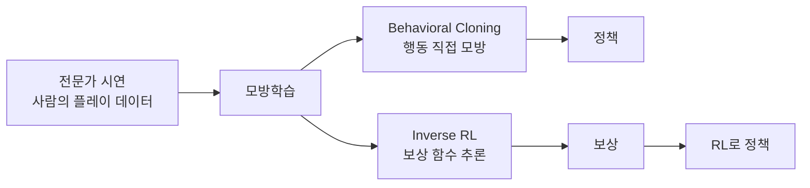
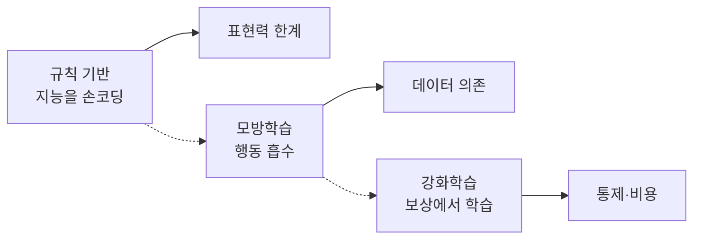
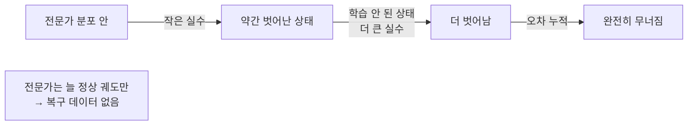
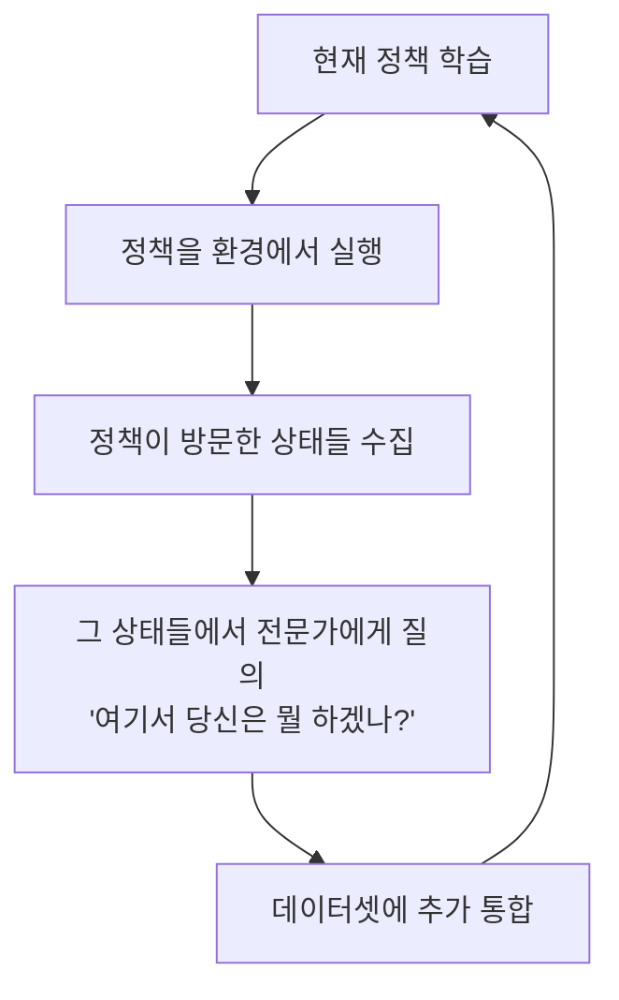
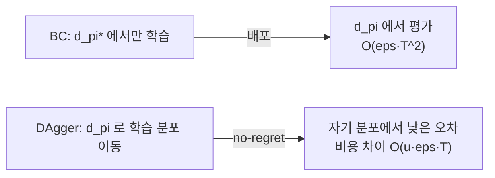
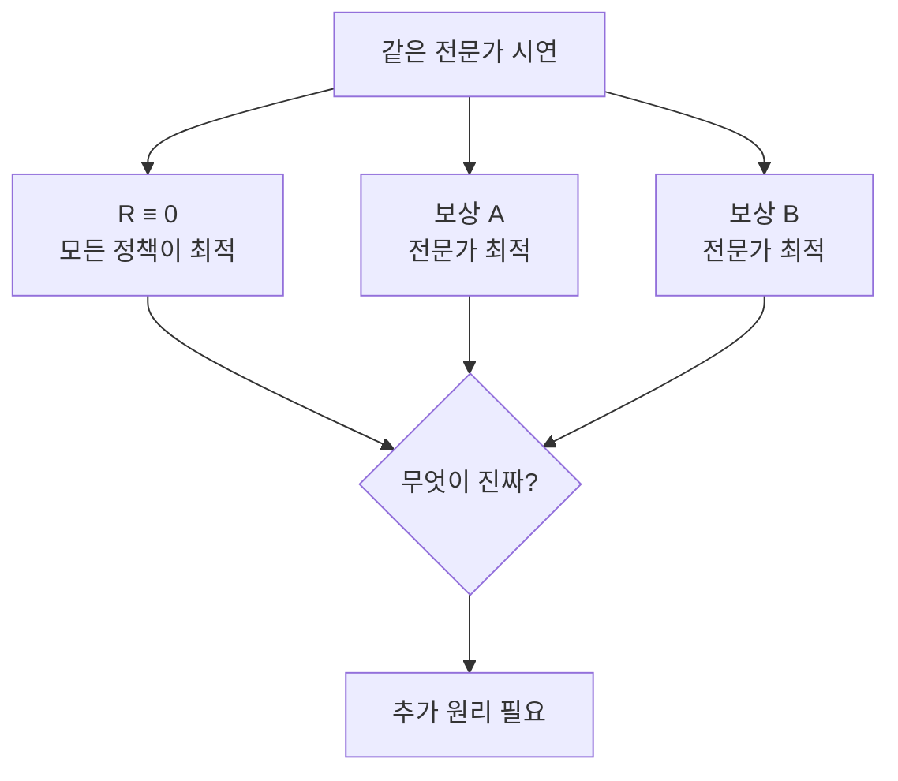
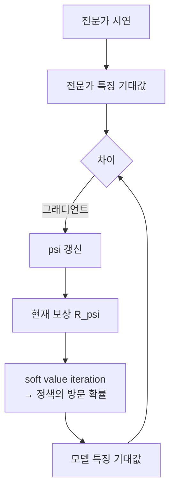
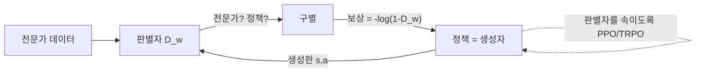

## 들어가며

강화학습은 보상 신호만으로 정책을 만든다. 하지만 보상 설계가 어렵고, 학습이 비싸며, 결과가 "강하지만 이상한" 정책이 되기 쉽다. 게임에는 다른 자산이 있다 — *이미 잘 플레이하는 사람의 데이터* 다. 플레이어가 남긴 수많은 플레이 기록은, "이 상황에서 사람은 이렇게 했다"는 시연(demonstration)의 보고다. 모방학습(Imitation Learning, IL)은 이 데이터에서 직접 배운다. 보상을 정의하는 대신, *전문가를 흉내 내는* 정책을 학습한다.

모방학습의 매력은 두 가지다. 첫째, 원하는 행동을 보상 항들의 간접 조합이 아니라 *시연 분포* 로 지정할 수 있다. 다만 신경망 정책은 여전히 블랙박스이고 분포 밖 행동은 예측하기 어려우므로, 시연을 썼다는 이유만으로 통제 가능성이나 인간다움이 보장되지는 않는다. 둘째, *보상 설계 회피* 다. "좋은 운전"을 스칼라 보상으로 정의하는 대신 좋은 운전 시연을 감독 신호로 쓸 수 있다. Forza의 Drivatar는 플레이어 운전 데이터를 이용해 인간다운 상대를 만들려는 상용 방향을 보여주지만, 공개된 제품 설명만으로 모든 세대의 내부 알고리즘을 특정 모방학습 방법 하나와 동일시해서는 안 된다.

이 글은 가장 단순한 모방인 Behavioral Cloning에서 출발해, 그것이 부딪히는 핵심 문제인 distribution shift를 *왜 오차가 시간 지평의 제곱으로 누적되는지* 까지 증명 수준으로 분해하고, 이를 푸는 DAgger의 no-regret 보증, 그리고 행동이 아니라 *보상 함수를 역으로 추론* 하는 Inverse RL과 그 확장(Maximum Entropy IRL, GAIL)을 다룬다. 각 방법의 알고리즘을 의사코드가 아닌 구체적 코드와 수치 트레이스로 보이고, 실패 모드와 트레이드오프를 정량화한다. Forza의 Drivatar 사례와 데이터 수집의 현실적 문제로 마무리한다.



이 글의 목표.

1. **동기** — 데이터에서 배우는 통제 가능한 AI, RL과의 정확한 분업.
2. **Behavioral Cloning** — 행동의 지도학습, 이산/연속, 멀티모달 함정.
3. **distribution shift** — $O(T^2)$ 오차 누적의 증명과 트레이스.
4. **DAgger** — 전문가에게 다시 묻기, no-regret과 $\beta$ 스케줄.
5. **Inverse RL** — 보상 함수 역추론, ill-posed 문제.
6. **MaxEnt IRL** — 분배 함수, 특징 기대값 일치, 그래디언트.
7. **GAIL** — 적대적 모방, 판별자=보상, occupancy measure.
8. **Drivatar와 데이터 수집** — 상용 사례, 데이터 품질의 상한.


---

## 목차
1. [모방학습의 동기](#1-모방학습의-동기)
2. [Behavioral Cloning](#2-behavioral-cloning)
3. [Distribution Shift 문제](#3-distribution-shift-문제)
4. [DAgger 알고리즘](#4-dagger-알고리즘)
5. [Inverse RL의 발상](#5-inverse-rl의-발상)
6. [Maximum Entropy IRL](#6-maximum-entropy-irl)
7. [GAIL](#7-gail)
8. [Drivatar와 데이터 수집](#8-drivatar와-데이터-수집)


---

## 1. 모방학습의 동기

### 문제 설정과 표기

모방학습은 *전문가의 시연으로부터 정책을 학습* 한다. 전문가 정책 $\pi^*$가 만든 상태-행동 쌍의 집합 $\mathcal{D} = \{(s_i, a_i)\}_{i=1}^N$이 입력이고, 그 전문가처럼 행동하는 정책 $\pi_\theta(a|s)$가 출력이다. 환경은 마르코프 결정 과정(Markov Decision Process, MDP) $(S, A, P, \rho_0, T)$로 본다 — 상태 $S$, 행동 $A$, 전이 확률 $P(s'|s,a)$, 초기 상태 분포 $\rho_0$, 시간 지평 $T$.

여기서 핵심은 *보상 함수 $R$이 입력에 없다* 는 점이다. 강화학습은 $R$을 받아 $\pi$를 찾지만, 모방학습은 $R$ 없이 시연만으로 $\pi$를 찾는다. 이 차이가 모든 것을 결정한다.

| 축 | 강화학습(RL) | 모방학습(IL) |
|---|---|---|
| 학습 신호 | 보상 함수 $R$ | 전문가 시연 $\mathcal{D}$ |
| 보상 설계 | 필요 (어려움) | 불필요 |
| 최적화 대상 | 기대 누적 보상 | 시연 행동·방문 분포 또는 추론한 보상 |
| 데이터 | 자체 탐험으로 생성 | 미리 수집된 시연 |
| 탐험 | 필요 (비쌈) | 불필요(BC) / 부분 필요(DAgger·GAIL) |
| 일반화 근거 | 보상 최대화 | 전문가 행동 또는 의도 |

### 왜 게임에서 인간다움이 자산인가

게임에서 모방학습이 매력적인 핵심 이유는 *인간 행동 분포를 직접 목표로 삼을 수 있다는 점* 이다. 승률만 최대화한 NPC는 반응 시간과 조준 오차 같은 인간 제약을 재현하지 않을 수 있다. 사람 데이터를 모방하면 실수와 스타일이 데이터에 포함될 수 있지만, 평균화·데이터 편향·분포 이동 때문에 그것이 자동으로 보존되는 것은 아니다.

레이싱 게임에서 상대 AI가 친구의 운전 버릇을 따르거나 격투 게임 봇이 선수의 패턴을 보이게 만드는 것이 모방학습의 목표가 될 수 있다. "인간적으로 운전하되 너무 못하거나 지나치게 완벽하지 않게"를 스칼라 보상만으로 명세하면 많은 대리 항과 가중치가 필요하다. 시연은 그 목표를 더 직접적으로 표현하지만, 충분한 상태 범위·일관된 라벨·적절한 정책 표현력이 필요하다.

### 분업의 지도

모방학습은 규칙 기반 AI와 강화학습 사이에 위치한다. 규칙은 지능을 손으로 코딩하고, RL은 보상에서 처음부터 학습하며, 모방학습은 *사람의 행동을 흡수* 한다.



이 글에서 다루는 네 방법은 모두 같은 입력($\mathcal{D}$)에서 출발하지만, *무엇을 모방하느냐* 가 다르다. BC와 DAgger는 행동을 직접 베끼고, IRL과 GAIL은 행동 뒤의 의도(보상 또는 그 등가물)를 추론한다. 이 축이 일반화 능력과 계산 비용의 트레이드오프를 가른다.

## 2. Behavioral Cloning

가장 단순하고 직접적인 모방학습이 *Behavioral Cloning(BC)* 이다. 발상은 명쾌하다 — 상태를 입력, 전문가의 행동을 정답으로 하는 *지도학습(supervised learning)* 으로 정책을 학습한다. 모방학습 문제를 통째로 *i.i.d. 분류/회귀* 문제로 환원한다.

### 목적 함수

BC는 전문가 상태 분포 $d_{\pi^*}$ 아래에서 행동 예측 손실을 최소화한다.

$$\theta^* = \arg\min_\theta \; \mathbb{E}_{s \sim d_{\pi^*}}\big[\, \ell(\pi_\theta(s),\, \pi^*(s)) \,\big]$$

여기서 $\ell$은 행동 손실이다. *이산 행동* 이면 분류 — 전문가 행동을 정답 클래스로 보는 교차 엔트로피. *연속 행동* 이면 회귀 — 조향각·가속 같은 출력의 평균제곱오차(MSE) 또는 가우시안 정책의 음의 로그우도.

```cpp
// Behavioral Cloning: 전문가 데이터로 지도학습
void TrainBC(Policy& policy, std::vector<Demo> demos) {
    for (int epoch = 0; epoch < kNumEpochs; ++epoch) {
        Shuffle(demos);                          // i.i.d. 가정 — 순서 무작위화
        for (const MiniBatch& mb : Batches(demos, kBatch)) {
            // 이산: cross-entropy, 연속: MSE 또는 -log N(a|mu,sigma)
            float loss = 0.f;
            for (const Demo& d : mb) {
                ActionDist pred = policy.Forward(d.state);
                loss += ActionLoss(pred, d.expertAction);
            }
            policy.Backprop(loss / mb.size());   // 흉내 내도록 갱신
        }
    }
}
```

BC는 표준 지도학습 그대로다. "이 상태에서 전문가는 이 행동을 했다"를 학습 쌍으로 삼아 정책을 훈련한다. *훈련 자체* 는 환경 상호작용 없이 오프라인으로 가능하지만, 정책 평가와 안전성 검증에는 환경 실행이 필요하다. 자율주행 초기 연구(ALVINN, 1989)부터 이 방식이 쓰였고, 학습 분포와 배포 분포가 충분히 겹치면 강한 기본선이 된다.

### 멀티모달 행동의 함정

연속 행동에서 MSE 회귀는 *조용한 실패* 를 부른다. 갈림길에서 전문가가 어떤 시연에서는 왼쪽, 다른 시연에서는 오른쪽으로 갔다고 하자. 둘 다 올바른 행동이지만, 단일 가우시안 정책을 MSE로 학습하면 두 모드의 *평균* — 즉 정면(벽)으로 가는 행동 — 을 출력한다. 평균이 두 정답 사이의 *틈* 에 떨어진다.

```text
전문가 시연 분포(조향각):   왼쪽(-30°) 50%,  오른쪽(+30°) 50%
단일 가우시안 MSE 학습 결과:  평균 0° (정면) — 벽으로 직진
```

이 문제는 정책의 *표현력* 문제다. 해법은 출력 분포를 멀티모달로 만드는 것이다 — 혼합 밀도 네트워크(Mixture Density Network, 여러 가우시안의 혼합), 행동 공간 이산화(연속 조향각을 빈으로 나눠 분류로), 또는 최근의 확산 정책(diffusion policy). 핵심은 "정답이 여럿일 수 있다"를 모델이 담을 수 있어야 한다는 것이다.

### 인과 혼동

BC의 또 다른 미묘한 함정은 *인과 혼동(causal confusion)* 이다. 입력에 과거 행동의 결과나 행동과 우연히 상관된 변수가 있으면, 정책이 의사결정 원인 대신 그 단축 경로를 학습할 수 있다. 예를 들어 방향지시등 상태와 회전 행동이 시연에서 항상 함께 나타나면, 도로 형상보다 표시등을 이용해 조향을 예측할 수 있다. 배포 시 그 상관관계가 깨지면 정책도 무너진다. 따라서 입력 특징은 "예측에 도움이 되는가"뿐 아니라 "정책이 개입해 행동할 때도 관계가 유지되는가"를 따져야 한다.

BC의 장점은 단순함과 효율이지만, 치명적 약점이 있다. *전문가가 가보지 않은 상태에서 무너진다.* 이것이 distribution shift이며, 위의 함정들보다 더 근본적이다.

## 3. Distribution Shift 문제

BC의 근본 문제는 *학습 데이터의 상태 분포와 실행 시 마주치는 상태 분포가 다르다* 는 것이다. 이를 distribution shift(또는 covariate shift)라 한다. BC는 $s \sim d_{\pi^*}$(전문가 방문 분포)에서 손실을 최소화하지만, 배포된 정책은 $s \sim d_{\pi_\theta}$(자신이 방문하는 분포)에서 평가된다. 이 두 분포가 어긋나는 것이 핵심이다.

### 오차 누적의 메커니즘

문제의 메커니즘은 *오차 누적* 이다. BC 정책은 완벽하지 않아 작은 실수를 한다. 그 실수가 에이전트를 *전문가가 가본 적 없는 상태* 로 데려간다. 그 낯선 상태에서 정책은 더 큰 실수를 하고, 더 낯선 상태로 간다. 오차가 눈덩이처럼 불어나 정책이 완전히 무너진다.



레이싱으로 비유하면 명확하다. 전문가는 항상 트랙 중앙으로 잘 달리므로, 데이터에는 *트랙 가장자리에서 복구하는* 상황이 없다. BC 정책이 살짝 가장자리로 가면, 그 상황을 *학습한 적이 없어* 어떻게 복구할지 모르고, 더 벗어나 벽에 박는다. 전문가의 완벽함이 역설적으로 *실패 복구 데이터의 부재* 를 낳는다.

### 왜 $O(T^2)$인가 — 증명 스케치

distribution shift는 BC의 이론적 한계다. 오차가 시간 지평 $T$에 대해 $O(T^2)$로 누적됨이 분석돼 있는데, 이는 지도학습의 $O(T)$보다 나쁘다. 직관을 따라가 보자.

정책이 전문가 상태 분포에서 한 스텝마다 전문가와 다른 행동을 할 평균 확률(0-1 손실)을 $\epsilon$이라 하자. 전문가가 방문하는 $T$개 상태에서의 기대 disagreement 합은 기대값의 선형성으로 $\epsilon T$다. 이 계산에는 스텝별 독립성이 필요하지 않다. 그러나 학습 정책을 직접 실행하면 한 번의 다른 행동이 이후 상태 분포 자체를 바꿀 수 있다.

직관을 위해 각 정상 상태의 이탈 확률이 모두 $\epsilon$인 동질한 절벽 환경을 생각하자. $t$에서 처음 이탈할 확률을 거칠게 $\epsilon$으로 상계하고, 이후 남은 $T-t$ 스텝의 비용이 모두 1일 수 있다고 두면 다음 이차 surrogate를 얻는다.

$$\text{총 오차} \;\le\; \sum_{t=1}^{T} \epsilon \cdot (T-t) \;=\; \epsilon \cdot \frac{T(T-1)}{2} \;=\; O(\epsilon\, T^2)$$

이 식은 $\epsilon T\ll1$인 구간에서 절벽 환경의 실제 기대비용과 같은 차수를 보이는 직관이며, 모든 $\epsilon,T$에서의 실제 비용 공식은 아니다. 스텝 비용이 최대 1이면 총비용은 $T$를 넘을 수 없고, 일반 상한은 스텝별 손실 분포와 cost-to-go를 사용해야 한다.

### 수치 트레이스

작은 수치로 보면 체감이 분명하다. 스텝당 오차 $\epsilon = 0.01$(99% 정확)인 정책을 가정한다.

| 시간 지평 $T$ | 전문가 분포 disagreement 합 $\epsilon T$ | 절벽 MDP의 실제 기대비용 |
|---:|---:|---:|
| 10 | 0.1 | 약 0.4 |
| 100 | 1.0 | 약 36.6 |
| 1,000 | 10 | 약 900.0 |

$T=1{,}000$에서는 초반에 한 번 이상 이탈할 확률이 매우 높아 기대비용이 상한 $T$에 가까워진다. `99%`라는 전문가 분포상의 단일 스텝 정확도가 실행 궤적의 성공률을 뜻하지 않는 이유다. 표의 실제 값은 아래 절벽 MDP에서 독립적인 이탈 확률을 가정한 예이며, 일반 환경의 실패율은 복구 가능성과 cost-to-go로 결정된다.

### 정확한 정리와 일치하는 하한 — 이차는 느슨함이 아니라 본질이다

위의 합 $\sum_t \epsilon\,(T-t)$은 *상한의 직관* 이다. 그렇다면 $T^2$는 분석이 헐거워 생긴 군더더기인가, 아니면 BC 자체의 본질인가? Ross와 Bagnell(2010)이 양쪽을 닫았다 — 정확한 상한과, 그 상한을 *실제로 달성하는* MDP다.

표기를 정리한다. 학습 정책 $\hat\pi$의 전문가 분포 아래 평균 0-1 손실을

$$\epsilon \;=\; \frac{1}{T}\sum_{t=1}^{T}\mathbb{E}_{s\sim d_{\pi^*}^{t}}\big[\mathbb{1}(\hat\pi(s)\neq\pi^*(s))\big]$$

로 두고, 스텝 비용 $C(s,a)\in[0,1]$, 총비용 $J(\pi)=\sum_{t}\mathbb{E}_{s\sim d_{\pi}^{t}}[C(s,\pi(s))]$로 정의한다.

상한 정리. 비용이 $[0,1]$에 갇혀 있으면

$$J(\hat\pi)\;\le\;J(\pi^*)+T^2\,\epsilon.$$

논증의 골격은 cost-to-go의 결합이다 — $\hat\pi$와 $\pi^*$의 궤적을 같은 난수로 짝지으면 *첫 이탈 전까지* 동일하다. 각 스텝의 이탈 확률은 그 스텝의 0-1 손실로 막히고(전체 $T$개 합이 $T\epsilon$), 한 번 이탈하면 남은 cost-to-go 차이가 최대 $T-t\le T$다. 이 두 $T$가 곱해져 $T\cdot T\epsilon$이 나온다. 지도학습의 $\epsilon T$와 다른 곳은 둘째 $T$ 하나뿐이고, 그 출처가 바로 "한 번의 실수가 이후 전부를 오염시킨다"는 순차성이다.

하한(절벽 MDP). 같은 차수를 *달성하는* 구성으로 이차가 본질임을 본다. 길이 $T$의 사슬을 두고, 각 "정상" 상태에서 옳은 행동 하나만 다음 정상 상태로 잇는다(비용 0). 다른 어떤 행동도 *흡수되는 나락* $B$로 떨어뜨리고, $B$의 모든 상태는 비용 1이며 복귀 행동이 없다.

```text
g0 → g1 → g2 → ... → g_{T-1}     정상 경로, 비용 0
 │    │    │
 ↓    ↓    ↓    한 번의 오행동 → 복귀 불가
 B (흡수): 모든 상태 비용 1/스텝
```

전문가는 정상 경로만 달리므로 $J(\pi^*)=0$. 학습 정책이 정상 상태마다 확률 $\epsilon$로 어긋나면(전문가 분포 아래 0-1 손실 정확히 $\epsilon$), 첫 이탈 시각 $\tau$는 기하분포이고 그 뒤 $T-\tau$ 스텝을 나락에서 비용 1로 보낸다. 기대 총비용은

$$J(\hat\pi)\;=\;\sum_{t=1}^{T}(1-\epsilon)^{t-1}\,\epsilon\,(T-t).$$

이 합의 거동이 핵심이다. $\epsilon T\ll 1$이면 $(1-\epsilon)^{t-1}\approx 1$이라 $J\approx\epsilon\frac{T(T-1)}{2}=\Theta(\epsilon T^2)$ — 상한과 상수 $\tfrac12$까지 일치한다. 즉 이차는 느슨한 분석의 산물이 아니라, BC가 *전문가 분포에서만, 복구 데이터 없이* 배운다는 사실의 필연적 귀결이다.

다만 경계가 있다. 총비용은 어떤 정책도 $T$를 넘을 수 없으므로($C\le 1$/스텝), $\epsilon T$가 1을 넘어서면 $J$는 $\Theta(\epsilon T^2)$가 아니라 $\Theta(T)$로 *포화* 한다 — 거의 확실히 일찍 이탈해 끝까지 실패하는 구간이다. 그래서 $\tfrac12\epsilon T^2$ 형태의 수치 surrogate는 $\epsilon=O(1/T)$인 구간에서만 실제 기대비용과 같은 차수를 보이고, 그 밖에서는 $T$를 넘는 느슨한 상계가 될 수 있다. 표는 이 포화를 반영해 exact cliff-MDP 합을 사용했다.

```python
eps = 0.01
for T in (10, 100, 1000):
    J = sum((1 - eps) ** (t - 1) * eps * (T - t) for t in range(1, T + 1))
    print(T, round(J, 1), round(0.5 * eps * T * T, 1))
# T=10   -> J=0.4   surrogate=0.5   (eps*T=0.1, 이차 구간: 둘이 일치)
# T=100  -> J=36.6  surrogate=50.0  (eps*T=1, 전이 구간)
# T=1000 -> J=900.0 surrogate=5000  (eps*T=10, J는 ~T로 포화; 5000은 상한일 뿐)
```

DAgger로의 다리. 이 하한은 또한 DAgger의 $O(\epsilon T)$가 *공짜가 아님* 을 드러낸다. DAgger의 선형 보증(Ross·Gordon·Bagnell, 2011)은 한 번의 실수가 키우는 cost-to-go 벌점

$$u\;=\;\max_{t,\,s}\big[\,Q^{\pi^*}_{T-t+1}(s,\hat\pi(s))-V^{\pi^*}_{T-t+1}(s)\,\big]$$

에 대해 $J(\hat\pi)\le J(\pi^*)+u\,T\,\epsilon+\tilde{O}(1)$ 형태다. 전문가가 실수에서 $O(1)$ 스텝에 복구할 수 있으면 $u=O(1)$이라 선형 $O(T)$지만, 위 절벽 MDP는 복귀가 없어 $u=T$ — DAgger조차 거기서는 $O(T^2)$를 벗어나지 못한다. 즉 선형 보증 $O(u\epsilon T)$가 사실상 $O(T)$가 되는 것은 *복구 가능성* ($u=O(1)$)이라는 가정 위에서만 성립한다. 그 학습 분포 이동을 실제로 구현하는 것이 DAgger다.

## 4. DAgger 알고리즘

DAgger(Dataset Aggregation, Ross et al. 2011)는 distribution shift를 *전문가에게 다시 묻는* 방식으로 푼다. 핵심 통찰은 "정책이 *실제로 마주치는* 상태에서 전문가라면 어떻게 했을지를 배워야 한다"는 것이다. BC가 $d_{\pi^*}$에서 학습하는 반면, DAgger는 학습 분포를 점차 $d_{\pi_\theta}$ 쪽으로 끌어온다.



### 반복과 $\beta$ 스케줄

초기 반복에서는 정책이 너무 나빠 의미 있는 상태를 방문하지 못한다. 그래서 DAgger는 *혼합 정책* 으로 데이터를 모은다 — 확률 $\beta_i$로 전문가를, $1-\beta_i$로 학습 정책을 따른다. $\beta$는 반복이 진행되며 0으로 감쇠한다($\beta_1 = 1$로 첫 반복은 순수 BC와 동일, 이후 $\beta_i = p^{i-1}$ 같은 기하 감쇠). 단, *라벨(정답)은 항상 전문가* 가 준다 — 누가 운전대를 잡았든 "전문가라면 무엇을 했을지"를 기록한다.

```cpp
Policy FitBC(const Dataset& data) {
    Policy p;
    TrainBC(p, data.ToDemoVector());
    return p;
}

Dataset data = initialExpertDemos;          // D_1: 초기 전문가 시연
Policy pi = FitBC(data);                    // 새 정책을 학습해 반환하는 편의 함수
std::vector<Policy> allPolicies{pi};
for (int i = 1; i <= kNumIters; ++i) {
    float beta = Pow(kP, i - 1);            // 기하 감쇠, beta_1 = 1
    Trajectory traj;
    State s = env.Reset();
    for (int t = 0; t < kHorizon; ++t) {
        // 혼합 정책: 확률 beta로 전문가, 아니면 학습 정책이 운전
        Action driveAction = (Rand() < beta) ? expert.Act(s) : pi.Act(s);
        Action expertLabel = expert.Query(s); // 라벨은 언제나 전문가
        traj.Add({ s, expertLabel });          // 방문 상태 + 전문가 정답
        s = env.Step(driveAction).next;
    }
    data.Append(traj);                       // D <- D ∪ 새 데이터 (Aggregation)
    pi = FitBC(data);                        // 누적 전체로 재학습
    allPolicies.push_back(pi);
}
return BestOnValidation(allPolicies);        // 검증 성능 최고 정책 선택
```

### 왜 작동하는가 — no-regret 관점

DAgger가 BC의 한계를 푸는 방식이 핵심이다. BC는 *전문가가 방문한 상태* 만 학습하지만, DAgger는 *정책이 방문한 상태* — 즉 실수로 들어간 낯선 상태 — 에서 전문가의 정답을 얻어 학습한다. 가장자리로 벗어난 상태에서도 "전문가라면 이렇게 복구한다"는 데이터가 쌓여, 복구 능력이 생긴다.

이론적 보증은 *온라인 학습의 no-regret* 으로 설명된다. 각 반복을 "현재 정책의 방문 분포"에서 정의된 손실에 대한 온라인 예측 문제로 보면, 데이터 누적 학습기의 평균 regret이 작을 때 반복 중 하나 또는 혼합 정책의 자기 방문 분포상 손실도 작아진다. 이를 총비용으로 바꾸면 핵심 항은

$$J(\hat\pi) \le J(\pi^*) + uT\epsilon + \text{regret·mixing 항}$$

꼴이다. $u$는 한 번 전문가와 다른 행동을 했을 때 늘어날 수 있는 최대 cost-to-go다. 복구가 $O(1)$ 비용이면 $u=O(1)$이라 $O(\epsilon T)$가 되지만, 복귀 불가능한 절벽에서는 $u=\Theta(T)$라 $O(\epsilon T^2)$가 남는다. DAgger가 제거하는 것은 학습·배포 분포 불일치이지, 한 번의 행동이 만드는 환경의 비가역적 피해가 아니다.



### 대가와 적용 조건

DAgger의 대가는 *전문가가 반복적으로 필요* 하다는 것이다. 정책이 새로 방문한 상태마다 전문가가 정답을 줘야 한다. 사람 전문가라면 매 반복 추가 라벨링을 해야 해 비싸고, 더 어려운 것은 *맥락 없는 라벨링* 이다 — 정책이 만든 이상한 상태("차가 벽을 향해 비스듬히 미끄러지는 중")의 스냅샷만 보고 "여기서 뭘 하겠나"를 답하기는 사람에게 부자연스럽다.

DAgger는 전문가가 스크립트나 기존 AI여서 자동 질의할 수 있을 때 특히 편리하다. 게임에서는 비싼 탐색 기반 플래너나 특권 정보를 쓰는 교사를 전문가로 두고, 런타임 정책으로 증류할 수 있다. 사람 전문가를 쓰려면 안전한 혼합 정책, 질의할 상태 선택, 라벨링 UI, 잘못된 상태를 보여 줄 맥락 설계까지 비용 모델에 포함해야 한다.

## 5. Inverse RL의 발상

BC와 DAgger는 *행동을 직접* 모방한다. Inverse Reinforcement Learning(IRL)은 한 단계 추상화한다 — 전문가가 *어떤 보상 함수를 최대화하고 있다* 고 가정하고, 그 *보상 함수를 역으로 추론* 한다.


### 왜 행동이 아니라 보상인가

왜 행동이 아니라 보상을 추론하는가? 보상이 환경별 행동보다 이전하기 좋은 표현일 *수 있기* 때문이다. 행동을 직접 모방하면 학습에 없던 새 상황에 약하지만, 전문가의 목적을 잘 식별했다면 새 동역학에서 그 보상을 다시 최적화할 수 있다.

"이 운전자는 충돌 위험을 크게 싫어한다"는 보상을 제대로 추론했다면 새 차량 동역학에서도 그 목적에 맞는 정책을 다시 풀 수 있다. 그러나 특징 표현이 새 환경에서도 같은 의미를 가져야 하고, 시연만으로 의도를 식별할 수 있어야 하며, 새 MDP를 풀 RL 절차도 필요하다. IRL은 이전 가능성을 *제공할 수 있는 표현* 이지 새 트랙·차량·날씨 일반화의 보장이 아니다.

### ill-posed 문제

IRL의 근본 어려움은 *ill-posed* 라는 점이다 — 같은 전문가 행동을 설명하는 보상 함수가 *무수히 많다*. 가장 극단적으로, "모든 상태에 보상 0"이라는 상수 함수 아래에서는 *모든 정책이 동등하게 최적* 이므로, 전문가의 행동도 (무차별하게) 최적으로 설명된다. 보상에 양의 상수를 곱하는 것은 모든 return을 같은 양수배 하므로 최적 정책을 바꾸지 않는다. 반면 보상에 상수를 *더하는* 불변성은 정책이 고르는 종료 길이가 달라지면 일반적으로 성립하지 않는다 — 매 단계 상수를 더하면 더 오래 사는 정책의 return이 더 커지기 때문이다. 상수 이동이 정책 공통항이 되는 것은 고정 horizon이거나 종료 후 흡수 보상까지 같은 기준으로 합산하는 무한 할인계에서다. 따라서 스케일 불변성과 평행이동 불변성은 horizon·termination·보상 타이밍 계약과 함께 구분해 적어야 한다.



초기 IRL(Ng & Russell, 2000)은 전문가 정책이 다른 행동보다 낫도록 만드는 보상을 선형 제약으로 찾고, 퇴화한 해를 피하기 위한 목적함수를 제안했다. 전문가 최적성을 결정적으로 가정하면 실수·부분 시연을 모델링하기 어렵고, slack이나 확률적 행동 모델 같은 추가 가정이 필요하다. 최대 엔트로피 IRL은 차선 행동에 0이 아닌 확률을 부여하는 하나의 확률적 모델이다.

## 6. Maximum Entropy IRL

Maximum Entropy IRL(MaxEnt IRL, Ziebart et al. 2008)은 특징 기대값을 맞추는 궤적 분포 중 엔트로피가 큰 분포를 선택한다. 이는 관측되지 않은 선호를 임의로 결정하지 않으면서 차선 시연에도 확률을 주는 원리다. 다만 보상 비식별성 자체를 없애지는 않는다.

### 확률적 궤적 모델

MaxEnt IRL은 전문가가 *보상에 지수적으로 비례하는 확률* 로 궤적 $\tau = (s_0, a_0, s_1, \ldots)$를 선택한다고 모델링한다.

$$P_\psi(\tau) = \frac{1}{Z_\psi}\,\rho_0(s_0)\!\prod_t P(s_{t+1}\mid s_t,a_t)\,
\exp\!\Big(\sum_t R_\psi(s_t,a_t)\Big)$$

여기서 $\rho_0$와 $P$는 가능한 궤적에 확률 질량을 주는 환경의 base measure이고, $R_\psi$는 흔히 $R_\psi(s,a)=\psi^\top f(s,a)$인 보상, $Z_\psi$는 정규화 상수다. 결정적 동역학에서는 base measure가 가능한 경로를 표시하는 항으로 단순화된다. 높은 보상의 궤적일수록 더 자주 선택되지만 최고 궤적만 확률 1로 고르지는 않는다. 다만 이 전역 지수 가중 궤적 분포가 일반 확률적 MDP에서 *어떤 실행 정책의 occupancy와도 같지 않을 수 있다* 는 점을 구분해야 한다. 환경 전이확률 $P$는 정책이 바꿀 수 없으므로, 행동이 하나뿐이고 종료 결과가 0.5/0.5·보상 0/1이면 전역 tilt는 성공 확률을 $e/(1+e)\approx0.731$로 만들지만 어떤 정책도 환경의 0.5를 바꾸지 못한다. 따라서 이 모델은 고정 시작·결정적 전이의 경로 집합에 한정해 쓰거나, 확률적 환경에는 causal entropy/feasible occupancy 제약을 도입해 정책이 실현 가능한 분포만 다루어야 한다.

이 한 줄짜리 모델이 두 가지를 동시에 해결한다.

- *분포 선택*: 적절한 feasible set에서 엔트로피는 엄격 오목하므로 특징 기대값 제약을 만족하는 최대 엔트로피 *궤적 분포* 는 유일할 수 있다. 그러나 특징이 선형 종속이거나 서로 다른 보상이 같은 occupancy를 만들면 파라미터 $\psi$와 인간의 "진짜 보상"은 여전히 유일하지 않다. potential-based shaping 동치도 남는다.
- *시연의 불완전성 수용*: 전문가도 실수하고 차선책을 택한다. 결정적 모델은 이를 모순으로 보지만, 확률 모델은 "낮은 확률의 선택"으로 자연스럽게 수용한다 — 차선 궤적은 0이 아니라 $\exp$만큼 작은 확률을 받는다.

### 특징 기대값 일치와 그래디언트

학습 목표는 시연의 로그우도 $\sum_{\tau \in \mathcal{D}} \log P(\tau)$를 $\psi$에 대해 최대화하는 것이다. 선형 보상에서 이 로그우도 그래디언트는 놀랍도록 깔끔한 형태가 된다.

$$\nabla_\psi \mathcal{L} \;=\; \underbrace{\frac{1}{|\mathcal{D}|}\sum_{\tau\in\mathcal{D}} f(\tau)}_{\text{전문가 특징 기대값}} \;-\; \underbrace{\mathbb{E}_{\tau \sim P_\psi}[\,f(\tau)\,]}_{\text{현재 모델 특징 기대값}}$$

즉 그래디언트는 *전문가가 평균적으로 보인 특징 통계* 와 *현재 모델의 특징 통계* 의 차이다. 선형 보상과 정확한 기대값 계산에서 두 값이 일치하면 우도의 정지점 조건을 만족한다. 유한 데이터, 정규화, 함수 근사, 근사 RL에서는 최적화 오차와 통계 오차를 별도로 봐야 한다.



두 번째 항(모델 특징 기대값)을 계산하려면 현재 $R_\psi$ 아래의 *상태 방문 빈도* 가 필요하다. 유한 MDP에서는 동적계획법으로 푼다 — 부드러운 벨만 백업(soft value iteration)으로 각 상태의 soft value를 구하고, 거기서 정방향으로 방문 확률을 전파한다. 이것이 MaxEnt IRL의 핵심 계산이며, 동시에 비용의 출처다.

```cpp
// MaxEnt IRL: 특징 기대값을 일치시키도록 보상 가중치 갱신
Vector psi = ZeroInit();
Vector fExpert = AvgFeatureCounts(demos);          // 전문가 특징 기대값(고정)
for (int it = 0; it < kIters; ++it) {
    Reward R = LinearReward(psi);                   // R(s) = psi . f(s)
    // 1) soft value iteration → 상태별 soft value
    auto V = SoftValueIteration(R, mdp);
    // 2) 정책의 상태 방문 빈도 전파
    auto svf = ExpectedStateVisitFreq(V, mdp, R);
    // 3) 모델 특징 기대값
    Vector fModel = FeatureExpectation(svf, mdp);
    // 4) 그래디언트 = 전문가 - 모델, 경사 상승
    psi += kLr * (fExpert - fModel);
}
```

### 한계와 deep 확장

MaxEnt IRL은 확률적 IRL의 중요한 기준점이며, 보상을 신경망으로 둔 확장도 있다. 다만 분배 함수 또는 상태 방문 빈도 계산은 큰 연속 상태에서 근사가 필요하다. 또한 보상 갱신마다 그 보상 아래 정책 또는 방문 분포를 다시 계산하는 중첩 최적화가 생길 수 있다. GAIL은 명시적 보상 복원을 생략하고 정책의 방문 분포를 직접 맞추는 다른 선택이다.

## 7. GAIL

GAIL(Generative Adversarial Imitation Learning, Ho & Ermon 2016)은 IRL의 "보상 추론 → RL"이라는 이중 루프를 건너뛰고, *적대적 학습* 으로 정책을 직접 만든다. GAN(생성적 적대 신경망)의 아이디어를 모방학습에 가져왔다.

### occupancy measure 일치라는 관점

GAIL의 이론적 출발점은 *정책을 occupancy measure로 본다* 는 것이다. occupancy measure $\rho_\pi(s,a)$는 정책 $\pi$를 따랐을 때 상태-행동 쌍 $(s,a)$를 방문하는 할인 빈도다. occupancy가 같으면 두 정책은 환경에서 같은 할인 상태-행동 통계를 만들고, 방문 확률이 양수인 상태에서는 $\pi(a\mid s)=\rho(s,a)/\sum_b\rho(s,b)$로 행동 분포도 복원된다. 반면 도달하지 않는 상태에서 정책 함수가 같은지는 알 수 없다. Ho와 Ermon은 정규화된 IRL 뒤 RL을 수행하는 절차를 occupancy 최적화로 표현하고, 특정 regularizer에서 적대적 분포 일치 목적을 얻었다.

### 생성자 vs 판별자

GAIL의 구조는 GAN과 같은 *생성자 vs 판별자* 대결이다.

- *생성자(정책 $\pi_\theta$)*: 환경에서 행동을 생성한다. 목표는 판별자를 속이는 것 — "내 상태-행동이 전문가 것처럼 보이게".
- *판별자 $D_w$*: 주어진 상태-행동 $(s,a)$가 *전문가 것인지 정책 것인지* 구별한다. 전문가 데이터에는 1, 정책 데이터에는 0을 출력하도록 학습한다.



### 판별자가 곧 보상이다

여기서는 $D_w(s,a)$를 "전문가일 확률"로 정의했으므로, 정책 보상을

$$r_D(s,a)=-\log\!\big(1-D_w(s,a)+\varepsilon\big)$$

로 두면 전문가처럼 보여 $D_w$가 1에 가까울수록 보상이 커진다. 문헌과 구현에 따라 판별자 라벨을 반대로 정의하거나 포화가 덜한 $\log D_w$ 보상을 쓰기도 한다. 어느 convention을 쓰든 *라벨 의미, 판별자 목적함수, 정책이 최대화할 보상 부호* 세 가지가 일치해야 한다.

```cpp
// GAIL: 판별자와 정책을 번갈아 갱신
for (int it = 0; it < kIters; ++it) {
    auto rollout = pi.Collect(env, kSteps);          // 정책으로 상태-행동 수집

    // 1) 판별자 갱신: 전문가=1, 정책=0 으로 이진 분류
    for (int d = 0; d < kDiscSteps; ++d) {
        auto eb = SampleBatch(expertData);
        auto pb = SampleBatch(rollout);
        // BCE: 전문가는 D->1, 정책은 D->0
        disc.Step(BinaryCrossEntropy(disc, eb, /*label=*/1)
                + BinaryCrossEntropy(disc, pb, /*label=*/0));
    }
    // 2) 판별자를 보상으로 삼아 정책을 RL 갱신
    for (auto& step : rollout) {
        float d = Clamp(disc.Forward(step.s, step.a), kEps, 1.0f - kEps);
        step.reward = -Log(1.0f - d);                    // D=전문가 확률
    }
    pi.UpdatePPO(rollout);                                // 정책 그래디언트
}
```

명시적 보상 함수를 복원하지 않아도 판별자가 *암묵적 학습 신호* 역할을 한다. GAIL은 정책 자신의 rollout에서 학습하므로 순수 BC의 고정된 전문가 상태 분포 문제를 완화할 수 있다. 그러나 매 반복 환경 rollout과 on-policy 최적화가 필요해 환경 표본 효율이 높다고 일반화할 수 없고, MaxEnt IRL과의 비용 비교도 상태 공간·동역학 모델·최적화 방식에 따라 달라진다.

### 비교와 불안정성

세 가지 행동 모방 방법의 위치를 정리하면 분업이 명확해진다.

| 방법 | 환경 상호작용 | 전문가 반복 질의 | distribution shift | 일반화(보상 이전) | 주요 비용 |
|---|---|---|---|---|---|
| BC | 훈련에는 불필요 | 불필요 | 전문가 분포 오차가 최악 $O(\epsilon T^2)$ 비용으로 누적 | 행동 정책만 학습 | 데이터 양·다양성 |
| DAgger | 필요 | 필요 | 핵심 비용 항 $O(u\epsilon T)$ | 행동 정책만 학습 | 반복 라벨링·안전한 rollout |
| MaxEnt IRL | 모델 기반 기대값 또는 내부 최적화 필요 | 불필요 | 모델·특징 가정에 좌우 | 명시 보상 후보를 얻음 | 비식별성·중첩 계산 |
| GAIL | 필요 | 불필요 | 자기 occupancy에서 학습 | 판별자 신호는 정책과 함께 변함 | rollout 비용·적대 학습 불안정성 |

GAIL의 대가는 적대적 최적화의 *학습 불안정성* 이다. 정책과 판별자의 균형이 깨지면 학습이 진동하거나 시연의 일부 모드만 재현할 수 있다. 판별자가 너무 강하면 사용하는 generator loss에 따라 보상이나 그래디언트가 포화할 수 있고, 너무 약하면 유용한 밀도비 신호를 주지 못한다. 판별자 업데이트 수, 정규화, gradient penalty, 정책 entropy, 보상 스케일을 함께 조정해야 한다.

## 8. Drivatar와 데이터 수집

### Forza의 Drivatar

Microsoft와 Turn 10의 공개 설명에 따르면 *Drivatar* 는 머신러닝으로 플레이어 운전 스타일을 모델링해 인간처럼 경쟁하는 상대를 지향한다. 이는 게임 제작에서 "최강 정책"이 아니라 "사람다운 행동 분포"를 데이터로 표현하려는 좋은 제품 사례다.

다만 제품 세대별 특징, 클라우드 집계, 난이도 조정, 레이스 제어 계층이 함께 작동하므로 Drivatar 전체를 순수 BC나 DAgger로 단정할 수 없다. 공개 자료가 확인해 주는 범위와 특정 연구 알고리즘을 구분해야 한다. 여기서 얻을 설계 원리는 더 일반적이다. 플레이어별 스타일 표현과 주행 제어를 분리하고, 학습 출력 위에 충돌 회피·레이스 규칙·난이도 같은 제작 제약을 둘 수 있다.


대규모 플레이 데이터는 희귀 상태의 사례를 늘릴 수 있지만 모든 분포 이동을 없애지는 않는다. 또한 인간다운 상대는 보상 기반 학습으로 원리상 만들 수 없는 것이 아니라, 행동 제약·스타일 조건·보상·시연을 어떤 조합으로 소유할지의 문제다. Drivatar가 보여주는 핵심은 사람의 행동 데이터를 게임 AI의 제작 자산으로 사용할 수 있다는 점이다.

### 데이터 수집의 현실

모방학습은 *데이터에 전적으로 의존* 한다. 이것이 강점이자 현실적 제약이다.

- *데이터 양과 다양성*: 전문가가 안 가본 상황은 모방할 수 없다(distribution shift). DAgger·GAIL은 자기 방문 분포로 이를 일부 메우지만, 그조차 전문가 질의나 충분한 시드 데이터를 요구한다. 다양한 상황의 데이터가 필요하지만, 모든 상황을 시연받기는 어렵다.
- *데이터 품질과 목적의 정렬*: BC와 DAgger의 목적함수는 전문가 라벨과의 일치를 최적화하므로, 과업 보상에서 전문가를 능가한다는 일반 보장은 없다. 모델의 일반화나 여러 시연의 잡음 평균화로 평균 시연자보다 나아질 수는 있지만, 나쁜 편향도 그대로 학습할 수 있다. IRL도 잘못된 특징이나 합리성 가정을 쓰면 다른 보상을 추론한다.
- *멀티모달·일관성*: 여러 사람의 데이터를 섞으면 모순된 정답(같은 코너에서 다른 라인)이 생겨 2절의 평균화 함정에 빠진다. 개인별로 분리하거나 멀티모달 모델이 필요하다.
- *프라이버시*: 플레이어 데이터를 수집·학습하는 것은 프라이버시 문제를 동반한다. 무엇을 수집하는지 고지하고 동의를 받아야 하며, 개인을 식별 가능한 데이터의 취급에 법적·윤리적 기준이 적용된다. Drivatar처럼 개인 스타일을 재현하는 경우 특히 민감하다.
- *수집·운영 인프라*: 온라인 게임은 플레이 데이터를 자연스럽게 모으지만, 저장·전송·집계·재학습 파이프라인에 인프라 비용이 든다. 클라우드 집계는 이 비용을 규모로 정당화한다.

모방학습은 보상 설계의 일부를 데이터 명세로 바꾸지만, 인간 데이터가 자동으로 인간적이고 통제 가능한 결과를 보장하지는 않는다. "원하는 행동을 대표하는 데이터를 충분히, 합법적으로 모을 수 있는가"와 "분포 밖 행동을 어떤 시스템 계약으로 제한할 것인가"가 함께 핵심 질문이다.


---

## 결론

모방학습은 보상 대신 *전문가 시연* 을 직접 학습 신호로 사용할 수 있다. 원하는 행동 분포가 데이터에 있고 학습·배포 분포가 충분히 겹치며 출력 제약이 갖춰졌을 때, 특정 집단이나 개인의 스타일을 가진 AI를 만드는 도구가 된다.

가장 단순한 Behavioral Cloning은 행동을 지도학습으로 모방하지만, 멀티모달 정답의 평균화, 인과 혼동, distribution shift를 겪는다. 전문가 분포의 작은 행동 오차가 복구 불가능한 환경에서는 $O(\epsilon T^2)$ 비용으로 증폭될 수 있다. DAgger는 자기 방문 상태에서 전문가에게 다시 물어 분포 불일치를 줄이지만, 비용 보장은 $O(u\epsilon T)$라 복구 cost-to-go $u$가 핵심이다. Inverse RL은 보상 후보를 역추론하고, MaxEnt IRL은 특징 기대값 아래 궤적 분포를 선택하지만 보상의 비식별성은 남는다. GAIL은 occupancy 차이를 적대적 학습 신호로 바꾸며, 정확한 라벨·보상 convention과 환경 rollout 비용을 요구한다.

이 방법들은 같은 시연 데이터에서 출발하지만 행동, occupancy, 보상 후보 중 무엇을 맞추는지와 환경 상호작용·전문가 질의의 필요성으로 갈린다. 공통 제약은 데이터 대표성, 식별 가정, 배포 분포, 프라이버시, 운영 비용이다. 게임에서는 학습 정책 하나에 통제를 맡기기보다 규칙 기반 불변식, 데이터 기반 스타일, 검증 가능한 안전 계층의 책임을 나누는 편이 현실적이다.

## 더 읽을거리

- Ross & Bagnell, "Efficient Reductions for Imitation Learning" (AISTATS 2010) — BC의 $T^2$ 상한과 이를 달성하는 절벽 MDP 하한(이차의 필연성), forward training의 $O(T)$.
- Ross, Gordon & Bagnell, "A Reduction of Imitation Learning and Structured Prediction to No-Regret Online Learning" (DAgger, 2011) — distribution shift의 $O(T^2)$ 분석과 no-regret 보증, cost-to-go 벌점 $u$에 의존하는 $O(uT\epsilon)$ 선형 보증.
- Ziebart et al., "Maximum Entropy Inverse Reinforcement Learning" (2008) — MaxEnt IRL, 특징 기대값 일치.
- Ho & Ermon, "Generative Adversarial Imitation Learning" (GAIL, 2016) — occupancy measure 관점과 적대적 모방.
- Ng & Russell, "Algorithms for Inverse Reinforcement Learning" (2000) — IRL의 시작, ill-posed와 마진 기반 접근.
- Pomerleau, "ALVINN: An Autonomous Land Vehicle in a Neural Network" (1989) — BC의 고전.
- de Haan, Jayaraman & Levine, "Causal Confusion in Imitation Learning" (2019) — 인과 혼동 함정.
- Microsoft Research, Forza Drivatar 기술 자료 — 세그먼트 기반 운전 스타일 학습의 상용 사례.
- Osa et al., "An Algorithmic Perspective on Imitation Learning" (2018) — IL 전반의 통합적 서베이.
