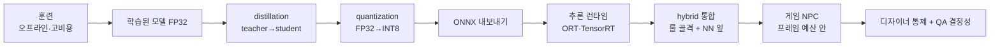
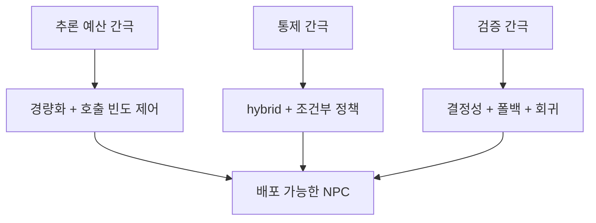
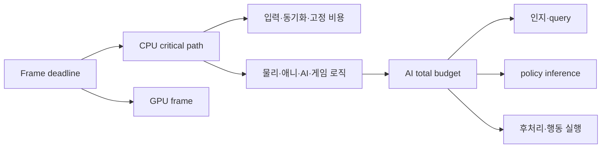
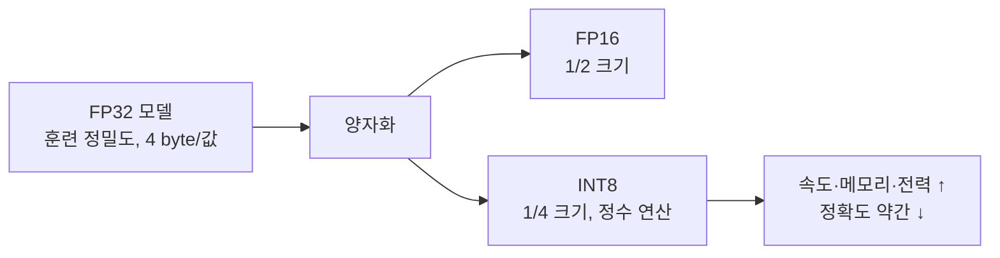
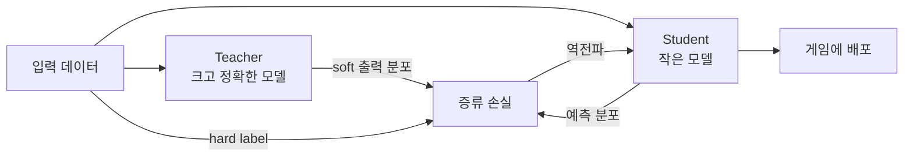
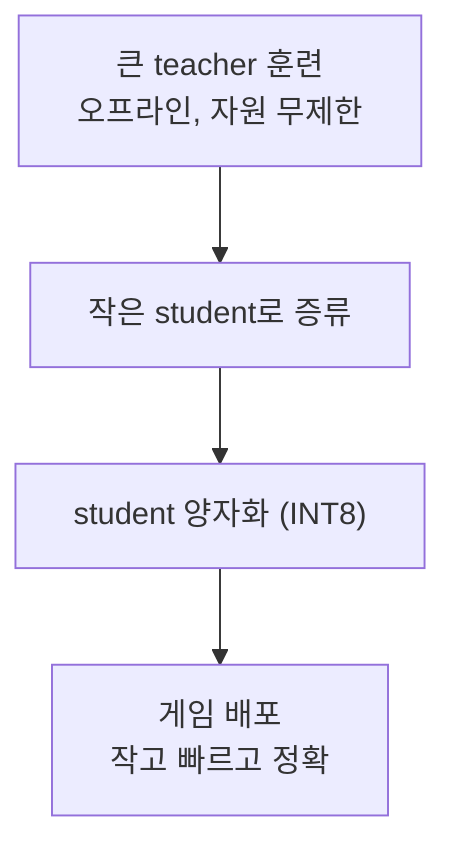
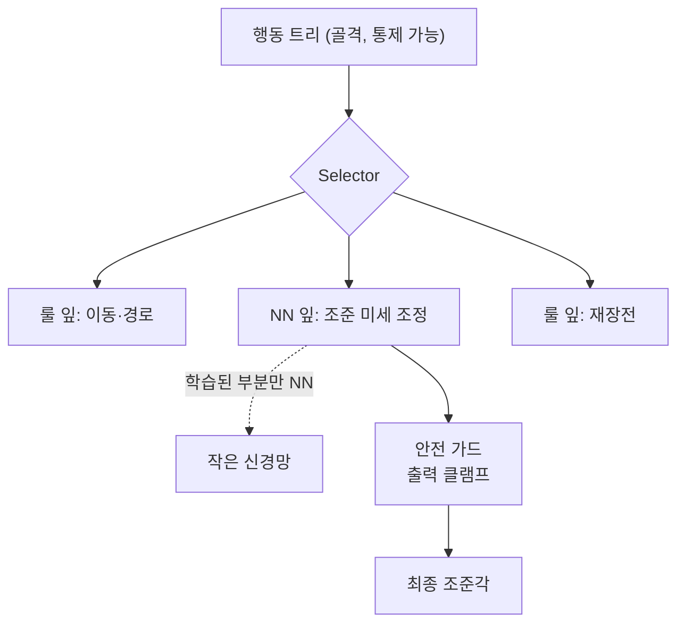
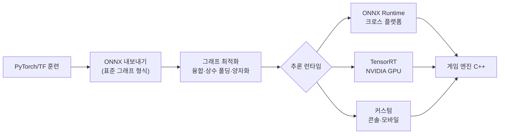
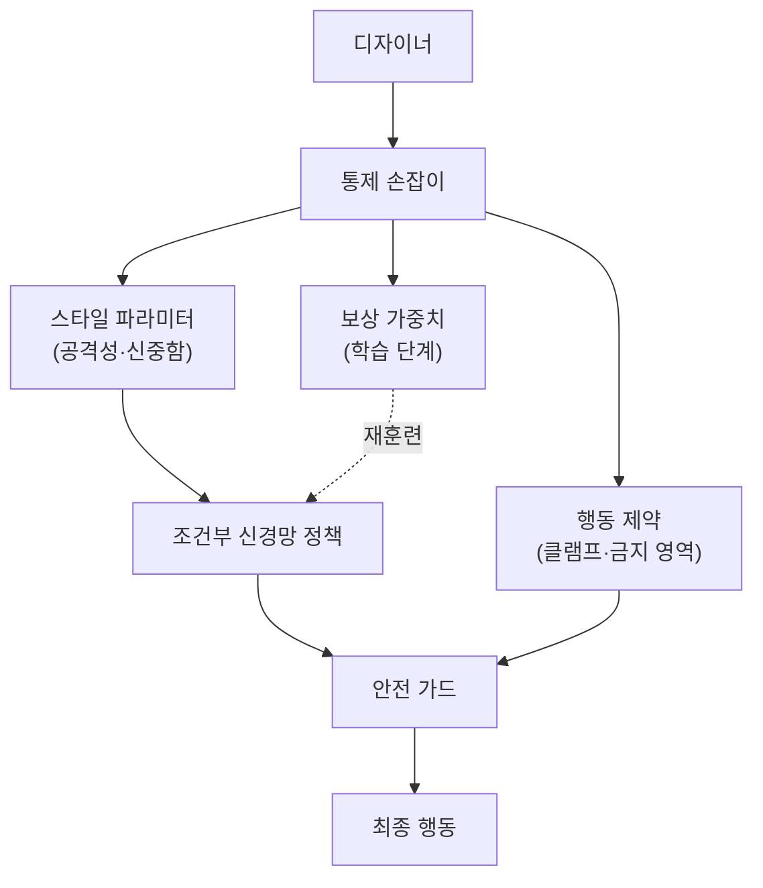

## 들어가며

학습된 신경망을 연구 환경에서 훈련하는 일과 프레임 기반 게임에 배포하는 일은 서로 다른 예산을 가진다. 훈련은 오프라인 연산량과 표본 효율이 중요하고, 배포는 대상 하드웨어의 지연·메모리·전력, NPC 수와 호출 주기, 최악 지연이 중요하다. 학술 시스템도 실시간 환경과 추론 제한을 가질 수 있고, 게임의 AI 예산도 장르와 플랫폼마다 다르므로 "연구는 100ms, 게임은 1~2ms" 같은 보편값은 없다. frame capture에서 확보한 예산을 모델당·NPC당 호출 계약으로 나눠야 한다.

배포의 간극은 단순히 "더 빠르게"가 아니다. 게임 NPC는 디자이너가 통제할 수 있어야 하고, QA가 재현 가능한 입력과 출력을 추적할 수 있어야 하며, 학습 분포 밖 상태에서 안전한 fallback을 가져야 한다. AlphaStar 같은 연구 시스템의 전체 훈련·서비스 구성을 일반 NPC 런타임에 그대로 옮기는 것은 요구사항이 맞지 않지만, 그 이유를 검증되지 않은 고정 추론 배율로 설명할 필요는 없다. 비용, 통제, 재현성과 OOD 안전성이 각각 독립된 배포 계약이다.

이 글은 학습된 신경망을 게임에 배포하는 *현실 공학* 을 다룬다. 추론 비용 예산의 정량 분석, 모델을 작고 빠르게 만드는 quantization과 distillation의 수학과 코드, 룰과 신경망을 섞는 hybrid 아키텍처, 추론 런타임(ONNX/TensorRT)의 그래프 최적화, 디자이너가 학습 모델을 다루는 통제 인터페이스, 그리고 QA가 요구하는 결정성(determinism)을 부동소수점 수준까지 파고든다. EA의 축구 AI와 Microsoft Bonsai를 사례로, "학습 기반 AI가 상용 게임에서 실제로 쓰이는 방식"을 정리한다.



이 글의 목표.

1. **학술/산업 간극** — 훈련과 배포의 차이, 그리고 그 간극이 만드는 공학.
2. **추론 예산** — 프레임 시간 예산의 정량화와 분할·LOD·캐싱.
3. **quantization** — 정밀도를 낮춰 가속하는 수학과 PTQ/QAT.
4. **distillation** — 큰 모델을 작은 모델로, soft label과 온도.
5. **hybrid** — 룰과 신경망의 결합 아키텍처와 안전 가드.
6. **추론 런타임** — ONNX/TensorRT의 그래프 최적화와 플랫폼.
7. **디자이너 통제** — 조건부 정책, 가드, 에디터 통합.
8. **결정성과 QA** — 부동소수점 비결정성, OOD, 폴백, 회귀 테스트.


---

## 목차
1. [학술 RL과 산업 NPC의 간극](#1-학술-rl과-산업-npc의-간극)
2. [추론 비용 예산](#2-추론-비용-예산)
3. [모델 경량화: Quantization](#3-모델-경량화-quantization)
4. [Distillation](#4-distillation)
5. [Hybrid: 룰 + 신경망](#5-hybrid-룰--신경망)
6. [추론 런타임](#6-추론-런타임)
7. [디자이너 통제 인터페이스](#7-디자이너-통제-인터페이스)
8. [결정성과 QA](#8-결정성과-qa)


---

## 1. 학술 RL과 산업 NPC의 간극

### 같은 정책, 정반대의 요구사항

학습 기반 AI의 화려한 성과 — AlphaGo, OpenAI Five, AlphaStar — 와 실제 게임 NPC 사이에는 깊은 간극이 있다. 같은 "신경망 정책"이지만, 요구사항이 정반대다.

| 축 | 학술 연구 | 산업 게임 NPC |
|---|---|---|
| 추론 시간 | 실험 환경·평가 프로토콜의 제한 | frame budget에서 할당한 deadline과 tail latency |
| 연산 자원 | 데이터센터 GPU | 소비자 HW (콘솔·모바일 포함) |
| 목표 | 이기기 (성능 최대화) | 재미·통제·예측 가능 |
| 검증 | 벤치마크 평균 점수 | QA 재현성·개별 버그 추적 |
| 일관성 | 재현성과 통계적 유의성 필요 | replay·네트워크 모델에 맞는 재현성 계약 |
| 실패 모드 | 평균·분산과 실패 사례 보고 | 도달 가능한 edge case와 복구 경로 |

핵심 간극은 셋이다. *추론 예산*은 평균 latency가 아니라 batch 크기, 호출 수와 p95/p99 deadline으로 정한다. *통제*는 디자이너가 스타일·난이도·금지 행동을 조절할 인터페이스를 요구한다. *검증*은 aggregate reward뿐 아니라 특정 입력에서 나온 행동, 모델 버전과 runtime 설정을 재현해야 한다.

### 왜 "이기는 정책"으로 충분하지 않은가

학술 RL의 목표 함수는 보상의 기댓값 $\mathbb{E}[\sum_t \gamma^t r_t]$를 최대화하는 것이다. 게임 NPC의 목표는 이와 어긋난다. *가장 강한 NPC* 는 보통 *가장 재미없는 NPC* 다 — 완벽한 조준, 즉각적 반응, 빈틈없는 위치 선정은 플레이어를 좌절시킨다. 게임 AI의 실제 목표 함수는 "플레이어가 이길 수 있되 도전적인 상대"라는, 정량화하기 어려운 곡선 위에 있다.

이 차이가 학습 기반 NPC 도입을 어렵게 만든다. RL이 최적화하는 목적과 게임이 원하는 경험이 다르면, 학습된 정책을 그대로 썼을 때 강하지만 읽기 어렵거나 단조로운 적이 나올 수 있다. 난이도·스타일을 정책 입력으로 조건화하고, 금지 행동은 룰 가드로 막으며, 학습이 유리한 하위 문제만 정책에 맡기는 hybrid 구조로 통제면을 만들 수 있다.

### 간극을 메우는 공학이 이 글의 전부

이 간극 때문에 실제로 신경망을 NPC에 쓰는 사례는, 대부분 *순수 학습 정책* 이 아니라 *이 간극을 메우는 공학* 위에 서 있다.



세 계약은 서로 대체되지 않는다. 빠른 모델도 금지 행동을 낼 수 있고, 통제 가능한 모델도 플랫폼별 수치 차이로 재현성이 깨질 수 있다. 따라서 성능, 통제, 검증을 각각 측정 가능한 배포 계약으로 둔다.

## 2. 추론 비용 예산

### 프레임 예산의 해부

게임은 frame deadline 안에서 동작한다. 60Hz의 표시 구간은 약 16.67ms이고 120Hz는 약 8.33ms지만, 이것을 시스템별 시간을 단순 합한 표로 바로 나눌 수는 없다. render thread와 GPU, worker job, audio callback은 일부 겹치며 최종 frame time은 critical path와 동기화 지점으로 결정된다. AI 예산은 장르·플랫폼·활성 NPC 수와 다른 시스템의 worst-case 작업을 포함한 frame capture에서 정한다.



예를 들어 측정으로 AI 전체 CPU budget을 1.5ms, 같은 frame에 갱신할 NPC를 50개로 정했다면 단순 평균은 NPC당 30μs다. 이 산수는 목표를 분해하는 예시일 뿐 “게임 AI는 NPC당 30μs”라는 업계 상수가 아니다. 실제 scheduler는 근거리 전투 NPC에 더 많은 budget을 주고, 인지 query·pathfinding·inference를 서로 다른 주기로 실행한다. 평균뿐 아니라 한 frame에 비싼 decision이 몰릴 때의 p95/p99와 deadline miss를 본다.

### 추론 비용을 직접 추정한다

추론 비용의 1차 근사는 곱셈-덧셈(MAC) 연산 수다. 완전연결 신경망의 MAC 수는 층마다 (입력 차원 × 출력 차원)의 합이다. 예를 들어 입력 64, 은닉층 256-256, 출력 16인 작은 MLP를 보자.

$$
\text{MACs} = 64 \times 256 + 256 \times 256 + 256 \times 16 = 16{,}384 + 65{,}536 + 4{,}096 = 86{,}016
$$

약 86K MAC다. 그러나 MAC 수를 peak FLOPS로 나눈 값은 하한에 가까운 roofline 계산일 뿐 실제 latency가 아니다. 작은 tensor는 kernel dispatch·runtime·shape 처리 비용이 지배할 수 있고, weight가 cache에 남는지, SIMD width와 quantized kernel이 맞는지, batch를 만들 수 있는지에 따라 같은 MAC도 달라진다. GPU/NPU는 큰 batch에는 유리해도 NPC 한 개의 작은 model에는 dispatch와 synchronization이 더 비쌀 수 있다.

| 측정 축 | 질문 |
|---|---|
| 연산량 | MAC, activation·normalization·attention 같은 비-MAC 연산은 얼마인가 |
| memory | weight와 activation bytes가 어느 cache에 머무는가 |
| 실행 단위 | NPC 단건 latency인가, 여러 NPC batch throughput인가 |
| runtime | allocation·tensor copy·layout conversion·dispatch가 포함됐는가 |
| tail | cold cache, 첫 실행 compile, 동시 job 경합에서 p99가 얼마인가 |

작은 MLP와 압축된 feature vector는 budget을 맞추기 쉬운 출발점이지만 CNN·transformer가 원천적으로 부적합한 것은 아니다. 입력 해상도, model 구조, accelerator, batch와 갱신 주기가 맞으면 사용할 수 있다. 반대로 작은 MLP도 경계 복사와 runtime allocation이 나쁘면 frame hitch를 만든다.

### 전략 1: 모델을 작게/빠르게

첫 번째 축은 단일 추론 비용 자체를 줄이는 것이다. quantization으로 정밀도와 메모리 대역폭을 줄이고 대상 하드웨어의 정수 커널을 활용하거나, distillation으로 더 작은 student가 teacher의 출력 분포를 학습하게 할 수 있다. 층 수·폭과 입력 표현을 줄이는 구조 변경도 포함된다. 각 방법의 실제 이득은 런타임의 kernel 지원과 정확도 회귀를 함께 측정해야 한다.

### 전략 2: 추론을 분산/생략

두 번째 축은 추론 횟수를 줄이는 것이다. 고수준 행동 선택은 locomotion control보다 느린 시간 규모를 가질 수 있지만 허용 stale time은 행동마다 다르다. 추격/도망 선택을 250ms마다 갱신해도 되는지는 전투 속도와 interrupt 요구로 검증해야 한다. 정책 출력 사이에는 결정적 action controller가 계속 실행되고, 피격·사망·낙하처럼 즉시성이 필요한 event는 캐시된 결정을 취소해야 한다.

세 가지 기법이 있다.

- *시간 분할(time-slicing)*: 매 frame 일부 NPC만 추론한다. N개 bucket으로 균등 분할하면 평균 호출 수는 약 1/N이지만, model 비용과 활성 NPC가 불균등하면 peak는 남는다. deadline·priority queue와 최대 stale time이 필요하다.
- *중요도 LOD*: 거리뿐 아니라 화면 노출, 전투 참여, 플레이어에게 미치는 결과로 주기를 정한다. 화면 밖 NPC도 서버 권위 전투나 소리·경제에 영향을 주면 드물게 갱신할 수 없다.
- *상태 캐싱*: 입력 상태가 직전과 거의 같으면 추론을 생략하고 캐시된 결정을 재사용한다.

```cpp
// 추론 빈도 제어: 모든 NPC가 매 프레임 추론하지 않는다
struct NPC {
    Policy   policy;
    Action   cachedAction;
    bool     hasCachedAction = false;
    float    inferenceTimer = 0.0f;
    float    distanceToCamera = 0.0f;
    State    lastInferState;
};

void UpdateNPC(NPC& npc, float dt) {
    npc.inferenceTimer += dt;
    float interval = LodInterval(npc.distanceToCamera);   // 멀수록 긴 간격
    State s = SenseWorld(npc);                             // 인지

    bool stale = npc.inferenceTimer >= interval;
    bool changed = StateDelta(s, npc.lastInferState) > kEps;  // 상태가 충분히 변함
    if (!npc.hasCachedAction || (stale && changed)) {
        npc.cachedAction   = npc.policy.Infer(s);          // 신경망 추론 (비용 큼)
        npc.hasCachedAction = true;
        npc.lastInferState = s;
        npc.inferenceTimer = 0.0f;
    }
    ExecuteAction(npc, npc.cachedAction, dt);              // 캐시된 결정 실행 (매 프레임)
}
```

### LOD 간격의 정량 효과

거리 LOD가 총 추론 비용에 미치는 영향을 따져 보자. 100마리 NPC가 균등하게 분포하고, 추론 간격을 거리 구간별로 다음과 같이 두면.

| 구간 | NPC 수 | 추론 간격 | 초당 추론 수 |
|---|---:|---:|---:|
| 근거리 (전투 중) | 10 | 100ms | 100 |
| 중거리 | 30 | 500ms | 60 |
| 원거리 (화면 밖) | 60 | 2,000ms | 30 |
| 합계 | 100 | — | 190 |

균등하게 매 프레임 추론하면 100마리 × 60fps = *초당 6,000회* 다. LOD를 적용하면 *초당 190회* 로 30배 이상 줄어든다. 단일 추론을 더 빠르게 만드는 것(전략 1)과 추론 횟수를 줄이는 것(전략 2)은 곱으로 작용하므로, 둘을 함께 쓰면 총비용을 두 자릿수 배수로 낮춘다. 영향력 맵 갱신, 행동 트리 평가, 경로 탐색도 같은 시간 분할 원리로 비용을 평탄화한다는 점에서, 신경망 추론만의 기법이 아니라 게임 AI 일반의 예산 관리 패턴이다.

## 3. 모델 경량화: Quantization

### 정밀도를 낮춘다는 것의 의미

*Quantization(양자화)* 은 신경망의 가중치와 활성값을 *낮은 정밀도* 로 표현해 추론을 가속한다. 보통 32비트 부동소수점(FP32)으로 훈련된 모델을, 추론 시 16비트(FP16) 또는 8비트 정수(INT8)로 변환한다.



### 양자화의 수학

INT8 양자화의 핵심은 실수 범위 $[\alpha, \beta]$를 정수 범위 $[-128, 127]$로 선형 사상하는 것이다. 실수 0을 정확히 표현해야 하는 일반적인 affine quantization에서는 관측 범위를 $\alpha=\min(r_{\min},0)$, $\beta=\max(r_{\max},0)$로 확장하고 $\beta>\alpha$를 보장한다. 비대칭 양자화에서 스케일 $s$와 영점 $z$는 다음과 같다.

$$
s = \frac{\beta - \alpha}{255}, \qquad z = \operatorname{clamp}\!\left(\operatorname{round}\!\left(-\frac{\alpha}{s}\right)-128,\;-128,\;127\right)
$$

실수 $r$을 정수 $q$로, 다시 역으로 복원하는 식은.

$$
q = \text{clamp}\!\left(\text{round}\!\left(\frac{r}{s}\right) + z,\; -128,\; 127\right), \qquad \hat{r} = s\,(q - z)
$$

복원값 $\hat{r}$과 원래 $r$의 차이가 *양자화 오차* 다. 이 오차는 스케일 $s$에 비례하므로, 범위 $[\alpha,\beta]$를 *실제 값 분포에 꼭 맞게* 잡는 것이 정확도 유지의 관건이다. 범위를 너무 넓게 잡으면 해상도가 낭비되고, 너무 좁게 잡으면 바깥값이 클리핑된다.

관측값이 전부 0이면 $\alpha=\beta=0$이라 위 식을 그대로 쓸 수 없다. 이 퇴화 경우는 양자화 값을 모두 0으로 두고 임의의 양의 scale(예: 1)을 저장하거나 런타임의 명시된 zero-tensor 규약을 따른다.

```cpp
// INT8 대칭 양자화: 가중치 행렬을 스케일 하나로 INT8화
struct QuantTensor {
    std::vector<int8_t> q;   // 양자화된 값
    float scale;             // 복원 스케일
};

QuantTensor QuantizeSymmetric(const std::vector<float>& w) {
    float absMax = 0.0f;
    for (float x : w) absMax = std::max(absMax, std::fabs(x));
    QuantTensor out;
    if (absMax == 0.0f) {
        out.scale = 1.0f;                           // 전부 0: 임의의 양수 scale
        out.q.assign(w.size(), int8_t{0});
        return out;
    }
    float scale = absMax / 127.0f;                  // 대칭: z=0
    out.scale = scale;
    out.q.reserve(w.size());
    for (float x : w) {
        int v = static_cast<int>(std::lround(x / scale));
        out.q.push_back(static_cast<int8_t>(std::clamp(v, -127, 127)));
    }
    return out;
}
```

### 양자화 오차는 얼마나 큰가 — $s^2/12$ 잡음과 비트당 6dB

본문은 "오차가 스케일 $s$에 비례한다"고만 적었다. 그 비례 상수가 얼마이고, 비트 수를 한 칸 낮출 때 정확도가 정확히 얼마나 깎이며, 왜 범위 $A$를 분포에 맞추는 것이 "잘 맞으면 좋다" 수준이 아니라 *최소화 문제* 인지를 한 번 유도한다.

가장 가까운 정수로 반올림하는 양자화의 복원 오차는 $e=\hat r-r\in[-s/2,\,s/2]$ 안에 갇힌다. 신호가 격자 간격보다 충분히 넓게 퍼져 있고 격자와 병적으로 상관되지 않으면(고해상도 가정), $e$는 그 구간 위 *균등 분포* 로 근사되고 신호와 독립이다. 그러면 평균은 0, 분산은

$$
\sigma_e^2=\frac1s\int_{-s/2}^{s/2}e^2\,de=\frac1s\cdot\frac23\Big(\frac s2\Big)^3=\frac{s^2}{12}
$$

이다(Bennett 1948; Widrow & Kollár 2008). 즉 RMS 오차는 $s/\sqrt{12}\approx0.289\,s$ — "오차는 $s$에 비례"의 비례 상수가 $1/\sqrt{12}$임을 닫힌 형태로 확정한다.

이제 신호 대 양자화잡음비(SQNR)를 본다. 신호 전력을 $\sigma_x^2$, $b$비트 대칭 범위를 $[-A,A]$(양의 준위 $2^{b-1}-1$개)로 두면 $s=A/(2^{b-1}-1)\approx A/2^{b-1}$이고 $\sigma_e^2\approx A^2/(3\cdot2^{2b})$이므로

$$
\mathrm{SQNR}_{\text{dB}}=10\log_{10}\frac{\sigma_x^2}{\sigma_e^2}
=\underbrace{20b\log_{10}2}_{\approx\,6.02\,b}+10\log_{10}\frac{3\sigma_x^2}{A^2}.
$$

비트 하나는 이 고해상도 균등 양자화 모델에서 $20\log_{10}2\approx6.02$dB를 더한다. 상수항은 부하율 $\sigma_x/A$에 의존한다. 풀스케일 정현파에서는 교과서의 $6.02b+1.76$dB가 나오지만, 임의의 신경망 tensor에 같은 상수를 적용할 수는 없다. 더 중요하게, tensor SQNR은 최종 argmax 보존을 직접 보장하지 않는다. layer별 오차는 비선형 연산을 거쳐 전파되고 두 로짓의 margin이 작으면 작은 오차도 순위를 바꾼다. calibration set에서 logit margin, action disagreement rate와 rollout 결과를 별도로 측정해야 한다.

경계 조건: 6dB 법칙은 *균등(granular) 잡음이 지배하는 영역* 에서만 성립한다. 전체 오차는 균등 잡음($s^2/12$, $A$가 커질수록 증가)과 클리핑 잡음($\pm A$ 바깥값이 포화, $A$가 커질수록 감소)의 합이다. 범위를 고정한 채 비트만 올리면 균등 잡음은 6dB씩 내려가지만 클리핑 잡음은 그대로라, 어느 순간 클리핑이 지배하며 SQNR이 바닥을 친다(수치로 $A=4\sigma$ 가우스는 $b\approx8$까지 비트당 약 6dB, 그 뒤 4σ 꼬리 잡음에 막혀 포화). 그래서 "범위를 분포에 꼭 맞게"는 구호가 아니라

$$
\sigma_e^2(A)=\underbrace{\frac{A^2}{3\cdot2^{2b}}}_{\text{균등}}+\underbrace{\int_{|x|>A}(|x|-A)^2\,p(x)\,dx}_{\text{클리핑}}
$$

를 최소화하는 $A^\star$를 찾는 문제다. 최적은 *내부점* 이다 — max-abs(아무것도 안 자르고 희귀한 꼬리에 해상도를 낭비)도, 너무 좁은 값도 아니다. 8비트에서 그것은 몇 σ 바깥에 있다: 가우스 $A^\star\approx3.92\sigma$(최댓값 약 5.3σ가 아니다), 꼬리가 두꺼운 라플라스는 더 바깥 $A^\star\approx7.0\sigma$. 이것이 정확히 PTQ 보정(백분위·MSE·KL)이 계산하는 양이며, 단순 min-max 보정이 뒤지는 이유다(Banner 외 2019의 해석적 클리핑 ACIQ; Jacob 외 2018).

```python
import numpy as np
rng = np.random.default_rng(0)

# (1) 균등 잡음 분산 == s^2/12
s = 0.01
x = rng.uniform(-3, 3, 2_000_000)
e = np.round(x/s)*s - x
print("Var(e)=%.3e  s^2/12=%.3e  ratio=%.4f" % (e.var(), s*s/12, e.var()/(s*s/12)))

# (2) 비트당 ~6dB (가우스 sigma=1, A=4sigma), 균등 영역
def quant(x, b, A):
    qmax = 2**(b-1)-1
    sloc = A/qmax
    return np.clip(np.round(x/sloc), -qmax, qmax)*sloc
xg = rng.normal(0, 1, 4_000_000); A = 4.0
db = [10*np.log10(xg.var()/(quant(xg,b,A)-xg).var()) for b in range(6,9)]
print("SQNR dB b=6..8:", [round(v,2) for v in db], " per-bit:", [round(db[i+1]-db[i],2) for i in range(2)])

# (3) 최적 클리핑 A*는 내부점 (max-abs 아님)
As = np.linspace(2,12,200)
mse = [np.mean((quant(xg,8,a)-xg)**2) for a in As]
print("A*=%.2f sigma (max|x|=%.2f)" % (As[int(np.argmin(mse))], np.abs(xg).max()))
```

### 양자화의 이득

- *저장량*: INT8 scalar는 1 byte로, 4 byte인 FP32 scalar의 1/4 크기다. 그러나 scale·zero point, padding, FP16/FP32 activation과 runtime workspace가 있어 전체 resident memory가 정확히 1/4이 되는 것은 아니다.
- *속도*: x86 VNNI나 ARM dot-product처럼 INT8 누적에 맞는 명령과 최적화 kernel이 있으면 한 vector에서 더 많은 MAC을 처리할 수 있다. 작은 model의 변환·dispatch 비용이나 지원되지 않는 operator가 지배하면 빨라지지 않을 수도 있다.
- *전력*: 지원 하드웨어에서 정수 kernel의 전력당 처리량이 유리할 수 있다. 실제 소비 전력과 thermal throttling은 target device에서 전체 frame을 측정한다.

### PTQ와 QAT

양자화를 적용하는 두 방법이 있다.

- *Post-Training Quantization(PTQ)*: 이미 훈련된 FP32 모델을 변환한다. 활성값의 범위 $[\alpha,\beta]$를 정하기 위해 실제 배포 분포를 대표하는 calibration set을 흘려보낸다. 필요한 표본 수는 model·상태 분포·outlier와 calibration 알고리즘에 따라 정하며, 드문 보스 상태나 경계 입력이 빠지면 평균 정확도가 좋아도 행동이 깨질 수 있다.
- *Quantization-Aware Training(QAT)*: 훈련 중에 양자화-역양자화 연산을 끼워 넣어, 모델이 양자화 오차에 적응하게 한다. PTQ보다 품질을 더 잘 보존하는 경우가 많지만 데이터·학습 설정에 따라 이득이 없을 수도 있어 같은 배포 지표로 비교해야 한다.

```cpp
// QAT의 핵심: forward에 fake-quant을 삽입, backward는 통과(STE)
float FakeQuant(float x, float scale, int qmin, int qmax) {
    int q = std::clamp((int)std::lround(x / scale), qmin, qmax);
    return q * scale;   // 양자화→역양자화: forward에서만 오차를 본다
}
// 역전파는 Straight-Through Estimator로 기울기를 그대로 통과시킨다
```

### 게임 AI에서 허용 가능한 손실

낮은 정밀도는 출력과 내부 상태를 바꿀 수 있다. 손실이 허용 가능한지는 로짓 margin과 정책의 폐루프 동역학에 달려 있다. 한 시점의 action disagreement가 작아도 상태 전이를 바꿔 장기 궤적이 갈릴 수 있으므로, 프레임별 출력 오차와 rollout 수준의 행동 분포·성공률·안전 조건을 모두 본다.

저장 표현만 비교하면 FP16 scalar는 FP32의 1/2, INT8 scalar는 1/4이다. 속도와 행동 품질에는 이런 보편 비율이 없다. 동일한 model·batch·runtime으로 cold/warm latency, p95/p99, peak memory, energy를 측정하고, 분류 정확도뿐 아니라 action 전환율·승률·경로 실패·드문 상태 회귀를 비교한다. 정수 누적도 backend마다 accumulator width, requantization과 rounding 규칙이 다를 수 있으므로 bit-exact 동기화 경로에 넣으려면 실행 계약을 고정해야 한다. 양자화는 **측정과 calibration 또는 재학습을 동반하는 후보 최적화**다.

## 4. Distillation

### 큰 모델의 지식을 작은 모델로

*Distillation(증류)* 은 *큰 모델(teacher)의 지식을 작은 모델(student)로 옮기는* 기법이다. 양자화가 같은 모델의 *정밀도* 를 낮춘다면, distillation은 *모델 자체의 구조* 를 작게 만든다. 둘은 직교하므로 함께 쓴다.

핵심 발상은 큰 모델의 *출력(soft label)* 을 작은 모델이 흉내 내도록 학습시키는 것이다. 작은 모델이 원본 데이터의 정답(hard label)만 배우는 게 아니라, 큰 모델이 출력한 *확률 분포 전체* 를 모방한다 — 이 분포에 큰 모델이 학습한 "미묘한 지식"이 담겨 있다.



### Soft label과 온도

왜 hard label(정답 하나)이 아니라 soft label(분포 전체)이 더 많은 정보를 주는가? 분류기가 "고양이 0.7, 개 0.25, 자동차 0.05"를 출력했다면, 이 분포는 "고양이지만 개와 헷갈릴 만하고, 자동차와는 전혀 다르다"는 *클래스 간 유사도 구조* 를 담는다. hard label "고양이"는 이 구조를 버린다.

이 구조를 더 잘 드러내기 위해 *온도(temperature)* $T$를 도입한다. 소프트맥스에 온도를 넣으면.

$$
p_i = \frac{\exp(z_i / T)}{\sum_j \exp(z_j / T)}
$$

$T=1$이면 보통의 소프트맥스, $T>1$이면 분포가 *부드러워져* 작은 확률들의 차이가 드러난다. 증류 손실은 student와 teacher의 부드러운 분포 사이의 KL 발산에, 정답에 대한 일반 교차엔트로피를 섞은 것이다.

$$
\mathcal{L} = (1-\lambda)\,\mathcal{L}_{\text{CE}}(y, p_S^{(T=1)}) + \lambda\, T^2\, \mathrm{KL}\!\left(p_T^{(T)} \,\|\, p_S^{(T)}\right)
$$

$T^2$ 보정은 온도로 인해 줄어든 기울기 크기를 되돌리기 위한 것이다. $\lambda$는 두 신호의 가중치다.

```cpp
// Distillation: student가 teacher의 soft 분포를 모방
void DistillStep(Model& student, const Model& teacher,
                 const Sample& x, int label, float T, float lambda) {
    Logits zt = teacher.Forward(x.input);          // teacher 로짓 (고정)
    Logits zs = student.Forward(x.input);          // student 로짓

    auto pt = Softmax(zt, T);                       // teacher soft 분포
    auto psT = Softmax(zs, T);                      // student soft 분포 (증류용)
    auto ps1 = Softmax(zs, 1.0f);                   // student 분포 (정답용)

    float lossKD = T * T * KLDivergence(pt, psT);   // KL(teacher || student)
    float lossCE = CrossEntropy(ps1, label);        // 정답 손실
    float loss   = (1.0f - lambda) * lossCE + lambda * lossKD;
    student.Backprop(loss);
}
```

### 왜 $T^2$ 보정인가 — 온도 소프트맥스의 기울기와 고온 극한

본문은 $T^2$ 보정을 "온도로 줄어든 기울기 크기를 되돌린다"고 결과로만 적었다. 그 인자가 어디서 정확히 $T^2$로 나오는지, 그리고 고온에서 증류가 무엇으로 수렴하는지를 한 번 유도한다.

teacher 로짓을 $v$, student 로짓을 $z$, 온도 소프트맥스를 $q_i=\mathrm{softmax}(v_i/T)$, $p_i=\mathrm{softmax}(z_i/T)$로 둔다. 증류 항은 $\mathcal{L}_{\text{KD}}=T^2\,\mathrm{KL}(q\,\|\,p)$이고 teacher는 고정이다.

먼저 보정 *없는* KL 항의 student 로짓 기울기를 구한다. $\log p_i = z_i/T-\log Z$, $Z=\sum_j e^{z_j/T}$이므로

$$
\frac{\partial \log p_i}{\partial z_k}=\frac1T\big(\delta_{ik}-p_k\big).
$$

$\mathrm{KL}(q\|p)=\sum_i q_i\log q_i-\sum_i q_i\log p_i$에서 $z$에 의존하는 항은 둘째뿐이라

$$
\frac{\partial\,\mathrm{KL}(q\|p)}{\partial z_k}
=-\sum_i q_i\cdot\frac1T(\delta_{ik}-p_k)
=\frac1T\Big(p_k\sum_i q_i-q_k\Big)
=\frac1T\big(p_k-q_k\big).
$$

즉 보정 없는 KL 기울기는 앞에 $1/T$를 달고 있다. 여기에 $T^2$를 곱하면

$$
\frac{\partial\,\mathcal{L}_{\text{KD}}}{\partial z_k}=T^2\cdot\frac1T\big(p_k-q_k\big)=T\,(p_k-q_k).
$$

이제 고온 극한을 본다. $T$가 크면 $z_k/T$가 작아 $e^{z_k/T}\approx 1+z_k/T$이고, 평균 로짓을 $\bar z$로 쓰면 소프트맥스의 시프트 불변성에 의해

$$
p_k\approx\frac1N\Big(1+\frac{z_k-\bar z}{T}\Big),\qquad
p_k-q_k\approx\frac{(z_k-\bar z)-(v_k-\bar v)}{N\,T}.
$$

이를 두 식에 대입하면 두 결과가 갈린다. 보정 없는 KL 기울기는 $\dfrac{(z_k-\bar z)-(v_k-\bar v)}{N\,T^2}$로 $1/T^2$로 *사라진다*. 반면 $T^2$를 곱한 증류 항의 기울기는

$$
\frac{\partial\,\mathcal{L}_{\text{KD}}}{\partial z_k}\approx\frac{(z_k-\bar z)-(v_k-\bar v)}{N}
$$

로 $T$에 *무관* 해지고, 이는 중심화 로짓의 L2 정합 $\dfrac1{2N}\sum_k\big[(z_k-\bar z)-(v_k-\bar v)\big]^2$의 기울기와 정확히 같다. 즉 *고온 증류는 (중심화한) 로짓을 직접 맞추는 회귀로 환원* 된다(Hinton 외 2015 §2.1; Ba & Caruana 2014의 로짓 정합과 동일 극한).

여기서 세 가지가 따라온다.

- *왜 하필 $T^2$인가.* 보정 없는 KD 기울기는 고온에서 $1/T^2$로 줄지만, 정답 교차엔트로피 항은 $T=1$ 경로(코드의 `ps1=Softmax(zs,1)`)라 크기가 $O(1)$로 유지된다. 보정이 없으면 $T$를 올릴수록 증류 신호만 조용히 꺼지고 CE가 지배한다. $T^2$는 두 기울기를 같은 자릿수로 맞춰, 가중치 $\lambda$가 온도와 무관하게 같은 의미를 갖게 한다.
- *고온이 버리는 것.* 극한이 *분포* 정합이 아니라 *중심화 로짓* 정합이라는 점은, 매우 높은 $T$가 teacher의 절대 스케일을 버리고 로짓의 상대 구조만 남긴다는 뜻이다. $T$는 큰 로짓에 집중하는 영역과 전체 로짓 차이를 펴서 보는 영역 사이의 손잡이이며, teacher calibration과 student 용량에 맞춰 검증 집합에서 탐색해야 한다.
- *시프트 불변성.* 극한이 $\bar z,\bar v$를 빼고 나타나는 것은 소프트맥스가 로짓에 상수를 더해도 불변이기 때문이다(모든 로짓에 $c$를 더해도 $q$ 불변, 수치로 $5.6\times10^{-17}$). 따라서 절대 로짓이 아니라 로짓 *차이* 만 학습 신호다.

경계 조건. 코드의 `Softmax`는 반드시 최댓값 차감으로 안정화해야 한다 — $T<1$이고 로짓이 크면 $z/T$가 커져 `exp`가 오버플로하고, 반대로 $T$가 매우 크면 $p_i$가 균등에 가까워 차이 $\sim 1/T$가 단정밀도 정밀도 아래로 묻힌다. 또한 $T^2$ 보정은 KD 항에만 붙고 CE 항에는 붙지 않는다(코드의 `lossKD`만 `T*T`를 곱함). 이 보정을 빠뜨린 채 온도만 올리면, 의도와 달리 증류 가중치를 낮추는 것과 같아진다.

```python
import numpy as np
def softmax(z, T=1.0):
    z = np.asarray(z, float)/T; z -= z.max()
    e = np.exp(z); return e/e.sum()

N = 6
v = np.array([ 1.6,-0.9, 2.4, 0.3,-1.2, 0.7])   # teacher 로짓
z = np.array([ 0.8, 0.1, 1.9,-0.4, 0.5,-1.1])   # student 로짓

# (1) 보정 없는 KL 기울기 == (1/T)(p-q): 유한차분 대조
def kl(q,p): return float(np.sum(q*(np.log(q)-np.log(p))))
for T in (1.0, 4.0, 16.0):
    q, p = softmax(v,T), softmax(z,T)
    g_ana = (p-q)/T
    g_num = np.array([( kl(softmax(v,T), softmax(z+e,T))
                      - kl(softmax(v,T), softmax(z-e,T)) )/(2*1e-6)
                      for e in 1e-6*np.eye(N)])
    assert np.max(np.abs(g_num-g_ana)) < 1e-7

# (2) T^2 보정 후 기울기 T(p-q) -> 중심화 (z-v)/N (고온)
zc, vc = z-z.mean(), v-v.mean()
limit = (zc-vc)/N
for T in (2.0, 8.0, 64.0):
    q, p = softmax(v,T), softmax(z,T)
    print(f"T={T:5.1f}  ||T(p-q) - (z-v)/N|| = {np.linalg.norm(T*(p-q)-limit):.2e}")

# (3) 보정 없으면 1/T^2 로 소멸 (T 2배 -> 약 1/4)
g = [np.linalg.norm((softmax(v,T)-softmax(z,T))/T) for T in (8,16,32,64)]
print("ratios:", [round(g[i]/g[i+1],2) for i in range(len(g)-1)])  # ~4

# (4) 시프트 불변
print("shift-invariance:", np.max(np.abs(softmax(v,4)-softmax(v+10,4))))
```

### 정책 증류와 게임 AI

게임 NPC에서 distillation은 두 형태로 나타난다.

- *정책 증류(policy distillation)*: RL로 훈련한 크고 정확한 정책을 teacher로, 게임에 들어갈 작은 정책을 student로 둔다. student가 teacher의 행동 분포를 모방하면, 작은 모델이 큰 모델의 전략을 상당 부분 물려받는다.
- *앙상블 증류*: 여러 정책의 합의를 하나의 작은 정책으로 압축한다. 다양한 상황에서 강건한 teacher 앙상블의 지식을 단일 student로 옮긴다.

### 처음부터 작게 vs 증류

작은 모델을 처음부터 훈련하는 기준선과 증류한 student를 비교해야 한다. teacher의 soft target이 클래스 관계나 행동 대안의 상대 구조를 제공해 증류가 개선되는 경우가 있지만, teacher 오류·분포 불일치·student 용량·loss 가중치가 맞지 않으면 이득이 없거나 더 나빠질 수 있다. 증류는 보장된 우위가 아니라 같은 배포 크기에서 평가할 학습 방법이다.



distillation의 가치는 *큰 모델로 학습하고 작은 모델로 배포* 하는 분리다. 훈련 시에는 크고 정확한 모델로 좋은 정책을 만들고(오프라인, 자원 무제한), 배포 시에는 그 지식을 압축한 작은 모델을 쓴다(온라인, 예산 제약). 그리고 그 작은 student를 다시 양자화하면, 정확도를 최대한 유지하며 추론 비용을 distillation(구조 축소)과 quantization(정밀도 축소)의 곱만큼 낮춘다.

## 5. Hybrid: 룰 + 신경망

### 왜 순수 신경망 NPC가 드문가

순수 신경망 NPC는 통제와 검증이 어렵다(1절). 그래서 실전에서 가장 흔한 패턴은 *룰 기반과 신경망의 hybrid* 다. 신경망을 NPC 전체가 아니라 *특정 부분* 에만 쓰고, 골격은 통제 가능한 전통 기법(행동 트리·FSM·효용)으로 유지한다.



### 분담의 원칙

hybrid의 전형적 분담은 *통제 가능성이 중요한 곳은 룰, 손코딩이 어려운 곳은 학습* 이다.

- *고수준 의사결정은 룰*: "공격할지 후퇴할지", "어느 표적을 고를지"는 행동 트리·FSM·효용으로. 디자이너가 직접 통제하고 QA가 그래프를 따라 검증한다.
- *저수준 운동은 신경망*: "어떻게 자연스럽게 움직일지"(조준 곡선, 회피 모션, 보행 적응, 충돌 회피)는 학습으로. 사람이 손코딩하기 어려운 미세한 자연스러움을 데이터에서 얻는다.

| 영역 | 기법 | 이유 |
|---|---|---|
| 표적 선택 | 룰/효용 | 디자이너 의도, 검증 필요 |
| 전투 모드 전환 | FSM/BT | 명확한 상태, 디버깅 쉬움 |
| 조준 미세 보정 | 신경망 | 손코딩 어려운 곡선 |
| 보행·회피 모션 | 신경망 | 데이터에서 자연스러움 |
| 안전 제약 | 룰 가드 | 신경망 출력 보증 불가 |

### 안전 가드: 신경망 출력을 룰이 감싼다

hybrid의 핵심 안전장치는 신경망 출력을 *룰로 감싸는* 가드다. 신경망이 학습 분포 밖 상황에서 이상한 값을 내도, 가드가 그것을 합리적 범위로 강제한다.

```cpp
// 신경망 잎: 조준 미세 보정을 NN이 내고, 룰 가드가 범위를 강제
float ComputeAimAngle(const NPC& npc, const Target& tgt) {
    float baseAngle = AngleTo(npc.pos, tgt.pos);        // 룰: 기본 조준
    float nnDelta   = npc.aimNet.Infer(BuildAimInput(npc, tgt));  // NN: 미세 보정

    // 안전 가드: 보정량을 합리적 범위로 클램프
    nnDelta = std::clamp(nnDelta, -kMaxAimDelta, kMaxAimDelta);

    float angle = baseAngle + nnDelta;
    // 추가 가드: 금지 방향(아군 사선)이면 룰 폴백
    if (WouldHitAlly(npc, angle)) angle = baseAngle;
    return angle;
}
```

이 패턴에서 신경망은 *제안* 하고 룰은 검증 가능한 제약을 강제한다. 다만 가드가 검사하지 않는 위험까지 자동으로 안전해지는 것은 아니다. OOD 점수, 입력 유효성, 출력 범위와 도메인 불변식을 검사하고 실패 시 룰 기반 폴백으로 전환한다.

### 검증 부담의 국소화

hybrid의 또 다른 이점은 *검증 부담의 국소화* 다. 순수 신경망 NPC는 모든 행동이 학습 모델에서 나오므로, 어떤 이상 행동이든 모델 전체를 의심해야 한다. hybrid는 신경망이 작은 영역(조준 보정)에만 쓰이므로, *그 부분만* 검증하면 된다. 나머지 행동은 결정적이고 추적 가능한 룰이다.

hybrid는 학습 모델의 권한과 검증 범위를 좁힐 수 있는 실용적 선택이다. 손으로 모델링하기 어려운 인식·운동·점수 추정만 학습에 맡기고, 안전 조건과 고수준 권한은 규칙으로 제한할 수 있다. 특정 상용 시스템의 내부 구조는 공개 자료로 확인되는 범위에서만 사례로 사용하고, 채택 근거는 제품 수가 아니라 실패 격리와 관측 가능성으로 설명해야 한다.

## 6. 추론 런타임

### 훈련 프레임워크와 추론 런타임의 분리

학습된 모델을 게임에서 실행하려면, 훈련 프레임워크(PyTorch·TensorFlow)와 별개의 *추론 런타임* 이 필요하다. 게임은 보통 C++로 작성되고, Python 훈련 환경과 그 거대한 의존성을 게임에 그대로 들일 수 없다. 훈련 프레임워크는 역전파·자동미분·동적 그래프를 위해 무겁고, 추론에는 그중 *순전파* 만 필요하다.

표준 흐름은 *모델을 이식 가능한 형식으로 내보내고, 경량 런타임으로 추론* 하는 것이다.



### 형식과 런타임

- *ONNX(Open Neural Network Exchange)*: 프레임워크 독립적 모델 그래프 형식. 신경망을 연산자(Conv, Gemm, Relu 등)의 방향성 그래프로 표현한다. PyTorch/TF 모델을 ONNX로 내보내면 다양한 런타임에서 실행 가능하다. 사실상 모델 교환 표준이다.
- *ONNX Runtime(ORT)*: ONNX 모델을 실행하는 크로스 플랫폼 런타임. CPU·GPU·다양한 하드웨어 백엔드를 실행 제공자(execution provider) 추상화로 지원한다.
- *TensorRT*: NVIDIA GPU에 특화된 고성능 추론 엔진. 그래프 최적화·양자화·커널 융합·자동 튜닝을 제공한다. 지원되는 PC·서버·임베디드 플랫폼에서 사용할 수 있으며, 콘솔은 해당 플랫폼 SDK와 런타임 지원 여부를 별도로 확인해야 한다.
- *플랫폼별 런타임*: 콘솔의 전용 추론 가속기, 모바일의 Core ML(Apple)·NNAPI(Android)는 각자의 런타임을 쓴다. 게임 엔진 측에서는 Unity Sentis(구 Barracuda)처럼 엔진에 내장된 추론기를 쓰기도 한다.

### 런타임이 하는 그래프 최적화

런타임이 프레임워크의 기본 실행보다 빠른 이유는 *그래프 최적화* 다. 모델을 정적 그래프로 보고 추론 전에 변형한다.

- *연산자 융합(operator fusion)*: 연속된 연산을 하나의 커널로 합친다. 예를 들어 `Conv → BatchNorm → ReLU`를 하나의 융합 커널로 묶으면, 중간 텐서를 메모리에 쓰고 다시 읽는 왕복이 사라진다. 메모리 바운드 워크로드에서 이 절감이 크다.
- *상수 폴딩(constant folding)*: 입력에 의존하지 않는 부분 그래프를 미리 계산해 상수로 대체한다.
- *데드 코드 제거*: 출력에 기여하지 않는 연산을 제거한다.
- *레이아웃 최적화*: 텐서 메모리 배치를 타깃 하드웨어 캐시·SIMD에 맞게 재배열한다.
- *양자화 통합*: 3절의 INT8 양자화를 그래프에 녹여 정수 커널로 실행한다.

```cpp
// ONNX Runtime을 게임 엔진에서 호출하는 전형적 패턴 (의사 인터페이스)
struct PolicyRuntime {
    Ort::Session session;          // 로드된 ONNX 그래프
    std::vector<int64_t> inShape;  // 입력 텐서 형상
    std::vector<int64_t> outShape;

    Action Infer(const State& s) {
        std::array<float, kInDim> in;
        PackState(s, in);                                   // 상태를 입력 벡터로
        auto inTensor = MakeTensor(in.data(), inShape);
        auto outs = session.Run(inTensor);                  // 순전파
        return DecodeAction(outs[0].GetData<float>());      // 출력을 행동으로
    }
};
```

### 런타임 선택은 플랫폼이 정한다

런타임 선택의 핵심 고려는 *타깃 플랫폼* 이다. 게임은 여러 플랫폼(PC·콘솔·모바일)에 동시 출시되고, 각 플랫폼의 하드웨어가 다르다. 일반적 전략은 *ONNX 같은 표준 형식으로 모델을 하나 두고, 플랫폼마다 최적 런타임으로 실행* 하는 것이다 — PC의 NVIDIA GPU에서는 TensorRT, CPU 폴백에는 ORT, 모바일에는 NNAPI/Core ML.

플랫폼마다 다른 런타임은 결정성 계약을 어렵게 한다. 같은 ONNX 모델이라도 GPU와 CPU kernel의 부동소수점 누적 순서, operator fusion과 양자화 경로가 달라 경계값 근처의 행동 선택이 달라질 수 있다. bitwise 재현성이 필요하면 동일한 연산 경로와 수치 규약을 고정하고, 그렇지 않으면 추론 결과를 lockstep 상태에서 제외하거나 authoritative 결과를 동기화한다.

## 7. 디자이너 통제 인터페이스

### 블랙박스라는 장벽

신경망 NPC의 장벽은 내부 가중치가 디자이너가 직접 다루는 의미 단위가 아니라는 점이다. 디자이너는 "이 적을 더 공격적으로", "이 보스는 2페이즈에서 이 패턴을 쓰게", "이 구역에선 절대 후퇴하지 않게"를 정밀하게 조정해야 하지만, 원시 가중치 행렬에는 이런 의도가 명시적인 손잡이로 드러나지 않는다. 학습 기반 NPC를 제작 파이프라인에 넣으려면 조건 입력, 행동 제약, 정책 선택과 검증 가능한 가드로 이루어진 *통제 인터페이스* 를 별도로 설계해야 한다.



### 조건부 정책

가장 강력한 통제 수단은 *조건부 정책(conditioned policy)* 이다. 스타일 파라미터를 정책의 *입력* 으로 넣어 훈련한다. 정책 $\pi(a \mid s, c)$가 상태 $s$뿐 아니라 통제 벡터 $c$(공격성, 신중함, 선호 거리 등)에도 의존하도록 학습하면, 디자이너가 $c$를 바꿔 같은 모델로 다른 성향을 얻는다.

```cpp
// 조건부 정책: 스타일 벡터를 입력에 결합해 추론
struct StyleParams {
    float aggression;   // 0 = 수비적, 1 = 공격적
    float caution;      // 0 = 무모, 1 = 신중
    float preferRange;  // 선호 교전 거리(정규화)
};

Action ConditionedInfer(Policy& pi, const State& s, const StyleParams& style) {
    std::array<float, kStateDim + 3> input;
    PackState(s, input.data());                  // 상태 특징
    input[kStateDim + 0] = style.aggression;     // 스타일을 입력에 결합
    input[kStateDim + 1] = style.caution;
    input[kStateDim + 2] = style.preferRange;
    return pi.Infer(input);                       // 같은 모델, 다른 성향
}
```

훈련 시에는 $c$를 무작위로 샘플링해 다양한 성향을 모두 학습시킨다. 배포 시 디자이너는 에디터 슬라이더로 $c$를 조정하고, NPC마다 다른 슬라이더 값을 주어 부대 안에서 성향을 분산시킨다 — 같은 모델 하나로 "돌격병"과 "저격수"를 만든다.

### 보상 가중치 노출과 행동 가드

조건부 정책이 *추론 시* 통제라면, 보상 가중치 노출은 *학습 시* 통제다. 보상을 구성요소(공격 보상, 생존 보상, 스타일 보상)의 가중합으로 두고, 디자이너가 가중치를 조정해 원하는 성향의 정책을 재훈련한다. 추론 시 조정은 못 하지만, 학습 목표 자체를 디자이너 의도에 맞춘다.

*행동 가드(action guard)* 는 추론 *후* 통제다. 신경망 출력을 룰로 후처리한다 — "이 영역엔 못 들어감", "이 행동은 금지", "출력을 합리적 범위로 클램프"(5절의 안전 가드와 동일). 신경망이 이상한 결정을 내도 가드가 막는다. 이는 통제일 뿐 아니라 결정성·안전의 마지막 보루다.

| 통제 수단 | 적용 시점 | 디자이너 작업 | 재훈련 |
|---|---|---|---|
| 조건부 정책 | 추론 시 | 슬라이더 조정 | 불필요 |
| 보상 가중치 | 학습 시 | 가중치 조정 | 필요 |
| 행동 가드 | 추론 후 | 규칙 작성 | 불필요 |
| hybrid 분담 | 설계 시 | 어느 부분을 NN으로 | 부분적 |

### 에디터 통합이 채택을 가른다

핵심은 신경망을 *디자이너 도구에 통합* 하는 것이다. 디자이너가 Python 훈련 스크립트를 만질 필요 없이, 게임 에디터의 슬라이더와 파라미터로 NPC 성향을 조정하고 즉시 플레이테스트할 수 있어야 한다. Microsoft의 Project Bonsai가 보여준 방향이 이것이다 — 도메인 전문가가 ML 전문가 없이 "기계 교육(machine teaching)" 인터페이스로 학습 기반 제어를 다루게 한다. 게임에서도 같은 발상이 적용되어, AI 디자이너가 보상과 스타일을 선언적으로 기술하고 학습 파이프라인이 그것을 정책으로 바꾼다.

이 통제 인터페이스의 부재가 학습 기반 NPC 도입의 가장 큰 실무 장벽이며, 그것을 잘 설계하는 것이 채택의 관건이다. 기술적으로 추론이 충분히 빨라도, 디자이너가 만질 손잡이가 없으면 제작 파이프라인에 들어가지 못한다.

## 8. 결정성과 QA

### 재현 가능성이라는 전제

게임 QA는 *재현 가능한 버그* 를 전제로 한다. "이 입력 순서로 이 버그가 난다"를 재현해 고치고, 고쳤음을 검증한다. 멀티플레이어 게임은 한 걸음 더 나아가, 모든 클라이언트가 *비트 단위로 같은 시뮬레이션* 을 돌려야 한다(lockstep 동기화). 신경망 추론은 이 결정성을 정면으로 위협한다.

```mermaid
flowchart TB
    NN[신경망 추론] --> FP{부동소수점<br/>비결정성?}
    FP -->|위험| Fix1[결정적 커널/고정 연산순서/고정소수점]
    NN --> Plat{플랫폼<br/>차이?}
    Plat -->|위험| Fix3[플랫폼 공통 결정적 추론]
    NN --> OOD{학습 밖<br/>상황(OOD)?}
    OOD -->|위험| Fix2[신뢰도 탐지 + 룰 폴백]
    Fix1 --> QA[QA 재현 + 동기화 가능]
    Fix2 --> QA
    Fix3 --> QA
```

### 부동소수점 비결정성의 뿌리

같은 신경망도 하드웨어·드라이버·연산 순서에 따라 부동소수점 결과가 *미세하게* 다를 수 있다. 근원은 부동소수점 덧셈이 *결합법칙을 만족하지 않는다* 는 것이다.

$$
(a + b) + c \neq a + (b + c) \quad \text{(부동소수점에서 일반적으로)}
$$

신경망의 행렬곱은 수천 개 항의 합이다. GPU는 이 합을 수천 스레드로 병렬 누적하므로, *누적 순서* 가 실행마다 다를 수 있다. 순서가 다르면 라운딩 오차가 다르게 쌓여 결과가 마지막 비트에서 갈린다. SIMD 폭, FMA(fused multiply-add) 사용 여부, 컴파일러 최적화도 같은 차이를 만든다.

이 미세한 차이가 보통은 무해하다. 하지만 출력이 *argmax* 나 *임계값 비교* 를 통과하면, 마지막 비트의 차이가 *다른 이산 결정* 으로 증폭된다. 두 로짓이 거의 같을 때(예: 5.0000001 vs 5.0000000) 어느 쪽이 큰지가 플랫폼마다 갈리면, A 클라이언트는 "공격", B 클라이언트는 "후퇴"를 골라 시뮬레이션이 갈라진다.

```cpp
// 비결정성이 이산 결정으로 증폭되는 지점
int ChooseAction(const std::array<float, kActDim>& logits) {
    int best = 0;
    for (int i = 1; i < kActDim; ++i)
        if (logits[i] > logits[best]) best = i;   // 로짓이 비슷하면 비트 차이가 결정을 바꾼다
    return best;
}
```

### 플랫폼 차이와 OOD

- *플랫폼 차이*: PC·콘솔·모바일의 CPU/GPU 아키텍처, 드라이버, 추론 런타임(6절)이 달라 같은 모델이 플랫폼마다 다른 출력을 낼 수 있다. 크로스플랫폼 멀티플레이어에서 특히 치명적이다.
- *학습 데이터 밖 행동(Out-of-Distribution, OOD)*: 정책이 훈련에서 못 본 상황에 처하면 예측 불가능하게 행동한다. QA가 모든 상황을 커버할 수 없고, 출시 후 수백만 플레이어가 *훈련 분포에 없던* 상황(맵 구석에 끼이기, 비정상적 위치 조합)을 만들어낸다. OOD에서 신경망은 그럴듯한 출력을 자신 있게 내놓지만 그것이 옳다는 보장이 없다.

### 대응 전략

- *결정적 추론*: 연산 순서, kernel, thread 수, rounding, overflow, quantization scale과 operator 버전을 고정한다. 고정소수점은 부동소수점 차이를 피할 수 있지만 정수 폭·포화/랩어라운드·signed shift와 SIMD 누적 순서까지 같은 명세로 구현해야 비트 일치를 얻는다. 가장 단순한 멀티플레이 계약은 authoritative 서버 한 곳에서 추론하고 결과 action만 복제하는 것이다.

```cpp
// 고정소수점 추론: Q16.16 정수로 결정적 MAC
using fx = int32_t;                  // Q16.16 고정소수점
constexpr int kShift = 16;
inline fx SaturateFx(int64_t x) {
    return static_cast<fx>(std::clamp(
        x, int64_t{std::numeric_limits<fx>::min()},
        int64_t{std::numeric_limits<fx>::max()}));
}

fx FixedDot(const fx* w, const fx* x, int n) {
    int64_t acc = 0;
    for (int i = 0; i < n; ++i) {
        int64_t p = int64_t{w[i]} * int64_t{x[i]};
        if (p > 0 && acc > std::numeric_limits<int64_t>::max() - p)
            acc = std::numeric_limits<int64_t>::max();
        else if (p < 0 && acc < std::numeric_limits<int64_t>::min() - p)
            acc = std::numeric_limits<int64_t>::min();
        else
            acc += p;
    }
    // C++ 정수 나눗셈의 0 방향 절삭을 명시적 requantization 규칙으로 사용한다.
    return SaturateFx(acc / (int64_t{1} << kShift));
}
```

- *폴백과 가드*: OOD 상황을 탐지해(출력 엔트로피가 높거나, 입력이 학습 분포 밖이거나, 출력 신뢰도가 낮으면) *룰 기반 폴백* 으로 전환한다. 신경망이 위험할 때 안전한 룰이 받는다 — 5절의 hybrid 가드와 같은 안전망이다.

```cpp
Action SafeInfer(const NPC& npc, const State& s) {
    Logits out = npc.policy.Forward(s);       // 디코딩 전 로짓
    float conf = MaxSoftmax(out);             // 출력 신뢰도
    bool ood = conf < kConfThreshold || OutOfTrainRange(s);
    if (ood) return RuleFallback(npc, s);     // OOD면 결정적 룰로 폴백
    return DecodeAction(out);
}
```

- *광범위 자동 테스트*: 학습 정책을 다양한 상황에서 자동 플레이테스트해 이상 행동을 출시 전에 발견한다. RL 봇을 QA 도구로 쓰는 것과 연결된다 — 학습 에이전트가 게임을 수만 판 자동으로 돌려 OOD 상황과 크래시를 캐낸다.
- *버전 고정과 회귀 테스트*: 출시된 모델을 버전 고정하고, 대표 입력 집합에 대한 출력을 *골든 레코드* 로 저장한다. 모델을 갱신하면 골든 레코드와 비교해 회귀를 잡는다.

```cpp
// 회귀 테스트: 고정 입력에 대한 출력이 골든과 일치하는지
bool RegressionCheck(Policy& pi, const std::vector<State>& fixtures,
                     const std::vector<Action>& golden) {
    for (size_t i = 0; i < fixtures.size(); ++i)
        if (pi.Infer(fixtures[i]) != golden[i]) return false;  // 결정 변경 = 회귀
    return true;
}
```

### 검증이 마지막 관문이다

결정성과 검증 가능성은 학습 기반 NPC의 *마지막 관문* 이다. 추론이 충분히 빠르고(2~4·6절) 통제 가능해도(5·7절), QA가 검증할 수 없으면 출시할 수 없다. 그래서 hybrid(통제 가능한 룰 골격 + 좁은 신경망)가 거듭 선호된다 — 검증 부담이 작은 영역에만 신경망을 두고, 핵심 결정과 동기화 경로는 결정적 룰로 유지하기 때문이다. 학습 기반 AI의 게임 채택은 기술의 성능 문제만이 아니라, *검증과 신뢰* 의 문제다.


---

## 결론

학습된 신경망을 게임 NPC에 배포하는 것은 훈련 목표만으로 끝나지 않는 공학 문제다. 추론 예산, 통제 가능성, 검증 가능성이라는 세 계약을 만족해야 한다. "이기는 정책"은 충분조건이 아니다 — 가장 강한 NPC가 가장 재미없을 수 있고, 의도한 손잡이가 없거나 실패를 재현하기 어려울 수 있다.

추론 예산은 target hardware의 frame capture에서 정하고, 단일 추론 경량화와 호출 빈도 제어를 함께 사용한다. INT8 quantization의 속도 향상과 품질 손실은 hardware kernel, calibration data와 model 구조에 따라 달라져 `2~4배·1%`로 보장되지 않는다. Distillation도 teacher·loss·student capacity가 맞을 때 도움을 주며 항상 동일 크기의 직접 학습보다 정확하지는 않다. 시간 분할·중요도 LOD·캐싱 역시 stale decision과 event response를 회귀 테스트해야 한다. ONNX 같은 교환 형식과 ORT·TensorRT 등의 runtime은 graph 최적화를 제공하지만 지원 operator, layout 변환, 첫 실행 compile과 플랫폼별 결과를 검증해야 한다.

마지막 관문은 재현성과 QA다. 부동소수점 비결합성, 병렬 kernel, 플랫폼별 operator와 OOD 입력을 deterministic mode·고정된 execution contract·신뢰도 기반 룰 fallback·자동 플레이테스트·golden 회귀 테스트로 다룬다. 고정소수점도 overflow·rounding·연산 순서를 명세하지 않으면 자동으로 결정론을 주지 않는다. 핵심 판정과 동기화 경로를 통제 가능한 규칙으로 유지하고 학습 모델의 책임 범위를 좁히는 hybrid는 강한 출발점이지만, 최종 경계는 게임의 위험도와 검증 비용으로 정한다.

## 더 읽을거리

- EA SEED·EA Sports, 학습 기반 게임 AI 기술 발표 — 축구 AI와 운동 합성의 학습·배포.
- Microsoft, "Project Bonsai" 자료 — 도메인 전문가가 다루는 산업용 학습 기반 제어와 기계 교육 인터페이스.
- Hinton, Vinyals, Dean, "Distilling the Knowledge in a Neural Network" (2015) — distillation과 soft label·온도의 원논문. §2.1의 $T^2$ 보정과 고온 극한의 로짓 정합 논증.
- Ba & Caruana, "Do Deep Nets Really Need to Be Deep?" (NIPS 2014) — student가 teacher의 로짓을 직접 회귀하는 정합, 고온 증류의 극한과 동치.
- Rusu et al., "Policy Distillation" (2016) — RL 정책을 작은 네트워크로 증류하는 기법.
- Jacob et al., "Quantization and Training of Neural Networks for Efficient Integer-Arithmetic-Only Inference" (2018) — INT8 양자화와 QAT의 표준 정식화.
- W. R. Bennett, "Spectra of Quantized Signals" (Bell System Technical Journal, 1948) — 균등 양자화 잡음 $s^2/12$ 모델의 원논문.
- B. Widrow & I. Kollár, "Quantization Noise: Roundoff Error in Digital Computation, Signal Processing, Control, and Communications" (Cambridge Univ. Press, 2008) — 양자화 잡음의 PQN 조건과 통계 이론.
- R. Banner, Y. Nahshan, D. Soudry, "Post training 4-bit quantization of convolutional networks for rapid-deployment" (NeurIPS 2019) — 균등·클리핑 잡음 합 최소화로 최적 클리핑 범위를 해석적으로 구하는 ACIQ.
- ONNX 공식 문서 및 ONNX Runtime — 모델 교환 형식과 실행 제공자, 그래프 최적화.
- NVIDIA TensorRT 문서 — GPU 추론 최적화·커널 융합·INT8 보정.
- Unity ML-Agents / Sentis 문서 — 게임 엔진의 신경망 추론 통합과 조건부 정책.
- David Goldberg, "What Every Computer Scientist Should Know About Floating-Point Arithmetic" — 부동소수점 비결합성과 재현성의 기초.
