## 들어가며

NPC가 이상하게 행동한다. 적이 벽을 향해 사격하고, 길찾기가 빙 돌고, 보스가 패턴을 건너뛴다. 원인을 찾아야 하는데, AI 디버깅은 일반 코드 디버깅과 근본적으로 다르다. 일반 버그는 "이 함수가 잘못된 값을 반환한다"처럼 국소적이지만, AI 버그는 *왜 이 결정을 내렸는가* 라는 질문이고, 그 답은 수십 개의 입력, 깊은 분기, 누적된 상태, 때로는 비결정성에 흩어져 있다.

문제의 본질은 *결정의 불투명성* 이다. 효용 AI가 어떤 행동을 골랐을 때, "왜?"의 답은 그 순간 모든 행동의 점수 분포에 있다. 행동 트리가 엉뚱한 잎을 실행할 때, 답은 루트부터의 평가 경로에 있다. 길찾기가 이상한 경로를 낼 때, 답은 탐색한 노드와 비용에 있다. 이 정보들은 *그 순간에만* 존재하고 사라진다 — 한 틱 뒤면 점수도, 평가 경로도, 탐색 상태도 바뀐다. 프레임과 NPC별 결정 예산은 장르·플랫폼·업데이트 주기에 따라 다르지만, 공통 문제는 내부 상태가 다음 평가에 덮어쓰인다는 점이다. AI 디버깅의 핵심은 이 *순간의 내부 상태를 붙잡아 보이게* 만드는 것이다.

브레이크포인트가 통하지 않는 이유도 여기 있다. 디버거로 코드를 멈추면 시간이 멈추고, 그 순간의 *변수* 는 볼 수 있지만 *결정의 흐름* — 직전 N프레임 동안 무슨 일이 누적됐는지 — 은 보이지 않는다. 게다가 멈추는 행위 자체가 타이밍을 바꿔 비결정적 버그를 사라지게 한다(관찰자 효과). AI 디버깅은 멈추는 디버깅이 아니라 *기록하고 재생하는* 디버깅이다.

이 글은 AI 디버깅의 도구들을 다룬다. 결정의 이유를 남기는 트레이스와 로그, 게임 화면에 내부 상태를 그리는 시각화 오버레이, 과거 시점으로 돌아가는 time travel/replay, 그리고 행동 트리·blackboard·길찾기의 전용 디버거다. 상용 엔진의 통합 도구를 살펴보고, 자체 디버깅 도구를 만들 때의 원칙으로 마무리한다. 핵심 명제는 하나다 — *AI를 만드는 것만큼 AI를 들여다보는 것이 중요하며, 들여다볼 수 없는 지능은 다스릴 수 없다.*

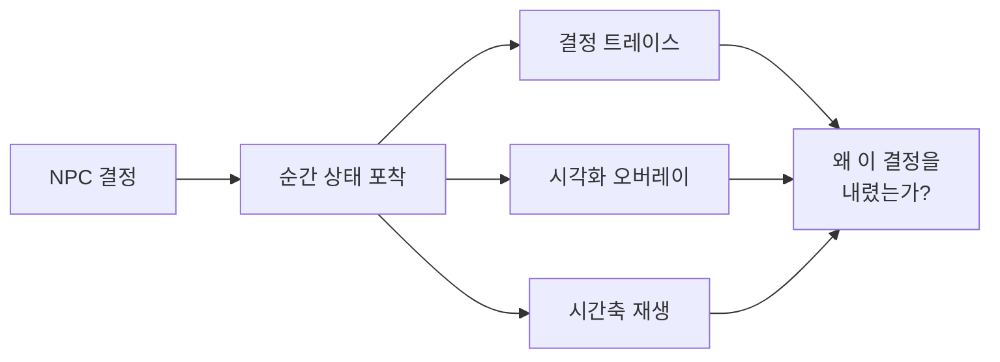

이 글의 목표.

1. **AI 디버깅의 어려움** — 결정의 불투명성과 일반 디버깅 가정의 붕괴.
2. **트레이스와 로그** — 결정의 이유를 구조화해 기록하고 사후 분석.
3. **시각화 오버레이** — 내부 상태를 화면에, 디버그 드로우 인프라.
4. **time travel과 replay** — 스냅샷 링과 결정적 재생, 비결정성 격리.
5. **BT·blackboard 디버거** — 평가 경로 하이라이트, 와치, breakpoint.
6. **길찾기 시각화** — open/closed/경로, 스텝 실행, 알고리즘 비교.
7. **메트릭과 A/B** — 집계 차원의 검증, 끼임 탐지, 통계적 유의성.
8. **자체 도구 원칙** — 비침습·저비용·토글·계층, 비용 예산화.


---

## 목차
1. [AI 디버깅의 어려움](#1-ai-디버깅의-어려움)
2. [결정 트레이스와 로그](#2-결정-트레이스와-로그)
3. [시각화 오버레이](#3-시각화-오버레이)
4. [Time Travel과 Replay](#4-time-travel과-replay)
5. [행동 트리와 Blackboard 디버거](#5-행동-트리와-blackboard-디버거)
6. [길찾기 시각화](#6-길찾기-시각화)
7. [메트릭과 A/B 테스트](#7-메트릭과-ab-테스트)
8. [자체 디버깅 도구 제작](#8-자체-디버깅-도구-제작)


---

## 1. AI 디버깅의 어려움

### 일반 디버깅의 네 가지 가정이 깨진다

일반 코드 디버깅은 암묵적 가정 위에서 작동한다. 버그는 한 곳에 있고(국소성), 같은 입력은 같은 결과를 내며(재현성), 현재 상태가 원인을 담고 있고(현재성), 답이 코드 흐름에 있다(투명성). AI에서는 이 넷이 모두 깨진다.

- *비국소성*: 일반 버그는 한 함수에 있지만, AI 버그는 여러 시스템(인지·의사결정·길찾기·이동)의 상호작용에서 나온다. 적이 벽에 쏘는 이유가 인지(잘못된 위치)인지, 의사결정(잘못된 타깃)인지, 조준(이동 예측 오류)인지 단번에 알 수 없다.
- *시간 의존성*: AI 상태는 누적된다. 지금의 잘못된 행동이 *몇 초 전* 의 잘못된 인지에서 비롯될 수 있다. 현재 상태만 봐서는 원인을 못 찾는다.
- *비결정성*: 무작위 요소(가중 랜덤 선택), 부동소수점 차이, 프레임 타이밍, 멀티스레드 잡 순서에 따라 같은 상황이 다르게 전개된다. 버그가 재현되지 않는다.
- *불투명성*: "왜 이 결정을?"의 답이 코드가 아니라 *데이터* (점수, 가중치, 평가 경로)에 있다. 브레이크포인트로 코드를 멈춰도 결정의 *이유* 는 보이지 않는다.

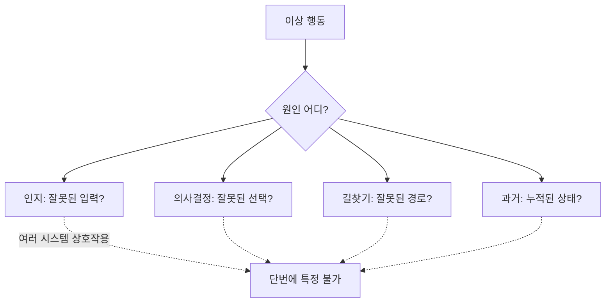

### 한 버그를 네 시스템으로 쪼개는 예

"적이 벽을 향해 사격한다"는 신고를 받았다고 하자. 이 한 줄의 증상 뒤에는 최소 네 갈래의 원인이 가능하다.

| 가설 | 점검 대상 | 필요한 도구 |
|---|---|---|
| 타깃 위치가 잘못됨 | blackboard `targetPos` | 와치, 트레이스 |
| 인지가 유령 타깃을 줌 | 마지막 목격 위치, 시야 콘 | 오버레이 |
| 조준 예측이 과도함 | 리드(lead) 계산 입력 | 트레이스 |
| 과거 프레임의 위치를 캐시 | N프레임 전 인지 스냅샷 | time travel |

증상만으로는 어느 가설인지 모른다. 각 가설은 *서로 다른 시점, 서로 다른 시스템* 의 데이터를 봐야 기각되거나 확정된다. 일반 디버거는 "지금 이 함수의 변수"만 보여주므로, 네 가설 중 기껏해야 하나(현재 타깃 위치)밖에 검증하지 못한다.

### 그래서 전용 도구가 필요하다

이 어려움들이 AI 디버깅 *도구* 를 필요하게 만든다. 도구는 깨진 네 가정을 하나씩 메운다.

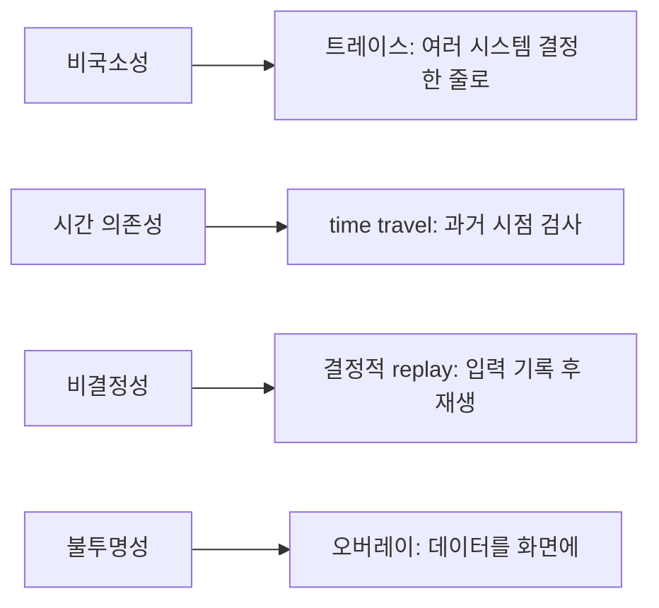

비국소성에는 여러 시스템의 결정을 한 타임라인에 모으는 *트레이스* 가, 시간 의존성에는 과거 프레임을 검사하는 *time travel* 이, 비결정성에는 입력을 박제했다가 재생하는 *결정적 replay* 가, 불투명성에는 데이터를 그림으로 바꾸는 *시각화 오버레이* 가 대응한다. "AI를 만드는 것"과 "AI를 들여다보는 도구를 만드는 것"은 분리할 수 없는 한 쌍이다.

## 2. 결정 트레이스와 로그

### 로그가 아니라 결정 기록이다

가장 기본적인 도구는 *결정 트레이스* — NPC가 결정을 내릴 때마다 그 *이유* 를 기록하는 것이다. 일반 로그(`LOG("attacking")`)와 다르다. 일반 로그는 "무엇을 했는가"만 남기지만, 트레이스는 의사결정 모델의 구조를 보존한다. 효용 AI는 후보 전체와 점수를, 행동 트리는 방문 경로와 반환 상태를, 플래너는 확장 노드와 폐기 이유를 남긴다. 모든 의사결정이 후보 하나를 고르는 형태는 아니므로 시스템마다 설명 단위가 달라야 한다.

```cpp
struct DecisionTrace {
    uint64_t        frame;        // 프레임 번호 (타임라인 정렬 키)
    double          timestamp;    // 게임 시간 (초)
    EntityId        npc;
    const char*     system;       // "Utility" / "BT" / "Pathfinding"
    const char*     chosen;       // 선택된 행동
    struct Factor { const char* name; float value; };
    struct Candidate {
        const char* name;
        float score;
        std::array<Factor, 8> factors{};
        uint8_t factorCount = 0;
    };
    std::array<Candidate, 8> candidates{}; // 후보 + 점수 + 구조화된 근거
    uint8_t candidateCount = 0;
};
```

후보를 남기면 트레이스가 *반증 가능* 해진다. "공격을 골랐다"만 있으면 그게 옳은지 알 수 없지만, "공격 0.82, 후퇴 0.31, 엄폐 0.55"가 있으면 "후퇴가 0.31인데 왜 이렇게 낮지? HP 가중치가 빠졌나?"로 즉시 추적이 이어진다. 점수를 안 남기면 이 추적 자체가 불가능하다.

### 효용 AI 트레이스 워크스루

구체적으로 보자. 효용 AI가 각 행동의 점수를 여러 고려요소(consideration)의 곱으로 계산한다고 하자. 트레이스는 *최종 점수뿐 아니라 그 점수를 만든 요소별 기여* 까지 남기는 것이 이상적이다.

```cpp
float Utility::Score(const Action& a, const Context& ctx, DecisionTrace::Candidate* out) {
    float product = 1.0f;                    // 고려요소만의 raw 곱
    if (out) out->factorCount = 0;
    for (const Consideration& c : a.considerations) {
        float v = c.curve(c.input(ctx));     // 입력을 0~1 곡선에 통과
        product *= v;                        // 곱셈 결합
        if (out && out->factorCount < out->factors.size()) {
            out->factors[out->factorCount++] = {c.name, v};
        }
    }
    // 보상 보정(compensation): [0,1] 범위의 곱에만 적용한다
    int n = (int)a.considerations.size();
    float compensated = product;
    if (n > 0) {
        float mod = 1.0f - 1.0f / n;
        compensated = product + (1.0f - product) * mod * product;
    }
    float score = a.baseWeight * compensated; // raw 곱 → 보정 → baseWeight 순서를 통일한다
    if (out) { out->name = a.name; out->score = score; }
    return score;
}
```

핫 경로에는 문자열을 저장하지 않는다. 위 구조는 후보와 요소 이름·수치를 고정 배열에 복사하고, 실제 `name=value` 문자열은 링 버퍼를 덤프할 때 만든다. `const char*` 이름은 정적 수명 또는 intern pool 수명을 가져 링보다 먼저 사라지지 않는다는 계약이다. 후보 8개 또는 후보당 고려요소 8개를 넘으면 잘린다는 사실도 trace에 표시해야 한다. 모든 요소가 필요하다면 항목 크기를 키우거나, 별도의 전역 byte budget을 가진 가변 저장소를 사용한다.

이제 실제 트레이스 한 줄이 다음처럼 찍힌다고 하자. 아래 점수는 `baseWeight`를 1로 두고 보상 보정을 적용하기 전의 곱이다 — 요소별 기여를 눈으로 따라가기 쉽게 한 것이고, 실제 `out->score`에는 보정까지 반영된 값이 들어간다. 괄호 안 수치는 입력이 아니라 *그 행동의 곡선을 통과한 뒤* 의 값이라 행동마다 다르다.

```text
[frame 4210 t=70.16 npc=37 Utility] chosen=Retreat
  Attack  0.18  (dist=0.95 hp=0.20 ammo=1.0 cover=0.95)
  Retreat 0.42  (dist=0.95 hp=0.50 safe=0.88)
  Cover   0.39  (dist=0.95 hp=0.57 coverAvail=0.72)
```

여기서 진단이 즉시 나온다. Attack의 `hp=0.20` 항이 점수를 0.18로 끌어내렸다 — 곱셈 결합이라 한 항이 낮으면 전체가 무너진다. HP가 20%일 때 후퇴를 고르는 것 자체는 의도된 동작일 수 있다. 하지만 "전투 중인데 자꾸 도망친다"는 신고라면, HP 곡선이 너무 가팔라 80%에서도 후퇴 점수가 높게 나오는지 *같은 트레이스 포맷으로* 다른 프레임을 비교해 확인한다. 곱셈 결합의 함정(한 항이 전체를 지배)이 트레이스에 그대로 드러난다는 점이 핵심이다.

### 트레이스 설계의 세 원칙

트레이스를 항상 켜 두면 비용과 노이즈가 감당이 안 된다. 세 가지로 제어한다.

- *선택적 활성화*: NPC ID나 이벤트 조건으로 트레이스 대상을 좁힌다. 보통 "선택된 NPC 1마리"만 상세 트레이스하고, 나머지는 끈다.
- *링 버퍼*: 최근 N개 결정만 메모리에 유지한다. 이상 행동은 보통 신고받은 시점 직전 몇 초에 원인이 있으므로, 전 구간을 남길 필요가 없다.
- *지연 포맷팅(deferred formatting)*: 문자열 조립은 비싸다. 핫 경로에서는 숫자/포인터만 저장하고, *덤프할 때* 비로소 사람이 읽을 문자열로 만든다.

```cpp
class TraceRing {
public:
    void Push(const DecisionTrace& t) {
        buf_[head_] = t;                     // 덮어쓰기 — 할당 없음
        head_ = (head_ + 1) % buf_.size();
        if (count_ < buf_.size()) ++count_;
    }
    template<class F> void ForEach(F&& f) const {       // 오래된 것부터
        size_t start = (head_ + buf_.size() - count_) % buf_.size();
        for (size_t i = 0; i < count_; ++i) f(buf_[(start + i) % buf_.size()]);
    }
private:
    std::vector<DecisionTrace> buf_{2048};   // 고정 크기 링
    size_t head_ = 0, count_ = 0;
};
```

이 구현은 생성 시 `vector` 저장소를 한 번 할당하지만 `Push` 경로에서는 증설하지 않는다. 따라서 `DecisionTrace`의 대입과 소멸자, `ForEach` 콜백도 할당하지 않는다는 조건에서 핫 경로의 동적 할당을 피한다. 트레이스 한 항목이 약 1.2KiB(후보 8 × 요소 8 고정 배열이라 candidates만 1216바이트)이므로 2048개 링은 NPC당 약 2.5MiB이고, NPC 수를 곱한 총량은 빠르게 커진다. 전 NPC에 동일한 링을 두기보다 선택된 NPC·최근 활성 NPC만 상세 추적하거나 전역 byte budget 안에서 용량을 배분한다.

### 트레이스의 한계

트레이스는 *그 시스템이 남긴 것만* 보여준다. 효용 점수는 남겼지만 그 점수의 입력이 어디서 왔는지는 트레이스 밖일 수 있다. 비국소적 버그는 인지 → 의사결정 → 이동 트레이스를 같은 simulation tick, entity와 causal/request ID로 조인해야 전체 흐름이 보인다. 재생은 이 공통 키와 입력 snapshot을 사용해 특정 결정 시점으로 돌아간다.

## 3. 시각화 오버레이

### 공간 정보는 그림으로 봐야 한다

트레이스가 *텍스트* 라면, 시각화 오버레이는 NPC의 내부 상태를 *게임 화면에 직접 그린다*. 공간적 정보(시야, 경로, 위치)는 숫자보다 그림으로 봐야 즉시 이해된다. "적이 왜 날 못 보지?"라는 질문에 시야 콘을 그려 보면 "콘이 너무 좁네" 또는 "벽에 가려졌네"가 한눈에 보인다. 숫자 로그로 한참 걸릴 진단이 그림 한 장으로 끝난다.

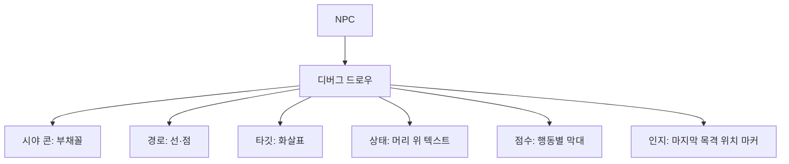

### 디버그 드로우 인프라

오버레이의 토대는 *디버그 드로우* — 게임 월드에 임시 선·도형·텍스트를 그리는 시스템이다. 핵심 설계는 *즉시 모드 + 수명(lifetime)* 이다. 호출 한 번이 한 프레임만 그리는 것이 아니라, "이 선을 2초간 유지"처럼 수명을 줄 수 있어야 한다 — 한 프레임만 깜빡이는 이벤트(피격, 전이)는 사람 눈으로 못 잡기 때문이다.

```cpp
struct DebugLine { Vec3 a, b; Color c; float expireAt; };
struct DebugText { Vec3 pos; std::string s; Color c; float expireAt; };

class DebugRenderer {
public:
    void Line(Vec3 a, Vec3 b, Color c, float life = 0.f) {
        lines_.push_back({a, b, c, now_ + life});       // life=0 → 한 프레임
    }
    void Cone(Vec3 apex, Vec3 dir, float halfAngle, float range, Color c, float life=0.f);
    void Text3D(Vec3 p, std::string s, Color c, float life = 0.f);
    void Flush(float now) {
        now_ = now;
        for (auto& l : lines_) Submit(l);               // 먼저 GPU 제출
        // 제출 후 만료 제거 — life=0도 이번 프레임엔 반드시 한 번 그려진다
        std::erase_if(lines_, [&](auto& l){ return l.expireAt <= now; });
        // text/cone 동일
    }
private:
    std::vector<DebugLine> lines_;
    std::vector<DebugText> texts_;
    float now_ = 0;
};
```

수명 0은 "이번 프레임만"이고, 양수면 그 시각까지 누적 유지된다. 이 작은 기능 하나가 "경로가 한 프레임 그려졌다 사라지는" 문제를 해결한다. 경로를 `life=0.5f`로 그리면 매 프레임 갱신돼도 0.5초 잔상이 남아 눈이 따라간다.

### 무엇을 그리는가

```cpp
void Agent::DebugDraw(DebugRenderer& dr) const {
    dr.Cone(eyePos_, facing_, fovHalf_, sightRange_, Color::Yellow);   // 시야
    Vec3 prev = pos_;
    for (auto& wp : currentPath_) {
        dr.Line(prev, wp, Color::Green);                               // 경로
        prev = wp;
    }
    dr.Line(pos_, currentWaypoint_, Color::Cyan);                      // 다음 목표
    dr.Text3D(headPos_, StateName(state_), StateColor(state_));        // 상태
    if (HasTarget()) dr.Line(eyePos_, targetPos_, Color::Red);         // 타깃
    if (alertLevel_ > 0) dr.Text3D(headPos_ - up*0.3f,                 // 경계 단계
        fmt("alert=%.1f", alertLevel_), Color::Orange);
    float y = 0;                                                       // 점수 막대
    for (auto& [name, s] : lastScores_)
        dr.Line(headPos_ + Vec3{0, y, 0}, headPos_ + Vec3{s, y, 0}, BarColor(name)),
        y += 0.2f;
}
```

상태별로 색을 다르게 하면(Patrol=초록, Chase=노랑, Attack=빨강) *멀리서 한눈에* 부대 전체의 상태 분포가 보인다 — "왜 절반이 아직 Patrol이지?" 같은 의문이 즉시 생긴다.

### 화면 공간 vs 월드 공간, 그리고 선택

오버레이는 두 좌표계로 나뉜다. *월드 공간* 은 시야 콘·경로처럼 3D 위치가 의미 있는 것이고, *화면 공간* 은 선택된 NPC의 상세 점수표처럼 화면 한쪽에 고정해 읽는 것이다. 모든 NPC의 점수 막대를 머리 위에 그리면 화면이 난장판이 되므로, 실전에서는 *선택(pick)* 을 둔다 — 클릭하거나 카메라 중앙에 든 NPC 하나만 상세 오버레이를, 나머지는 색상 텍스트만.

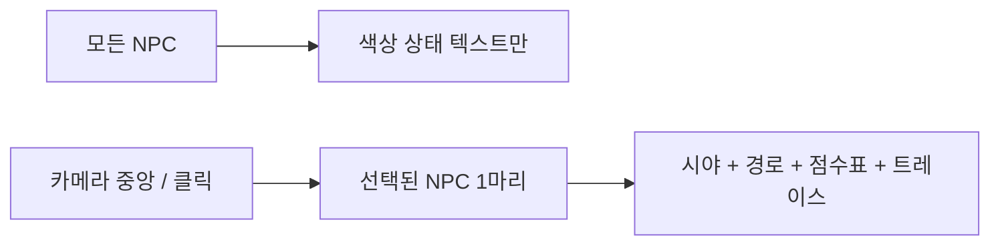

이 "전체는 싸게, 선택 하나는 자세히" 패턴이 오버레이 가독성과 비용을 동시에 잡는다.

### 오버레이의 함정: 관찰이 대상을 바꾸면 안 된다

디버그 드로우가 *게임 로직을 건드리면* 안 된다. 흔한 실수는 디버그용으로 raycast를 한 번 더 쏘는 것이다. 추가 query가 공유 예산과 캐시, 완료 순서를 바꾸면 디버그 빌드에서만 실행 결과가 달라질 수 있다. 오버레이는 이미 계산된 값이나 복제한 snapshot을 읽고, 새 게임플레이 계산을 트리거하지 않아야 한다.

## 4. Time Travel과 Replay

### 시간 의존 버그는 과거를 봐야 풀린다

AI 버그의 시간 의존성(1절)은 *과거를 다시 볼* 수 있어야 풀린다. 지금의 잘못된 행동이 몇 초 전 원인에서 비롯됐다면, 그 과거 시점의 상태를 봐야 한다. 두 가지 접근이 있고, 둘은 데이터량·재현 충실도·비결정성 내성에서 정반대의 트레이드오프를 가진다.

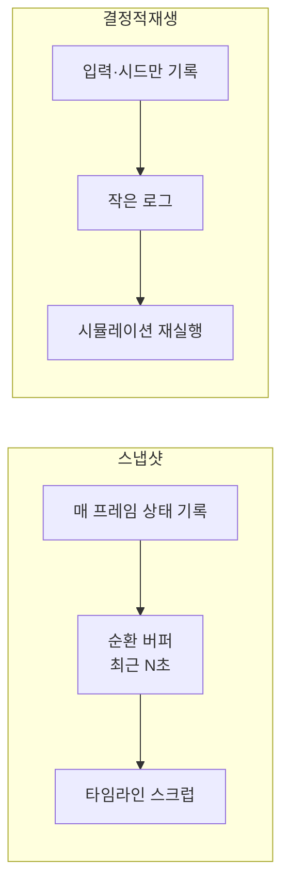

| 항목 | 상태 스냅샷 | 결정적 replay |
|---|---|---|
| 기록량 | 큼 (전체 상태 × 프레임) | 작음 (입력 + 시드) |
| 재현 충실도 | 부분 (기록한 것만) | 완전 (전체 시뮬) |
| 비결정성 내성 | 강함 (있는 그대로 박제) | 약함 (조금만 갈려도 발산) |
| 구현 난이도 | 중 | 높음 (결정성 보장) |
| 앞으로 재생 | 불가 (찍힌 시점만) | 가능 (재실행) |

### 상태 스냅샷 링

매 프레임(또는 주기적으로) 모든 NPC의 핵심 상태 — 위치, 의사결정 상태, blackboard, 그 프레임의 트레이스 — 를 순환 버퍼에 저장한다. 버그 발생 후 타임라인을 *되감아* 각 시점의 상태를 검사한다.

```cpp
struct AISnapshot {
    uint64_t frame;
    double   time;
    struct AgentState {
        EntityId id; Vec3 pos; Vec3 facing;
        uint16_t bt_active_node;     // 활성 BT 노드 인덱스
        Blackboard::Compact bb;      // 압축된 blackboard
    };
    std::vector<AgentState> agents;
    std::vector<DecisionTrace> decisions;   // 같은 frame 키로 조인 가능
};

class TimeTravel {
public:
    void Record(const World& w) {
        if (buf_.size() >= maxFrames_) buf_.pop_front();
        buf_.push_back(Capture(w));          // 현재 상태 스냅샷
    }
    const AISnapshot* At(uint64_t frame) const {     // 과거 프레임 조회
        auto it = std::lower_bound(buf_.begin(), buf_.end(), frame,
            [](const AISnapshot& s, uint64_t f){ return s.frame < f; });
        return (it != buf_.end() && it->frame == frame) ? &*it : nullptr;
    }
private:
    std::deque<AISnapshot> buf_;
    size_t maxFrames_ = 600;     // 60fps × 10초
};
```

기록량이 관건이다. NPC 200마리 × 64바이트 × 600프레임 = 약 7.7MB. 위치·facing·활성 노드·압축 blackboard만 남기고 *재구성 가능한 것은 버린다* (예: 애니메이션 본 포즈는 위치에서 재계산). 비싼 raycast 결과나 인지 캐시처럼 *재구성 불가능한* 입력은 반드시 남긴다 — 이것이 시간 의존 버그의 단서이기 때문이다.

### 결정적 replay

다른 접근은 *입력만 기록* 하고 시뮬레이션을 재실행해 재현하는 것이다. 랜덤 시드, 사용자 입력, 외부 이벤트만 로그에 남기면, 같은 코드가 같은 입력을 받아 같은 결과를 낸다 — *결정성* 이 전제다. 데이터량이 작아(초당 수 KB) QA가 긴 세션을 통째로 기록해 개발자에게 넘길 수 있다.

```cpp
// 결정적 시뮬레이션의 골격: 모든 비결정 소스를 시드/로그에서 끌어온다
void SimStep(World& w, const InputFrame& in) {
    rng.BeginFrame(in.frameSeed);        // 예시: 스트림·draw 순서 계약도 별도 고정
    ApplyPlayerInput(w, in.player);      // 기록된 입력
    DispatchEvents(w, in.events);        // 기록된 외부 이벤트
    UpdateAI(w);                         // 결정적 갱신: 같은 상태와 입력 → 같은 출력
    StepPhysics(w, kFixedDt);            // 고정 dt — 가변이면 발산
}
```

결정성을 깨는 주범은 기록되지 않은 외부 입력과 시간, 플랫폼별 부동소수점 계약, 난수 소비 순서, 명세되지 않은 컨테이너·멀티스레드 순서다. 결정적 replay는 고정 타임스텝, 동일한 실행 자산, 결정적 작업 병합, 일관된 수학 계약, 외부 사건 기록을 함께 요구한다. lockstep·rollback 게임도 이미 일부 조건을 갖췄을 뿐 replay가 자동으로 생기지는 않는다. 장기 seek용 snapshot, 버전 호환, 기록 파일 검증, 관측 도구와 저장 예산은 별도 구현해야 한다.

### time travel의 위력과 워크스루

"보스가 3페이즈에서 패턴을 건너뛰었다"는 신고를 받았다고 하자. 실시간으로는 0.2초 만에 지나가 버려 잡을 수 없다. time travel로는 다음처럼 추적한다.

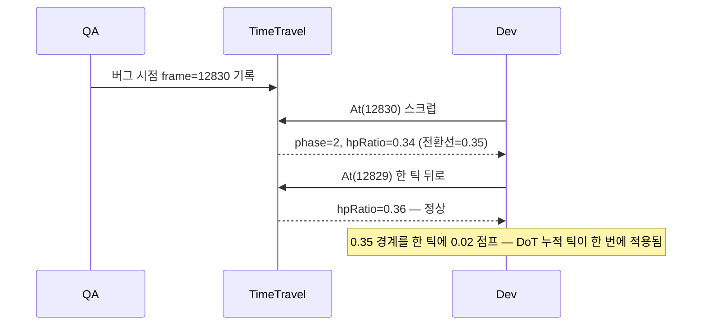

되감아 보니 HP 비율이 한 틱에 0.36에서 0.34로 뛰면서 0.35 전환선을 *건너뛰었다*. 도트 데미지(DoT)가 여러 틱치를 한 번에 적용해, 페이즈 2 진입 이벤트가 처리되기 전에 페이즈 3 임계도 넘어버린 것이다. 원인은 "전환을 `==`가 아니라 `<=` 누적 체크로" 또는 "한 프레임에 한 전환만"으로 고친다. 멈춰서 천천히 인접 프레임을 비교할 수 있어야만 보이는 버그다.

## 5. 행동 트리와 Blackboard 디버거

### 왜 트리에는 전용 디버거가 필요한가

의사결정 구조 — 특히 행동 트리(Behavior Tree) — 는 전용 디버거가 필요하다. BT는 매 틱 루트부터 평가되며 깊은 분기를 가지므로, "지금 어느 잎이 왜 실행 중인가"를 *트리 구조 위에서* 봐야 한다. 텍스트 트레이스로는 트리의 형태가 안 보이고, 일반 디버거로는 매 틱 루트부터 도는 평가 흐름을 따라갈 수 없다.

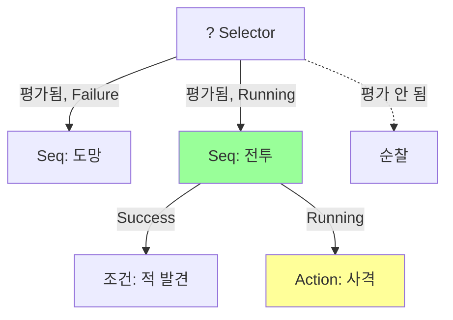

### 평가 경로를 기록하는 계측 BT

핵심은 매 틱 각 노드가 *평가됐는지, 무슨 상태를 반환했는지* 를 기록하는 것이다. BT 노드의 `Tick`을 얇게 감싸 상태를 박제한다.

```cpp
enum class Status { Success, Failure, Running };

struct NodeDebug {
    uint64_t lastTickFrame = 0;
    Status   lastStatus    = Status::Failure;
    bool     breakpoint    = false;      // 노드 breakpoint (아래)
};

class Node {
public:
    Status Tick(Context& ctx) {
        Status s = OnTick(ctx);
        dbg_.lastTickFrame = ctx.frame;       // 이번 틱에 평가됨을 기록
        dbg_.lastStatus = s;
        if (ctx.recordTrace)                  // 선택적: 평가 경로 누적
            ctx.trace->push_back({id_, s, ctx.frame});
        return s;
    }
    const NodeDebug& Debug() const { return dbg_; }
protected:
    virtual Status OnTick(Context&) = 0;
    NodeDebug dbg_;
    uint16_t id_;
};
```

`lastTickFrame == 현재 프레임` 인 노드만 "이번 틱에 평가됨"이다. 디버거는 이 플래그로 *평가된 가지는 진하게, 안 된 가지는 흐리게* 칠하고, 상태별 색(Success=초록, Failure=빨강, Running=노랑)을 입힌다. Running 잎까지의 경로를 강조하면 "지금 무엇을, 왜 하는가"가 트리 위에 그대로 그려진다.

### BT 디버거가 보여주는 것

- *실행 경로 하이라이트*: 이번 틱에 평가된 노드와 현재 Running 잎까지의 경로. 평가 안 된 가지는 흐리게.
- *노드 상태 색상*: Success/Failure/Running을 색으로 구분, 마지막 평가 프레임 표시.
- *실시간 갱신*: 게임이 도는 동안 활성 노드가 실시간으로 바뀌는 것을 본다.
- *조건 값*: 각 조건(condition) 노드 옆에 술어의 현재 값과 입력 변수.
- *노드 breakpoint*: 특정 노드가 평가되는 순간 게임을 일시정지(아래).

### 노드 breakpoint

일반 디버거의 브레이크포인트를 *트리 노드 단위* 로 옮긴 것이다. "이 사격 노드가 실행되는 순간 멈춰라"를 걸면, 그 노드가 평가되는 프레임에 플래그를 세우고 노드의 OnTick이 끝난 뒤 다음 safe point에서 게임 시뮬레이션이 멈춰 그때의 blackboard 전체를 검사한다. 즉 이 구현은 *after-tick breakpoint* 다 — 노드 진입 전에 멈추려면 노드를 실행하지 않고 반환하는 별도의 suspend/resume 프로토콜이 필요하며, 단순히 Running을 반환하면 BT 결과가 달라진다.

```cpp
Status Node::Tick(Context& ctx) {
    if (dbg_.breakpoint && ctx.debugBreakAllowed) {
        ctx.pauseRequested = true;            // 이 노드 실행 후 다음 safe point에서 일시정지 요청
        ctx.breakNode = id_;                  // 어느 노드에서 멈췄는지
    }
    Status s = OnTick(ctx);
    // ... 위와 동일
    return s;
}
```

코드 라인이 아니라 *결정 구조* 에 거는 브레이크포인트라는 점이 핵심이다. "사격 코드"는 여러 곳에서 불릴 수 있지만, "이 트리의 이 사격 노드"는 의미가 명확하다.

### Blackboard watch

*Blackboard* 는 BT 노드 간 데이터를 공유하는 키-값 저장소로, 의사결정의 *입력* 이다. 그 값을 실시간으로 들여다보는 것이 *blackboard watch* 다. "MoveTo가 엉뚱한 곳으로 간다"면, blackboard의 `targetPos` 값을 와치해 "타깃 위치가 잘못 설정됐다"를 확인한다. 더 강력한 것은 *변경 추적* — 어느 노드가 어느 프레임에 그 키를 마지막으로 썼는지 기록하면, 잘못된 값의 *출처* 를 바로 찾는다.

```cpp
class Blackboard {
public:
    template<class T> void Set(const char* key, const T& v, uint16_t writerNode) {
        auto& e = data_[key];
        e.value = v;
        e.lastWriter = writerNode;            // 누가 썼는가
        e.lastWriteFrame = curFrame_;         // 언제 썼는가
    }
    void DebugInspect(DebugUI& ui) const {
        for (auto& [key, e] : data_) {
            ui.Watch(key, ToString(e.value),
                     fmt("by node#%u @f%llu", e.lastWriter, e.lastWriteFrame));
            if (e.lastWriteFrame == curFrame_) ui.MarkChanged(key);   // 이번 틱 변경 강조
        }
    }
private:
    struct Entry { Any value; uint16_t lastWriter; uint64_t lastWriteFrame; };
    std::unordered_map<std::string, Entry> data_;
    uint64_t curFrame_ = 0;
};
```

`targetPos`가 잘못됐다면 와치에 "by node#42 @f4210"이 함께 뜨고, 노드 42가 인지에서 타깃을 베끼는 노드임을 보면 버그가 의사결정이 아니라 인지에 있음이 드러난다. 와치는 잘못된 *값* 을, 변경 추적은 잘못된 값의 *책임자* 를 가리킨다.

상용 엔진의 BT 디버거가 이 모든 것의 표준을 보여준다 — 실행 중 트리 시각화, 노드 상태 색상, blackboard watch, 시뮬레이션 일시정지를 통합 제공한다. 이런 통합 디버거의 유무가 BT 기반 AI 개발 생산성을 크게 좌우한다.

## 6. 길찾기 시각화

### 탐색은 공간적이자 알고리즘적이다

길찾기는 *공간적* 이고 *알고리즘적* 이라, 시각화가 특히 효과적이다. "왜 이 경로로 갔지?"는 탐색 과정을 그려 보면 즉시 답이 나온다. A* 같은 탐색은 open set(탐색 후보)과 확장한 노드 집합을 유지한다. 일관적 휴리스틱을 쓰는 구현은 확장한 노드를 closed set으로 확정할 수 있고, 재개방을 허용하는 구현은 같은 노드를 더 나은 비용으로 다시 확장할 수 있다. 어느 쪽이든 두 집합의 *모양* 이 알고리즘의 건강 상태를 드러낸다.

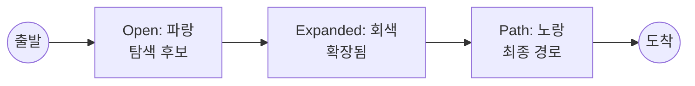

### 탐색 과정 기록

핵심은 A*가 노드를 open/closed로 옮길 때마다 *그 이벤트를 기록* 하는 것이다. 알고리즘 본체는 건드리지 않고, 콜백 한 줄로 관찰만 한다(비침습성).

```cpp
struct SearchEvent { enum Kind { PushOpen, Expand } kind; NodeId node;
                     float g, h; NodeId parent; int step; };

std::vector<NodeId> AStar(NodeId start, NodeId goal, SearchVisualizer* viz) {
    PriorityQueue open;  std::unordered_map<NodeId, NodeRec> rec;
    float h0 = Heuristic(start, goal);
    open.Push({h0, 0, start}); rec[start] = {0, h0, kNone};
    int step = 0;
    while (!open.Empty()) {
        [[maybe_unused]] auto [queuedF, queuedG, cur] = open.Pop();
        if (queuedG != rec[cur].g) continue; // 더 짧은 경로가 들어온 뒤 남은 stale 항목
        if (viz) viz->Record({SearchEvent::Expand, cur, rec[cur].g, rec[cur].h, rec[cur].parent, step});
        if (cur == goal) return Reconstruct(rec, goal);
        for (NodeId nb : Neighbors(cur)) {
            float ng = rec[cur].g + Cost(cur, nb);
            if (!rec.count(nb) || ng < rec[nb].g) {
                rec[nb] = {ng, Heuristic(nb, goal), cur};
                open.Push({ng + rec[nb].h, ng, nb});
                if (viz) viz->Record({SearchEvent::PushOpen, nb, ng, rec[nb].h, cur, step});
            }
        }
        ++step;
    }
    return {};   // 경로 없음
}
```

`viz`가 null이어도 분기와 함수 호출 비용은 남고, 인라이닝 여부에 따라 최적화 결과도 달라진다. 릴리스 빌드의 계약이 계측 비활성이라면 컴파일 타임 플래그나 `if constexpr`로 호출 경로 자체를 제거하고, 개발 빌드에서는 null sink의 비용을 따로 측정한다. 기록된 이벤트로 디버거는 각 셀의 g·h·f 값과 부모 포인터, 탐색 순서(step)를 재현할 수 있다.

### 무엇이 보이는가

- *Open/Expanded 셀*: open(파랑)과 확장된 셀(회색)을 색으로. 탐색이 *어느 방향으로 퍼졌는지* 보임 — 휴리스틱이 잘 들으면 목표 쪽으로 집중, 아니면 사방으로 부풀어 오른다. 재개방된 셀은 횟수나 별도 색으로 표시한다.
- *최종 경로*: 복원된 경로(노랑)를 선으로.
- *비용/f값*: 각 셀에 g·h·f를 텍스트로(작은 그리드에서). 왜 이 셀이 선택됐는지 정량 확인.
- *단계 실행*: 탐색을 *한 스텝씩* 진행하며 open/closed 변화를 관찰. step 키로 재생 위치를 스크럽.
- *알고리즘 비교*: 같은 맵에서 A*/JPS/Dijkstra의 탐색 노드 수를 나란히.

### 탐색 모양으로 버그를 읽는다

확장된 노드 집합의 모양이 진단의 핵심이다.

| 탐색 모양 | 의미 | 처방 |
|---|---|---|
| 목표 쪽으로 좁게 집중 | 휴리스틱 정상 | 정상 |
| 사방으로 원형 부풀음 | 휴리스틱이 0에 가까움(Dijkstra화) | 휴리스틱 점검 |
| 장애물을 크게 우회 | 통과 비용이 과대 설정 | 비용 맵 확인 |
| 목표 직전에서 멈춤 | 목표 셀이 막힘/도달 불가 | 그래프 연결성 |
| 지그재그 경로 | string pulling 누락 | 경로 평활화 추가 |

"캐릭터가 이상하게 돌아간다"면 확장 영역이 장애물을 크게 우회하는 모양인지 보고, 그렇다면 장애물 통과 비용이 잘못 부풀려졌음을 안다. "경로는 맞는데 부자연스럽게 꺾인다"면 string pulling(가시선이 통하는 웨이포인트를 잇는 평활화)이 빠진 것이다. 메트릭(탐색 노드 수, 시간, 경로 길이 대 최적)을 함께 표시하면 성능 문제("이 알고리즘이 노드를 너무 많이 본다")도 같이 잡힌다. 길찾기 시각화는 디버깅 도구이자 *알고리즘을 이해하는 도구* 다 — 추상적 알고리즘이 구체적 그림으로 살아난다.

## 7. 메트릭과 A/B 테스트

### 미시와 거시

개별 NPC의 결정을 보는 것(트레이스·오버레이)이 *미시적* 디버깅이라면, *집계 메트릭* 은 *거시적* 검증이다. 한 NPC를 보면 멀쩡한데 *전체적으로* 난이도가 잘못됐거나, *특정 상황에서만* 드물게 버그가 나는 경우는 미시적 도구로 못 잡는다. 수많은 플레이의 통계로만 보인다.

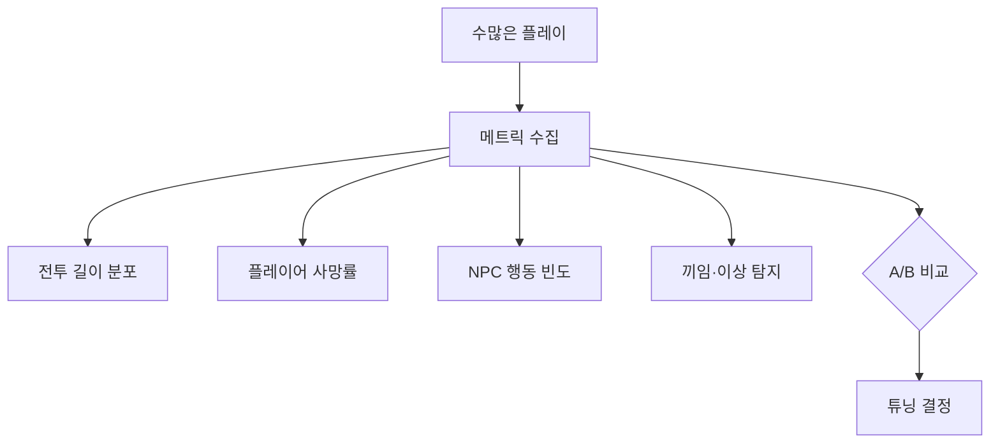

### AI 메트릭의 종류

- *밸런스*: 전투 길이, 플레이어 승률, 특정 적의 위협도. "이 적이 너무 강한가/약한가"를 통계로.
- *행동 분포*: NPC가 각 행동을 얼마나 자주 하는가. "도망을 너무 자주 한다" 같은 튜닝 신호.
- *진행 메트릭*: 플레이어가 어디서 막히고 어디서 이탈하는가. 페이싱 검증.
- *이상 탐지*: 끼임(stuck), 무한 루프, 비정상 패턴의 발생 빈도.

### 끼임 탐지: 자동화된 이상 검출

이상 탐지는 그 자체로 자동화 가능한 메트릭이다. 가장 흔한 AI 버그인 *끼임* 은 "오랫동안 위치가 거의 안 변하는데 이동 의도는 있는" 상태로 정의된다. 이를 런타임에 감지해 텔레메트리로 보낸다.

```cpp
void StuckDetector::Update(Agent& a, float dt) {
    float moved = Distance(a.pos, lastPos_);
    bool tooSlow = dt > 0.0f && moved / dt < kMinMoveSpeed;
    if (a.wantsToMove && tooSlow) {
        stuckTime_ += dt;
        if (stuckTime_ > kStuckThreshold) {      // 예: 2초
            Telemetry::Report("ai_stuck", {       // 집계 서버로
                {"npc", a.id}, {"pos", a.pos},
                {"goal", a.moveGoal}, {"navpoly", a.currentPoly},
                {"map", CurrentMap()}});
            stuckTime_ = 0;
        }
    } else stuckTime_ = 0;
    lastPos_ = a.pos;
}
```

이 한 조각이 수천 명의 플레이에서 "맵 X의 좌표 (123, 0, 456)에서 NPC가 자주 낀다"는 *히트맵* 을 만든다. 한 번도 재현 못 한 끼임 버그가 텔레메트리 집계에서는 명확한 핫스팟으로 드러난다. 위치·내비메시 폴리곤·맵을 함께 보내는 것이 핵심이다 — 좌표만으로는 "왜"가 안 보인다.

### A/B 테스트와 통계적 유의성

*A/B 테스트* 는 AI 변경의 효과를 *통계적으로* 검증한다. 두 버전의 AI(또는 튜닝)를 플레이어 그룹에 나눠 적용하고, 메트릭을 비교해 어느 쪽이 의도한 결과를 내는지 판단한다. "보스를 더 공격적으로 바꿨더니 플레이어 좌절 이탈이 늘었나?"를 추측이 아니라 데이터로 답한다.

함정은 *유의성* 이다. A군 이탈률 12%, B군 14%라는 차이가 진짜인지 우연인지는 표본 크기에 달렸다. 표본이 작으면 노이즈를 신호로 착각해 잘못 튜닝한다.

| 점검 항목 | 잘못된 결론을 막는 이유 |
|---|---|
| 표본 크기 | 작으면 우연한 차이를 진짜로 오인 |
| 무작위 배정 | 숙련자가 한쪽에 몰리면 AI 차이가 아니라 플레이어 차이 |
| 사전 정의한 비교 | 여러 변경을 묶었다면 묶음 효과만 식별됨. 요인별 효과는 factorial 설계 필요 |
| 충분한 기간 | 신규/복귀 유저 비율 등 시간 효과를 섞지 않게 |

### 유의성의 정량화 — 두 비율 검정, 표본 크기, 엿보기 함정

"표본 크기에 달렸다"를 결과로 두지 말고 숫자로 못박자. 이탈 여부는 베르누이 시행이므로 A/B 비교는 *두 비율의 차* 를 검정하는 문제다. A군 이탈률 추정 $\hat p_A=x_A/n_A$, B군 $\hat p_B=x_B/n_B$일 때 검정 통계량은

$$
Z=\frac{\hat p_B-\hat p_A}{\sqrt{\hat p(1-\hat p)\left(\dfrac{1}{n_A}+\dfrac{1}{n_B}\right)}},\qquad \hat p=\frac{x_A+x_B}{n_A+n_B}
$$

귀무가설 아래 표본이 충분히 크면 $Z$는 표준정규로 근사되고, 양측 유의수준 $\alpha=0.05$에서 $|Z|>1.96$이면 기각한다. 각 군의 성공·실패 기대 빈도가 작거나 사용자 간 간섭, 반복 관측, cluster 배정이 있으면 이 근사가 깨진다. 같은 크기 두 군에서 귀무가설 표준오차는 $\mathrm{SE}_0=\sqrt{2\bar p(1-\bar p)/n}$로 $1/\sqrt n$에 비례한다.

빠른 설계 근사로 null과 alternative의 분산을 모두 $\bar p$에서 평가하면 최소 검출 효과와 군당 표본 수는

$$
\delta_{\min}=(z_{1-\alpha/2}+z_{1-\beta})\sqrt{\frac{2\bar p(1-\bar p)}{n}}
\quad\Longrightarrow\quad
n=\frac{(z_{1-\alpha/2}+z_{1-\beta})^2\,2\bar p(1-\bar p)}{\delta^2}
$$

신고 사례(이탈률 12% 대 14%)를 대입하자. $\bar p=0.13$, $\delta=0.02$, 양측 $\alpha=0.05$·검정력 80%($z_{1-\beta}=0.842$):

$$
n=\frac{(1.96+0.842)^2\cdot 2(0.13)(0.87)}{0.02^2}\approx\frac{7.85\times0.226}{0.0004}\approx 4{,}400\ \text{(명/군)}
$$

이 근사에서는 군당 약 4,400명이다. 더 정확한 두 비율 설계식은 null 쪽에 $\bar p$, alternative 쪽에 $p_A(1-p_A)+p_B(1-p_B)$를 따로 사용하고, 실제 분석의 continuity correction·cluster 효과·중도 이탈·다중 비교까지 반영한다. 따라서 4,400은 보편적인 최소값이 아니라 주어진 가정의 계획값이다.

군당 500명뿐이면 이 근사 표준오차는 $\sqrt{0.226/500}=0.0213$이고, 참 차이 2%p의 표준화 이동은 약 0.94다. 반대쪽 tail이 매우 작다고 무시한 근사 검정력은 $\Phi(0.94-1.96)\approx15.4\%$에 불과하다. 즉 낮은 검정력 때문에 실제 차이를 자주 놓친다. 고정된 유의수준의 올바른 검정에서 표본이 작다는 이유만으로 명목 1종 오류율이 자동으로 커지는 것은 아니다. 1종 오류는 엿보기·다중 비교·근사식 위반에서 따로 증가한다. 다른 조건이 같다면 필요한 표본은 대략 $1/\delta^2$로 늘어 MDE를 절반으로 줄일 때 약 네 배가 필요하다.

가장 흔한 통계 오용은 실험을 돌리며 *유의해지는 순간 멈추는* 엿보기(optional stopping)다. 매 시점의 검정이 $\alpha=0.05$여도 여러 시점을 보고 한 번이라도 기각하면 전체 1종 오류가 5%를 넘는다. 독립 검정 $K$개라는 단순 모델이면 적어도 한 번 위양성이 날 확률은 $1-(1-\alpha)^K$지만, 누적 A/B 데이터의 중간 검정은 서로 강하게 상관돼 이 식도 정확하지 않다. 실제 팽창률은 점검 시점과 중단 규칙에 달린다. 표본 수를 사전에 고정해 마지막에 한 번 검정하거나, 중간 점검이 필요하면 group-sequential alpha-spending, always-valid p-value, 순차 확률비 검정처럼 전체 오류율을 제어하는 절차를 미리 선택한다.

```cpp
#include <cmath>
#include <limits>
#include <optional>

// 두 비율 A/B: 필요 표본 수(사전 계산)와 고정-표본 검정(엿보기 금지)
std::optional<long long> ApproxRequiredSamplePerGroup(
        double pBar, double delta,
        double zAlpha = 1.95996,   // 양측 alpha=0.05
        double zBeta  = 0.84162) { // 검정력 0.80
    if (!std::isfinite(pBar) || !std::isfinite(delta) ||
        !(pBar > 0.0 && pBar < 1.0) || !(delta > 0.0))
        return std::nullopt;       // 비유한 입력 또는 정의역 밖
    double s = zAlpha + zBeta;
    double n = std::ceil(s * s * 2.0 * pBar * (1.0 - pBar) / (delta * delta));
    if (!std::isfinite(n) || n > (double)std::numeric_limits<long long>::max())
        return std::nullopt;       // 변환 전 유한성·상한 검사
    return (long long)n;           // int가 아닌 넓은 정수로 반환
}

// 사전 고정한 n에 도달한 뒤 단 한 번만 호출한다 — 매 틱 호출+조기 중단은 위양성 폭증
bool AbSignificant(int xA, int nA, int xB, int nB) {
    if (nA <= 0 || nB <= 0 || xA < 0 || xA > nA || xB < 0 || xB > nB)
        throw std::invalid_argument("invalid binomial counts");
    double pA = (double)xA / nA, pB = (double)xB / nB;
    // 합산은 int가 아니라 넓은 부동소수점에서 수행한다 (int 합 overflow 방지)
    double xSum = (double)xA + (double)xB;
    double nSum = (double)nA + (double)nB;
    double p  = xSum / nSum;
    double se = std::sqrt(p * (1.0 - p) * (1.0 / nA + 1.0 / nB));
    if (se == 0.0) return false;                 // 두 군 모두 0 또는 모두 1
    double Z  = (pB - pA) / se;
    return std::abs(Z) > 1.95996;
}
```

`ApproxRequiredSamplePerGroup`이 `nullopt`를 반환하면 입력이 비유한이거나 표본 수가 상한을 넘은 경우이므로, 호출자는 계획값 실패로 처리하고 좁은 정수로 잘라 계속 계산하지 않는다. 거시·미시 두 차원의 검증은 서로 다른 실패를 찾는다. 트레이스·오버레이는 개별 결정의 인과와 계약 위반을 찾고, 메트릭·통제 실험은 전체 경험의 분포 변화를 추정한다. 어느 한쪽도 AI 품질을 단독으로 보장하지 않는다.

## 8. 자체 디버깅 도구 제작

### 원칙들

상용 엔진은 디버깅 도구를 제공하지만, 프로젝트 고유의 AI에는 *자체 도구* 가 필요하다. 자체 도구 제작의 원칙은 다섯이다.

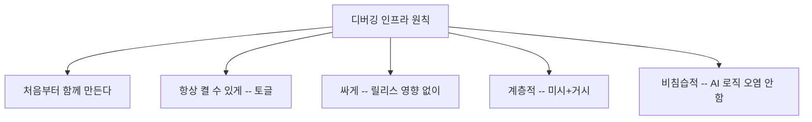

- *처음부터 함께 만든다*: 디버깅 도구를 AI 완성 후에 만들면 늦다. AI 시스템을 만들면서 동시에 트레이스·오버레이를 넣는다. 디버깅 인프라 없이 AI를 디버깅하는 것은 불가능에 가깝다.
- *항상 켤 수 있게*: 디버그 드로우·트레이스를 *런타임 토글* 로. 개발 빌드에서 언제든 켜고, 특정 NPC만 선택해 보고, 재컴파일 없이.
- *비용 분리*: 디버그 코드가 릴리스 빌드 성능에 영향을 주지 않게. 조건부 컴파일이나 런타임 분기로 분리한다.
- *비침습적*: 디버깅 코드가 AI 로직을 오염시키지 않게. 트레이스 기록이 결정에 영향을 주거나, 디버그 드로우가 게임 상태를 바꾸면 안 된다. 관찰이 대상을 바꾸지 않아야.
- *계층적*: 미시(개별 결정 트레이스·오버레이)와 거시(메트릭·A/B)를 모두. 한 차원만으로는 부족하다.

### 비용을 예산화한다

"싸게"는 막연한 말이 아니라 *프레임 예산* 으로 못박아야 한다. 디버그 코드가 어디에 들어가느냐로 비용이 갈린다.

| 코드 위치 | 릴리스 비용 | 처리 |
|---|---|---|
| 핫 루프 안 분기 | 분기 예측 실패 시 누적 | `#if`로 컴파일 제거 |
| 콜백 포인터(null 체크) | 분기·호출 비용이 남음 | 런타임 토글 가능 |
| 문자열 포맷팅 | 큼 | 덤프 시점으로 지연 |
| 디버그 드로우 제출 | GPU/CPU 부담 | 토글 + 수명 정리 |

가장 안전한 패턴은 *컴파일 타임 제거 + 런타임 토글* 조합이다. 릴리스에서 존재할 이유가 없는 경로는 `#if`로 제거하고, 개발 빌드 안에서 켜고 끌 도구는 null 가능한 콜백이나 명시적 sink를 둔다. 꺼진 분기가 예측되더라도 명령 수·코드 배치·핫 루프의 누적 비용은 남으므로, 실제 호출 빈도에서 계측해 허용 여부를 정한다.

```cpp
// 비용 분리 + 토글: 디버그 코드가 릴리스에 영향 없게
#if AI_DEBUG_ENABLED
    if (g_dbg.IsTracing(npc.id))            // 선택적 활성화 (null 체크 수준)
        npc.LogDecision(action, scores);     // 트레이스 — 숫자만 저장(지연 포맷)
    if (g_dbg.drawOverlays && g_dbg.IsPicked(npc.id))
        npc.DebugDraw(g_dbgRenderer);        // 선택된 NPC만 상세
#endif
    // AI 로직 본체 — 위 블록과 완전히 분리, 디버그 유무로 결과 불변
    npc.Apply(action);
```

핵심은 *마지막 줄* 이다. `npc.Apply(action)`은 디버그 블록이 있든 없든 같은 입력으로 같은 결과를 낸다. 디버그 블록이 `action`이나 `scores`를 *읽기만* 하고 쓰지 않으므로, 트레이스를 켜고 끄는 것이 게임 동작을 바꾸지 않는다. 이 불변이 비침습성의 실체다.

### 통합 콘솔: 도구를 하나로 묶는다

흩어진 도구들 — 트레이스 덤프, 오버레이 토글, NPC 선택, time travel 스크럽 — 을 *하나의 디버그 콘솔* 로 묶으면 위력이 배가된다. 콘솔이 가져야 할 명령의 예다.

```text
ai.trace 37          # NPC 37 상세 트레이스 켜기
ai.pick 37           # NPC 37 선택 (상세 오버레이)
ai.overlay vision    # 시야 콘 오버레이 토글
ai.bt.break node#42  # BT 노드 42에 breakpoint
ai.tt.scrub -120     # time travel: 120프레임 되감기
ai.path.viz on       # 다음 길찾기 탐색 시각화
ai.dump 37 > t.json  # NPC 37 트레이스 링을 파일로
```

명령으로 노출하면 QA가 재컴파일 없이 버그를 좁혀 개발자에게 "ai.pick 37, ai.tt.scrub -120 했더니 이렇더라"를 그대로 전달할 수 있다. 도구가 *말로 전달 가능한 절차* 가 되는 것이다.

### 근본 교훈

자체 도구 제작의 근본 교훈은 *디버깅 가능성이 설계의 일부* 라는 것이다. AI를 "잘 동작하게" 만드는 것과 "왜 그렇게 동작하는지 볼 수 있게" 만드는 것은 분리되지 않는다. 들여다볼 수 없는 AI는 — 아무리 정교해도 — 유지보수 불가능하다. FSM부터 신경망까지, 모든 의사결정 기법은 그것을 *관찰하고 검증하는 도구* 와 함께일 때 비로소 실용이 된다.


---

## 결론

AI 디버깅은 일반 코드 디버깅과 다르다. 결정이 비국소적이고, 시간에 의존하며, 때로 비결정적이고, 무엇보다 그 *이유가 코드가 아니라 데이터* 에 있다. "왜 이 결정을 내렸는가"의 답은 그 순간의 점수·평가 경로·탐색 상태에 흩어져 있고, 그것을 붙잡아 보이게 만드는 것이 AI 디버깅의 본질이다. 브레이크포인트로 시간을 멈추는 디버깅이 아니라, 기록하고 재생하는 디버깅이다.

결정 트레이스가 후보와 점수를 구조화해 남겨 선택을 반증 가능하게 만들고(곱셈 결합의 함정이 트레이스에 그대로 드러난다), 시각화 오버레이가 시야·경로·점수를 화면에 그려 공간적 직관을 준다(수명 있는 디버그 드로우, 선택 하나만 상세히). time travel은 스냅샷 링으로 과거 프레임을 검사하고 결정적 replay는 입력을 박제해 비결정 버그를 재현한다 — 둘은 데이터량과 충실도에서 정반대의 트레이드오프다. 행동 트리 디버거는 계측된 노드로 평가 경로를 하이라이트하고 노드 breakpoint로 결정 구조에 멈추며, blackboard watch는 잘못된 값과 그 책임자를 함께 가리킨다. 길찾기 시각화는 open/closed의 모양으로 휴리스틱과 비용 맵의 건강을 읽는다. 메트릭과 끼임 탐지·A/B 테스트는 개별 결정이 아닌 전체 경험을 통계로 검증하되, 표본과 유의성을 지켜야 한다.

이 모든 도구의 공통 원칙은 *디버깅 가능성이 설계의 일부* 라는 것이다. 자체 도구를 AI와 함께 만들고, 비용을 프레임 예산으로 못박아 릴리스에 영향 없게 하고, 관찰이 대상을 바꾸지 않도록 비침습적이며, 미시와 거시를 모두 덮도록 계층적으로 구성한다. 흩어진 도구는 하나의 콘솔로 묶어 말로 전달 가능한 절차로 만든다. AI를 만드는 기법은 그것을 *관찰하고 이해하는 도구* 와 함께일 때 비로소 실용이 된다. 들여다볼 수 없는 지능은 다스릴 수 없다.

## 더 읽을거리

- Unreal Engine 공식 문서, "Behavior Tree Debugging"·"Gameplay Debugger"·"Visual Logger" — 트리 시각화, 노드 breakpoint, 시간축 비주얼 로그의 상용 표준.
- Steve Rabin (ed.), *Game AI Pro* 시리즈, AI 디버깅·시각화 관련 챕터 — 결정 트레이스·텔레메트리·자체 도구 사례.
- Dave Mark, *Behavioral Mathematics for Game AI* 및 효용 AI 점수 시각화 GDC 발표 — 고려요소 곱셈 결합과 점수 트레이스의 실무.
- "AI Debugging Tools"·"Building a Better Centaur" 등 GDC AI Summit 발표들 — 자체 디버깅 인프라와 텔레메트리 기반 이상 탐지.
- Bret Victor, "Inventing on Principle" — 즉각적 시각 피드백과 시간축 스크럽의 디버깅 철학.
- 각 엔진의 디버그 드로우(DrawDebug* / Debug.DrawLine) API 문서 — 수명 있는 오버레이 구현의 기반.
- Glenn Fiedler, "Deterministic Lockstep"·"Fix Your Timestep" — 결정적 replay를 위한 고정 타임스텝과 결정성 보장.
- Jacob Cohen, *Statistical Power Analysis for the Behavioral Sciences* 2nd ed.(Lawrence Erlbaum, 1988) — 검정력·효과 크기·필요 표본 수의 표준 레퍼런스.
- Ron Kohavi, Diane Tang & Ya Xu, *Trustworthy Online Controlled Experiments*(Cambridge University Press, 2020) — 온라인 A/B 실험 설계, 엿보기(optional stopping)와 순차 검정·표본 크기 함정의 실무 표준.
