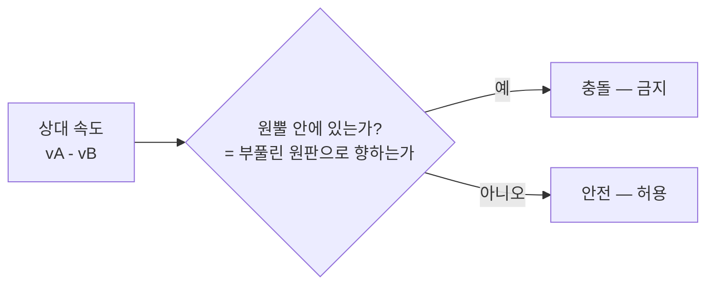
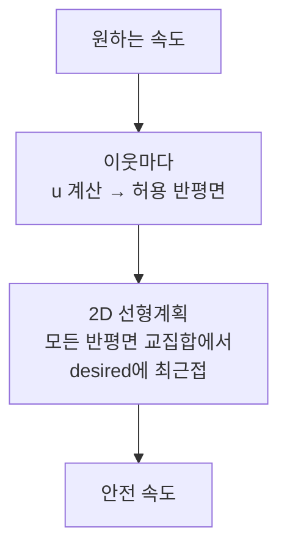
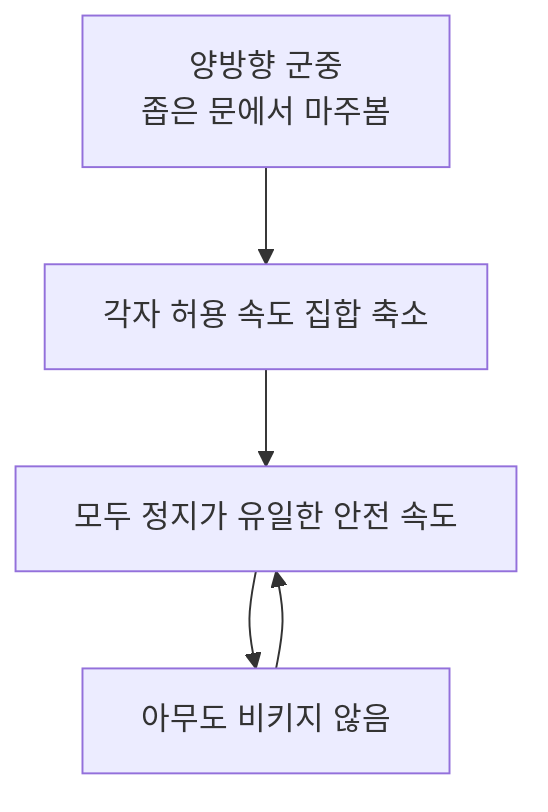

## 들어가며

길찾기는 "어느 길로 갈 것인가"를 정하지만, 국소 회피(local avoidance)는 "지금 이 순간 누구와 부딪히지 않고 어떻게 움직일 것인가"를 정한다. A*나 NavMesh가 만든 경로는 보통 정적 장애물과 지형만 고려한다. 하지만 실제 게임 월드에는 다른 NPC, 플레이어, 문, 탄환, 임시 장애물이 계속 움직인다. 전역 경로가 맞아도, 좁은 문 앞에서 서로 밀고 멈추면 이동 AI는 실패한다.

국소 회피의 목표는 전역 경로를 깨지 않으면서 단기 충돌을 피하는 것이다. 단순 steering은 가까운 장애물을 밀어내고, 속도 장애물(Velocity Obstacle)은 미래 충돌을 속도 공간에서 예측하며, RVO/ORCA는 서로 움직이는 에이전트가 충돌 회피 책임을 나눠 가진다. 이 계층은 길찾기의 대체물이 아니라, 길찾기와 locomotion 사이의 마지막 안전 장치다.

이 글은 위치 공간이 아니라 *속도 공간* 에서 충돌을 다룬다는 한 가지 관점 전환을 축으로 삼는다. 그 관점에서 steering 회피의 한계가 왜 *예측 부재* 인지, VO의 원뿔이 어떻게 유도되는지, RVO의 절반 양보가 진동을 어떻게 죽이는지, ORCA가 어떤 선형계획을 푸는지를 식과 코드와 수치로 따라간다. 마지막으로 회피가 만드는 교착·병목, $O(n^2)$를 깨는 공간 분할, 상황별 모델 선택 기준까지 정리한다. 핵심은 국소 회피가 "근처 몇 초"만 본다는 점이다. 멀리 돌아가야 하는 문제는 전역 경로가 풀고, 눈앞의 충돌은 국소 회피가 푼다.


이 글의 목표.

1. **전역 경로와 국소 회피** — 책임 경계와 속도 출력.
2. **steering 회피** — 가까운 장애물 밀어내기와 그 한계.
3. **Velocity Obstacle** — 미래 충돌을 속도 공간의 원뿔로 표현하고 유도.
4. **RVO와 ORCA** — 상호 회피, 절반 양보, 선형 제약과 2D 선형계획.
5. **crowd 파라미터** — 반지름, 시간 지평, 우선순위의 수치 효과.
6. **교착과 병목** — 회피가 멈춤을 만드는 원리와 crowd control.
7. **성능 최적화** — 근접 후보 제한과 시간 분할의 정량 분석.
8. **선택 기준과 디버깅** — 상황별 회피 모델과 측정·시각화.


---

## 목차
1. [전역 경로와 Local Avoidance](#1-전역-경로와-local-avoidance)
2. [Steering 기반 충돌 회피](#2-steering-기반-충돌-회피)
3. [Velocity Obstacle](#3-velocity-obstacle)
4. [RVO와 ORCA](#4-rvo와-orca)
5. [Crowd 파라미터](#5-crowd-파라미터)
6. [교착 상태와 병목](#6-교착-상태와-병목)
7. [성능 최적화](#7-성능-최적화)
8. [선택 기준과 디버깅](#8-선택-기준과-디버깅)


---

## 1. 전역 경로와 Local Avoidance

전역 경로는 큰 결정을 한다. 어느 복도를 지나고, 어느 문을 통과하고, 어느 계단을 오를지를 정한다. 국소 회피는 작은 결정을 한다. 그 문 앞에서 마주 오는 NPC를 왼쪽으로 피할지, 잠깐 감속할지, 옆의 빈 공간으로 비켜설지를 정한다.

### 두 계층을 섞으면 무너진다

두 계층을 섞으면 두 방향 모두에서 실패한다. 국소 회피가 멀리 돌아가는 결정을 하려고 하면, 짧은 시간 지평 안에서 전역 최적을 추측하게 된다. 시야 밖의 막다른 골목을 모르니 "지금 빈 쪽"으로 갔다가 결국 더 큰 우회를 한다. 반대로 전역 길찾기가 모든 동적 유닛을 장애물로 넣으면, 매 프레임 경로를 다시 계산해야 한다. NPC 200마리가 서로를 장애물로 보고 매 프레임 A*를 돌리면 비용이 폭발하고, 한 유닛이 한 칸 움직일 때마다 200개의 경로가 흔들린다.

이 분리는 시간 규모의 분리이기도 하다. 전역 경로는 수 초~수십 초의 결정(목표까지 도달)을, 국소 회피는 0.5~3초의 결정(눈앞 충돌 회피)을 다룬다. 시간 규모가 다르면 갱신 주기도 다르다. 경로는 목표가 바뀌거나 경로가 막혔을 때만 재계산하고, 회피는 매 프레임 또는 몇 프레임마다 갱신한다.

### 책임 경계 테이블

각 계층이 보는 범위와 출력, 그리고 그 계층이 단독으로 풀 수 없는 실패 모드는 다음과 같다.

| 계층 | 보는 범위 | 출력 | 갱신 주기 | 단독 실패 예 |
|---|---|---|---|---|
| 전역 길찾기 | 전체 맵 | waypoint / path corridor | 목표 변경 시 | 막힌 방으로 들어감 |
| 경로 추종 | 다음 waypoint | desired velocity | 매 프레임 | 코너를 크게 돎 |
| 국소 회피 | 주변 몇 m, 몇 초 | collision-free velocity | 매 1~4 프레임 | 문 앞에서 서로 멈춤 |
| locomotion | 캐릭터 몸 | animation / root motion | 매 프레임 | 발 미끄러짐 |

표의 마지막 열은 계층의 지역 정보만으로 해결하기 어려운 실패다. "문 앞에서 서로 멈춤"은 속도 선택만으로 풀리지 않을 수 있으며, 병목 예약이나 통행 우선권처럼 더 높은 수준의 조율이 필요하다.

### 출력은 속도다

국소 회피의 출력은 보통 *속도* 다. 경로 추종이 `desiredVelocity`를 만들고, 회피 시스템이 그 속도와 가까우면서 유한 시간 지평 안의 충돌 제약을 만족하는 `safeVelocity`를 고른다. 일정 속도 가정에서는 속도 하나가 시간 지평 안의 직선 궤적을 정한다. 실제 캐릭터는 가속 한계와 회전·root motion 제약이 있으므로 선택 속도를 즉시 달성할 수 있는지는 별도로 확인해야 한다.

```cpp
Vector2 UpdateAgent(Agent& a, float dt) {
    Vector2 desired = FollowPath(a.path, a.position);   // 경로 추종이 만든 희망 속도
    Vector2 safe    = AvoidNeighbors(a, desired);       // 회피가 고른 안전 속도
    // 안전 속도로 즉시 점프하지 않고 가속 한계 안에서 따라간다
    a.velocity = LimitAcceleration(a.velocity, safe, a.maxAccel, dt);
    a.position += a.velocity * dt;
    return a.velocity;
}

Vector2 LimitAcceleration(Vector2 cur, Vector2 target, float maxAccel, float dt) {
    Vector2 dv = target - cur;
    float maxDv = maxAccel * dt;
    if (LengthSquared(dv) > maxDv * maxDv) dv = Normalize(dv) * maxDv;
    return cur + dv;
}
```

이 구조에서는 국소 회피가 경로의 목적을 잃지 않는다. 회피는 원하는 속도에서 *최소한만* 벗어나며, 그 최소화가 모든 회피 알고리즘의 공통 목적함수다 — "충돌하지 않는 속도 중 `desired`에 가장 가까운 것". 알고리즘마다 다른 것은 "충돌하지 않는 속도 집합"을 어떻게 표현하느냐뿐이다.

## 2. Steering 기반 충돌 회피

가장 단순한 국소 회피는 steering force다. 주변 에이전트와 장애물이 가까우면 반대 방향으로 힘을 만든다. 거리가 가까울수록 힘은 커지고, 멀어지면 0이 된다. Craig Reynolds의 boids에서 이 힘은 *separation* 이라 불린다.

### separation force의 구조

```cpp
Vector2 Separation(const Agent& self, Span<Agent*> neighbors) {
    Vector2 force{0, 0};
    for (Agent* other : neighbors) {
        Vector2 delta = self.position - other->position;  // 상대 → 나 방향
        float dist = Length(delta);
        float minDist = self.radius + other->radius;       // 두 원이 닿는 거리
        // 계약: avoidRadius는 모든 대상과의 minDist보다 커야 한다.
        if (dist > 0.001f && dist < self.avoidRadius &&
            self.avoidRadius > minDist) {
            // 가까울수록 1에 가깝고, avoidRadius 밖이면 0인 가중치
            float t = 1.0f - Saturate((dist - minDist) / (self.avoidRadius - minDist));
            force += Normalize(delta) * (t * t);            // 제곱으로 근거리 강조
        }
    }
    return force * self.avoidStrength;
}
```

가중치를 `t * t`로 제곱한 이유는 *근거리에서 급격히 커지는* 힘을 원하기 때문이다. 선형이면 회피 반경의 경계와 충돌 직전이 같은 기울기로 변해 둔하게 느껴진다. 일부 구현은 물리적 직관(중력·전하)을 따라 $1/d^2$를 쓰지만, 그러면 $d \to 0$에서 힘이 발산해 수치가 폭발한다. 게임에서는 위처럼 *유한하고 경계에서 0인* 다항식 폴오프를 더 자주 쓴다.

이 방식은 싸고 직관적이다. 한 이웃당 제곱근 하나와 몇 번의 곱셈이면 끝난다. 적은 수의 NPC, 느린 이동, 약간의 겹침이 허용되는 게임에서는 충분하다.

### 한계 1: 미래를 보지 못한다

steering separation의 본질적 한계는 *현재 거리* 만 본다는 것이다. 미래 궤적을 무시한다. 두 NPC가 정면으로 빠르게 접근하는 경우를 보자. 둘의 상대 속도가 10m/s, 회피 반경이 2m라면, 회피 힘이 의미 있게 커지는 거리(약 1m 안쪽)에 들어온 시점부터 충돌까지 남은 시간은 약 0.1초다. 가속 한계 안에서 0.1초에 경로를 틀기에는 늦다. 결과는 둘 중 하나다 — 관통하거나, 마지막 순간에 과하게 튀는 부자연스러운 움직임.

```text
정면 접근 시나리오 (상대속도 10 m/s, 반지름 합 0.4 m, avoidRadius 2 m):
  거리 2.0 m → 힘 = 0.00   (첫 접촉까지 0.16초)
  거리 1.0 m → 힘 ≈ 0.39  (첫 접촉까지 0.06초)
  거리 0.4 m → 힘 = 1.00  (이미 접촉, 회피가 너무 늦음)
```

힘이 거리에만 의존하므로, *빠르게 다가오는 위협* 과 *천천히 다가오는 위협* 을 구분하지 못한다. 둘 다 같은 거리면 같은 힘이다. 상대 위치와 상대 속도로 충돌 시간을 계산하는 Velocity Obstacle 계열은 이 차이를 금지 속도 집합에 반영한다.

### 한계 2: 대칭과 진동

또 하나의 문제는 좌우 대칭이다. 서로 정면에서 마주 온 두 에이전트가 *같은 규칙* 을 쓰면, 둘 다 같은 쪽으로 피했다가 다시 정면으로 마주친다. 그러면 반대쪽으로 피하고, 또 마주치고 — 좌우로 진동하며 앞으로 나아가지 못한다. separation force가 두 에이전트의 위치만으로 결정되고, 그 위치 관계가 대칭이기 때문이다.

이 흔들림을 줄이는 도구는 셋이다. *side bias*(항상 한쪽으로 살짝 치우치게), *우선순위*(한쪽만 비키게), *히스테리시스*(한번 정한 회피 방향을 일정 시간 유지).

```cpp
// 같은 쌍은 양쪽에서 같은 sign을 얻는다.
Vector2 AddPairSideBias(Vector2 avoid, AgentId self, AgentId other) {
    if (LengthSquared(avoid) < 1e-6f) return avoid;
    auto lo = std::min(self, other);
    auto hi = std::max(self, other);
    float sign = (HashPair(lo, hi) & 1) ? 1.0f : -1.0f;
    return avoid + Perp(Normalize(avoid)) * sign * 0.15f;
}
```

각자 자기 ID 홀짝만 사용하면 두 ID가 같은 parity일 수도 있어 pair의 합의가 보장되지 않는다. 위 코드는 정렬한 ID 쌍을 hash해 두 에이전트가 같은 `sign`을 얻는다. 두 에이전트의 `avoid` 방향은 서로 반대이므로 같은 local sign이 global 공간에서는 서로 반대쪽 lateral offset을 만들어 통과 방향을 맞춘다. 모든 pair에 고정된 통행 방향을 쓰는 정책도 가능하다. 중요한 것은 양쪽이 같은 convention을 계산하고 일정 시간 유지하는 것이다.

steering 기반 회피는 *반응형* 이다. 이미 가까워진 문제를 푼다. 많은 군중이나 빠른 이동에서는 충돌을 미리 예측하는 모델이 필요하고, 그 예측은 속도 공간에서 일어난다.

## 3. Velocity Obstacle

Velocity Obstacle(VO)은 충돌을 위치 공간이 아니라 *속도 공간* 에서 본다. 핵심 질문이 바뀐다. steering은 "지금 얼마나 가까운가"를 묻고, VO는 "이 속도를 유지하면 미래에 충돌하는가"를 묻는다.

### 충돌 조건의 유도

두 원형 에이전트 $A$(반지름 $r_A$, 위치 $p_A$)와 $B$(반지름 $r_B$, 위치 $p_B$)를 생각한다. 둘이 각각 속도 $v_A$, $v_B$로 직선 운동한다면, 시각 $t$에서 둘의 상대 위치는

$$
p_{AB}(t) = (p_B - p_A) + t\,(v_B - v_A)
$$

두 원이 충돌하는 조건은 중심 거리가 반지름 합보다 작아지는 것, 즉 $\lVert p_{AB}(t) \rVert < r_A + r_B$다. 여기서 표준 트릭을 쓴다 — $A$를 점으로 줄이고 $B$를 반지름 $r_A + r_B$로 부풀린다(Minkowski 합). 그러면 문제는 "점 $A$의 상대 운동이 반지름 $r_A + r_B$인 원판을 지나는가"가 된다.

상대 속도를 $v = v_A - v_B$로 두면, 점 $A$는 $B$에서 $-v$ 방향이 아니라 $v$ 방향으로 멀어지거나 다가간다. $A$ 기준에서 보면 $B$가 $-v$ 방향으로 다가온다. 정리하면, *상대 속도 $v_A - v_B$ 가 $p_B - p_A$ 방향을 향한 어떤 원뿔 안에 들어가면 충돌* 이다. 이 원뿔의 정점은 원점, 좌우 경계는 부풀린 원판에 그은 두 접선이다.



### 시간 지평으로 원뿔을 자른다

위 원뿔은 "언젠가는 충돌"을 뜻한다. 이대로면 현재 게임 시간 안에는 만나지 않을 만큼 느린 접근 속도까지 불필요하게 금지한다. 그래서 시간 지평 $\tau$로 자른다. 시각 $\tau$ 안에 충돌하는 속도만 금지하면, 무한 원뿔이 *잘린 원뿔*(원점 근처가 뚫린 모양)이 된다. 정확히는, $\tau$ 안에 충돌하는 상대 속도 집합의 가까운 경계가 중심 $(p_B - p_A)/\tau$·반지름 $(r_A + r_B)/\tau$인 원판의 호로 막힌다. 이 원판의 *중심*은 원점에서 $\lVert p_B - p_A\rVert/\tau$ 떨어져 있고(반지름과 같지 않다), 원점에 가장 가까운 점까지의 거리는 $(\lVert p_B - p_A\rVert - (r_A + r_B))/\tau$다 — "아주 느린 접근은 $\tau$ 안에 도달 못 하므로 안전"이라는 뜻이다.

$\tau$가 작으면 임박한 충돌만 금지해 반응이 늦고 공격적으로 보일 수 있으며, 크면 더 먼 미래의 충돌까지 피하므로 일찍 양보하고 소심하게 보일 수 있다. 적절한 값은 속도, 반지름, 감속 거리와 병목 폭에 대해 정한다. `0.5초`와 `5초`는 성격 차이를 설명하는 예일 뿐 보편 권장값이 아니다.

### 샘플링 기반 구현

VO의 정확한 기하 표현 대신, 게임에서는 *후보 속도 샘플링* 으로 근사하는 경우가 많다. 여러 속도 후보를 만들고, 각 후보가 어느 이웃의 VO 안에 들어가는지 검사한 뒤, 충돌하지 않는 후보 중 `desired`에 가장 가까운 것을 고른다.

```cpp
// 후보 속도 v로 움직였을 때 시간 tau 안에 other와 충돌하는가
bool WillCollide(const Agent& self, Vector2 v,
                 const Agent& other, float tau) {
    Vector2 relPos = other.position - self.position;
    Vector2 relVel = v - other.velocity;            // 상대 속도
    float combinedR = self.radius + other.radius;

    // 이미 겹쳐 있으면 무조건 충돌로 본다
    if (LengthSquared(relPos) <= combinedR * combinedR) return true;

    // 점-원 충돌까지의 시간: |relPos - t*relVel| = combinedR 의 최소 t
    float a = LengthSquared(relVel);
    if (a < 1e-8f) return false;                     // 상대 정지면 충돌 안 함
    float b = Dot(relPos, relVel);
    if (b <= 0.0f) return false;                     // 서로 멀어지는 중
    float c = LengthSquared(relPos) - combinedR * combinedR;
    float disc = b * b - a * c;
    if (disc < 0.0f) return false;                   // 스쳐 지나감, 충돌 없음
    float t = (b - sqrtf(disc)) / a;                 // 첫 접촉 시각
    return t >= 0.0f && t < tau;                     // tau 안이면 충돌
}
```

이 `WillCollide`는 VO 멤버십 검사의 닫힌 형식이다 — 후보 $v$가 잘린 원뿔 안에 있으면 `true`다. 이제 후보들을 훑어 최선을 고른다.

```cpp
Vector2 ChooseSampledVelocity(const Agent& self, Vector2 desired,
                              Span<Agent*> neighbors) {
    Vector2 best = {0, 0};
    float bestCost = FLT_MAX;
    for (Vector2 v : SampleVelocities(self.maxSpeed, desired)) {
        bool blocked = false;
        for (Agent* o : neighbors)
            if (WillCollide(self, v, *o, self.timeHorizon)) { blocked = true; break; }
        if (blocked) continue;
        float cost = LengthSquared(v - desired);     // desired에서 벗어난 정도
        if (cost < bestCost) { bestCost = cost; best = v; }
    }
    // 0도 안전하다는 보장은 없다. 안전 후보가 없으면 비상 감속값을 반환하고
    // 호출자가 겹침 해소·최소 TTC 선택·전역 조율 같은 폴백을 실행한다.
    return bestCost < FLT_MAX ? best : Vector2{0, 0};
}
```

### 샘플링의 비용과 품질

샘플링 방식은 구현이 쉽지만, 후보 수 $m$과 이웃 수 $k$의 곱 $O(mk)$만큼 검사한다. 후보가 적으면 움직임이 계단처럼 보이고, 많으면 비용이 커진다. 후보 배치를 *전방에 촘촘히, 후방에 듬성듬성* 두면 같은 후보 수로 더 나은 품질을 얻는다 — 보통 앞으로 가고 싶지 뒤로 가고 싶지 않기 때문이다.

| 후보 수 $m$ | 각도 해상도 | 움직임 품질 | 이웃 $k=8$ 시 검사 |
|---:|---|---|---:|
| 8 | 45° | 계단처럼 끊김 | 64 |
| 32 | 11° | 보통 | 256 |
| 128 | 3° | 부드러움 | 1,024 |

### VO의 약점: 진동

VO의 근본 약점은 *책임 배분* 이다. VO는 "$B$가 현재 속도 $v_B$를 그대로 유지한다"고 가정하고 $A$가 *전부* 피한다. 그런데 $B$도 같은 VO를 풀며 $A$가 그대로 간다고 가정하고 전부 피한다. 결과적으로 둘 다 과하게 비킨다. 다음 프레임에는 둘 다 비켜서 충돌 위협이 사라졌으니 다시 `desired`로 복귀하고, 또 마주치고 — *프레임 단위 진동* 이 생긴다.

```text
프레임 t   : A,B 정면 접근 → 둘 다 VO 피해 좌우로 크게 비킴
프레임 t+1 : 위협 사라짐 → 둘 다 desired로 복귀 → 다시 정면
프레임 t+2 : 다시 둘 다 크게 비킴 ...   (좌우 진동, 전진 거의 없음)
```

이 진동은 "상대가 그대로 간다"는 잘못된 가정에서 나온다. 가정을 고치는 것이 RVO다.

## 4. RVO와 ORCA

RVO(Reciprocal Velocity Obstacle)는 VO의 상호 과회피와 진동을 줄이기 위해 *상대도 회피 책임을 나눈다* 는 가정을 넣는다.

### 절반 양보가 과회피를 줄인다

$A$가 충돌을 피하려면 상대 속도를 VO 밖으로 옮겨야 한다. VO는 $A$가 전부 옮긴다고 본다. RVO는 $A$와 $B$가 *각각 절반씩* 옮긴다고 본다. 원래 RVO는 속도 장애물의 정점을 두 에이전트 속도의 평균으로 옮겨 이 상호 책임을 표현한다. ORCA는 같은 생각을 최소 보정 벡터의 절반과 허용 반평면으로 더 직접적으로 정식화한다.

둘 다 같은 책임 규칙을 따르고 서로의 상태를 충분히 정확히 관측한다면, 각자 절반씩 보정해 한쪽이 전부 피했다가 다음 프레임에 되돌아오는 과회피를 크게 줄일 수 있다. 이것이 VO보다 진동에 강한 이유다. 다만 이산 시간, 지연, 가속도 제한, 여러 이웃의 상충 제약, 서로 다른 우선순위가 끼면 RVO도 진동하거나 교착할 수 있다. ORCA의 충돌 회피 보장 역시 선호 속도가 아니라 계산된 허용 속도를 에이전트가 실제로 따르고 모델 가정이 성립하는 시간 구간 안에서만 해석해야 한다.

### 절반은 왜 하필 절반인가 — 대칭 책임과 상대 속도 공간

앞 절은 “각자 절반씩 보정한다”는 대칭 규칙을 두었다. 상대 속도 공간이 요구하는 것은 두 책임의 합이 1이라는 조건이고, **두 에이전트의 책임이 같다는 대칭성까지 요구할 때** 각각의 값이 $1/2$로 정해진다. 여기서는 잘린 VO의 한 경계점에서 두 보정이 어떻게 합쳐지는지 본다.

상대 속도 $v_{AB}=v_A-v_B$로 두면 잘린 VO는 이 한 벡터에 대한 판정이다. 충돌 속도라면 $v_{AB}$를 선택한 VO 경계의 최근접점으로 보내는 최소 보정 벡터를 다음처럼 둔다. 경계의 비매끄러운 점이나 동률에서는 최근접점이 유일하지 않을 수 있으므로 구현은 결정적 tie-break를 사용한다.

$$
u = \Big(\arg\min_{w \,\in\, \partial VO^\tau} \lVert w - v_{AB}\rVert\Big) - v_{AB},
\qquad
\hat n = \frac{u}{\lVert u\rVert}
$$

$u$는 $v_{AB}$에서 경계 최근접점까지의 벡터이고, 그 방향 $\hat n$이 경계의 바깥 법선이다. 이 $\hat n$이 곧 ORCA 반평면의 법선이 된다.

핵심 관찰은 측정 대상과 제어 대상이 다르다는 데 있다. 에이전트가 바꿀 수 있는 것은 *자기 속도* $v_A$이고, 충돌을 결정하는 것은 *상대 속도* $v_{AB}$다. 둘은 차로 묶인다:

$$
\Delta v_{AB} = \Delta v_A - \Delta v_B
$$

A가 $+c\,u$, B가 대칭으로 $-c\,u$만큼 자기 속도를 옮긴다고 하자(B가 보는 상대 속도는 $v_B - v_A = -v_{AB}$이고 그 최소 보정은 거울상 $-u$이므로, 대칭 보정의 부호가 반대다). 그러면

$$
\Delta v_{AB} = (+c\,u) - (-c\,u) = 2c\,u
$$

상대 속도가 선택한 경계점에 닿는 조건은 $\Delta v_{AB}=u$, 즉 $2c=1\Rightarrow c=\tfrac12$다. 이 값은 두 에이전트가 같은 크기의 책임을 진다는 대칭 가정 아래에서 유일하다. 비대칭 우선순위를 허용하면 A가 $\lambda u$, B가 $-(1-\lambda)u$를 적용하는 모든 $\lambda\in[0,1]$이 합 조건을 만족한다.

완전히 대칭인 두 에이전트가 같은 경계 법선에서 상대가 그대로 간다고 보고 각각 $u$ 전체를 거울상으로 적용하는 단순 VO 사례에서는 상대 속도가 $2u$ 움직여 필요한 보정의 두 배가 된다. 이후 둘 다 선호 속도로 복귀하면 진동이 생길 수 있다. 여러 이웃·서로 다른 preferred velocity·가속 제한에서는 보정 방향이 정확한 거울상이 아니므로 “과회피 인자 2”는 이 대칭 예제의 값이지 VO 전체의 상수가 아니다.

| 보정 분배 | 상대 속도 이동 $\Delta v_{AB}$ | 결과 |
|---|---|---|
| 대칭 VO 예제: 각자 $u$ 전부 | $2u$ | 필요한 상대 보정의 두 배 |
| 동등 책임: 각자 $\tfrac12 u$ | $u$ | 선택한 경계점에 도달 |
| 비대칭 $\lambda u,\ (1-\lambda)u$ | $u$ | 합이 1이면 같은 경계점, 분담만 다름 |
| 정적 장애물 ($\lambda = 1$) | $u$ | 상대가 안 움직이므로 내가 전부 |

두 에이전트의 책임을 $\lambda$와 $1-\lambda$로 나누면 $\Delta v_{AB}=\lambda u+(1-\lambda)u=u$다. 이는 두 에이전트가 같은 상태·경계·책임 규칙을 계산하고 실제 속도 보정을 수행한다는 조건부 결과다. 정적 장애물이나 협력하지 않는 상대에는 상대 보정을 기대할 수 없어 내가 $u$ 전체를 부담한다.

이 가법성이 ORCA 반평면의 정합성도 설명한다. A의 허용 반평면은

$$
\text{ORCA}_{A|B} = \{\, v : (v - (v_A + \tfrac12 u)) \cdot \hat n \ge 0 \,\}
$$

이고, A가 그 경계점 $v_A + \tfrac12 u$를, B가 대칭으로 $v_B - \tfrac12 u$를 고르면 새 상대 속도는 $ (v_A + \tfrac12 u) - (v_B - \tfrac12 u) = v_{AB} + u$로 VO 경계에 정확히 놓인다 — 둘이 각자 절반만 내고도 충돌이 막힌다. 두 반평면이 *독립적으로* 풀려도 합이 맞는 이유가 여기 있다.

실패 경계는 가정이 깨지는 자리다. (1) 규약 불일치 — 한쪽이 전부($c{=}1$), 다른 쪽이 절반($c{=}\tfrac12$)을 적용하면 $\Delta v_{AB} = \tfrac32 u$로 과회피가 남고, 둘 다 "상대가 전부 피한다"고 가정하면 $\Delta v_{AB} = 0$으로 *아무도 안 비켜* 충돌한다. 왕복 회피는 양쪽이 같은 $c$ 규약을 공유해야 성립한다. (2) 이산 시간·가속 한계 — $\tfrac12 u$가 한 프레임의 $\text{maxAccel}\cdot dt$를 넘으면 경계에 못 닿아 잔여 충돌 위협이 남고, 다음 프레임 재계산이 미세 진동을 만든다. (3) 관측 오차 — $u$는 상대의 현재 속도 추정에 의존하므로, 지연·예측 오차가 $\hat n$을 흔들면 절반의 정확성도 흔들린다. 절반은 *이상적 동기·정확 관측* 위에서만 과회피를 0으로 만든다.

### ORCA: 속도 집합을 반평면으로

ORCA(Optimal Reciprocal Collision Avoidance)는 이 아이디어를 선형 제약으로 정리한다. 각 이웃에 대해 현재 상대 속도를 finite-horizon VO 밖으로 옮기는 최소 보정 $u$를 구하고, 그중 자기 책임만큼 이동한 경계에 허용 반평면을 만든다. 이 반평면은 전체 충돌 회피 속도 집합을 그대로 표현하는 것이 아니라, reciprocity 가정 아래 선택한 경계에서 얻은 볼록한 충분 조건이다.

구체적으로, $A$가 이웃 $B$에 대해 책임지는 만큼(절반이면 $\tfrac{1}{2}u$) 속도를 옮기는 것을 허용하는 반평면은

$$
\text{ORCA}_{A|B} = \{\, v : (v - (v_A + \tfrac{1}{2}u)) \cdot \hat{n} \ge 0 \,\}
$$

여기서 $u$는 현재 상대 속도 $v_A - v_B$를 VO 경계로 밀어내는 최소 벡터, $\hat{n}$은 그 경계의 바깥 법선이다. 모든 이웃이 각자 반평면 하나를 만들고, 에이전트는 *모든 반평면의 교집합* 안에서 `desired`에 가장 가까운 속도를 고른다.



### 선형계획으로 푼다

반평면 교집합에서 속도 원 안의 목적점에 가장 가까운 점을 찾는 것은 고정 차원의 볼록 최적화 문제다. 제약을 무작위 순서로 처리하는 Seidel 계열 증분 LP는 2차원에서 기대 $O(n)$이다. 아래처럼 정해진 순서로 위반 제약마다 앞선 제약을 다시 훑는 구현은 입력 순서에 따라 최악 $O(n^2)$가 될 수 있다. 기대 선형 복잡도를 주장하려면 randomization 또는 그와 동등한 순서 가정을 구현 계약에 포함해야 한다.

```cpp
struct Line { Vector2 point; Vector2 dir; };  // dir의 왼쪽(Cross(dir, w) ≥ 0)이 허용 영역

// 좌표계: 오른손 2D(x 오른쪽, y 위), Cross(a,b) = a.x*b.y - a.y*b.x.
// ORCA 반평면의 n은 허용측(outward) 법선이고 허용 조건은 n·(v - point) ≥ 0이다.
// 이를 Cross(dir, v - point) ≥ 0과 일치시키려면 dir = PerpCW(n) = (n.y, -n.x)여야 한다.
Vector2 PerpCW(Vector2 n) { return Vector2{n.y, -n.x}; }

// 2D 선형계획: maxSpeed 원 안에서, 모든 Line의 허용쪽을 만족하며 optVel에 최근접
bool LinearProgram2D(Span<Line> lines, float maxSpeed,
                     Vector2 optVel, Vector2& result) {
    result = ClampLength(optVel, maxSpeed);
    for (size_t i = 0; i < lines.size(); ++i) {
        // 현재 result가 line i의 허용쪽에 있으면 통과
        if (Cross(lines[i].dir, lines[i].point - result) <= 0.0f) continue;
        // 위반: line i 위에서, 앞선 제약들과 maxSpeed를 만족하는 최근접점 탐색
        Vector2 tentative = result;
        if (!SolveOnLine(lines, i, maxSpeed, optVel, tentative))
            return false;          // 교집합이 비어 있음 → 실패(밀집·강제 충돌)
        result = tentative;
    }
    return true;
}
```

`SolveOnLine`은 제약선 $i$를 1차원 구간으로 줄여, 앞선 모든 제약과 속도 원의 교집합 안에서 `optVel`의 투영을 푸는 보조 루틴이다. 핵심 비교 한 줄 — `Cross(dir, point - result) <= 0` — 이 "result가 이 반평면 안에 있는가"를 판정한다.

### 교집합이 비면: 3D 폴백

밀집 군중에서는 반평면 교집합이 *빌* 수 있다 — 어떤 속도로도 모든 충돌을 피하지 못하는 상황(둘러싸여 끼임). 이때 ORCA는 "충돌을 가장 덜 위반하는" 속도를 골라야 한다. van den Berg는 이를 *최대 위반량을 최소화* 하는 3D 선형계획으로 푼다. 위반 거리를 변수로 추가해, 모든 제약을 가장 적게 어기는 속도를 찾는다. 게임에서는 단순화해 "가장 가까운 충돌만 피하고 나머지는 감수"하거나, 그냥 감속·정지로 대체하기도 한다.

```cpp
Vector2 SolveORCA(const Agent& self, Vector2 desired, Span<Agent*> neighbors) {
    std::vector<Line> lines;
    for (Agent* o : neighbors)
        lines.push_back(BuildORCALine(self, *o));     // u, 법선 → 반평면
    Vector2 result;
    if (!LinearProgram2D(lines, self.maxSpeed, desired, result))
        result = LinearProgram3D(lines, self.maxSpeed); // 폴백: 최소 위반
    return result;
}
```

### VO / RVO / ORCA 비교

세 모델의 핵심 차이는 "상대의 행동을 어떻게 가정하는가"와 "속도 집합을 어떻게 표현하는가"다.

| 모델 | 상대 가정 | 속도 집합 표현 | 진동 | 비용 |
|---|---|---|---|---|
| VO | 상대는 그대로 간다 | finite-horizon VO | 상호 과회피 가능 | 샘플링이면 $O(mk)$ |
| RVO | 상대도 책임을 나눈다 | reciprocal VO | 대칭 조건에서 감소 | 샘플링이면 $O(mk)$ |
| ORCA | 상대도 책임을 나눈다 | 반평면 교집합 | 지연·가속 제한에서 잔류 가능 | 무작위 증분 LP 기대 $O(k)$, 단순 순서 최악 $O(k^2)$ |

ORCA는 밀집 군중에서 유용하지만 만능은 아니다. 표준 보장은 에이전트의 모양·상태 추정, 상호 책임, 선형 속도와 즉시 속도 변경 같은 모델 가정에 의존한다. 막힌 문, 일방통행 통로, 목표가 서로 정반대인 군중은 지역 속도 선택만으로 풀리지 않을 수 있으므로 병목 예약, 통행 우선권, 전역 재경로 같은 조율이 필요하다.

## 5. Crowd 파라미터

국소 회피의 품질은 알고리즘보다 파라미터에 크게 흔들린다. 같은 ORCA라도 반지름, 시간 지평, 최대 가속, 우선순위가 다르면 전혀 다른 움직임이 나온다.

### 파라미터별 효과

| 파라미터 | 의미 | 너무 작을 때 | 너무 클 때 |
|---|---|---|---|
| `radius` | 충돌 반지름 | 겹침 발생 | 통로를 못 지나감 |
| `timeHorizon` | 몇 초 앞 충돌을 볼지 | 늦게 피해 관통 | 과회피·소심함 |
| `neighborDist` | 후보 검색 거리 | 갑작스런 회피 | 비용 증가, 불필요 반응 |
| `maxAccel` | 속도 변화 한계 | 둔함 | 미끄러짐·급회전 |
| `priority` | 양보 정도 | 모두 버팀 | 특정 유닛만 지나감 |

### 반지름은 그래픽이 아니라 통과 설계 값이다

반지름은 캐릭터 모델의 어깨 폭만이 아니라 통과 가능성과 개인 공간을 함께 정하는 값이다. 같은 반지름 $r$인 두 원이 벽과 서로 접촉하지 않고 폭 $w$인 문을 나란히 지나려면 여유를 제외하고 $w\ge4r$가 필요하다. collision·navigation·avoidance 반지름을 다르게 둘 수 있지만, 시각 모델보다 무조건 일정 비율 작게 두는 보편값은 없다. 문 폭, animation sway, 허용 겹침과 agent 종류별 footprint로 정한다.

### 시간 지평의 수치 효과

정면 접근에서 상대 속력 $s$, 현재 중심 거리 $d$, 반지름 합 $R$이면 현재 속도를 유지할 때 첫 접촉 시간은 $(d-R)/s$다. 이 값이 $\tau$ 이하면 해당 상대 속도가 유한 시간 VO에 들어간다. 따라서 경계 중심 거리는 대략 $R+s\tau$이며 단순히 $s\tau$만은 아니다. 적절한 $\tau$는 이동 속도, 가속 한계, neighbor density와 통로 폭으로 정한다. 너무 짧으면 감속 가능한 거리보다 늦게 반응하고, 너무 길면 먼 이웃의 제약이 교집합을 과도하게 줄인다.

### 우선순위와 책임 분배

우선순위는 비대칭 상황을 푼다. 4절의 ORCA는 기본적으로 양쪽이 *절반씩*($\tfrac{1}{2}u$) 책임진다. 우선순위는 이 절반을 비대칭으로 바꾼다 — 상대의 우선순위가 높을수록 내가 더 많이($u$의 더 큰 비율) 비킨다.

```cpp
// 내가 부담할 회피 책임 비율 (0=상대가 다 피함, 1=내가 다 피함)
float Responsibility(const Agent& self, const Agent& other) {
    float total = self.priority + other.priority;
    if (total <= 0.0f) return 0.5f;                 // 둘 다 0이면 절반씩
    return other.priority / total;                  // 상대 우선순위 높을수록 내가 더 비킴
}

Line BuildORCALine(const Agent& self, const Agent& other) {
    Vector2 u; Vector2 n;
    ComputeBoundaryCorrection(self, other, /*out*/ u, /*out*/ n);
    float w = Responsibility(self, other);          // 절반 대신 비대칭 분배
    Line line;
    line.point = self.velocity + w * u;             // w만큼 내가 이동
    line.dir   = PerpCW(n);                         // n: 허용측 outward 법선
    return line;
}
```

플레이어·보스·중요 NPC가 덜 비키게 할 수 있지만 큰 priority 차이는 낮은 쪽에 infeasible한 가속 요구를 몰아준다. 둘 다 priority 0이면 예제 함수는 명시적으로 절반씩 분담한다. 문제는 한쪽 값이 다른 쪽보다 매우 클 때이며, 책임 비율을 clamp하고 실제 max acceleration으로 수행 가능한지 확인해야 한다.

## 6. 교착 상태와 병목

국소 회피는 "충돌하지 않는 속도"를 찾는다. 하지만 충돌하지 않는 속도가 모두 0에 가까우면 군중은 멈춘다. 4절에서 ORCA의 반평면 교집합이 빌 수 있다고 했는데, 교집합이 비지 않더라도 *허용 영역이 정지 근처로 쪼그라들면* 같은 결과가 난다.

### 교착의 메커니즘

좁은 문에서 양방향 군중이 마주 보면, 각 에이전트의 허용 속도 집합이 점점 줄어 0 근처만 남는다. 모두가 "지금 움직이면 충돌"이라고 판단해 정지하고, 모두 정지하니 아무도 길을 비켜 주지 않아 영원히 정지한다. 이는 알고리즘의 버그가 아니라 *국소 정보만으로는 풀 수 없는 전역 조정 문제* 다.



### 교착의 원인 분류

| 원인 | 설명 | 국소 회피만으로? |
|---|---|---|
| 대칭 | 양쪽 규칙·우선순위가 같아 결정이 맞물림 | 불가 — bias/우선순위 필요 |
| 좁은 병목 | 동시 통과 가능 수보다 많이 몰림 | 불가 — 수용량 제한 필요 |
| 짧은 전역 경로 | 모두 같은 중앙선을 따라 우회 공간 미사용 | 불가 — 경로 다양화 필요 |
| 속도만 조정 | 통행권·예약 없이 순간 회피만 | 불가 — 정책 필요 |

표의 마지막 열이 핵심이다 — 네 원인 모두 국소 회피 *바깥* 의 정보를 요구한다. 속도 선택을 아무리 정교하게 해도 이 문제들은 풀리지 않는다.

### 해법은 crowd control이다

해법은 국소 회피 밖의 정보를 추가하는 것이다. 문·계단 같은 병목에는 *예약(reservation)* 을 둔다. 일정 수만 진입하게 하고 나머지는 대기 위치로 보낸다. 양방향 통로는 한쪽 흐름에 일시적 통행권을 준다.

```cpp
struct PassageGate {
    int capacity = 3;
    std::deque<AgentId> queue;                        // 대기열
    std::unordered_map<AgentId, uint32_t> leaseGen;   // id별 lease 세대
    std::unordered_set<AgentId> admitted;             // 유효 lease를 가진 에이전트

    bool TryEnter(AgentId id) {
        if (admitted.count(id)) return true;
        if (std::find(queue.begin(), queue.end(), id) == queue.end())
            queue.push_back(id);
        Promote();                                    // 새 요청도 기존 대기열 뒤에 선다
        return admitted.count(id) != 0;
    }

    uint32_t CurrentGen(AgentId id) const {            // 승인 직후 lease 토큰으로 보관
        auto it = leaseGen.find(id);
        return it != leaseGen.end() ? it->second : 0;
    }

    bool IsCurrent(AgentId id, uint32_t gen) const {   // 실제 사용 전 매 tick 확인
        return admitted.count(id) != 0 && CurrentGen(id) == gen;
    }

    void CancelRequest(AgentId id) {                   // 대기 중 취소: 유령 요청 제거
        auto it = std::find(queue.begin(), queue.end(), id);
        if (it != queue.end()) queue.erase(it);
        if (admitted.erase(id)) ++leaseGen[id];        // 이미 승인됐다면 lease 무효화
    }

    // 강제 슬롯 회수. true를 반환하면 호출자가 그 id의 실제 통과 액션을 취소 통지한다.
    // 데이터 owner를 비우는 것만으로는 진행 중 사용이 멈췄다고 보장되지 않는다.
    bool Revoke(AgentId id) {
        auto it = std::find(queue.begin(), queue.end(), id);
        if (it != queue.end()) queue.erase(it);
        if (!admitted.erase(id)) return false;
        ++leaseGen[id];                                // 기존 lease를 stale로 만든다
        Promote();
        return true;
    }

    void Leave(AgentId id) {                           // 반대편으로 빠져나감
        if (!admitted.erase(id)) return;
        ++leaseGen[id];
        Promote();
    }
private:
    void Promote() {
        while (!queue.empty() && (int)admitted.size() < capacity) {
            AgentId id = queue.front();
            queue.pop_front();                         // 취소되지 않은 요청만 여기 도달
            admitted.insert(id);
            ++leaseGen[id];                            // 승인마다 세대 증가 → 이전 lease 무효
        }
    }
};
```

`TryEnter`가 `false`면 그 에이전트의 목표 속도를 *문 앞 대기 위치* 로 돌린다. 그러면 국소 회피는 "문으로 밀고 들어가는 충돌"이 아니라 "대기열에 서는 회피"를 푼다 — 같은 회피 알고리즘이 전혀 다른 거시 행동을 낳는다.

이 게이트가 실제로 안전하려면 데이터 소유권과 *실제 액션* 을 함께 묶는 계약이 필요하다. 대기 중 취소된 요청이 queue에 남으면 자리가 날 때 유령 요청이 승인되므로, 소멸·취소 경로는 `CancelRequest`로 queue에서 제거해야 한다. 승인은 `(id, generation)` lease로 발급하고, 통과 행동은 매 tick `IsCurrent`로 자기 lease가 아직 유효한지 확인한다. 강제 회수(`Revoke`)는 데이터 owner를 비우는 것만으로 끝나지 않는다 — generation을 올려 기존 lease를 stale로 만들고, 호출자가 그 id의 진행 중 액션을 취소 통지해야 새 owner와 실제 사용이 겹치지 않는다. 큐 공정성(선입선출)은 요청이 유효하고 보유 시간이 유한하다는 조건 아래에서만 보장된다.

이런 구조는 국소 회피가 아니다. crowd control이다. 중요한 점은 병목 문제를 속도 회피만으로 해결하려 하지 않는 것이다. 국소 회피는 단기 충돌을 줄이고, 병목의 정책은 별도 시스템이 정한다. 대규모 RTS의 flow field, lane 분리, density control도 같은 발상이다 — 전역에서 흐름을 만들고 국소에서 충돌만 막는다.

## 7. 성능 최적화

국소 회피의 순진한 구현은 모든 에이전트 쌍을 본다. 에이전트가 $n$명이면 $O(n^2)$다. 1,000명이면 1,000,000쌍이고, 60fps에서 매 프레임 감당하기 어렵다.

### 공간 분할로 이웃을 제한

가장 먼저 할 일은 이웃 후보를 제한하는 것이다. spatial hash, uniform grid, BVH 같은 공간 분할로 `neighborDist` 안의 에이전트만 가져온다. 밀도가 유계이고 셀 크기와 질의 반경이 고정돼 있으면 전체 후보 열거가 기대 $O(n)$에 가까워질 수 있다. 한 셀에 모든 에이전트가 몰리는 최악 분포에서는 grid도 $O(n^2)$ 후보를 반환한다.

```cpp
void UpdateAvoidance(Crowd& crowd) {
    crowd.grid.Clear();
    for (Agent& a : crowd.agents)
        crowd.grid.Insert(a.position, &a);          // 위치를 셀에 등록

    for (Agent& a : crowd.agents) {
        // neighborDist 반경의 셀들에서 후보만 수집
        auto neighbors = crowd.grid.Query(a.position, a.neighborDist);
        // 가까운 순으로 정렬해 상한 개수만 남긴다
        PartialSortByDistance(neighbors, a.position, a.maxNeighbors);
        a.safeVelocity = SolveAvoidance(a, neighbors);
    }
}
```

### 이웃 수 상한

최대 이웃 수를 제한하면 비용 상한을 만들 수 있다. 다만 가까운 이웃 8개만 남기는 순간 제외한 9번째 이웃에 대한 ORCA 충돌 회피 보장은 사라진다. 거리만이 아니라 time-to-collision, 접근 속도, 우선순위로 후보를 고르고, 고밀도 상태에서는 반경 확대·감속·병목 제어 같은 폴백을 둔다. 후보 $q$개에서 상위 $K$개를 고르는 비용도 구현에 따라 $O(q)$ selection 또는 $O(q\log K)$ heap 비용이 든다.

| 군중 규모 | 순진한 ordered pair 상한 $n^2$ | 에이전트당 유지하는 제약 8개 |
|---:|---:|---:|
| 100 | 10,000 쌍 | ~800 검사 |
| 1,000 | 1,000,000 쌍 | ~8,000 검사 |
| 10,000 | 100,000,000 쌍 | ~80,000 검사 |

표의 오른쪽은 LP에 전달하는 제약 수만 센 값이다. $n=10{,}000$에서 $n^2/(8n)=1{,}250$은 *보존된 pair 수의 비율* 이며 실제 속도 향상이 아니다. grid 구축, 후보 열거, 거리 계산, top-$K$ 선택, 캐시 미스가 남고 고밀도에서는 후보 생성 자체가 제곱으로 돌아갈 수 있다.

### 갱신 빈도 분리

또 하나의 최적화는 갱신 빈도 분리다. 화면 가까운 에이전트는 매 프레임, 먼 군중은 2~4프레임마다 회피를 갱신한다. 안전 속도는 캐시하고, 그 사이 프레임에는 기존 속도를 부드럽게 보간한다.

```cpp
bool ShouldUpdateAvoidance(const Agent& a, int frame) {
    int interval = a.distanceToCamera < 20.0f ? 1 : 4;  // 가까우면 매 프레임
    return (frame + a.id) % interval == 0;              // id로 프레임 분산
}
```

`(frame + a.id) % interval`의 `a.id` 항이 중요하다. 이것이 없으면 모든 먼 에이전트가 *같은 프레임* 에 갱신돼 4프레임마다 한 번씩 비용이 폭발한다(스파이크). `a.id`를 더하면 갱신이 프레임에 고르게 분산돼 매 프레임 비용이 평탄해진다. 군중 이동은 약간의 지연을 잘 숨기므로, 이 시간 분할의 효과가 크다.

### 데이터 레이아웃

수천 에이전트를 한 루프에서 도는 핫 패스에서는 캐시가 지배한다. 위치·속도·반지름을 객체마다 흩어진 포인터로 두면 매 이웃 접근이 캐시 미스다. SoA(Structure of Arrays)로 위치 배열, 속도 배열을 연속 메모리에 두고 grid가 인덱스를 반환하게 하면, 이웃 순회가 연속 메모리 접근에 가까워져 SIMD 친화적이 된다.

## 8. 선택 기준과 디버깅

국소 회피는 장르와 밀도에 따라 선택한다. 적은 수의 액션 NPC는 steering 기반 회피로 충분하다. 수십 명의 동적 NPC가 서로 지나가야 하면 VO/RVO 계열이 필요하다. 수백~수천 명의 군중은 국소 회피만이 아니라 flow field, lane, reservation, density control이 함께 필요하다.

### 상황별 선택

| 상황 | 적합한 방식 | 이유 |
|---|---|---|
| 5~20명 액션 NPC | steering + priority | 튜닝 쉽고 반응 빠름 |
| 20~100명 이동 군중 | RVO / ORCA | 상호 회피가 자연스러움 |
| 대규모 RTS | flow field + 간단 회피 | 전역 흐름이 더 중요 |
| 좁은 문 / 계단 | reservation + 국소 회피 | 병목은 정책이 필요 |
| 플레이어 주변 | priority + animation 보정 | 시각 품질이 중요 |

### 평가 지표는 충돌만이 아니다

국소 회피를 평가할 때 충돌 횟수만 보면 부족하다. 충돌이 0이어도 모두 멈춰 있으면 실패다. 다음 지표를 함께 본다.

- *멈춤 시간*: 속도가 임계값 아래로 떨어진 누적 시간. 교착의 직접 신호다.
- *평균 속도 비율*: 실제 속도 / `desired` 속도. 회피가 얼마나 흐름을 죽이는지.
- *목표 도달 시간*: 회피로 인한 지연.
- *경로 이탈량*: 전역 경로에서 벗어난 누적 거리. 회피가 경로를 얼마나 망치는지.
- *진동 횟수*: 회피 방향이 단시간에 뒤집힌 횟수. 3절의 VO 진동을 잡는 지표.

### 시각화로 진단한다

속도 공간의 문제는 화면 오버레이로 보면 즉시 드러난다. 에이전트마다 *desired 속도*(파랑 화살표)와 *실제 속도*(초록 화살표)를 그리면, 둘이 크게 벌어진 에이전트가 회피로 고생하는 에이전트다. 정지한 에이전트를 빨강으로 칠하면 교착 지점이 한눈에 보인다.

```cpp
void Agent::DebugDraw(DebugRenderer& dr) const {
    dr.DrawArrow(position, position + desiredVel * 0.3f, Color::Blue);   // 희망
    dr.DrawArrow(position, position + velocity   * 0.3f, Color::Green);  // 실제
    dr.DrawCircle(position, radius, Color::Gray);                        // 충돌 반지름
    if (LengthSquared(velocity) < 0.04f)                                  // 거의 정지
        dr.DrawCircle(position, radius * 1.5f, Color::Red);              // 교착 후보
}
```

부대 전체를 멀리서 보면 "왜 절반이 빨강(정지)이지?"라는 의문이 즉시 생기고, 그 빨강이 좁은 문 앞에 몰려 있으면 6절의 reservation이 필요하다는 진단으로 이어진다. 충돌 반지름 원을 그리면, 겹쳐 그려지는 원들이 곧 `radius`가 너무 큰지 작은지를 보여 준다. 국소 회피는 속도라는 추상적 출력을 다루므로, 이 시각화가 없으면 튜닝이 추측이 된다.


---

## 결론

국소 회피는 전역 길찾기와 실제 이동 사이의 계층이다. 전역 경로는 큰 길을 정하고, 경로 추종은 원하는 속도를 만들며, 국소 회피는 그 속도를 주변 에이전트와 충돌하지 않는 속도로 조정한다. 모든 회피 알고리즘은 같은 목적함수를 푼다 — "충돌하지 않는 속도 중 `desired`에 가장 가까운 것". 다른 것은 그 "충돌하지 않는 속도 집합"을 표현하는 방식뿐이다.

steering separation은 현재 거리 중심이라 정면 접근에 늦게 반응할 수 있다. VO는 finite horizon의 충돌을 속도 공간으로 옮기지만 상대가 현재 속도를 유지한다고 가정해 상호 과회피가 생길 수 있다. RVO는 책임 분담으로 이를 줄이고, ORCA는 이웃마다 허용 반평면을 만들어 고정 차원 최적화로 속도를 고른다. 공간 분할과 이웃 상한은 밀도가 유계인 평균 상황에서 비용을 선형에 가깝게 만들 수 있지만, 밀집 최악 상황과 제외된 이웃의 안전성은 별도 crowd policy가 처리해야 한다.

핵심 제약은 국소 회피가 국소 문제만 푼다는 점이다. 좁은 문, 양방향 병목, 통행권, 대기열은 속도 선택만으로 풀리지 않는다 — 어떤 속도도 안전하지 않은 교착은 정의상 국소 정보 밖의 조정을 요구한다. 이런 문제에는 reservation, lane, 우선순위, crowd control이 필요하다. 좋은 이동 AI는 전역 길찾기, 경로 추종, 국소 회피, locomotion, 병목 정책이 각자의 책임을 지키고, 그 경계를 흐리지 않을 때 나온다.

## 더 읽을거리

- Jur van den Berg, Ming Lin, Dinesh Manocha, "Reciprocal Velocity Obstacles for Real-Time Multi-Agent Navigation" (ICRA 2008) — RVO의 절반 양보 원리.
- Jur van den Berg et al., "Reciprocal n-Body Collision Avoidance" (ISRR 2009) — ORCA의 선형 제약과 2D/3D 선형계획.
- Jamie Snape, Jur van den Berg, Stephen J. Guy, Dinesh Manocha, "The Hybrid Reciprocal Velocity Obstacle" (IEEE Transactions on Robotics 27(4), 2011) — 왕복 책임 분배와 잔여 진동(reciprocal dance)의 분석·보정.
- Craig Reynolds, "Steering Behaviors For Autonomous Characters" (GDC 1999) — separation을 포함한 steering 회피의 고전.
- Paolo Fiorini, Zvi Shiller, "Motion Planning in Dynamic Environments Using Velocity Obstacles" (IJRR 1998) — VO 원뿔의 원전.
- Raimund Seidel, "Small-Dimensional Linear Programming and Convex Hulls Made Easy" (1991) — ORCA가 쓰는 무작위 증분 2D LP.
- Recast / Detour Crowd 문서 — NavMesh 기반 crowd 이동과 sampleVelocityGrid/adaptive 속도 샘플링·시간 분할의 상용 구현. 이 구현은 ORCA half-plane LP와 동일하지 않으므로 위 RVO/ORCA 문헌은 이론 비교용으로만 둔다.
- Ian Millington, *AI for Games*, 3rd Ed. — steering behavior와 collision avoidance 구현 정리.
