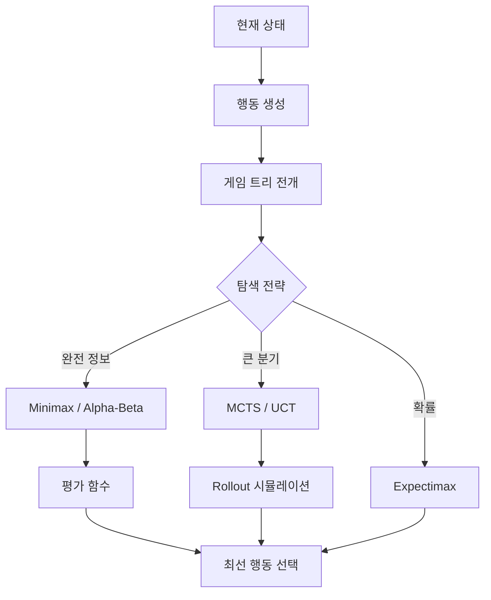
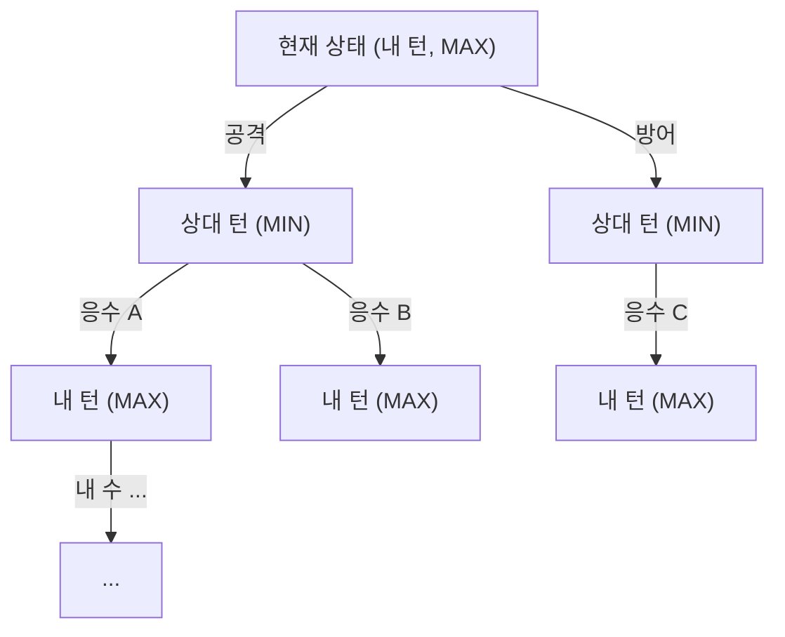
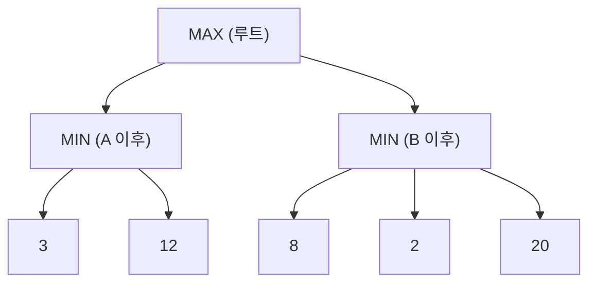
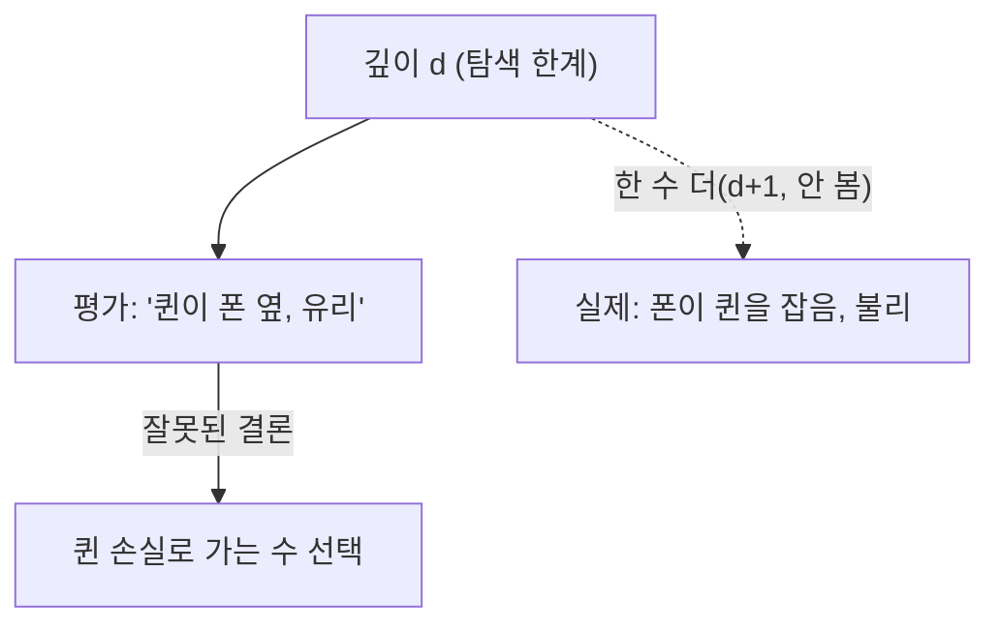
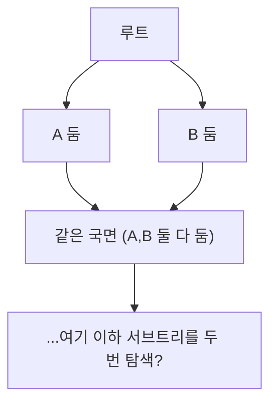
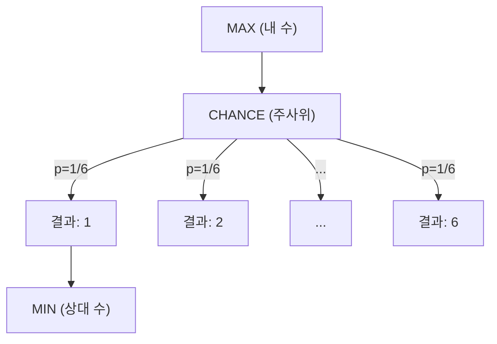
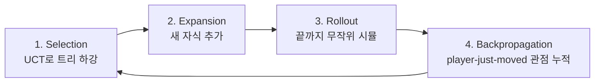

## 들어가며

대부분의 게임 AI는 "환경 안에서 무엇을 할까"를 고른다. 경로를 찾고, 효용을 비교하고, 행동 트리를 내려간다. 이 결정들에는 *적대자* 가 없다 — 월드는 가만히 있거나 무작위로 변할 뿐, AI의 수를 읽고 일부러 최악의 대응을 고르지 않는다. 그런데 체스, 장기, 바둑, 카드 게임, 턴제 전술, 자동 전투에서는 문제가 근본적으로 달라진다. 한 수의 가치는 그 수 자체가 아니라 *상대가 그 수에 어떻게 응수하느냐* 에 따라 결정된다. 좋은 수란 지금 점수가 높은 수가 아니라, 상대의 최선 대응까지 모두 펼쳐 본 뒤에도 여전히 좋은 수다.

적대적 탐색(Adversarial Search)은 이 상호작용을 *게임 트리* 로 모델링한다. 한 플레이어가 점수를 최대화하려 하고 다른 플레이어가 같은 점수를 최소화하려 한다는 가정 위에서, 미래의 수읽기 전체를 트리로 펼치고 그 트리를 거꾸로 접어 올려 현재의 최선 수를 뽑는다. 이 한 문장에 이 글의 모든 기법이 들어 있다. Minimax는 그 접어 올리는 규칙이고, Alpha-Beta는 결과를 바꾸지 않으면서 트리의 일부를 보지 않는 기법이며, 평가 함수는 끝까지 펼칠 수 없는 트리의 잎을 점수화하는 함수다. Monte Carlo Tree Search는 트리를 균등하게 펼치는 대신 무작위 시뮬레이션의 통계로 유망한 가지에만 계산을 몰아준다.

이 글은 완전 정보 2인 제로섬 게임의 minimax에서 출발해, alpha-beta pruning과 그 효율을 좌우하는 move ordering, 깊이 제한 탐색의 필수 조건인 평가 함수와 quiescence·horizon effect, 시간 예산을 다루는 iterative deepening, 중복 상태를 캐싱하는 transposition table과 Zobrist hashing, 주사위·숨은 패를 다루는 expectimax와 determinization, 그리고 평가 함수 없이 시뮬레이션으로 값을 추정하는 MCTS와 UCT까지를 다룬다. 각 절은 알고리즘 정의에 그치지 않고 *왜 그렇게 동작하는지의 워크스루*, *복잡도와 수치 예시*, *흔한 함정* 을 함께 짚는다. 핵심은 처음부터 끝까지 하나다 — "상대도 생각한다"는 사실을 *데이터 구조* 가 아니라 *탐색의 재귀 구조* 안에 박아 넣는 것.



이 글의 목표.

1. **게임 트리** — 상태/행동/상대 턴, 분기 폭발, negamax 단일화.
2. **Minimax** — 최선 대응 가정과 백업 규칙, 트레이스.
3. **Alpha-Beta** — 결과 보존 pruning, move ordering, $\sqrt{b}$ 분석.
4. **평가 함수** — 깊이 제한의 필요조건, horizon effect, quiescence.
5. **Iterative Deepening** — 시간 예산, PV·killer·aspiration window.
6. **Transposition Table** — Zobrist hashing, bound 타입, 교체 정책.
7. **Chance와 Hidden Information** — expectimax, determinization, ISMCTS.
8. **MCTS** — 4단계 루프, UCT 유도, 게임별 적합성.


---

## 목차
1. [게임 트리](#1-게임-트리)
2. [Minimax](#2-minimax)
3. [Alpha-Beta Pruning](#3-alpha-beta-pruning)
4. [평가 함수](#4-평가-함수)
5. [Iterative Deepening](#5-iterative-deepening)
6. [Transposition Table](#6-transposition-table)
7. [Chance와 Hidden Information](#7-chance와-hidden-information)
8. [Monte Carlo Tree Search](#8-monte-carlo-tree-search)


---

## 1. 게임 트리

### 상태, 행동, 그리고 턴이 번갈아 든다

게임 트리는 상태(state)를 노드로, 행동(move)을 간선으로 둔다. 루트는 현재 상태다. 내 턴이라면 가능한 행동 하나하나가 자식 노드 — 상대 턴 상태 — 를 만든다. 그 상대 턴 상태에서 상대가 둘 수 있는 행동 하나하나가 다시 손자 노드 — 내 턴 상태 — 를 만든다. 이 과정을 반복하면 미래의 모든 진행이 트리로 펼쳐지고, 잎(leaf)은 게임이 끝난 상태(승/패/무) 또는 탐색을 멈춘 깊이의 비종료 상태다.



노드의 *플레이어 라벨* 이 트리의 깊이에 따라 MAX/MIN으로 번갈아 든다는 점이 핵심이다. 이 번갈음이 적대적 탐색을 일반적인 그래프 탐색과 구분한다. 일반 탐색은 모든 노드에서 같은 목적(최단 경로, 최소 비용)을 추구하지만, 적대적 탐색은 *깊이마다 목적이 뒤집힌다*. 내 깊이에서는 점수를 올리려 하고, 상대 깊이에서는 같은 점수를 내리려 한다.

게임 상태를 코드로 옮길 때 필요한 인터페이스는 다음 다섯 가지로 충분하다.

```cpp
struct State {
    // 합법 수 목록을 채운다. 종료 상태면 비어 있다.
    void LegalMoves(std::vector<Move>& out) const;
    // 수를 적용한 새 상태를 만든다. (또는 in-place Apply/Undo 쌍)
    State Apply(Move m) const;
    bool  IsTerminal() const;        // 게임이 끝났는가
    int   TerminalScore() const;     // 끝났다면 MAX 관점의 결과 (+승 / -패 / 0무)
    bool  IsMaxToMove() const;       // 이번 턴이 MAX인가
};
```

실전에서는 `Apply`가 새 상태를 복사하는 대신 *in-place로 수를 두고(make) 무르는(unmake)* 연산을 쌍으로 두는 경우가 많다. 체스판처럼 상태가 크면 노드마다 전체 복사는 비싸다. make/unmake는 바뀐 필드와 해시를 함께 증분 갱신하고, undo record에 원래 값을 보관해 정확히 복구한다. 반복 횟수·캐슬링 권리·턴처럼 합법 수와 동일성에 영향을 주는 모든 필드가 이 경로에 포함돼야 한다.

### 분기 폭발의 정량화

게임 트리는 빠르게 폭발한다. 한 상태의 평균 합법 수가 $b$개(분기 계수, branching factor)이고 $d$수 앞을 본다면, 깊이 $d$의 잎 노드 수는 $O(b^d)$다. 이 지수가 적대적 탐색의 모든 비용을 지배한다.

| 균일 트리 근사 | 대표 분기 $b$ | $b^4$ | $b^8$ | $b^{12}$ |
|---|---:|---:|---:|---:|
| $b=4$ 예시 | 4 | 256 | 65,536 | ~16,000,000 |
| 체커 | ~8 | 4,096 | ~16,000,000 | ~7e10 |
| 체스 | ~35 | ~1,500,000 | ~2.3e12 | ~3.4e18 |
| 바둑(19x19) | ~250 | ~3.9e9 | ~1.5e19 | ~6e28 |

표는 실제 게임의 정확한 reachable-state 수가 아니라 분기 계수를 고정한 균일 트리 산수다. 종료 상태, 반복, 합법 수 변화, transposition을 무시한다. 그럼에도 체스를 $b=35$로 근사하면 8 ply의 잎은 약 2조 개이고, 잎당 10ns라는 비현실적으로 작은 비용에서도 약 6시간이다. 바둑 초반을 $b=250$으로 단순화하면 4 ply만으로 약 39억 후보다. 지수 성장의 규모를 보는 예이지 엔진 성능 예측값이 아니다.

따라서 적대적 탐색은 세 가지 장치로 이 지수와 싸운다.

- *깊이 제한 + 평가 함수*: 끝까지 가지 않고 일정 깊이에서 멈춰, 잎의 비종료 상태를 점수로 근사한다.
- *pruning*: 현재 최선 수를 바꿀 수 없다고 증명된 가지를 보지 않는다. 완벽한 수 순서의 alpha-beta는 균일 트리에서 대략 $O(b^{d/2})$까지 줄일 수 있다.
- *caching*: 다른 수순으로 도달한 같은 상태(transposition)의 탐색 결과를 깊이와 bound 종류와 함께 재사용한다.

### 적용 전제 — 어디까지가 "기본형"인가

기본 minimax가 정확히 들어맞는 영역은 좁고 명확하다. *결정론적*(주사위 없음), *2인*, *제로섬*(한 명의 이득이 정확히 다른 한 명의 손실), *완전 정보*(숨은 패 없음, 둘 다 같은 상태를 본다) 게임이다. 체스·바둑·오목·턴제 전술 일부가 여기에 든다.

이 전제 중 하나라도 깨지면 백업 규칙과 상태 표현을 바꿔야 한다. 주사위·카드 뽑기 같은 알려진 확률 전이는 chance node에서 기댓값을 취하고, 숨은 정보는 관측으로 구분할 수 없는 상태들의 정보 집합 또는 믿음 분포를 요구한다. 셋 이상의 일반합 플레이어는 단일 스칼라 제로섬 값 대신 플레이어별 효용 벡터와 상대 모델이 필요하다.

### negamax — MAX/MIN을 하나로 접기

코드를 보기 전에 한 가지 단순화를 도입한다. 제로섬 게임에서는 한 관점의 점수가 다른 관점에서는 부호만 뒤집힌 값이다. 즉 MIN 노드에서 "최소화"하는 대신, 자식 값들의 *부호를 뒤집어* "최대화"한다고 보면 MAX 노드와 MIN 노드를 *같은 코드* 로 처리할 수 있다.

$$
\text{minimax}(s) = \begin{cases} \max_{m} \text{minimax}(\text{apply}(s,m)) & s\text{가 MAX 노드} \\ \min_{m} \text{minimax}(\text{apply}(s,m)) & s\text{가 MIN 노드} \end{cases}
$$

이것을 항상 "현재 둘 차례인 플레이어 관점"으로 재정의하면 다음 한 줄로 합쳐진다.

$$
\text{negamax}(s) = \max_{m} \left( -\,\text{negamax}(\text{apply}(s,m)) \right)
$$

이 negamax 형태는 제로섬·교대 수 구조에서 MAX/MIN 분기 중복을 없애고 alpha-beta의 부호 반전 규칙도 한 함수에 모은다.

## 2. Minimax

### 백업 규칙 — 잎에서 루트로 접어 올린다

Minimax는 상대가 *항상 나에게 가장 불리한 최선 대응* 을 한다고 가정한다. 이 가정 아래, 각 노드의 값은 잎에서부터 거꾸로 정해진다. 잎의 값은 평가 함수(또는 종료 점수)다. 내부 노드의 값은 자식 값들을 *그 노드의 플레이어 목적에 따라 접은* 결과다 — MAX 노드는 자식의 최댓값, MIN 노드는 자식의 최솟값.

```cpp
int Minimax(const State& s, int depth) {
    if (s.IsTerminal()) return s.TerminalScore(); // 종료값: MAX 관점의 정확한 결과
    if (depth == 0) return Evaluate(s);            // cutoff: MAX 관점 근사값

    std::vector<Move> moves;
    s.LegalMoves(moves);

    if (s.IsMaxToMove()) {
        int best = -INF;
        for (Move m : moves)
            best = std::max(best, Minimax(s.Apply(m), depth - 1));
        return best;
    } else {
        int best = +INF;
        for (Move m : moves)
            best = std::min(best, Minimax(s.Apply(m), depth - 1));
        return best;
    }
}
```

루트에서는 값만 계산하는 게 아니라 *어떤 수* 가 그 값을 만드는지를 기억해야 한다. 그래서 루트는 별도 함수로 두고, 각 수에 대한 minimax 값을 비교해 최선 수를 고른다.

```cpp
Move ChooseMove(const State& s, int depth) {
    std::vector<Move> moves;
    s.LegalMoves(moves);
    Move best{};
    int bestScore = -INF;
    for (Move m : moves) {                       // 루트는 MAX 라고 가정
        int score = Minimax(s.Apply(m), depth - 1);
        if (score > bestScore) { bestScore = score; best = m; }
    }
    return best;
}
```

### 워크스루 — 작은 트리를 손으로 접어 본다

추상적인 "최댓값/최솟값"을 구체화하려면 작은 트리를 직접 접어 보는 게 빠르다. 깊이 2, MAX→MIN→잎 구조를 생각하자. 루트 MAX가 행동 A, B 둘 중 하나를 고르고, 각 행동 뒤 MIN이 둘 중 하나를 고른다. 잎의 평가값은 다음과 같다.



접어 올리는 순서는 잎 → MIN → MAX다.

- MIN 노드 A: 자식 `{3, 12}`의 최솟값 = **3**. (상대는 내가 A를 두면 3을 강요한다.)
- MIN 노드 B: 자식 `{8, 2, 20}`의 최솟값 = **2**. (상대는 내가 B를 두면 2를 강요한다.)
- MAX 노드 루트: 자식 `{3, 2}`의 최댓값 = **3**. 따라서 루트는 행동 **A** 를 고른다.

여기서 *순진한 탐욕* 과의 차이가 드러난다. 각 가지에서 가장 큰 잎만 보면 B의 20이 A의 12보다 좋아 보이고, 잎 평균도 B가 10으로 A의 7.5보다 높다. 하지만 상대가 최선으로 두면 B는 2로 떨어진다. Minimax는 "내가 좋아하는 잎"이 아니라 "상대가 허용하는 최악의 잎"으로 각 수를 평가하므로, 좋은 잎 옆에 치명적인 응수가 숨어 있는 함정에 빠지지 않는다.

### negamax로 다시 쓰기

1절 끝의 negamax 항등식을 쓰면 위 두 분기가 하나로 합쳐진다. 평가 함수가 *항상 둘 차례인 플레이어 관점* 의 점수를 반환하도록 부호 규약을 고정하는 것이 전제다.

```cpp
int ScoreForSideToMove(const State& s) {
    int maxScore = s.IsTerminal() ? s.TerminalScore() : Evaluate(s);
    return s.IsMaxToMove() ? maxScore : -maxScore;
}

int Negamax(const State& s, int depth) {
    if (depth == 0 || s.IsTerminal())
        return ScoreForSideToMove(s);

    std::vector<Move> moves;
    s.LegalMoves(moves);
    int best = -INF;
    for (Move m : moves)
        best = std::max(best, -Negamax(s.Apply(m), depth - 1));   // 부호 반전
    return best;
}
```

여기서 `ScoreForSideToMove`는 종료 상태면 `TerminalScore()`, cutoff 상태면 MAX 관점 `Evaluate(s)`를 얻은 뒤, MIN 차례라면 부호를 뒤집는다. 종료 점수와 근사 평가의 관점 계약이 하나라도 다르면 negamax 항등식은 성립하지 않는다.

자식 값 앞의 마이너스 부호 하나가 MAX/MIN 번갈음을 흡수한다. alpha-beta를 negamax로 쓸 때는 자식 호출의 창도 `(-beta, -alpha)`로 뒤집어야 같은 의미가 유지된다.

### 비용과 한계

Minimax는 유한한 결정론적 2인 제로섬 완전정보 게임을 terminal까지 정확히 탐색하면 게임 이론적 값을 계산한다. 깊이 제한과 근사 평가 함수를 쓰면 그 최적성은 더 이상 보장되지 않는다. 가지치기 없는 탐색 비용은 균일 트리 근사에서 $O(b^d)$이며, alpha-beta는 결과에 영향 없는 가지를 증명해 줄이고 평가 함수는 cutoff 상태의 값을 근사한다.

## 3. Alpha-Beta Pruning

### 핵심 직관 — 이미 진 가지는 끝까지 안 본다

Alpha-beta pruning은 *minimax와 정확히 같은 값* 을 내면서 잎의 상당수를 보지 않는다. 직관은 한 문장이다. *내가 더 들여다봐도 부모의 결정을 바꿀 수 없다는 게 확정되면, 그 가지의 나머지는 볼 필요가 없다.*

탐색은 두 경계값을 들고 다닌다.

- `alpha`: 루트에서 여기까지 오는 경로상에서 *MAX가 이미 보장한* 최선(하한). MAX는 적어도 alpha는 받는다.
- `beta`: 같은 경로에서 *MIN이 이미 보장한* 최선(상한). MIN은 많아야 beta까지만 내준다.

탐색 중 `alpha >= beta`가 되는 순간, 현재 노드의 남은 자식들은 부모의 선택을 절대 바꿀 수 없다 — 이때 가지를 자른다(cutoff). 구체적으로 MAX 노드에서 어떤 자식 값이 beta 이상이면, MIN인 부모는 이 가지를 절대 허용하지 않을 것이므로 나머지 형제를 볼 이유가 없다(beta-cutoff). 대칭으로 MIN 노드에서 자식 값이 alpha 이하면 alpha-cutoff가 일어난다.

```cpp
int AlphaBeta(const State& s, int depth, int alpha, int beta) {
    if (s.IsTerminal()) return s.TerminalScore();
    if (depth == 0) return Evaluate(s);

    std::vector<Move> moves;
    OrderedMoves(s, moves);             // move ordering 이 효율을 좌우한다

    if (s.IsMaxToMove()) {
        int value = -INF;
        for (Move m : moves) {
            value = std::max(value, AlphaBeta(s.Apply(m), depth - 1, alpha, beta));
            alpha = std::max(alpha, value);
            if (alpha >= beta) break;   // beta-cutoff: MIN 부모가 허용 안 함
        }
        return value;
    } else {
        int value = +INF;
        for (Move m : moves) {
            value = std::min(value, AlphaBeta(s.Apply(m), depth - 1, alpha, beta));
            beta = std::min(beta, value);
            if (alpha >= beta) break;   // alpha-cutoff: MAX 부모가 허용 안 함
        }
        return value;
    }
}
```

루트 호출은 가장 넓은 창 `AlphaBeta(s, depth, -INF, +INF)`로 시작한다.

### 워크스루 — cutoff가 일어나는 순간

2절의 워크스루 트리(MAX→MIN→잎)에 alpha-beta를 적용해 *어디서 잎을 건너뛰는지* 추적한다. 잎 값은 동일하게 A 가지 `{3, 12}`, B 가지 `{8, 2, 20}`이다.

```text
루트 MAX 진입: alpha=-INF, beta=+INF

A 가지(MIN) 진입: alpha=-INF, beta=+INF
  A1=3 평가 → MIN value=3, beta=min(+INF,3)=3.  alpha(-INF) < beta(3), 계속.
  A2=12 평가 → MIN value=min(3,12)=3.  beta=3. 자식 끝.
  A 가지 반환 = 3.
루트 MAX: value=3, alpha=max(-INF,3)=3.

B 가지(MIN) 진입: alpha=3(상속), beta=+INF
  B1=8 평가 → MIN value=8, beta=min(+INF,8)=8. alpha(3) < beta(8), 계속.
  여기서 아직 컷 없음.
  B2=2 평가 → MIN value=min(8,2)=2, beta=min(8,2)=2.
  이제 alpha(3) >= beta(2) → alpha-cutoff! B3=20은 평가하지 않음.
  B 가지 반환 = 2.
루트 MAX: value=max(3,2)=3. alpha=3.
루트 반환 = 3, 최선 수 = A.
```

이 트리에서는 B2에서 alpha-cutoff가 나는 순간 세 번째 잎 B3=20을 실제로 평가하지 않는다. 핵심은 cutoff의 조건 — "MAX가 이미 3을 확보했는데, B 가지의 MIN이 2를 강요할 수 있음이 드러나면, B의 나머지가 무엇이든 MAX는 B를 고르지 않는다" — 이다. 더 들여다봐도 결정이 안 바뀌므로 본다는 행위 자체가 낭비다.

### move ordering이 전부를 좌우한다

alpha-beta가 얼마나 자르는지는 *수를 어떤 순서로 보는가* 에 결정적으로 의존한다. cutoff는 "좋은 자식을 일찍 봐서 경계가 빨리 좁혀질 때" 일어난다. 그래서 *최선에 가까운 수를 먼저 보면* pruning이 폭발적으로 늘고, *최악의 수를 먼저 보면* 거의 minimax와 같아진다.

| move ordering | 깊이 $d$ 탐색 노드 수 | 같은 노드 예산에서 가능한 깊이 |
|---|---|---|
| 무작위/최악 | $\approx b^d$ | $d$ (minimax와 동일) |
| 무작위 순서의 고전적 평균 모델 | $\approx b^{3d/4}$ | $\approx 1.3d$ |
| 완벽(최선 먼저) | $\approx b^{d/2}$ | $\approx 2d$ |

이론적으로 균일 트리와 완벽한 정렬에서 alpha-beta가 보는 잎 수는 짝수 깊이에 대해 대략 $b^{d/2}$ 차수로 줄어든다. 같은 노드 예산에서 깊이를 거의 두 배로 늘릴 수 있다는 말도 이 이상적 모델 안의 결과다. 실제 깊이는 강제 수, transposition, quiescence, 생성·평가 비용과 시간 관리에 좌우된다. $b^{3d/4}$ 역시 특정 확률 모델에서의 고전적 평균이지 임의 게임의 보편 평균이 아니다.

현실적인 정렬 기법은 다음과 같이 쌓인다.

- *전이표 수(TT move)*: 같은 상태를 충분한 깊이에서 탐색한 기록이 있으면 당시의 best move를 먼저 본다. 기록된 bound의 값과 move-ordering hint는 구분한다.
- *캡처/체크 우선*: 기물을 잡거나 왕을 위협하는 수는 평가 변화가 크므로 먼저 본다. MVV-LVA(가장 값진 피해자를 가장 값싼 공격자로) 휴리스틱이 표준이다.
- *killer move*: 같은 깊이의 형제 노드에서 cutoff를 일으킨 수는 다른 형제에서도 cutoff를 낼 가능성이 높다. 깊이별로 두어 개 기억한다.
- *history heuristic*: 과거에 자주 cutoff를 낸 (출발칸, 도착칸) 쌍에 점수를 누적해 정렬에 반영한다.

### negamax 형태의 alpha-beta

명시적 MAX/MIN의 alpha-beta도 negamax로 합칠 수 있다. 자식으로 내려갈 때 창을 `(-beta, -alpha)`로 뒤집어 넘기고, 돌아온 값의 부호를 뒤집는다. 이것이 실전 엔진이 쓰는 표준형이다.

```cpp
int AlphaBetaNega(const State& s, int depth, int alpha, int beta) {
    if (depth == 0 || s.IsTerminal()) return ScoreForSideToMove(s);

    std::vector<Move> moves;
    OrderedMoves(s, moves);
    for (Move m : moves) {
        int score = -AlphaBetaNega(s.Apply(m), depth - 1, -beta, -alpha);
        if (score >= beta) return beta;          // fail-hard beta cutoff
        if (score > alpha) alpha = score;        // 새 하한
    }
    return alpha;
}
```

창을 뒤집어 넘기는 `(-beta, -alpha)`가 핵심이다. 자식 관점에서는 부모의 상한이 자식의 하한이 되고, 부모의 하한이 자식의 상한이 된다 — 제로섬의 부호 반전이 경계에도 그대로 적용된다. 이 코드는 명시적 버전과 완전히 같은 결과를 내면서 분기가 없어, killer/history/TT를 얹기에도 더 깔끔하다.

## 4. 평가 함수

### 깊이 제한이 평가 함수를 강제한다

큰 게임에서는 계산 예산 때문에 탐색을 깊이·노드·시간 한계에서 자르는 경우가 많다. cutoff 잎이 비종료 상태라면 종료 점수 대신 *평가 함수(evaluation function)* 가 필요하다. 작은 게임이나 endgame tablebase 범위처럼 terminal 값이 완전히 알려진 구간은 예외다. 평가 함수는 비종료 상태를 받아 "이 국면이 MAX에게 얼마나 좋은가"를 하나의 숫자로 근사한다(negamax에서는 둘 차례 관점으로 부호를 맞춘다).

평가 함수는 *탐색 알고리즘만큼, 때로는 그 이상으로* 중요하다. 깊이 6 탐색에 형편없는 평가를 붙이면, 깊이 3 탐색에 좋은 평가를 붙인 것보다 약할 수 있다 — 탐색은 평가가 매긴 점수를 더 정밀하게 *전파* 할 뿐, 잘못된 점수를 고쳐 주지 않기 때문이다.

```cpp
// MAX(자기) 관점 점수. negamax 라면 둘 차례 관점으로 부호를 맞춘다.
int Evaluate(const State& s) {
    int score = 0;
    score += 100 * (s.myUnits      - s.enemyUnits);       // 병력 수 (지배적)
    score +=  10 * (s.myHealth     - s.enemyHealth);      // 총 체력
    score +=  25 * (s.myObjectives - s.enemyObjectives);  // 점령 목표
    score +=   5 * (s.centerControl);                     // 위치 우위
    score +=   3 * (s.myMobility    - s.enemyMobility);   // 행동 선택지 수
    return score;
}
```

### 좋은 평가 함수의 조건

평가 함수 설계는 게임마다 다르지만, 만족해야 할 성질은 공통이다.

- *빠르다*: 탐색 한 번에 수십만~수백만 번 호출된다. 평가 한 번이 1μs면 100만 호출에 1초가 든다. 분기마다 raycast나 경로 탐색을 넣으면 탐색 깊이를 통째로 잃는다.
- *단조롭다(monotone)*: 명백히 더 좋은 상태가 더 높은 점수를 받아야 한다. 기물을 하나 더 잡았는데 점수가 떨어지면 탐색이 엉뚱한 수를 고른다.
- *국면 의존(phase-aware)*: 같은 요소라도 초반과 후반의 가치가 다르다. 체스에서 왕은 중반엔 안전이 최우선이지만 종반엔 적극적으로 전진하는 기물이다. 가중치를 게임 진행도에 따라 보간한다(tapered eval).
- *제로섬 대칭*: 2인 제로섬이라면 `eval(s) == -eval(s를 상대 관점으로 뒤집은 상태)` 가 성립해야 한다. 이 대칭이 깨지면 negamax의 부호 반전이 틀린다.

### horizon effect — 탐색의 지평선 너머

평가 함수의 가장 악명 높은 실패가 *horizon effect(지평선 효과)* 다. 탐색은 깊이 $d$ 에서 멈추는데, 결정적인 사건이 *바로 그 깊이 너머* 에서 일어나는 경우다. 예컨대 깊이 $d$ 의 잎에서 "내 퀸이 적 폰 옆에 있다"는 국면이 평가상 유리해 보이지만, 한 수만 더 두면(깊이 $d+1$) 그 퀸이 잡힌다. 탐색은 그 한 수를 못 보고 유리하다 판단한다.

더 교활한 변형은 AI가 *나쁜 일을 지평선 밖으로 밀어내는* 행동이다. 퀸을 잃을 운명인 국면에서, AI는 의미 없는 체크를 연발해 퀸 손실을 깊이 밖으로 "미룬다". 탐색 안에서는 손실이 안 보이니 그 헛수들이 좋아 보이고, 결국 더 나쁜 자리에서 퀸을 잃는다.



### quiescence search — 조용해질 때까지만 더 본다

horizon effect의 표준 해법은 *quiescence search(정적 탐색)* 다. 깊이 한계에 도달했을 때 곧장 평가하지 않고, *"불안정한(noisy)" 수* — 캡처, 체크, 승급처럼 평가가 급변할 수 있는 수 — 만 골라 *조용해질 때까지* 조금 더 본다. 조용한(quiet) 국면, 즉 더 둬도 평가가 크게 안 변하는 상태에 도달해야 평가 함수를 신뢰한다.

```cpp
int Quiescence(const State& s, int alpha, int beta) {
    int standPat = ScoreForSideToMove(s); // 아무것도 안 두는 평가 (하한 후보)
    if (standPat >= beta) return beta;   // 이미 충분히 좋음
    if (standPat > alpha) alpha = standPat;

    std::vector<Move> captures;
    s.NoisyMoves(captures);              // 캡처/체크/승급만
    for (Move m : captures) {
        int score = -Quiescence(s.Apply(m), -beta, -alpha);
        if (score >= beta) return beta;
        if (score > alpha) alpha = score;
    }
    return alpha;                        // 조용한 국면의 안정된 평가
}
```

negamax 형태인 `AlphaBetaNega`의 `depth == 0` 분기에서 `ScoreForSideToMove(s)` 대신 `Quiescence(s, alpha, beta)`를 호출하면 캡처·체크처럼 크게 흔들리는 전술 수를 더 따라간 뒤 평가한다. `Quiescence`는 현재 차례(side-to-move) 관점의 점수와 부호 반전 창 `(-beta, -alpha)`를 쓰므로, MAX 관점 값과 그대로의 `[alpha, beta]`를 쓰는 명시적 `AlphaBeta`의 `Evaluate(s)` 자리에 직접 끼워 넣으면 값과 창의 관점이 뒤집힌다(quiet MIN 상태가 MAX 관점 +100이면 `Quiescence`는 -100을 반환한다). 명시적 MAX/MIN 버전에 붙이려면 값과 창을 차례에 따라 함께 변환하는 adapter를 두거나 MAX용·MIN용 quiescence를 따로 작성해야 한다. `standPat`은 실제로 패스할 수 있다는 뜻이 아니다. 체크가 아닌 국면에서 정적 평가를 현재 하한 후보로 두고, 유리한 전술 수가 있을 때만 올리는 null-move 관찰이다. 체크 중에는 가만히 있을 수 없으므로 stand-pat을 허용하지 않고 모든 합법 회피를 생성해야 한다. quiescence search는 포함한 전술 종류 밖의 horizon effect를 남기며, 조용한 국면의 정의와 delta pruning이 정확성과 비용을 결정한다.

## 5. Iterative Deepening

### 시간 예산에서 완료된 깊이의 답을 보존한다

게임 AI는 입력·애니메이션·서버 tick과 플레이 경험이 정한 deadline 안에 수를 내야 한다. 허용 시간이 초 단위일 수도, 한 simulation tick의 일부일 수도 있다. 깊이 $d$ 탐색의 비용은 분기 변화와 cutoff 때문에 미리 정확히 알기 어렵고, 깊이 8 탐색을 완료하지 못하면 그 불완전 결과가 모든 root move를 같은 기준으로 비교했다는 보장이 없다.

Iterative deepening(반복 심화)은 깊이 1부터 1, 2, 3,... 순으로 완전한 탐색을 반복하고 완료된 결과만 commit한다. 적어도 깊이 1이 끝났거나 사전에 합법 fallback move를 골라 두었다는 조건에서, 시간이 끊기면 마지막 완료 깊이의 답을 사용할 수 있다. timer 확인 간격이 너무 길면 deadline을 넘을 수 있으므로 node budget이나 주기적 cancellation check도 계약에 넣는다.

```cpp
Move SearchWithTimeLimit(const State& s, double endTime) {
    Move best = FirstLegalMove(s);         // 깊이 1도 못 끝낼 때의 fallback
    for (int depth = 1; depth <= kMaxDepth; ++depth) {
        SearchResult r = AlphaBetaRoot(s, depth, endTime);  // 시간 초과 시 중단 플래그
        if (r.aborted) break;            // 이 깊이는 미완 → 버린다
        best = r.bestMove;               // 완료된 깊이의 결과만 채택
        StorePV(r.principalVariation);   // 다음 깊이의 move ordering 용
        if (r.isMate) break;             // 확정 메이트면 더 깊이 볼 필요 없음
    }
    return best;
}
```

### 균일 트리 모델에서의 반복 비용

분기 계수가 일정하고 탐색 비용이 마지막 깊이의 노드 수에 지배된다는 단순 모델에서는 얕은 반복의 합이 기하급수 꼬리에 묻힌다. 각 깊이 탐색의 지배항을 $b^i$로 두면

$$
\sum_{i=1}^{d} b^i = \frac{b^{d+1}-b}{b-1} \approx b^d \cdot \frac{b}{b-1}
$$

이다. $b=35$인 완전 균일 트리라면 지배항 비율이 $35/34\approx1.03$이다. 이것은 반복 심화의 보편 오버헤드가 3%라는 뜻이 아니다. alpha-beta cutoff, transposition table, quiescence, 강제 수로 유효 분기 계수가 1에 가까워지면 비율이 커지고, 시간 초과로 폐기한 마지막 반복은 거의 한 budget을 추가로 소비할 수 있다.

- *언제든 멈출 수 있는 anytime 성질*: 시간이 부족하면 직전 깊이의 답을 쓴다.
- *move ordering 부트스트랩*: 깊이 $d-1$의 principal variation과 transposition 정보를 깊이 $d$의 앞쪽에 두면 alpha-beta cutoff가 늘어날 수 있다. 이 이득이 반복 비용을 상쇄하는지는 게임의 이동 순서 품질과 cache 재사용을 포함해 측정한다.

### aspiration window

iterative deepening과 짝을 이루는 최적화가 *aspiration window(기대 창)* 다. 깊이 $d-1$ 탐색의 결과 점수가 $v$ 였다면, 깊이 $d$ 의 결과도 그 근처일 가능성이 높다. 그래서 전체 창 `(-INF, +INF)` 대신 *좁은 창* `(v-δ, v+δ)` 로 탐색을 시작한다. 창이 좁을수록 cutoff가 빨라진다.

```cpp
int delta = 25;                                   // 평가 단위에 맞춘 작은 폭
int score = AlphaBetaRoot(s, depth, v - delta, v + delta);
if (score <= v - delta || score >= v + delta) {   // 창 밖 → fail
    score = AlphaBetaRoot(s, depth, -INF, +INF);   // 전체 창으로 재탐색
}
v = score;                                         // 다음 깊이의 중심
```

Aspiration window는 이전 반복의 점수가 새 깊이에서도 가까울 때 alpha-beta cutoff를 늘릴 수 있다. 점수가 창을 벗어나면 더 넓은 창으로 재탐색하는 비용을 치르므로 실제 이득은 점수 안정성과 창 너비에 달려 있다. 실시간 월드가 탐색 중 변한다면 동일 root snapshot을 고정하거나 검색을 취소·재시작해야 하며, 오래된 결과를 적용할 수 있는 최대 지연도 계약으로 둔다.

## 6. Transposition Table

### transposition — 다른 수순, 같은 국면

서로 다른 수의 순서가 완전히 같은 상태에 도달하는 경우를 *transposition(전위)* 이라 한다. 이런 합류 때문에 상태 공간은 단순 트리가 아니라 그래프다. 반복 가능한 수나 원위치 복귀가 있으면 cycle도 생길 수 있으므로 DAG라고 일반화할 수 없다. 탐색은 repetition rule·depth·history-dependent state를 key에 포함하거나 별도로 검출하면서 같은 국면의 계산을 재사용한다.



*Transposition table(TT)* 은 상태의 해시를 키로, 그 상태를 탐색한 결과를 저장하는 큰 해시 맵이다. 같은 해시가 다시 나오면 저장된 값을 재사용한다.

### Zobrist hashing — 증분으로 갱신되는 상태 해시

TT의 핵심은 상태를 빠르게 hash하면서 충돌 위험을 관리하는 것이다. Zobrist hashing은 각 `(기물 종류, 칸)` 조합의 난수 key를 XOR해 증분 갱신하기 쉽지만 유한 bit hash이므로 충돌을 제거하지는 않는다. side-to-move뿐 아니라 castling·en-passant·반복 판정에 필요한 history처럼 게임의 미래 합법 수와 terminal 판정을 바꾸는 상태도 key 계약에 포함한다.

```cpp
uint64_t zobrist[PIECE_TYPES][SQUARES];   // 시작 시 난수로 1회 초기화
uint64_t zobristSideToMove;               // 둘 차례 토글용

uint64_t HashBoard(const Board& b) {       // 처음 한 번 전체 계산
    uint64_t h = 0;
    for (int sq = 0; sq < SQUARES; ++sq)
        if (b.piece[sq] != EMPTY) h ^= zobrist[b.piece[sq]][sq];
    if (b.blackToMove) h ^= zobristSideToMove;
    return h;
}

// make/unmake 경로에서 바뀐 칸만 XOR — O(1) 증분 갱신
void MovePiece(uint64_t& h, int piece, int from, int to) {
    h ^= zobrist[piece][from];   // from 에서 제거 (XOR 두 번이면 원복)
    h ^= zobrist[piece][to];     // to 에 추가
}
```

XOR의 자기역원 성질 덕분에 수를 둘 때 *변경된 상태 특징만* XOR해 해시를 $O(1)$에 갱신할 수 있다. 움직인·잡힌 기물뿐 아니라 side-to-move, castling 권리, en-passant 표식처럼 그 수가 바꾼 모든 key 특징을 포함해야 한다. repetition이나 이동 횟수 규칙이 terminal 판정을 바꾸면 TT key 또는 조회 계약에서 그 문맥도 처리한다. unmake는 동일한 특징 변경을 역순으로 복원한다.

### bound 타입 — alpha-beta 값은 정확하지 않을 수 있다

TT 저장에서 흔히 빠뜨리는 함정이 있다. alpha-beta는 cutoff 때문에 노드의 *정확한 minimax 값* 이 아니라 *경계값* 만 알아내는 경우가 많다. beta-cutoff로 빠져나온 노드는 "값이 적어도 beta 이상"이라는 하한만 안다. 그래서 TT 엔트리에는 점수와 함께 *그 점수가 정확한지/하한인지/상한인지* 를 표시하는 bound 타입을 저장해야 한다.

```cpp
enum class Bound { Exact, Lower, Upper };

struct TTEntry {
    uint64_t key;        // Zobrist 해시 (충돌 검증용)
    int      depth;      // 이 결과를 얻은 탐색 깊이
    int      score;
    Bound    bound;
    Move     bestMove;   // move ordering 용 — 정확한 값이 아니어도 유용
};

// 탐색 진입부에서 TT 조회
bool ProbeTT(uint64_t key, int depth, int alpha, int beta, int& out) {
    TTEntry* e = table.Find(key);
    if (!e || e->key != key || e->depth < depth) return false;  // 없거나 더 얕음
    switch (e->bound) {
        case Bound::Exact: out = e->score; return true;
        case Bound::Lower: if (e->score >= beta)  { out = e->score; return true; } break;
        case Bound::Upper: if (e->score <= alpha) { out = e->score; return true; } break;
    }
    return false;   // 경계만으로는 현재 창을 결정짓지 못함
}
```

`depth` 조건이 중요하다. 더 *얕은* 깊이로 얻은 값은 현재 더 깊은 탐색의 답으로 신뢰할 수 없으므로 무시한다. bestMove 필드는 비록 점수가 부정확해도 *move ordering* 에 쓰면 가치가 크다 — 같은 국면에서 한 번 좋았던 수는 다시 좋을 가능성이 높고, 이를 맨 앞에 두면 3절의 cutoff가 폭증한다.

### 교체 정책과 충돌

TT는 무한히 커질 수 없다. 보통 고정 크기 배열(예: 항목 수가 2의 거듭제곱)에 `key % size`로 인덱싱하고, 충돌(다른 국면이 같은 슬롯)이 나면 *교체 정책* 으로 무엇을 남길지 정한다.

- *depth-preferred*: 더 깊은 탐색으로 얻은 결과를 우선 보존한다. 깊은 결과는 계산 비용이 컸고 정보량도 많다.
- *always-replace*: 항상 새 결과로 덮는다. 단순하고, 탐색이 진행됨에 따라 최신 국면을 유지한다.
- *2단(two-tier)*: 슬롯마다 "깊이 우선" 칸과 "항상 교체" 칸을 둘 다 두어 두 정책의 장점을 합친다.

엔트리에 전체 64bit key를 저장하면 같은 table index를 쓴 **서로 다른 key**는 거부할 수 있지만, 서로 다른 상태가 같은 64bit key 자체를 만든 충돌은 구분하지 못한다. 잘못된 exact/bound 값 하나가 root move와 게임 결과를 바꿀 수 있으므로 “한 노드만 틀린다”고 보장할 수 없다. 제품은 더 넓은 signature, 독립적인 보조 hash, 중요 조회의 state verification 중 비용에 맞는 방어를 선택하고, 재현 테스트에서는 충돌을 강제로 주입한다.

## 7. Chance와 Hidden Information

### chance node와 expectimax

주사위, 카드 뽑기, 무작위 크리티컬처럼 *확률* 이 끼면 트리에 MAX/MIN이 아닌 제3의 노드 — chance node(확률 노드) — 가 들어간다. 확률 노드의 자식은 가능한 무작위 결과들이고, 각 결과에는 확률이 붙는다. 이 노드의 값은 최댓값도 최솟값도 아닌 *기대값* 이다. 이렇게 확장한 알고리즘이 expectimax다.

```cpp
double Expectimax(const State& s, int depth) {
    if (s.IsTerminal()) return s.TerminalScore();
    if (depth == 0) return Evaluate(s);

    if (s.IsChanceNode()) {                      // 주사위/카드 등
        double expected = 0.0;
        for (const Outcome& o : s.Outcomes())    // (결과, 확률) 목록
            expected += o.probability * Expectimax(s.Apply(o), depth - 1);
        return expected;                          // 기대값으로 백업
    }
    std::vector<Move> moves;
    s.LegalMoves(moves);

    if (s.IsMaxToMove()) {
        double best = -INF;
        for (Move m : moves)
            best = std::max(best, Expectimax(s.Apply(m), depth - 1));
        return best;
    }
    double best = +INF;
    for (Move m : moves)
        best = std::min(best, Expectimax(s.Apply(m), depth - 1));
    return best;
}
```



확률 노드는 분기 폭발을 가속한다. 주사위 결과 6가지가 *내 수 × 상대 수 사이마다* 곱해지면, 같은 깊이를 보는 데 노드가 6배씩 든다 — 유효 분기가 $b$ 에서 $b \cdot k$($k$=결과 수)로 뛴다. 게다가 *alpha-beta를 그대로 쓸 수 없다*. 기대값은 자식 일부만 봐서는 경계를 좁힐 수 없기 때문이다(평가값이 유계라면 \*-minimax 같은 제한적 pruning이 가능하지만 일반 alpha-beta만큼 강하지 않다). 그래서 실전에서는 *확률이 낮은 결과 생략*, *비슷한 결과 묶기(bucketing)*, *샘플링* 같은 근사로 분기를 줄인다.

### hidden information — 단일 상태가 아니라 믿음 상태

숨은 정보 — 상대의 손패, 안개 속 유닛, 뒤집힌 카드 — 는 더 근본적인 변화를 요구한다. 이제 AI는 *현재 상태를 정확히 모른다*. 알 수 있는 건 "현재 가능한 상태들의 집합과 그 확률 분포", 즉 *믿음 상태(belief state)* 다. 진짜 게임 트리는 이 믿음 상태 위에서 펼쳐져야 한다.

가장 단순한 실전 접근은 *determinization(결정화)* 이다. 모르는 정보를 *그럴듯한 하나의 가능성으로 무작위 표본화* 해 "이 카드들이 상대 손에 있다"고 가정하면, 그 순간 게임은 완전 정보 게임이 된다. 그 결정화된 상태에서 평범한 minimax/alpha-beta를 돌리고, 이를 *여러 표본에 대해 반복* 한 뒤 각 수의 평균 가치로 실제 수를 고른다(Perfect Information Monte Carlo, PIMC).

```cpp
Move ChooseMoveImperfect(const Belief& belief, int depth, int samples) {
    std::unordered_map<Move, double> total;
    std::vector<Move> rootMoves = belief.LegalMovesKnownToPlayer();
    for (Move m : rootMoves) total[m] = 0.0;

    for (int i = 0; i < samples; ++i) {
        State det = belief.SampleConsistentState();   // 숨은 정보를 하나로 고정
        for (Move m : rootMoves) {
            if (!det.IsLegal(m))
                throw std::logic_error("belief states disagree on information-set actions");
            total[m] += AlphaBeta(det.Apply(m), depth - 1, -INF, +INF);
        }
    }
    return ArgMax(rootMoves, [&](Move m) { return total[m] / samples; });
}
```

같은 정보 집합에서 플레이어가 선택할 수 있는 행동 집합은 관측으로 결정되어야 한다. 결정화마다 합법 수가 달라지는 모델에서 “합법이었던 표본만” 평균 내면, 실제 상태에 따라 불법일 수 있는 수가 과대평가된다. 그런 게임은 정보 집합을 다시 나누거나 행동을 관측 가능한 공통 집합으로 정의해야 한다. `samples > 0` 역시 호출 계약이다.

### determinization의 약점

determinization은 구현이 쉽고 강한 게임도 많지만 두 가지 구조적 약점이 있다.

- *strategy fusion(전략 융합)*: 각 표본을 완전 정보로 풀면, AI는 *표본마다 다른 최적 행동* 을 자유롭게 고른다고 가정한다. 하지만 실제로는 같은 정보 집합(눈에 보이는 것이 똑같은 상황)에서 *하나의 행동* 만 할 수 있다. 표본별로 다른 수를 섞어 쓴다고 착각해 실제보다 자신을 과대평가한다.
- *비현실적 전지(全知)*: 각 결정화 안에서 AI는 숨은 카드를 *아는 것처럼* 둔다. 그래서 정보를 캐내는 수(상대를 떠보는 수), 정보를 숨기는 수(블러핑)의 가치를 평가하지 못한다.

이 약점을 줄이려는 방향이 정보 집합 MCTS(Information Set MCTS, ISMCTS)다. 트리 노드는 플레이어의 관측으로 구분할 수 없는 상태들의 정보 집합에 대응하고, 시뮬레이션마다 일관된 숨은 상태를 표본화해 관측 가능한 행동의 통계를 누적한다. 이것이 strategy fusion을 자동으로 모두 없애는 것은 아니며, 정보 집합의 정의, 상대의 관측과 행동 모델, 표본화 편향이 결과를 좌우한다.

## 8. Monte Carlo Tree Search

### 평가 함수 없이 통계로 값을 추정한다

깊이 제한 minimax와 alpha-beta는 cutoff 상태의 평가 함수에 의존한다. 분기 계수가 크고 수작업 평가가 어려운 게임에서는 균일한 깊이 전개와 정적 평가만으로 계산을 배분하기 어렵다.

Monte Carlo Tree Search(MCTS)는 트리를 균등하게 펼치는 대신 rollout이나 leaf value 표본으로 값을 추정하고 유망한 가지에 더 많은 계산을 배분한다. terminal까지 싼 rollout이 가능하면 손으로 만든 정적 평가 함수 없이도 시작할 수 있지만, 긴 게임에서는 cutoff evaluator가 필요하다. 언제든 현재 통계로 수를 반환할 수 있다는 의미에서 anytime 구조지만, 유한 표본에서 시뮬레이션을 더 했다고 선택한 수가 매번 단조롭게 좋아지는 것은 아니다.

MCTS의 기본 루프는 네 단계의 반복이다.



- *Selection(선택)*: 루트에서 시작해, 이미 만들어진 트리 안에서 UCT 점수가 가장 높은 자식을 따라 잎까지 내려간다.
- *Expansion(확장)*: 그 잎에서 아직 시도하지 않은 수 하나를 골라 새 노드로 트리에 붙인다.
- *Rollout(시뮬레이션)*: 그 새 노드의 상태에서 *빠른 정책*(보통 무작위 또는 단순 휴리스틱)으로 게임이 끝날 때까지 둔다. 결과는 승/패/무다.
- *Backpropagation(역전파)*: rollout 결과를 *내려온 경로의 모든 노드* 통계(방문 수, 승수)에 누적한다. 이때 노드의 플레이어에 따라 승/패 관점을 뒤집는다.

이 네 단계를 시간이 허락하는 한 반복한 뒤, 루트에서 *방문 수가 가장 많은(또는 평균 보상이 가장 높은) 자식* 의 수를 실제로 둔다.

### UCT — 활용과 탐험의 균형

Selection 단계의 자식 선택이 MCTS의 핵심이다. 단순히 "지금까지 승률이 높은 자식"만 따라가면, 초반에 운 좋게 이긴 가지에 갇혀 더 나은 가지를 영영 안 본다. 반대로 무작정 골고루 보면 유망한 가지에 계산이 집중되지 않는다. 이 *활용(exploitation) vs 탐험(exploration)* 의 균형을 다루는 것이 다중 슬롯머신(multi-armed bandit) 문제이고, 그 해법인 UCB1을 트리에 적용한 것이 UCT(Upper Confidence bounds applied to Trees)다.

자식 $i$ 의 UCT 점수는 다음과 같다.

$$
UCT_i = \underbrace{\bar{X}_i}_{\text{활용}} + \underbrace{C\sqrt{\frac{\ln N}{n_i}}}_{\text{탐험}}
$$

- $\bar{X}_i$: 자식 $i$ 의 평균 보상(승수/방문 수). 좋아 보이는 가지일수록 크다 — *활용 항*.
- $N$: 부모의 총 방문 수, $n_i$: 자식 $i$ 의 방문 수.
- $C$: 탐험 상수. 보상이 $[0,1]$ 이면 $\sqrt{2}$ 가 이론적 출발점이고, 게임에 맞춰 튜닝한다.

탐험 항 $C\sqrt{\ln N / n_i}$ 는 *적게 방문한 자식($n_i$ 작음)일수록 커진다*. 즉 충분히 탐색되지 않은 가지에 보너스를 줘서 한 번씩 가보게 만든다. 부모가 많이 방문될수록($\ln N$ 증가) 이 보너스가 천천히 자라, 결국 거의 안 가본 자식도 언젠가 선택된다. $C$ 가 크면 탐험 쪽으로, 작으면 활용 쪽으로 치우친다.

```cpp
// 계약: Node::wins는 그 노드로 이끈 수를 둔 플레이어(player-just-moved) 관점의 누적 보상이다.
// 자식의 wins도 같은 관점이므로 부모(같은 플레이어)가 exploit을 최대화하는 것이 맞다.
Node* SelectChild(Node* node) {
    Node* best = nullptr;
    double bestScore = -INF;
    double logN = std::log((double)node->visits);
    for (Node* c : node->children) {
        double exploit = c->wins / (double)c->visits;
        double explore = kC * std::sqrt(logN / (double)c->visits);
        double uct = exploit + explore;
        if (uct > bestScore) { bestScore = uct; best = c; }
    }
    return best;   // 모든 자식이 한 번씩은 방문됐다고 가정 (아니면 미방문 우선)
}
```

주의할 구현 디테일은 *아직 방문되지 않은 자식($n_i = 0$)* 의 처리다. 식에서 $n_i = 0$ 이면 0으로 나누므로, 보통 미방문 자식을 무한대 점수로 취급해 *모든 자식을 적어도 한 번씩* 방문한 뒤에야 UCB 비교를 시작한다. 또 `wins`의 관점을 하나로 고정해야 한다. 이 코드는 `wins`를 *그 노드로 이끈 수를 둔 플레이어*(player-just-moved, 곧 자식 입장의 부모) 관점의 누적 보상으로 정의한다. 그 관점에서 자식 통계는 부모와 같은 플레이어의 보상이므로 `SelectChild`가 exploit을 최대화하는 것이 맞고, backup은 한 경로에서 관점을 한 번씩 뒤집는다 — leaf rollout에서 승자 W를 알았다면 W를 만든 쪽 노드부터 `reward = (mover == W) ? 1 : (무승부 ? 0.5 : 0)`, 그 부모로 올라가며 `reward = 1 - reward`로 누적한다. 자식 `wins`를 자식의 차례 관점으로 저장하면서 부모가 최대를 고르면 상대에게 유리한 수를 고르므로, 저장·backup·selection이 같은 관점을 공유해야 한다.

### 탐험 항은 왜 하필 그 형태인가 — Hoeffding 신뢰 상계와 UCB1 로그 후회

위에서 탐험 항 $C\sqrt{\ln N/n_i}$ 와 "보상이 $[0,1]$이면 $C=\sqrt2$가 출발점"을 규칙으로만 주었다. 이 절은 *왜* 제곱근이고 *왜* 분자가 $\ln N$이며 *왜* 상수가 $\sqrt2$인지를 다중 슬롯머신 이론에서 유도하고, 그 선택이 보장하는 후회(regret) 한계를 제시한 뒤, 같은 식을 트리에 가져올 때 깨지는 가정을 짚는다.

먼저 한 자식을 슬롯머신의 한 팔로 본다. 팔 $i$를 당기면 보상 $X_{i,1},X_{i,2},\dots\in[0,1]$이 평균 $\mu_i$의 독립 표본으로 나오고, $n_i$번 당긴 표본평균이 $\bar X_i$다. 핵심 도구는 유계 확률변수의 집중 부등식인 Hoeffding 부등식이다.

$$
\Pr\!\left(\bar X_i \le \mu_i - u\right) \le e^{-2 n_i u^2}, \qquad
\Pr\!\left(\bar X_i \ge \mu_i + u\right) \le e^{-2 n_i u^2}.
$$

표본평균이 참값에서 $u$ 이상 어긋날 확률이 표본 수에 지수적으로, 어긋난 폭의 제곱에 지수적으로 작아진다는 뜻이다. 이제 *허용 실패 확률* 을 부모 방문 수 $N$의 함수 $N^{-4}$로 고정하고 그에 맞는 $u$를 역산한다.

$$
e^{-2 n_i u^2} = N^{-4}
\;\Longrightarrow\;
2 n_i u^2 = 4\ln N
\;\Longrightarrow\;
u = \sqrt{\frac{2\ln N}{n_i}}.
$$

이 유도는 실패 확률을 편의상 $N^{-4}$로 잡은 한 선택이다. $u=\sqrt{2\ln N/n_i}$이면 "참 평균 $\mu_i$가 $\bar X_i+u$를 넘을 확률"의 Hoeffding 상한이 $N^{-4}$가 된다. $N^{-4}$ 자체가 유일한 confidence schedule은 아니다.

$$
\mathrm{UCB}_i = \bar X_i + \sqrt{\frac{2\ln N}{n_i}}
$$

는 이 꼬리 상계 아래의 신뢰 상계다. 적게 당긴 팔은 반지름이 커져 다시 탐색된다. 범위가 $[a,b]$이면

$$\Pr(\bar X-\mu\ge u)\le\exp\!\left(-\frac{2nu^2}{(b-a)^2}\right)$$

이므로 같은 $N^{-4}$ 기준의 반지름은 $(b-a)\sqrt{2\ln N/n}$이다. 즉 $C$는 $(b-a)\sqrt2$로 스케일하며, $(b-a)/\sqrt2$는 계수가 뒤집힌 값이다. 트리에서는 보상 정규화와 선택한 UCT convention에 맞춰 $C$를 검증한다.

분자가 자식 방문 $n_i$가 아니라 *부모 방문* $\ln N$인 이유는 시간에 대한 합집합 경계(union bound)다. 매 당김마다 위 신뢰 구간이 깨질 작은 확률을 허용하는데, $N$번에 걸쳐 그 실패들을 모두 합쳐도 유한하게 남으려면 실패 확률 일정이 $N^{-4}$처럼 충분히 빨리 0으로 가야 한다($\sum_N N^{-2}$가 수렴). 그 일정이 로그를 분자로 끌어와 $\ln N$이 된다.

이 선택이 보장하는 것이 UCB1의 *로그 후회 한계* 다(Auer–Cesa-Bianchi–Fischer 2002, Thm. 1). 최적 팔과의 격차를 $\Delta_j=\mu^\star-\mu_j$라 할 때, $n$번 당긴 뒤 차선 팔 $j$를 당긴 기대 횟수는

$$
\mathbb{E}[T_j(n)] \le \frac{8\ln n}{\Delta_j^2} + 1 + \frac{\pi^2}{3}.
$$

유도의 골자는 신뢰 반지름과 격차의 경쟁이다. 차선 팔이 당겨지려면 그 상한이 최적 팔의 상한 이상이어야 하는데, 일단 $n_j \ge 8\ln n/\Delta_j^2$만큼 당겨지면 반지름 $\sqrt{2\ln n/n_j}\le \Delta_j/2$로 줄어, 두 신뢰 구간이 더는 겹치지 않는다. 그 뒤에도 차선 팔이 뽑히려면 "최적 팔이 자기 반지름만큼 과소평가" 또는 "차선 팔이 자기 반지름만큼 과대평가"라는 꼬리 사건이 일어나야 하고, 각 확률은 Hoeffding으로 $t^{-4}$ 이하다. 시간·표본 수에 대해 합하면 한 시각당 항이 최대 $t^2$개라 $\sum_t t^2\cdot 2t^{-4}=\sum_t 2t^{-2}=\pi^2/3$로 수렴한다 — 한계식의 상수 $\pi^2/3$는 바로 이 꼬리합이다. 따라서 총 기대 후회는

$$
R_n=\sum_{j:\,\mu_j<\mu^\star}\Delta_j\,\mathbb{E}[T_j(n)]
\le 8\sum_{j}\frac{\ln n}{\Delta_j}+\Bigl(1+\tfrac{\pi^2}{3}\Bigr)\sum_j\Delta_j
= O(\ln n).
$$

후회가 $n$에 *로그* 로만 자란다는 것이 핵심이다. Lai–Robbins(1985)의 하한은 일반적으로 보상 분포 사이의 KL divergence $D(P_j\Vert P^\star)$를 쓰며, Bernoulli bandit에서는 이를 평균 매개변수의 Bernoulli KL $d(\mu_j,\mu^\star)$로 쓸 수 있다. 이 하한도 $\mathbb{E}[T_j(n)]\gtrsim \ln n / D(P_j\Vert P^\star)$ 차수이므로 UCB1은 *로그 차수상* 최적이다. 고정 $\epsilon$-greedy와 대비하면 차이가 분명하다: $\epsilon$-greedy는 끝까지 확률 $\epsilon$로 무작위 탐험하므로 차선 당김이 $\approx\epsilon n/K$로 *선형* 누적, 후회도 선형이다.

수치로 박아 두자. 두 팔 $\mu^\star=0.6$, $\mu_j=0.4$, $\Delta=0.2$. 반지름이 $\Delta/2=0.1$ 아래로 내려가는 임계가 $n_j\ge 8\ln n/\Delta^2=200\ln n$이고, 한계식 값은 다음과 같다.

| $n$ | $8\ln n/\Delta^2$ (반지름 $<\Delta/2$ 임계) | $\mathbb{E}[T_j]$ 한계 | UCB1 실측 차선 당김(MC 40회) | $\epsilon$-greedy($\epsilon{=}0.1$) 실측 |
|---:|---:|---:|---:|---:|
| $10^3$ | 1382 | 1386 | ~146 | ~62 |
| $10^4$ | 1842 | 1846 | ~325 | ~521 |
| $10^5$ | 2303 | 2307 | ~511 | ~5013 |

UCB1 실측은 한 자릿수 위 한계 아래에서 십진 구간마다 약 일정량(179, 186)만 늘어 *로그 성장* 을 보이고, $\epsilon$-greedy는 $0.1\cdot n/2$를 따라 *선형* 으로 폭증한다. 한계식이 실측보다 큰 것은 Hoeffding이 느슨한 상한이기 때문이며, 성장 *차수* 가 로그라는 결론은 그대로다.

이 깨끗한 bandit 한계를 트리에 그대로 가져올 수는 없다. 노드의 한 자식에서 얻는 보상은 그 아래 선택 정책이 학습되며 변하므로 일반적으로 i.i.d. 정상 팔이 아니다. Kocsis–Szepesvári의 UCT 일관성 결과는 유한 지평 MDP, 유계 보상, 충분한 탐색 같은 가정 아래 표본 수가 무한대로 갈 때의 점근 결과다. 유한 예산에서 시뮬레이션을 추가할 때마다 수의 품질이 단조 개선되거나 UCB1과 같은 단순 로그 regret을 갖는다는 뜻이 아니다. 특정 트리에서는 좋은 가지를 발견하기까지 극단적으로 오래 걸릴 수도 있다. 보상 범위, rollout 정책, tree depth, progressive widening, prior를 포함한 실제 도메인에서 $C$와 budget을 측정해야 한다.

```python
# UCB1 신뢰 반지름·로그 후회 검증
import math, random
# (1) u = sqrt(2 ln N / n)는 Hoeffding 꼬리를 정확히 N^-4로 만든다
N, n = 10_000, 50
u = math.sqrt(2*math.log(N)/n)
assert abs(math.exp(-2*n*u*u) - N**-4) < 1e-30        # exp(-2 n u^2) == N^-4

# (2) 꼬리합 상수: sum 2 t^-2 = pi^2/3
S = sum(2.0/t**2 for t in range(1, 2_000_000))
assert abs(S - math.pi**2/3) < 1e-5                    # ~3.2899

# (3) UCB1은 로그, eps-greedy는 선형으로 차선 팔을 당긴다
def ucb1(n, mus, C=math.sqrt(2), seed=0):
    rng = random.Random(seed); K=len(mus); cnt=[0]*K; sw=[0.0]*K; sub=0
    opt=max(range(K), key=lambda i: mus[i])
    for t in range(1, n+1):
        a = t-1 if t<=K else max(range(K),
            key=lambda i: sw[i]/cnt[i] + C*math.sqrt(math.log(t-1)/cnt[i]))
        sw[a]+= 1.0 if rng.random()<mus[a] else 0.0; cnt[a]+=1
        sub += (a!=opt)
    return sub
# 40시드 평균(seed=0..39): n=10^3,10^4,10^5에서 ~146, ~325, ~511 (십진마다 ~일정 증가 = 로그)
# 단일 실행(기본 seed=0)은 162, 285, 428 — 표의 값은 MC 40회 평균이다
# print(sum(ucb1(n, [0.6,0.4], seed=s) for s in range(40))/40)
```

### 워크스루 — 시뮬레이션이 쌓이며 트리가 자란다

MCTS가 "유망한 가지에 집중"한다는 말의 구체적 의미를 추적한다. 루트에 자식 A, B, C가 있다고 하자.

```text
초기 3회: 미방문 우선 → A, B, C 각 1회 rollout.
  A: 1승/1방문 (승률 1.00)
  B: 0승/1방문 (승률 0.00)
  C: 1승/1방문 (승률 1.00)

4회차: UCT 계산 (C=1.41, N=3, ln3≈1.10)
  A: 1.00 + 1.41·√(1.10/1) = 1.00 + 1.48 = 2.48
  B: 0.00 + 1.48 = 1.48
  C: 1.00 + 1.48 = 2.48   → A,C 동률, A 선택(또는 타이브레이크)
  A를 더 깊이 selection → expansion → rollout. A가 또 이김.
  A: 2승/2방문.

수십 회 후: A가 계속 이기면 방문이 A에 몰린다.
  A: 18승/25방문(0.72), B: 1/3, C: 4/12 ...
  탐험 항이 B,C 에도 가끔 기회를 주지만, 통계가 명확해질수록 A로 수렴.
최종: 루트는 "방문 수 최대"인 A 의 수를 둔다.
```

핵심은 *방문 분포가 곧 계산 자원 배분* 이라는 점이다. 유망한 A의 서브트리는 깊고 정밀하게 펼쳐지고, 가망 없는 B는 얕게 남는다. alpha-beta가 트리를 깊이 우선으로 *완전히* 훑는 것과 달리, MCTS는 *비대칭적으로* 트리를 키운다 — 좋은 수일수록 더 멀리 읽는다.

### 장점, 한계, 그리고 현대적 확장

기본 MCTS는 손으로 만든 정적 평가 함수 대신 terminal reward와 rollout policy로 값을 추정할 수 있다. 그러나 rollout policy 자체가 편향을 만들고 terminal까지 가지 못하면 cutoff evaluator가 필요하다. budget이 늘수록 통계를 갱신하는 anytime 구조이지만 “100회보다 10만 회가 항상 더 좋은 move”를 유한 표본에서 보장하지는 않는다. 큰 분기 계수에서도 progressive widening·prior 없이 모든 행동을 한 번씩만 방문하는 데 budget을 소진할 수 있다. 강점은 균등한 깊이 전개 대신 관측된 가치에 따라 표본을 비대칭적으로 배분한다는 점이다.

한계도 분명하다. *시뮬레이션이 싸야* 한다 — 한 rollout이 비싸면 통계를 쌓을 횟수가 줄어 추정이 거칠어진다. *희소 보상*(긴 게임 끝에야 승패가 갈리는)에서는 무작위 rollout의 분산이 커서 수렴이 느리다. *전술적 함정*(한 수만 틀려도 지는 좁은 외길)은 무작위 rollout이 잘 못 찾는다 — 이 점에서 깊이를 정밀하게 읽는 alpha-beta가 더 강하다.

현대적 해법은 무작위 rollout을 *학습된 정책/가치 신경망* 으로 대체하는 것이다. rollout 대신 가치망이 잎의 값을 직접 추정하고, 정책망이 Selection·Expansion에서 유망한 수에 사전 확률을 부여한다(PUCT). 이것이 바둑(AlphaGo Zero), 체스, 일본 장기(쇼기)를 단일 구조로 정복한 계열(AlphaZero)의 뼈대이며, MCTS의 통계적 트리 성장과 신경망의 평가를 결합한 형태다. 결국 적대적 탐색의 두 축 — *탐색 구조* 와 *상태 평가* — 가 각각 MCTS와 신경망으로 진화해 다시 만난 셈이다.


---

## 결론

적대적 탐색은 "상대도 최선을 다한다"는 사실을 *데이터가 아니라 탐색의 재귀 구조* 안에 박아 넣는 일이다. Minimax는 내 깊이에서 최대화하고 상대 깊이에서 최소화하며 잎의 값을 루트로 접어 올린다 — 그래서 좋아 보이는 잎이 아니라 상대가 허용하는 최악의 잎으로 각 수를 평가한다. Alpha-beta pruning은 그 값을 한 비트도 바꾸지 않으면서, 부모의 결정을 바꿀 수 없는 가지를 건너뛴다. 그 효율은 move ordering에 결정적으로 달렸고, 이상적 균일 트리 모델에서 완벽한 정렬을 가정하면 유효 분기가 $b$ 에서 $\sqrt{b}$ 로 떨어져 같은 노드 예산에서 깊이를 거의 두 배로 늘릴 수 있다.

깊이를 제한하는 순간 평가 함수가 탐색만큼 중요해진다. 국면을 반영하는 평가와 quiescence search는 포함한 전술에 대한 horizon effect를 줄인다. Iterative deepening은 완료된 깊이의 답과 move-ordering 정보를 제공하지만 반복·취소 비용은 유효 분기 계수와 budget 정책에 달려 있다. transposition table은 같은 국면의 값을 재사용하되 Zobrist 충돌 검증, 검색 깊이와 bound 타입을 함께 저장해야 한다. 확률이 끼면 expectimax로 기대값을 백업하고, 숨은 정보는 믿음 상태와 determinization으로 다루되 strategy fusion의 약점을 안고 간다.

MCTS는 rollout 또는 가치 추정의 통계로 값을 갱신하고, UCT 계열의 활용·탐험 균형으로 계산을 비대칭적으로 배분한다. 분기 폭, 보상 희소성, rollout bias와 전술 외길에 따라 progressive widening·policy prior·value model 같은 보정이 필요하다. 어느 기법을 쓰든 핵심 질문은 같다. *지금 좋아 보이는가*가 아니라 *상대가 최선으로 응수해도 여전히 좋은가*. 이 질문을 계산 구조로 옮기는 순간, 게임 AI는 환경을 탐색하던 자리에서 상대를 읽는 자리로 옮겨 간다.

## 더 읽을거리

- Stuart Russell & Peter Norvig, *Artificial Intelligence: A Modern Approach*, "Adversarial Search and Games" 장 — minimax/alpha-beta/expectimax의 형식적 정리.
- Donald Knuth & Ronald Moore, "An Analysis of Alpha-Beta Pruning" (1975) — alpha-beta의 $b^{d/2}$ 분석 원전.
- Albert Zobrist, "A New Hashing Method with Application for Game Playing" (1970) — Zobrist hashing 원전.
- T. Anthony Marsland, "A Review of Game-Tree Pruning" — TT·bound 타입·move ordering의 실무 종합.
- Levente Kocsis & Csaba Szepesvári, "Bandit based Monte-Carlo Planning" (2006) — UCT 제안 논문, 트리에서의 비정상 보상 수렴 분석.
- Peter Auer, Nicolò Cesa-Bianchi & Paul Fischer, "Finite-time Analysis of the Multiarmed Bandit Problem" (Machine Learning 47, 2002) — UCB1과 로그 후회 한계($8\ln n/\Delta^2+1+\pi^2/3$)의 원전.
- Tze Leung Lai & Herbert Robbins, "Asymptotically Efficient Adaptive Allocation Rules" (Advances in Applied Mathematics 6, 1985) — 밴딧 후회의 로그 하한.
- Wassily Hoeffding, "Probability Inequalities for Sums of Bounded Random Variables" (JASA 58, 1963) — 신뢰 반지름의 근거가 되는 집중 부등식.
- Cameron Browne et al., "A Survey of Monte Carlo Tree Search Methods" (2012) — MCTS 변형 전반의 표준 서베이.
- Peter Cowling et al., "Information Set Monte Carlo Tree Search" — 불완전 정보에서의 ISMCTS.
- David Silver et al., "Mastering the game of Go without human knowledge" (2017) — MCTS + 정책/가치망(PUCT) 결합(AlphaGo Zero).
- David Silver et al., "Mastering Chess and Shogi by Self-Play with a General Reinforcement Learning Algorithm" (arXiv:1712.01815, 2017) — 체스·일본 장기(쇼기)로의 AlphaZero 자기대국 일반화 사례.
- Chess Programming Wiki (chessprogramming.org) — quiescence·killer·aspiration window·교체 정책의 구현 디테일 모음.
