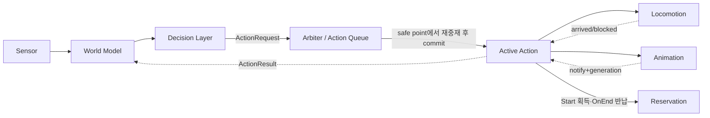
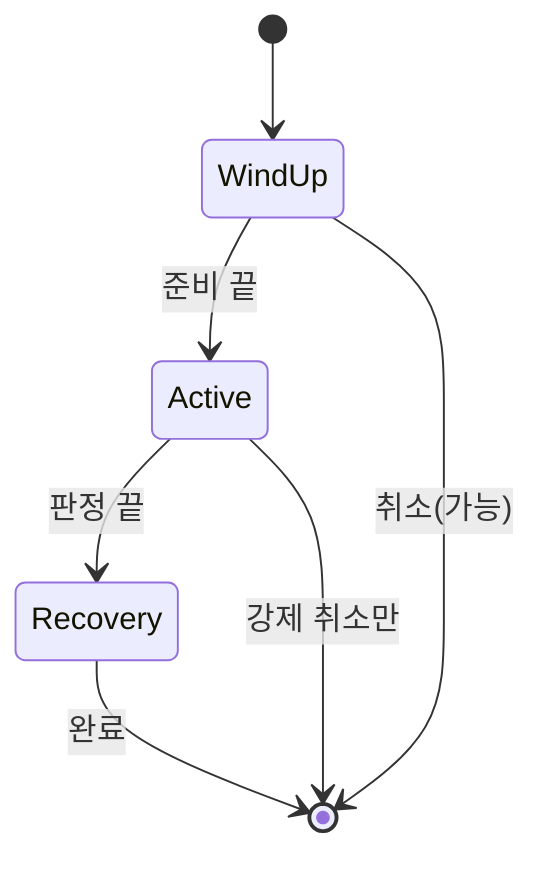
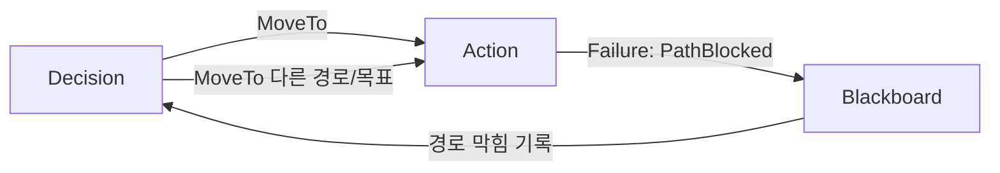
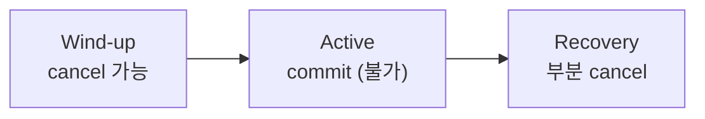
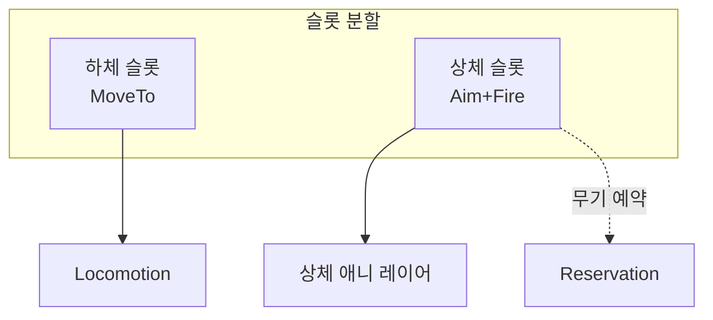
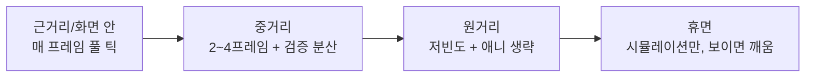

## 들어가며

의사결정 알고리즘은 행동을 *선택* 한다. 하지만 게임에서 행동은 선택되는 순간 끝나지 않는다. "공격한다"는 결정은 무기 예약, 조준 시작, 이동 정지, 애니메이션 재생, 히트박스 개폐 예약, 쿨다운 등록, 실패 처리, 그리고 자원 반납까지 이어지는 *긴 수명의 작업* 이다. 의사결정이 아무리 영리해도, 실행 계층이 약하면 캐릭터는 매 프레임 명령을 서로 덮어쓰고, 애니메이션과 논리 상태가 어긋나며, 자원이 누수되고, 버그는 재현되지 않는다.

AI 아키텍처의 핵심은 *의사결정과 실행의 분리* 다. 결정 계층(decision layer)은 "무엇을 할지"를 고르고, 액션 계층(action layer)은 그 행동을 시작·진행·취소·완료하며 그동안의 모든 부작용을 책임진다. 이동 계층(locomotion)은 몸을 실제로 움직이고, 애니메이션은 시각을 입히며, 예약 계층(reservation)은 공유 자원을 보호한다. 이 계층화가 있어야 FSM·행동 트리·효용 시스템·계획 기반 AI처럼 서로 다른 의사결정 기법이 *하나의 동일한 실행 시스템* 위에서 동작한다. 결정 기법을 갈아끼워도 실행 계약은 그대로다.

이 글은 그 실행 계층의 공학을 다룬다. 계층 구조와 데이터 흐름, 액션을 *계약(contract)* 으로 보는 관점, 상태/결과 코드의 설계, 중재(arbitration)와 우선순위·인터럽트, 액션 큐와 직렬화, 애니메이션·이동 연동(root motion·notify·IK), 자원 소유권과 예약 큐, 틱 예산과 LOD, 그리고 약한 액션 계층에서 반복적으로 나타나는 실패 케이스와 그 구조적 처방까지 정리한다. 목표는 "AI가 결정을 내렸다"와 "캐릭터가 안전하게 행동을 끝까지 수행했다" 사이의 거리를 메우는 것이다.



이 글의 목표.

1. **AI 계층 구조** — sensor, world model, decision, action, locomotion의 책임 분리와 데이터 흐름.
2. **Action Contract** — CanStart/Start/Tick/Cancel의 의미론과 자원 대칭, 상태 머신.
3. **상태와 결과 코드** — Running/Success/Failure/Cancelled와 실패 이유의 피드백 루프.
4. **Interrupt와 Priority** — 중재 규칙, commit window, 우선순위 역전, 디바운싱.
5. **액션 큐와 직렬화** — 한 프레임 다중 요청, 재진입, 시퀀스·동시 실행.
6. **Animation과 Locomotion 연동** — code-driven vs animation-driven, root motion, notify, IK warping.
7. **Resource Ownership** — 예약, RAII, 예약 큐와 공정성, 데드락 회피.
8. **Tick Budget과 LOD** — 검사 빈도 분산, 시간 분할, LOD 단계.
9. **실패 케이스와 디버깅** — 증상·원인·처방의 카탈로그와 트레이스 인프라.


---

## 목차
1. [AI 계층 구조](#1-ai-계층-구조)
2. [Action Contract](#2-action-contract)
3. [상태와 결과 코드](#3-상태와-결과-코드)
4. [Interrupt와 Priority](#4-interrupt와-priority)
5. [액션 큐와 직렬화](#5-액션-큐와-직렬화)
6. [Animation과 Locomotion 연동](#6-animation과-locomotion-연동)
7. [Resource Ownership](#7-resource-ownership)
8. [Tick Budget과 LOD](#8-tick-budget과-lod)
9. [실패 케이스와 디버깅](#9-실패-케이스와-디버깅)


---

## 1. AI 계층 구조

AI를 한 덩어리로 만들면 빠르게 무너진다. "적이 보이면 공격, 아니면 순찰"은 하나의 `Update` 함수로 충분하지만, 행동이 늘어나면 의사결정과 실행이 뒤섞인다. 공격 중 피격, 이동 중 목표 사망, 재장전 중 엄폐 이탈을 전부 한 함수의 if 분기로 처리하게 되고, 그 함수는 곧 아무도 손대지 못하는 천 줄짜리 괴물이 된다.

### 책임의 수직 분할

계층을 나누면 각 계층이 *하나의 질문에만* 답한다. 위 계층은 아래 계층에게 *명령* 을 내리고, 아래 계층은 위로 *사실* 을 보고한다. 명령은 아래로, 정보는 위로 흐른다.

| 계층 | 답하는 질문 | 대표 산출물 |
|---|---|---|
| Sensor | 무엇이 관찰되는가 | 시야·청각·피해 이벤트 |
| World Model | 무엇을 알고 있는가 | 마지막 목격 위치, 위협도, blackboard |
| Decision | 무엇을 할 것인가 | `ActionRequest` |
| Action | 그 행동을 어떻게 수행·책임지는가 | `ActionResult`, 자원 소유 |
| Locomotion | 몸을 어디로 어떻게 움직이는가 | 속도·회전·경로 추종 |
| Animation | 그것을 어떻게 보이게 하는가 | montage, root motion, notify |

핵심은 *각 계층이 바로 아래 계층의 인터페이스만 알고, 그 구현은 모른다* 는 것이다. 결정 계층은 `Attack(target)`이라는 요청을 만들 뿐, 그 공격이 어느 애니메이션을 쓰는지 어느 히트박스를 여는지 모른다. 액션 계층은 경로를 따라 어떻게 가속·감속하는지 모르고 `MoveAlongPath(dt)`만 호출한다. 이 무지(無知)가 곧 교체 가능성이다.

### 결정과 실행 사이의 인터페이스

두 계층을 잇는 것은 두 개의 작은 구조체다. 결정이 내려보내는 요청과, 실행이 올려보내는 결과.

```cpp
struct ActionRequest {
    ActionType type;        // MoveTo, Attack, Reload, UseCover ...
    EntityId   target;      // 대상이 있으면
    Vector3    position;    // 위치 기반 행동이면
    int        priority;    // 가로채기·중재 순서
    uint32_t   requestId;   // 재발행과 완료 응답을 연결하는 식별자
};

struct ActionResult {
    uint32_t      requestId; // 어떤 요청에 대한 결과인가
    ActionStatus  status;   // Running / Success / Failure / Cancelled
    FailureReason reason;   // 실패 원인과 복구 정책 선택용
};
```

이 인터페이스의 폭이 곧 결합도다. 요청에 `ActionType`처럼 구체 행동을 박으면 결정 계층이 실행의 어휘를 알아야 하고, 반대로 `target/position`처럼 *데이터만* 넘기면 결정 계층은 행동의 종류만 고르면 된다. 실전에서는 둘 사이 어딘가 — 행동 종류 + 파라미터 — 에 선을 긋는다.

### 데이터 흐름의 단방향성

이 분리가 주는 가장 큰 실용적 이득은 *디버깅의 좁은 통로* 다. NPC가 이상하게 굴면 결정 계층이 무엇을 요청했고 액션 계층이 어떤 결과를 돌려줬는지 확인한다. "공격을 안 한다"는 증상을 "Attack 요청을 `OutOfRange`로 거부" 또는 "매 틱 새 requestId가 들어와 시작 전에 취소"처럼 계약 위의 사건으로 바꿀 수 있다. 두 구조체에 simulation tick과 requestId를 남기면 요청·수락·중단·완료를 한 인과 사슬로 조인할 수 있다.

이 계층의 책임은 결정 품질과 분리된다. 어떤 의사결정기가 요청을 만들든 arbiter는 충돌·우선순위·commit 계약을 적용하고, active action은 시작한 작업의 수명과 자원, 결과 보고를 책임진다.

## 2. Action Contract

액션은 *명령* 이 아니라 *계약* 이다. 명령은 "공격해"라고 외치고 잊어버리지만, 계약은 시작 조건·소유물·진행·종료·정리를 모두 명시한다. 액션이 여러 프레임에 걸쳐 살아 있고 그동안 공유 자원을 만지기 때문에, 이 계약의 엄밀함이 곧 안정성이다.

### 다섯 개의 약속

기본 인터페이스는 다섯 개의 가상 함수로 압축된다.

```cpp
class Action {
public:
    virtual bool         CanStart(const Context& ctx) const = 0;  // 전제조건
    virtual void         Start(Context& ctx) = 0;                 // 자원 획득 + 초기화
    virtual ActionStatus Tick(Context& ctx, float dt) = 0;        // 진행 + 상태 반환
    virtual void         OnEnd(Context& ctx, ActionStatus how,
                               CancelReason why = CancelReason::None) = 0;
    void Cancel(Context& ctx, CancelReason why) {                 // 외부 취소의 단일 진입점
        OnEnd(ctx, ActionStatus::Cancelled, why);
    }
    virtual int          Priority() const = 0;                    // 중재용
    virtual ~Action() = default;
};
```

각 함수가 답하는 질문은 다르다.

- `CanStart`: 지금 시작해도 되는가. 탄약 없는 공격, 경로 없는 이동, 이미 점유된 엄폐 진입은 *시작 전에* 걸러야 한다. 부작용이 없어야 한다 — `CanStart`는 순수 질의다.
- `Start`: 시작에 필요한 자원을 잡고, 애니메이션을 걸고, 내부 상태를 초기화한다. 여기서부터 *부작용이 시작* 된다.
- `Tick`: 한 프레임만큼 진행하고 현재 상태를 반환한다. 액션의 본체다.
- `OnEnd`: 성공·실패·외부 취소를 포함한 모든 종료에서 정확히 한 번 호출된다. `Cancel`은 취소 상태와 이유를 이 훅으로 전달하는 비가상 래퍼다.

### 대칭성 — 계약의 본질

액션 계약의 핵심은 *대칭성* 이다. `Start`에서 획득한 것은 완료·실패·취소 *어느 경로로든* 정확히 한 번 반납돼야 한다. 이 대칭이 깨지면 락이 남고, 슬롯이 영영 점유되며, NPC는 다음 행동을 시작하지 못한다.

```cpp
void AttackAction::Start(Context& ctx) {
    reserved_ = ctx.weapon->Reserve(ctx.self.id);   // 획득
    animGeneration_ = ctx.anim.CurrentGeneration(); // 이 재생의 세대 — notify 검증용
    ctx.anim.Play("attack", /*blend*/0.1f);
    fired_ = false;
    elapsed_ = 0.0f;
}

void AttackAction::OnEnd(Context& ctx, ActionStatus, CancelReason) {
    if (reserved_) ctx.weapon->Release(ctx.self.id); // 반납 (대칭)
    reserved_ = false;
    ctx.weapon->DisableHitbox();                     // 열려 있을 수 있는 히트박스 강제 닫기
    ++animGeneration_;                               // 이후 도착하는 late notify 무효화
    ctx.anim.Stop("attack", /*blend*/0.15f);
}
```

문제는 반납 지점이 `Cancel` 하나가 아니라는 것이다. 액션은 `Tick`이 `Success`나 `Failure`를 반환하며 스스로 끝날 수도 있다. 같은 정리 코드를 `Cancel`, 성공 종료, 실패 종료에 복제하면 한 곳을 빠뜨리는 순간 자원 누수다. 정리는 멱등적인 한 함수로 모으고, scope guard나 소유 객체의 소멸자를 이용해 모든 종료 경로가 같은 release 경로를 지나게 한다. 이때 release의 기준 시점은 *객체 파괴가 아니라 `OnEnd`* 다 — Sequence가 종료한 자식 객체를 계속 보유하면 파괴가 훨씬 늦거나 아예 없을 수 있다. `OnEnd`에서 lease를 반납하고 콜백을 해제하며, 소멸자는 누락 대비 안전망으로 둔다.

컨트롤러는 `Tick`이 `Success`나 `Failure`를 반환하면 `OnEnd`를 호출하고, 외부 선점에는 `Cancel`을 호출한다. 두 경로는 결국 같은 가상 훅으로 모이므로 파생 액션은 정리 로직을 한 곳에만 둔다.

### 액션의 내부 상태 머신

겉보기에 `Tick`은 매번 같은 일을 하는 듯하지만, 의미 있는 액션은 내부에 작은 상태 머신을 품는다. 공격을 예로 들면 wind-up(준비) → active(판정) → recovery(경직)의 세 위상이 있고, 위상마다 인터럽트 가능성과 부작용이 다르다.



```cpp
ActionStatus AttackAction::Tick(Context& ctx, float dt) {
    elapsed_ += dt;
    switch (phase_) {
    case Phase::WindUp:
        if (!ctx.IsValid(target_)) return ActionStatus::Failure;   // stale target
        if (elapsed_ >= windUpTime_) phase_ = Phase::Active;
        return ActionStatus::Running;
    case Phase::Active:
        if (!fired_) { ctx.weapon->Fire(target_); fired_ = true; } // 1회성
        if (elapsed_ >= activeEnd_) phase_ = Phase::Recovery;
        return ActionStatus::Running;
    case Phase::Recovery:
        if (elapsed_ >= recoveryEnd_) return ActionStatus::Success;
        return ActionStatus::Running;
    }
    return ActionStatus::Running;
}
```

이 내부 위상은 가로채기 가능성을 세분화하고 애니메이션 이벤트와 판정 시점을 연결한다. 예를 들어 `Windup`은 취소 가능, `Active`는 commit, `Recovery`는 특정 상위 우선순위에만 취소 가능하도록 계약할 수 있다. 히트박스는 단순히 상태 이름을 보고 켜기보다 애니메이션의 검증된 event marker와 simulation tick에 연결해야 시각과 판정이 일관된다.

## 3. 상태와 결과 코드

액션의 결과가 단순 boolean이면 부족하다. 행동은 여러 프레임에 걸쳐 진행되므로 "진행 중"이라는 제3의 상태가 필요하고, *왜* 실패했는지가 다음 의사결정의 입력이 되기 때문이다.

### 네 가지 상태와 그 의미

```cpp
enum class ActionStatus {
    Running,     // 아직 진행 중 — 다음 틱 계속
    Success,     // 목표 달성하고 정상 종료
    Failure,     // 목표 달성 못 하고 종료 (이유 동반)
    Cancelled    // 외부에 의해 중단됨 (이유 동반)
};
```

`Success`와 `Failure`는 액션이 *스스로* 내리는 판정이고, `Cancelled`는 *외부* 가 강제한 종료다. 이 구분이 중요한 이유는 후속 처리가 다르기 때문이다. 실패는 "이 방법은 안 됐으니 다른 방법을"이라는 신호이고, 취소는 "더 급한 일이 생겼다"는 신호다. 같은 종료지만 결정 계층의 반응이 갈린다.

### 실패 이유 — 진단 가능한 피드백

실패는 *왜* 가 따라붙어야 의미가 있다. 실패 이유는 다음 의사결정의 입력이 되어 피드백 루프를 닫는다.

```cpp
enum class FailureReason {
    None,
    TargetLost,          // 목표를 시야에서 잃음
    TargetDead,          // 목표가 죽음
    PathBlocked,         // 경로 막힘 / 경로 없음
    ResourceUnavailable, // 자원 점유됨 (엄폐·슬롯)
    OutOfRange,          // 사거리 밖
    Interrupted,         // 더 높은 우선순위에 밀림
    Timeout              // 제한 시간 초과
};
```

실패 이유는 world model이나 blackboard에 기록되어 *다른 행동을 유도* 한다. `PathBlocked`가 반복되면 다른 경로나 다른 목표로, `TargetLost`면 마지막 목격 위치로 수색, `ResourceUnavailable`이면 대기 행동으로 전환, `OutOfRange`면 먼저 이동.

```cpp
ActionStatus MoveToAction::Tick(Context& ctx, float dt) {
    if (!ctx.nav.HasPath()) {
        if (!ctx.nav.Repath(goal_)) {              // 한 번 재탐색 시도
            lastFailure_ = FailureReason::PathBlocked;
            return ActionStatus::Failure;
        }
    }
    if (Distance(ctx.self.pos, goal_) < kArriveDist) return ActionStatus::Success;
    if (ctx.locomotion.IsStuck(dt)) {              // 한 자리에서 못 움직임
        stuckTime_ += dt;
        if (stuckTime_ > kStuckSeconds) {
            lastFailure_ = FailureReason::PathBlocked;
            return ActionStatus::Failure;
        }
    } else stuckTime_ = 0.0f;
    ctx.locomotion.MoveAlongPath(dt);
    return ActionStatus::Running;
}
```

### 실패의 피드백 루프

상태 코드가 만드는 것은 결정과 실행 사이의 *닫힌 루프* 다. 결정이 요청을 내리고, 실행이 결과 코드로 답하고, 결정이 그 코드를 보고 다음 요청을 조정한다.



액션이 boolean 실패만 알리면 결정 계층은 원인을 구분하지 못해 같은 요청을 반복할 수 있다. 구조화된 결과 코드는 `OutOfRange`에는 접근, `PathBlocked`에는 다른 위치 선택, `TargetDead`에는 목표 해제처럼 복구 정책을 바꾸게 한다. requestId와 결과 코드를 기록하면 반복 실패와 요청 spam도 탐지할 수 있다.

## 4. Interrupt와 Priority

게임 AI는 행동 도중 끊임없이 새 상황을 만난다. 순찰 중 적 발견, 공격 중 수류탄 회피, 재장전 중 피격. 모든 행동을 즉시 끊으면 캐릭터가 발작하듯 떨리고, 아무것도 못 끊으면 둔하고 멍청해 보인다. 그 사이를 잡는 것이 *중재(arbitration)* 정책이다.

### 중재의 세 축

액션은 보통 세 속성으로 중재된다.

- *priority(우선순위)*: 새 행동이 기존 행동보다 중요한가. 생존(사망·피격·낙하·회피) > 전투 > 이동 > 대기.
- *interruptible(가로채기 가능)*: 기존 행동이 *지금* 끊길 수 있는가. 위상마다 다르다(2절의 내부 상태 머신).
- *commit window(확정 구간)*: 이미 시작한 행동을 끝까지 밀어야 하는 구간인가. 공격 active 프레임은 끊으면 시각·판정이 깨진다.

```cpp
bool CanInterrupt(const Action& cur, float curTime, const Action& next) {
    if (!cur.InterruptibleAt(curTime, next.Priority())) return false;
    return next.Priority() >= cur.Priority(); // 같은 등급은 별도 score 중재로 결정
}
```

### 공격 위상과 commit window

공격 애니메이션의 wind-up/active/recovery 위상은 중재에 직접 대응된다. wind-up은 회피로 끊을 수 있고, active는 어떤 일이 있어도 밀어붙이며(commit), recovery는 부분적으로 끊을 수 있다.



```cpp
bool AttackAction::InterruptibleAt(float t, int nextPriority) const {
    if (t < windUpTime_)  return true;    // 준비 중 — 회피 가능
    if (t < activeEnd_)   return false;   // 판정 중 — commit
    return nextPriority >= 80;             // 경직 중 — 생존 이상만 가로챔
}
```

commit window의 의미는 "이 구간만큼은 결정 계층의 변덕을 무시한다"는 것이다. 그래서 commit은 *짧아야* 한다 — 길면 반응성이 죽고, 없으면 일관성이 죽는다. 격투 게임의 "공격 후딜"이 정확히 이 commit/recovery 설계의 산물이다.

### 우선순위 등급은 넓게

priority는 설계 의도를 숫자로 옮긴 것이다. 그러나 우선순위 값을 1점 단위로 세밀하게 두면 튜닝 지옥에 빠진다 — 47과 48의 차이를 아무도 기억 못 한다. 3~5단계의 *넓은 등급* 으로 묶는 편이 관리된다.

| 등급 | 값 | 예 |
|---|---:|---|
| Reflex | 100 | 사망, 피격 경직, 낙하 |
| Survival | 80 | 회피, 긴급 엄폐, 도주 |
| Combat | 50 | 공격, 조준, 재장전 |
| Movement | 30 | 이동, 추격, 수색 |
| Idle | 10 | 대기, 시선 돌리기, 잡담 |

같은 등급 안의 충돌은 *부가 기준* 으로 깬다. 더 최근 요청, 더 가까운 목표, 이미 진행 중인 쪽 우선 등. 동률을 임의로 깨면 행동이 매 프레임 흔들린다.

### 디바운싱 — 떨림 방지

중재의 숨은 함정은 *경계에서의 떨림(thrashing)* 이다. 두 행동의 점수가 비슷하면 매 프레임 우열이 뒤집혀 NPC가 두 행동 사이를 진동한다. 처방은 두 가지다.

- *히스테리시스(hysteresis)*: 현재 행동에 보너스를 줘서, 새 행동이 *충분히* 더 좋아야만 바꾼다.
- *최소 실행 시간(min duration)*: 시작한 행동은 짧은 시간(예: 0.2s) 동안 가로채지 못하게 한다.

```cpp
bool ArbiterCanSwitch(const Action& cur, float curTime, const Action& next) {
    if (!cur.InterruptibleAt(curTime, next.Priority())) return false;
    if (next.Priority() != cur.Priority())              // 등급 간에는 우선순위가 먼저
        return next.Priority() > cur.Priority();
    if (curTime < cur.MinDuration()) return false;      // 같은 등급에만 dwell 적용
    float bias = (next.Type() == cur.Type()) ? 0.0f : kStickyBonus;
    return next.Score() > cur.Score() + bias;           // 같은 등급 안의 히스테리시스
}
```

### 떨림이 멈추는 조건 — 히스테리시스 폭과 드웰 타임의 정량화

위 두 처방을 "왜 그만큼"으로 답하려면 떨림을 정량 모델로 둬야 한다. 결정 계층이 매 프레임 산출하는 두 후보의 효용 차이를 $\Delta_t = u_B(t) - u_A(t)$로 쓰고, 이를 *느리게 변하는 참값* $\mu$와 *프레임마다 흔들리는 잡음* 으로 분해한다.

$$\Delta_t = \mu + \varepsilon_t,\qquad \varepsilon_t \sim \mathcal{N}(0,\sigma^2)$$

여기서 $\sigma$는 결정 잡음의 표준편차다 — 센서 노이즈, 부동소수점 변동, 타깃 점수의 미세한 흔들림이 모두 들어간다. 떨림은 *참값이 동률($\mu \approx 0$)일 때* 잡음만으로 우열이 뒤집히는 현상이다.

히스테리시스 없는 중재는 $\operatorname{sign}(\Delta_t)$가 바뀔 때마다 전환한다. 동률 $\mu=0$에서 대칭 잡음이면 매 프레임 부호가 뒤집힐 확률은 $1/2$이므로, 프레임레이트 $f$에서 기대 전환율은

$$R_0 = \tfrac{f}{2} = 30\ \text{회/s}\quad(f=60)$$

초당 30번 행동이 갈리면 캐릭터는 문자 그대로 발작한다. 처방인 히스테리시스는 *데드밴드* 다. 현재 행동에 보너스 $h$(코드의 `kStickyBonus`)를 줘서, A에서 B로 가려면 $\Delta_t > h$, B에서 A로 가려면 $\Delta_t < -h$를 요구한다. 동률 $\mu=0$에서 한 프레임에 밴드를 벗어날 확률은 정규 상측꼬리 $Q(\cdot)$로

$$p = \Pr[\varepsilon_t > h] = Q\!\left(\tfrac{h}{\sigma}\right),\qquad R(h) = f\,Q\!\left(\tfrac{h}{\sigma}\right)$$

이 된다(대칭이라 어느 상태에 있든 프레임당 전환 확률이 $p$). 핵심은 $Q$가 꼬리에서 *지수적으로* 죽는다는 것이다 — 밴드를 잡음의 몇 배로 두면 전환율이 급락한다.

| 밴드 $h$ | $Q(h/\sigma)$ | 전환율 $R$ (60fps) |
|---|---:|---:|
| $0$ (없음) | $0.5$ | $30$ 회/s |
| $1\sigma$ | $0.159$ | $9.5$ 회/s |
| $2\sigma$ | $0.0228$ | $1.37$ 회/s |
| $3\sigma$ | $0.00135$ | $0.081$ 회/s |
| $4\sigma$ | $3.2\times10^{-5}$ | $0.0019$ 회/s |

표의 수치는 중재를 60Hz로 평가하고, 각 샘플의 잡음이 독립·정규이며 참 마진이 0이라는 가정에서만 성립한다. 이 모델에서 $h=2\sigma$는 초당 약 1.4회, $h=3\sigma$는 평균 약 12초에 한 번 전환한다. 실제 후보 점수는 자기상관·상태 변화·비정규 꼬리를 가지므로 3σ는 보편 권장값이 아니다. decision tick에서 $\Delta_t$를 기록해 잡음 분포와 전환율을 추정하고, 허용 반응 지연과 함께 밴드를 정한다.

밴드에는 공짜가 없다. A에서 B로 전환할 한 샘플의 확률은 $Q\!\big(\tfrac{h-m}{\sigma}\big)$이다. $m<h$여도 확률은 0이 아니므로 행동이 원리적으로 무시되는 것은 아니지만, 독립 샘플 모델에서 평균 대기 시간이 길어진다. $\sigma=5,\ h=15$이고 60Hz로 평가할 때 $m=10$이면 $p=Q(1)\approx0.159$라 평균 약 6.3 tick, 즉 105ms다. $m=20$이면 $p=Q(-1)\approx0.841$라 약 1.19 tick, 즉 20ms다. 이 숫자도 iid 가정의 산술 예시이며, 의미 있는 마진이 $h$보다 작아도 가끔 전환되는 것이 오히려 문제일 수 있다. 밴드는 관측한 false-switch rate와 허용 detection delay의 Pareto 절충으로 정한다.

최소 실행 시간 $\tau$는 통계적 보장이 아니라 *하드 캡* 이다. 잡음이 정규가 아니라 두꺼운 꼬리를 가지면 위 $Q$ 추정이 전환율을 과소평가하지만, $\tau$는 분포와 무관하게 전환율을 $1/\tau$로 못 박는다($\tau=0.2$s → 최대 5회/s). 이는 스위치드 시스템 이론의 *드웰 타임(dwell time)* 과 같은 장치다 — 전환 신호의 최소 체류 시간을 보장해 시스템 일관성을 지킨다. 히스테리시스가 *평균* 드웰 타임 $1/R(h)$를 늘리는 통계적 장치라면, 최소 실행 시간은 *최소* 드웰 타임을 강제하는 결정적 장치이고, 둘은 직교해 함께 쓴다.

```cpp
// 히스테리시스(잡음 억제) + 드웰 타임(하드 캡)을 분리해 건다
bool ArbiterCanSwitchTuned(const Action& cur, float curTime,
                           const Action& next, float noiseSigma) {
    if (!cur.InterruptibleAt(curTime, next.Priority())) return false;
    if (next.Priority() != cur.Priority())
        return next.Priority() > cur.Priority();          // 긴급 등급은 dwell을 우회
    if (curTime < cur.MinDuration()) return false;        // 같은 등급의 최소 드웰 타임
    const float h = configuredSigmaMultiple * noiseSigma;
    float bias = (next.Type() == cur.Type()) ? 0.0f : h;  // 점수 단위를 유지
    if (next.Score() <= cur.Score() + bias) return false; // 통계적 억제
    return true;
}
```

경계 조건 셋. (1) 참값이 서서히 이동해 $\mu$가 밴드를 넘으면 전환 확률이 빠르게 커지지만, 잡음이 남아 있으므로 "정확히 한 번만"을 확률 모델만으로 보장하지는 않는다. (2) 프레임 간 자기상관이 있으면 iid의 $1/p$ 대기 시간과 전환율 식을 그대로 사용할 수 없다. 양의 상관은 threshold exceedance를 군집시킬 수 있으므로 실제 trace에서 run length와 양방향 crossing을 측정한다. (3) 최소 실행 시간을 너무 길게 잡으면 생존 행동의 반응이 늦는다. 긴급 등급은 명시적인 interrupt 정책으로 처리하되, 어떤 상태에서 우회 가능한지 테스트한다.

### 우선순위 역전 주의

우선순위 시스템의 고전적 함정은 *역전(priority inversion)* 이다. 낮은 우선순위 행동이 자원을 잡고 commit window에 들어가면 높은 우선순위 행동이 기다린다. commit window의 최대 길이를 계약으로 제한하고, 예약 자원은 취소 시 원자적으로 반납하거나 새 행동에 명시적으로 handoff한다. 우선순위 상속이 맞는 자원인지, 선점 불가능한 애니메이션 구간인지도 구분해야 한다.

## 5. 액션 큐와 직렬화

액션 계층은 단일 요청뿐 아니라 한 프레임의 여러 요청, "문으로 이동 → 문 열기 → 통과" 같은 순차 합성, "이동하면서 조준" 같은 병행 실행을 다뤄야 한다. 이 다중성을 중재하는 곳이 액션 큐와 컨트롤러다.

### 한 프레임 다중 요청 — 덮어쓰기 문제

가장 흔한 버그는 결정 계층이 매 프레임 새 `ActionRequest`를 발행해, 기존 행동이 *시작만 하고 끝나지 않는* 것이다. 매 틱 BT가 같은 결론("MoveTo 적")에 도달해 매 틱 새 MoveTo를 만들면, `Start`가 매 프레임 호출되어 경로가 리셋되고 NPC는 제자리에서 떤다.

처방은 *요청의 동일성 판정* 이다. 새 요청이 진행 중인 행동과 "같은" 것이면 무시하고, 진행 중인 행동을 *갱신* 만 한다.

```cpp
void ActionController::Submit(const ActionRequest& req, Context& ctx) {
    // 1) 진행 중 행동과 동일 요청이면 — 목표만 갱신, 재시작 금지
    if (current_ && current_->Matches(req)) {
        current_->UpdateGoal(req);       // 예: MoveTo 목표 좌표만 갱신
        return;
    }
    // 2) 다른 요청이면 중재 (4절)
    auto next = factory_.Create(req);
    if (current_ && !ArbiterCanSwitch(*current_, currentTime_, *next)) {
        QueuePending(std::move(next));   // 높은 등급 우선, 동률은 최신 요청 우선
        return;
    }
    RequestAction(std::move(next));      // 즉시 교체하지 않고 safe point로 지연
}
```

`Matches`는 보통 `type`과 핵심 파라미터(target/position)를 비교한다. 이 한 줄짜리 동일성 판정이 명령 덮어쓰기 버그의 대부분을 잡는다.

### 전환의 직렬화와 재진입

행동을 바꿀 때 `Cancel(old) → Start(new)`가 일어나는데, `Cancel`이나 `Start` *안에서* 또 다른 전환이 트리거되면 상태가 꼬인다. 예컨대 `AttackAction::Start`가 탄약 부족을 발견하고 즉시 Reload로 가려 하면, 전환이 전환 도중에 일어난다. 단순 구현은 여기서 무한 재귀나 자원 이중 반납에 빠진다.

처방은 FSM과 동일하게 *전환을 직렬화* 하는 것이다. 다만 직렬화만으로는 부족하다 — `Start`뿐 아니라 `Tick`·`Cancel`·`OnEnd`·애니메이션 notify까지 사용자 콜백 실행 전체를 재진입 구역으로 취급해야 한다. 콜백 안에서 교체를 요청하면 새 요청을 큐에 넣기만 하고 현재 객체는 파괴하지 않는다. 실제 교체는 모든 콜백이 반환해 콜백 깊이가 0이 된 safe point에서, *현재* 액션을 기준으로 CanStart·우선순위·interrupt policy·request generation을 다시 검사한 뒤 commit한다. 이 계약(사용자 콜백은 동기 재진입·즉시 교체를 금지하고, 요청은 반드시 외부 safe point로 지연한다)이 없으면 Tick이 실행 중인 객체가 파괴되어 해제된 멤버를 만지는 use-after-free가 된다. 이는 thread safety나 예외 트랜잭션 보장과는 별개의 계약이다.

```cpp
// 요청 적재 — 사용자 콜백(Tick/Start/Cancel/OnEnd/notify) 안에서 호출해도
// current_를 파괴하지 않는다.
void ActionController::RequestAction(std::unique_ptr<Action> next) {
    QueuePending(std::move(next));
}

// safe point(콜백 깊이 0)에서만 호출. 보류 요청을 현재 액션 기준으로 재중재한다.
void ActionController::CommitPending(Context& ctx) {
    int transitions = 0;
    while (auto next = TakePending()) {
        if (++transitions > kMaxTransitionsPerTick) {   // Start 연쇄의 무한 루프 방어
            ReportTransitionLoop();
            break;
        }
        // 적재 시점의 허가가 아니라 지금의 current_ 기준으로 다시 검사한다 (AI-055)
        if (current_ && !ArbiterCanSwitch(*current_, currentTime_, *next)) {
            QueuePending(std::move(next));               // 우선순위 보존해 다시 보류
            break;
        }
        if (!next->CanStart(ctx)) continue;              // 전제가 지금도 성립하는가 (AI-055)
        if (current_) current_->Cancel(ctx, CancelReason::Replaced); // 정리 (2절)
        current_     = std::move(next);
        currentTime_ = 0.0f;
        current_->Start(ctx);            // 이 안의 RequestAction도 pending_ 적재만
    }
}
```

`QueuePending`은 단일 보류 슬롯을 쓴다면 기존 요청과 새 요청을 다시 중재해 높은 우선순위를 보존하고, 같은 등급에서만 최신 요청으로 교체한다. 모든 요청을 순서대로 보존해야 하는 도메인은 슬롯 하나가 아니라 bounded queue를 쓰고 overflow 정책을 명시한다. 단순 대입으로 `pending_`를 덮으면 늦게 들어온 낮은 우선순위 요청이 긴급 요청을 지울 수 있다.

이 패턴은 전환을 *원자적* 으로 만든다. "전환 중 전환"이 안전하게 한 줄로 펴진다. 재진입 안전성은 행동이 적을 땐 무시되다가, 행동이 많아지고 `Start`/`Cancel`이 부작용을 가지면 *재현 안 되는 버그* 로 돌아온다.

### 시퀀스와 동시 실행

단일 슬롯 컨트롤러로는 "이동 후 문 열기" 같은 순차 행동이나 "이동하며 조준" 같은 병렬 행동을 표현하지 못한다. 두 가지 합성기가 필요하다.

```cpp
// 순차: 앞 행동이 Success 면 다음으로, Failure 면 전체 Failure
class SequenceAction : public Action {
    std::vector<std::unique_ptr<Action>> steps_;
    size_t idx_ = 0;
public:
    ActionStatus Tick(Context& ctx, float dt) override {
        if (idx_ >= steps_.size()) return ActionStatus::Success;
        ActionStatus s = steps_[idx_]->Tick(ctx, dt);
        if (s == ActionStatus::Success) {
            steps_[idx_]->OnEnd(ctx, s);
            if (++idx_ < steps_.size()) steps_[idx_]->Start(ctx);
            return idx_ >= steps_.size() ? ActionStatus::Success : ActionStatus::Running;
        }
        if (s == ActionStatus::Failure) {
            steps_[idx_]->OnEnd(ctx, s);            // 실패한 자식의 자원도 즉시 정리
            childEnded_ = true;
        }
        return s;  // Running 또는 Failure 전파
    }
    void Start(Context& ctx) override {
        idx_ = 0; childEnded_ = steps_.empty();
        if (!steps_.empty()) steps_[0]->Start(ctx);
    }
    void OnEnd(Context& ctx, ActionStatus how,
               CancelReason why = CancelReason::None) override {
        if (!childEnded_ && idx_ < steps_.size()) {
            // 자식의 lease 반납도 그 자식의 OnEnd 에서 일어난다 — 객체를 steps_ 에
            // 보유해도 종료 후 예약이 남지 않는다 (AI-058).
            if (how == ActionStatus::Cancelled) steps_[idx_]->Cancel(ctx, why);
            else steps_[idx_]->OnEnd(ctx, how, why);
            childEnded_ = true;
        }
    }
private:
    bool childEnded_ = false;
};
```

동시 실행은 흔히 *슬롯* 으로 나눈다. 한 NPC가 여러 액션 슬롯(예: locomotion, upper-body aim/fire)을 갖고 각 슬롯이 독립 컨트롤러를 굴린다. 슬롯 경계는 애니메이션 mask와 항상 1:1인 것은 아니며, 두 슬롯이 같은 무기·이동 controller·root motion을 요구하면 명시적인 resource reservation과 호환성 행렬로 충돌을 막아야 한다.



슬롯 모델의 규칙은 "한 슬롯은 한 액션"이고, 슬롯 간 충돌(둘 다 전신 애니메이션을 원함)은 우선순위로 한쪽을 전신, 다른 쪽을 비활성화하여 해소한다.

## 6. Animation과 Locomotion 연동

액션 계층의 가장 흔한 시각적 실패는 *애니메이션과 논리 상태의 불일치* 다. 코드상으로는 공격이 끝났는데 캐릭터는 아직 칼을 휘두르고 있거나, 애니메이션은 피격 모션인데 AI는 태연히 공격을 계속한다. 이 어긋남을 막는 것이 연동 설계의 목표다.

### 두 가지 주도권 모델

연동은 누가 타이밍의 주인이냐로 갈린다.

| 방식 | 주도권 | 장점 | 단점 |
|---|---|---|---|
| Code-driven | 코드가 애니메이션을 재생/정지 | 결정성, 제어 단순 | 시각이 딱딱하고 끊김 |
| Animation-driven | notify/root motion이 논리 이벤트를 발생 | 시각이 자연스러움 | 타이밍 의존, 디버깅 어려움 |

순수한 한쪽은 둘 다 문제다. code-driven만 쓰면 "0.3초 뒤 발사"처럼 하드코딩된 타이밍이 애니메이션과 미세하게 어긋나고, animation-driven만 쓰면 애니메이션이 안 끝나는 버그가 AI를 영영 멈추게 한다. 실전은 *혼합* 한다 — 상태 전이는 액션 계약이 소유하되, 타이밍은 애니메이션에서 받는다.

### Notify — 애니메이션이 주는 타이밍 신호

히트 판정은 보통 animation notify로 연다. 애니메이션의 특정 프레임에 마커를 박아 두면, 재생이 그 프레임에 닿을 때 이벤트가 발생하고 액션이 받는다. 발사 타이밍이 칼이 가장 멀리 뻗는 시각과 *자동으로 일치* 한다.

```cpp
void AttackAction::OnAnimEvent(Context& ctx, AnimEvent e) {
    if (e.generation != animGeneration_) return;   // 취소/교체 후 늦게 온 notify 무시
    switch (e) {
    case AnimEvent::HitStart: ctx.weapon->EnableHitbox();  break;
    case AnimEvent::HitEnd:   ctx.weapon->DisableHitbox(); break;
    case AnimEvent::Finished: finished_ = true;            break; // Tick 이 읽어 Success 반환
    default: break;
    }
}
```

`Finished` 노티파이가 핵심이다. 액션의 `Tick`은 "애니메이션이 끝났다고 알려왔는가"(`finished_`)만 보고 종료를 판정한다 — 시간을 직접 세지 않는다. 단, 노티파이가 *영영 안 올* 위험(애니메이션 블렌드 아웃, 몽타주 중단)에 대비해 *안전 타임아웃* 을 함께 둔다.

```cpp
ActionStatus AttackAction::Tick(Context& ctx, float dt) {
    elapsed_ += dt;
    if (finished_) return ActionStatus::Success;
    if (elapsed_ > maxDuration_) {            // notify 유실 대비 안전망
        ctx.weapon->DisableHitbox();          // 열려 있을지 모를 히트박스 강제 닫기
        return ActionStatus::Failure;
    }
    return ActionStatus::Running;
}
```

### Root Motion — 애니메이션이 주는 이동

root motion은 애니메이션이 캐릭터의 실제 이동량을 제공하는 방식이다. 발이 미끄러지지 않고(no foot sliding) 연출이 정확하지만, *locomotion이 원하는 경로와 충돌* 할 수 있다. 애니메이션이 "앞으로 2m"라고 말하는데 경로는 "왼쪽으로"라면 둘이 싸운다.

원칙은 행동의 성격으로 가른다.

- 짧고 연출이 중요한 행동(보스 돌진, 회피 구르기, 근접 공격 전진): *root motion 주도*. 그동안 locomotion의 경로 추종은 꺼 둔다.
- 일반 이동(순찰, 추격): *locomotion 주도*. 애니메이션은 속도에 맞춰 블렌드만 한다(root motion은 회전 정도만 사용하거나 끈다).

root motion과 목표 위치의 미세한 오차는 *워핑(motion warping/IK warping)* 으로 흡수한다. 애니메이션의 루트 궤적을 목표에 맞게 살짝 스케일·회전시켜, 정해진 발판이나 적의 위치에 정확히 닿게 한다.

```cpp
Vector3 AttackAction::ResolveRootMotion(Context& ctx, Vector3 animDelta) {
    if (!useRootMotion_) return ctx.locomotion.DesiredDelta();  // locomotion 주도
    if (warpToTarget_) {
        // 남은 거리에 맞춰 루트 모션을 스케일 — 적 앞에 정확히 멈추도록
        float remain  = Distance(ctx.self.pos, ctx.PositionOf(target_)) - kStrikeDist;
        float planned = RemainingRootDistance();
        if (planned > kEps) animDelta *= Clamp(remain / planned, 0.5f, 1.5f);
    }
    return animDelta;  // root motion 주도
}
```

### IK와 발 고정

연동의 마지막 조각은 IK다. 이동·공격이 끝나 멈춰 선 캐릭터의 발이 경사면에 떠 있거나 박혀 있으면 즉시 가짜처럼 보인다. 발 IK(foot placement)는 지형에 발을 맞추고, 손 IK는 무기·문손잡이·엄폐물 모서리에 손을 붙인다. 액션 계층은 IK 목표(어느 손을 어디에)만 지정하고, 실제 관절 풀이는 애니메이션/IK 솔버에 맡긴다. 여기서도 *액션은 의도를, 하위 계층은 구현을* 의 원칙이 반복된다.

좋은 연동의 한 문장 요약: *상태 전이는 액션이 소유하고, 타이밍과 이동은 애니메이션에서 받되, 노티파이 유실에 대비한 안전망을 항상 둔다.*

## 7. Resource Ownership

많은 AI 버그는 공유 자원을 동시에 쓰려다 생긴다. 한 엄폐물에 두 명이 겹쳐 들어가고, 같은 근접 공격 슬롯을 셋이 동시에 잡고, 좁은 문을 양방향 군중이 동시에 통과하려다 끼인다. 액션 계층은 자원 소유권을 *명시* 해야 한다.

### 예약의 기본형

가장 단순한 자원은 단일 소유 예약(reservation)이다.

```cpp
class Reservation {
public:
    explicit Reservation(uint32_t stableId) : id_(stableId) {}  // 자원마다 전역 고유·불변
    bool TryAcquire(EntityId owner) {
        if (owner_ != kInvalid) return false;   // 이미 점유됨
        owner_ = owner;
        return true;
    }
    void Release(EntityId owner) {
        if (owner_ == owner) owner_ = kInvalid;  // 소유자만 반납 (방어)
    }
    bool IsOwnedBy(EntityId e) const { return owner_ == e; }
    bool IsFree() const { return owner_ == kInvalid; }
    uint32_t StableId() const { return id_; }    // 락 순서화용 전역 순서 (아래 데드락 항)
private:
    EntityId owner_ = kInvalid;
    uint32_t id_ = 0;
};
```

`Release`가 소유자를 검사하는 이유는 *엉뚱한 NPC가 남의 예약을 반납* 하는 사고를 막기 위해서다. 이런 작은 방어가 멀티 NPC 환경에서 추적 불가능한 버그를 미연에 차단한다.

### 생명주기에 묶기 — RAII

핵심 규칙은 *소유권을 액션 생명주기에 묶는* 것이다. `Start`에서 획득, 모든 종료 경로(`Success`/`Failure`/`Cancelled`)에서 반납. 이 대칭(2절)을 손으로 맞추면 한 경로를 빠뜨려 슬롯이 영영 점유된다. RAII로 강제하되 반납의 기준 시점은 *객체 파괴가 아니라 `OnEnd`* 다 — Sequence가 종료한 자식을 보유하면 파괴가 훨씬 늦거나 아예 없을 수 있다. `OnEnd`에서 lease를 reset하고, 소멸자는 누락 대비 안전망으로 둔다. 종료 처리는 멱등이어야 한다.

```cpp
class ScopedReservation {                 // 획득과 반납을 객체 수명에 묶는다
public:
    ScopedReservation(Reservation* r, EntityId owner)
        : r_(r), owner_(owner), held_(r && r->TryAcquire(owner)) {}
    ~ScopedReservation() { if (held_ && r_) r_->Release(owner_); } // 어떤 경로로 죽든 반납
    bool Held() const { return held_; }
    ScopedReservation(const ScopedReservation&) = delete;
    ScopedReservation& operator=(const ScopedReservation&) = delete; // x = y 는 lease 누수
    ScopedReservation(ScopedReservation&&) = delete;                // 이동이 필요하면
    ScopedReservation& operator=(ScopedReservation&&) = delete;     // 반납·소유권 이전을 명시 구현
private:
    Reservation* r_; EntityId owner_; bool held_;
};

bool UseCoverAction::CanStart(const Context& ctx) const {
    return cover_ && cover_->IsFree();
}
void UseCoverAction::Start(Context& ctx) {
    lease_ = std::make_unique<ScopedReservation>(cover_, ctx.self.id);
    if (!lease_->Held()) { failed_ = true; }   // 시작 직전 누가 채감 — 실패 예약
}
void UseCoverAction::OnEnd(Context&, ActionStatus, CancelReason) {
    lease_.reset();                            // 모든 종료 경로에서 즉시 반납 (멱등)
}
// lease_ 는 Start 에서 잡고 OnEnd 에서 reset 한다 — 파괴자는 누락 대비용 안전망
```

`CanStart`에서 비었는지 확인했어도 `Start` 시점엔 다른 NPC가 먼저 잡았을 수 있다(TOCTOU). 그래서 `Start`의 실제 `TryAcquire` 결과까지 확인하고, 실패하면 깔끔히 실패 처리한다.

### 예약 큐와 공정성

자원 소유권은 AI의 *공정성* 에도 영향을 준다. 먼저 잡은 NPC가 항상 이기면 뒤쪽 NPC는 굶어(starvation) 영영 행동하지 못한다. 처방은 예약을 큐로 만들고 정책을 얹는 것이다.

```cpp
class CoverSlot {
public:
    void Request(EntityId who) {
        if (who == owner_ || std::find(waiting_.begin(), waiting_.end(), who) != waiting_.end())
            return;
        waiting_.push_back(who);                     // FIFO: 중복 없는 대기열
    }
    void CancelRequest(EntityId who) {
        std::erase(waiting_, who);                   // 대기 중 취소는 큐에서 제거 (유령 요청 방지)
        if (owner_ == who) Revoke(CancelReason::Requested);  // 점유 중 취소는 강제 회수 통보
    }
    void Tick(float dt) {
        if (owner_ != kInvalid) { holdTime_ += dt; if (holdTime_ > kMaxHold) Revoke(CancelReason::Timeout); }
        if (owner_ == kInvalid && !waiting_.empty()) {
            owner_ = waiting_.front();               // 유효하게 남은 먼저 기다린 요청부터
            waiting_.pop_front();
            holdTime_ = 0.0f;
            ++generation_;                           // 새 점유의 lease 세대
        }
    }
    // 실제 점유 효력은 액션이 이 lease 세대를 검증할 때만 생긴다 (AI-039).
    std::optional<Lease> TryStart(EntityId who) const {
        if (owner_ != who) return std::nullopt;
        return Lease{who, generation_};
    }
private:
    // 데이터 owner 만 비우지 않고 기존 액션에 취소/lease 무효화를 통보한다.
    void Revoke(CancelReason why) {
        if (owner_ != kInvalid) NotifyRevoke(owner_, generation_, why);
        owner_ = kInvalid; holdTime_ = 0.0f; ++generation_;
    }
    std::deque<EntityId> waiting_;
    EntityId owner_ = kInvalid; float holdTime_ = 0.0f;
    uint32_t generation_ = 0;
};
```

예제는 중복 없는 FIFO와 *최대 보유 시간(timeout)* 으로 기아와 무한 점유를 막는다. 강제 회수는 `owner_`를 비우는 데 그치지 않고 기존 액션에 revoke를 통보하고 lease 세대를 올려, 늦게 도착한 사용·콜백이 새 점유와 겹치지 않게 한다. 공정성은 *유효한 요청*과 *유한 보유시간* 조건 아래에서만 보장된다 — 취소·회수를 generation/lease token으로 실제 액션에 전달하지 않으면 큐 순서는 지켜도 새 점유와 기존 사용이 겹칠 수 있다. 거리 우선이 더 자연스러운 자원이라면 대기 시간에 따라 우선순위를 올리는 aging을 함께 넣어 먼 NPC도 결국 선택되게 해야 한다. 어느 정책이 맞는지는 게임에 따라 다르지만, 공정성 계약 없이 매 틱 가장 가까운 요청만 고르면 먼 요청은 영원히 굶을 수 있다.

### 데드락과 다중 자원

행동이 둘 이상의 자원을 동시에 잡아야 하면(문 + 그 너머 엄폐물) 고전적 데드락 위험이 생긴다. A가 문을, B가 엄폐물을 잡고 서로의 것을 기다리면 둘 다 영영 멈춘다. 처방은 운영체제의 락 순서화와 같다 — *자원에 전역 순서를 부여* 하고 항상 그 순서로만 획득하거나, *전부 아니면 아무것도(all-or-nothing)* 로 한 번에 시도하고 실패하면 즉시 전부 반납한다.

```cpp
bool TryAcquireAll(Context& ctx, std::initializer_list<Reservation*> rs) {
    std::vector<Reservation*> ordered(rs);
    std::sort(ordered.begin(), ordered.end(),
              [](auto* a, auto* b) { return a->StableId() < b->StableId(); });
    if (std::adjacent_find(ordered.begin(), ordered.end(),
            [](auto* a, auto* b) { return a->StableId() == b->StableId(); }) != ordered.end())
        return false;                          // 같은 자원을 두 번 요청한 계약 오류

    std::vector<Reservation*> got;
    got.reserve(ordered.size());               // 획득 *전에* 저장 공간 확보 (T21)
    auto releaseNew = ScopeGuard([&] {         // 중간 실패/예외 모두 이번에 얻은 것만 역순 반납
        for (auto it = got.rbegin(); it != got.rend(); ++it)
            (*it)->Release(ctx.self.id);
    });
    for (Reservation* r : ordered) {           // 전역 stable id 순서로만 획득
        if (r->IsOwnedBy(ctx.self.id)) continue;   // 기존 점유는 이번 lease 와 구분
        if (r->TryAcquire(ctx.self.id)) got.push_back(r); // reserve 후 — 재할당 없음
        else return false;                     // ScopeGuard 가 새로 얻은 것만 롤백
    }
    releaseNew.dismiss();
    return true;
}
```

`got.reserve`를 획득 전에 끝내고 `TryAcquire`와 `push_back`이 throw하지 않는 계약을 명시해야 강한 예외 보장이 성립한다. `TryAcquire`가 할당·콜백 때문에 throw할 수 있다면 이미 획득한 lease를 `ScopeGuard`로 역순 반납해야 하며, 같은 owner의 기존 점유는 이번 호출이 새로 얻은 lease와 구분한다.

대부분의 게임은 행동을 *단일 자원* 으로 설계해 이 복잡성을 피하지만, 분대 협동·동시 진입 연출에서는 다중 자원이 불가피하고, 그때 위 순서화/롤백이 데드락을 막는다.

## 8. Tick Budget과 LOD

액션 계층도 비용을 쓴다. 모든 NPC가 매 프레임 경로 유효성, 애니메이션 상태, 목표 생존, 자원 유효성, 시야를 전부 검사하면 액션 계층이 결정 계층만큼 비싸진다. 1,000마리 × 다섯 가지 검사 × 60fps면 초당 30만 번이다. 실행 계층에도 예산(budget)과 LOD가 필요하다.

### 위험한 것은 자주, 안정적인 것은 드물게

원칙은 "틀렸을 때 *눈에 보이는* 것은 자주, 약간 늦어도 티 안 나는 것은 드물게"다.

| 검사 | 예시 빈도 | 이유 |
|---|---|---|
| 사망 / 피격 | 즉시 이벤트 | 반응 지연이 즉시 보임 |
| 공격 히트 프레임 | 매 프레임 / notify | 판정 정확도 필수 |
| 목표 생존·유효성 | 2~4프레임 | 약간 늦어도 허용 |
| 사거리·시야 | 3~6프레임 | 비용 큼, 캐싱 가능 |
| 경로 재검증 | 5~15프레임 | 비쌈, 잘 안 변함 |
| 먼 NPC 액션 틱 | 낮은 빈도 | 시각 영향 작음 |

이 주기는 보편 권장값이 아니라 중요 이벤트는 즉시 처리하고 비싼 폴링만 분산한다는 설계 예시다. 실제 간격은 허용 반응 지연, NPC 수, 플랫폼 프로파일로 정한다.

### 시간 분할 — 한 프레임에 몰리지 않게

같은 검사를 모든 NPC가 *같은 프레임* 에 하면 그 프레임만 스파이크가 튄다. NPC id를 오프셋으로 써서 검사를 여러 프레임에 고르게 분산한다(타임 슬라이싱).

```cpp
bool ShouldValidatePath(const Agent& a, int frame) {
    int interval = a.isVisible ? 5 : 15;          // 보이면 자주, 안 보이면 드물게
    return (frame + a.id) % interval == 0;        // id 오프셋으로 프레임 분산
}
```

`frame % interval == 0`만 쓰면 interval의 배수 프레임마다 *전원이 동시에* 검사해 스파이크가 난다. `+ a.id`가 NPC마다 검사 시점을 흩어 부하를 평탄화한다.

### LOD 단계

거리·화면 점유·중요도에 따라 액션 계층 전체의 충실도를 단계로 낮춘다.



먼 NPC는 애니메이션을 끄고 위치만 갱신하거나, 액션을 *결과만* 시뮬레이션한다(예: "3초 뒤 이 지점 도착"으로 압축). 단, LOD 전이 시 *상태 일관성* 을 지켜야 한다 — 휴면에서 깨어날 때 애니메이션과 논리 위상을 다시 맞추지 않으면 6절의 불일치가 재발한다.

### 액션 틱을 무작정 낮추면 안 되는 이유

주의할 함정 하나. 비용을 줄이려고 *액션 틱 자체* 의 빈도를 낮추면, 애니메이션 노티파이(매 프레임 들어옴)와 논리 상태(드물게 갱신)가 어긋난다. `HitStart` 노티파이는 왔는데 액션이 그 프레임에 틱하지 않으면 히트박스가 안 열리거나 늦게 열린다. 처방은 *분리* 다 — 시각적으로 중요한 액션은 매 프레임 틱하되, 그 안의 *비싼 검증만* (경로·시야) 시간 분할한다. 틱의 골격은 매 프레임, 무거운 질의는 띄엄띄엄.

```cpp
ActionStatus MoveToAction::Tick(Context& ctx, float dt) {
    ctx.locomotion.MoveAlongPath(dt);            // 매 프레임 — 움직임은 끊기면 안 됨
    if (ShouldValidatePath(ctx.self, ctx.frame)) // 비싼 검증만 분산
        if (!RevalidatePath(ctx)) return ActionStatus::Failure;
    if (Distance(ctx.self.pos, goal_) < kArriveDist) return ActionStatus::Success;
    return ActionStatus::Running;
}
```

## 9. 실패 케이스와 디버깅

약한 액션 계층이 내는 증상은 놀랍도록 반복적이다. 증상을 알면 원인이 보이고, 원인을 알면 처방이 구조적이 된다.

### 증상-원인-처방 카탈로그

| 증상 | 근본 원인 | 구조적 처방 |
|---|---|---|
| 명령 덮어쓰기 (제자리 떨림) | 매 프레임 새 요청으로 `Start` 반복 | 요청 동일성 판정 `Matches` (5절) |
| 자원 누수 (슬롯 영구 점유) | 일부 종료 경로에서 release 누락 | RAII `ScopedReservation` (7절) |
| 상태 불일치 (애니 끝났는데 running) | notify 유실, 타임아웃 없음 | `Finished` notify + 안전 타임아웃 (6절) |
| 반응 과잉 (캐릭터 발작) | 경계에서 중재 떨림 | 히스테리시스 + 최소 실행 시간 (4절) |
| stale target (죽은 적 공격) | 목표 유효성 미검사 | `Tick` 진입 시 target validation (3절) |
| action spam (실패 즉시 재시도) | 실패 후 쿨다운 없음 | 실패 이유별 쿨다운 (아래) |
| 우선순위 역전 (급한 행동 막힘) | 낮은 행동이 자원 + commit 점유 | 짧은 commit + 자원 핸드오프 (4·7절) |

### action spam — 실패 쿨다운

실패한 행동을 결정 계층이 다음 프레임 즉시 재요청하면, 같은 실패가 초당 60번 반복된다. 처방은 실패 이유에 *쿨다운* 을 거는 것이다.

```cpp
bool ActionController::ShouldThrottle(const ActionRequest& req, float now) const {
    auto it = cooldownUntil_.find(req.type);
    return it != cooldownUntil_.end() && now < it->second;
}
void ActionController::OnActionFailed(ActionType t, FailureReason r, float now) {
    float cd = (r == FailureReason::PathBlocked)  ? 1.0f
             : (r == FailureReason::OutOfRange)   ? 0.3f
             : 0.5f;
    cooldownUntil_[t] = now + cd;     // 이 행동은 cd 동안 재시도 안 함
}
```

쿨다운 길이를 실패 이유에 맞춘다. `PathBlocked`는 경로가 다시 뚫리려면 시간이 걸리니 길게, `OutOfRange`는 이동하면 곧 풀리니 짧게.

### 전환의 안전 지점 — 컨트롤러 코어

중재·정리·직렬화를 한곳에 모은 컨트롤러 코어는 다음과 같다.

```cpp
void ActionController::Update(Context& ctx, float dt) {
    if (current_) {
        ++callbackDepth_;                    // 사용자 콜백 구역 진입
        currentTime_ += dt;
        ActionStatus s = current_->Tick(ctx, dt);   // 콜백 안 교체 요청은 적재만 (AI-054)
        if (s != ActionStatus::Running) {
            current_->OnEnd(ctx, s);         // 자원 반납 보장 (2·7절)
            if (s == ActionStatus::Failure) OnActionFailed(current_->Type(), current_->Reason(), Now());
            log_.push_back({Now(), current_->RequestId(), current_->Type(),
                            s, current_->Reason()});                 // 트레이스
            current_.reset();
        }
        --callbackDepth_;                    // 콜백 깊이 0 복귀
    }
    if (callbackDepth_ == 0) CommitPending(ctx);   // safe point — 여기서만 교체
}
```

### 트레이스 — 디버깅 가능성의 실현

1절에서 계층 분리가 디버깅의 좁은 통로를 만든다고 했다. 그 통로를 실제 도구로 만드는 것이 *액션 트레이스* 다 — 언제 어떤 행동이 어떤 결과/이유로 끝났는지의 링 버퍼.

```cpp
struct ActionLogEntry {
    float         time;
    uint32_t      requestId;
    ActionType    type;
    ActionStatus  status;
    FailureReason reason;
};
```

이 로그를 덤프하면 NPC의 의사결정 궤적이 그대로 읽힌다.

```text
12.3s  MoveTo   Success
12.9s  Attack   Failure(OutOfRange)
13.4s  MoveTo   Failure(PathBlocked)   ← 여기서 막힘
13.4s  UseCover Failure(ResourceUnavailable)
13.5s  Idle     Success                ← 결국 유효한 일을 못 함: 7절 예약 큐 점검
```

여기에 화면 오버레이를 더한다. NPC 머리 위에 현재 액션 이름과 상태를, 발밑에 목표·경로·예약 중인 자원을 디버그 드로우로 표시하면, *부대 전체* 의 행동 분포가 멀리서 한눈에 보인다 — "왜 절반이 Idle이지?"라는 의문이 즉시 떠오르고, 그 답이 트레이스에 있다.

```cpp
void Agent::DebugDraw(DebugRenderer& dr) const {
    dr.DrawText3D(headPos_, ActionName(ac_.CurrentType()), StatusColor(ac_.CurrentStatus()));
    if (ac_.HasGoal())   dr.DrawArrow(pos_, ac_.Goal(), Color::Cyan);
    if (ac_.HasTarget()) dr.DrawArrow(pos_, TargetPos(), Color::Red);
    for (auto* r : ac_.HeldResources()) dr.DrawMarker(r->Pos(), Color::Yellow); // 점유 자원
}
```

좋은 액션 계층은 *예측 가능하고 추적 가능* 하다. "MoveTo failed: PathBlocked", "Attack cancelled: HigherPriority Dodge", "Cover released: Success" 같은 이벤트가 남아야 AI의 행동을 사후에 설명할 수 있다. 트레이스 없는 액션 계층은 작을 때만 디버깅이 쉽고, 커지면 다른 모든 시스템처럼 들여다볼 수 없는 블랙박스가 된다.


---

## 결론

AI 의사결정은 행동을 *고르는* 문제이고, 액션 계층은 그 행동을 *끝까지 책임지는* 문제다. 좋은 구조는 sensor, world model, decision, action, locomotion, animation, reservation을 수직으로 분리하고, 명령은 아래로 정보는 위로 흐르게 한다. 결정은 `ActionRequest`를 만들고, 액션은 `CanStart`/`Start`/`Tick`/`Cancel` 계약에 따라 실행되며, 그 계약의 본질은 *자원 획득과 반납의 대칭* 이다. 이 대칭이 깨지는 모든 경로(취소·성공·실패)에서 정리가 보장되도록 RAII와 단일 종료 훅으로 강제하는 것이 안정성의 절반이다.

나머지 절반은 중재와 동기화다. 우선순위·인터럽트·commit window가 "언제 끊고 언제 밀어붙일지"를 정하고, 히스테리시스와 최소 실행 시간이 경계의 떨림을 막는다. 한 프레임 다중 요청은 요청 동일성 판정과 전환 직렬화로, 순차·동시 행동은 시퀀스 합성기와 슬롯 모델로 다룬다. 애니메이션과의 연동은 "상태 전이는 액션이 소유하고 타이밍은 notify에서 받되 유실에 대비한 타임아웃을 둔다"로 요약되고, 자원은 예약 큐와 공정성 정책으로 굶주림과 데드락을 막는다. 틱 예산과 LOD는 이 모든 검사를 수천 마리 규모에서 감당 가능하게 만든다.

결국 게임 AI의 체감 품질은 알고리즘의 영리함만으로 결정되지 않는다. 좋은 결정을 내려도 실행 계층이 약하면 캐릭터는 명령을 덮어쓰고, 자원을 누수하고, 애니메이션과 논리가 어긋난다. 실패 케이스의 카탈로그 — 덮어쓰기·누수·불일치·과잉반응·stale target·spam·우선순위 역전 — 는 각각 구조적 처방을 가지며, 그 처방을 묶는 것이 추적 가능한 트레이스 인프라다. "무엇을 할지"만큼이나 "선택한 행동을 어떻게 안전하게 끝낼지"를 설계하는 것이 실전 AI의 공학이다.

## 더 읽을거리

- Steve Rabin (ed.), *Game AI Pro* 시리즈 — action system, animation-driven AI, AI architecture 관련 챕터들(예약·중재·실행 파이프라인 실전 패턴).
- Damian Isla, "Handling Complexity in the Halo 2 AI" (GDC 2005) — 행동 선택과 실행 구조의 산업 사례, 우선순위 기반 행동 중재의 원형.
- Ian Millington, *AI for Games*, 3rd Ed. — decision/action 분리와 movement(steering·locomotion) 계층의 정리.
- Unreal Engine Behavior Tree·Gameplay Ability System 문서 — 의사결정과 실행 분리, 능력(ability)의 비용·쿨다운·태그 기반 중재의 대표 구현.
- Unreal Engine Motion Warping / Root Motion 문서 — 애니메이션 주도 이동과 목표 워핑.
- Unity Animator·Animation Rigging 문서 — 애니메이션 레이어, notify(이벤트)와 코드 연동, IK.
- Edsger Dijkstra의 자원 순서화 원칙(데드락 회피) — 다중 자원 획득 순서화의 고전적 근거.
- Daniel Liberzon, *Switching in Systems and Control* (Birkhäuser, 2003) — 드웰 타임·평균 드웰 타임과 전환 신호의 안정성. 최소 실행 시간의 이론적 배경.
- João P. Hespanha and A. Stephen Morse, "Stability of Switched Systems with Average Dwell-Time" (Proc. IEEE CDC, 1999) — 평균 드웰 타임 개념의 원전.
- Stephen O. Rice, "Mathematical Analysis of Random Noise" (Bell System Technical Journal, 1944–1945) — 연속 시간 잡음의 레벨 교차율(히스테리시스 없는 떨림의 연속판).
