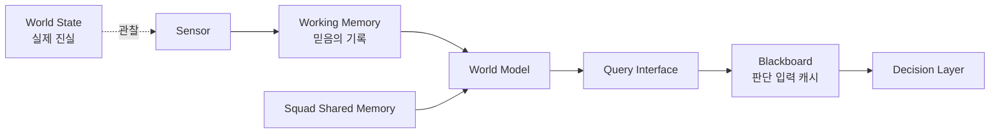
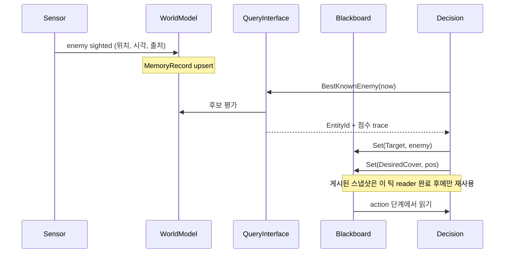
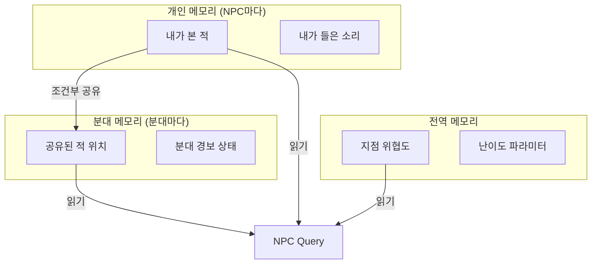

## 들어가며

NPC는 실제 월드를 직접 아는 것이 아니라, 센서가 관찰한 정보를 바탕으로 *믿고 있는 월드* 를 가진다. 플레이어를 봤다면 위치를 안다. 플레이어가 벽 뒤로 숨으면 현재 위치는 모르지만 마지막 목격 위치는 기억한다. 폭발음을 들으면 정확한 적은 몰라도 위험한 방향을 추정한다. 이 믿음의 저장소가 blackboard, working memory, world model이다.

의사결정 구조(FSM, 행동 트리, 효용 시스템, 계획기)가 "무엇을 할지"를 고르는 두뇌라면, blackboard와 world model은 그 두뇌가 읽는 *입력 메모리* 다. 어떤 의사결정 알고리즘을 쓰든 입력 데이터가 오염되면 출력도 오염된다. 죽은 적을 target으로 들고 있으면 행동 트리는 죽은 적을 추격하고, 한 명이 본 정보를 모두가 즉시 알면 분대는 텔레파시를 쓰는 것처럼 보인다. AI의 *행동* 버그처럼 보이는 것의 상당수가 실제로는 *지식 표현* 버그다. 그래서 blackboard/world model 설계는 의사결정 알고리즘과 독립적으로, 그 자체로 하나의 시스템이다.

blackboard는 의사결정 노드들이 공유하는 키-값 저장소로 시작한다. 하지만 규모가 커지면 단순 변수 모음으로 부족하다. 값에는 출처, 시간, 신뢰도, 만료 조건이 붙어야 하고, 개별 NPC 메모리와 분대 공유 메모리, 전역 전술 정보가 분리되어야 한다. 그렇지 않으면 NPC는 오래된 정보를 사실처럼 믿고, 서로의 임시 값을 덮어쓰며, 디버깅하기 어려운 행동을 만든다.

이 글은 blackboard와 world model의 차이에서 출발해, 문자열 키의 위험을 줄이는 typed key, 값에 메타데이터를 붙이는 memory record, 시간에 따른 confidence와 decay, 개인·분대·전역의 scope, 상충 정보를 병합하는 conflict resolution, 의사결정이 읽는 query interface, 마지막으로 디버깅과 실패 케이스를 다룬다. 핵심은 AI가 "무엇을 아는가"와 "무엇을 믿는가"를 명시적으로 설계하는 것이다.



이 글의 목표.

1. **Blackboard와 World Model** — 저장소의 역할 구분과 데이터 흐름.
2. **Typed Key** — 문자열 키의 위험과 타입 안전한 접근.
3. **Memory Record** — 값에 시간·출처·신뢰도·불확실성을 붙인다.
4. **Confidence와 Decay** — 기억의 약화와 불확실성 팽창의 수학.
5. **Scope** — 개인·분대·전역 메모리와 정보 전파.
6. **Conflict Resolution** — 상충 정보의 병합 정책.
7. **Query Interface** — 의사결정이 읽는 방식과 결합 분리.
8. **디버깅과 실패 케이스** — stale data, telepathy, amnesia, 키 충돌.


---

## 목차
1. [Blackboard와 World Model](#1-blackboard와-world-model)
2. [Typed Key](#2-typed-key)
3. [Memory Record](#3-memory-record)
4. [Confidence와 Decay](#4-confidence와-decay)
5. [Scope](#5-scope)
6. [Conflict Resolution](#6-conflict-resolution)
7. [Query Interface](#7-query-interface)
8. [디버깅과 실패 케이스](#8-디버깅과-실패-케이스)


---

## 1. Blackboard와 World Model

### 두 저장소의 역할 차이

blackboard와 world model은 비슷해 보이지만 역할이 다르다. blackboard는 의사결정 실행 중 필요한 값을 공유하는 *작업 공간* 이다. world model은 NPC가 세계에 대해 믿고 있는 *지속적 지식* 이다.

| 항목 | Blackboard | World Model |
|---|---|---|
| 수명 | 짧음, 행동/트리 실행 중심 | 길음, 기억 중심 |
| 값 | 현재 target, path, action flag | 마지막 목격 위치, 위협, 관계 |
| 소유 | AI controller / BT 인스턴스 | NPC memory / squad memory |
| 변경 빈도 | 매 틱 또는 노드 진입마다 | 센서 이벤트 발생 시 |
| 실패 양상 | 키 충돌, 덮어쓰기, 잔존 값 | stale data, 잘못된 믿음 |

blackboard에 모든 것을 넣으면 전역 변수 덩어리가 된다. 반대로 world model이 너무 복잡하면 단순한 행동도 무거워진다. 둘을 가르는 기준은 *수명* 이다. "이번 행동이 끝나면 무의미해지는 값"(현재 경로, 이번 공격의 타깃 캐시)은 blackboard로, "센서가 한 번 알려준 뒤 시간이 지나도 의미가 유지되는 믿음"(마지막 목격 위치, 위협 평가)은 world model로 간다.

### 센서에서 행동까지의 흐름

데이터는 한 방향으로 흐른다. 센서가 world model을 갱신하고, decision layer가 query로 필요한 값을 끌어와 blackboard에 캐시하고, action이 blackboard를 읽어 실행한다.



이 흐름에서 blackboard는 *현재 판단의 입력 캐시* 고, world model은 *지속되는 믿음* 이다. 흐름이 한 방향이라는 점이 중요하다. action이 world model을 직접 쓰지 않고, 센서가 blackboard를 직접 건드리지 않는다. 이 단방향 규약이 깨지면 "누가 이 값을 썼는가"를 추적할 수 없어진다.

### 왜 분리하는가 — 결합과 재현성

분리의 실질적 이득은 셋이다. 첫째, *교체 가능성* 이다. 같은 world model 위에 행동 트리를 얹든 효용 시스템을 얹든, 의사결정 알고리즘을 바꿔도 지식 표현은 그대로 재사용된다. 둘째, *테스트 가능성* 이다. world model에 가짜 센서 이벤트를 주입하면 의사결정 로직을 실제 게임 없이 단위 테스트할 수 있다. 셋째, *디버깅* 이다. 행동이 이상할 때 "world model이 무엇을 믿고 있었나"와 "blackboard에 무슨 값이 있었나"를 분리해서 보면 원인이 지식 쪽인지 판단 쪽인지 즉시 갈린다.

blackboard를 의사결정 인스턴스마다 따로 두고 world model을 NPC 단위로 공유하면, 같은 NPC가 여러 의사결정 컨텍스트(전투 BT, 대화 BT)를 가져도 지속되는 믿음은 하나로 통일된다. 이때 센서가 world model을 갱신하고, 명시적인 동기화 단계가 필요한 사실만 blackboard로 투영하며, action은 blackboard를 소비한다.

## 2. Typed Key

### 문자열 키가 망가지는 방식

문자열 blackboard는 빠르게 망가진다. `"target"`, `"Target"`, `"enemyTarget"` 같은 키가 코드 곳곳에서 제각각 만들어지고, 어느 시스템이 어느 키를 쓰는지 추적할 수 없으며, 값 타입이 슬그머니 바뀌어 런타임에 터진다. 문자열 키 blackboard의 전형적인 버그를 보면 모두 *컴파일러가 잡아줄 수 있었던* 실수다.

```cpp
// 문자열 blackboard의 전형적 함정
bb.Set("target", enemyId);          // EntityId 로 저장
auto pos = bb.Get<Vector3>("target"); // 다른 곳에서 Vector3 로 읽음 → 런타임 오류
bb.Set("Target", otherId);          // 대소문자 오타 → 별개의 키가 생김
bb.Get<float>("treat");             // "threat" 오타 → 조용히 기본값 반환
```

이런 실수는 빌드를 통과하고, 특정 상황에서만 재현되며, 로그에 "AI가 이상하다"로만 남는다. 키는 타입을 가져야 한다.

### 타입을 키에 박는다

키를 타입 파라미터를 가진 상수로 정의하면, 키 하나가 곧 "이름 + 타입"의 쌍이 된다.

```cpp
enum class BBSlotId : uint16_t { Target, TargetPos, Threat, HasTarget, Count };

template<typename T>
struct BBKey {
    BBSlotId id;            // 중앙 레지스트리에서 한 번만 부여하는 충돌 없는 ID
    const char* name;       // 디버그 표시용
};

inline constexpr BBKey<EntityId> Target   {BBSlotId::Target,    "target"};
inline constexpr BBKey<Vector3>  TargetPos{BBSlotId::TargetPos, "target_pos"};
inline constexpr BBKey<float>    Threat   {BBSlotId::Threat,    "threat"};
inline constexpr BBKey<bool>     HasTarget{BBSlotId::HasTarget, "has_target"};
```

blackboard는 키의 타입으로 값을 읽고 쓴다. 타입이 시그니처에 박혀 있으므로, 잘못된 타입으로 접근하면 컴파일이 막힌다.

```cpp
class Blackboard {
public:
    template<typename T>
    void Set(BBKey<T> key, const T& value) {
        slots_[static_cast<uint16_t>(key.id)] = Slot{std::any(value), TypeIdOf<T>()};
    }

    template<typename T>
    std::optional<T> Get(BBKey<T> key) const {
        auto it = slots_.find(static_cast<uint16_t>(key.id));
        if (it == slots_.end()) return std::nullopt;
        assert(it->second.type == TypeIdOf<T>() && "blackboard 타입 불일치");
        return std::any_cast<T>(it->second.value);
    }
private:
    struct Slot { std::any value; uint32_t type; };
    std::unordered_map<uint32_t, Slot> slots_;
};
```

`bb.Get(Target)`은 항상 `std::optional<EntityId>`를 돌려준다 — 호출부가 타입을 다시 적을 필요가 없다. `bb.Set(Target, somePos)`처럼 잘못된 타입을 넣으면 템플릿 인자 추론이 실패해 컴파일 단계에서 걸린다. ID는 한 중앙 레지스트리에서만 선언하고, 시작 시 ID·이름·타입의 중복을 검증한다. 이름의 32비트 해시만 map key로 쓰면 서로 다른 문자열이 충돌했을 때 같은 타입의 값은 조용히 덮어써지므로 typed key만으로는 충분하지 않다.

### `std::any`를 피하는 variant 변형

`std::any`는 매 접근에 RTTI 비교와 힙 할당 가능성이 따른다. 핫 루프에서 NPC 수천 마리를 갱신한다면 비용이 누적된다. blackboard에 들어가는 타입의 집합이 고정적이라면 `std::variant`로 바꿔 힙 할당과 RTTI를 제거할 수 있다.

```cpp
using BBValue = std::variant<std::monostate, bool, int, float, EntityId, Vector3>;

template<typename T>
void Blackboard::Set(BBKey<T> key, const T& v) {
    slots_[static_cast<uint16_t>(key.id)] = BBValue{v}; // 값 자체는 인플레이스 저장
}

template<typename T>
std::optional<T> Blackboard::Get(BBKey<T> key) const {
    auto it = slots_.find(static_cast<uint16_t>(key.id));
    if (it == slots_.end()) return std::nullopt;
    if (auto* p = std::get_if<T>(&it->second)) return *p;
    return std::nullopt;   // 타입 불일치는 nullopt 로 안전 처리
}
```

variant는 가장 큰 멤버 크기로 값 크기가 고정되므로 메모리가 약간 늘지만, 값 자체에는 별도 힙 할당이 필요 없다. 다만 예제의 `unordered_map` 노드는 여전히 할당될 수 있다. 키 집합이 고정돼 있다면 `BBSlotId::Count` 크기의 배열로 바꿔 저장소까지 고정하면 룩업과 메모리 예산이 더 명확해진다. 타입 집합이 자주 바뀌는 프로토타이핑 단계에는 `std::any`가, 타입이 안정된 빌드에는 variant가 적합하다.

### 키의 소유권 규칙

typed key는 타입 오류를 막지만 *의미적 충돌* 은 막지 못한다. 두 시스템이 같은 `Target` 키를 다른 의도로 쓰면 타입은 같아도 행동이 꼬인다. 그래서 키에는 소유권 규칙이 필요하다 — 어떤 시스템이 쓰기 권한을 갖는지, 누가 갱신하고, 언제 지우는지를 정한다.

| 키 | 쓰기 소유자 | 읽기 | 수명 |
|---|---|---|---|
| `Target` | Combat decision | action, animation | 전투 종료 시 clear |
| `TargetPos` | Sensor sync | movement, aim | target 유효 동안 |
| `DesiredCover` | Tactical query | movement | 한 번 이동 완료 후 무효 |
| `HasTarget` | Combat decision | 전이 가드 | 매 틱 재계산 |

규칙 없는 blackboard는 모든 시스템이 읽고 쓰는 공유 전역 상태가 된다. typed key는 타입 오류를 줄일 뿐 쓰기 경합과 수명 오류를 막지 못하므로, 키마다 단일 쓰기 소유자, 허용된 독자, 갱신 시점과 clear 조건을 함께 정의해야 한다.

## 3. Memory Record

### 값이 아니라 관찰을 저장한다

world model의 값은 단순 값이 아니다. "적 위치"라는 정보 하나에도 *언제* 관찰했는지, *어떻게* 알았는지(봤는지 들었는지), *얼마나 확실한지*, *얼마나 정확한지* 가 함께 붙는다. 이 메타데이터가 없으면 "방금 눈앞에서 본 위치"와 "30초 전 소리로 추정한 위치"를 구분할 수 없다.

```cpp
enum class SenseType { Sight, Sound, Damage, SquadReport, Footprint };

struct MemoryRecord {
    EntityId  entity;             // 누구에 대한 기억인가
    Vector3   lastKnownPosition;  // 마지막으로 안 위치
    Vector3   lastKnownVelocity;  // 추정 이동 — 외삽에 사용
    double    timestamp;          // 관찰 시각 (초)
    float     confidence;         // 0..1, 초기 신뢰도 (위치 정확도와 별개)
    float     uncertaintyRadius;  // 도달 가능 불확실성 반경 (m) — v_max 로 늘어나는 전파 반경
    float     positionSigma;      // 위치 추정 1σ (m) — 통계적 정확도, 반경과 다른 차원
    float     decayRate;          // 출처별 감쇠 계수 (lambda)
    SenseType source;             // 출처
};
```

이 구조가 있어야 NPC가 "봤다", "들었다", "추정한다"를 구분한다. 시야로 본 위치는 정확하고(`positionSigma` 작음) 신뢰도가 높다(`confidence` 1.0). 소리로 들은 위치는 부정확하고 신뢰도가 중간이다. 출처에 따라 초기값이 달라진다.

```cpp
void RememberSight(WorldModel& m, EntityId e, Vector3 pos, Vector3 vel, double now) {
    MemoryRecord r{};
    r.entity            = e;
    r.lastKnownPosition = pos;
    r.lastKnownVelocity = vel;
    r.timestamp         = now;
    r.confidence        = 1.0f;     // 직접 봤으니 확실하다
    r.uncertaintyRadius = 0.5f;     // 초기 도달 반경
    r.positionSigma     = 0.5f;     // 위치 추정 1σ — 반경과 별도로 관리
    r.decayRate         = 0.15f;    // 천천히 잊는다
    r.source            = SenseType::Sight;
    m.Upsert(r);                    // 같은 entity 기록은 시간·출처 정책에 따라 병합
}

void RememberSound(WorldModel& m, Vector3 pos, double now) {
    MemoryRecord r{};
    r.entity            = kUnknownEntity;  // 누군지는 모른다
    r.lastKnownPosition = pos;
    r.timestamp         = now;
    r.confidence        = 0.5f;     // 방향만 안다
    r.uncertaintyRadius = 4.0f;     // 초기 도달 반경
    r.positionSigma     = 4.0f;     // 위치 추정 1σ가 크다
    r.decayRate         = 0.6f;     // 빨리 잊는다
    r.source            = SenseType::Sound;
    m.Upsert(r);
}
```

### 메모리가 행동을 바꾼다

memory record의 가치는 행동 분기에 있다. 같은 "적이 저기 있다"는 정보라도 신뢰도와 불확실성에 따라 완전히 다른 행동이 나온다.

| 신뢰도 | 불확실성 | 적절한 행동 |
|---:|---:|---|
| 높음(>0.8) | 작음 | 직접 추격·교전 |
| 중간(0.4~0.8) | 중간 | 마지막 위치로 이동 후 경계 |
| 낮음(<0.4) | 큼 | 영역 수색, 발견 시 재교전 |
| 매우 낮음 | — | 무시, 순찰 복귀 |

신뢰도가 높으면 정확한 점을 겨냥하고, 불확실성이 크면 *점이 아니라 영역* 을 탐색한다. 이 한 가지 분기가 "벽 뒤로 숨었는데도 정확히 그 지점을 계속 쏘는" 부자연스러움과 "마지막 위치 근처를 두리번거리며 찾는" 자연스러움을 가른다.

### 저장 구조와 용량 관리

NPC 하나가 여러 적과 여러 소리를 기억하므로, world model은 보통 `entity → record` 맵과 위치 기반 record 리스트를 함께 둔다. 무한히 쌓이면 메모리와 query 비용이 늘어나므로 *상한과 정리* 가 필요하다.

```cpp
struct EnemyBelief {
    std::optional<MemoryRecord> visual;       // 가장 최근 직접 시야
    std::vector<MemoryRecord>   sounds;       // 같은 대상으로 식별된 소리 후보
    std::optional<MemoryRecord> squadReport;  // 가장 최근 분대 보고
};

class WorldModel {
public:
    void Upsert(const MemoryRecord& r);   // 더 최신·신뢰도 높은 관측과 병합
    void Prune(double now);               // 만료 기억 제거
private:
    std::unordered_map<EntityId, EnemyBelief> entities_; // 식별된 대상별·출처별 믿음
    std::vector<MemoryRecord>                 signals_;  // 익명 소리·흔적
    static constexpr size_t kMaxSignals = 16;
};

void WorldModel::Prune(double now) {
    // 신뢰도가 임계 이하로 떨어진 기억은 잊는다.
    std::erase_if(signals_, [&](const MemoryRecord& r){
        return DecayedConfidence(r, now) < 0.05f;
    });
    // 익명 신호가 상한을 넘으면 가장 오래된 것부터 버린다.
    if (signals_.size() > kMaxSignals) {
        std::sort(signals_.begin(), signals_.end(),
                  [](auto& a, auto& b){ return a.timestamp > b.timestamp; });
        signals_.resize(kMaxSignals);
    }
}
```

`Prune`을 매 틱이 아니라 N틱마다 돌리면 비용을 분산할 수 있다. 다만 읽는 쪽은 마지막 정리 시점이 아니라 현재 시각으로 confidence를 계산해야 한다. 정리 주기보다 오래된 record가 물리적으로 남아 있어도 질의 결과에서는 만료된 사실로 취급돼야 한다.

## 4. Confidence와 Decay

### 왜 기억이 약해져야 하는가

기억은 시간이 지나면 약해져야 한다. 마지막 목격 위치를 영원히 100% 신뢰하면 NPC는 적이 떠난 지 한참 지난 빈 곳을 계속 겨냥한다. 반대로 시야가 끊기자마자 즉시 잊으면 추격이 불가능하다. decay는 그 사이를 메운다 — 신뢰도를 시간의 함수로 *부드럽게* 줄인다.

가장 단순한 모델은 지수 감쇠다.

$$
\mathrm{confidence}(t) = c_0 \cdot e^{-\lambda \, \Delta t}, \qquad \Delta t = t - t_{\text{obs}}
$$

$\lambda$가 클수록 빨리 잊는다. 반감기(신뢰도가 절반이 되는 시간)는 $t_{1/2} = \ln 2 / \lambda$다. $\lambda = 0.15$면 반감기는 약 4.6초, $\lambda = 0.6$이면 약 1.2초다. 출처별 decay 차이를 반감기로 표현하면 디자이너가 직관적으로 튜닝할 수 있다.

```cpp
float DecayedConfidence(const MemoryRecord& r, double now) {
    float age = static_cast<float>(std::max(0.0, now - r.timestamp));
    return r.confidence * std::exp(-r.decayRate * age);
}
```

### 출처별 감쇠

모든 기억이 같은 속도로 사라지면 안 된다. 시야·소리·발자국·분대 보고는 초기 신뢰도와 감쇠가 다르다.

| 정보 | 초기 신뢰도 | 감쇠($\lambda$) | 반감기 | 이유 |
|---|---:|---:|---:|---|
| 직접 시야 | 1.0 | 0.15 | ~4.6s | 대상이 움직일 수 있으나 방금 확인됨 |
| 소리 | 0.5 | 0.6 | ~1.2s | 위치가 부정확하고 순간적임 |
| 발자국 | 0.3 | 0.05 | ~14s | 오래 남지만 방향만 시사 |
| 분대 보고 | 0.6 | 0.25 | ~2.8s | 통신 지연, 2차 정보 |

이 값들이 만드는 행동 차이는 분명하다. 소리는 반감기가 짧아 "잠깐 그쪽을 보다가 곧 흥미를 잃는" 반응을, 발자국은 반감기가 길어 "흔적을 따라 끈질기게 추적하는" 반응을 만든다.

### 불확실성의 팽창

신뢰도가 줄어드는 동안, *위치 불확실성은 반대로 커진다*. 적이 마지막 위치에서 최대 속도 $v$로 어느 방향으로든 움직일 수 있다면, 가능한 위치의 반경은 시간에 비례해 늘어난다.

$$
r_{\text{uncert}}(t) = r_0 + v_{\max} \cdot \Delta t
$$

이 $r_{\text{uncert}}$는 최대 속도로 도달 가능한 *반경*(reachability radius)이지 위치 오차의 표준편차 $\sigma$가 아니다. 융합 가중에는 별도의 `positionSigma`를 쓴다.

```cpp
// 도달 가능 반경 — 통계적 1σ(positionSigma)와 다른 양이다.
float UncertaintyRadius(const MemoryRecord& r, double now, float maxSpeed) {
    float age = static_cast<float>(std::max(0.0, now - r.timestamp));
    return r.uncertaintyRadius + maxSpeed * age;
}
```

velocity를 알고 있다면 단순 원이 아니라 *진행 방향으로 늘어난 타원* 으로 외삽할 수 있다 — 마지막으로 본 이동 방향 쪽이 더 그럴듯하다. 외삽한 예측 위치는 다음과 같다.

```cpp
Vector3 PredictedPosition(const MemoryRecord& r, double now) {
    float age = static_cast<float>(std::max(0.0, now - r.timestamp));
    // 마지막 속도를 짧은 시간 동안만 외삽한다 — 길게 외삽하면 빗나간다.
    float horizon = std::min(age, 2.0f);
    return r.lastKnownPosition + r.lastKnownVelocity * horizon;
}
```

### 수치 워크스루

시야로 한 번 본 적이 시야에서 사라진 뒤 시간이 흐르는 동안 NPC의 믿음이 어떻게 변하는지 추적해 본다. 초기 $c_0 = 1.0$, $\lambda = 0.15$, $r_0 = 0.5\text{m}$, $v_{\max} = 5\text{m/s}$로 둔다.

| 경과 $\Delta t$ | 신뢰도 | 불확실성 반경 | NPC가 하는 일 |
|---:|---:|---:|---|
| 0s | 1.00 | 0.5m | 직접 교전 |
| 2s | 0.74 | 10.5m | 마지막 위치로 추격 |
| 5s | 0.47 | 25.5m | 도착, 주변 경계 |
| 10s | 0.22 | 50.5m | 넓은 영역 수색 |
| 20s | 0.05 | 100.5m | 신뢰도 임계 이하 — 기억 제거, 순찰 복귀 |

신뢰도 0.05를 정리 임계로 잡으면, 한 번 본 적을 약 20초간 기억하고 그 사이 점점 넓은 영역을 수색하다가 포기한다. 이 곡선의 모양($\lambda$)과 임계가 곧 "NPC가 얼마나 끈질긴가"의 정의다. 같은 의사결정 로직이라도 이 두 숫자만 바꾸면 경비병이 집요해지거나 무던해진다.

### decay를 매 틱 계산하지 않기

`DecayedConfidence`는 query 시점에 즉석으로 계산하는 함수다 — 저장된 `confidence`를 매 틱 깎아 덮어쓰지 않는다. 이렇게 하면 부동소수 누적 오차가 없고, 정리(`Prune`)와 질의 시점에만 `exp`를 호출하므로 비용이 query 횟수에 비례한다. 매 틱 모든 record의 신뢰도를 갱신하는 방식은 기록 수 × 틱 수만큼 `exp`를 부르므로, 기억이 많고 query가 드문 경우에 낭비가 크다. *값은 관찰 시점에 고정하고, 감쇠는 읽을 때 적용한다* 가 원칙이다.

## 5. Scope

### 정보의 전파 범위

모든 정보가 같은 범위로 공유되면 안 된다. 한 NPC가 들은 작은 발소리를 맵 전체의 적군이 즉시 아는 것은 부자연스럽다(텔레파시). 반대로 한 분대원이 플레이어를 정면에서 봤는데 옆 동료가 전혀 반응하지 않으면 멍청해 보인다(고립). 그 사이를 scope가 메운다.

보통 세 범위를 둔다.

| Scope | 내용 | 예 | 갱신 주체 |
|---|---|---|---|
| 개인 | 자신이 직접 관찰한 정보 | 내 마지막 피격 방향 | 자기 센서 |
| 분대 | 가까운 동료와 공유 | 발견한 적 위치 | 분대원의 공유 이벤트 |
| 전역 | 게임 모드 차원의 정보 | 점령 지점 위협도 | 게임 룰/AI director |

개인 메모리는 NPC마다 하나, 분대 메모리는 분대마다 하나, 전역은 게임에 하나다. NPC의 query는 보통 셋을 합쳐 본다 — 개인 기억을 우선하되, 직접 본 게 없으면 분대 공유 정보를 참고한다.



### 공유 규칙과 지연

개인 관찰이 분대로 올라가는 데에는 *조건* 과 *지연* 이 붙는다. 조건은 "확실한 정보만 공유"를, 지연은 "통신에 시간이 걸림"을 표현한다.

```cpp
struct PendingShare { MemoryRecord record; double readyAt; };

void QueueShareSight(SquadComms& comms, const MemoryRecord& r, double now) {
    if (r.source != SenseType::Sight) return;     // 시야 확인만 공유
    if (DecayedConfidence(r, now) < 0.7f) return; // 확실할 때만
    float commDelay = 0.5f + RandRange(0.0f, 1.0f); // 무전 지연 0.5~1.5s
    comms.pending.push_back({ r, now + commDelay });
}

void FlushSquadShares(SquadComms& comms, SquadMemory& squad, double now) {
    std::erase_if(comms.pending, [&](const PendingShare& p){
        if (now < p.readyAt) return false;        // 아직 지연 안 끝남
        squad.Upsert(p.record);                   // 분대 메모리에 반영
        return true;
    });
}
```

이 작은 지연이 "한 명이 발견했지만 아직 모두가 반응하지는 않는" 자연스러운 순간을 만든다. 지연이 0이면 분대 전체가 동시에 고개를 돌려 기계적으로 보이고, 지연이 너무 크면 정보 공유가 무의미해진다. 예제의 0.5~1.5초는 보편값이 아니라 무전 애니메이션, 전투 속도와 난이도 목표에 맞춰 검증할 시작값이다.

### scope와 난이도, 그리고 치트의 경계

scope는 난이도 조절의 핵심 손잡이다. 쉬운 난이도에서는 공유 반경을 좁히고 신뢰도 임계를 높여 정보가 잘 안 퍼지게 하고, 어려운 난이도에서는 반경을 넓히고 지연을 줄여 분대가 빠르게 협응하게 한다. 적의 *반응 속도* 가 아니라 *정보 흐름* 으로 난이도를 만드는 것이 핵심이다.

가장 흔한 안티패턴은 AI가 플레이어의 실제 위치를 world model을 거치지 않고 직접 읽는 것이다 — 이러면 벽 뒤에 숨어도 정확히 조준당해 치트처럼 느껴진다. 모든 적 정보는 반드시 센서 → memory record → scope 전파를 거쳐야 한다. world model을 우회하는 직접 접근 하나가 정교하게 설계한 perception 시스템 전체를 무력화한다.

## 6. Conflict Resolution

### 같은 대상, 다른 정보

서로 다른 센서가 같은 대상에 대해 다른 정보를 줄 수 있다. 시야는 적이 A 위치에 있다고 하고, 직전의 소리는 B 위치를 가리키며, 5초 전 동료 보고는 오래된 C 위치를 들고 있다. `Upsert`가 호출될 때마다 world model은 기존 믿음과 새 정보를 어떻게 합칠지 정해야 한다.

가장 단순한 규칙은 *감쇠 적용 후 신뢰도와 최신성 비교* 다.

```cpp
bool ShouldReplace(const MemoryRecord& oldR, const MemoryRecord& newR, double now) {
    float oldConf = DecayedConfidence(oldR, now);
    float newConf = DecayedConfidence(newR, now);
    if (newConf > oldConf + 0.1f) return true;          // 새 정보가 더 확실
    bool meaningfullyNewer = newR.timestamp > oldR.timestamp + 1.0;
    if (meaningfullyNewer && newConf >= oldConf * 0.75f) return true;
    return false;
}
```

`+0.1f` 마진은 신뢰도가 엇비슷할 때 정보가 매 틱 깜빡이며 교체되는 것을 막는 *히스테리시스* 다. 최신성만으로 무조건 교체하면 방금 들어온 희미한 소리가 아직 유효한 직접 시야를 지울 수 있으므로, 예제는 최신 관측에도 최소 상대 신뢰도를 요구한다. 실제 정책은 출처 우선순위와 불확실성까지 함께 비교한다.

### 덮어쓰기의 함정 — 정보를 잃는다

단순 교체의 문제는 *정보 손실* 이다. 시야 정보로 소리 정보를 덮어쓰면, 시야가 끊긴 뒤 "방금 다른 방향에서 소리도 났었다"는 사실이 사라진다. 정보의 종류가 다르면 합치지 말고 *나란히* 보관해야 한다.

```cpp
void WorldModel::Upsert(const MemoryRecord& r) {
    if (r.entity == kUnknownEntity) {
        signals_.push_back(r);                 // 식별 전 신호는 별도 용량 제한
        return;
    }
    EnemyBelief& b = entities_[r.entity];
    if (r.source == SenseType::Sight) MergeRecord(b.visual, r);
    else if (r.source == SenseType::SquadReport) MergeRecord(b.squadReport, r);
    else b.sounds.push_back(r);                // 실제 코드는 출처별 상한·게이팅 적용
}
```

이 구조에서 `Upsert`는 출처별로 다른 슬롯에 들어간다. 시야는 `visual`을 갱신하고, 소리는 `sounds`에 누적되며(상한 적용), 분대 보고는 `squadReport`로 들어간다. 의사결정은 상황에 맞게 골라 읽는다 — 전투 행동은 `visual`을 우선하고, 수색 행동은 `sounds`와 `squadReport`를 후보로 쓴다. 하나의 `targetPos`로 전부 뭉개면 이 선택지가 사라진다.

### 위치 융합

같은 종류의 정보가 여러 개일 때(여러 소리, 또는 시야 + 분대 보고가 같은 대상을 가리킬 때)는 측정 불확실성으로 가중한 평균으로 *융합* 할 수 있다. 단, 먼저 측정들이 같은 대상을 가리키는지 게이팅하거나 클러스터링해야 한다. 서로 모순되는 정보(앞과 뒤에서 동시에 난 소리)를 무조건 평균하면 *둘 다 아닌 중간* 에 유령 표적을 만든다.

### 왜 역분산 가중이 최적인가 — 정밀도의 합과 융합 분산

같은 대상의 참 위치 $\mu$를 추정하는 서로 독립인 불편(unbiased) 측정 $x_i$가 있고, 각 측정의 분산이 $\sigma_i^2$라 하자(`positionSigma`를 $1\sigma$로 사용; `uncertaintyRadius`는 도달 가능 반경이므로 융합에 쓰지 않는다. 등방 대각 공분산 가정 하에 좌표축별로 따로 본다). 선형 불편 추정량 $\hat\mu=\sum_i w_i x_i$가 불편이려면 $\sum_i w_i = 1$이어야 하고, 독립성에서 그 분산은

$$
V(w) = \sum_i w_i^2 \sigma_i^2
$$

이다. $\sum_i w_i = 1$ 제약 아래 $V$를 최소화한다. 라그랑주 함수

$$
\mathcal{L} = \sum_i w_i^2 \sigma_i^2 - 2\lambda\Big(\sum_i w_i - 1\Big),
\qquad
\frac{\partial \mathcal{L}}{\partial w_i} = 2 w_i \sigma_i^2 - 2\lambda = 0
\;\Rightarrow\;
w_i = \frac{\lambda}{\sigma_i^2}
$$

에서 가중치는 *분산의 역수* 에 비례한다. 제약으로 $\lambda$를 풀면 $\lambda = \big(\sum_j \sigma_j^{-2}\big)^{-1}$이고,

$$
w_i = \frac{\sigma_i^{-2}}{\sum_j \sigma_j^{-2}},
\qquad
\frac{1}{\sigma_{\text{fused}}^2} = \sum_i \frac{1}{\sigma_i^2}.
$$

즉 *정밀도(분산의 역수)가 더해진다*. 융합 분산은 항상 가장 작은 개별 분산보다도 작으므로, 측정이 독립이고 분산이 옳다면 측정을 합칠수록 손해는 없다. 두 측정의 경우 이는

$$
\hat\mu = x_1 + K(x_2 - x_1), \qquad K = \frac{\sigma_1^2}{\sigma_1^2 + \sigma_2^2}
$$

로, 과정 모델이 없는 *정적 스칼라 칼만 갱신* 과 정확히 같다. "칼만의 단순화 형태"라는 표현은 이 의미에서 옳다 — 단, 옳은 가중은 $1/\sigma^2$이다.

표준편차의 역수 $1/\sigma$를 쓰는 흔한 휴리스틱과 차이를 수치로 확인할 수 있다. 두 시야의 위치 표준편차 $\sigma_1=1\text{m}$, $\sigma_2=3\text{m}$(신뢰도 동일)를 1차원 위치 $x_1=0$, $x_2=12$로 융합하면:

| 가중 방식 | $w_2$(3m 측정) | 융합 위치 $\hat\mu$ | 융합 $\sigma$ |
|---|---:|---:|---:|
| 최적 $1/\sigma^2$ | $0.1$ | $1.2$ | $0.949\text{m}$ |
| 휴리스틱 $1/\sigma$ | $0.25$ | $3.0$ | — |

휴리스틱은 최적 가중과 비교했을 때 노이즈가 큰 3m 측정의 정규화 가중을 $0.1$에서 $0.25$로, 2.5배 크게 잡는다. 그 결과 융합 위치도 정확한 측정에서 2.5배 멀어진다. 분산이 같은 $n$개 측정이면 최적 융합은 $\sigma_{\text{fused}} = \sigma/\sqrt{n}$이다($\sigma=2\text{m}$ 둘이면 $1.41\text{m}$).

경계 조건은 넷이다.

첫째, *상관* 이다. "정밀도가 더해진다"는 독립 가정에서만 성립한다. 같은 원관측을 두 분대원이 중계하면 두 측정은 거의 완전 상관이라, 독립으로 융합하면 융합 분산이 실제보다 작게 나와 *과신* 한다. 출처 ID와 관측 계보로 중복을 제거하고, 상관을 알고 있으면 교차 공분산까지 추적하는 track-to-track fusion을 사용한다. 상관을 알 수 없으면 covariance intersection처럼 과신하지 않는 보수적 융합이 필요하다.

둘째, *잘못 보고된 분산* 이다. $1/\sigma^2$ 가중은 작은 $\sigma$를 강하게 신뢰하므로, 이상치가 작은 `positionSigma`로 들어오면 융합을 지배한다. 융합 전에 측정과 예측이 같은 대상을 가리키는지 게이팅한다. 서로 독립인 1차원 예측과 측정이라면 혁신의 분산은 두 분산의 합이므로 $d_i^2=(x_i-\hat\mu)^2/(\sigma_i^2+\sigma_{\text{pred}}^2)$를 쓴다. 상관이 있으면 교차 공분산도 반영해야 하며 단순 거리 임계 클러스터링과 같은 검사는 아니다.

셋째, *모순 측정은 모델 오설정* 이다. BLUE는 모든 측정이 *같은* $\mu$를 추정한다고 가정한다. 앞과 뒤에서 동시에 난 두 소리가 서로 다른 대상이라면 평균은 둘 다 아닌 유령점이다. 거리 임계로 클러스터를 먼저 분리하고 클러스터 *내부* 만 융합해야 한다.

넷째, 최소 표준편차 *바닥* 이다. $r\to0$의 0 나눗셈을 막는 정규화지만, $1/\sigma^2$ 형에서는 완벽 시야가 $r^{-2}$로 융합을 지배하려 하므로 `max(positionSigma, kMinSigma)`가 단일 측정의 최대 가중을 캡해 "하나의 완벽한 측정에 무한 신뢰"를 막는다. 모든 반경에 상수를 더하면 큰 오차까지 체계적으로 부풀리므로 바닥과 가산 오차 모델을 구분한다.

독립·등방 측정에 대한 융합 코드는 다음과 같다. 분모가 $\sigma$가 아니라 $\sigma^2$인 점, 그리고 융합 정밀도 $\sum 1/\sigma_i^2$를 그대로 반환해 호출부가 새 `positionSigma`로 쓸 수 있다는 점이 핵심이다.

```cpp
// 역분산(정밀도) 가중 융합 — 정적 칼만 갱신과 동형.
// 게이팅을 통과해 같은 대상으로 묶인 record 만 넘긴다.
// 서로 다른 timestamp 의 측정은 공통 기준 시각 now 로 예측한 위치에서 융합한다.
// PredictedSigma는 관측 시각의 positionSigma에 now까지의 과정 잡음을 반영한다.
// 위치 정확도는 positionSigma(1σ)로만 가중하고, confidence 는 게이팅에서 별도 처리한다.
std::optional<Vector3> FusePositionsBLUE(const std::vector<MemoryRecord>& cluster,
                                         double now, float& outFusedSigma) {
    Vector3 weighted{0, 0, 0};
    float   precisionSum = 0.0f;                  // Σ 1/σ²  → 융합 정밀도
    for (const auto& r : cluster) {
        float sigma = std::max(PredictedSigma(r, now), kMinSigma); // 예측된 위치 1σ
        float prec  = 1.0f / (sigma * sigma);      // 위치 정확도만 — confidence 는 섞지 않는다
        weighted     += PredictedPosition(r, now) * prec;
        precisionSum += prec;
    }
    // 정보량 0 — σ→∞가 극한이므로 0이 아니라 '아무것도 모른다'를 돌려준다.
    if (precisionSum <= 0.0f) {
        outFusedSigma = std::numeric_limits<float>::max();
        return std::nullopt;
    }
    outFusedSigma = std::sqrt(1.0f / precisionSum);           // 융합 σ = 1/√(Σ1/σ²)
    return weighted / precisionSum;
}
```

위치 정확도(σ)와 confidence는 서로 다른 양이므로 융합 가중에는 σ만 쓴다 — confidence는 게이팅/유효성에서 따로 다룬다. 그래도 정보 필터 한 식에 흡수하고 싶다면 $\sigma^2$를 신뢰도로 부풀려($\sigma_{\text{eff}}^2 = \sigma^2/\text{conf}$) 쓸 수 있지만, 이는 위치 정확도와 존재 신뢰도를 섞는 선택임을 명시해야 한다.

## 7. Query Interface

### 의사결정을 저장 구조에서 분리한다

decision layer가 world model의 내부 자료구조(`entities_`, `signals_`, `EnemyBelief`)를 직접 뒤지면, 저장 구조를 바꿀 때마다 모든 의사결정 코드가 깨진다. 의사결정은 *질문* 만 던지고, world model이 내부 정책으로 답해야 한다.

```cpp
class WorldModel {
public:
    // 전투용 질의
    std::optional<EntityId> BestKnownEnemy(double now) const;
    std::optional<Vector3>  BestInvestigatePosition() const;
    // 공간 질의
    float ThreatAt(Vector3 pos) const;
    bool  IsPositionExposed(Vector3 pos, EntityId threat) const;
    // 시간 질의
    bool  HasRecentDamage(double withinSeconds) const;
    int   KnownEnemyCount(double now) const;
};
```

`BestKnownEnemy`는 최근 시야로 형성된 믿음의 거리, HP, 위협도, 신뢰도를 종합해 하나를 고른다. “시야 출처”는 “현재 보인다”와 같지 않다. 현재 가시성만 필요한 질의는 센서의 이번 관측 집합을 별도로 읽어야 한다. decision layer는 점수 공식을 몰라도 되고, 질의 시각을 인자로 받으므로 replay와 단위 테스트에서 숨은 전역 시계에 의존하지 않는다.

### query 구현 — 점수화

"가장 위협적인 적"을 고르는 query는 여러 요인의 가중 합으로 후보를 점수화한다.

```cpp
std::optional<EntityId> WorldModel::BestKnownEnemy(double now) const {
    EntityId best = kInvalid;
    float bestScore = -1.0f;
    for (const auto& [id, belief] : entities_) {
        if (!belief.visual) continue;
        const MemoryRecord& rec = *belief.visual;
        float conf = DecayedConfidence(rec, now);
        if (conf < 0.5f) continue;                    // 흐릿한 믿음은 제외
        float dist  = Distance(self_.pos, rec.lastKnownPosition);
        float score = conf * 1.0f
                    + (1.0f / (dist + 1.0f)) * 2.0f    // 가까울수록 위협
                    + ThreatWeight(id);                // HP, 무기 등
        if (score > bestScore) { bestScore = score; best = id; }
    }
    return best != kInvalid ? std::optional{best} : std::nullopt;
}
```

### blackboard로 캐싱

query는 거리·신뢰도·정렬을 매번 계산하므로 매 틱 여러 번 부르면 비용이 든다. decision layer는 한 틱에 한 번 query를 돌려 결과를 blackboard에 캐시하고, 그 틱의 모든 행동 노드는 캐시된 값을 읽는다.

```cpp
void UpdateCombatBlackboard(WorldModel& model, Blackboard& bb, double now) {
    if (auto enemy = model.BestKnownEnemy(now)) {
        bb.Set(Target, *enemy);
        bb.Set(TargetPos, model.PositionOf(*enemy));
        bb.Set(HasTarget, true);
    } else {
        bb.Clear(Target);            // 유효 후보가 없으면 이전 대상 ID를 지운다
        bb.Set(HasTarget, false);
        // target entity는 잃었지만 마지막 위치는 별도 키로 보존해 수색에 사용한다.
    }
}
```

여기서 1절의 역할 분리가 구체화된다. world model query는 *지속 믿음에서 판단을 끌어내고*, 그 판단을 blackboard에 *이번 틱의 입력으로 고정* 한다. 같은 query 결과를 트리 안에서 다섯 번 읽어도 계산은 한 번이다.

### query는 디버깅 포인트다

"왜 이 적을 골랐는가"를 알려면 query가 후보별 점수를 남겨야 한다. blackboard에는 최종 결과(`Target = 42`)만 있지만, query trace에는 탈락한 후보와 점수가 있다.

```cpp
struct QueryTrace {
    const char* query;
    std::vector<std::pair<EntityId, float>> candidates;  // (후보, 점수)
    EntityId chosen;
};
```

이 trace를 디버그 오버레이에 띄우면 "적 A(점수 3.2) vs 적 B(점수 2.9) → A 선택"처럼 결정의 근거가 그대로 보인다. blackboard의 최종 값만으로는 "왜 B가 아니라 A인가"에 답할 수 없다 — 그 답은 query 안의 점수 비교에 있다.

## 8. 디버깅과 실패 케이스

### 행동 버그처럼 보이는 지식 버그

blackboard/world model의 실패는 겉으로 보면 "AI가 이상하다"로만 나타난다. 실제 원인은 오래된 값, 잘못된 scope, 키 충돌, 신뢰도 누락인 경우가 많다. 증상과 원인을 분리해 보면 디버깅이 빨라진다.

| 증상 | 실제 원인 | 분류 |
|---|---|---|
| 죽은 적을 계속 추격 | clear되지 않은 target | stale data |
| 모두가 동시에 반응 | scope/지연 없는 공유 | telepathy |
| 시야 끊기자 즉시 포기 | 시야 끊김 = 기억 삭제 | amnesia |
| 가끔 엉뚱한 값 | 두 시스템이 같은 키 사용 | key collision |
| 누구도 소유 안 함 | 모든 값을 blackboard에 | global variable화 |
| 소리에 시야처럼 반응 | confidence 미구분 | metadata 누락 |

각 실패에는 구조적 처방이 있다. stale target은 entity 무효화 시 정리(`OnEntityDestroyed`에서 관련 record 제거), telepathy는 5절의 scope와 지연, amnesia는 3·4절의 memory record와 decay(시야가 끊겨도 기억은 신뢰도와 함께 남음), key collision은 2절의 typed key와 소유권 규칙, global variable화는 blackboard/world model 분리와 키 소유자 지정, metadata 누락은 3절의 출처별 confidence다. 이 글의 각 절이 곧 각 실패의 처방이다.

### stale target — 무효화 훅

가장 흔한 버그는 사라진 엔티티가 메모리와 blackboard에 잔존하는 것이다. 엔티티 파괴 이벤트를 구독해 관련 기록을 즉시 정리한다.

```cpp
void WorldModel::OnEntityDestroyed(EntityId e) {
    entities_.erase(e);                       // 지속 믿음의 소유자가 자기 상태 정리
}

void CombatBlackboardSync::OnEntityDestroyed(EntityId e) {
    if (bb_.Get(Target) == e) {               // 작업 캐시의 소유자가 자기 상태 정리
        bb_.Clear(Target);
        bb_.Set(HasTarget, false);
    }
}
```

같은 파괴 이벤트를 두 소유자가 각각 구독하되 서로의 저장소를 직접 수정하지 않는다. 7절에서 `HasTarget == false`일 때 마지막 위치를 별도 키로 보존해 수색에 쓰는 패턴이 있었는데, *엔티티가 파괴된 경우는 예외* 다 — 존재하지 않는 대상 ID는 반드시 지운다. "시야만 끊김"(기억 유지)과 "엔티티 소멸"(대상 ID 삭제)을 구분하는 것이 핵심이다.

### 세 가지 디버그 뷰

memory는 *시간축* 이 중요하다. 현재 값만 보면 왜 그렇게 됐는지 모른다. 디버거는 최소 세 가지를 보여줘야 한다.

| 뷰 | 내용 | 답하는 질문 |
|---|---|---|
| Blackboard Watch | 현재 key/value와 타입·소유자 | decision 입력이 맞는가 |
| Memory Timeline | 관찰 이벤트와 신뢰도 곡선 | 언제 무엇을 알았는가 |
| World Overlay | 마지막 위치, 불확실성 반경, 출처 색 | 어디를 믿고 있는가 |

World Overlay는 공간 디버깅에서 압도적이다. NPC의 믿음을 3D 공간에 직접 그린다.

```cpp
void WorldModel::DebugDraw(DebugRenderer& dr, double now) const {
    auto drawRecord = [&](const MemoryRecord& r) {
        float conf   = DecayedConfidence(r, now);
        float radius = UncertaintyRadius(r, now, kMaxEnemySpeed);
        Color c = SourceColor(r.source);          // 시야=초록, 소리=노랑, 보고=파랑
        c.a = conf;                               // 신뢰도를 투명도로
        dr.DrawSphere(r.lastKnownPosition, radius, c);  // 믿는 영역
        dr.DrawText3D(r.lastKnownPosition,
                      Format("conf=%.2f age=%.1fs", conf, now - r.timestamp));
    };
    for (const auto& [id, belief] : entities_) {    // 값은 record가 아니라 EnemyBelief다
        if (belief.visual)      drawRecord(*belief.visual);
        for (const MemoryRecord& s : belief.sounds) drawRecord(s);
        if (belief.squadReport) drawRecord(*belief.squadReport);
    }
}
```

이 한 뷰가 "NPC가 빈 벽을 쏘는" 버그의 원인을 즉시 드러낸다 — 거기에 신뢰도 0.8짜리 시야 record가 남아 있고 불확실성 반경이 아직 작으면, decay가 너무 느린 것이다. 반경이 거대하면 query가 불확실성을 무시하고 중심점만 겨냥하는 것이다. 색으로 출처를 보면 "소리를 시야처럼 신뢰"하는 버그가 노란 구를 정확히 조준하는 모습으로 보인다.

World Overlay가 읽는 `entities_`는 writer가 동시에 갱신할 수 있다. 다중 스레드라면 이 디버그 뷰가 라이브 컨테이너를 직접 순회하지 않고 *게시된 스냅샷*을 읽어야 한다. 게시(publish)의 release는 reader의 획득 acquire와 짝을 맞추고, 읽기 완료 신호의 release는 재사용하려는 writer의 acquire와 짝을 맞춘다. 이전 버퍼는 모든 reader가 다 읽은 뒤(reuse barrier/epoch)에만 다음 write용으로 재사용한다. 단일 스레드이거나 프레임 완료 barrier가 있으면 이 수명 계약이 자동으로 성립한다.

### Memory Timeline

타임라인은 결정의 *인과* 를 복원한다. 현재 행동이 이상할 때, 그 행동을 만든 관찰의 순서를 거슬러 본다.

```text
t=0.0   Sound   pos=(12,0,8)  conf=0.5  → Investigate 후보 추가
t=3.2   Sight   pos=(14,0,6)  conf=1.0  → Target 설정, 교전
t=5.1   (시야 끊김)            conf=0.75 (감쇠) → 마지막 위치 추격
t=6.0   SquadReport pos=(20,0,4) conf=0.6 → 새 후보, 신뢰도 비교
t=9.3   conf=0.40 (임계 근처)   → 수색 모드 전환
```

"왜 저기로 갔지?"의 답이 이 타임라인에 있다 — 9.3초 시점에 시야 신뢰도가 임계 아래로 떨어졌고, 6초의 분대 보고가 새 후보로 남아 그쪽으로 수색을 갔다. 현재 값(`Target = none, 수색 위치 = (20,0,4)`)만 보면 결코 알 수 없는 인과다. 좋은 world model은 NPC를 똑똑하게 만들 뿐 아니라, *왜 그런 행동을 했는지 설명 가능하게* 만든다.


---

## 결론

blackboard는 의사결정이 공유하는 짧은 수명의 작업 공간이고, world model은 NPC가 세계에 대해 믿는 지속적 지식이다. 데이터는 센서 → world model → query → blackboard → action으로 한 방향으로 흐르며, 이 단방향 규약과 두 저장소의 분리가 교체 가능성·테스트 가능성·디버깅 가능성을 만든다. world model의 값은 단순 변수가 아니라 출처, 시각, 신뢰도, 불확실성을 가진 memory record다. typed key는 키 충돌과 타입 오류를 컴파일·assert 단계에서 잡고, query interface는 의사결정을 저장 구조에서 떼어 낸다.

기억은 시간에 따라 약해진다. 지수 감쇠로 신뢰도를 줄이고 불확실성 반경을 키우면, 같은 "적이 저기 있다"는 정보가 시간에 따라 직접 교전 → 추격 → 영역 수색 → 망각으로 자연스럽게 흐른다. 감쇠 계수와 정리 임계라는 두 숫자가 NPC의 끈질김을 정의한다. scope는 정보 전파를 개인·분대·전역으로 나누고 지연을 두어, 텔레파시도 고립도 아닌 협응을 만든다. conflict resolution은 출처가 다른 정보를 덮어쓰지 않고 나란히 보관하거나 신뢰도로 융합한다.

AI가 자연스러워 보이려면 실제 월드 상태보다 *AI가 무엇을 알고 있다고 믿는가* 가 더 중요하다. 시야가 끊겨도 마지막 위치를 기억하고, 오래된 정보는 약해지고, 불확실한 소리는 조사 후보가 되며, 분대 정보는 적절한 범위와 지연으로 공유된다. 행동 버그처럼 보이는 것의 상당수는 지식 표현 버그이며, World Overlay와 Memory Timeline 같은 시간축 디버그 뷰가 그 인과를 복원한다. 잘 설계된 지식 표현은 어떤 의사결정 알고리즘 아래에서도 NPC를 더 똑똑하게, 그리고 더 설명 가능하게 만든다.

## 더 읽을거리

- Damian Isla, "Handling Complexity in the Halo 2 AI" (GDC 2005) — blackboard와 지식 표현의 산업 사례.
- Jeff Orkin, "Three States and a Plan: The A.I. of F.E.A.R." (GDC 2006) — world state 기반 planning과 working memory.
- Steve Rabin (ed.), *Game AI Pro* 1~3권 — "Knowledge Representation", "Perception", "Blackboard Architectures" 관련 챕터들.
- Ian Millington, *AI for Games*, 3rd Ed. — blackboard 아키텍처와 sensory/world interfacing 정리.
- Greg Welch & Gary Bishop, "An Introduction to the Kalman Filter" — 위치 융합과 불확실성 추정의 이론적 배경.
- Yaakov Bar-Shalom, X.-Rong Li & Thiagalingam Kirubarajan, *Estimation with Applications to Tracking and Navigation* (Wiley, 2001) — 역분산 측정 융합, 게이팅, 정보 필터의 표준 교재.
- Yaakov Bar-Shalom & Leon Campo, "The Effect of the Common Process Noise on the Two-Sensor Fused-Track Covariance" (IEEE Trans. Aerospace and Electronic Systems, 1986) — 상관 측정의 융합 공분산.
- Unreal Engine Behavior Tree Blackboard 문서 — typed key 기반 blackboard의 대표적 상용 구현.
