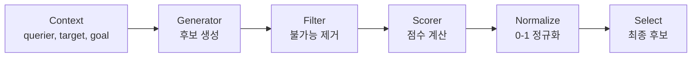
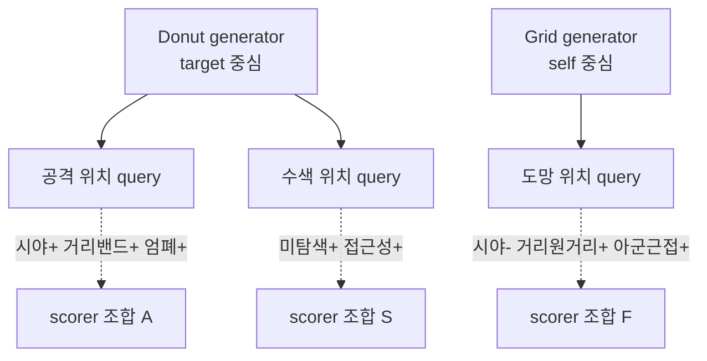
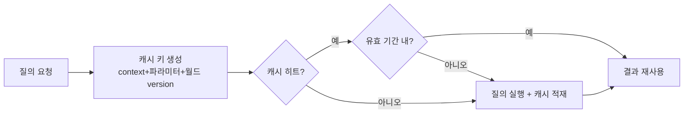

## 들어가며

게임 AI는 자주 "어디가 좋은가"를 묻는다. 어디로 엄폐할까, 어디서 공격할까, 어디를 조사할까, 어디에 스폰할까, 어디로 도망갈까. 이 질문은 단일 함수로 끝나지 않는다. 후보 위치를 만들고, 갈 수 없는 곳을 거르고, 거리·시야·위험·엄폐·목표 접근성을 점수화하고, 점수를 0~1로 맞추고, 최종 위치를 선택해야 한다. 그리고 이 다섯 단계는 "공격 위치"든 "도망 위치"든 "스폰 위치"든 *구조가 같다*. 다른 것은 무엇을 만들고 무엇으로 점수를 매기느냐뿐이다. Environment Query System(EQS)은 이 공통 구조를 데이터 주도 파이프라인으로 고정하고, 그 위에서 각 질의를 데이터로 조립하게 만든다.

EQS의 핵심은 공간 판단을 코드의 if문에서 분리하는 것이다. 후보 생성(generator), 필터(filter), 점수화(scorer), 정규화(normalization), 선택(selection)을 조합하면, 디자이너는 "좋은 위치"의 정의를 *코드 빌드 없이* 데이터로 튜닝할 수 있다. 본질적으로 EQS는 효용 기반 AI(utility AI)를 *행동* 이 아니라 *공간* 에 적용한 것이다. 효용 AI가 여러 행동 후보에 점수를 매겨 최선을 고르듯, EQS는 여러 위치 후보에 점수를 매겨 최선을 고른다. 이 관점이 EQS의 모든 설계 결정을 관통한다 — 점수 스케일 통일, 가중합, response curve, 선택 정책이 전부 효용 AI에서 그대로 온다.

이 글은 EQS의 파이프라인, candidate generation(grid/donut/NavMesh/cover), filter와 scorer, 정규화와 가중치, context, 비동기 실행과 캐싱, 디버깅과 실패 케이스를 다룬다. 코드는 실제 동작하는 밀도로 적고, 격자·도넛 생성기와 거리/시야/엄폐 스코어러는 좌표 수준으로 트레이스한다. 목표는 "가장 가까운 위치"가 아니라 "현재 전술 목적에 가장 맞는 위치"를 *반복 가능하고 디버깅 가능하게* 계산하는 구조를 세우는 것이다.



이 글의 목표.

1. **EQS 파이프라인** — generator, filter, scorer, 단계 순서의 비용 논리.
2. **Candidate Generation** — grid, donut, NavMesh, cover point, 후보 밀도 트레이드오프.
3. **Filter** — 불가능한 후보 제거, filter와 scorer의 경계.
4. **Scorer** — 거리, 시야, 위험, 엄폐 점수와 trace 예시.
5. **정규화와 가중치** — 스케일 불일치, response curve, 결합 함정.
6. **Context** — 질의의 기준점, 단일/다중 target.
7. **비동기와 캐싱** — 프레임 예산, 시간 분할, stale 결과 검증.
8. **디버깅과 선택 기준** — 점수 시각화, 선택 정책, reservation.
9. **Unreal EQS** — 상용 구현의 구조와 용어 대응.


---

## 목차
1. [EQS 파이프라인](#1-eqs-파이프라인)
2. [Candidate Generation](#2-candidate-generation)
3. [Filter](#3-filter)
4. [Scorer](#4-scorer)
5. [정규화와 가중치](#5-정규화와-가중치)
6. [Context](#6-context)
7. [비동기와 캐싱](#7-비동기와-캐싱)
8. [디버깅과 선택 기준](#8-디버깅과-선택-기준)
9. [Unreal EQS](#9-unreal-eqs)


---

## 1. EQS 파이프라인

EQS는 공간에 대한 utility query다. 행동 후보가 아니라 위치 후보에 점수를 매긴다. "공격 위치"라는 query는 여러 위치를 만들고(generate), 갈 수 없는 위치를 버리고(filter), 적을 볼 수 있는지와 위험도를 점수화한 뒤(score), 점수를 0~1로 맞추고(normalize), 가장 높은 점수의 위치를 반환한다(select). 이 다섯 단계가 항상 같은 순서로 흐른다는 점이 EQS의 골격이다.

### 데이터 구조

파이프라인을 흐르는 단위는 *후보 항목(item)* 이다. 각 항목은 위치 하나와, 그 위에 누적되는 점수, 그리고 살아 있는지(valid) 여부를 가진다.

```cpp
struct QueryItem {
    Vector3 position;
    SmallVector<float, 8> rawScores; // scorer ID별 raw 값
    float       score = 0.0f;        // normalize 후 가중합
    bool        valid = true;        // filter가 false로 떨어뜨림
    const char* failReason = nullptr;
    uint64_t    navGeneration = 0;   // 비동기 결과 검증용
    double      snapshotTime = 0.0;  // 결과가 만들어진 query 시각 — TTL 재검증
    uint64_t    worldVersion = 0;    // 지형·문·엄폐 등 hard filter 입력 버전
};

struct QueryContext {
    EntityId             querier;        // 질의 주체
    Vector3              querierPos;
    EntityId             target;         // 주 대상
    Vector3              targetPos;      // 주 대상 위치 snapshot
    Vector3              origin;         // 후보 생성 기준점
    std::vector<EntityId> targets;        // 다중 대상 질의용, 주 대상 포함 계약
    std::vector<Vector3> pointsOfInterest;
    TeamId               team;
    double               queryTime;
    uint64_t             navGeneration;
    uint64_t             threatMapVersion;
};
```

`valid` 플래그를 두는 이유는 *제거 대신 표시* 가 캐시 지역성과 디버깅에 유리하기 때문이다. filter가 항목을 벡터에서 즉시 지우면(`erase`) 뒤 요소가 앞으로 당겨져 인덱스가 무너지고, 디버그 시각화에서 "이 후보가 *왜* 탈락했는가"를 보여줄 대상이 사라진다. 대신 `valid = false`로 표시해 두면, 나머지 처리기는 살아 있는 항목만 건너뛰며 처리하고, 디버그 단계는 탈락 후보까지 그려 탈락 이유를 표시한다.

### 단계 순서는 비용으로 결정된다

파이프라인 순서는 각 단계의 *비용과 선택도(selectivity)* 로 정한다. 싼 filter가 많은 후보를 제거한다면 앞에 두는 것이 유리하지만, 거의 아무것도 제거하지 못하면 전체 memory pass만 늘릴 수 있다. batching·SIMD·cache locality를 깨는 filter는 scalar 비용이 싸도 전체로는 손해일 수 있다.

| 연산 | 대략 비용 | 분류 |
|---|---|---|
| 거리 비교 (제곱 거리) | 산술·메모리 접근 | 대체로 싼 filter/scorer |
| 예약 조회 | table lookup | 부하율·cache에 의존 |
| NavMesh 포함/투영 | 공간 질의 | tile 후보 수에 의존 |
| 시야 raycast | 충돌 질의 | BVH와 후보 수에 의존 |
| 경로 비용 | graph search | 확장 노드 수에 의존 |

후보 200개에서 거리 filter가 절반, NavMesh filter가 다시 절반을 제거한다면 path query는 200회에서 50회로 줄어든다. 그러나 실제 순서는 각 단계의 평균 비용 $c_i$와 조건부 생존율 $s_i$를 측정해 기대비용을 비교해야 한다. 독립적인 두 filter A, B만 놓으면 A→B의 비용은 $c_A+s_Ac_B$, B→A는 $c_B+s_Bc_A$다. 이 식과 vectorization·batch 제약을 함께 사용한다.

```cpp
std::optional<QueryItem> RunQuery(const QueryDef& def, const QueryContext& ctx) {
    std::vector<QueryItem> items = def.generator->Generate(ctx);
    ApplyFilters(def.filters, ctx, items);     // 측정한 비용·선택도에 따라 정렬
    ApplyScorers(def.scorers, ctx, items);     // 살아남은 후보만 점수화
    Normalize(def.scorers, items);             // scorer별 0~1 정규화 + 가중합
    return SelectBest(def.selection, items);   // 정책에 따라 최종 선택
}
```

비싼 단계가 *살아남은 후보만* 보도록 `ApplyScorers`는 `valid`가 참인 항목만 평가한다.

```cpp
void ApplyScorers(const std::vector<ScorerPtr>& scorers,
                  const QueryContext& ctx, std::vector<QueryItem>& items) {
    for (QueryItem& it : items) {
        if (!it.valid) continue;               // 탈락한 후보는 건너뛴다
        for (const ScorerPtr& s : scorers)
            s->Accumulate(ctx, it);            // raw 점수를 scorer별 버퍼에 적재
    }
}
```

### 같은 골격, 다른 질의

EQS의 진짜 가치는 *재사용* 이다. generator·filter·scorer가 작은 부품이면, 같은 부품을 다르게 조립해 전혀 다른 질의를 만든다.



"공격 위치"는 대상 주변 도넛 생성기에 (시야 가점 + 선호 거리 밴드 + 엄폐 가점)을 붙인 것이고, "도망 위치"는 자기 주변 격자에 (시야 단절 + 원거리 + 아군 근접)을 붙인 것이다. generator와 scorer만 바꾸면 파이프라인 코드는 한 줄도 고치지 않는다. 이 분리가 이후 모든 절의 전제다.

## 2. Candidate Generation

generator는 평가할 후보를 만든다. 후보가 나쁘면 어떤 scorer를 붙여도 좋은 답이 나오지 않는다 — 좋은 위치가 애초에 후보에 없으면 고를 수 없다. 반대로 후보가 너무 많으면 성능이 무너진다. generator 설계는 *해의 공간을 충분히 덮으면서 후보 수는 최소로* 라는 긴장 위에 있다.

대표 generator는 다음과 같다.

| Generator | 후보 | 용도 | 후보 수 특성 |
|---|---|---|---|
| Grid | 기준점 주변 정사각 격자 | 일반 위치 탐색 | 반경²에 비례 (폭발) |
| Donut | 대상 주변 동심원 링 | 포위, 공격 슬롯 | 링 수 × 링당 점 (제어 쉬움) |
| NavMesh sample | 이동 가능 표면 샘플 | 순찰, 도망 | 폴리곤 수에 비례 |
| Cover Point | 사전 추출/배치 엄폐점 | 엄폐 선택 | 적음 (이미 좋은 후보) |
| Tactical Marker | 디자이너 배치 지점 | 보스, 연출 | 매우 적음 |
| On-actors | 주변 액터 위치 | 추격, 회피, 아이템 | 대상 수에 비례 |

### Grid generator

Grid는 가장 범용적이다. 기준점을 중심으로 정사각 격자를 깔고, 각 점을 NavMesh에 투영해 후보로 삼는다.

```cpp
std::vector<QueryItem> GenerateGrid(Vector3 center, float radius, float spacing) {
    if (!std::isfinite(radius) || !std::isfinite(spacing) ||
        !(radius >= 0.0f) || !(spacing > 0.0f))
        throw std::invalid_argument("grid radius/spacing");
    // int 캐스팅과 (2*half+1)^2 곱셈 전에 예산을 검사한다 (T20)
    const double halfD = std::floor(double(radius) / double(spacing));
    const double sideD = 2.0 * halfD + 1.0;
    if (!(sideD * sideD <= double(kMaxGridCandidates)))   // 초과/비유한 → 실패 상태(빈 결과)
        return {};
    int half = int(halfD);                     // 예산 안이므로 안전 범위
    const size_t side = size_t(2) * size_t(half) + 1;
    std::vector<QueryItem> out;
    out.reserve(side * side);                  // size_t 곱
    for (int ix = -half; ix <= half; ++ix) {
        for (int iz = -half; iz <= half; ++iz) {
            float x = ix * spacing, z = iz * spacing;
            if (x * x + z * z > radius * radius) continue;  // 원 밖이면 버림
            Vector3 p = center + Vector3{x, 0, z};
            Vector3 onNav;
            QueryItem item;
            if (ProjectToNavMesh(p, &onNav)) {
                item.position = onNav;
                item.navGeneration = CurrentNavGeneration();
            } else {
                item.position = p;              // 디버그 뷰에 실패한 원래 표본도 남김
                item.valid = false;
                item.failReason = "NavProjection";
            }
            out.push_back(std::move(item));
        }
    }
    return out;
}
```

Grid의 함정은 *후보 수가 반경의 제곱으로 자란다* 는 점이다. 간격(spacing)이 같을 때 반경을 2배로 늘리면 후보는 약 4배가 된다.

| 반경 | 간격 | 격자 점(원 내부 근사) |
|---:|---:|---:|
| 5m | 1m | ~81 |
| 10m | 1m | ~317 |
| 20m | 1m | ~1,257 |
| 20m | 2m | ~317 |

반경 20m, 간격 1m면 후보가 1,200개를 넘는다. 여기에 시야 raycast scorer를 붙이면 한 질의에 1,200번의 raycast다 — 전투 중 매 프레임은 불가능하다. 대응은 셋이다. 간격을 넓혀 후보를 줄이거나(20m·2m → 약 317개), 관심 *방향* 으로만 부채꼴 샘플링하거나, NavMesh 폴리곤 중심을 직접 후보로 써서 빈 공간 샘플링 자체를 없애는 것이다. 반경·간격은 유한성과 범위를 먼저 검증하고, 후보 예산을 넘는 입력은 거대한 `reserve`·루프 전에 실패 상태(빈 후보)로 반환한다.

### Donut generator

대상을 *포위* 하거나 *일정 거리에서 공격* 하려면 격자보다 동심원이 자연스럽다. 격자는 간격이 일정해 *단위 면적당 후보 밀도가 균등* 하므로 관심 거리대 밖(너무 가깝거나 먼 곳)에도 후보를 낭비하는 반면, Donut(도넛)은 관심 거리대에 후보를 집중하는 설계다 — 공격 위치는 보통 "대상에서 적당히 떨어진 고리"에 있기 때문이다. Donut(도넛) generator는 안쪽·바깥 반경 사이를 여러 개의 동심 링으로 나누고, 각 링에 점을 균등 분포시킨다.

```cpp
std::vector<QueryItem> GenerateDonut(Vector3 center, float innerR, float outerR,
                                     int rings, int pointsPerRing, float twist) {
    if (!std::isfinite(innerR) || !std::isfinite(outerR) ||
        !(innerR >= 0.0f) || outerR < innerR || rings <= 0 || pointsPerRing <= 0)
        throw std::invalid_argument("donut parameters");
    const size_t count = size_t(rings) * size_t(pointsPerRing);   // size_t 곱
    if (count > kMaxDonutCandidates)          // 후보 예산 초과 → 실패 상태(빈 결과)
        return {};
    std::vector<QueryItem> out;
    out.reserve(count);
    for (int r = 0; r < rings; ++r) {
        // 링 반경: inner..outer 를 균등 분할 (rings==1 이면 inner 사용)
        float t = (rings == 1) ? 0.0f : float(r) / float(rings - 1);
        float radius = innerR + (outerR - innerR) * t;
        float phase  = twist * r;               // 링마다 각도 비틀기 (정렬 방지)
        for (int i = 0; i < pointsPerRing; ++i) {
            float a = phase + 2.0f * kPi * float(i) / float(pointsPerRing);
            Vector3 p = center + Vector3{std::cos(a) * radius, 0, std::sin(a) * radius};
            Vector3 onNav;
            if (ProjectToNavMesh(p, &onNav)) {
                QueryItem item;
                item.position      = onNav;
                item.navGeneration = CurrentNavGeneration();   // 격자와 동일하게 세대 기록
                out.push_back(std::move(item));
            }
        }
    }
    return out;
}
```

`twist` 파라미터는 링 사이에 각도 위상차를 주어, 모든 링의 점이 같은 방사 직선 위에 정렬되는 것을 막는다. 정렬되면 후보가 방사 방향으로만 촘촘하고 둘레 방향은 듬성해져 공간을 고르게 덮지 못한다. 위상차를 주면 점들이 나선처럼 어긋나 둘레를 더 고르게 메운다.

여러 원본 점이 같은 NavMesh 위치로 투영될 수도 있다. 이 중복을 그대로 두면 같은 장소가 여러 표를 얻은 것처럼 선택 분포와 상대 정규화를 왜곡하므로, 투영 뒤에는 폴리곤 ID와 양자화 좌표로 후보를 deduplicate한다. 투영 실패 표본도 grid 예제처럼 디버그 trace에는 남길 수 있다.

후보 수가 `rings × pointsPerRing`으로 *직접* 결정되는 것이 도넛의 장점이다. 격자의 제곱 폭발과 달리, 디자이너가 "링 3개 × 점 12개 = 36개"처럼 예산을 명시적으로 잡는다. 다음은 안쪽 6m·바깥 12m, 링 2개·링당 8개로 만든 도넛을 위에서 본 모양의 트레이스다.

```text
center=(0,0)  innerR=6  outerR=12  rings=2  pointsPerRing=8  twist=0.2

ring0 (r=6):  (6.0,0.0) (4.2,4.2) (0,6) (-4.2,4.2) (-6,0) (-4.2,-4.2) (0,-6) (4.2,-4.2)
ring1 (r=12): twist 0.2rad 만큼 회전 → 각 점이 ring0 사이 빈 각도로 들어감
              (11.8,2.4) (6.6,10.0) (-2.4,11.8) (-10.0,6.6) ...
```

ring1의 점들이 ring0 점들 사이 각도로 들어가 둘레를 고르게 채운다는 점이 핵심이다.

### NavMesh 기반 생성과 투영의 함정

격자/도넛 모두 `ProjectToNavMesh`에 의존한다. 허공이나 벽 속에 찍힌 점을 *가장 가까운 이동 가능 표면* 으로 내려야 후보가 의미를 가진다. 투영에는 두 함정이 있다.

첫째, *투영 거리 상한* 이다. 점이 NavMesh에서 너무 멀면(절벽 아래, 다른 층) 투영이 엉뚱한 곳으로 튄다. 따라서 투영은 수직 탐색 범위(extent)를 제한하고, 그 안에 표면이 없으면 후보를 *버린다*(생성 단계의 암묵적 filter).

둘째, *층 모호성* 이다. 다층 건물에서 한 (x,z)에 여러 표면이 겹치면, 기준점 높이에 가장 가까운 표면을 골라야 위층 후보가 아래층으로 새지 않는다.

NavMesh를 *직접* 후보원으로 쓰는 방법도 있다. 격자 점을 투영하는 대신, 질의 반경 안의 NavMesh 폴리곤을 모아 각 폴리곤 중심(또는 폴리곤 안의 무작위 점)을 후보로 삼는다. 빈 공간 샘플링이 없어 투영 실패가 원천적으로 사라지고, 후보가 자동으로 이동 가능 영역에만 생긴다. 순찰·도망처럼 "갈 수 있는 아무 데나"에는 이 방식이 격자보다 효율적이다.

### generator는 문제 형태를 미리 반영한다

좋은 generator는 해의 형태를 이미 담고 있다. 엄폐를 찾을 때 사전 추출한 cover point에서 출발하면 무작위 공간 샘플보다 후보를 크게 줄일 수 있다. 그러나 사전 생성·메모리·streaming·동적 파괴 갱신 비용이 추가되고, 추출 규칙이 놓친 위치는 절대 선택할 수 없다. generator는 첫 번째 편향이므로 후보 수뿐 아니라 recall, 갱신 비용과 stale 비율을 함께 평가한다.

### 후보 수의 비용 모델

반경 $R$인 원을 간격 $h$의 grid로 샘플링하면 후보 수의 주항은 면적을 셀 면적으로 나눈 값이다.

$$
N \approx \frac{\pi R^2}{h^2}
$$

원 경계와 격자가 만나는 방식 때문에 실제 정수 개수에는 둘레에 비례하는 오차가 생기지만, 예산 계획에는 이 근사면 충분하다. 반경을 두 배로 하면 후보 수는 약 네 배, 간격을 두 배로 하면 약 1/4이 된다. filter 생존율을 $\varphi$, 후보당 싼 단계 비용을 $c_f$, 비싼 query 비용을 $c_q$라 하면

$$
C \approx N c_f+\varphi N c_q
$$

다. 따라서 반경·간격·부채꼴 범위·filter 선택도 중 어느 항을 조정해야 하는지 드러난다. NavMesh 직접 샘플은 grid 간격과 무관하지만 폴리곤 수, 연결 컴포넌트와 agent filter에 의존하며 모든 후보의 도달 가능성을 보장하지 않는다.

Donut generator는 $N=\text{rings}\times\text{pointsPerRing}$로 후보 수를 직접 제한한다. 대가로 링 사이와 각도 사이의 좋은 위치를 놓칠 수 있으므로, 후보 감소는 정확한 최적화가 아니라 해 공간을 전술적 고리로 제한하는 모델링 선택이다.

## 3. Filter

filter는 불가능한 후보를 제거한다. 출력이 boolean이라는 점이 scorer와 다르다. 이동 불가, 너무 멀다, 너무 가깝다, 시야가 없다, 예약됨, 위험도가 임계 이상 — 이런 조건은 "정도"가 아니라 "여부"다. filter를 통과 못 한 후보는 점수가 아무리 높아도 선택되지 않는다.

```cpp
void FilterReachable(const QueryContext& ctx, std::vector<QueryItem>& items) {
    for (QueryItem& it : items) {
        if (!it.valid) continue;                       // 이미 탈락한 건 건너뜀
        if (!NavCanReach(ctx.querierPos, it.position)) { // 질의 주체가 갈 수 없으면
            it.valid      = false;                       // 표시만 (제거 아님)
            it.failReason = "Unreachable";               // 디버그 뷰에 이유를 남김
        }
    }
}
```

### filter와 scorer의 경계

EQS 설계에서 가장 자주 틀리는 결정이 *어떤 조건을 filter로, 어떤 조건을 scorer로* 둘지다. 기준은 하나다 — *위반 시 절대 선택 금지면 filter, 나쁘지만 차선이 될 수 있으면 scorer.*

| 조건 | Filter | Scorer | 이유 |
|---|---|---|---|
| NavMesh 밖 | 예 | 아니오 | 갈 수 없으면 무조건 탈락 |
| 예약된 cover | 예 | 아니오 | 두 NPC가 같은 칸 점유 불가 |
| 목표와 거리 | 임계 밖이면 예 | 선호 거리면 예 | 사정거리 밖은 탈락, 안에서는 선호 |
| 위험도 | 즉사 위험이면 예 | 낮을수록 가점 | 폭발 중심은 탈락, 약한 위협은 감점 |
| 시야 | 반드시 필요하면 예 | 있으면 가점 | 공격엔 필수, 수색엔 선호 |

같은 조건이 질의 목적에 따라 filter도 되고 scorer도 된다. "시야"는 *공격 위치* 질의에서는 filter(못 보면 못 쏜다)지만, *수색 위치* 질의에서는 scorer(보이면 좋지만 안 보여도 조사할 수 있다)다. 이 분기를 데이터 정의에 노출하는 것이 EQS의 유연성이다.

### filter 순서도 비용이다

scorer 앞에 filter를 두는 것과 같은 논리가 filter *내부* 에도 적용된다. 각 filter의 비용과 탈락률을 측정해 기대비용이 작은 순서를 찾는다. 대체로 싸고 선택도가 높은 filter가 앞에 오지만, 배치 경로 질의처럼 여러 후보를 한 번에 처리하는 단계는 scalar 비용순으로 재배열하면 오히려 느려질 수 있다.

```cpp
void ApplyFilters(const std::vector<FilterPtr>& filters,   // 프로파일링한 실행 계획 순서
                  const QueryContext& ctx, std::vector<QueryItem>& items) {
    for (const FilterPtr& f : filters) {       // 거리 → 예약 → NavMesh → raycast 순
        f->Apply(ctx, items);
        if (CountValid(items) == 0) return;    // 다 떨어졌으면 조기 종료
    }
}
```

거리·예약 여부는 산술 한두 번이다. NavMesh 도달성은 짧은 경로 탐색이다. 시야 raycast는 물리 질의다. 이 셋을 거꾸로 — raycast를 먼저 — 돌리면, 어차피 거리 filter에서 떨어질 후보에까지 raycast를 쏘게 된다. `CountValid == 0` 조기 종료는 모든 후보가 한 filter에서 전멸했을 때 남은 단계를 건너뛴다(예: 사방이 막혀 도달 가능한 후보가 없는 경우).

### 모든 후보가 탈락하면

filter가 후보를 전부 떨어뜨리는 일은 실전에서 반드시 일어난다 — 완전히 포위됐거나, 엄폐가 전부 예약됐거나, 사정거리 안에 갈 수 있는 곳이 없을 때다. 이때 질의는 *실패(no result)* 를 반환해야 하고, 호출하는 AI는 그 실패에 대비해야 한다. 흔한 대응은 *완화된 백업 질의* 다 — "이상적 공격 위치"가 비면 "시야 없어도 되는 접근 위치"로 폴백한다. filter를 강하게 걸어 놓고 폴백을 두지 않으면 NPC가 *그 자리에 얼어붙는다*. 빈 결과는 버그가 아니라 처리해야 할 정상 경로다.

## 4. Scorer

scorer는 살아남은 후보에 점수를 더한다. 각 scorer는 거리·가시성·위협처럼 단위가 다른 raw value를 계산한다. 결합 전에 각 항의 방향과 유효 범위를 정의해 공통 효용 척도로 정규화하고, 그 뒤 가중치를 적용해야 한 항의 단위가 전체 점수를 지배하지 않는다.

### 공격 위치 — scorer 조합

공격 위치 query를 생각한다. 좋은 위치는 적을 볼 수 있고, 너무 가깝거나 멀지 않으며(선호 거리 밴드), 엄폐가 있고, 위험도가 낮다. 각 요소를 작은 scorer로 만들고 가중합한다.

```cpp
float ScoreAttackPosition(const QueryContext& ctx, Vector3 p) {
    float score = 0.0f;
    score += 0.35f * LineOfSightScore(p, ctx.targetPos);          // 적을 봄
    score += 0.25f * DistanceBandScore(p, ctx.targetPos, 8, 15);  // 8~15m 선호
    score += 0.25f * CoverScore(p, ctx.targetPos);                // 엄폐 있음
    score += 0.15f * (1.0f - ThreatScore(p));                     // 위험 낮음
    return score;                                                 // 0~1 (가중치 합=1)
}
```

각 scorer 출력이 $[0,1]$이고 가중치가 음이 아니며 합이 1일 때 최종 점수도 0~1에 들어와 후보 간 비교와 디버그 표시가 단순해진다. 음의 가중치나 정규화되지 않은 항을 허용하면 이 범위 보장은 사라진다. 가중치 자체가 디자인 손잡이다 — 시야를 0.35에서 0.5로 올리면 "어떻게든 보이는 자리"를, 엄폐를 0.4로 올리면 "숨을 수 있는 자리"를 더 고른다.

### 도망 위치 — 부호를 뒤집은 조합

도망 위치는 공격 위치의 거울상이다. 목표와 멀고, 시야가 끊기며, 아군과 가깝고, 위험도가 낮아야 한다. 같은 부품(거리·시야·위협)을 *반대 방향* 으로 쓴다.

```cpp
float ScoreFleePosition(const QueryContext& ctx, Vector3 p) {
    float score = 0.0f;
    score += 0.35f * FarFromTargetScore(p, ctx.targetPos);        // 멀수록 가점
    score += 0.30f * BreakLineOfSightScore(p, ctx.targetPos);     // 안 보일수록 가점
    score += 0.20f * AllyProximityScore(p);                       // 아군 근처 가점
    score += 0.15f * (1.0f - ThreatScore(p));                     // 위험 낮음
    return score;
}
```

`LineOfSightScore`와 `BreakLineOfSightScore`는 같은 raycast 결과를 반대로 해석한 것뿐이다. scorer를 작은 단위로 쪼개 두면, 새 질의는 *조합* 만으로 만들어진다.

### 거리 밴드 scorer와 trace

거리는 "가까울수록 좋다"가 아닐 때가 많다. 공격 위치는 너무 가까우면 위험하고 너무 멀면 명중률이 떨어진다 — *선호 구간(band)* 이 있다. 구간 안은 만점, 양쪽으로 멀어질수록 감점하는 사다리꼴 함수가 자연스럽다.

```cpp
// idealMin~idealMax 안은 1.0, 그 밖은 falloff 폭에 걸쳐 0으로 선형 감소
float DistanceBandScore(Vector3 p, Vector3 target,
                        float idealMin, float idealMax, float falloff = 5.0f) {
    float d = Distance(p, target);
    if (d >= idealMin && d <= idealMax) return 1.0f;
    if (d < idealMin) return Saturate((d - (idealMin - falloff)) / falloff);
    return Saturate(1.0f - (d - idealMax) / falloff);
}
```

idealMin=8, idealMax=15, falloff=5로 두면 거리에 따른 점수는 다음과 같이 변한다.

| 거리 d | 점수 | 설명 |
|---:|---:|---|
| 3m | 0.0 | 8-5=3 이하 — 너무 가까움 |
| 5.5m | 0.5 | 진입 구간 중간 |
| 8m | 1.0 | 선호 하한 |
| 11m | 1.0 | 선호 구간 안 |
| 15m | 1.0 | 선호 상한 |
| 17.5m | 0.5 | 이탈 구간 중간 |
| 20m | 0.0 | 15+5=20 이상 — 너무 멂 |

이 사다리꼴이 "8~15m가 가장 좋고, 그 밖은 점점 나빠진다"는 디자인 의도를 그대로 수치로 옮긴다. falloff를 늘리면 경사가 완만해져 구간 밖 후보도 덜 손해 본다.

### 시야 scorer — 비싼 raycast의 절약

시야 scorer는 후보 위치의 눈높이에서 대상으로 raycast를 쏴, 가리는 지오메트리가 없으면 1, 있으면 0(또는 부분 가림 비율)을 준다.

```cpp
float LineOfSightScore(Vector3 p, Vector3 targetPos) {
    Vector3 eye = p + Vector3{0, kEyeHeight, 0};   // 후보 위치의 눈높이
    return RaycastOccluders(eye, targetPos) ? 0.0f : 1.0f;
}
```

시야 raycast는 scorer 중 가장 비싸므로, 3절의 filter로 후보를 충분히 줄인 뒤에 평가한다. 후보 1,000개 전부에 raycast를 쏘는 대신, 거리·NavMesh filter로 80개로 줄이고 그 80개에만 쏜다. 부분 가림이 필요하면 한 점이 아니라 대상의 머리·가슴·발 *여러 점* 으로 raycast해 보이는 비율을 점수로 쓴다(예: 3점 중 2점 보이면 0.66).

### 엄폐 scorer

엄폐 점수는 "후보 위치가 *대상의 사선* 으로부터 가려지는가"를 묻는다. 대상 방향으로 짧은 raycast를 쏴 *근처에* 벽이 있는지, 혹은 미리 추출한 cover point와의 인접성을 본다.

```cpp
float CoverScore(Vector3 p, Vector3 threatPos) {
    Vector3 delta = threatPos - p;
    if (LengthSquared(delta) < 1e-8f) return 0.0f;
    Vector3 toThreat = Normalize(delta);
    Vector3 eye   = p + Vector3{0, kCrouchHeight, 0}; // 웅크린 높이
    Vector3 probe = eye + toThreat * kCoverProbeDist; // 같은 높이에서 위협 방향 1m 앞
    HitResult hit;
    if (RaycastWorld(eye, probe, &hit))
        return 1.0f;                                  // 위협 방향에 차폐물 있음
    return 0.0f;                                      // 노출됨
}
```

시야 scorer와 엄폐 scorer는 서로 다른 자세 높이를 검사할 때 함께 의미가 있다. 서 있는 눈높이에서는 적을 볼 수 있고 웅크린 높이에서는 가까운 차폐물이 사선을 막는 위치가 둘 다 높은 점수를 받는다. 다만 짧은 probe 하나는 “엄폐물 후보”를 찾는 휴리스틱일 뿐 실제 탄도 차폐를 증명하지 않는다. 최종 선택에는 위협점까지의 crouch ray, 엄폐 법선·높이와 캐릭터 자세를 검증한다.

### scorer는 재사용 가능해야 한다

`DistanceTo`, `LineOfSightTo`, `ThreatAt`, `CoverFrom`, `PathCostTo` 같은 작은 scorer를 라이브러리로 두면, 질의는 이들의 가중 조합으로 *데이터에서* 정의된다. 새 질의를 만들 때 새 코드를 짜는 대신 기존 scorer를 골라 가중치를 매긴다. 이것이 1절에서 말한 "같은 골격, 다른 질의"의 구체적 메커니즘이다.

## 5. 정규화와 가중치

EQS에서 가장 흔한 버그는 *점수 스케일 불일치* 다. 거리 scorer가 raw로 0~100m를 반환하고 시야 scorer가 0~1을 반환하면, 가중치를 줘도 거리 항이 시야 항을 50~100배로 압도한다. 결과적으로 NPC는 "시야"를 사실상 무시하고 거리만 본다. 모든 scorer는 결합 전에 *같은 범위* 로 정규화되어야 한다.

### 왜 스케일을 맞춰야 하는가

가중합 $S = \sum_i w_i \cdot s_i$에서, 각 $s_i$의 범위가 다르면 $w_i$가 의도한 중요도를 표현하지 못한다. 두 scorer의 raw 범위가 각각 $[0, 100]$과 $[0, 1]$이고 둘 다 $w=0.5$를 줬다고 하자. 실효 기여는 $0.5 \times 100 = 50$ 대 $0.5 \times 1 = 0.5$ — 100배 차이다. 가중치가 "절반씩"이라는 의도와 정반대다. 정규화는 모든 $s_i$를 $[0,1]$로 끌어와, $w_i$가 *실제로* 상대 중요도가 되게 만든다.

```cpp
// scorer별 raw 값을 모아 두었다가, 정규화 후 가중합
void Normalize(const std::vector<ScorerPtr>& scorers, std::vector<QueryItem>& items) {
    for (QueryItem& it : items) {
        if (!it.valid) continue;
        float total = 0.0f;
        for (const ScorerPtr& s : scorers) {
            float raw  = it.rawScores[s->id];
            float norm = s->Normalize(raw);    // scorer마다 0~1로 변환
            total += s->weight * norm;         // 가중 누적
        }
        it.score = total;
    }
}
```

### 고정 범위 vs 후보 상대 정규화

정규화 방식 자체도 함정이다. *후보 집합의 min/max* 로 정규화하면 자동으로 0~1에 들어오지만, 후보가 바뀔 때 *같은 위치의 점수가 흔들린다*. 어제는 0.8이던 위치가, 더 좋은 후보가 하나 추가됐다는 이유만으로 오늘은 0.5가 된다 — 절대적 의미가 없다. 반면 *고정 범위*(예: "거리 0~30m를 0~1로") 정규화는 후보 집합과 무관하게 같은 위치에 같은 점수를 주어 안정적이다.

| 정규화 | 장점 | 단점 | 적합 |
|---|---|---|---|
| 고정 범위 | 의미가 안정적, 캐싱 가능 | 범위 튜닝 필요 | 거리·위협처럼 절대 의미 있는 값 |
| 후보 min/max | 자동 스케일, 튜닝 불요 | 후보 집합에 따라 흔들림 | 상대 비교만 필요할 때 |
| 곡선(response curve) | 디자이너 튜닝 쉬움 | 곡선 관리 비용 | 비선형 선호 표현 |

### response curve

선형 정규화로는 표현 못 하는 선호가 많다. "위협은 어느 임계까지는 무시하다가 그 이후 급격히 기피", "거리는 처음엔 완만하다 멀어질수록 급격히 감점" 같은 비선형 선호는 *response curve* 로 표현한다. 효용 AI의 핵심 도구가 EQS 스코어러에 그대로 들어온다.

```cpp
// 흔히 쓰는 곡선들 — x in [0,1] → y in [0,1]
float Linear   (float x)            { return x; }
float Quadratic(float x)            { return x * x; }                 // 느리게 시작
float SqrtCurve(float x)            { return std::sqrt(x); }          // 빠르게 포화
float Logistic (float x, float k, float m) {                         // S자 (임계)
    return 1.0f / (1.0f + std::exp(-k * (x - m)));
}
```

위협 scorer에 logistic을 씌우면 "약한 위협은 거의 무시, 임계 $m$ 부근에서 급격히 기피"라는 의도가 한 곡선으로 표현된다. 곡선 파라미터($k$: 기울기, $m$: 변곡점)가 디자이너의 튜닝 손잡이가 된다.

### 가중합은 필수 조건을 표현 못 한다

가중합의 근본 한계는 *어떤 항이 0이어도 다른 항이 크면 총점이 높다* 는 것이다. "시야가 없으면(0점) 절대 공격 위치가 아니다"를 가중합으로 표현하려 하면, 시야 0점이어도 거리·엄폐 점수가 높아 선택되어 버린다. 이런 *필수 조건* 은 scorer가 아니라 *filter* 여야 한다. 규칙은 3절과 같다 — 위반 시 무조건 탈락이면 filter, 차선이 될 수 있으면 scorer.

가중합 대신 *곱셈* 결합을 쓰면 "하나라도 0이면 전체 0"이 표현되지만, 이번엔 모든 항이 동시에 높아야 해서 너무 까다로워진다. 실전은 보통 *필수 조건은 filter로 떼어내고, 나머지를 가중합* 하는 절충을 쓴다.

```cpp
// 안티패턴: 필수 조건을 scorer 가중치로 누르려는 시도
score += 0.9f * LineOfSightScore(...);   // 시야에 큰 가중치를 줘도
score += 0.1f * DistanceBandScore(...);  // 시야 0점 + 거리 만점이면 0.1 → 선택될 수 있음
// 올바름: 시야 필수면 filter 로 — 시야 없는 후보를 아예 valid=false
```

EQS 점수는 "수학적 정답"이 아니라 *디자인 모델* 이다. 후보별 raw value, 정규화 출력, 각 항의 가중 기여와 filter 탈락 이유를 시각화하고, 대표 상황의 선택 결과를 회귀 데이터로 고정해 가중치와 곡선을 조정한다.

## 6. Context

context는 query의 기준점이다. 같은 query라도 기준이 달라지면 결과가 달라진다. "좋은 엄폐"는 누구에게서 숨는지, "좋은 공격 위치"는 누구를 공격하는지, "좋은 스폰 위치"는 플레이어가 어디 있는지에 달렸다. context는 generator의 중심, filter의 기준 거리, scorer의 대상 위치를 모두 공급한다.

1절의 `QueryContext`가 이 정보를 한 snapshot으로 묶는다. `target/targetPos`는 가장 흔한 단일 대상 fast path이고, `targets`는 다중 위협 질의용이다. 비동기 실행 중 live entity 위치를 다시 읽지 않도록 시작 시점의 위치 배열도 함께 snapshot하거나, 명시적으로 동적 scorer만 최신 상태를 읽게 구분한다. `queryTime`은 누적 정밀도를 잃기 쉬운 `float` 대신 `double` 또는 simulation tick을 사용한다.

### 단일 대상과 다중 대상

context는 단일 target일 수도, 여러 target일 수도 있다. 수류탄 회피 위치는 폭발 중심 *하나* 를 기준으로 한다. 하지만 엄폐 위치는 *여러* 적의 사선을 모두 고려해야 한다 — 한 적에게는 가려져도 다른 적에게 노출되면 좋은 엄폐가 아니다. 다중 대상 scorer는 보통 *최댓값* 으로 결합한다(가장 위험한 적 기준).

```cpp
float MultiThreatScore(Vector3 p, Span<const EntityId> enemies) {
    float threat = 0.0f;
    for (EntityId e : enemies)
        threat = std::max(threat, EnemyThreatAt(e, p));  // 최악의 적 기준
    return threat;
}

float MultiCoverScore(Vector3 p, Span<const Vector3> enemyPositions) {
    float minCover = 1.0f;
    for (const Vector3& ep : enemyPositions)
        minCover = std::min(minCover, CoverScore(p, ep)); // 한 명에게라도 노출되면 감점
    return minCover;
}
```

`max`(위협)와 `min`(엄폐)의 선택은 *최악 케이스를 보수적으로* 평가하려는 의도다. 적이 셋이면 셋 중 가장 위협적인 방향, 가장 노출되는 방향이 그 위치의 등급을 결정한다. 빈 적 집합에서는 예제대로 위협 0·엄폐 1이 되며, “대상이 반드시 있어야 하는” 질의라면 그보다 앞에서 context 유효성 실패로 종료한다.

### context가 캐싱 단위를 정한다

context는 캐시 동일성의 일부다. querier, target 집합, 질의 파라미터뿐 아니라 NavMesh·visibility·위협 맵의 version이 같아야 결과를 재사용할 수 있다. 키가 너무 성기면 다른 대상이나 오래된 월드 상태의 결과를 잘못 재사용하고, 매 프레임의 연속 위치를 그대로 넣으면 hit가 거의 사라진다. 위치를 공간 셀로 양자화하거나 결과의 최대 허용 오차와 TTL을 계약으로 두되, 문 폐쇄 같은 위상 변화는 version 증가로 즉시 무효화한다.

## 7. 비동기와 캐싱

EQS는 비쌀 수 있다. 후보 수백 개에 raycast, path query, threat lookup을 붙이면 주어진 AI deadline을 넘을 수 있다. 개별 질의의 비용은 NavMesh 크기와 계층 구조, 충돌 가속 구조, 캐시 상태, 동시 작업 부하에 따라 크게 달라지므로 고정된 마이크로초 값으로 판단할 수 없다. 대상 플랫폼에서 generator·filter·scorer별 평균뿐 아니라 p95/p99 지연과 후보 생존율을 측정한 뒤, 한 틱에 끝내지 못하는 query를 *비동기* 또는 *시간 분할(time-slicing)* 로 실행한다.

```cpp
enum class QueryState { Pending, Running, Done, Failed };

struct QueryJob {
    QueryDef               def;
    QueryContext           ctx;
    std::vector<QueryItem> items;
    int                    nextIndex = 0;   // 다음에 평가할 후보 인덱스
    QueryState             state = QueryState::Pending;
};
```

### 프레임당 예산 분할

한 프레임에 후보의 *일부만* 평가하고, 나머지는 다음 프레임으로 넘긴다. 예산(budget)은 "프레임당 평가할 후보 수"다.

```cpp
void TickQuery(QueryJob& job, int budget) {
    if (job.state == QueryState::Pending) {
        // 예시는 구조를 단순화해 생성과 필터를 한 번에 실행한다.
        // 실제 시스템은 이 두 단계도 프로파일링 결과에 따라 작업으로 쪼갠다.
        job.items = job.def.generator->Generate(job.ctx);
        ApplyFilters(job.def.filters, job.ctx, job.items);
    }
    job.state = QueryState::Running;
    int done = 0;
    while (done < budget && job.nextIndex < (int)job.items.size()) {
        QueryItem& it = job.items[job.nextIndex++];
        if (it.valid) EvaluateScorers(job.def, job.ctx, it);
        ++done;                                  // invalid scan도 예산에 포함해 상한 유지
    }
    if (job.nextIndex >= (int)job.items.size()) {
        Normalize(job.def.scorers, job.items);
        job.state = QueryState::Done;
    }
}
```

후보 200개를 budget=40으로 돌리면 scorer 단계는 5프레임에 걸쳐 완료된다. 60fps에서 약 83ms 지연이다. 이 지연이 비동기의 비용이다. 실제 비용 편차가 크면 후보 개수보다 경과 CPU 시간·raycast/path-query 개수에 별도 상한을 두며, `budget > 0`은 호출 계약이다.

### stale 결과 검증

비동기 query의 진짜 문제는 *결과가 늦게 온다* 는 것이다. 5프레임 전에 좋았던 위치가 지금도 좋은가? 그사이 적이 이동했고, 문이 닫혔고, 다른 NPC가 그 cover를 예약했을 수 있다. 그래서 최종 선택을 *수락하기 직전* 에 빠른 유효성 검사를 다시 돌린다. 예약 상태, 대상 생존 여부, NavMesh 세대 번호, 연결 컴포넌트 같은 상수 시간 또는 제한된 질의를 먼저 확인하고, 행동 계약상 실제 경로 존재가 꼭 필요할 때만 예산을 둔 경로 질의를 수행한다.

```cpp
// item 은 query 종료 시점의 snapshot 이다. 과거 QueryContext 를 다시 읽는 것은
// 현재 hard filter 재검증이 아니다 — *현재* 맥락으로 실행 직전 제약을 다시 확인한다 (AI-061).
bool ValidateResult(const QueryContext& current, const QueryItem& item) {
    if (current.queryTime - item.snapshotTime > kMaxResultAge) return false; // TTL
    if (item.worldVersion != CurrentWorldVersion())          return false;   // 지형·문·엄폐 버전
    if (current.target != kInvalid && !IsAlive(current.target)) return false;
    if (item.navGeneration != CurrentNavGeneration())        return false;
    if (IsReserved(item.position))                           return false;
    if (!SameNavComponent(current.querierPos, item.position)) return false;
    if (!MeetsCurrentHardFilters(current, item))             return false;   // 거리/LoS 등 현재 재검사
    return true;
}
```

`snapshotTime`과 `worldVersion`은 후보 생성·질의 시작 시 채우고, `ValidateResult`는 그 값과 현재 시각·버전을 비교한다. `SameNavComponent`는 연결 가능성의 빠른 필요조건이지 현재 문·동적 장애물까지 반영한 완전한 경로 증명은 아니다. 정확한 도달 가능성이 선택 계약이면 제한 시간 경로 질의를 추가한다. 검증에 실패하면 차순위 후보로 내려가고, 차순위까지 전부 실패하면 질의를 다시 실행한다. 검증을 통과해도 최종 예약은 `IsReserved` 조회가 아니라 실제 `TryAcquire` 성공으로 확정한다.

### 캐싱과 키 설계

캐싱은 query *결과* 를 재사용한다. threat map, cover point score, path cost는 몇 프레임 동안 크게 변하지 않으므로, 부대 전체가 같은 위협 맵을 공유하면 한 번 계산해 여러 NPC가 쓴다. 단, *캐시 키에 context를 충분히 넣지 않으면* 다른 NPC·다른 대상의 결과를 잘못 재사용한다.



캐시 항목에는 *유효 기간(TTL)* 또는 *무효화 이벤트* 를 붙인다. NavMesh 갱신, 문 상태 변화, target 사망 같은 이벤트가 오면 관련 캐시를 버린다. 캐싱 없는 EQS는 부대 규모에서 같은 위협 계산을 NPC 수만큼 중복 수행한다.

## 8. 디버깅과 선택 기준

EQS는 디버그 시각화 없이는 튜닝이 거의 불가능하다. 최종 위치 *하나* 만 보면 왜 그곳이 선택됐는지, 더 나은 곳을 왜 안 골랐는지 알 수 없다. 모든 후보의 점수와 filter 실패 이유를 *공간에* 띄워야 비로소 가중치를 조정할 근거가 생긴다.

### 필수 디버그 정보

| 정보 | 표시 방법 |
|---|---|
| 후보 위치 | 점 또는 작은 구 |
| 최종 점수 | 색상 그라데이션(파랑→빨강) 또는 숫자 |
| filter 실패 | X 표시 + 탈락시킨 filter 이름 |
| scorer별 기여 | 후보 위 막대 또는 텍스트 |
| 선택 결과 | 강조(굵은 링, 다른 색) |

색상 그라데이션이 가장 강력하다. 후보 점수를 파랑(낮음)→빨강(높음)으로 칠하면, *공간 전체의 점수 지형* 이 한눈에 보인다. "왜 적 뒤쪽이 다 파랗지?"라는 의문이 "엄폐 scorer가 적 방향만 보고 있다"는 버그로 이어진다.

```cpp
void DebugDrawQuery(const std::vector<QueryItem>& items, DebugRenderer& dr) {
    for (const QueryItem& it : items) {
        if (!it.valid) {
            dr.DrawCross(it.position, Color::Gray);             // 탈락 후보
            dr.DrawText3D(it.position, it.failReason, Color::Gray);
        } else {
            Color c = Lerp(Color::Blue, Color::Red, it.score);  // 점수→색
            dr.DrawSphere(it.position, 0.2f, c);
            dr.DrawText3D(it.position, Format("%.2f", it.score), c);
        }
    }
}
```

탈락 후보를 회색으로 *함께* 그리는 것이 핵심이다(1절에서 `valid`만 끄고 지우지 않은 이유). "여기 좋아 보이는데 왜 후보가 없지?"의 답 — "NavMesh 밖이라 generator가 안 만들었다" 또는 "도달 불가 filter에서 떨어졌다" — 이 화면에 그대로 보인다.

### 선택 정책

선택(selection)은 별도 설계 요소다. *항상 최고점* 을 고르면 같은 상황의 NPC들이 *같은 위치* 로 몰려, 행동이 예측 가능하고 부자연스러워진다(전원이 같은 모서리에 겹친다). 대안은 셋이다.

- *상위 N개 중 무작위*: 최고점 근처 후보 중 랜덤. 다양성은 생기나 가끔 명백히 나쁜 선택.
- *점수 가중 무작위*: 점수에 비례한 확률로 선택. 좋은 곳이 자주, 나쁜 곳이 드물게.
- *최고점 + reservation*: 최고점을 고르되, 고른 위치를 *예약* 해 다른 NPC가 같은 곳을 못 고르게 한다.

```cpp
std::optional<QueryItem> SelectTopRandom(std::vector<QueryItem>& items, int topN) {
    if (topN <= 0) return std::nullopt;
    // valid 한 것만 모아 점수 내림차순 정렬
    std::vector<QueryItem*> live;
    for (auto& it : items) if (it.valid) live.push_back(&it);
    std::sort(live.begin(), live.end(),
              [](const QueryItem* a, const QueryItem* b){ return a->score > b->score; });
    if (live.empty()) return std::nullopt;             // 실패: 호출 측이 처리
    int n = std::min(topN, (int)live.size());
    return *live[RandomInt(0, n - 1)];
}
```

reservation은 부대 단위 협조에 특히 중요하다. 예약 없이 각 NPC가 독립적으로 최고 cover를 고르면, 다섯 명이 같은 한 칸을 노린다. 선택 시 위치를 예약하고(`Reserve(pos)`), 다른 NPC의 filter가 예약된 위치를 거르면(`IsReserved` → `valid=false`), 자연히 분산된다.

### EQS를 쓸지 말지

EQS는 공짜가 아니다 — 파이프라인 인프라, 데이터 정의, 디버그 도구가 모두 필요하다. 판단 기준은 *질문의 반복성과 복잡도* 다. 단순히 "가장 가까운 적"을 찾는 데 EQS는 과하다 — `min` 한 줄이면 된다. 하지만 *여러 조건이 결합된 위치 선택* 이 *여러 질의로 반복* 된다면(공격·도망·수색·엄폐·스폰이 전부 위치 선택이라면) EQS의 재사용성과 디버깅 가능성이 비용을 정당화한다.

## 9. Unreal EQS

EQS라는 이름과 구조는 Unreal Engine의 Environment Query System에서 굳어졌다. 앞 절들의 일반적 파이프라인이 상용 엔진에서 어떤 형태로 구현되는지 보면, 개념과 실무가 어떻게 대응되는지 분명해진다.

### 구조와 용어 대응

Unreal EQS는 *EnvQuery* 에셋(에디터에서 그래프로 편집)으로 질의를 정의하고, *Generator* 하나와 *Test* 여러 개로 구성한다. 앞 절의 filter와 scorer가 Unreal에서는 *Test* 라는 단일 개념으로 통합되어 있다 — 각 Test가 filter 모드, score 모드, 또는 둘 다로 동작한다.

| 이 글의 용어 | Unreal EQS | 비고 |
|---|---|---|
| Generator | EnvQueryGenerator | Grid, Donut(Ring), OnCircle, ActorsOfClass 등 내장 |
| 후보 항목(item) | Item (Point 또는 Actor) | 위치 또는 액터 단위 |
| Filter | Test의 Filter 모드 | boolean 통과/탈락 |
| Scorer | Test의 Score 모드 | 가중치 + scoring factor |
| 정규화/곡선 | Scoring Equation | Linear, Square, InverseLinear, SquareRoot |
| Context | EnvQueryContext | Querier, Item, 커스텀 컨텍스트 |
| 선택 정책 | RunMode | Single Best, Random in Best 5%/25%, All Matching |

Unreal의 내장 generator로는 `SimpleGrid`(격자), `Donut`(동심 링 — 2절의 도넛), `OnCircle`(단일 링), `ActorsOfClass`(주변 액터), `PathingGrid`(경로 비용 기반 격자), `Composite`(여러 generator 합성)가 있다. Test로는 `Distance`, `Trace`(시야/엄폐 raycast), `Dot`(방향 정렬), `Pathfinding`(경로 존재/비용), `Overlap`, `GameplayTags` 등이 있다.

### Test의 filter/score 이중성

Unreal이 filter와 scorer를 *Test* 하나로 합친 것은 3절에서 본 "같은 조건이 질의에 따라 filter도 scorer도 된다"를 인터페이스로 받아들인 결과다. 한 Distance Test를 *Filter 모드* 로 두면 "사정거리 밖 탈락", *Score 모드* 로 두면 "선호 거리 가점", *Filter and Score* 로 두면 둘 다 한다. 디자이너가 코드 없이 모드 토글과 가중치, scoring equation(정규화 곡선)만으로 질의를 조립한다.

```text
EnvQuery "AttackPosition"
  Generator: Donut (center=TargetContext, inner=8, outer=15, rings=3, points=8)
  Tests:
    - Trace(LoS to Target)     : Filter=true   (못 보면 탈락)
    - Distance(to Target)      : Score, Eq=InverseLinear, Weight=0.25
    - Trace(Cover from Target) : Score, Eq=Linear,        Weight=0.40
    - Pathfinding(from Querier): Filter=true (도달 가능만) + Score Weight=0.15
  RunMode: Single Random in Best 5%
```

이 텍스트 정의가 앞 절들의 ScoreAttackPosition 함수와 같은 종류의 질의를 표현한다(항과 가중치, filter/score 모드 배분은 다르다) — 다만 *코드가 아니라 에셋* 이라 빌드 없이 수정된다.

### 시간 분할 실행과 디버깅

Unreal의 `UEnvQueryManager`는 update당 테스트 시간 예산을 두고 실행 중인 질의를 time-slicing할 수 있다. 이는 긴 질의를 여러 update로 나누는 스케줄링이며, 모든 Test가 자동으로 worker thread에서 병렬 실행된다는 뜻은 아니다. 동작은 보통 Behavior Tree의 *Run EQS Query* 태스크에서 트리거되어 결과를 블랙보드 키에 쓴다. 디버깅은 *EQS Testing Pawn* 과 AI 디버그 도구가 담당한다. 테스트 폰은 후보의 점수와 실패를 색·크기·라벨로 표시하며, 큰 generator는 테스트 폰 자체도 높은 비용을 낼 수 있으므로 step 시간 제한과 재실행 조건을 조절한다.

Unreal EQS는 이 글이 다룬 파이프라인 — generator로 후보를 만들고, filter/score Test로 거르고 점수화하고, equation으로 정규화하고, RunMode로 선택하고, 시간 예산 안에서 실행하고, 시각화로 튜닝하는 — 을 엔진에 통합한 구체적 레퍼런스다. 공식 문서는 버전에 따라 EQS를 experimental 기능으로 표시하므로 API·성능·지원 상태는 사용하는 엔진 버전에서 다시 확인한다. 개념을 직접 구현하든 엔진 기능을 쓰든 다섯 단계의 골격과 filter/scorer 경계, 정규화의 함정은 동일하다.


---

## 결론

Environment Query System은 공간 판단을 데이터 주도 파이프라인으로 만든다. generator가 후보를 만들고(grid는 반경 제곱으로 증가하므로 donut이나 NavMesh 샘플로 후보 수를 제어한다), filter가 불가능한 후보를 boolean으로 제거하며, scorer가 거리 밴드·시야·엄폐·위험을 raw value로 계산한다. 단계 순서는 비용과 선택도로 결정된다. 각 단계의 조건부 생존율과 실행 비용을 측정하고, 배치·SIMD·캐시 제약까지 포함해 기대비용이 낮은 실행 계획을 택한다.

정규화와 가중치가 점수 결합의 핵심이다. 스케일을 0~1로 통일하지 않으면 큰 범위의 항이 가중치를 무시하고 다른 항을 압도한다. response curve로 비선형 선호를 표현하고, 필수 조건은 가중합 대신 filter로 떼어낸다. context가 질의의 기준점이자 캐싱 키를 정하고, 다중 대상은 max(위협)·min(엄폐)으로 보수적으로 결합한다. 비용은 후보 수와 비싼 테스트에서 나오므로, 비동기 시간 분할로 프레임 예산을 지키되 늦게 온 결과는 선택 직전 싼 검증으로 다시 확인한다.

EQS의 가치는 *재사용성과 디버깅 가능성* 이다. 공격·도망·수색·스폰 위치가 모두 "후보 생성 → 필터 → 점수화 → 정규화 → 선택"이라는 하나의 골격으로 표현되고, 색상 그라데이션 시각화가 가중치 튜닝을 가능하게 한다. 선택 정책(상위 N 무작위, reservation)이 부대의 위치 분산을 만든다. Unreal EQS는 이 구조의 엔진 통합 사례이며, 시야와 엄폐가 동시에 높은 모서리 위치처럼 단일 if문으로는 표현하기 어려운 전술을 점수 결합으로 모델링할 수 있다. 좋은 EQS는 공간 선택의 근거를 반복 가능하고 관찰 가능한 데이터로 만든다.

## 더 읽을거리

- [Unreal Engine Environment Query System 문서](https://dev.epicgames.com/documentation/en-us/unreal-engine/environment-query-system-in-unreal-engine)와 [EQS Testing Pawn 문서](https://dev.epicgames.com/documentation/en-us/unreal-engine/environment-query-testing-pawn-in-unreal-engine) — Generator·Test·Context·RunMode와 버전별 지원 상태, 시각화 도구.
- Steve Rabin (ed.), *Game AI Pro* 시리즈 — tactical position selection과 spatial reasoning, influence map 관련 챕터들.
- Dave Mark, *Behavioral Mathematics for Game AI* — 점수화와 response curve 설계, 효용 기반 의사결정의 수학적 토대.
- Ian Millington, *AI for Games*, 3rd Ed. — tactical analysis와 spatial reasoning, waypoint/cover point 추출.
- Mikko Mononen, Recast/Detour 문서 — NavMesh 위 후보 생성·투영과 crowd 이동 기반.
- Damian Isla / Bungie의 tactical position scoring 발표 자료 — 전술 위치 평가를 효용으로 다룬 산업 사례.
