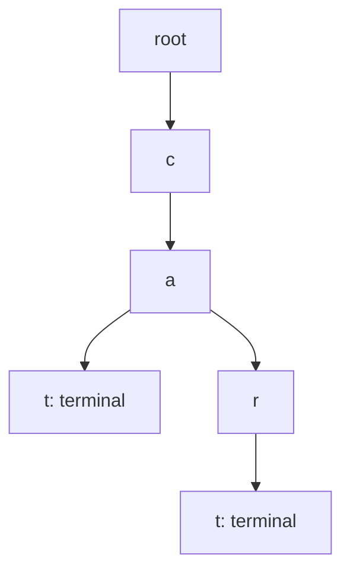
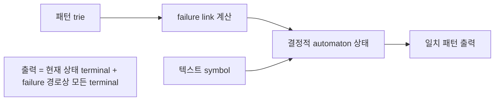

## 들어가며

사전(dictionary)은 키로 값을 찾는 추상 문제다. Hash table, 정렬 배열, 균형 트리, trie는 모두 같은 문제에 서로 다른 보장을 제공한다. “Hash table은 $O(1)$”이라는 문장은 hash 분포, load factor, 충돌 해결, 공격자가 키를 고를 수 있는지까지 명시하지 않으면 설계 근거가 되지 못한다.

문자열은 단순한 키보다 복잡하다. 비교 비용이 공통 접두 길이에 비례하고, 텍스트 안에서 패턴이 시작될 모든 위치를 검사하면 같은 문자를 반복해 읽는다. KMP는 실패 뒤에도 보존되는 접두 정보를 사용하고, Aho-Corasick은 여러 패턴의 접두 상태를 하나의 automaton으로 결합한다. Unicode에서는 바이트 일치와 사용자가 보는 문자 일치가 다른 문제다.

이 글은 사전 연산의 계약에서 시작해 해싱의 기대 비용과 충돌 불변식을 분석한다. 이어서 trie, KMP, Z, Boyer-Moore 계열, Aho-Corasick, suffix 구조가 어떤 반복 작업을 제거하는지 설명하고, 리소스 ID·명령 검색·로그 필터·비신뢰 입력에 맞는 선택 기준을 세운다.

---

## 목차
1. [사전 문제와 연산 계약](#1-사전-문제와-연산-계약)
2. [Hash 함수와 확률 모델](#2-hash-함수와-확률-모델)
3. [Chaining과 Open Addressing](#3-chaining과-open-addressing)
4. [삭제·재해시·참조 안정성](#4-삭제재해시참조-안정성)
5. [확률적 사전과 Bloom Filter](#5-확률적-사전과-bloom-filter)
6. [Trie와 접두 질의](#6-trie와-접두-질의)
7. [단일 패턴 문자열 탐색](#7-단일-패턴-문자열-탐색)
8. [다중 패턴과 Aho-Corasick](#8-다중-패턴과-aho-corasick)
9. [Suffix 구조와 반복 질의](#9-suffix-구조와-반복-질의)
10. [Interning·Unicode·보안 경계](#10-interningunicode보안-경계)
11. [검증과 선택 기준](#11-검증과-선택-기준)

---

## 1. 사전 문제와 연산 계약

사전은 키 집합 $K$와 값 집합 $V$ 사이의 부분 함수 $D:K\rightharpoonup V$를 유지한다. 기본 연산은 다음과 같다.

```text
Find(key) -> value 또는 없음
Insert(key, value)
Erase(key)
```

중복 키를 허용하는 multimap인지, 삽입이 기존 값을 덮는지 실패하는지, 반환한 참조가 어느 연산까지 유효한지가 공개 계약이다.

### 사전 구현의 설계 축

| 구조 | 조회 | 순서 질의 | 대표 비용 |
|---|---|---|---|
| 선형 배열 | $O(n)$ | 없음 | 작고 순회가 빠름 |
| 정렬 배열 | $O(\log n)$ | 범위·순서 가능 | 삽입 $O(n)$ |
| 균형 탐색 트리 | $O(\log n)$ | 범위·순서 가능 | 노드·포인터 비용 |
| Hash table | 기대 $O(1)$ | 없음 | bucket 여유와 충돌 |
| Trie | 키 길이 $O(m)$ | 접두 질의 | alphabet·노드 비용 |

Big-O만 보면 작은 사전에서 선형 배열을 선택할 이유가 보이지 않는다. 실제로는 연속 순회와 낮은 고정 비용 때문에 원소 수가 작을 때 선형·정렬 배열이 hash table보다 빠를 수 있다. 교차점은 키 크기, 비교 비용, 할당 정책에 따라 달라진다.

### Binary Search Tree

Binary search tree(BST)는 각 노드 `x`에 대해 왼쪽 subtree의 모든 키가 `x`보다 작고 오른쪽 subtree의 모든 키가 `x`보다 크다는 순서 불변식을 유지한다. 중복 키를 허용하면 count를 노드에 저장하거나 어느 방향에 둘지 일관된 정책이 필요하다.

조회·삽입·삭제 비용은 tree 높이 $h$에 비례한다. 균형이 잡히면 $h=O(\log n)$이지만 정렬 순서로 삽입한 단순 BST는 chain이 되어 $h=n$이다. “Tree 조회는 $O(\log n)$”이라는 주장은 balance invariant가 있을 때만 맞다.

삭제는 세 경우를 구분한다.

```text
자식 0개: 노드를 제거한다.
자식 1개: 자식으로 대체한다.
자식 2개: successor 또는 predecessor와 구조를 교환한다.
```

두 자식 삭제에서 key-value 일부만 잘못 복사하면 ID·부가 데이터의 논리적 정체성이 분리될 수 있다. 노드 전체 의미와 iterator 안정성 계약을 함께 정의한다.

### 균형 탐색 트리

Red-black tree는 root-to-leaf 경로의 black height와 연속 red 금지 규칙으로 가장 긴 경로를 가장 짧은 경로의 두 배 이내로 제한한다. 높이가 $O(\log n)$이므로 조회·삽입·삭제가 최악 $O(\log n)$이다. Rotation은 in-order 키 순서를 보존하면서 local parent-child 구조를 바꾼다.

AVL tree는 subtree 높이 차이를 더 엄격히 제한해 조회 깊이가 작을 수 있지만 갱신 중 rotation이 더 자주 필요할 수 있다. 어떤 균형 방식이 빠른지는 조회·갱신 비율과 node layout에 달려 있다.

정렬 배열과 균형 트리는 둘 다 $O(\log n)$ 조회를 제공하지만 다음 비용이 다르다.

| 조건 | 정렬 배열 | 균형 트리 |
|---|---|---|
| 조회 locality | 연속적 | pointer 추적 가능 |
| 중간 삽입·삭제 | $O(n)$ 이동 | $O(\log n)$ 구조 갱신 |
| 범위 순회 | 연속 구간 | successor 순회 |
| 참조 안정성 | 재배치 시 무효화 | 구현 정책에 따라 node 주소 유지 |

### Augmentation과 순위 질의

각 노드에 subtree 크기를 저장하면 `k`번째 키와 특정 키의 rank를 $O(\log n)$에 구할 수 있다. Rotation과 삽입·삭제마다 크기 요약을 정확히 갱신해야 한다.

일반적으로 subtree에 결합 가능한 요약을 저장하면 interval overlap, 합, 최댓값 같은 질의를 지원할 수 있다. 자료구조를 augment할 때는 다음을 확인한다.

```text
요약이 자식 정보와 현재 노드에서 계산 가능한가?
회전 뒤 local O(1) 갱신으로 복구 가능한가?
모든 mutation 경로가 요약을 갱신하는가?
```

복잡도는 유지돼도 node 크기와 cache density가 달라진다. 추가 정보의 이득을 실제 질의 빈도와 비교한다.

### 키 동등성과 hash 동등성

Hash 값이 같다는 사실은 키가 같다는 뜻이 아니다. 올바른 조회는 먼저 hash로 후보를 좁히고 실제 키 동등성을 검사한다.

```cpp
if (entry.hash == h && equal(entry.key, key)) {
    return &entry.value;
}
```

필요한 계약은 한 방향이다.

$$
equal(a,b)\Rightarrow hash(a)=hash(b)
$$

역은 요구하지 않는다. 대소문자 무시 동등성을 사용하면서 hash는 원문 바이트에 적용하면 같은 키가 다른 bucket에 들어가 조회가 실패한다.

## 2. Hash 함수와 확률 모델

Hash 함수는 큰 키 공간을 고정 폭 정수로 압축한다. pigeonhole principle 때문에 키 공간이 hash 공간보다 크면 충돌은 반드시 존재한다. 목표는 충돌 제거가 아니라 작업 부하에서 충돌을 균등하고 예측하기 어렵게 분산하는 것이다.

### 단순 균등 해싱 가정

테이블 bucket 수를 $m$, 항목 수를 $n$, load factor를

$$
\alpha=\frac{n}{m}
$$

라 하자. 각 키가 bucket에 독립·균등하게 들어간다고 가정하면 chaining의 bucket 기대 길이는 $\alpha$이고 조회 기대 비용은 $O(1+\alpha)$다.

이 가정은 데이터가 자동으로 제공하는 성질이 아니다. 낮은 비트에 규칙이 있는 ID를 power-of-two bucket에 그대로 mask하면 특정 bucket에 몰릴 수 있다. hash의 avalanche 특성과 bucket reduction 방법이 함께 작동해야 한다.

### Birthday bound

$b$비트 hash에서 임의 충돌이 나타날 확률은 항목 수 $n$이 대략 $2^{b/2}$에 가까워질 때 유의미해진다. 근사적으로 충돌이 하나 이상일 확률은

$$
p\approx 1-\exp\left(-\frac{n(n-1)}{2\cdot 2^b}\right)
$$

이다. 64비트 hash를 영구 식별자로 간주하면 대규모 콘텐츠에서 충돌 가능성을 0으로 만들 수 없다. hash는 후보 색인이나 무결성 보조값으로 쓰고, 충돌 시 원본 키를 확인해야 한다.

### 일반 hash와 공격 방어 hash

빠른 비암호학적 hash는 성능과 분포를 목표로 한다. 공격자가 요청 키를 선택할 수 있는 서버에서는 미리 계산한 충돌 집합으로 $O(n)$ chain이나 긴 probe를 만들 수 있다.

방어 방법은 다음과 같다.

- 프로세스마다 비밀 seed를 가진 keyed hash를 사용한다.
- 요청별 항목 수와 문자열 길이를 제한한다.
- probe·chain 길이가 임계값을 넘으면 요청을 거부하거나 구조를 전환한다.
- 최악 지연을 계측한다.

암호학적 hash가 항상 필요한 것은 아니다. 신뢰 경계와 공격 비용을 먼저 정의해야 한다.

### Universal hashing

함수 family $H$에서 실행마다 hash 함수를 무작위 선택하고, 서로 다른 두 키 $x,y$에 대해

$$
\Pr_{h\in H}[h(x)=h(y)]\le\frac{1}{m}
$$

을 보장하면 함수를 선택하기 전에 정해진 고정·독립 키 집합에 대한 기대 충돌이 제한된다. 이는 적응적 공격 내성이 아니다. 함수 선택을 관측하고 후속 키를 고르는 공격자에 대한 보장은 keyed PRF 수준의 별도 모델이며, 해시플러딩 방어는 앞의 일반 hash와 공격 방어 hash처럼 비밀 seed를 가진 keyed hash와 작업량 한도로 다룬다.

## 3. Chaining과 Open Addressing

### Chaining

Chaining은 각 bucket에 같은 index의 항목 집합을 둔다. 단순 linked list는 구현하기 쉽지만 노드 할당과 포인터 추적이 크다. 작은 연속 bucket이나 flat node pool로 locality를 개선할 수 있다.

성공 조회는 bucket 안에서 찾은 위치까지, 실패 조회는 bucket 전체를 검사한다. 평균만 보지 않고 chain 길이 분포를 기록해야 한다.

### Open addressing

Open addressing은 모든 항목을 하나의 slot 배열에 두고 충돌하면 probe sequence를 따라 다음 slot을 찾는다.

```text
h_i(key) = (h(key) + probe(i)) mod m
```

선형 probing은 연속 메모리 접근이 빠르지만 primary clustering이 생긴다. Quadratic probing과 double hashing은 cluster 패턴을 줄이지만 probe가 더 복잡하고 모든 slot을 방문하는 조건을 맞춰야 한다.

균등 해싱에 가까운 이상화 아래 open addressing의 기대 probe는 load factor가 1에 가까워질수록 급격히 증가한다. 실패 조회는 대략 $1/(1-\alpha)$ 형태로 발산한다. 정확한 식은 probe 모델에 따라 다르지만, 핵심은 빈 slot 비율이 작아지면 종료 지점을 찾기 어려워진다는 점이다.

### 탐색 불변식

Open addressing 조회의 핵심 불변식은 다음과 같다.

```text
키가 존재한다면,
그 키의 홈 위치에서 실제 위치까지 probe하는 동안
한 번도 사용된 적 없는 slot이 나타나지 않는다.
```

조회는 실제 키를 찾거나 never-used slot을 만날 때 종료한다. 다만 occupied와 deleted가 테이블을 모두 채우면 never-used slot이 없을 수 있으므로 probe에는 최대 $m$회(또는 전체 순환 1회)의 유한 상한을 두거나 항상 EMPTY slot 하나를 남기는 불변식을 둔다. 이 불변식 때문에 삭제를 단순 empty로 바꾸면 안 된다.

### Robin Hood hashing

Robin Hood hashing은 현재 probe 거리가 더 긴 항목이 짧은 항목의 slot을 차지하도록 교환한다. 평균 probe보다 분산과 최악에 가까운 probe를 줄이는 것이 목표다.

조회 중 현재 slot 항목의 probe 거리가 찾는 키의 현재 거리보다 작아지면 키가 더 뒤에 있을 수 없다는 조기 종료가 가능하다. 이 결론은 삽입이 probe 거리 순서를 유지했다는 불변식에 의존한다.

## 4. 삭제·재해시·참조 안정성

### Tombstone 삭제

삭제 slot을 `EMPTY`로 바꾸면 뒤에 밀린 키를 찾지 못할 수 있다. `DELETED` tombstone은 조회가 통과하되 삽입은 재사용할 수 있는 상태다.

```text
EMPTY: 한 번도 사용되지 않음, 실패 조회 종료
OCCUPIED: 키가 있음
DELETED: 과거 사용됨, 조회 계속
```

삽입은 처음 만난 DELETED slot을 곧바로 재사용하지 않는다. 그 위치를 기억하되 같은 키를 찾거나 EMPTY에 도달하거나 probe를 한 바퀴 마칠 때까지 계속 탐색해, 뒤쪽에 이미 존재하는 동등 키와 중복되지 않을 때만 재사용한다.

Tombstone이 쌓이면 논리 load factor는 낮아도 probe가 길어진다. 항목 수뿐 아니라 `occupied + deleted` 비율을 재해시 조건에 포함해야 한다.

### Backward-shift 삭제

선형 probing cluster에서 삭제 뒤의 항목을 홈 위치를 넘지 않는 범위까지 앞으로 당기면 tombstone 없이 탐색 불변식을 복구할 수 있다. 삭제는 여러 이동을 만들지만 이후 조회 비용을 안정시킨다.

어느 정책이 좋은지는 조회·삭제 비율과 참조 안정성 계약에 달려 있다. 원소 이동이 허용되지 않으면 backward shift를 사용할 수 없다.

### Rehash와 상각 비용

용량을 기하급수적으로 늘리면 여러 삽입에 걸친 총 이동 원소 수는 $O(n)$이다. 해시 분포와 적재율이 재배치 위치를 찾는 기대 비용을 상수로 유지한다는 조건까지 있어야 삽입당 *기대 상각* $O(1)$을 얻는다. 충돌이 몰리면 크기 확장의 상각 분석만으로 긴 chain·probe 비용이 사라지지는 않는다. 이 조건 아래에서도 한 번의 rehash는 $O(n)$ 기대 지연과 임시 peak 메모리를 만든다.

실시간 경로에서는 다음 전략을 검토한다.

- 예상 최대 크기로 reserve한다.
- rehash를 안전한 loading 구간에 수행한다.
- 두 테이블을 유지하며 항목을 조금씩 옮기는 incremental rehash를 사용한다.
- 최대 항목 수를 고정한다.

Incremental rehash 중 조회는 새·옛 테이블을 모두 검사할 수 있다. 이동 cursor와 중복 삽입 정책이 정확성 상태의 일부가 된다.

### 참조 안정성

Open addressing rehash와 삭제 이동은 원소 주소를 바꾼다. 외부에서 장기 포인터를 보관하면 구조 최적화가 use-after-move 버그로 이어진다. 안정 handle, generation ID, 별도 node storage 중 하나를 계약해야 한다.

## 5. 확률적 사전과 Bloom Filter

Bloom filter는 집합에 **확실히 없음** 또는 **있을 가능성 있음**을 답하는 확률적 자료구조다. $m$비트 배열과 $k$개 hash 위치를 사용한다.

항목 $n$개를 넣었을 때 특정 bit가 0일 근사 확률은

$$
\left(1-\frac1m\right)^{kn}\approx e^{-kn/m}
$$

이다. 집합에 없는 키의 $k$개 위치가 모두 1일 false positive 확률은

$$
p\approx\left(1-e^{-kn/m}\right)^k
$$

이다. 주어진 $m,n$에서 이를 최소화하는 hash 수는 근사적으로

$$
k\approx\frac{m}{n}\ln 2
$$

다.

기본 Bloom filter는 false negative를 만들지 않지만 삭제를 지원하지 않는다. bit 하나를 끄면 다른 키가 공유하던 증거까지 지워진다. Counting Bloom filter는 counter를 사용해 삭제하지만 메모리와 overflow 정책이 필요하다. 삭제는 실제로 삽입된 원본 집합에서 존재와 삽입 횟수를 확인한 multiplicity에만 허용한다. 양성 응답만 보고 임의 키를 지우면 false positive 키의 counter를 내려 다른 키에 false negative를 만들 수 있다. saturation으로 counter가 포화된 뒤의 삭제는 원래 multiplicity를 복구할 수 없으므로 별도 정책으로 명시한다.

Bloom filter는 느린 저장소 조회를 피하는 앞단 필터로 유용하다. filter가 “있을 수 있음”이라고 해도 실제 사전 조회를 생략할 수는 없다. false positive가 정확성을 바꾸지 않고 추가 비용만 만드는 위치에 둬야 한다.

## 6. Trie와 접두 질의

Trie는 문자열의 각 symbol을 간선으로 갖고 접두를 공유한다. 키 길이를 $m$이라 하면 조회 시간은 저장 키 수가 아니라 $O(m)$이다.



`cat`과 `cart`는 `ca` 접두 노드를 공유한다. prefix 아래 subtree를 순회하면 자동완성과 명령 검색을 구현할 수 있다.

### 자식 표현

alphabet가 작고 dense하면 노드마다 고정 배열을 둘 수 있다. UTF-8 byte나 큰 symbol 공간에서는 고정 배열이 낭비되므로 작은 vector, 정렬 edge 배열, hash map 등을 선택한다.

| 자식 구조 | 조회 | 메모리 특성 |
|---|---|---|
| 고정 배열 | $O(1)$ | sparse alphabet에서 큼 |
| 정렬 작은 배열 | $O(\log d)$ | locality 양호 |
| Hash map | 기대 $O(1)$ | 노드별 overhead 큼 |

압축 trie(radix tree)는 자식이 하나뿐인 경로를 문자열 조각 하나의 간선으로 합쳐 노드 수를 줄인다. 조회 중 간선 label 비교가 필요하지만 pointer depth가 감소한다.

### Trie의 불변식

노드에 도달한 경로 label의 연결이 정확히 그 노드의 prefix여야 한다. terminal flag는 “이 prefix로 끝나는 키가 존재함”을 나타내며 자식 존재와 별개다. `car`와 `cart`를 함께 저장할 때 `car` 노드는 terminal이면서 자식을 가진다.

## 7. 단일 패턴 문자열 탐색

텍스트 길이를 $n$, 패턴 길이를 $m$이라 하자. Naive 탐색은 각 시작 위치에서 패턴을 비교해 최악 $O(nm)$이다. 반복 접두가 많은 입력에서 같은 텍스트 문자를 여러 번 읽는다.

### KMP의 prefix function

KMP는 패턴 prefix 중 현재까지 일치한 suffix이기도 한 가장 긴 길이를 저장한다. Prefix function $\pi[i]$는 `pattern[0..i]`의 proper prefix이면서 suffix인 최대 길이다.

패턴 `ababaca`의 접두 구조처럼 실패 뒤에도 이미 확인된 접두 일부를 재사용할 수 있다. 불일치 시 텍스트 위치를 되돌리지 않고 `j=pi[j-1]`로 패턴 상태만 줄인다.

```cpp
std::vector<std::size_t> PrefixFunction(std::string_view p) {
    std::vector<std::size_t> pi(p.size(), 0);
    for (std::size_t i = 1; i < p.size(); ++i) {
        std::size_t j = pi[i - 1];
        while (j > 0 && p[i] != p[j]) j = pi[j - 1];
        if (p[i] == p[j]) ++j;
        pi[i] = j;
    }
    return pi;
}
```

`j`는 증가하거나 prefix chain을 따라 감소한다. 전체 감소 횟수는 증가 횟수에 의해 제한되어 전처리와 탐색이 각각 선형이다.

실제 탐색에서는 `j==m`일 때 일치를 출력한 뒤 `j=pi[m-1]`로 복귀해 겹치는 일치를 계속 찾는다. 빈 패턴 `m=0`은 `pi`가 비어 `p[j]` 접근이 성립하지 않으므로 탐색 전에 별도 정책(보통 입력 오류 또는 모든 위치 일치)으로 고정한다.

### Z algorithm

Z 배열 `Z[i]`는 문자열 전체 prefix와 `i`에서 시작하는 suffix가 일치하는 최대 길이다. 패턴과 구분자, 텍스트를 연결하면 `Z[i]>=m`인 위치가 일치다.

이미 계산된 `[L,R)` 일치 구간 안에서는 구간 시작 `L`만큼 앞으로 옮긴 대응 위치 `i-L`의 Z 값을 재사용하고 필요한 부분만 오른쪽으로 확장한다. KMP와 같은 선형 상한을 다른 상태 표현으로 얻는다.

### Boyer-Moore 계열

Boyer-Moore는 패턴을 오른쪽에서 비교하고 bad-character, good-suffix 정보를 이용해 여러 위치를 건너뛴다. 긴 패턴과 큰 alphabet에서 실제 비교를 크게 줄일 수 있다.

작은 패턴에서는 전처리와 복잡한 분기 비용이 더 클 수 있다. 표준 라이브러리의 검색 구현이 SIMD나 특수화된 memchr를 사용할 수 있으므로 직접 구현과 실제 workload를 비교해야 한다.

### Rolling hash

길이 $m$ substring hash를 $O(1)$에 갱신하면 후보 위치를 빠르게 찾을 수 있다. 그러나 hash 일치는 문자열 일치가 아니므로 최종 바이트 비교가 필요하다. 두 hash를 써도 충돌 확률을 줄일 뿐 정확한 동등성의 대체가 아니다.

## 8. 다중 패턴과 Aho-Corasick

패턴이 $p$개일 때 각각 KMP를 실행하면 텍스트를 $p$번 읽는다. Aho-Corasick은 모든 패턴의 trie에 failure link를 추가해 텍스트를 한 번 훑는다.

현재 trie 상태에서 symbol 간선이 없으면 failure link를 따라 “현재 문자열의 suffix이면서 trie prefix인 가장 긴 상태”로 이동한다. 이 상태는 KMP의 prefix fallback을 여러 패턴으로 일반화한 것이다. Failure link는 root에서 proper suffix만 대상으로 하고 root에서는 자기 자신으로 돌아오도록 규약한다. 각 상태의 출력은 그 상태에서 끝나는 패턴뿐 아니라 failure link를 따라 올라가며 만나는 모든 terminal 상태의 패턴을 포함하며, terminal 상태만 잇는 output link를 정의해 suffix로 끝나는 패턴을 빠뜨리지 않는다. 출력 목록을 모든 노드에 복사하지 않아도 되어 전처리·공간이 선형으로 유지된다.



전처리 후 시간은 alphabet 전이 구현에 따라 대략

$$
O(\text{패턴 총 길이}+\text{텍스트 길이}+\text{출력 수})
$$

이다. 이 출력 수에 비례하는 경계는 terminal 상태만 따라가는 output link 같은 구현을 전제로 한다. 매 문자마다 failure chain 전체를 다시 훑어 출력을 확인하면, 패턴이 `aaa...ab`이고 텍스트가 `aaa...a`인 경우 일치가 없어도 긴 chain을 반복 방문한다. 일치가 매우 많으면 출력 수 자체가 하한이다. 모든 위치에서 수천 패턴이 끝난다면 결과를 기록하는 비용을 없앨 수 없다.

채팅 필터, 로그 규칙, 명령 token 탐지에 사용할 수 있지만 Unicode 정규화와 단어 경계 정책을 automaton 입력 전에 고정해야 한다. 패턴 변경이 잦으면 전체 automaton 재구축 비용도 고려한다.

## 9. Suffix 구조와 반복 질의

하나의 긴 텍스트에 substring 질의가 반복되면 suffix를 색인할 수 있다.

### Suffix array

Suffix array는 모든 suffix 시작 인덱스를 사전순으로 정렬한 배열이다. 패턴을 suffix들과 이진 탐색하면 $O(m\log n)$의 단순 비교 비용으로 일치 범위를 찾을 수 있다. LCP(longest common prefix) 정보를 사용하면 반복 비교를 줄일 수 있다.

저장 공간은 suffix 문자열 복사가 아니라 인덱스 배열 $O(n)$이다. 구축 알고리즘은 단순 비교 정렬 $O(n^2\log n)$부터 prefix doubling $O(n\log^2 n)$, 선형 알고리즘까지 설계 공간이 넓다. 실제로는 구축 시간, 메모리, 구현 복잡도의 균형을 택한다.

### Suffix tree와 suffix automaton

Suffix tree는 모든 suffix를 압축 trie로 표현해 선형 공간에서 substring 질의를 패턴 길이에 비례해 처리할 수 있다. 이론적 보장은 강하지만 노드와 구현 상수가 크다.

Suffix automaton은 한 문자열의 suffix 언어에 대한 표준 최소 부분 DFA이고, 모든 substring은 시작 상태에서의 경로로 인식된다. 이는 substring 언어 자체의 최소 DFA와 같지 않다. 예를 들어 `abb`에서 dead state를 양쪽 모두 생략하면 suffix를 인식하는 DFA는 5개 상태이고 substring(factor) 언어의 최소 DFA는 4개 상태다. 서로 다른 substring 수, 반복 구조 질의에 유용하지만 일반 게임 런타임의 기본 사전으로 쓸 이유는 적다.

Suffix 구조는 정적 대형 텍스트에 반복 질의가 있을 때 가치가 있다. 짧은 설정 문자열 몇 개에는 정렬 배열이나 hash table이 더 단순하다.

## 10. Interning·Unicode·보안 경계

### String interning

Interning은 동일 문자열을 한 번만 저장하고 작은 ID나 안정 handle로 참조한다. 이후 비교는 ID 비교로 줄어든다.

```text
입력 문자열 -> 정규화 정책 -> intern table 조회
                               -> 기존 ID 반환
                               -> 새 저장 + ID 생성
```

장점은 중복 저장과 반복 hash·비교를 줄이는 것이다. 비용은 table 수명, 동시성, 무제한 신규 문자열 공격이다. 외부 사용자가 임의 문자열을 영구 intern하게 두면 해제되지 않는 메모리 공격이 된다.

ID가 실행마다 달라도 되는지, 저장 파일과 네트워크에서 안정해야 하는지 구분한다. 런타임 intern ID를 영구 serialization 값으로 사용하면 삽입 순서 변화가 호환성을 깨뜨린다.

### Unicode의 비교 단위

UTF-8 문자열에서 byte index, Unicode scalar value, grapheme cluster는 다른 단위다.

- 프로토콜 token과 파일 key: 정규화된 바이트 비교가 가능하다.
- 사용자 이름: 정규화, 대소문자 접기, locale 정책이 필요할 수 있다.
- UI cursor: grapheme cluster 경계가 필요하다.

육안으로 같은 문자열이 다른 code point 조합일 수 있다. 동등성 정책을 정한 뒤 hash와 trie 입력에도 같은 변환을 적용해야 한다.

### 자원 상한

비신뢰 문자열 처리에는 다음 상한이 필요하다.

```text
키 최대 바이트 길이
요청당 키 수
intern 가능한 신규 문자열 수
automaton 패턴 총 길이
검색 결과 최대 개수
hash probe 또는 chain 작업량
```

알고리즘 복잡도 공격은 메모리 안전 버그가 없어도 서버를 정지시킬 수 있다.

## 11. 검증과 선택 기준

### Hash table 속성

작은 기준 사전과 operation sequence를 비교한다.

```text
Insert 뒤 Find는 같은 값을 반환한다.
Erase 뒤 Find는 없음이다.
고유 키이거나 같은 키에 같은 값을 삽입한 경우, 서로 다른 삽입 순서에서도 논리 key-value 집합은 같다.
중복 키의 덮어쓰기 정책이 last-write-wins라면 삽입 순서가 최종 값을 바꾸므로, 중복 키는 그 정책에 맞는 순차 model로 검증한다.
rehash 전후 모든 key-value가 보존된다.
모든 키가 같은 hash여도 정확성은 유지된다.
```

적대 hash, 높은 load factor, tombstone 누적, 반복 rehash, 중복 삽입 정책을 생성한다. 성능은 평균 조회보다 성공·실패별 P99 probe와 최대 cluster를 본다.

### 문자열 알고리즘 속성

Naive search를 작은 입력 oracle로 사용한다.

- KMP·Z·Boyer-Moore 결과 위치가 naive 결과와 같다.
- 패턴이 빈 경우의 정책을 고정한다.
- 겹치는 일치를 포함할지 명시한다.
- Aho-Corasick 결과 multiset이 패턴별 naive 검색과 같다.
- UTF-8 invalid byte sequence 처리 정책을 검사한다.

반복 문자 `aaaa...`, 긴 공통 접두, 패턴이 텍스트보다 김, 모든 위치에서 일치, embedded NUL을 포함한 byte string이 경계 입력이다.

### 선택 기준

| 요구 | 우선 구조 |
|---|---|
| 작은 읽기 전용 사전 | 정렬 배열 또는 선형 배열 |
| 일반 exact key 조회 | Hash table |
| 순서·범위 질의 | 정렬 배열 또는 균형 트리 |
| 접두 자동완성 | Trie/radix tree |
| 한 패턴을 긴 텍스트에서 탐색 | KMP·Boyer-Moore 계열 또는 검증된 라이브러리 |
| 많은 패턴을 한 스트림에서 탐색 | Aho-Corasick |
| 한 정적 텍스트에 반복 substring 질의 | Suffix array 계열 |
| 느린 저장소의 부재 조회 차단 | Bloom filter + 정확한 사전 |

구조 선택은 키 수만으로 결정하지 않는다. 키 길이, 갱신 빈도, 순서 요구, 공격자 제어, 참조 안정성, 메모리 상한을 함께 기록한다.

---

## 결론

사전의 기대 $O(1)$ 조회는 균등 분포와 제한된 load factor라는 가정 위에 있다. Chaining과 open addressing은 충돌을 없애지 않고 관리하며, 삭제·재해시는 탐색 불변식과 참조 안정성을 바꾼다. 공격자가 키를 고를 수 있으면 평균 가정 대신 keyed hash와 작업량 상한이 필요하다.

문자열 탐색 알고리즘은 실패 뒤에도 남는 접두 정보를 재사용한다. KMP는 단일 패턴 상태를, Aho-Corasick은 여러 패턴의 trie와 failure link를 유지한다. Trie와 suffix 구조는 접두·substring 질의를 빠르게 하지만 입력 수명과 메모리 비용이 맞을 때만 가치가 있다. Unicode와 interning에서는 동등성·수명·보안 정책이 알고리즘 자체만큼 중요하다.

## 더 읽을거리

- Cormen, Leiserson, Rivest, Stein, *Introduction to Algorithms*, 4th ed. (MIT Press, 2022), Ch. 11, 32 — hash table과 문자열 일치의 분석·정확성.
- Steven S. Skiena, *The Algorithm Design Manual*, 3rd ed. (Springer, 2020), Ch. 3, 6 및 문자열 문제 catalog — 사전 구조와 문자열 문제를 식별하는 실무 관점.
- Donald E. Knuth, James H. Morris Jr., Vaughan R. Pratt, “Fast Pattern Matching in Strings”, *SIAM Journal on Computing* 6(2), 1977 — KMP의 원전.
- Alfred V. Aho, Margaret J. Corasick, “Efficient String Matching: An Aid to Bibliographic Search”, *CACM* 18(6), 1975 — 다중 패턴 automaton의 원전.
- Burton H. Bloom, “Space/Time Trade-offs in Hash Coding with Allowable Errors”, *CACM* 13(7), 1970 — Bloom filter의 원전.
- Udi Manber, Gene Myers, “Suffix Arrays: A New Method for On-Line String Searches”, *SIAM Journal on Computing* 22(5), 1993 — suffix array의 원전.
