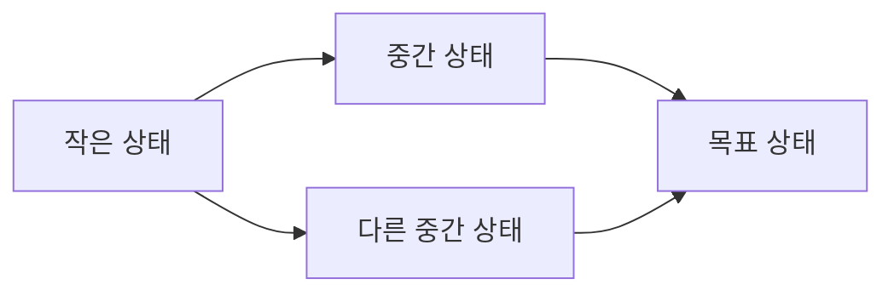

## 들어가며

동적 계획법(Dynamic Programming, DP)은 점화식을 코드로 옮기는 기법이 아니다. 미래 결정에 필요한 과거 정보만 상태로 압축하고, 상태 사이 의존을 비순환 그래프로 만드는 설계 방법이다. 상태가 부족하면 서로 다른 과거를 잘못 합치고, 상태가 과하면 정확하지만 계산할 수 없는 크기로 폭발한다.

코딩 문제에서 DP는 배열 채우기 패턴으로 보이기 쉽다. 실제 게임 시스템에서는 제한된 자원으로 upgrade 조합을 고르거나, animation sequence를 정렬하거나, 작은 전술 상태의 최적 정책을 계산할 때 같은 원리가 나타난다. 반면 실시간 월드 전체를 상태에 넣으면 지수 상태 공간 때문에 적용할 수 없다.

이 글은 최적 부분 구조와 중복 부분 문제를 구분하고, 상태의 충분성을 증명하는 방법을 다룬다. Memoization과 bottom-up 순서, sequence·interval·tree·bitmask DP, 메모리 압축과 해 복원, 상태 폭발과 최적화 경계를 분석한다.

---

## 목차
1. [DP가 해결하는 구조](#1-dp가-해결하는-구조)
2. [상태의 충분성](#2-상태의-충분성)
3. [Memoization과 Bottom-up](#3-memoization과-bottom-up)
4. [Knapsack과 순회 방향](#4-knapsack과-순회-방향)
5. [Sequence DP](#5-sequence-dp)
6. [Interval DP](#6-interval-dp)
7. [DAG와 Tree DP](#7-dag와-tree-dp)
8. [Bitmask DP와 작은 집합](#8-bitmask-dp와-작은-집합)
9. [메모리 압축과 해 복원](#9-메모리-압축과-해-복원)
10. [상태 폭발과 최적화](#10-상태-폭발과-최적화)
11. [게임 적용과 검증](#11-게임-적용과-검증)

---

## 1. DP가 해결하는 구조

DP는 큰 문제의 답을 작은 부분 문제의 답으로 표현하고 같은 부분 문제를 한 번만 계산한다. 두 성질을 구분해야 한다.

### 최적 부분 구조

최적해가 부분 문제의 최적해로 구성될 수 있다. 최단 경로의 subpath가 최단 경로가 아니라면 더 짧은 subpath로 교체해 전체를 개선할 수 있다.

### 중복 부분 문제

재귀 분해 과정에서 같은 상태가 여러 경로로 반복 호출된다. Fibonacci의 순진한 재귀는 `F(n-2)`를 여러 번 계산한다.

Divide-and-conquer도 부분 문제로 나누지만 보통 부분 문제가 겹치지 않는다. Merge sort의 왼쪽·오른쪽 절반은 독립이므로 결과 table을 장기 저장할 필요가 없다.

### DP는 상태 DAG다

상태를 정점, recurrence 의존을 간선으로 보면 DP는 DAG 위 계산이다.



Memoization은 목표에서 필요한 상태만 DFS하고, bottom-up은 위상 순서로 상태를 채운다. 계산 순서가 의존 edge를 거슬러 읽으면 아직 정의되지 않은 값을 사용한다.

## 2. 상태의 충분성

상태는 미래의 가능한 전이와 비용을 결정하는 데 필요한 과거 정보의 요약이다.

두 history $h_1,h_2$를 같은 상태로 합치려면, 이후 어떤 선택 sequence를 붙여도 가능성과 추가 비용이 같아야 한다. 그렇지 않으면 상태가 정보를 잃었다.

### 열쇠가 있는 경로

위치만 상태로 두면 같은 칸에 도착한 두 경로를 합친다. 그러나 한 경로는 열쇠를 얻었고 다른 경로는 얻지 못했다면 이후 문 통과 가능성이 다르다.

```text
잘못된 상태: position
충분한 상태: (position, key_mask)
```

상태를 늘리면 정확성은 회복되지만 칸 수 $N$, 열쇠 수 $k$일 때 최대 상태가 $N2^k$로 증가한다.

### Markov 성질

DP 상태가 충분하다는 것은 미래가 과거 전체가 아니라 현재 상태만으로 결정된다는 Markov 성질과 연결된다. 이 성질이 없다면 누락된 이력을 상태에 추가하거나 문제를 근사해야 한다.

### 상태 설계 절차

1. 한 결정을 내리는 시점을 정한다.
2. 가능한 선택을 나열한다.
3. 선택의 feasibility와 미래 비용에 영향을 주는 정보만 상태에 둔다.
4. 서로 다른 history를 합쳐도 되는지 반례를 찾는다.
5. 상태 수와 전이 수의 상한을 계산한다.

### 상태 값의 의미

`dp[state]`가 최소 비용인지, 최대 가치인지, 가능한 방법 수인지, 도달 가능 여부인지 명시한다. 값의 의미가 바뀌면 초기값과 결합 연산도 바뀐다.

```text
최소화: 도달 불가 = +INF, combine = min
최대화: 도달 불가 = -INF, combine = max
경우의 수: 도달 불가 = 0, combine = sum
가능성: 도달 불가 = false, combine = OR
```

## 3. Memoization과 Bottom-up

### Top-down memoization

재귀 함수가 상태의 답을 계산하고 cache에 저장한다.

```cpp
std::int64_t Solve(State s) {
    if (IsBase(s)) return BaseValue(s);
    if (memo.contains(s)) return memo[s];

    std::int64_t best = INF;
    for (Action a : Actions(s)) {
        if (!Feasible(s, a)) continue;
        best = std::min(best, Cost(s, a) + Solve(Next(s, a)));
    }
    return memo[s] = best;
}
```

목표에서 도달 가능한 sparse 상태만 계산하는 장점이 있다. 재귀 stack, hash lookup, cycle 처리 비용이 생긴다. 상태 graph가 실제로 cyclic이면 “계산 중” 상태를 따로 표시하거나 DP 모델 자체를 다시 점검해야 한다.

### Bottom-up tabulation

모든 상태를 의존 순서로 채운다. Dense table에서는 연속 메모리와 낮은 호출 overhead가 유리하다.

```text
base state를 초기화한다.
의존을 만족하는 순서로 state를 순회한다.
각 transition으로 target state를 갱신한다.
```

아직 계산하지 않은 상태를 읽는 버그는 loop 순서에서 발생한다. 차원마다 증가·감소 방향이 recurrence와 맞아야 한다.

### Push와 pull

- Pull DP: 현재 상태가 필요한 predecessor 값을 읽어 계산한다.
- Push DP: 현재 도달 상태에서 successor를 갱신한다.

Push는 도달 상태만 전파하기 쉽지만 동일 target에 여러 source가 쓰면 병렬화 충돌이 생긴다. Pull은 target별 독립 계산이 가능하지만 모든 predecessor를 검사할 수 있다.

### 어떤 방식을 선택하는가

| 조건 | 유리한 방식 |
|---|---|
| 도달 상태가 전체보다 희소 | Memoization |
| 모든 상태가 촘촘히 필요 | Bottom-up |
| 재귀 깊이가 큼 | Bottom-up |
| 상태 순서를 찾기 어려움 | Memoization으로 시작 |
| SIMD·병렬 순회가 중요 | 규칙적인 Bottom-up |

두 구현은 같은 recurrence를 가져야 한다. Differential test로 서로 비교할 수 있다.

## 4. Knapsack과 순회 방향

항목 $i$의 무게 $w_i$, 가치 $v_i$, 용량 $W$가 있다. 0/1 knapsack은 각 항목을 최대 한 번 선택한다.

### 2차원 상태

$$
dp[i][c]=\text{앞 }i\text{개 항목으로 용량 }c\text{에서 얻는 최대 가치}
$$

전이는

$$
dp[i][c]=\max\left(dp[i-1][c],\;dp[i-1][c-w_i]+v_i\right)
$$

이다. 두 번째 항은 $c\ge w_i$일 때만 유효하다.

### 1차원 압축

현재 행이 이전 행만 읽으므로 배열 하나로 줄일 수 있다. 그러나 용량을 큰 값부터 순회해야 한다.

```cpp
std::vector<std::int64_t> dp(capacity + 1, 0);
for (const Item item : items) {
    for (int c = capacity; c >= item.weight; --c) {
        dp[c] = std::max(dp[c], dp[c - item.weight] + item.value);
    }
}
```

작은 값부터 순회하면 이번 항목으로 갱신된 `dp[c-w]`를 같은 항목에서 다시 읽어 항목을 여러 번 사용한다. 이는 unbounded knapsack recurrence가 된다. Loop 방향은 단순 최적화가 아니라 문제 의미다.

### Pseudo-polynomial complexity

시간 $O(nW)$는 입력 숫자 값 $W$에 비례한다. $W$를 binary로 표현하는 입력 길이는 $\log W$이므로 엄밀히 input length에 대한 polynomial이 아니라 pseudo-polynomial이다. 용량이 10억이면 항목 수가 작아도 table을 만들 수 없다.

가치 합을 축으로 바꾸거나, sparse reachable capacity만 저장하거나, 근사 scaling을 사용할 수 있다. 어느 차원이 작은지 workload가 결정한다.

## 5. Sequence DP

### Longest Common Subsequence

두 sequence $A[0..n)$, $B[0..m)$의 최장 공통 부분수열(LCS) 길이를 구한다.

$$
dp[i][j]=LCS(A[0..i),B[0..j))
$$

마지막 symbol이 같으면 둘 다 사용한 이전 상태에서 1을 더한다.

$$
dp[i][j]=
\begin{cases}
dp[i-1][j-1]+1 & A[i-1]=B[j-1]\\
\max(dp[i-1][j],dp[i][j-1]) & \text{otherwise}
\end{cases}
$$

시간은 $O(nm)$, 전체 table 공간은 $O(nm)$다. 길이만 필요하면 두 행으로 줄일 수 있다.

### Edit distance

삽입·삭제·대체 비용으로 한 문자열을 다른 문자열로 바꾸는 최소 비용도 prefix 상태를 사용한다.

```text
삭제: dp[i-1][j] + delete_cost
삽입: dp[i][j-1] + insert_cost
대체/일치: dp[i-1][j-1] + (A[i-1]=B[j-1] ? 0 : replace_cost)
```

비용이 음수이거나 작업 sequence에 상호작용이 있으면 단순 recurrence 전제가 달라진다.

### Longest Increasing Subsequence

단순 상태 `dp[i]=i에서 끝나는 LIS 길이`는 모든 이전 `j<i`를 검사해 $O(n^2)$이다. 각 길이별 가능한 최소 tail 값을 유지하면 binary search로 $O(n\log n)$에 길이를 구할 수 있다.

이 최적화는 DP table 전체가 아니라 미래 확장에 필요한 지배되지 않은 요약만 남기는 관점이다. 실제 subsequence 복원에는 predecessor와 tail index가 추가로 필요하다.

### 게임 적용

Animation event sequence 정렬, replay diff, command history 유사도는 sequence DP로 모델링할 수 있다. 그러나 프레임마다 긴 sequence 두 개를 $O(nm)$에 비교하는 것은 부적합할 수 있다. 입력 길이 상한과 banded approximation을 검토한다.

## 6. Interval DP

Interval DP는 연속 구간 `[l,r)`의 답을 작은 구간으로 분할한다. 계산 순서는 구간 길이가 짧은 것부터 길게다.

### Matrix-chain multiplication

행렬 $A_i$의 크기가 $p_{i-1}\times p_i$일 때 곱셈 순서에 따라 scalar multiplication 수가 달라진다. 이 점화식은 관례대로 닫힌 구간 $[i..j]$, 즉 $A_i\cdots A_j$의 최소 비용을 $dp[i][j]$로 둔다.

$$
dp[i][j]=\min_{i\le k<j}
\left(dp[i][k]+dp[k+1][j]+p_{i-1}p_kp_j\right)
$$

상태는 행렬 구간, 선택은 마지막으로 두 부분을 결합하는 split $k$다. 모든 구간 길이와 split을 검사하면 $O(n^3)$ 시간, $O(n^2)$ 공간이다.

### 구간 분할의 불변식

최적 괄호화의 마지막 곱셈은 어떤 `k`에서 왼쪽·오른쪽 결과를 결합한다. 각 부분이 최적이 아니라면 더 싼 부분 괄호화로 교체해 전체를 줄일 수 있다. 이것이 recurrence의 최적 부분 구조다.

### 구간 DP의 일반 형태

```text
for length = 1..n
  for l
    r = l + length
    모든 split 또는 마지막 선택을 검사
```

구간 제거 게임, 작은 crafting 조합, polygon triangulation 같은 문제에 나타난다. Circular sequence는 시작점을 복제하거나 고정해 linear interval로 바꿀 수 있지만 중복 선택을 피하는 조건이 필요하다.

## 7. DAG와 Tree DP

### DAG DP

DAG에서는 위상 순서가 DP 계산 순서다. 각 정점까지의 방법 수, 최대 보상, earliest completion 등을 predecessor에서 결합한다.

```text
dp[source] = identity
topological order에서 u 처리
각 edge u->v에 대해 dp[v]를 갱신
```

Cycle이 있으면 위상 순서가 없고 recurrence가 자기 자신에 의존할 수 있다. Fixed point나 최단 경로 같은 다른 문제로 다시 모델링해야 한다.

### Tree DP

Rooted tree에서 자식 subtree의 답을 결합해 부모 답을 만든다. 예를 들어 인접 정점을 동시에 선택할 수 없는 최대 weight 독립 집합은 정점 `u`를 선택했는지 상태로 둔다.

$$
dp[u][1]=w_u+\sum_{v\in child(u)}dp[v][0]
$$

$$
dp[u][0]=\sum_{v\in child(u)}\max(dp[v][0],dp[v][1])
$$

Tree라서 자식 subtree들이 `u` 외에는 서로 연결되지 않는 독립 구조가 성립한다. 일반 graph에 같은 recurrence를 적용하면 cross edge 제약을 놓친다.

### Rerooting

모든 정점을 root로 했을 때의 답이 필요하면 각 root마다 $O(n)$ DP를 반복해 $O(n^2)$를 쓸 수 있다. 부모 방향의 기여와 자식 방향 기여를 분리해 root를 edge 하나 건너 이동할 때 갱신하면 전체 $O(n)$ 또는 $O(n\log n)$에 가능한 문제가 있다.

결합 연산이 어떤 정보를 잃지 않는지, 자식 하나를 제외한 나머지 기여를 prefix/suffix로 계산할 수 있는지가 핵심이다.

## 8. Bitmask DP와 작은 집합

원소 수 $k$가 작으면 선택 집합을 $k$비트 mask로 표현한다. 상태 수는 $2^k$이므로 $k$가 조금만 커져도 폭발한다.

### 방문 집합 경로

작은 지점들을 모두 방문하는 최소 비용은

$$
dp[mask][v]=\text{mask의 지점을 방문하고 }v\text{에서 끝나는 최소 비용}
$$

으로 둘 수 있다.

$$
dp[mask\cup\{u\}][u]
=\min\left(dp[mask\cup\{u\}][u],
dp[mask][v]+dist[v][u]\right)
$$

시간은 $O(2^k k^2)$, 공간은 $O(2^k k)$다. $k=20$이면 모든 `mask`, 현재점, 다음점을 훑는 단순 삼중 loop는 약 4.2억 번 조건을 검사한다. 실제 유효 transition만 세면 시작점 고정 여부와 상태 정의에 따라 약 4,500만~1억 번이므로, 같은 점근 복잡도 안에서도 구현의 순회 방식이 큰 상수 차이를 만든다.

### Subset iteration

Mask의 모든 submask는 다음 패턴으로 중복 없이 순회한다.

```cpp
for (unsigned sub = mask; sub != 0; sub = (sub - 1) & mask) {
    // sub는 mask의 0이 아닌 모든 부분집합이다.
}
```

모든 mask의 모든 submask를 순회하면 총 $O(3^k)$이다. 겉 loop가 $2^k$, 속 loop가 또 $2^k$라고 단순 곱하지 않고 각 원소가 `mask 밖`, `mask 안 sub 밖`, `sub 안` 세 상태를 갖는 것으로 센다.

### 사용 경계

Bitmask DP는 squad의 소수 역할 배정, 작은 puzzle, boss phase 조합처럼 $k$가 명시적으로 작을 때 적합하다. Entity 수가 runtime에서 늘 수 있는 시스템에 넣으면 콘텐츠 증가가 지수 비용을 폭발시킨다.

## 9. 메모리 압축과 해 복원

### Rolling array

현재 행이 이전 몇 행만 읽으면 오래된 행을 버릴 수 있다. 공간을 $O(nm)$에서 $O(m)$로 줄인다. 그러나 실제 최적 선택을 복원하려면 parent table이 사라진다.

### Parent 저장

각 상태에서 최적을 만든 선택을 저장하면 목표 상태에서 역추적할 수 있다.

```text
value[state] = 최적 값
choice[state] = 그 값을 만든 action
```

동점 해가 여러 개면 choice tie-break를 고정한다. 값만 검증하고 경로를 복원하지 않으면 잘못된 parent 갱신 버그를 놓칠 수 있다.

### 재계산과 공간 교환

Parent 전체를 저장하지 않고 값을 다시 계산하며 divide-and-conquer로 해를 복원하는 방법도 있다. 실행 시간은 늘고 메모리는 줄어든다. 해가 자주 필요하지 않거나 table이 매우 클 때 고려한다.

### In-place 갱신 위험

메모리 압축은 서로 다른 논리 시간의 값을 같은 slot에 덮는다. 읽어야 할 이전 상태를 이미 갱신했는지 loop 방향과 별도 buffer로 증명해야 한다. 압축 전 2차원 기준 구현과 differential test가 유용하다.

## 10. 상태 폭발과 최적화

### 지배 관계

같은 미래 가능성을 가진 두 상태에서 하나가 비용·자원 모든 면에서 나쁘면 지배된 상태를 버릴 수 있다. 예를 들어 같은 위치·key mask에서 시간도 늦고 stamina도 적은 상태는 후보가 될 이유가 없다.

다목적 비용에서는 Pareto frontier가 여러 상태를 남긴다. Frontier 크기가 최악에 클 수 있으므로 근사 binning이나 상한이 필요하다.

### Sparse table

가능한 상태 공간은 크지만 실제 도달 상태가 적으면 hash map memoization을 사용한다. Dense 배열의 빠른 접근과 초기화 비용을 잃으므로 밀도 교차점을 측정한다.

### Monotone queue·divide-and-conquer 최적화

일부 DP recurrence는 최적 split 위치의 단조성, 비용 함수의 quadrangle inequality 같은 추가 구조로 transition을 줄일 수 있다. 조건을 증명하지 않고 optimization을 적용하면 조용히 잘못된 답을 낸다.

최적화 순서는 다음이 안전하다.

1. 단순 recurrence와 정확성 oracle을 만든다.
2. 상태·전이 수를 측정한다.
3. 지배·단조성 조건을 증명한다.
4. 최적화 구현을 기준 결과와 비교한다.

### 근사와 제한

상태가 지수적으로 크면 exact DP가 문제 규모에 맞지 않는다. 다음 선택이 가능하다.

- 입력의 작은 parameter만 지수화하는 fixed-parameter 접근
- 값이나 비용을 양자화하는 근사 DP
- beam width로 상태 frontier 제한
- 시간 budget에서 가장 좋은 현재 해 반환

무엇을 버렸는지와 품질 측정법을 명시해야 한다.

## 11. 게임 적용과 검증

### 적용 예

| 문제 | 상태 예 | 위험 |
|---|---|---|
| 제한 budget upgrade | `(item_index, remaining_budget)` | pseudo-polynomial 크기 |
| 작은 squad 역할 배정 | `(assigned_mask, next_role)` | $2^k$ 폭발 |
| command sequence 정렬 | `(prefix_i, prefix_j)` | $O(nm)$ 메모리 |
| 작업 DAG 완료 비용 | `job` | cycle이 있으면 부적합 |
| 작은 전술 tree 선택 | `(node, selected_parent)` | 일반 graph에는 부적합 |

### 정확성 검증

작은 입력의 모든 선택을 열거해 최적 값을 구한다.

```text
DP 값이 exhaustive OPT와 같다.
복원한 해가 모든 제약을 만족한다.
복원한 해의 목적 값이 DP 값과 같다.
top-down과 bottom-up 결과가 같다.
압축 table과 전체 table 결과가 같다.
```

### Metamorphic property

- 모든 가치에 양의 상수를 곱하면 선택이 같고 최적 값도 그만큼 곱해진다.
- 용량을 늘리면 knapsack 최적 가치는 감소하지 않는다.
- 두 sequence 앞에 같은 고유 symbol을 붙이면 LCS 길이가 1 증가한다.
- Tree 정점 ID를 순열로 바꿔도 최적 값은 같다.

### 경계 입력

- 용량 0, 항목 0개, 무게 0인 항목
- 음수 가치와 overflow 근처 합
- 모든 선택이 동점
- 상태는 많지만 도달 가능한 상태는 극히 적음
- 깊은 chain tree와 넓은 star tree
- Bitmask 한계 bit와 shift overflow

### 측정

시간만 보지 않고 상태 수와 전이 수를 기록한다.

```text
이론적 상태 상한
실제 방문 상태 수
상태당 평균 transition 수
table byte와 peak 메모리
cache miss와 hash lookup 수
복원 비용
```

DP 성능 문제는 흔히 한 상태의 코드보다 상태 정의가 만든 차원 크기에서 발생한다.

---

## 결론

동적 계획법의 핵심은 recurrence 암기가 아니라 미래에 필요한 과거 정보를 상태로 정확히 압축하는 일이다. 상태가 충분해야 서로 다른 history를 합칠 수 있고, 의존 관계가 DAG를 이뤄야 memoization과 bottom-up 계산이 같은 답을 낸다. Loop 순서와 in-place 갱신은 문제 의미를 바꿀 수 있다.

Sequence·interval·tree·bitmask DP는 서로 다른 표 모양이 아니라 서로 다른 상태 graph 구조다. Exact DP가 너무 크면 지배 관계, sparse 상태, 추가 단조성, parameter 제한, 근사를 검토한다. 작은 완전 탐색 oracle과 복원 해 검증을 함께 사용해야 최적 값뿐 아니라 실제 선택도 정확함을 확인할 수 있다.

## 더 읽을거리

- Cormen, Leiserson, Rivest, Stein, *Introduction to Algorithms*, 4th ed. (MIT Press, 2022), Ch. 14 — rod cutting, matrix-chain, LCS와 최적 부분 구조의 표준 전개.
- Steven S. Skiena, *The Algorithm Design Manual*, 3rd ed. (Springer, 2020), Ch. 10 — recurrence보다 상태 설계와 문제 식별에 초점을 둔 DP 접근.
- Richard Bellman, *Dynamic Programming* (Princeton University Press, 1957) — 최적성 원리와 동적 계획법의 고전.
- Dan Gusfield, *Algorithms on Strings, Trees, and Sequences* (Cambridge University Press, 1997) — sequence DP와 문자열 구조의 심화.
- F. S. Hillier, G. J. Lieberman, *Introduction to Operations Research* — knapsack·scheduling과 최적화 모델의 경계.
