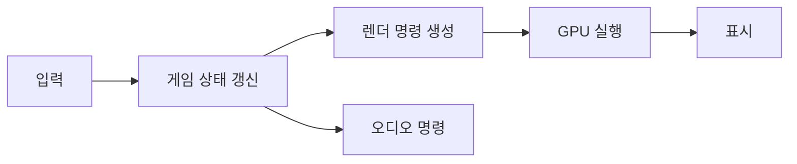

## 들어가며

게임은 제한된 시간 안에 입력을 읽고 상태를 갱신하며 화면과 소리를 만든다. 성능 문제는 단순히 “코드가 느리다”가 아니라, 정해진 마감 시간 안에 필요한 일을 끝내지 못한 상태다. 따라서 최적화의 출발점은 특정 명령의 속도가 아니라 **어떤 결과를 언제까지 내야 하는가**라는 비용 모델이다.

비용 모델은 시간 복잡도만 의미하지 않는다. 지연 시간, 처리량, 메모리 사용량, 대역폭, 정확도와 변동성까지 포함한다. 이 글은 게임 시스템의 비용을 분해하고, 측정값을 설계 판단으로 바꾸는 기본 방법을 다룬다.

---

## 목차
1. [정확성과 비용](#1-정확성과-비용)
2. [프레임 시간과 임계 경로](#2-프레임-시간과-임계-경로)
3. [점근 분석과 실제 비용](#3-점근-분석과-실제-비용)
4. [하드웨어 비용의 계층](#4-하드웨어-비용의-계층)
5. [측정 가능한 주장 만들기](#5-측정-가능한-주장-만들기)
6. [최적화 판단](#6-최적화-판단)

---

## 1. 정확성과 비용

프로그램의 첫 번째 계약은 올바른 결과다. 빠르지만 가끔 잘못된 충돌 판정을 내리는 코드는 최적화된 코드가 아니다. 정확성 계약을 정한 뒤 그 계약을 만족하는 구현들의 비용을 비교해야 한다.

게임 시스템의 비용은 대체로 다음 항목으로 나뉜다.

| 항목 | 묻는 질문 | 대표 단위 |
|---|---|---|
| 지연 시간 | 한 요청이 끝날 때까지 얼마나 걸리는가 | ns, μs, ms |
| 처리량 | 단위 시간에 몇 건을 처리하는가 | entities/s, packets/s |
| 메모리 | 살아 있는 상태와 여유 용량이 얼마인가 | KB, MB, GB |
| 대역폭 | 단위 시간에 얼마의 데이터를 옮기는가 | MB/s, Mbit/s |
| 정확도 | 근사가 결과를 얼마나 바꾸는가 | 절대·상대 오차 |
| 변동성 | 최악이나 상위 백분위가 얼마나 튀는가 | p95, p99, max |

평균만으로 실시간 품질을 설명할 수 없다. 100개 프레임 중 99개가 8ms이고 한 프레임이 80ms라면 평균은 양호해도 플레이어는 끊김을 느낀다. 프레임 시간은 평균과 함께 분포, 상위 백분위, 최대값을 봐야 한다.

## 2. 프레임 시간과 임계 경로

60fps의 표시 간격은 다음과 같다.

$$
T_{\text{frame}} = \frac{1}{60}\text{s} \approx 16.67\text{ms}
$$

이 값은 60fps를 유지하기 위한 목표 표시 간격이며 개별 시스템의 예산이 아니다. 프레임 산출 간격, 한 프레임의 CPU·GPU 처리 구간, 입력에서 화면 표시까지의 지연은 서로 다른 값이다. 여러 프레임이 겹쳐 처리되면 한 프레임의 지연이 표시 간격보다 길어도 초당 프레임 수는 유지될 수 있다. 입력, 게임 로직, 물리, AI, 렌더 제출, 운영체제 대기 등이 이 시간 안에서 경쟁한다. 120fps라면 약 8.33ms, 30fps라면 약 33.33ms다.

CPU와 GPU가 겹쳐 실행되면 각 구간을 단순히 더한 값이 표시 간격과 같지 않다. 프레임 완료를 늦추는 가장 긴 의존 경로가 임계 경로(Critical Path)다.



오디오 명령이 GPU보다 먼저 끝난다면 오디오를 더 빠르게 만들어도 프레임 완료 시점은 바뀌지 않는다. 최적화 대상은 총 작업량과 임계 경로를 구분해서 선택해야 한다.

처리량과 지연 시간도 다르다. 작업을 64개씩 묶으면 전체 처리량은 좋아질 수 있지만 첫 결과를 기다리는 시간은 길어질 수 있다. 렌더링 배칭, 네트워크 패킷 묶기, DB 일괄 쓰기는 모두 이 교환을 가진다.

## 3. 점근 분석과 실제 비용

점근 표기법은 입력 크기가 커질 때 연산 수가 어떻게 증가하는지 설명한다.

$$
T(n) = an + b,\qquad U(n) = c\log n + d
$$

충분히 큰 $n$에서는 $O(\log n)$인 $U$가 유리하지만, 상수 $a,b,c,d$와 입력 범위에 따라 작은 $n$에서는 선형 탐색이 더 빠를 수 있다. 게임에서 실제로 발생하는 $n$의 범위를 알아야 한다.

복잡도에는 조건을 붙여야 한다.

- 해시 테이블 탐색은 좋은 해시 분포와 적절한 적재율에서 평균 $O(1)$이다. 최악에는 $O(n)$이다.
- 동적 배열 끝 삽입은 상각 $O(1)$이다. 재할당이 일어난 한 번의 삽입은 $O(n)$이다.
- 이중 연결 리스트 삭제는 삭제할 노드를 이미 알고 있을 때 $O(1)$이다. 값을 찾는 과정까지 포함하면 $O(n)$이다.
- 균형 트리 탐색은 $O(\log n)$이지만 균형을 보장하지 않는 이진 탐색 트리는 최악 $O(n)$이다.

상각 분석은 드문 비싼 연산을 긴 연산열에 나눈다. 실시간 시스템에서는 평균 비용이 낮아도 재할당 한 번이 프레임을 넘길 수 있다. 상각 비용과 단일 연산 최악 비용을 함께 본다.

## 4. 하드웨어 비용의 계층

현대 CPU에서 같은 덧셈이라도 피연산자가 어디에 있는지에 따라 완료 시간이 달라진다. 다만 “L1은 몇 ns, DRAM은 몇 ns” 같은 값은 CPU 세대, 클럭, 접근 패턴, 동시 요청 수에 따라 변하므로 보편 상수로 쓰면 안 된다.

비용을 결정하는 대표 요인은 다음과 같다.

- 연속 메모리 접근은 캐시 라인과 하드웨어 프리페처를 활용하기 쉽다.
- 포인터 추적은 다음 주소를 알기 전까지 후속 요청을 내기 어려워 지연을 숨기기 어렵다.
- 예측하기 어려운 분기는 파이프라인의 추측 실행을 무효화할 수 있다.
- 동적 할당은 할당자 메타데이터, 동기화, 캐시와 페이지 동작을 수반할 수 있다.
- 시스템 콜은 사용자 모드와 커널 모드 사이의 계약을 통과하지만 실제 비용은 호출 종류와 대기 여부에 따라 다르다.
- 파일, 네트워크, GPU 전송은 장치와 큐를 거치므로 비동기 완료와 대역폭 상한을 고려해야 한다.

연산 집약적인 코드와 메모리 집약적인 코드를 같은 방식으로 최적화할 수 없다. 산술 연산 장치가 비어 있는데 메모리를 기다린다면 명령 수를 조금 줄여도 효과가 작다. 반대로 작은 데이터가 캐시에 머문다면 구조를 복잡하게 바꿔 메모리를 줄이는 것이 손해일 수 있다.

## 5. 측정 가능한 주장 만들기

“A가 B보다 빠르다”는 검증할 수 없는 문장이다. 다음 조건을 붙여야 한다.

- 컴파일러, 최적화 옵션, CPU와 운영체제
- 입력 크기와 값의 분포
- 데이터가 캐시에 있는지, 매번 새로 읽는지
- 준비 구간과 측정 구간
- 반복 횟수와 결과 분포
- 측정한 결과가 실제로 사용되는지

다음 함수는 벤치마크 자체가 아니라 측정할 대상의 예다. 반환값이 있다는 사실만으로 호출 결과가 관찰 가능해지는 것은 아니므로, 실제 벤치마크는 입력 준비, 반복, 결과 소비, 측정 구간을 별도로 구성해 컴파일러가 계산을 제거하거나 미리 계산하지 못하게 해야 한다.

```cpp
std::uint64_t Sum(std::span<const std::uint32_t> values) {
    std::uint64_t result = 0;
    for (std::uint32_t value : values) {
        result += value;
    }
    return result;
}
```

호출 결과를 버리거나 컴파일러가 입력에서 결과를 미리 구할 수 있으면 측정이 무의미해진다. 호출 전후의 시간만 재는 것으로도 충분하지 않을 수 있다. 타이머 호출 비용, 스케줄러 선점, CPU 주파수 변화, 첫 실행의 페이지 폴트와 캐시 준비가 섞인다. 반복 측정 후 중앙값과 상위 백분위를 기록하고, 프로파일러로 실제 병목 위치를 확인한다.

[Google Benchmark 사용자 가이드](https://google.github.io/benchmark/user_guide.html)는 워밍업, 반복, 최적화 방지와 실행 환경 기록을 포함한 마이크로벤치마크 구성 방법을 설명한다. 도구를 사용해도 실제 게임 입력 분포와 임계 경로를 별도로 확인해야 한다.

프레임 측정은 계층적으로 구성한다.

```text
frame
  update
    animation
    physics
    ai
  render submission
  waits
```

계층 합계가 부모 구간과 맞지 않으면 겹친 작업, 누락된 대기, 계측 오버헤드 중 하나를 조사한다.

## 6. 최적화 판단

전체 시간 $T$ 중 비율 $p$인 부분을 $s$배 빠르게 만들었을 때 이론적 전체 가속 한계는 다음과 같다. 여기서 $p$는 여러 작업을 단순히 합친 시간이 아니라 같은 워크로드의 전체 경과 시간에서 그 부분이 차지하는 비율이다. 이 식은 최적화 전 시간을 겹치지 않는 대상 구간과 나머지 구간으로 나눌 수 있고, 작업량과 나머지 구간의 시간은 그대로이며 새 동기화·전송 비용이 생기지 않는다고 가정한다. 겹쳐 실행되는 작업의 단순 점유율을 $p$에 대입하지 않고, 실제 경과 시간을 줄일 수 있는 구간을 확인해야 한다.

$$
S = \frac{1}{(1-p) + \frac{p}{s}}
$$

전체의 5%인 코드를 무한히 빠르게 만들어도 전체 가속은 약 1.053배를 넘지 못한다. 이 관계는 국소 벤치마크의 큰 개선이 실제 프레임 개선으로 이어지지 않는 이유를 설명한다.

최적화 순서는 다음 질문으로 정리할 수 있다.

1. 지켜야 할 정확성 계약과 마감 시간은 무엇인가.
2. 평균이 아니라 어떤 분포와 최악 조건이 중요한가.
3. 임계 경로에서 실제로 시간을 쓰는 구간은 어디인가.
4. 병목은 연산, 메모리, 동기화, I/O 중 무엇인가.
5. 변경 후 같은 입력과 계측 조건에서 개선이 재현되는가.
6. 얻은 성능이 코드 복잡성, 메모리, 정확도 비용을 정당화하는가.

---

## 결론

게임 성능은 단일 명령의 속도가 아니라 정확한 결과를 마감 시간 안에 만드는 문제다. 프레임 시간, 처리량, 메모리, 대역폭, 정확도와 변동성을 함께 모델링해야 한다.

점근 복잡도는 증가율을 설명하고 프로파일링은 실제 병목을 찾는다. 두 방법은 대체 관계가 아니다. 복잡도로 위험한 증가를 제거하고, 계측으로 임계 경로와 하드웨어 비용을 확인한 뒤 변경의 효과를 같은 조건에서 검증해야 한다.
