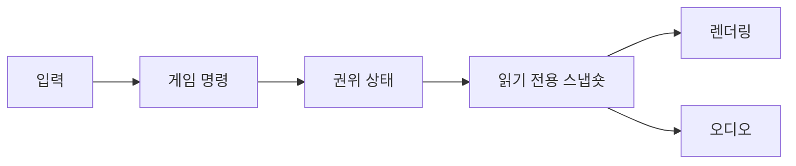

## 들어가며

게임 코드는 입력, 전투, AI, 물리, 렌더링, 저장처럼 서로 다른 변화율을 가진 기능이 함께 실행되는 시스템이다. 기능을 클래스로 나누는 것만으로 복잡도가 관리되지는 않는다. 경계가 어떤 상태를 소유하고 어떤 변경을 허용하는지 명확해야 한다.

추상화는 세부 사항을 숨기는 기술이 아니라, 클라이언트가 의존할 수 있는 계약을 만드는 기술이다. 타입, 모듈, 조합, 메시지 전달을 사용해 변경 범위를 제한하는 기본 원리를 다룬다.

---

## 목차
1. [추상화와 표현 불변식](#1-추상화와-표현-불변식)
2. [타입으로 상태 제한하기](#2-타입으로-상태-제한하기)
3. [결합도와 응집도](#3-결합도와-응집도)
4. [상속보다 조합](#4-상속보다-조합)
5. [패턴을 선택하는 기준](#5-패턴을-선택하는-기준)
6. [게임 시스템 경계](#6-게임-시스템-경계)

---

## 1. 추상화와 표현 불변식

추상 데이터 타입은 가능한 연산과 그 연산이 지키는 규칙으로 정의된다. 내부 컨테이너가 `vector`인지 트리인지는 구현 세부 사항이다.

[C++ Core Guidelines의 인터페이스 원칙](https://isocpp.github.io/CppCoreGuidelines/CppCoreGuidelines#S-interfaces)은 인터페이스를 구현과 분리하고 전제·후속 조건을 명확히 하라는 기준을 제시한다. 구체적인 언어와 무관하게 추상화의 품질은 계약이 숨기는 상태보다 드러내는 불변식으로 판단할 수 있다.

```cpp
// 인터페이스 발췌다. 생성자가 유효한 용량을 받아 불변식을 확립한다.
class Inventory {
public:
    explicit Inventory(std::size_t capacity) : capacity_(capacity) {}

    bool Add(Item item);
    bool Remove(ItemId id);
    std::span<const Item> Items() const;

private:
    std::vector<Item> items_;
    std::size_t capacity_;
};
```

이 타입의 핵심은 다음 표현 불변식이다.

$$
0 \le |items| \le capacity
$$

외부 코드가 `items_`를 직접 변경할 수 있으면 타입이 불변식을 지킬 수 없다. 캡슐화는 필드를 감추는 형식이 아니라 유효한 상태 전이만 허용하는 경계다.

`Items()`가 돌려주는 `span<const Item>`은 소유하지 않는 뷰다. 호출자가 그 뷰를 통해 값을 수정하지 못한다는 것과 원본이 변하지 않거나 수명이 보장된다는 것은 다르다. 삽입·삭제나 소유자 파괴 뒤의 뷰 유효성과 동시 접근 허용 여부를 계약에 명시해야 한다.

좋은 인터페이스는 실패도 표현한다. 용량 초과가 가능한 `Add`가 무조건 성공하는 것처럼 보이면 호출자가 실패를 처리할 수 없다. 반환값, 오류 타입, 예외 정책 중 하나로 계약을 드러낸다.

## 2. 타입으로 상태 제한하기

유효하지 않은 상태를 표현하기 어렵게 만들면 런타임 검사와 디버깅 비용이 줄어든다.

```cpp
struct Alive {
    Health health;
};

struct Dead {
    DeathReason reason;
};

using LifeState = std::variant<Alive, Dead>;
```

`isDead == true`인데 `health > 0`인 조합을 여러 필드로 허용하는 대신 상태를 합 타입으로 표현할 수 있다. 합 타입은 불가능한 조합 일부를 제거하지만 `Alive` 안에 체력 0이나 음수를 넣는 것까지 막지는 않으므로, 남은 수치 불변식은 검증된 생성과 상태 전이로 지킨다. 모든 상태를 타입으로 분리해야 하는 것은 아니지만, 불가능한 조합이 버그의 주요 원인이라면 가치가 있다.

단위도 타입의 일부다.

```cpp
struct Seconds { float value; };
struct Meters { float value; };

void Advance(Seconds dt);
```

문자열과 정수로 모든 것을 표현하면 API는 유연해 보이지만 의미 검사가 실행 시점으로 밀린다. 반대로 지나치게 세분화된 타입은 변환 코드와 컴파일 시간을 늘린다. 오류 비용이 높은 경계부터 강한 타입을 적용한다.

## 3. 결합도와 응집도

응집도는 한 모듈의 상태와 연산이 하나의 책임을 향하는 정도다. 결합도는 한 모듈의 변경이 다른 모듈에 전달되는 정도다.



렌더러가 입력 장치와 전투 규칙을 직접 호출하지 않으면 각 경계의 변경 이유가 분리된다. 데이터가 한 방향으로 흐르면 중간 상태와 재현 순서도 추적하기 쉽다.

결합도를 낮추기 위해 모든 호출을 이벤트로 바꾸면 의존성이 사라지는 것이 아니라 보이지 않게 된다. 발행자, 구독자, 전달 순서, 재진입, 구독 해제 수명이 새로운 계약이 된다.

의존성 방향은 정책과 세부 구현을 분리한다.

```cpp
class IStorage {
public:
    virtual ~IStorage() = default;
    virtual SaveResult Save(const SaveData&) = 0;
};
```

전투 규칙이 파일 API나 클라우드 SDK가 아니라 저장 계약에 의존하면 구현을 바꿀 수 있다. 단, 가상 인터페이스를 만든 것만으로 좋은 경계가 되지는 않는다. 실제로 교체할 이유와 안정적인 계약이 있어야 한다.

## 4. 상속보다 조합

상속은 “is-a” 관계와 치환 가능성을 요구한다. 기반 타입을 기대하는 코드가 파생 타입에서도 같은 계약을 믿을 수 있어야 한다.

`FlyingSwimmingArmoredEnemy`처럼 특성 조합마다 타입을 만들면 클래스 수가 조합 수와 함께 증가한다. 상태와 동작을 구성 요소로 분리하면 필요한 기능만 조합할 수 있다.

```cpp
struct Entity {
    Transform transform;
    std::optional<Health> health;
    std::optional<Movement> movement;
};
```

이 구조도 만능은 아니다. 모든 구성 요소를 `optional` 필드로 넣으면 객체가 비대해지고 가능한 조합 규칙이 흐려진다. 밀집 배열 ECS, 일반 객체 조합, 상속은 접근 패턴과 수명에 따라 선택한다.

개방-폐쇄 원칙은 모든 미래 변경을 플러그인으로 만들라는 뜻이 아니다. 자주 추가되는 변형에는 확장 지점을 두고, 시스템의 핵심 불변식은 제한한다. 확장 축을 잘못 예측하면 추상화가 오히려 변경을 어렵게 만든다.

## 5. 패턴을 선택하는 기준

디자인 패턴은 이름이 아니라 해결하려는 힘의 충돌로 평가한다.

| 패턴 | 해결하려는 문제 | 새로 생기는 비용 |
|---|---|---|
| 상태 | 상태별 전이와 행동 분리 | 상태 수와 전이 조합 증가 |
| 명령 | 행동을 값으로 저장·재생 | 명령 스키마와 수명 관리 |
| 관찰자 | 여러 소비자에게 변경 통지 | 순서, 재진입, 해제 문제 |
| 객체 풀 | 반복 할당과 수명 예측 | 초기화 누락, 용량 상한 |
| 서비스 로케이터 | 넓게 쓰는 서비스 접근 | 숨은 의존성과 테스트 격리 |
| 팩토리 | 생성 정책과 사용 분리 | 생성 경로 추적 비용 |

상태 패턴은 전이 규칙이 핵심일 때 유용하다. 단순한 열거형 분기로 충분한 시스템에 클래스를 늘리면 구조만 복잡해진다.

명령 패턴은 입력 기록, 실행 취소, 네트워크 전송에 쓰일 수 있다. 하지만 포인터와 런타임 객체를 그대로 명령에 담으면 재생과 직렬화가 불가능해진다. 명령의 데이터 계약과 실행 시점의 유효성 검사가 필요하다.

객체 풀은 할당 횟수를 줄이지만 객체 수명의 의미를 바꾼다. 반환된 객체의 이전 상태를 완전히 초기화해야 하고, 풀이 가득 찼을 때 실패·확장·축출 정책을 정해야 한다.

싱글턴은 인스턴스 수를 하나로 제한하는 패턴이지 의존성 관리 방법이 아니다. 전역 접근을 함께 제공하면 초기화 순서, 테스트 격리, 병렬 실행이 어려워진다.

## 6. 게임 시스템 경계

게임 시스템을 나눌 때 클래스 수보다 다음 세 경계를 먼저 정한다.

### 상태 소유권

한 상태의 권위 있는 소유자가 누구인지 정한다. 렌더링용 위치와 물리 위치가 서로 독립적으로 수정되면 어느 값이 맞는지 알 수 없다. 소유자는 쓰기를 담당하고 다른 시스템에는 스냅숏이나 명령 경계를 제공한다.

### 시간 경계

입력 수집, 고정 틱 시뮬레이션, 가변 렌더링은 서로 다른 시간축을 가질 수 있다. 함수 호출 순서가 결과를 결정한다면 스케줄과 동기화 지점을 명시한다.

### 실패 경계

에셋 로드 실패가 전투 상태를 부분적으로 변경해서는 안 된다. 저장, 네트워크, 비동기 작업은 성공과 실패가 상태에 반영되는 커밋 지점을 가진다.

모듈 경계를 검증하는 질문은 다음과 같다.

1. 이 상태를 쓸 수 있는 곳은 몇 개인가.
2. 인터페이스가 지키는 불변식은 무엇인가.
3. 호출 순서와 스레드가 계약에 포함되는가.
4. 실패 중간 상태가 외부에 보이는가.
5. 새 변형을 추가할 때 수정해야 하는 모듈은 어디인가.
6. 단독 테스트에서 숨은 전역 의존성이 드러나는가.

---

## 결론

추상화는 코드를 계층으로 많이 나누는 일이 아니라 유효한 상태와 허용된 전이를 계약으로 만드는 일이다. 타입과 캡슐화는 표현 불변식을 지키고, 모듈 경계는 상태·시간·실패의 전파 범위를 제한한다.

패턴은 상황별 비용 교환이다. 조합, 상태, 명령, 관찰자, 풀은 특정 변경을 쉽게 만드는 대신 새로운 수명과 순서 문제를 만든다. 변경 빈도와 불변식을 먼저 정의한 뒤 필요한 패턴만 선택해야 한다.
