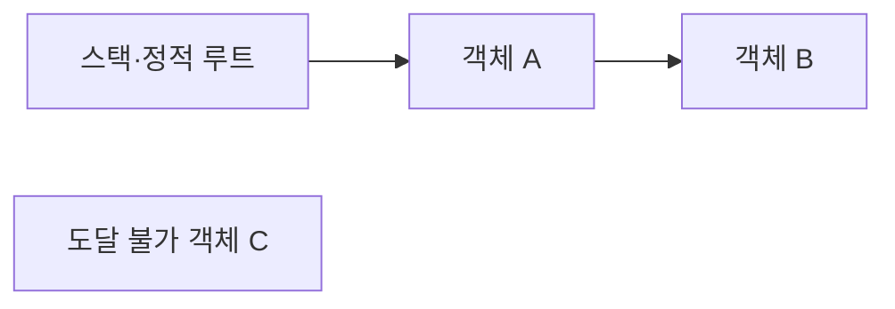

## 들어가며

메모리 버그의 많은 부분은 바이트가 부족해서가 아니라 객체의 수명과 참조의 수명이 일치하지 않아 발생한다. 객체가 언제 생성되고 누가 소유하며 어느 시점부터 접근할 수 없는지를 정하지 않으면 누수, 이중 해제, use-after-free가 생긴다.

메모리 관리는 `new`와 `delete`의 문법보다 넓다. 저장 기간, 소유권, 정렬, 할당자, 참조 안정성, 관리 런타임의 회수 정책을 하나의 수명 모델로 이해해야 한다. 이 글은 네이티브 코드와 관리 코드에 공통으로 적용되는 기본 계약을 다룬다.

---

## 목차
1. [저장 공간과 객체 수명](#1-저장-공간과-객체-수명)
2. [소유권과 RAII](#2-소유권과-raii)
3. [참조 안정성](#3-참조-안정성)
4. [할당 비용과 메모리 배치](#4-할당-비용과-메모리-배치)
5. [관리 런타임과 GC](#5-관리-런타임과-gc)
6. [오류를 검증하는 방법](#6-오류를-검증하는-방법)

---

## 1. 저장 공간과 객체 수명

저장 공간이 확보된 것과 그 공간에 객체가 살아 있는 것은 다른 사건이다. C++에서는 메모리를 얻은 뒤 생성자가 객체의 수명을 시작하고, 소멸자가 수명을 끝낸 뒤 저장 공간을 반환할 수 있다.

```cpp
void* storage = ::operator new(sizeof(Enemy));
Enemy* enemy = new (storage) Enemy{};

enemy->~Enemy();
::operator delete(storage);
```

일반 애플리케이션 코드에서 이 형식을 직접 쓸 일은 드물지만, 할당과 객체 수명이 분리된다는 점을 보여준다. 다만 생성자가 예외를 던지면 위에서 확보한 저장 공간을 반환할 경로가 없어 누수가 된다. 생성 실패를 처리하려면 저장 공간을 소유하는 보호 장치를 두거나 시도 후 해제 경로를 마련해야 한다. 기본 정렬보다 강한 정렬을 요구하는 타입은 정렬을 받는 할당·해제 오버로드를 함께 사용해야 한다. 수명이 끝난 객체를 가리키는 주소가 그대로 남아 있어도 그 포인터로 객체에 접근할 수 없다.

저장 기간은 구현 방식에 따라 구분된다.

- 자동 저장 기간 객체는 블록을 벗어날 때 파괴된다.
- 정적 저장 기간 객체는 프로그램 수명과 연결된다.
- 동적 저장 기간 객체는 명시적인 소유 정책이 필요하다.
- 스레드 저장 기간 객체는 각 스레드 인스턴스와 함께 살아간다.

“스택은 아래로 자라고 힙은 위로 자란다”는 설명은 구현 관찰일 뿐 언어 계약이 아니다. 스택이라는 단어도 호출 프레임을 관리하는 관례와 자동 저장 기간을 혼용하기 쉽다.

## 2. 소유권과 RAII

소유권은 객체 파괴의 책임이다. C++의 RAII(Resource Acquisition Is Initialization)는 자원의 수명을 객체의 수명에 묶는다.

[C++ Core Guidelines의 자원 관리 원칙](https://isocpp.github.io/CppCoreGuidelines/CppCoreGuidelines#S-resource)은 소유권과 RAII, 스마트 포인터의 적용 경계를 정리한다. 지침을 따르더라도 컨테이너 무효화와 비동기 작업의 논리적 수명은 별도로 설계해야 한다.

```cpp
class File {
public:
    explicit File(std::FILE* handle) : handle_(handle) {}
    ~File() {
        if (handle_ != nullptr) {
            std::fclose(handle_);
        }
    }

    File(const File&) = delete;
    File& operator=(const File&) = delete;

private:
    std::FILE* handle_;
};
```

예외, 조기 반환, 여러 실패 경로가 있어도 스코프를 벗어나면 소멸자가 실행된다. RAII는 메모리뿐 아니라 파일, 락, 소켓, GPU 핸들에도 적용된다. 이 `File`은 전달받은 `FILE*`의 소유권을 인수한다는 계약을 전제로 한다. 소멸자에서 닫았다는 사실은 쓰기 작업의 성공을 뜻하지 않으므로, 내구성이 필요한 저장은 별도의 완료·닫기 결과 확인 단계를 둔다.

스마트 포인터는 소유권 종류를 표현한다.

| 타입 | 의미 | 주요 비용과 위험 |
|---|---|---|
| `unique_ptr<T>` | 단독 소유 | 이동으로 소유권 이전 |
| `shared_ptr<T>` | 공유 소유 | 제어 블록, 원자적 참조 계수 가능성 |
| `weak_ptr<T>` | 비소유 관찰 | 사용 전에 수명 확보 필요 |

`shared_ptr`는 모든 수명 문제의 해답이 아니다. 순환 참조는 참조 계수를 0으로 만들지 못하고, 실제 파괴 시점도 마지막 소유자에 의존한다. 게임의 프레임 임계 경로에서 큰 객체가 예상치 못한 시점에 파괴될 수 있다.

비소유 포인터와 참조는 수명 계약을 타입만으로 완전히 표현하지 못한다. 소유자가 먼저 파괴되지 않는다는 구조적 보장이 필요하다.

## 3. 참조 안정성

객체가 살아 있어도 컨테이너 이동 때문에 주소와 반복자가 무효화될 수 있다.

```cpp
std::vector<Enemy> enemies;
enemies.push_back(Enemy{});
Enemy* first = &enemies[0];

enemies.push_back(Enemy{}); // 재할당되면 first는 무효다.
```

`reserve`는 용량을 넘지 않는 동안 재할당을 막는다. 원소 삭제와 순서 변경까지 포함한 모든 참조 안정성을 보장하지는 않는다.

외부 참조가 오래 살아야 한다면 주소 대신 안정적인 핸들을 사용할 수 있다.

```cpp
struct EntityHandle {
    std::uint32_t slot;
    std::uint32_t generation;
};
```

핸들 조회는 간접 참조 비용을 추가하지만 제거된 객체와 재사용된 슬롯을 구분할 수 있다. 반대로 프레임 안에서만 쓰는 임시 참조라면 직접 인덱스나 포인터가 더 단순할 수 있다.

수명은 비동기 코드에서도 중요하다. 작업 큐에 `this`를 캡처한 뒤 객체가 먼저 파괴되면 작업이 실행될 때 잘못된 주소를 사용한다. 취소 요청을 보냈다는 사실만으로 실행 중이거나 이미 꺼낸 작업이 끝났다고 볼 수 없으므로, 작업 취소와 실제 접근 종료 확인, 작업 완료 대기, 공유 수명, 핸들 재검증 중 하나가 필요하다.

## 4. 할당 비용과 메모리 배치

범용 할당자는 다양한 크기와 수명을 처리한다. 할당 비용은 크기 클래스, 스레드 캐시, 경합, 새 페이지 요청 여부에 따라 달라지므로 `malloc`이 항상 $O(n)$이거나 `new`가 일정 배수 느리다고 단정할 수 없다.

게임 워크로드에서는 다음 패턴이 자주 나타난다.

- 프레임 동안만 필요한 임시 데이터
- 같은 크기의 총알이나 파티클
- 장면 전체와 수명을 함께하는 객체
- 크기와 수명이 제각각인 일반 객체

선형 영역 할당자는 포인터를 증가시키는 방식으로 여러 작은 할당을 묶고 전체를 한 번에 초기화할 수 있다.

```cpp
class Arena {
public:
    void Reset() noexcept { offset_ = 0; }

private:
    std::byte* memory_{};
    std::size_t capacity_{};
    std::size_t offset_{};
};
```

빠른 할당은 개별 소멸과 해제를 포기하는 수명 계약의 결과다. `Reset()`이 오프셋을 되돌리는 것과 저장된 객체의 자원을 정리하는 것은 별개다. 개별 파괴가 필요한 객체는 먼저 파괴하거나 소멸자 목록을 관리하고, 아니라면 정리가 필요 없는 타입으로 사용 범위를 제한하는 정책을 명시해야 한다.

정렬은 객체 주소가 특정 배수에 놓이는 조건이다. 할당 크기가 정렬보다 작을 수도 있으므로 `Deallocate(ptr, size)`만으로 할당 시 선택한 크기 클래스를 항상 복원할 수는 없다. 정렬까지 해제 계약에 포함하거나 메타데이터로 실제 클래스를 기록해야 한다.

단편화에는 두 종류가 있다.

- 내부 단편화: 요청보다 큰 블록을 제공해 블록 안에서 낭비된다.
- 외부 단편화: 전체 빈 공간은 충분하지만 필요한 연속 블록을 만들지 못한다.

메모리 사용량은 객체 크기 합계만으로 계산하지 않는다. 컨테이너 여유 용량, 정렬 패딩, 할당자 메타데이터, 페이지와 캐시까지 구분해서 측정한다.

## 5. 관리 런타임과 GC

관리 언어에서는 객체 참조를 잃었다고 즉시 메모리가 반환되는 것이 아니다. 가비지 컬렉터(GC)는 루트에서 도달 가능한 객체 그래프를 찾고, 도달할 수 없는 객체를 회수한다.



GC는 use-after-free와 이중 해제의 많은 원인을 제거하지만 자원 수명 전체를 관리하지 않는다. 파일과 소켓 같은 외부 자원은 결정적인 해제 패턴이 필요하다.

C#의 `IDisposable`과 `using`은 외부 자원의 수명을 스코프에 묶는다.

```csharp
using FileStream stream = File.OpenRead(path);
Consume(stream);
```

GC 비용은 “할당마다 힙을 검색한다” 같은 단순 모델로 설명할 수 없다. 세대별 수집, 이동, 압축, 큰 객체 처리, 쓰기 장벽과 런타임 구현에 따라 달라진다. 중요한 것은 할당률, 살아남는 객체 비율, 참조 그래프와 일시 정지 분포를 측정하는 일이다.

관리 참조도 논리적 수명 버그를 막지 못한다. 이벤트 구독이나 전역 컬렉션이 객체를 계속 참조하면 기능상 사용하지 않아도 회수되지 않는다.

## 6. 오류를 검증하는 방법

수명 오류는 정상 실행에서 우연히 드러나지 않을 수 있다. 다음 도구와 불변식을 함께 사용한다.

- AddressSanitizer로 범위 초과와 use-after-free를 찾는다.
- UndefinedBehaviorSanitizer로 일부 정의되지 않은 동작을 찾는다.
- 정적 분석으로 소유권과 해제 경로를 검사한다.
- 할당 추적으로 누수, 할당률, 크기 분포를 측정한다.
- 핸들 조회에서 세대와 점유 상태를 검증한다.
- 종료·장면 전환·취소처럼 수명이 교차하는 경로를 반복한다.

메모리 최적화 전에는 다음 값을 구분한다.

```text
reserved: 주소 공간이나 할당자에 확보된 크기
committed: 실제 사용하도록 약정된 크기(첫 접근 전에는 물리 페이지가 없을 수 있음)
resident·working set: 현재 물리 메모리에 상주하는 크기
live allocation: 살아 있는 객체가 요구하는 할당 크기
peak: 관측 구간의 최대 사용량
allocation rate: 단위 시간당 새로 할당한 바이트
```

누수와 높은 peak는 다른 문제다. 누수에는 더 이상 필요하지 않은 객체가 계속 살아 있는 경우와, 살아 있는 객체가 없어도 반환하지 않은 원시 할당 영역이 남는 경우가 있다. 높은 peak는 특정 시점에 실제로 많은 상태가 필요한 것일 수 있다.

---

## 결론

메모리 관리는 바이트 할당보다 객체 수명과 참조 계약의 문제다. 저장 공간, 객체 수명, 소유권, 주소 안정성을 분리해서 생각해야 네이티브 코드와 관리 코드의 오류를 같은 모델로 설명할 수 있다.

전용 할당자와 GC는 서로 다른 비용을 제공하지만 수명 정책을 대신 결정하지 않는다. 어떤 객체가 누구에게 속하고 언제 접근 불가능해지는지 정의하고, 도구와 경계 조건으로 그 불변식을 검증해야 한다.
