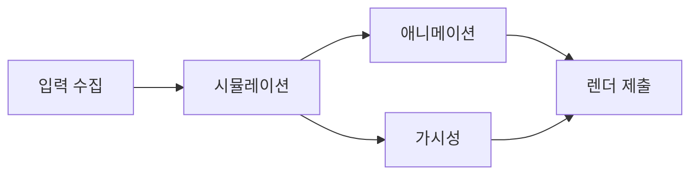

## 들어가며

동시성은 여러 작업이 진행될 수 있도록 프로그램을 구성하는 문제고, 병렬성은 실제로 여러 작업이 같은 시간에 실행되는 상태다. 코어 수가 늘었다고 게임이 자동으로 빨라지지는 않는다. 작업 의존성과 공유 상태가 병렬 실행 가능 범위를 결정한다.

공유 상태를 잘못 다루면 실행 순서에 따라 결과가 바뀌는 데이터 레이스, 데드락, 수명 오류가 발생한다. 이 글은 스레드 수보다 먼저 이해해야 할 메모리 모델과 작업 경계를 다룬다.

---

## 목차
1. [동시성과 병렬성](#1-동시성과-병렬성)
2. [데이터 레이스와 happens-before](#2-데이터-레이스와-happens-before)
3. [락과 동기화](#3-락과-동기화)
4. [원자 연산과 lock-free의 경계](#4-원자-연산과-lock-free의-경계)
5. [작업 시스템과 게임 루프](#5-작업-시스템과-게임-루프)
6. [성능과 정확성 검증](#6-성능과-정확성-검증)

---

## 1. 동시성과 병렬성

두 작업 사이에 데이터 의존성이 없다면 병렬 실행 후보가 된다. 한 작업의 출력이 다른 작업의 입력이면 순서나 동기화 지점이 필요하다.



작업 그래프의 총 작업량을 줄이는 것과 임계 경로를 줄이는 것은 다르다. 많은 코어에 작은 작업을 분배해도 마지막 의존 작업이 오래 걸리면 프레임 완료 시점은 바뀌지 않는다.

병렬화에는 오버헤드가 있다.

- 작업 생성과 큐 조작
- 스레드 깨우기와 스케줄링
- 공유 데이터 동기화
- 캐시 일관성 트래픽
- 결과 병합과 대기

작업이 너무 작으면 실제 계산보다 분배 비용이 커진다. grain size는 작업당 비용과 코어 수를 측정해 정한다.

## 2. 데이터 레이스와 happens-before

두 스레드가 같은 메모리 위치에 접근하고, 하나 이상이 쓰기이며, 적어도 한 접근이 비원자적이고, 동기화로 순서가 정해지지 않으면 데이터 레이스다. 두 접근이 모두 적절한 원자 연산이면 그 자체로 데이터 레이스가 아니며, 물리적으로 같은 순간에 실행되는지도 판정 기준이 아니다. C++에서 데이터 레이스는 정의되지 않은 동작이다.

```cpp
int score = 0;

// 두 스레드가 동시에 실행하면 데이터 레이스다.
void AddScore() {
    ++score;
}
```

`++score`는 읽기, 증가, 쓰기의 복합 연산이다. 두 스레드가 같은 이전 값을 읽으면 한 증가가 사라질 수 있다.

happens-before는 한 연산의 효과가 다른 연산에 관찰되도록 순서를 만드는 관계다. 뮤텍스 해제와 같은 뮤텍스의 후속 획득, 스레드 시작과 join, 적절한 원자 연산이 이 관계를 구성할 수 있다.

메모리 모델은 CPU가 물리적으로 어떤 순서로 실행했다는 단순 기록이 아니다. 프로그램이 어떤 값을 관찰할 수 있는지에 대한 언어 계약이다.

충돌하는 접근, 동기화 연산과 happens-before의 정확한 정의는 [C++ 표준 초안의 data race 절](https://eel.is/c++draft/intro.races)에 있다. 하드웨어 메모리 순서만 보고 언어 수준의 정확성을 추론하면 컴파일러 변환을 놓칠 수 있다.

## 3. 락과 동기화

뮤텍스는 한 시점에 한 스레드만 임계 구역에 들어가게 한다.

```cpp
class ScoreBoard {
public:
    void Add(int value) {
        std::scoped_lock lock(mutex_);
        score_ += value;
    }

private:
    std::mutex mutex_;
    int score_{};
};
```

락 비용은 `lock()` 호출 횟수만으로 판단하지 않는다. 경합이 없으면 사용자 공간 빠른 경로로 끝날 수 있고, 경합하면 대기와 스케줄링이 발생할 수 있다. 이 클래스는 경합을 막지만 `int score_`의 오버플로까지 막지는 않으므로 값 범위 계약을 함께 명시한다.

임계 구역은 공유 불변식을 유지하는 최소 단위여야 한다. 락을 너무 잘게 나누면 여러 락을 함께 잡는 순서가 복잡해지고, 너무 크게 잡으면 병렬성이 줄어든다.

데드락의 대표 조건은 상호 배제, 점유 대기, 비선점, 순환 대기다. 모든 코드가 동일한 락 순서를 사용하면 순환 대기를 제거할 수 있다.

```cpp
std::scoped_lock lock(inventoryMutex, economyMutex);
```

여러 뮤텍스를 함께 받는 `scoped_lock`은 전역 고정 락 순서를 강제하는 방식과 달리, 데드락 회피 알고리즘으로 여러 락 획득을 처리하는 별도 사용 방식이다.

조건 변수는 상태 변화 알림이다. 알림 자체를 상태로 사용하면 놓친 깨우기와 거짓 깨우기를 처리하지 못한다. 항상 조건식을 반복 검사한다.

```cpp
// 조건 상태는 동일한 뮤텍스로 보호한다.
std::unique_lock<std::mutex> lock(queueMutex);
cv.wait(lock, [&] { return !queue.empty() || stopping; });
```

`std::condition_variable`의 대기에는 `unique_lock<mutex>`를 사용하고, 조건을 보호하는 뮤텍스와 조건을 변경하는 쪽의 락 규칙을 함께 맞춘다. 알림을 반복 검사하는 것만으로 놓친 깨우기가 모두 해결되지는 않는다.

## 4. 원자 연산과 lock-free의 경계

원자 타입은 한 메모리 위치의 연산이 찢어지지 않게 하고 메모리 순서 규칙을 제공한다.

```cpp
std::atomic<bool> ready{false};
Payload payload;

// 생산자
payload = MakePayload();
ready.store(true, std::memory_order_release);

// 소비자
if (ready.load(std::memory_order_acquire)) {
    Consume(payload);
}
```

release 저장과 그 값을 읽은 acquire 로드는 앞선 payload 쓰기를 소비자에게 공개한다. 모든 원자 연산에 가장 강한 순서를 사용할 필요는 없지만 약한 순서는 정확한 증명이 필요하다. 이 예는 생산자가 한 번 게시하고 소비자가 읽는 동안 payload가 유지되는 단발 공개를 설명한다. `ready`가 참인 상태로 payload를 다시 쓰는 반복 프로토콜로 사용하면 보장이 달라지므로, 소비 중 수정·파괴를 금지하고 모든 소비자의 읽기 종료를 확인하는 별도 상태 전이와 소유권 규약이 필요하다.

lock-free는 특정 연산이 시스템 전체의 진행을 막지 않는다는 진행 보장이다. 다음을 자동으로 의미하지 않는다.

- wait-free
- 항상 더 빠름
- 메모리 할당 없음
- 수명 문제 없음
- 공정한 실행

lock-free는 특정 연산이 시스템 전체의 진행을 막지 않는다는 뜻이며, 개별 스레드의 기아 가능성이나 완료 시간까지 보장하지는 않는다. 연결 구조에서 노드를 제거한 직후 `delete`하면 다른 스레드가 아직 그 노드를 읽고 있을 수 있으므로, hazard pointer, epoch 기반 회수, RCU 같은 회수 전략이나 고정 용량 구조, 작업 종료 후 일괄 회수 같은 수명 정책으로 참조 중인 저장 공간을 회수하지 않아야 한다.

ABA 문제는 값이 A에서 B를 거쳐 다시 A가 되어 단순 비교가 중간 변화를 감지하지 못하는 문제다. 태그가 있는 포인터는 일부 경우를 완화하지만 메모리 회수와 태그 래핑까지 함께 다뤄야 한다.

## 5. 작업 시스템과 게임 루프

스레드를 기능마다 하나씩 만드는 방식은 부하 균형이 어렵다. 작업 시스템은 작은 작업을 큐에 넣고 제한된 worker가 실행하도록 구성한다.

```text
producer: 의존성이 충족된 작업을 enqueue
worker: 큐에서 작업을 가져와 실행
counter: 하위 작업 완료 수 추적
barrier: 프레임 단계의 공개 지점
```

작업이 공유 상태를 임의로 수정하면 큐만 도입했을 뿐 동시성 모델은 개선되지 않는다. 읽기 집합과 쓰기 집합, 결과 공개 시점을 정해야 한다.

게임 시뮬레이션은 다음 전략을 사용할 수 있다.

- 단계별 barrier로 입력, 시뮬레이션, 결과 공개를 분리한다.
- 각 작업이 독립 출력 버퍼에 쓰고 마지막에 병합한다.
- 엔티티 범위를 분할해 쓰기 충돌을 제거한다.
- 명령 버퍼에 구조 변경을 기록하고 안전한 지점에서 적용한다.

결정성이 필요하면 결과 병합 순서와 부동소수점 연산 순서도 계약에 포함한다. 병렬 합산은 결합 순서가 달라져 반올림 결과가 바뀔 수 있다.

## 6. 성능과 정확성 검증

동시성 버그는 특정 인터리빙에서만 나타난다. 단순 반복 외에 다음 방법을 사용한다.

- ThreadSanitizer로 데이터 레이스를 탐지한다.
- 락 순서를 검증하고 장시간 대기 스택을 수집한다.
- 작업 시작과 완료, queue depth, steal 횟수를 추적한다.
- 코어 수와 작업 크기를 바꿔 확장성을 측정한다.
- 임의 지연과 yield를 삽입해 인터리빙을 다양화한다.
- 같은 입력을 반복 실행해 결과 해시를 비교한다.

병렬 가속은 직렬 구간과 오버헤드에 제한된다.

$$
S(N) \le \frac{1}{(1-p) + \frac{p}{N}}
$$

$p$는 병렬화 가능한 비율이고 $N$은 실행 자원 수다. 실제 가속은 동기화와 메모리 대역폭 때문에 이 상한보다 작다.

false sharing은 서로 다른 변수를 쓰더라도 같은 캐시 라인을 공유해 일관성 트래픽이 생기는 현상이다. 패딩을 넣기 전에 성능 카운터와 스레드별 쓰기 패턴으로 실제 원인인지 확인해야 한다.

---

## 결론

동시성의 핵심은 스레드 수가 아니라 공유 상태의 관찰 순서다. happens-before 관계, 락이 보호하는 불변식, 원자 연산의 메모리 순서를 명확히 해야 결과를 신뢰할 수 있다.

병렬화는 작업 그래프와 임계 경로를 바꾸는 최적화다. 작업 분배, 동기화, 캐시 일관성 비용을 포함해 측정하고, 데이터 레이스 탐지와 결정성 검증으로 정확성을 함께 확인해야 한다.
