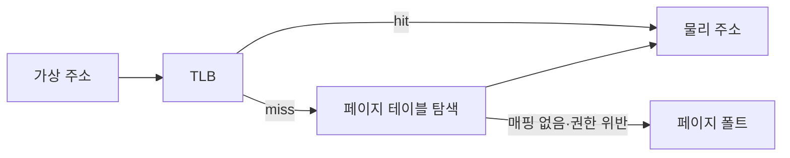

## 들어가며

게임 프로세스는 CPU, 메모리, 파일, 네트워크, 타이머와 장치를 직접 소유하지 않는다. 운영체제가 자원을 격리하고 스케줄하며, 프로그램은 시스템 콜과 핸들을 통해 서비스를 요청한다.

운영체제 경계를 이해하면 메모리가 충분한데도 페이지 폴트가 생기는 이유, 파일 읽기가 호출 즉시 완료되지 않는 이유, 비동기 I/O가 별도 스레드와 같지 않은 이유를 설명할 수 있다. 이 글은 게임 실행에 필요한 프로세스, 가상 메모리, 스케줄링과 I/O의 기본 계약을 다룬다.

프로세스·가상 메모리·동시성·영속성의 연결은 무료 교재 [Operating Systems: Three Easy Pieces](https://pages.cs.wisc.edu/~remzi/OSTEP/)에서 운영체제의 핵심 축으로 체계화돼 있다.

---

## 목차
1. [프로세스와 커널 경계](#1-프로세스와-커널-경계)
2. [가상 메모리](#2-가상-메모리)
3. [스레드와 스케줄링](#3-스레드와-스케줄링)
4. [파일과 장치 I/O](#4-파일과-장치-io)
5. [동기·비동기·논블로킹](#5-동기비동기논블로킹)
6. [자원과 실패를 검증하기](#6-자원과-실패를-검증하기)

---

## 1. 프로세스와 커널 경계

프로세스는 실행 중인 프로그램에 주소 공간, 핸들 테이블, 보안 주체와 실행 문맥을 결합한 추상화다. 같은 실행 파일을 여러 번 실행해도 각 프로세스는 별도 상태를 가진다.

사용자 모드 코드는 권한이 필요한 장치 접근과 페이지 테이블 변경을 직접 수행하지 않는다. 시스템 콜은 커널이 검증한 서비스 경계다.


시스템 콜 비용은 모드 전환이라는 한 단계로 끝나지 않는다. 호출이 즉시 메타데이터만 갱신할 수도 있고, 디스크나 네트워크 완료를 기다릴 수도 있다. 호출 종류, 캐시 상태, 경합, 대기 여부를 분리해 측정한다.

핸들은 커널 객체를 가리키는 프로세스별 식별자다. 정수처럼 보여도 임의 복사와 영구 저장이 가능한 ID가 아니다. 생성과 닫기의 수명 계약이 필요하다.

## 2. 가상 메모리

가상 메모리는 프로세스가 보는 주소를 물리 메모리와 다른 계층으로 만든다. 페이지 테이블이 가상 페이지를 물리 프레임과 권한에 매핑한다.



TLB는 최근 주소 변환을 캐시한다. 데이터가 CPU 캐시에 있어도 주소 변환이 TLB에 없으면 페이지 테이블 탐색 비용이 추가될 수 있다.

페이지 폴트는 항상 오류가 아니다. 예약한 주소에 처음 접근해 물리 페이지를 연결하거나, 메모리 매핑 파일의 페이지를 읽는 정상 동작일 수 있다. 접근 권한 위반이나 유효하지 않은 주소는 프로세스 오류가 된다.

주소 공간 예약과 물리 메모리 커밋을 구분하면 큰 연속 주소 범위를 확보한 뒤 필요한 페이지에만 저장을 붙일 수 있다. 정확한 API와 정책은 운영체제마다 다르다.

메모리 매핑 파일은 파일 바이트를 주소 공간으로 노출하지만 I/O를 제거하지 않는다. 첫 접근의 페이지 폴트와 write-back 시점이 암시적으로 이동한다.

## 3. 스레드와 스케줄링

스레드는 프로세스 주소 공간을 공유하면서 레지스터 상태와 스택, 스케줄링 상태를 가진 실행 단위다. 운영체제 스케줄러는 실행 가능한 스레드를 CPU에 배치한다.

스레드가 항상 즉시 실행되는 것은 아니다.

- 더 높은 우선순위 작업이 실행될 수 있다.
- 시간 할당량이 끝나 선점될 수 있다.
- 락이나 I/O를 기다리며 잠들 수 있다.
- 다른 코어로 이동해 캐시 상태를 잃을 수 있다.

실시간 프레임에서 “sleep 1ms”가 정확히 1ms 뒤 실행을 보장하지 않는다. 타이머 해상도, 스케줄러 지연, 플랫폼 정책에 따라 늦게 깨어날 수 있다.

우선순위를 높이면 CPU 시간이 새로 생기지 않는다. 다른 작업을 늦추고 우선순위 역전 문제를 만들 수 있다. 오디오 콜백처럼 마감 시간이 있는 스레드는 블로킹 I/O, 동적 할당, 긴 락을 피하도록 작업 경계를 설계한다.

## 4. 파일과 장치 I/O

파일은 바이트열과 메타데이터에 대한 운영체제 추상화다. 한 번의 `read`가 물리 디스크 한 번과 대응하지 않는다. 페이지 캐시, 파일 시스템, 블록 계층, 장치 큐가 사이에 있다.


순차 읽기는 미리 읽기와 큰 요청을 활용하기 쉽고, 작은 무작위 읽기는 메타데이터와 요청 오버헤드가 상대적으로 커질 수 있다. SSD에서도 요청 크기, queue depth, 파일 압축과 디코딩 비용이 결과를 바꾼다.

파일 쓰기가 API에서 반환됐다고 전원 손실 뒤에도 데이터가 남는 것은 아니다. 사용자 버퍼, 커널 캐시, 장치 캐시를 거칠 수 있다. 저장 파일의 내구성이 필요하면 임시 파일 쓰기, 동기화, 원자적 교체와 복구 정책을 함께 설계한다.

직접 I/O와 zero-copy는 복사를 줄일 가능성이 있지만 정렬, 버퍼 수명, 캐시 우회, 플랫폼 제약을 추가한다. “복사 0회”라는 이름만으로 전체 비용이 줄었다고 결론 내릴 수 없다.

## 5. 동기·비동기·논블로킹

세 용어는 서로 다른 축이다.

- 동기/비동기는 결과 완료를 어떤 방식으로 통지하는가를 설명한다.
- 블로킹/논블로킹은 호출 스레드가 기다리는가를 설명한다.
- 병렬은 작업이 실제로 동시에 실행되는가를 설명한다.

비동기 I/O는 요청을 제출한 뒤 완료 이벤트, 콜백, future, completion queue로 결과를 받는다. 내부 구현이 별도 스레드를 사용하는지 커널 비동기 큐를 사용하는지는 API와 장치에 따라 다르다.

```text
submit(request, buffer)
continue other work
receive completion(request, result)
release or reuse buffer
```

요청이 끝날 때까지 버퍼와 파일 핸들이 살아 있어야 한다. 취소 요청도 즉시 완료를 뜻하지 않을 수 있으므로 취소 완료와 원래 완료가 경쟁하는 조건을 처리한다.

무제한 비동기는 무제한 병렬성이 아니다. 요청을 계속 제출하면 메모리와 장치 큐가 쌓여 지연 시간이 증가한다. bounded queue와 backpressure로 생산 속도를 소비 속도에 맞춘다.

## 6. 자원과 실패를 검증하기

운영체제 경계는 부분 성공을 반환할 수 있다.

- 파일 읽기는 요청한 바이트보다 적게 읽을 수 있다.
- 쓰기는 일부만 완료될 수 있다.
- 시스템 콜은 인터럽트나 일시적 자원 부족으로 재시도가 필요할 수 있다.
- 파일은 읽는 동안 교체되거나 권한이 바뀔 수 있다.
- 프로세스는 종료 신호와 자원 제한을 받을 수 있다.

API별 오류 계약을 확인하고 모든 오류를 “다시 시도”로 처리하지 않는다. 영구 오류, 일시 오류, 취소, EOF를 구분해야 무한 재시도와 데이터 손상을 막을 수 있다.

계측에는 다음 항목이 유용하다.

```text
CPU 사용 시간과 wall-clock 대기
context switch와 runnable queue
page fault와 working set
I/O 요청 크기, queue depth, 완료 지연 분포
열린 핸들 수와 실패 코드
```

콜스택 프로파일만으로 대기 원인을 찾기 어려울 수 있다. 타임라인 추적으로 실행, 수면, I/O 제출과 완료를 같은 시간축에서 확인한다.

---

## 결론

운영체제는 게임 프로세스에 격리된 주소 공간과 자원 접근 계약을 제공한다. 가상 메모리, 스케줄러, 파일 시스템과 장치 큐를 거치므로 API 호출과 실제 하드웨어 동작은 일대일로 대응하지 않는다.

성능과 정확성을 함께 얻으려면 동기·비동기, 블로킹·논블로킹을 구분하고 버퍼와 핸들의 수명을 완료 시점까지 유지해야 한다. 부분 완료, 취소, 자원 부족을 정상적인 상태로 모델링하고 타임라인과 큐 지표로 병목을 검증해야 한다.
