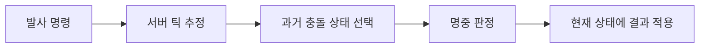

## 들어가며

멀티플레이 게임의 각 컴퓨터는 같은 순간을 직접 공유하지 않는다. 입력과 상태는 지연과 손실을 거쳐 도착하고, 서버 시뮬레이션과 클라이언트 렌더링은 서로 다른 시계에서 진행된다. 모든 화면을 즉시 같게 만드는 것은 불가능하므로 어떤 상태를 누가 결정하고 어느 정도의 차이를 허용할지 정해야 한다.

멀티플레이 네트워킹은 패킷 전송 위에 시간, 권위, 복제와 보정의 계약을 만든다. 이 글은 액션 게임을 중심으로 상태 동기화의 기본 모델과 실패 조건을 다룬다.

게임별 복제 의미는 애플리케이션이 정하지만, RTT 추정·손실 검출·재전송과 혼잡 제어가 결합되는 실제 표준 사례는 [QUIC loss detection RFC 9002](https://www.rfc-editor.org/rfc/rfc9002)에서 확인할 수 있다. 이를 게임 상태의 순서와 권위 계약으로 그대로 대체할 수는 없다.

---

## 목차
1. [서로 다른 시간축](#1-서로-다른-시간축)
2. [서버 권위와 입력](#2-서버-권위와-입력)
3. [스냅숏과 복제](#3-스냅숏과-복제)
4. [예측, 보정, 보간](#4-예측-보정-보간)
5. [지연 보상과 관심 영역](#5-지연-보상과-관심-영역)
6. [대역폭과 재현 검증](#6-대역폭과-재현-검증)

---

## 1. 서로 다른 시간축

게임에는 여러 빈도가 존재할 수 있다.

| 시간축 | 역할 |
|---|---|
| 입력 샘플 | 장치 상태를 게임 명령으로 변환 |
| 시뮬레이션 틱 | 권위 있는 상태 전이 |
| 네트워크 전송 | 입력과 상태를 패킷으로 송수신 |
| 렌더 프레임 | 현재 화면을 표시 |

이 빈도는 같을 필요가 없다. 서버가 30Hz로 시뮬레이션하고 클라이언트가 144Hz로 렌더링할 수도 있다. 렌더링은 두 시뮬레이션 상태 사이를 보간하며, 네트워크 전송은 여러 틱을 한 패킷에 묶을 수 있다.

각 틱에는 유한한 시퀀스 번호가 붙는다. 번호가 래핑되므로 일반 정수의 `<` 비교를 영구적으로 사용할 수 없다. 최대 비교 거리와 모듈러 순서 규칙을 정해야 한다.

클라이언트와 서버의 시계를 같은 벽시계 값으로 맞추는 것보다, 서버 틱에 대한 클라이언트의 추정 오프셋과 드리프트를 유지하는 편이 게임 상태에 직접적이다.

## 2. 서버 권위와 입력

권위 있는 서버는 최종 게임 상태를 결정한다. 클라이언트는 “내 위치는 여기다”라는 결과보다 “이 틱에 이 방향으로 이동했다”라는 입력 명령을 보낸다.

```text
InputCommand {
    clientTick
    sequence
    moveAxes
    buttons
}
```

서버는 명령을 다음 기준으로 검증한다.

- 세션과 플레이어가 유효한가.
- 시퀀스가 수신 윈도 안에 있는가.
- 입력 값이 허용 범위 안에 있는가.
- 단위 시간당 명령 수가 정책 안에 있는가.
- 현재 상태에서 행동이 가능한가.

서버 권위는 모든 치트를 자동으로 막지 않는다. 서버가 검증하지 않는 정보, 봇 입력, 가시성 정보 악용, 서비스 API 공격은 남는다. 권위는 신뢰 경계를 명시하는 출발점이다.

입력 손실을 줄이기 위해 최근 여러 입력을 함께 보낼 수 있다. 중복 입력은 시퀀스 번호로 제거한다. 오래된 입력을 무제한 수용하면 과거 상태를 다시 바꾸거나 메모리를 고갈시킬 수 있으므로 유한한 명령 윈도가 필요하다.

## 3. 스냅숏과 복제

서버는 전체 월드를 매번 보내지 않고 클라이언트가 알아야 할 상태를 스냅숏으로 만든다.

```text
Snapshot {
    serverTick
    baselineTick
    entities[]
}
```

스냅숏 복제의 핵심 계약은 다음과 같다.

- 스냅숏이 표현하는 서버 틱
- 전체 상태인지 baseline 대비 delta인지
- 엔티티 생성, 갱신, 제거 표현
- 필드별 양자화와 허용 오차
- 클라이언트가 확인한 baseline

delta는 송신자가 임의로 선택한 이전 상태와 비교하면 안 된다. 클라이언트가 실제로 보유한다고 확인한 baseline을 사용해야 한다. baseline이 유실되거나 만료되면 전체 상태나 더 오래된 확인 상태로 복구한다.

엔티티 ID는 네트워크 수명 동안 안정적이어야 한다. 제거된 ID를 즉시 재사용하면 지연된 패킷이 새 객체에 적용될 수 있다. 세대 번호나 충분한 재사용 지연이 필요하다.

상태 업데이트에는 신뢰성 종류가 섞인다.

- 최신 위치는 새 값이 옛 값을 대체한다.
- 생성과 제거는 결국 전달돼야 한다.
- 한 번만 적용할 게임 이벤트는 ID와 중복 제거가 필요하다.

모든 필드를 하나의 순서 채널에 넣으면 덜 중요한 손실이 중요한 최신 상태를 막을 수 있다.

## 4. 예측, 보정, 보간

클라이언트 예측은 로컬 입력을 서버 응답 전에 적용한다. 입력 지연을 숨기지만 클라이언트 상태가 권위 상태와 달라질 수 있다.

서버 스냅숏이 도착하면 다음 과정을 수행한다.

1. 스냅숏 틱의 권위 상태로 복원한다.
2. 서버가 처리했다고 확인한 입력까지 기록에서 제거한다.
3. 남은 로컬 입력을 동일한 시뮬레이션 규칙으로 다시 적용한다.
4. 화면 표현은 오차 크기에 따라 부드럽게 보정하거나 즉시 이동한다.

재시뮬레이션이 같은 결과를 내려면 입력, 시간 간격, 충돌 순서, 무작위 상태와 필요한 월드 조건이 일치해야 한다. 완전한 비트 결정성이 없더라도 오차를 감지하고 제한하는 정책은 필요하다.

원격 플레이어는 도착한 스냅숏을 즉시 표시하면 지터에 따라 흔들린다. 보간 버퍼는 렌더 시간을 최신 서버 상태보다 조금 과거에 두고 두 스냅숏 사이를 보간한다.

$$
x(t) = (1-\alpha)x_0 + \alpha x_1
$$

버퍼가 크면 손실과 지터를 잘 흡수하지만 표시 지연이 늘어난다. 버퍼가 부족해 미래 상태가 없으면 제한된 외삽을 사용할 수 있으나 오차가 시간과 함께 커진다. 최대 외삽 시간과 순간 이동 임계값을 둔다.

## 5. 지연 보상과 관심 영역

서버가 현재 위치만으로 과거 발사를 판정하면 높은 지연의 플레이어가 화면에서 맞춘 대상도 빗나갈 수 있다. 지연 보상은 서버가 제한된 과거 상태를 보관하고 발사 시점에 가까운 상태로 판정을 수행하는 방식이다.



서버는 클라이언트가 주장한 시간을 그대로 신뢰하지 않는다. 수신 시점, 관측된 RTT, 명령 윈도와 최대 rewind 범위로 제한한다. 지연 보상은 공격자에게 과거 위치의 이점을 주므로 공정성 정책이 필요하다.

관심 영역(AOI)은 각 클라이언트와 관련 있는 엔티티만 복제한다. 거리만 아니라 팀, 가시성, 게임 규칙, 소리와 중요 이벤트를 함께 고려할 수 있다.

AOI 경계에서 객체가 빠르게 들어왔다 나가면 생성과 제거가 반복될 수 있다. 진입·이탈 반경을 다르게 두는 히스테리시스와 최소 유지 시간을 사용할 수 있다.

## 6. 대역폭과 재현 검증

대역폭 예산은 엔티티 수와 필드 크기를 곱하는 것에서 시작하지만 헤더, 신뢰성 메타데이터, 재전송, 암호화 오버헤드도 포함한다.

$$
B \approx
N_{\text{clients}}
\times R_{\text{snapshots}}
\times E_{\text{visible}}
\times S_{\text{entity}}
$$

이 식은 상한을 찾는 출발점이다. 실제로는 모든 엔티티가 매번 변하지 않고 우선순위와 delta 압축을 사용한다.

우선순위는 중요도, 거리, 마지막 갱신 이후 시간, 예상 시각 오차를 조합할 수 있다. 예산이 부족할 때 어떤 상태부터 지연되는지가 게임 품질을 결정한다.

검증 환경은 네트워크 장애와 시뮬레이션 로그를 함께 다룬다.

- 고정 시드와 입력 명령을 기록한다.
- 서버 틱별 상태 해시와 핵심 상태를 저장한다.
- 지연, 지터, burst loss, 중복, 재정렬을 주입한다.
- baseline 유실과 ID 재사용을 강제로 발생시킨다.
- 보정 거리, 보간 버퍼 고갈, 외삽 시간을 계측한다.

상태 해시가 달라졌다는 사실만으로 원인을 알 수 없으므로 첫 불일치 틱의 입력, RNG 상태, 엔티티별 차이를 추적할 수 있어야 한다.

---

## 결론

멀티플레이 동기화는 네트워크를 통해 같은 메모리를 공유하는 일이 아니다. 서로 다른 시간축에서 입력과 스냅숏을 교환하고, 서버 권위와 제한된 로컬 추정을 결합해 일관된 플레이 경험을 만든다.

예측, 보정, 보간, 지연 보상과 AOI는 각각 지연·정확도·대역폭 사이의 비용 교환이다. 틱과 시퀀스, baseline, 입력 기록의 불변식을 명시하고 네트워크 장애 아래에서 상태 차이와 시각 오차를 검증해야 한다.
