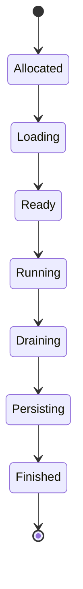
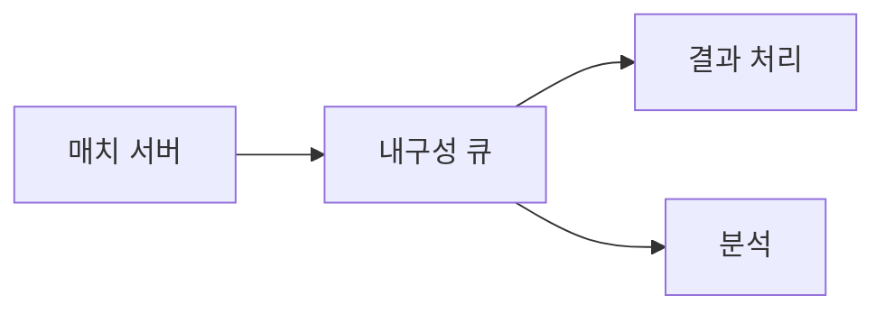

## 들어가며

온라인 게임 서버는 하나의 프로그램이 아니라 서로 다른 시간과 일관성 요구를 가진 기능의 집합이다. 실시간 매치 시뮬레이션은 짧은 틱 마감과 권위 상태가 중요하고, 로그인·인벤토리·매치메이킹은 요청의 내구성과 중복 처리가 중요하다.

모놀리스와 마이크로서비스라는 이름보다 상태 소유권, 실패 경계, 호출 빈도가 먼저다. 이 글은 권위 시뮬레이션과 온라인 서비스를 어떤 경계로 구성하는지 다룬다.

분산 서비스의 SLO, overload, 관측과 사고 대응을 연결하는 운영 모델은 [Google SRE Workbook](https://sre.google/workbook/table-of-contents/)에서 공개 교재 형태로 제공한다. 제품별 배포 문법보다 상태와 실패 경계에 적용하는 것이 중요하다.

---

## 목차
1. [서버 역할과 상태](#1-서버-역할과-상태)
2. [실시간 매치의 수명](#2-실시간-매치의-수명)
3. [서비스 경계와 통신](#3-서비스-경계와-통신)
4. [확장과 파티셔닝](#4-확장과-파티셔닝)
5. [부분 실패와 멱등성](#5-부분-실패와-멱등성)
6. [운영 가능한 서버 검증](#6-운영-가능한-서버-검증)

---

## 1. 서버 역할과 상태

온라인 게임의 대표 역할은 다음처럼 나뉜다.

| 역할 | 주요 상태 | 중요한 비용 |
|---|---|---|
| 게이트웨이 | 연결, 인증 결과, 라우팅 | 연결 수, 패킷률 |
| 매치 서버 | 권위 시뮬레이션 | 틱 지연, 결정 규칙 |
| 매치메이커 | 대기열과 조건 | 대기 시간, 매치 품질 |
| 계정·경제 서비스 | 영속 상태 | 일관성, 중복 방지 |
| 채팅·소셜 | 관계와 메시지 | fan-out, 보존 정책 |
| 분석 파이프라인 | 이벤트 로그 | 처리량, 지연 허용 |

한 프로세스에 모두 넣을 수도 있고 여러 서비스로 나눌 수도 있다. 경계의 핵심은 각 상태의 권위 있는 소유자가 하나인지, 다른 기능이 어떤 계약으로 접근하는지다.

실시간 매치 루프가 원격 경제 API 응답을 매 틱 기다리면 네트워크 지연과 서비스 장애가 프레임 마감에 들어온다. 자주 읽는 매치 규칙과 플레이어 초기 상태는 매치 시작 시 검증된 스냅숏으로 가져오고, 종료 결과는 명시적인 커밋 경계에서 처리한다.

## 2. 실시간 매치의 수명

매치 서버의 수명은 상태 기계로 표현할 수 있다.



각 전이는 실패 정책을 가진다.

- 로드 실패 시 참가자를 어디로 돌려보내는가.
- 일부 플레이어만 접속했을 때 언제 시작하는가.
- 연결이 끊긴 플레이어의 입력을 얼마나 기다리는가.
- 종료 결과 저장이 지연되면 매치 프로세스를 언제 해제하는가.

프로세스 메모리에만 있는 매치 상태는 프로세스 장애와 함께 사라진다. 모든 틱을 영속 저장하는 것은 비용이 크므로 장르에 따라 재접속 스냅숏, 이벤트 로그, 체크포인트, 매치 무효화 중 하나를 선택한다.

서버 틱이 늦어졌을 때 무제한 catch-up을 하면 부하가 더 커져 회복하지 못할 수 있다. 최대 보정 틱, 품질 저하, 매치 종료 같은 overload 정책이 필요하다.

## 3. 서비스 경계와 통신

프로세스 경계는 함수 호출을 네트워크 요청으로 바꾼다. 직렬화, 큐, 재시도, 부분 실패, 배포 버전 차이가 생긴다. 마이크로서비스는 이 비용을 지불할 만큼 독립 배포와 확장, 장애 격리 가치가 있을 때 사용한다.

동기 요청은 호출자가 결과를 기다린다. 결과가 즉시 필요한 인증과 조회에 적합하지만 의존 서비스의 지연이 호출 경로에 더해진다.

비동기 메시지는 생산자와 소비자의 시간을 분리한다.



큐는 작업을 없애지 않고 저장 위치와 완료 시점을 바꾼다. queue depth가 계속 증가하면 소비 처리량이 생산 처리량보다 낮다는 뜻이다. 유한한 보존 기간과 backpressure가 필요하다.

API 계약에는 버전, 타임아웃, 최대 요청 크기, 오류 분류와 중복 처리 규칙을 포함한다. 무기한 대기는 장애를 전체 호출 그래프로 전파한다.

## 4. 확장과 파티셔닝

무상태 요청 처리는 여러 인스턴스에 분산하기 쉽다. 상태가 있는 매치 서버는 특정 세션의 요청이 해당 상태를 가진 인스턴스로 가야 한다.

파티션 키는 상태의 함께 갱신되는 범위를 따른다.

- 매치 상태는 `matchId`
- 플레이어 계정은 `playerId`
- 길드 상태는 `guildId`
- 지역별 대기열은 `region`

단순한 `hash(key) % N`은 인스턴스 수가 바뀔 때 많은 키를 재배치할 수 있다. 일관 해싱이나 고정된 논리 파티션을 사용하면 이동 범위를 줄일 수 있지만 “정확히 몇 퍼센트”라는 값은 토큰 배치와 분포에 따라 달라진다.

파티션 내부에서만 가능한 트랜잭션과 파티션을 넘는 작업을 구분한다. 두 플레이어 간 거래가 서로 다른 파티션을 건너면 잠금, 조정자, 비동기 상태 기계 중 하나가 필요하다.

확장 단위는 CPU만이 아니다.

```text
동시 연결 수
초당 패킷과 바이트
매치당 CPU와 메모리
DB 요청률
큐 생산·소비율
외부 API quota
```

평균 부하보다 한 매치나 한 길드에 집중되는 hot key가 병목을 만들 수 있다.

## 5. 부분 실패와 멱등성

분산 호출은 다음 상태를 구분하기 어렵다.

```text
요청이 상대에 도착하지 않음
상대가 처리 전에 실패
처리했지만 응답이 유실
응답 후 호출자가 실패
```

타임아웃만으로 처리 여부를 알 수 없으므로 무조건 재시도하면 구매나 보상이 중복 적용될 수 있다. 멱등성 키는 같은 논리 요청의 반복을 같은 결과로 처리하게 한다.

```text
idempotencyKey = accountId + operationId
```

키와 결과는 상태 변경과 원자적으로 기록해야 한다. 메모리 캐시에만 중복 키를 두면 재시작 후 보호가 사라진다.

재시도에는 최대 횟수, 전체 deadline, 지수 backoff와 jitter를 둔다. 영구 오류를 재시도하거나 모든 클라이언트가 같은 간격으로 재시도하면 장애를 증폭한다.

서킷 브레이커는 실패 중인 의존성으로 새 요청을 계속 보내지 않게 하지만 데이터 일관성을 해결하지 않는다. fallback이 허용되는 읽기와 절대 생략할 수 없는 경제 쓰기를 구분한다.

DB 상태 변경과 메시지 발행을 함께 보장해야 하면 outbox를 사용할 수 있다. 같은 트랜잭션에 상태와 발행 예정 레코드를 기록하고 별도 전달자가 재시도한다. 소비자는 중복 메시지를 처리할 수 있어야 한다.

## 6. 운영 가능한 서버 검증

서버 테스트는 함수 결과뿐 아니라 장애 중 불변식을 확인한다.

- 매치 서버를 강제 종료해 재접속·결과 처리 정책을 확인한다.
- 응답 유실 뒤 같은 operation ID를 재전송한다.
- 큐 소비자를 중단해 backlog와 메모리 상한을 확인한다.
- 한 파티션에 부하를 집중해 hot key를 만든다.
- 서비스 버전이 섞인 상태에서 호환성을 검사한다.
- 시간 제한을 초과한 요청이 실제로 취소되는지 확인한다.

관측 신호는 상태 기계와 연결한다.

| 신호 | 해석 |
|---|---|
| tick p99 | 실시간 마감 위반 |
| active matches | 현재 상태량 |
| queue age | 처리 지연과 backlog |
| retry rate | 의존성 실패 또는 잘못된 timeout |
| duplicate suppression | 재전송과 멱등성 동작 |
| result commit latency | 매치 종료 후 영속화 지연 |

CPU 사용률이 낮아도 queue age와 p99가 높으면 락, I/O, hot partition이 병목일 수 있다. 시스템 목적과 직접 연결된 지표를 사용한다.

---

## 결론

온라인 게임 서버 아키텍처는 서비스 개수의 문제가 아니라 상태 소유권과 실패 경계의 문제다. 실시간 매치, 계정·경제, 매치메이킹과 분석은 서로 다른 마감과 일관성 요구를 가진다.

프로세스 경계를 추가하면 독립 확장과 장애 격리를 얻는 대신 네트워크 지연, 버전, 재시도와 부분 실패를 부담한다. 파티션 키, 멱등성, 유한 큐와 상태 기계를 명시하고 장애 주입으로 불변식을 검증해야 한다.
