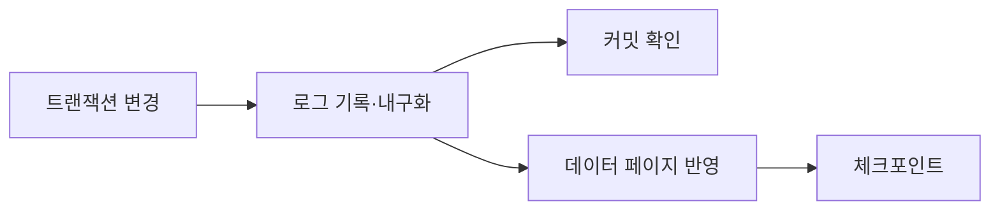

## 들어가며

메모리의 게임 상태는 프로세스가 종료되면 사라진다. 저장 시스템은 장애 뒤에도 계정, 인벤토리, 진행도와 경제 기록을 복구할 수 있게 한다. 핵심은 데이터를 넣는 API가 아니라 어떤 상태 전이가 원자적이고 어떤 읽기가 일관된 결과를 봐야 하는지 정하는 일이다.

데이터베이스는 트랜잭션, 인덱스, 로그, 복제와 파티셔닝을 통해 이 계약을 구현한다. 각 기능은 쓰기 비용, 지연과 가용성의 교환을 가진다. 이 글은 게임 영속 상태를 설계하는 기본 모델을 다룬다.

---

## 목차
1. [데이터 모델과 불변식](#1-데이터-모델과-불변식)
2. [트랜잭션과 격리](#2-트랜잭션과-격리)
3. [인덱스와 쿼리 비용](#3-인덱스와-쿼리-비용)
4. [로그와 복구](#4-로그와-복구)
5. [복제, 캐시, 샤딩](#5-복제-캐시-샤딩)
6. [게임 경제 검증](#6-게임-경제-검증)

---

## 1. 데이터 모델과 불변식

스키마는 객체 클래스를 그대로 옮긴 그림이 아니라 보존해야 할 사실과 제약의 모델이다.

```text
Account(account_id, ...)
InventoryItem(account_id, item_instance_id, item_type, quantity)
CurrencyLedger(entry_id, account_id, delta, reason, operation_id)
```

경제 상태에는 다음과 같은 불변식이 있다.

$$
quantity \ge 0
$$

$$
balance_{\text{after}}
=
balance_{\text{before}} + delta
$$

애플리케이션의 `if` 검사만으로 동시 요청 사이의 불변식을 보장할 수 없다. 데이터베이스 제약, 조건부 갱신, 트랜잭션과 잠금 정책을 함께 사용한다.

원장(ledger)은 결과 값만 덮어쓰는 대신 변화의 이유와 operation ID를 보존한다. 감사와 복구에 유리하지만 원장 크기, 집계 비용과 보존 정책이 필요하다.

정규화는 한 사실을 한 곳에 저장해 갱신 이상을 줄인다. 조회를 위해 중복 데이터를 만들면 어느 값이 권위인지와 갱신 방법을 명시해야 한다.

## 2. 트랜잭션과 격리

트랜잭션은 여러 읽기와 쓰기를 하나의 상태 전이로 묶는다. ACID는 아래 성질을 설명한다.

| 성질 | 의미 |
|---|---|
| 원자성 | 전부 반영되거나 전혀 반영되지 않음 |
| 일관성 | 정의한 제약을 만족하는 상태에서 다른 유효 상태로 이동 |
| 격리성 | 동시 실행이 관찰할 수 있는 중간 상태 제한 |
| 지속성 | 커밋 결과가 정의한 장애 모델 뒤에도 보존 |

일관성은 데이터베이스가 게임 규칙을 자동으로 이해한다는 뜻이 아니다. 제약과 트랜잭션 로직으로 규칙을 표현해야 한다.

아이템 구매는 잔액 확인과 차감, 아이템 추가, operation 기록이 하나의 논리 전이다.

```sql
UPDATE account_currency
SET balance = balance - :price
WHERE account_id = :account_id
  AND balance >= :price;
```

영향받은 행이 1개인지 확인한 뒤 같은 트랜잭션에서 아이템과 멱등성 레코드를 기록한다. 단순한 “SELECT 후 UPDATE”는 두 요청이 같은 잔액을 보고 모두 성공하는 경쟁을 만들 수 있다. 가격은 서버가 결정한 유효 값인지, 무료 구매를 허용하는지, 정수 범위·NULL·행 유일성이 보장되는지도 계약으로 둔다. 가격이 음수이면 잔액 조건을 통과해 오히려 잔액이 늘어날 수 있으므로, 조건부 갱신만으로 요청 자체의 유효성 검증이 사라지지는 않는다. 멱등성 기록의 유일성 충돌이 나면 아이템과 차감까지 같은 트랜잭션에서 취소한다.

격리 수준은 DBMS 구현마다 세부 의미가 다르다. 일반적으로 낮은 격리는 동시성을 높이는 대신 non-repeatable read, phantom, write skew 같은 이상 현상을 더 허용할 수 있다. 업무 불변식이 어떤 이상에 깨지는지부터 판단한다.

## 3. 인덱스와 쿼리 비용

인덱스는 키에서 행 위치로 가는 보조 자료구조다. B+Tree 계열 인덱스는 정렬된 범위 질의와 점 조회를 지원한다. 인덱스가 있으면 모든 쿼리가 빨라지는 것이 아니다.

복합 인덱스 `(account_id, item_type)`는 일반적으로 선두 키를 사용하는 조건에 유리하다.

```sql
SELECT quantity
FROM inventory_item
WHERE account_id = :account_id
  AND item_type = :item_type;
```

`item_type`만으로 조회할 때 같은 인덱스를 효율적으로 사용할 수 있는지는 DBMS, 통계와 실행 계획에 달려 있다. 쿼리 문장만 보고 인덱스 사용을 단정하지 않고 실행 계획을 확인한다.

인덱스 비용은 쓰기에 추가된다.

- 인덱스 페이지 갱신
- 페이지 분할과 유지 관리
- 로그 증가
- 캐시와 저장 공간 사용

선택도가 낮은 조건은 인덱스를 거쳐 많은 행을 임의 접근하는 것보다 순차 스캔이 유리할 수 있다. 고정된 선택도 임계값은 없으며 데이터 크기, 페이지 캐시, 행 폭과 클러스터링에 따라 달라진다.

N+1 문제는 부모 목록 한 번과 각 부모의 자식 조회를 별도로 수행해 요청 수가 입력에 비례하는 문제다. JOIN, batch query, 명시적 prefetch를 사용하되 결과 중복과 메모리 사용량을 함께 본다.

## 4. 로그와 복구

데이터베이스는 일반적으로 데이터 페이지보다 먼저 복구 가능한 로그를 기록하는 write-ahead logging을 사용한다. 커밋은 어떤 로그가 안정 저장소에 도달했는지에 대한 내구성 계약과 연결된다.



이 도식은 단순화한 한 경로다. WAL의 핵심 조건은 관련 데이터 페이지를 안정 저장소에 쓰기 전에 로그를 내구화하는 것이며, 데이터 페이지 쓰기가 항상 커밋 이후에만 가능하다는 뜻이 아니다. 체크포인트도 매 트랜잭션마다 수행하는 단계가 아니다.

장애 뒤에는 로그를 재실행하거나 취소해 커밋된 상태를 복원한다. 이 때문에 논리 쓰기 한 번이 로그, 데이터 페이지, 인덱스와 저장 장치 내부 쓰기로 증폭될 수 있다.

MVCC는 여러 버전의 행을 유지해 읽기와 쓰기의 관찰 관계를 관리한다. “트랜잭션 ID가 작으면 보인다”는 단순 비교로 설명할 수 없다. 스냅숏, 커밋 상태, 삭제 표식과 DBMS별 가시성 규칙이 필요하다.

[PostgreSQL 동시성 제어 문서](https://www.postgresql.org/docs/current/mvcc.html)는 실제 DBMS의 MVCC, 격리와 명시적 잠금 계약을 설명한다. 다른 DBMS에 같은 세부 동작을 가정하지 않고 사용하는 제품의 공식 문서를 확인해야 한다.

오래 열린 트랜잭션은 이전 버전 회수를 막고 저장 공간과 인덱스 성능을 악화시킬 수 있다. 트랜잭션 범위를 네트워크 왕복이나 사용자 입력까지 늘리지 않는다.

## 5. 복제, 캐시, 샤딩

복제는 같은 논리 데이터를 여러 노드에 유지한다. 동기 복제는 커밋 경로에 복제 확인을 넣어 데이터 손실 범위를 줄이지만 지연과 가용성 비용이 있다. 비동기 복제는 쓰기 지연을 줄일 수 있지만 장애 시 아직 전달되지 않은 커밋을 잃을 수 있다.

읽기 복제본은 지연된 상태를 반환할 수 있다. 방금 쓴 인벤토리를 즉시 읽어야 하는 요청을 무조건 replica로 보내면 read-your-writes가 깨질 수 있다.

캐시는 권위 데이터베이스를 대체하지 않는다. DB 쓰기 뒤 캐시 갱신이 실패하면 오래된 값이 남는다. TTL, invalidation, version, cache-aside 정책 중 무엇을 사용해도 두 저장소의 원자성은 자동으로 생기지 않는다.

샤딩은 데이터를 파티션 키로 나눠 여러 저장소에 배치한다. 좋은 키는 부하를 분산하면서 함께 트랜잭션해야 하는 데이터를 같은 파티션에 둔다.

```text
account_id: 개인 인벤토리에는 자연스러움
guild_id: 길드 공동 상태에는 자연스러움
region: 지역별 접속에는 유용하지만 대형 지역 hot spot 가능
```

파티션을 넘는 거래는 단일 노드 트랜잭션보다 복잡하다. 2PC는 조정자와 참여자의 내구 로그·복구 프로토콜이 있어야 하며, 단순히 여러 DB에 순서대로 `Commit`하는 코드는 2PC가 아니다.

## 6. 게임 경제 검증

경제 시스템은 성능보다 보존 법칙을 먼저 검증한다.

```text
동일 operation_id는 한 번만 효과를 냄
잔액과 수량은 허용 범위를 벗어나지 않음
거래 양쪽의 총량 변화가 규칙과 일치
실패 중간 상태가 외부에 커밋되지 않음
감사 로그로 결과를 재구성할 수 있음
```

장애 테스트는 커밋 전후의 각 지점에서 프로세스를 종료하고 재시도를 보낸다. 응답이 유실된 경우에도 같은 operation ID가 중복 보상을 만들지 않아야 한다.

부하 테스트는 평균 QPS뿐 아니라 hot account, 대형 길드, 오래 열린 트랜잭션, replica lag, 캐시 stampede를 포함한다.

DB 지표는 애플리케이션 결과와 연결한다.

| DB 지표 | 게임 영향 |
|---|---|
| lock wait | 구매·로그인 지연 |
| replication lag | 오래된 읽기 |
| transaction abort | 재시도와 중복 위험 |
| buffer hit ratio | I/O 경로 변화 |
| queue depth | 저장 지연 누적 |

---

## 결론

데이터베이스 설계의 중심은 테이블 수가 아니라 영속 상태의 불변식이다. 트랜잭션과 격리는 동시 상태 전이를 제한하고, 인덱스는 읽기 비용을 줄이는 대신 쓰기와 공간 비용을 추가하며, 로그는 장애 복구의 근거를 만든다.

복제, 캐시와 샤딩은 용량과 가용성을 확장하지만 지연된 읽기, 부분 실패와 교차 파티션 문제를 만든다. 경제 상태는 멱등성 키와 원자적 제약으로 보호하고, 응답 유실과 프로세스 종료를 주입해 결과를 검증해야 한다.
