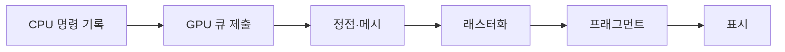

## 들어가며

실시간 그래픽스는 장면의 기하, 재질, 조명과 카메라를 유한한 픽셀 샘플로 바꾸는 과정이다. 행렬을 곱하고 셰이더를 실행하는 API 사용법만으로는 깊이 오류, aliasing, 대역폭 병목과 GPU 동기화를 설명할 수 없다.

렌더링은 좌표 변환, 가시성, 샘플링, 병렬 실행의 결합이다. 이 글은 그래픽스 API와 무관하게 장면이 화면으로 변환되는 기본 파이프라인과 비용 모델을 다룬다.

---

## 목차
1. [장면에서 클립 공간까지](#1-장면에서-클립-공간까지)
2. [래스터화와 깊이](#2-래스터화와-깊이)
3. [셰이딩과 빛](#3-셰이딩과-빛)
4. [텍스처와 샘플링](#4-텍스처와-샘플링)
5. [GPU 실행과 메모리](#5-gpu-실행과-메모리)
6. [병목과 검증](#6-병목과-검증)

---

## 1. 장면에서 클립 공간까지

정점은 여러 좌표계를 거쳐 화면에 배치된다.

$$
p_{\text{clip}} =
P V M p_{\text{local}}
$$

$M$은 모델에서 월드, $V$는 월드에서 뷰, $P$는 뷰에서 클립 공간으로 변환한다. 곱셈 순서는 벡터를 열벡터로 두는 표기 기준이며 실제 코드의 수학 규약과 일치해야 한다.

클립 공간에서는 동차 좌표 $(x_c,y_c,z_c,w_c)$로 절두체 경계를 표현한다. 클리핑 뒤 원근 나눗셈을 수행한다.

$$
p_{\text{ndc}} =
\left(
\frac{x_c}{w_c},
\frac{y_c}{w_c},
\frac{z_c}{w_c}
\right)
$$

NDC 깊이 범위와 화면 원점은 API 계약에 따라 다를 수 있다. 행렬 라이브러리의 투영 함수와 그래픽스 API의 규약이 맞지 않으면 화면은 보이더라도 깊이와 컬링이 반대로 동작할 수 있다.

법선은 위치와 같은 방식으로 변환하지 않는다. 비균일 스케일이 포함되면 모델 행렬 선형부의 역전치가 필요하다.

$$
n' = (M^{-1})^T n
$$

## 2. 래스터화와 깊이

래스터라이저는 클립된 삼각형이 덮는 픽셀 샘플을 찾고 정점 속성을 보간한다. 이 단계도 setup, 작은 삼각형, overdraw와 타일 처리에 따라 병목이 될 수 있다.

원근 투영에서 화면 공간 선형 보간만 사용하면 텍스처와 속성이 왜곡된다. GPU는 일반적으로 $1/w$를 이용한 원근 보정 보간을 제공한다.

깊이 버퍼는 각 샘플에서 카메라에 가까운 표면을 선택한다. 표준 원근 깊이는 거리에 대해 선형이 아니며 near plane 근처에 더 많은 정밀도를 배치한다.

near plane을 지나치게 작게 두면 전체 유효 정밀도가 악화된다. 부동소수점 깊이와 reversed-Z를 결합하면 원거리 정밀도 분포가 개선될 수 있지만 정확한 효과는 투영과 깊이 형식, API 규약에 따라 달라진다. 고정된 “몇 배 향상”으로 일반화하지 않는다.

깊이 테스트를 일찍 수행하면 가려진 프래그먼트의 셰이딩을 줄일 수 있다. 셰이더가 깊이를 변경하거나 특정 부작용을 사용하면 early depth 최적화가 제한될 수 있다.

## 3. 셰이딩과 빛

셰이더는 정점, 프래그먼트, 컴퓨트 작업에서 데이터를 병렬 처리한다. 화면의 밝기는 광원 수만으로 정해지지 않고 빛, 표면 반사, 가시성과 노출의 결합이다.

렌더링 방정식의 한 형태는 다음과 같다.

$$
L_o(x,\omega_o) =
L_e(x,\omega_o) +
\int_{\Omega}
f_r(x,\omega_i,\omega_o)
L_i(x,\omega_i)
(n\cdot\omega_i)^+
d\omega_i
$$

렌더링 방정식, 샘플링, 반사 모델과 기하 오차의 자세한 유도는 공개 교재 [Physically Based Rendering](https://pbr-book.org/4ed/contents)에서 확인할 수 있다. 실시간 렌더링은 같은 물리 모델을 제한된 샘플과 프레임 예산에 맞게 근사한다.

실시간 렌더링은 이 적분을 제한된 광원과 샘플, 근사 BRDF로 계산한다. 물리 기반 렌더링(PBR)은 “현실적인 값”이라는 라벨보다 에너지 보존, 일관된 재질 매개변수와 조명 환경의 관계가 중요하다.

forward 렌더링은 보이는 물체를 그리며 광원을 계산한다. deferred 렌더링은 표면 속성을 G-buffer에 저장한 뒤 조명을 계산한다. deferred가 항상 더 빠르지 않다.

| 경로 | 유리한 조건 | 주요 비용 |
|---|---|---|
| Forward | 적은 광원, 투명 물체, MSAA | 물체와 광원 조합 |
| Deferred | 많은 화면 공간 광원 | G-buffer 대역폭과 메모리 |
| Tiled/Clustered | 광원 영향 영역을 분할 가능 | 광원 목록 생성과 overflow 정책 |

타일 광원 목록은 고정 용량을 넘을 수 있다. 실제 저장한 개수와 발견한 개수를 분리하고, overflow 시 추가 패스·전역 목록·품질 저하 중 하나를 선택해야 한다.

## 4. 텍스처와 샘플링

텍스처는 연속 신호를 유한한 격자에 저장한 샘플이다. 화면 픽셀과 텍스처 샘플 밀도가 다르면 확대·축소 필터가 필요하다.

축소 시 한 픽셀이 넓은 텍스처 영역을 덮는다. 점 하나만 읽으면 고주파 성분이 낮은 주파수로 접혀 aliasing이 발생한다. mipmap은 미리 저역 통과된 여러 해상도를 제공한다.

LOD는 화면에서 텍스처 좌표 변화율을 이용해 선택한다. 비등방성 필터링은 비스듬한 표면에서 서로 다른 두 축의 footprint를 더 잘 근사한다.

색 텍스처와 법선·roughness 데이터는 같은 색 공간으로 해석하지 않는다. sRGB 색은 셰이딩 전에 선형 공간으로 변환하고, 법선과 재질 매개변수는 데이터로 읽는다.

텍스처 압축은 메모리와 대역폭을 줄이지만 블록 단위 오차와 형식 제약을 가진다. 압축률만 아니라 콘텐츠별 품질, 필터링 지원과 플랫폼 형식을 확인한다.

텍스처 아틀라스는 반드시 메모리를 줄이지 않는다. 같은 총 픽셀 수와 형식이면 원본 데이터 크기는 비슷하고, 패딩과 mip 경계 때문에 늘 수도 있다. 주된 이점은 바인딩과 배칭 구조에 있다.

## 5. GPU 실행과 메모리

GPU는 많은 invocation을 그룹으로 실행해 처리량을 높인다. 같은 그룹의 실행 경로가 갈라지면 양쪽 경로를 순차적으로 실행해야 할 수 있지만 실제 비용은 분기 일관성, 컴파일러와 아키텍처에 따라 다르다.

GPU 작업은 CPU 함수 호출처럼 즉시 끝나지 않는다.

CPU가 GPU 결과를 즉시 읽으면 파이프라인을 대기시킬 수 있다. 여러 프레임의 자원 수명, fence, command allocator 재사용 조건을 관리해야 한다.

GPU 메모리 비용은 자원 크기만으로 끝나지 않는다.

- 자원 정렬과 heap suballocation
- staging·upload 버퍼
- render target과 depth 버퍼
- mip와 압축 형식
- 프레임 중 동시 생존 복사본
- residency와 eviction

API에 따라 barrier와 상태 전이를 명시하거나 드라이버가 추론한다. 어느 경우든 한 작업의 쓰기가 다른 작업의 읽기 전에 완료되고 보이도록 해야 한다.

명시적 GPU 동기화 계약의 한 사례는 [Vulkan 명세](https://registry.khronos.org/vulkan/specs/latest/html/vkspec.html)에 정의돼 있다. 다른 API의 barrier와 자원 상태 규칙은 해당 명세를 사용해야 한다.

## 6. 병목과 검증

그래픽스 병목은 CPU 제출, 정점 처리, 래스터화, 프래그먼트 셰이딩, 메모리 대역폭, 동기화 중 어디에도 있을 수 있다.

부하를 하나씩 바꾸면 병목을 추론할 수 있다.

| 실험 | 시간이 크게 줄면 의심할 병목 |
|---|---|
| 해상도를 절반으로 낮춤 | 프래그먼트·대역폭 |
| 메시 복잡도를 낮춤 | 정점·래스터 setup |
| 셰이더를 단순화 | 셰이더 연산·텍스처 |
| draw 수를 줄임 | CPU 제출·상태 변경 |
| shadow 해상도·수 감소 | 그림자 패스 |

GPU 타이머는 비동기 큐의 작업 구간을 측정해야 한다. CPU에서 draw 호출 전후만 재면 명령 기록 시간을 측정할 뿐 GPU 실행 시간을 알 수 없다.

정확성 검증에는 다음 항목이 필요하다.

- 좌표축과 clip/NDC 규약을 표시하는 진단 장면
- 깊이와 법선, roughness, shadow map 시각화
- NaN과 무한대 탐지
- API validation layer와 자원 수명 검사
- 고정 카메라의 이미지 비교와 허용 오차
- 광원 목록과 버퍼의 overflow 카운터

---

## 결론

실시간 그래픽스는 좌표 변환, 가시성, 샘플링과 GPU 병렬 실행의 결합이다. 화면에 픽셀이 나왔다는 사실만으로 좌표와 깊이 규약, 색 공간, 자원 동기화가 올바르다고 판단할 수 없다.

렌더링 경로와 최적화는 장면의 삼각형 크기, overdraw, 광원, 해상도와 메모리 대역폭에 따라 달라진다. GPU 타이머와 진단 버퍼로 실제 병목을 분리하고, 경계·overflow·자원 수명을 검증해야 한다.
