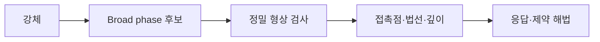

## 들어가며

물리 엔진은 연속 시간의 운동을 유한한 시간 간격과 부동소수점 연산으로 근사한다. 현실의 공식을 코드로 옮기는 것만으로 안정적인 결과가 나오지 않는다. 적분 오차, 충돌 검출 누락, 제약 반복 오차와 실행 순서가 결과를 바꾼다.

게임 물리는 정확한 자연 모사가 아니라 플레이 규칙에 필요한 안정성과 재현성을 정해진 시간 안에 제공하는 시스템이다. 이 글은 시간 적분, 충돌, 임펄스와 제약 해법의 기본 모델을 다룬다.

수치 적분, 연속 충돌과 sequential impulse의 실무적 유도 자료는 Erin Catto의 [Box2D Publications](https://box2d.org/publications/)에 공개돼 있다. 특정 엔진 구현을 복사하기보다 가정과 부호 규약을 확인하는 근거로 사용한다.

---

## 목차
1. [상태와 고정 시간 간격](#1-상태와-고정-시간-간격)
2. [수치 적분](#2-수치-적분)
3. [충돌 검출](#3-충돌-검출)
4. [충돌 응답](#4-충돌-응답)
5. [제약과 반복 해법](#5-제약과-반복-해법)
6. [안정성과 검증](#6-안정성과-검증)

---

## 1. 상태와 고정 시간 간격

강체의 기본 상태는 위치 $x$, 방향 $q$, 선속도 $v$, 각속도 $\omega$다. 힘과 토크는 상태를 직접 바꾸는 값이 아니라 속도의 변화율을 만든다.

$$
\dot{x}=v,\qquad
\dot{v}=\frac{F}{m}
$$

가변 렌더 프레임 시간을 그대로 물리 적분에 사용하면 같은 입력도 프레임 패턴에 따라 다른 결과를 낼 수 있다. 고정 간격 시뮬레이션은 누적 시간을 일정한 $\Delta t$ 단위로 소비한다. 다음은 기본 소비 흐름이며, `fixedDt`가 유한한 양수이고 누적 시간이 유효 범위 안이라는 전제가 필요하다. 실제 구현은 최대 반복 수와 초과 시간 처리 정책을 포함한다.

```cpp
accumulator += frameTime;

while (accumulator >= fixedDt) {
    Simulate(fixedDt);
    accumulator -= fixedDt;
}
```

한 프레임이 길어졌을 때 누적된 모든 틱을 무제한 실행하면 프레임이 더 늦어지는 spiral of death가 생길 수 있다. 최대 프레임 입력 시간과 최대 catch-up 틱을 두고, 초과 상태의 정책을 명시한다.

고정 $\Delta t$는 결정성에 유리한 조건일 뿐 충분조건은 아니다. 부동소수점 연산, 컨테이너 순회, 병렬 병합, 충돌 쌍 순서와 플랫폼 차이도 같아야 한다.

## 2. 수치 적분

명시적 오일러는 현재 속도로 위치를, 현재 가속도로 속도를 갱신한다.

$$
x_{n+1}=x_n+v_n\Delta t
$$

$$
v_{n+1}=v_n+a_n\Delta t
$$

조화 진동자에서는 에너지가 증가해 작은 $\Delta t$에서도 장기적으로 불안정할 수 있다.

반암시적 오일러는 속도를 먼저 갱신하고 새 속도로 위치를 갱신한다.

$$
v_{n+1}=v_n+a_n\Delta t
$$

$$
x_{n+1}=x_n+v_{n+1}\Delta t
$$

구현이 단순하고 해밀토니안 계에서 에너지 거동이 명시적 오일러보다 나아 게임 물리에 자주 쓰인다. “Explicit Euler”라는 이름으로 이 구현을 제시하면 안정성 분석이 섞인다.

Verlet 계열은 위치 이력을 이용해 2차 정확도를 얻을 수 있지만 고정 시간 간격과 힘의 성질 같은 조건이 필요하다. RK4는 매 단계 여러 힘 평가로 높은 국소 정확도를 제공하지만 symplectic하지 않으며 충돌과 불연속 힘이 많은 강체 엔진의 만능 해법이 아니다.

적분기 선택은 차수만 아니라 다음 항목을 본다.

- 장기 에너지 거동
- 힘 평가 비용
- 충돌과 제약의 불연속
- $\Delta t$ 변화
- 필요한 재현성

## 3. 충돌 검출

충돌 파이프라인은 broad phase와 narrow phase로 나뉜다.



broad phase는 AABB, sweep-and-prune, 균일 격자, BVH를 사용해 검사할 쌍을 줄인다. 결과는 실제 충돌이 아니라 충돌 가능성이 있는 후보다.

narrow phase는 형상 쌍에 대해 접촉 여부와 접촉 정보를 계산한다. 접촉 법선의 방향, 침투 깊이의 부호, 접촉점 기준을 일관되게 정의해야 응답 부호가 맞는다.

이산 충돌 검출은 두 틱 사이에 빠른 물체가 얇은 장애물을 통과하는 tunneling을 만들 수 있다. 연속 충돌 검출은 이동 구간에서 충돌 시간(TOI)을 찾지만 계산 비용과 퇴화 조건이 늘어난다.

모든 물체에 CCD를 적용하기보다 속도, 형상 크기, 게임 중요도에 따라 선별할 수 있다. 최대 속도와 충돌 여백도 설계 계약에 포함한다.

## 4. 충돌 응답

두 물체 A와 B 사이의 접촉 법선 $n$을 A에서 B 방향으로 정의한다. 상대 속도를 다음처럼 둔다.

$$
v_r = v_B - v_A
$$

접근 중이면 $v_r\cdot n < 0$이고 $n$은 단위 법선이다. 회전을 생략한 정상 임펄스 크기는 다음 형태다. 역질량 합이 양수여야 하며, 정적 물체는 이 모델에서 역질량 0으로 다룬다. 둘 다 정적이면 분모가 0이 되므로 임펄스를 적용하지 않는다. 분리 중인 접촉에 같은 식을 적용하면 끌어당기는 임펄스가 생길 수 있다. 단발 충돌의 임펄스와 반복 solver의 누적 임펄스 보정은 서로 다른 수준으로 다룬다.

$$
j =
-\frac{(1+e)(v_r\cdot n)}
       {m_A^{-1}+m_B^{-1}}
$$

$e$는 반발 계수다. 임펄스는 A와 B에 반대 방향으로 적용한다.

$$
v_A' = v_A - j m_A^{-1}n,\qquad
v_B' = v_B + j m_B^{-1}n
$$

부호 규약을 섞으면 물체를 분리하는 대신 더 밀어 넣는다. 고정된 간단한 장면으로 법선, 상대 속도와 임펄스 방향을 검증한다.

마찰 임펄스는 접선 방향의 상대 운동을 줄이며 정상 임펄스와 마찰 계수로 제한한다. 정지 마찰과 동마찰을 구분할 수 있지만 반복 해법에서는 근사와 clamping이 필요하다.

위치 보정은 이미 생긴 침투를 줄인다. 속도 임펄스와 위치 이동을 무분별하게 함께 사용하면 에너지를 추가하거나 떨림을 만들 수 있다. 허용 침투 slop과 보정 비율을 둔다.

## 5. 제약과 반복 해법

관절과 거리 제한처럼 양방향으로 붙드는 제약은 $C(x)=0$ 형태의 등식 제약으로 표현한다. 반면 일반적인 비접착 접촉은 비침투와 밀어내는 방향의 반력만 요구하는 단방향 제약이다. 접촉을 모두 등식으로 표현하면 떨어진 물체를 다시 붙들 수 있으므로, 접촉의 누적 법선 임펄스는 음수가 되지 않도록 제한한다.

속도 수준에서는 자코비안 $J$를 사용해 다음 조건을 푼다.

$$
Jv + b = 0
$$

여러 접촉을 한 번에 정확히 푸는 비용이 크므로 sequential impulse나 projected Gauss-Seidel 같은 반복 해법을 사용한다. 반복 횟수가 늘면 일반적으로 잔차가 줄지만 고정된 “몇 회면 몇 퍼센트 수렴”이라는 보장은 없다.

제약 순서가 결과에 영향을 줄 수 있다. 쌓인 상자, 질량비가 큰 관절, 닫힌 제약 고리는 수렴이 느리거나 떨릴 수 있다.

PBD의 거리 제약을 예로 들면

$$
C(x_1,x_2)=|x_2-x_1|-d
$$

늘어난 상태에서 두 점은 서로 가까워지는 방향으로 이동해야 한다. 역질량 가중치를 적용해 한쪽이 고정된 경우에도 올바르게 분배한다. 보정 부호와 질량 가중치를 단위 테스트로 확인한다.

warm starting은 이전 틱의 누적 임펄스를 초기값으로 사용해 수렴을 돕는다. 접촉 ID가 안정적이어야 하며 잘못 매칭된 캐시는 오히려 에너지를 추가할 수 있다.

## 6. 안정성과 검증

물리 엔진의 정확성은 한 장면이 그럴듯하게 보이는 것으로 충분하지 않다. 정량 지표를 둔다.

```text
자유 낙하의 위치·속도 오차
외력이 없는 계의 운동량 변화
진동자의 장기 에너지 드리프트
접촉 침투 깊이와 잔차
스택의 휴면 진입 시간과 떨림
CCD의 최대 통과 속도
동일 입력의 상태 해시
```

$\Delta t$를 절반으로 줄였을 때 오차가 어떻게 변하는지 보면 적분 차수와 구현 오류를 구분하는 데 도움이 된다. 에너지 보존이 계약이 아닌 감쇠 시스템에서는 목표 에너지 곡선을 기준으로 비교한다.

퇴화 입력도 필요하다.

- 질량 0 또는 매우 큰 질량비
- 길이가 0에 가까운 법선
- 거의 평행한 면
- 같은 위치의 여러 물체
- 매우 빠르고 작은 물체
- 긴 프레임 뒤의 catch-up

거리 제약에서 두 점이 같은 위치이면 방향을 구하는 정규화가 정의되지 않는다. 기존 방향을 유지하거나 제약 처리를 유예하거나 명시적으로 실패하는 등 도메인에 맞는 정책을 하나 정한다. 질량 0은 잘못된 동적 질량과 정적 물체 표현을 구분해 다룬다.

물리 상태에 `NaN`이 한 번 들어가면 접촉과 공간 인덱스 전체로 퍼질 수 있다. 각 단계 경계에서 유한성, 정규화와 허용 범위를 검증하고 첫 발생 지점을 기록한다.

---

## 결론

게임 물리는 연속 운동을 유한 시간과 정밀도에서 근사하는 수치 시스템이다. 고정 시간 간격, 적분기, 충돌 검출, 임펄스와 제약 반복이 각각 안정성과 비용을 바꾼다.

공식의 이름보다 부호, 좌표, 시간과 수명 계약이 중요하다. 단순 장면의 해석해, 보존량, 침투와 잔차를 측정하고 퇴화 입력과 긴 실행에서 오차가 어떻게 누적되는지 검증해야 한다.
