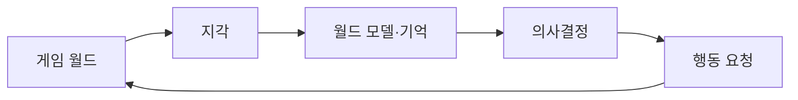
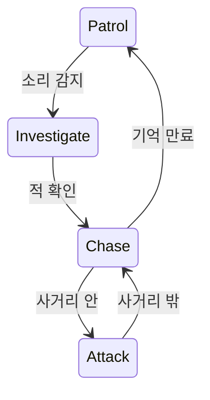

## 들어가며

게임 AI의 목표는 가장 지능적인 결정을 계산하는 것이 아니다. 제한된 정보와 프레임 예산 안에서 플레이어가 이해하고 대응할 수 있는 행동을 만드는 일이다. 같은 상황에서 완벽한 최적 행동만 반복하면 오히려 단조롭거나 불공정하게 느껴질 수 있다.

게임 AI는 지각, 월드 모델, 의사결정, 행동 실행과 피드백의 순환으로 볼 수 있다. FSM, 행동 트리, 효용, 계획과 머신러닝은 이 순환의 서로 다른 부분을 구현한다. 이 글은 기법 이름보다 상태와 실패 조건을 중심으로 기본 구조를 다룬다.

전통적 게임 AI부터 플레이어 모델링과 머신러닝까지의 학술적 범위는 Yannakakis와 Togelius의 공개 교재 사이트 [Artificial Intelligence and Games](https://gameaibook.org/)에서 확인할 수 있다.

---

## 목차
1. [지각-판단-행동 루프](#1-지각-판단-행동-루프)
2. [상태 기반 의사결정](#2-상태-기반-의사결정)
3. [효용과 계획](#3-효용과-계획)
4. [이동과 공간 질의](#4-이동과-공간-질의)
5. [머신러닝의 위치](#5-머신러닝의-위치)
6. [예산과 디버깅](#6-예산과-디버깅)

---

## 1. 지각-판단-행동 루프

AI 에이전트는 실제 월드 전체가 아니라 센서와 게임 규칙이 제공한 관측을 사용한다.



지각 결과에는 시간과 신뢰도가 필요할 수 있다.

```text
lastSeenPosition
lastSeenTick
visibilityConfidence
heardEvent
```

타깃이 잠깐 가려졌다고 즉시 존재를 잊을지, 마지막 위치를 일정 시간 조사할지는 게임 디자인 계약이다. AI가 실제로 볼 수 없는 권위 상태를 직접 읽으면 플레이어에게 부당한 정보로 느껴진다.

월드 모델은 현재 관측과 기억을 의사결정에 필요한 상태로 정리한다. 모든 엔티티와 컴포넌트를 복사할 필요는 없다. 행동을 선택하는 데 필요한 사실과 유효 기간만 저장한다.

행동 실행은 성공, 실패, 진행 중, 취소를 구분한다. 경로가 막혔거나 애니메이션이 중단됐을 때 의사결정 계층이 결과를 받아야 같은 실패를 무한 반복하지 않는다.

## 2. 상태 기반 의사결정

유한 상태 기계(FSM)는 상태와 전이를 명시한다.



FSM은 상태 수가 작고 전이가 명확할 때 강하다. 전이 조건이 모든 상태 쌍에 퍼지면 상태 폭발과 우선순위 충돌이 생긴다. 계층형 상태나 공유 전이 규칙으로 중복을 줄일 수 있다.

행동 트리(Behavior Tree)는 제어 흐름 노드와 행동 노드를 트리로 조합한다.

- Selector는 성공하는 첫 자식을 선택한다.
- Sequence는 자식이 모두 성공해야 성공한다.
- Decorator는 조건, 반복, timeout을 추가한다.
- Leaf는 월드 조회나 행동을 수행한다.

실행 중(`Running`) 상태의 전파 규칙을 명시해야 한다.

| 제어 노드 | 다음 자식으로 진행하는 조건 | 즉시 반환 |
|---|---|---|
| Selector/Fallback | 현재 자식이 Failure | 첫 Success 또는 Running |
| Sequence | 현재 자식이 Success | 첫 Failure 또는 Running |

Selector가 실행 중인 자식을 건너뛰거나 Sequence가 진행 중인 행동 다음으로 넘어가면 잘못된 행동을 실행할 수 있다.

매 틱 루트부터 모든 조건을 다시 평가할지, 실행 중 노드를 기억할지는 구현 계약이다. 실행 중 행동을 중단할 때 정리 콜백이 없으면 이동 목표와 애니메이션 상태가 남을 수 있다.

FSM과 행동 트리는 서로 배타적이지 않다. 큰 모드 전환은 상태 기계로, 한 모드 안의 행동 순서는 트리로 표현할 수 있다.

## 3. 효용과 계획

효용 AI는 후보 행동의 점수를 계산해 선택한다.

$$
U(a,s) =
\frac{\sum_i w_i u_i(a,s)}
     {\sum_i w_i}
$$

$u_i$는 상태 $s$에서 행동 $a$의 고려 요소 점수이고 $w_i$는 가중치다. 가중치 합이 0인 경우와 점수 범위를 처리해야 한다.

최댓값만 항상 선택하면 작은 점수 변화로 행동이 자주 바뀌거나 하나의 행동만 반복할 수 있다. hysteresis, cooldown, 현재 행동 보너스, 확률 선택을 사용하되 재현 가능한 RNG와 디버그 로그를 유지한다.

GOAP은 월드 상태와 행동의 전제·효과·비용으로 목표까지의 행동열을 찾는다.

```text
Action {
    preconditions
    effects
    cost
}
```

탐색 방향은 구현 선택이다. 현재 상태에서 전방 탐색할 수도 있고 목표 조건에서 필요한 전제를 역으로 확장할 수도 있다. “GOAP은 항상 역방향 탐색”이라고 단정할 수 없다.

계획은 실행 중 월드가 바뀌면 무효가 될 수 있다. 행동 전제 조건을 실행 시점에 다시 확인하고, 실패 원인과 재계획 조건을 구분한다. 매 틱 모든 에이전트가 전체 계획을 다시 세우지 않도록 요청 큐와 시간 예산을 둔다.

HTN은 추상 과업을 조건에 따라 더 구체적인 과업으로 분해한다. 설계자가 전술 구조를 명시하기 쉽지만 method 순서와 조건이 숨은 정책이 될 수 있다.

## 4. 이동과 공간 질의

경로 탐색은 AI 전체가 아니라 이동 의사결정의 한 서비스다. 경로는 그래프에서 유효해도 실제 캐릭터의 반경, 회전 속도, 다른 에이전트와 동적 장애물 때문에 실행할 수 없을 수 있다.

이동 계층을 분리하면 실패를 구분할 수 있다.

```text
global path: 목적지까지의 통로 선택
path following: 현재 세그먼트 추종
local avoidance: 근거리 충돌 회피
locomotion: 가속·회전·애니메이션 제어
```

local avoidance는 각 에이전트의 짧은 시간 지평에서 충돌을 피하지만 교착, 좁은 문, 상반된 우선순위에서 실패할 수 있다. 목표 진행도, 우선권, 시간 초과와 재경로 정책이 필요하다.

지각과 전술 질의는 공간 인덱스를 사용해 후보를 줄일 수 있다. 공간 인덱스 결과는 가시성의 최종 답이 아니다. 거리 후보 뒤에 시야각, ray cast, 팀과 게임 규칙을 적용한다.

## 5. 머신러닝의 위치

머신러닝은 규칙을 직접 작성하는 대신 데이터와 목적 함수에서 모델을 학습한다. 게임 AI에서 다음 용도로 사용할 수 있다.

- 애니메이션과 이동 예측
- 플레이어 행동 분류
- 전술 점수 근사
- 절차적 콘텐츠 평가
- 강화학습 정책

학습이 성공했다는 사실과 게임에 배포할 수 있다는 사실은 다르다. 모델은 다음 계약을 만족해야 한다.

```text
추론 지연과 메모리 상한
입력 범위와 결측 처리
플랫폼별 실행 지원
모델 버전과 재현성
안전한 fallback
행동 설명과 디버그 가능성
```

강화학습은 상태 $s$, 행동 $a$, 보상 $r$, 전이로 정책을 학습한다. 보상 함수가 원하는 플레이를 정확히 표현하지 못하면 에이전트가 점수만 높이는 예상 밖 행동을 찾을 수 있다.

DQN 같은 학습 코드는 추론 예제가 아니다. gradient 추적 범위, target network, replay 분포, tensor dtype과 device synchronization을 올바르게 다뤄야 한다. 에이전트마다 `.item()`을 호출하면 GPU와 CPU 사이 동기화가 반복될 수 있으므로 batch 추론과 한 번의 결과 전송을 사용한다.

학습 모델도 서버 권위와 규칙 검증을 우회할 수 없다. 모델 출력은 허용된 행동 공간 안에서 검증한다.

## 6. 예산과 디버깅

AI 비용은 에이전트 수에 단순 비례하지 않을 수 있다. 경로 탐색, 시야 ray cast, 군집 질의와 planning이 특정 프레임에 몰리면 spike가 생긴다.

작업을 중요도와 갱신 주기로 나눈다.

| 작업 | 갱신 특성 |
|---|---|
| 즉시 반응 | 피격, 행동 취소처럼 이벤트 기반 |
| 고빈도 | 가까운 전투 이동과 조준 |
| 저빈도 | 먼 NPC의 지각과 전략 |
| 예산 작업 | 경로 탐색과 계획을 여러 틱에 분산 |

AI를 디버그하려면 결과뿐 아니라 결정 과정을 기록한다.

```text
관측된 사실과 시간
후보 행동별 점수
선택된 상태·트리 노드
계획의 전제와 실패한 행동
경로와 local avoidance 속도
RNG 시드와 모델 버전
```

작업 스레드가 계산한 결과를 메인 스레드가 읽을 때는 결과 객체의 수명과 공개 동기화를 보장해야 한다. `bool ready`를 동기화 없이 일반 변수로 함께 읽고 쓰면 데이터 레이스다. 적절한 happens-before 관계로 보호하면 같은 플래그를 사용할 수 있다.

테스트는 고정된 작은 시나리오의 불변식을 사용한다.

- 보이지 않는 타깃을 즉시 추적하지 않는다.
- 공격 사거리 밖에서 공격 행동이 성공하지 않는다.
- 막힌 경로는 유한 시간 안에 실패를 보고한다.
- 같은 시드와 입력은 정의한 범위에서 같은 결정을 낸다.
- 계획과 지각 작업이 프레임 예산을 넘으면 품질 저하 정책이 작동한다.

---

## 결론

게임 AI는 지각한 정보를 월드 모델로 정리하고, 제한된 시간 안에 행동을 선택하며, 실행 결과를 다시 판단에 반영하는 순환 시스템이다. FSM, 행동 트리, 효용, 계획과 머신러닝은 이 순환의 다른 표현이다.

좋은 AI는 가장 복잡한 기법을 사용하는 AI가 아니다. 정보 제한, 행동 실패, 시간 예산과 디버그 가능성을 계약으로 만들고 플레이어가 이해할 수 있는 일관된 행동을 제공해야 한다.
