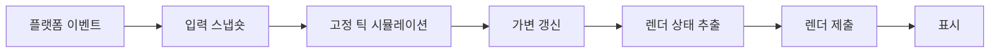

## 들어가며

게임 엔진은 렌더러, 물리, 오디오와 입력 라이브러리를 모아 둔 폴더가 아니다. 서로 다른 하위 시스템의 상태 수명, 데이터 흐름, 스레드 경계와 플랫폼 자원을 하나의 실행 계약으로 통합하는 런타임이다.

기능 추가가 쉬운 엔진은 모든 클래스를 상속으로 확장하는 엔진이 아니다. 안정적인 핵심 불변식과 교체 가능한 정책을 구분하고, 게임 콘텐츠가 엔진 세부 구현에 직접 묶이지 않게 해야 한다. 이 글은 엔진 아키텍처의 기본 경계를 다룬다.

게임 루프, 컴포넌트, 이벤트 큐, 데이터 지역성과 같은 반복되는 설계 선택은 Bob Nystrom의 공개 교재 [Game Programming Patterns](https://gameprogrammingpatterns.com/)에서도 비용과 함께 설명한다. 패턴 이름보다 현재 엔진의 상태·시간·수명 계약에 맞는지 판단해야 한다.

---

## 목차
1. [메인 루프와 시간](#1-메인-루프와-시간)
2. [월드와 객체 수명](#2-월드와-객체-수명)
3. [하위 시스템 경계](#3-하위-시스템-경계)
4. [리소스와 에셋](#4-리소스와-에셋)
5. [확장성과 데이터 주도 설계](#5-확장성과-데이터-주도-설계)
6. [엔진을 검증하는 방법](#6-엔진을-검증하는-방법)

---

## 1. 메인 루프와 시간

엔진의 메인 루프는 입력, 시뮬레이션, 렌더링과 플랫폼 이벤트의 순서를 정한다.



각 단계가 같은 월드 상태를 임의로 수정하면 순서 의존성이 숨는다. 고정 틱은 권위 시뮬레이션을 갱신하고, 렌더링은 읽기 전용 스냅숏을 소비하도록 경계를 둘 수 있다.

엔진 시간에는 여러 종류가 있다.

- 로그용 UTC 시각(달력 시각)
- 경과 시간 측정용 단조 시계
- 게임 배속과 pause가 적용된 시뮬레이션 시간
- 고정 틱 번호
- 렌더 보간 계수
- 오디오 장치의 샘플 시간

한 `deltaTime`으로 모두 표현하면 pause, replay, 네트워크 보정과 오디오 동기화에서 뜻이 섞인다. pause, 배속, 타임아웃이 어떤 시계를 사용하는지도 함께 정한다.

## 2. 월드와 객체 수명

게임 월드는 엔티티, 컴포넌트와 시스템의 소유자다. 구조가 객체 지향인지 ECS인지보다 생성·파괴와 참조의 안전한 시점이 중요하다.

시스템을 순회하는 중 객체를 즉시 제거하면 반복자와 다른 시스템의 참조가 무효화될 수 있다. 구조 변경을 명령 버퍼에 기록하고 단계 경계에서 적용할 수 있다.

```text
simulation reads stable world
systems append structural commands
barrier validates and commits commands
new stable world becomes visible
```

엔티티 ID는 저장 위치와 분리하고 세대로 재사용을 검증한다. 렌더링, 물리, AI가 같은 포인터를 장기간 보관하는 대신 각 하위 시스템의 프록시와 안정적인 핸들을 사용할 수 있다.

장면 전환은 모든 객체를 한 번에 지우는 호출이 아니다. 비동기 로드, GPU 작업, 오디오 재생, 네트워크 참조와 작업 큐가 이전 장면 상태를 붙잡을 수 있다. unload 완료 조건을 자원별 fence와 참조 수명으로 정의한다.

## 3. 하위 시스템 경계

하위 시스템은 서로 다른 데이터 표현과 실행 주기를 가진다.

| 시스템 | 권위 상태 | 외부에 제공할 경계 |
|---|---|---|
| 입력 | 장치 이벤트와 매핑 | 틱별 입력 스냅숏 |
| 물리 | 강체·접촉·제약 | pose와 query 결과 |
| 렌더링 | GPU 자원과 frame graph | 렌더 스냅숏 |
| 오디오 | voice와 sample timeline | 재생 명령 |
| 네트워크 | 연결·패킷·복제 상태 | 검증된 명령·스냅숏 |
| 저장 | 영속 형식과 작업 상태 | versioned save 결과 |

물리 엔진 객체를 게임 로직의 유일한 Transform으로 사용하면 렌더 보간, 네트워크 보정과 장면 편집이 물리 API에 종속된다. 게임의 권위 상태와 하위 시스템 표현 사이의 동기화 방향을 정한다. 동적 강체에서는 물리가 권위 pose를 계산하고 렌더 pose가 파생되는 식으로 객체 종류별 쓰기 방향을 정한다. 표현 분리는 같은 상태를 두 곳에서 독립적으로 수정한다는 뜻이 아니다.

이벤트 버스는 시스템 결합을 줄일 수 있지만 모든 통신을 이벤트로 바꾸면 순서와 실패가 숨는다. 즉시 결과가 필요한 질의, 한 틱 안의 명령, 지연 가능한 알림을 구분한다.

스레드 경계에서는 변경 가능한 객체보다 값 스냅숏과 명령 버퍼가 안전하다. 작업 완료 전에 원본 객체가 파괴될 수 있다면 ID 재검증이나 작업 수명 결합이 필요하다.

## 4. 리소스와 에셋

에셋은 원본 제작 파일이고 리소스는 런타임에서 사용할 수 있게 변환·로딩된 표현이다.


변환 결과는 원본 내용, importer 버전, 설정, 의존 에셋과 타깃 플랫폼에 의해 결정된다. 이 입력·변환 조건의 키를 캐시 키로 사용하면 변경되지 않은 결과를 재사용할 수 있다. 캐시 키(어떤 변환 결과를 재사용할지), 출력 바이트의 digest(실제로 어떤 파일을 만들었는지), provenance(누가 어떤 입력과 도구로 만들었는지)는 서로 다른 정보다. 이 글에서 에셋은 원본 파일, 리소스는 런타임 표현이라는 용어 규약을 사용한다.

리소스 핸들은 로드 중, 준비, 실패, 제거 예정 상태를 표현한다. 비동기 API가 항상 즉시 유효한 GPU 객체를 반환하는 것처럼 보이면 호출자가 실패와 대기를 처리할 수 없다.

스트리밍은 메모리 예산 안에서 필요한 mip, mesh LOD, 오디오 청크와 월드 셀을 유지한다. 요청 우선순위, I/O 대역폭, 디코드 작업과 GPU 업로드 큐를 함께 제어해야 한다.

hot reload는 객체 주소를 그대로 교체하는 일이 아니다. 새 리소스를 완전히 준비한 뒤 안전한 경계에서 핸들 매핑을 바꾸고, 진행 중 GPU 작업이 이전 리소스를 놓을 때 파괴한다.

## 5. 확장성과 데이터 주도 설계

개방-폐쇄 원칙은 검증된 핵심을 변경하지 않고 자주 변하는 정책을 추가할 수 있게 하라는 설계 지침이다. 모든 곳에 가상 인터페이스를 만들라는 뜻은 아니다.

엔진에서 자주 변하는 축은 프로젝트에 따라 다르다.

```text
새 컴포넌트와 시스템
새 에셋 importer
새 렌더 패스와 재질
플랫폼별 입력·창·파일 backend
게임 규칙과 데이터 스키마
```

확장 지점에는 명시적인 등록, 버전과 수명 계약을 둔다. 문자열로 전역 서비스를 찾아 반환하는 방식은 편하지만 의존성이 숨고 초기화 순서와 테스트가 어려워진다.

데이터 주도 설계는 행동을 전부 JSON으로 옮기는 일이 아니다. 변경 빈도가 높은 값과 조합을 데이터로 표현하고, 불변식을 지키는 실행기는 코드에 둔다.

타일 배치, 방어 시설 규칙, 적 웨이브와 렌더 에셋을 데이터로 분리하면 코드 변경 없이 콘텐츠를 추가할 수 있다. 그러나 데이터 스키마에는 타입, 범위, 참조 유효성, 버전 변환과 오류 위치가 필요하다.

플러그인은 ABI 경계와 버전 호환성 문제를 가진다. C++ 클래스 레이아웃을 그대로 노출하기보다 불투명 핸들과 함수 테이블, 명시적 allocator 경계를 사용할 수 있다.

## 6. 엔진을 검증하는 방법

엔진 검증은 데모 장면의 프레임률만 보지 않는다.

- 빈 월드에서 생성·파괴와 장면 전환을 반복한다.
- 리소스 로드 실패와 취소 중 unload를 수행한다.
- 프레임 단계별 읽기·쓰기 집합을 검사한다.
- 고정 입력을 replay해 상태 해시를 비교한다.
- GPU fence 전 자원 파괴와 stale handle을 탐지한다.
- 메모리, 작업 큐, 리소스 residency의 예산을 넘겨 본다.
- 데이터 스키마의 잘못된 참조와 버전을 진단한다.

엔진 계측은 동일한 프레임 ID와 엔티티·리소스 ID를 사용해 CPU, GPU, 작업 시스템과 스트리밍 이벤트를 연결해야 한다.

```text
frame time distribution
simulation catch-up count
job queue latency
resource load and upload latency
live entities and stale handle failures
CPU/GPU memory budget
```

확장성은 새 기능을 한 번 추가해 확인한다. 같은 기능 범주의 데이터 변형인데도 관련 없는 모듈을 반복해서 수정해야 하는가를 기준으로 본다. 기존 스키마의 데이터 추가와 새 표현·상호작용·프로토콜이 필요한 기능 추가는 비용이 다르다. 새 방어 타워가 기존 규칙의 데이터만 더하는데도 렌더러, 입력, 저장, 네트워크 코드를 모두 고쳐야 한다면 경계가 게임 규칙을 제대로 격리하지 못한 것이다. 반대로 추상화 계층이 많지만 실제 교체가 없다면 복잡성만 늘어난다.

---

## 결론

게임 엔진은 하위 시스템을 하나의 수명과 실행 계약으로 통합한다. 메인 루프의 시간축, 월드 구조 변경 시점, 리소스 준비와 파괴, 스레드 사이 데이터 공개가 핵심 불변식이다.

확장 가능한 엔진은 모든 것을 일반화하지 않는다. 자주 변하는 콘텐츠와 정책은 데이터·등록 경계로 열고, 상태 소유권과 자원 수명처럼 정확성을 지키는 핵심은 제한한다. 기능 추가와 장애 주입으로 실제 변경 범위와 실패 격리를 검증해야 한다.
