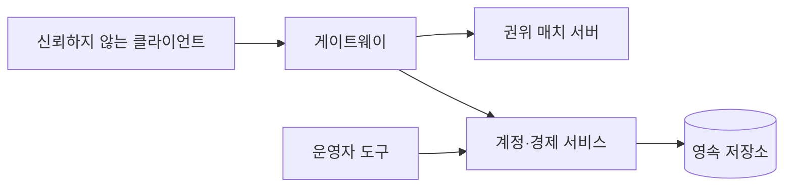
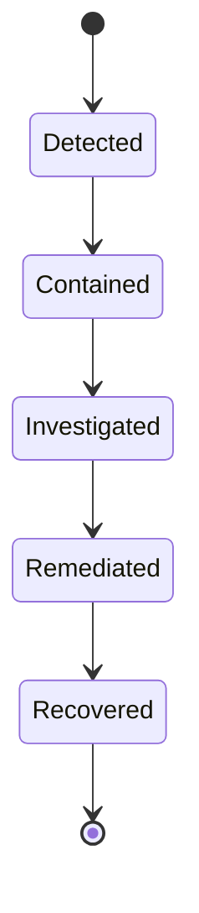

## 들어가며

게임 보안은 클라이언트 코드를 비밀로 만드는 문제가 아니다. 공격자는 클라이언트 프로세스, 네트워크 입력과 자동화 도구를 통제할 수 있다고 가정해야 한다. 서버와 운영 시스템은 신뢰할 수 없는 입력이 권위 상태와 다른 플레이어에게 미치는 영향을 제한한다.

보안 설계는 자산, 공격자 능력, 신뢰 경계와 실패 비용을 먼저 정한다. 암호화, 안티치트, rate limit은 서로 다른 위협을 줄이는 수단이다. 이 글은 게임 보안의 기본 위협 모델과 방어 계층을 다룬다.

인증, 세션, 입력 검증과 암호화 같은 애플리케이션 보안 요구를 체계적으로 점검할 때는 [OWASP ASVS](https://owasp.org/www-project-application-security-verification-standard/) 같은 공개 검증 기준을 사용할 수 있다. 게임 시뮬레이션의 권위와 안티치트 위협은 별도 모델을 추가해야 한다.

---

## 목차
1. [위협 모델과 신뢰 경계](#1-위협-모델과-신뢰-경계)
2. [서버 권위와 입력 검증](#2-서버-권위와-입력-검증)
3. [인증, 세션, 전송 보안](#3-인증-세션-전송-보안)
4. [클라이언트 보호와 안티치트](#4-클라이언트-보호와-안티치트)
5. [서비스와 경제 공격](#5-서비스와-경제-공격)
6. [탐지와 대응](#6-탐지와-대응)

---

## 1. 위협 모델과 신뢰 경계

위협 모델은 다음 질문으로 시작한다.

```text
보호할 자산은 무엇인가.
공격자는 어떤 코드와 계정을 통제하는가.
어떤 경계를 넘어 입력이 들어오는가.
성공한 공격의 영향 범위는 어디까지인가.
오탐과 방어 비용은 얼마인가.
```

대표 자산은 계정, 결제·재화, 경쟁 결과, 다른 플레이어의 개인정보, 서버 가용성과 빌드 서명 키다.

클라이언트는 사용자 장치에서 실행되므로 바이너리와 메모리, 입력 장치와 네트워크 호출을 통제당할 수 있다. 난독화와 무결성 검사는 공격 비용을 높일 수 있지만 클라이언트를 신뢰 가능한 권위로 바꾸지 않는다.

신뢰 경계를 도식화하면 검증 위치가 드러난다.



운영자 도구도 강한 권한을 가지므로 별도 인증, 감사와 최소 권한이 필요하다.

## 2. 서버 권위와 입력 검증

서버는 클라이언트가 보낸 결과가 아니라 허용된 명령을 검증하고 상태 전이를 계산한다.

검증은 단순 범위 검사보다 넓다.

- 스키마와 길이가 유효한가.
- 세션이 해당 엔티티를 조작할 권한이 있는가.
- 명령 시퀀스와 시간이 허용 윈도 안인가.
- 현재 게임 상태에서 행동이 가능한가.
- 속도, 쿨다운, 자원 소비가 규칙과 일치하는가.
- 같은 operation이 이미 처리됐는가.

클라이언트 위치를 암호화하거나 XOR로 가리는 것은 권위 검증이 아니다. 공격자는 복호화가 일어나는 같은 프로세스를 통제하며 값의 사용 지점을 관찰할 수 있다.

검증 실패는 즉시 영구 제재와 같지 않다. 패킷 손실, 버그, 부동소수점 오차가 이상 값을 만들 수 있다. 불가능한 상태는 거부하되 제재 판단은 여러 신호와 증거를 사용한다.

## 3. 인증, 세션, 전송 보안

인증은 사용자가 누구인지 확인하고, 인가는 어떤 작업을 허용할지 결정한다. 로그인에 성공했다고 모든 계정과 게임 세션을 조작할 권한이 생기는 것은 아니다.

비밀번호는 검증된 password hashing 함수와 사용자별 salt로 저장한다. 일반 해시나 직접 만든 반복 XOR을 사용하지 않는다. 구체적인 비용 파라미터는 서버 하드웨어와 위협 모델에 맞춰 조정한다.

세션 토큰은 다음 속성이 필요하다.

- 예측 불가능한 엔트로피
- 제한된 수명과 범위
- 서버 측 폐기·회전 정책
- 로그와 URL에 노출되지 않는 전달
- 재사용 탐지 또는 refresh token rotation

전송 보안은 검증된 TLS, DTLS, QUIC 같은 프로토콜을 사용한다. 고정 IV의 CBC, 인증 없는 암호화, 클라이언트에 내장된 공용 HMAC 비밀키는 적대적 클라이언트의 위조를 막지 못한다.

암호화는 패킷 내용의 기밀성과 무결성을 제공할 수 있지만 유효한 사용자가 허용되지 않은 게임 행동을 보내는 문제는 서버 규칙 검증이 해결한다.

replay 방지는 인증된 nonce, sequence, timestamp 윈도와 이미 처리한 operation ID를 사용한다. nonce를 시간으로 단순 비교하거나 무제한 메모리 집합에 저장하면 래핑·정리·DoS 문제가 생긴다.

## 4. 클라이언트 보호와 안티치트

클라이언트 보호는 공격 비용과 탐지 신호를 높이는 방어다.

```text
바이너리 무결성
코드 서명과 안전한 업데이트
디버거·인젝션 신호
메모리 변조 탐지
입력 패턴과 행동 분석
서버 상태 검증
```

커널 드라이버는 더 많은 관측 권한을 얻지만 운영체제 안정성, 개인정보, 취약점과 배포 신뢰 비용이 크다. 게임의 위협과 경쟁 영향이 그 권한을 정당화하는지 판단해야 한다.

에임봇 탐지는 실제 발사 방향, 타깃 가시성, 각속도, 입력 장치와 여러 경기의 분포를 봐야 한다. 예측된 타깃 방향과 현재 타깃 방향만 비교하면 정상 조준도 오탐할 수 있다.

탐지 모델의 정확도는 클래스 불균형과 함께 해석한다. 치터 비율이 낮으면 높은 정확도도 많은 정상 사용자를 제재할 수 있다.

$$
P(\text{cheat}\mid\text{flag})
=
\frac{P(\text{flag}\mid\text{cheat})P(\text{cheat})}
     {P(\text{flag})}
$$

자동 제재는 증거 보존, 이의 제기와 rollback 정책을 포함한다. 탐지 규칙을 공격자에게 즉시 알려 주지 않으면서 정상 사용자가 결과를 다툴 절차가 필요하다.

## 5. 서비스와 경제 공격

게임 공격은 매치 안의 치트만이 아니다.

- credential stuffing과 계정 탈취
- 구매·보상 요청 replay
- 환불과 결제 사기
- 거래를 이용한 재화 세탁
- 매치메이킹 조작과 봇
- 채팅 spam과 괴롭힘
- API와 로그인에 대한 자원 고갈

rate limiting은 주체와 작업 비용에 따라 설계한다. IP만 사용하면 NAT 뒤 정상 사용자와 분산 공격을 구분하기 어렵다. 계정, 세션, 장치 신호, endpoint와 전체 시스템 한도를 조합한다.

애플리케이션 프로세스의 IP 카운터만으로 대규모 DDoS를 막을 수 없다. 네트워크 edge, CDN·DDoS 보호, connection backlog, admission control과 서비스 용량 계획이 필요하다.

경제 변경은 멱등성 키와 원장, 데이터베이스 트랜잭션으로 보호한다. 안티치트 판정과 경제 rollback은 분리해 잘못된 탐지의 피해 범위를 제한한다.

관리 API는 사용자 API보다 강한 인증과 감사가 필요하다. 운영자 계정 탈취는 한 경기보다 전체 경제에 큰 영향을 줄 수 있다.

## 6. 탐지와 대응

보안 이벤트는 조사 가능한 증거로 남긴다.

```text
계정·세션·매치 ID
서버가 관찰한 입력과 상태
규칙 버전과 빌드 ID
탐지 신호와 임계값
시간 동기화 정보
운영자 조치와 변경 이력
```

민감한 토큰과 개인정보를 로그에 남기지 않는다. 보존 기간, 접근 권한과 삭제 정책을 정한다.

보안 테스트에는 다음 항목이 포함된다.

- 패킷 길이와 개수를 변형하는 fuzzing
- 인증·인가 경계의 음성 테스트
- 동일 operation의 중복·재정렬
- 토큰 만료와 회전 경쟁
- rate limit 우회와 자원 고갈
- 빌드·업데이트 서명 검증 실패
- 탐지 규칙의 오탐·미탐 평가

사고 대응은 탐지 뒤의 상태 기계다.



키 폐기, 세션 무효화, 취약 빌드 차단, 경제 rollback과 사용자 통지를 미리 준비해야 대응 시간이 짧아진다.

---

## 결론

게임 보안은 클라이언트를 완전히 보호하는 일이 아니라 신뢰할 수 없는 입력이 권위 상태와 운영 시스템에 미치는 영향을 제한하는 일이다. 서버 권위, 인증과 인가, 전송 보안, 경제 불변식과 안티치트가 서로 다른 위협을 담당한다.

방어는 공격 비용뿐 아니라 오탐, 개인정보, 성능과 운영 비용을 가진다. 위협 모델과 증거를 기반으로 계층을 선택하고, 중복·변조·자원 고갈과 키 유출을 주입해 대응 절차까지 검증해야 한다.
