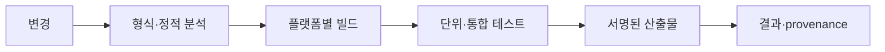

## 들어가며

게임은 입력과 상태 공간이 커서 모든 실행을 직접 확인할 수 없다. 테스트는 버그가 없음을 증명하는 장치가 아니라, 중요한 불변식과 실패 조건을 반복 가능한 입력으로 검사하는 장치다. 자동화는 그 검사를 동일한 환경에서 지속적으로 실행한다.

단위 테스트만 많거나 코드 커버리지가 높다고 제품이 안전해지지는 않는다. 알고리즘 속성, 시스템 경계, 재현성, 성능 예산과 빌드 산출물을 각각 검증해야 한다. 이 글은 게임 개발의 검증 계층과 자동화 계약을 다룬다.

---

## 목차
1. [검증할 계약 정하기](#1-검증할-계약-정하기)
2. [테스트 계층](#2-테스트-계층)
3. [시뮬레이션과 성능 검증](#3-시뮬레이션과-성능-검증)
4. [재현 가능한 빌드](#4-재현-가능한-빌드)
5. [지속적 통합](#5-지속적-통합)
6. [실패를 유용하게 만들기](#6-실패를-유용하게-만들기)

---

## 1. 검증할 계약 정하기

테스트는 구현 줄 수가 아니라 계약에서 시작한다.

```text
자료구조: 삽입·삭제 뒤 인덱스와 세대 불변식
알고리즘: 정렬성, 경로 유효성, 종료
물리: 침투·에너지·오차 범위
네트워크: 중복·손실 뒤 상태 전이
경제: operation당 한 번만 효과 발생
렌더링: 좌표와 자원 수명, 이미지 오차
```

테스트 이름은 조건과 기대 결과를 드러내야 한다.

```cpp
TEST(Inventory, DuplicateOperationDoesNotGrantItemTwice) {
    // 동일 operation ID의 반복이 수량을 두 번 늘리지 않는지 검사한다.
}
```

구현 세부 호출 순서만 검사하면 리팩터링에 취약하고 실제 불변식을 놓친다. 외부에서 관찰 가능한 상태와 부작용을 우선 검증한다.

## 2. 테스트 계층

테스트 계층은 실패 범위와 실행 비용이 다르다.

| 계층 | 검증 대상 | 특징 |
|---|---|---|
| 단위 | 작은 알고리즘·타입 불변식 | 빠르고 원인 격리가 쉬움 |
| 속성 기반 | 넓은 입력의 일반 성질 | 경계값 자동 탐색 |
| 통합 | DB, 파일, 네트워크 경계 | 실제 계약 차이 확인 |
| 시스템 | 빌드 전체의 사용자 흐름 | 느리지만 통합 실패 탐지 |
| fuzz | 비정상·적대 입력 | parser와 프로토콜에 유용 |
| 정적·동적 분석 | UB, race, 수명 | 일반 테스트가 놓치는 오류 |

속성 기반 테스트는 예시 출력보다 보존 법칙을 검사한다.

```text
decode(encode(x)) == x
sort(sort(x)) == sort(x)
remove(insert(S, x), x) preserves prior members
rollback(commit-failed transaction) preserves balance
```

손실 표현에서는 정확한 등호 대신 허용 오차와 범위를 사용한다.

통합 테스트는 외부 시스템을 무조건 mock으로 바꾸지 않는다. mock은 호출 의도를 검증하지만 실제 SQL 격리, 파일 원자성, 네트워크 부분 읽기, GPU validation을 재현하지 못할 수 있다.

## 3. 시뮬레이션과 성능 검증

게임 시뮬레이션은 입력 기록과 상태 해시로 회귀를 찾을 수 있다.

```text
build ID
initial seed
configuration hash
tick-by-tick input commands
state hash and first differing entity
```

해시는 불일치를 빠르게 찾지만 원인을 설명하지 않는다. 첫 불일치 틱의 주요 상태를 구조화해서 비교해야 한다.

무작위 테스트 실패는 시드와 축소된 최소 입력을 보존한다. 현재 시간과 전역 RNG에 의존하면 같은 실패를 재현하기 어렵다.

성능 테스트는 한 번의 wall-clock 측정으로 pass/fail을 정하지 않는다. 워밍업, 입력 분포, 머신 격리, 반복 분포를 정의한다.

반복, 워밍업, 통계와 최적화 방지의 구체적인 예는 [Google Benchmark 사용자 가이드](https://google.github.io/benchmark/user_guide.html)에서 확인할 수 있다.

```text
metric: update p95
workload: 10,000 active entities with fixed distribution
build: release, symbols enabled
machine class: pinned benchmark runner
comparison: baseline confidence interval
```

1ms 단위로 잘린 단일 샘플이 임계값보다 작다는 사실은 60fps를 보장하지 않는다. 프레임 전체 임계 경로와 장시간 분포를 측정한다.

성능 회귀 임계값은 환경 잡음보다 커야 하며 절대 예산과 상대 변화율을 함께 볼 수 있다. 작은 함수의 개선이 전체 프레임에 영향을 주는지도 프로파일로 확인한다.

## 4. 재현 가능한 빌드

같은 소스에서 같은 의미의 산출물을 만들려면 빌드 입력을 명시해야 한다.

```text
소스 commit
컴파일러와 SDK 버전
의존성 lockfile
빌드 옵션과 타깃
에셋 importer 버전·설정
환경 변수와 생성 코드
```

원본 에셋은 저장소나 관리되는 에셋 저장소의 입력이다. `.fbx`, `.uasset` 같은 필요한 콘텐츠를 일반 `.gitignore`로 제외하면 빌드 재현성이 사라진다. 큰 바이너리는 LFS나 별도 아티팩트 정책으로 관리한다.

빌드 산출물에는 provenance를 기록한다.

```text
version
commit
toolchain
content hash
build time
signature
```

모든 바이트가 완전히 동일한 reproducible build가 어려워도 어떤 입력으로 만들었는지 추적 가능해야 한다.

컨테이너는 서버 빌드와 테스트 환경을 고정하는 한 방법이다. 컨테이너 자체가 테스트 격리, 보안, 준비 완료를 자동 보장하지 않는다. 이미지 태그, base image 수명, health check, 볼륨과 네트워크 의존성을 명시한다.

## 5. 지속적 통합

지속적 통합(CI)은 변경을 공유 브랜치에 합치기 전에 자동 빌드와 검증을 실행하는 실천이다. 특정 서비스의 YAML이 핵심이 아니라, 어떤 변경이 어떤 검사를 통과해야 하는지가 핵심이다.



빠른 검사는 앞에 배치해 피드백 시간을 줄이고, 긴 플랫폼·성능·콘텐츠 검사는 병렬 또는 별도 보호 단계로 구성한다.

CI 작업은 버전이 고정된 도구와 최소 권한을 사용한다. 외부 action이나 스크립트를 이동하는 브랜치 이름으로 실행하면 공급망 변경이 예고 없이 빌드 권한을 얻을 수 있다. 검증된 버전이나 commit digest를 고정하고 갱신 과정을 둔다.

[GitHub Actions 보안 지침](https://docs.github.com/en/actions/reference/security/secure-use)은 외부 action의 전체 commit SHA 고정과 자격 증명 최소화를 권고한다. 다른 CI 제품에서도 같은 공급망 원칙을 적용한다.

비밀값은 저장소와 로그에 넣지 않는다. fork나 외부 기여 코드가 배포 자격 증명을 읽지 못하도록 신뢰 수준별 workflow를 분리한다.

캐시는 성능 최적화이며 정확성 입력이 아니다. 잘못된 캐시 키가 오래된 생성물이나 의존성을 재사용하지 않게 도구 버전과 lockfile hash를 포함한다.

## 6. 실패를 유용하게 만들기

자동화가 실패했을 때 재현에 필요한 정보를 산출물로 남긴다.

- 실패한 테스트와 seed
- 최소 입력과 replay
- crash dump와 심볼
- 로그와 trace
- 렌더 결과와 기준 이미지 차이
- 빌드·도구·콘텐츠 버전
- 성능 원시 샘플

flake를 단순 재시도로 숨기면 신뢰가 무너진다. 비결정적 테스트는 격리해 원인을 추적하고, 재시도 횟수와 첫 실패를 함께 기록한다.

코드 커버리지는 실행된 줄과 분기의 비율이지 요구사항 충족률이 아니다. 고정된 80% 같은 목표는 중요한 경제 불변식이 빠진 상태에서도 달성할 수 있다. 위험과 계약을 기준으로 테스트를 선택한다.

배포 전 검증은 환경 준비 완료와 실제 사용 가능성을 구분한다. 프로세스가 실행 중이라는 사실만으로 DB migration, 캐시 준비, 콘텐츠 로드가 끝났다고 볼 수 없다.

검증 체계 자체도 유지한다.

```text
테스트 실행 시간과 flake rate
실패 원인까지 걸린 시간
보호 브랜치 우회 기록
의존성·toolchain 갱신 주기
산출물 보존과 삭제 정책
```

---

## 결론

검증은 코드 줄을 많이 실행하는 일이 아니라 시스템의 불변식과 실패 조건을 반복 가능한 입력으로 확인하는 일이다. 단위·속성·통합·시스템 테스트, fuzzing과 sanitizer는 서로 다른 오류를 찾는다.

자동화는 소스, toolchain, 에셋과 설정을 추적 가능한 산출물로 바꾸고 같은 검사를 지속적으로 수행한다. 실패에 seed, 로그, 버전과 원시 측정값을 남겨 재현할 수 있을 때 CI가 실제 개발 안전망이 된다.
