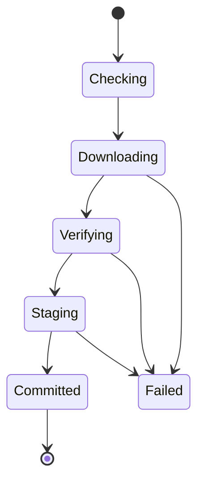
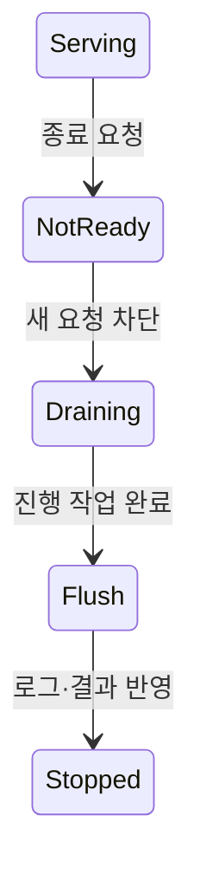

## 들어가며

게임 빌드가 개발 환경에서 실행된다는 사실과 플레이어에게 안전하게 제공할 수 있다는 사실은 다르다. 배포는 변경된 코드, 콘텐츠와 설정을 대상 환경에 적용하는 상태 전이다. 라이브 운영은 그 전이가 실제 사용자 경험과 시스템 불변식을 지키는지 관측하고 제어한다.

배포 기술의 이름보다 중요한 것은 산출물의 식별, 호환성, 준비 완료, 실패 범위와 rollback 조건이다. 이 글은 클라이언트 패치와 온라인 서비스에 공통으로 적용되는 변경 관리의 기본 모델을 다룬다.

---

## 목차
1. [배포 가능한 산출물](#1-배포-가능한-산출물)
2. [설정과 스키마 호환성](#2-설정과-스키마-호환성)
3. [점진적 배포와 rollback](#3-점진적-배포와-rollback)
4. [준비 완료와 종료](#4-준비-완료와-종료)
5. [관측성과 SLO](#5-관측성과-slo)
6. [용량, 사고, 비용](#6-용량-사고-비용)

---

## 1. 배포 가능한 산출물

배포 단위는 변경할 수 없는 immutable artifact로 식별하는 편이 안전하다.

```text
server image digest
client build ID
content manifest hash
schema migration version
configuration revision
```

같은 `latest` 이름이 시간에 따라 다른 바이트를 가리키면 어떤 코드가 실행됐는지 조사하기 어렵다. 사람용 버전과 내용 기반 digest를 함께 기록한다.

클라이언트 패치는 실행 파일만 배포하지 않는다. 에셋 번들, 셰이더 캐시, 로컬 저장 형식과 CDN 캐시가 함께 변한다. 콘텐츠 manifest는 파일별 hash, 크기, 압축과 의존성을 제공한다.

패치 과정은 다운로드 중단과 저장 공간 부족을 견뎌야 한다.



검증된 새 버전을 staging 위치에 완성한 뒤 원자적으로 활성 버전을 바꾸면 부분 설치를 줄일 수 있다. 서명과 hash는 전송 오류와 변조를 구분한다.

## 2. 설정과 스키마 호환성

코드와 설정은 서로 독립적으로 배포될 수 있으므로 호환 범위를 명시한다. 알 수 없는 설정 필드를 무시할지 오류로 처리할지, 필수 필드의 기본값이 무엇인지 정한다.

기능 플래그는 배포와 기능 공개를 분리한다. 하지만 플래그는 새로운 상태 공간을 만든다.

- 플래그 조합별 동작
- 대상 사용자 선택
- 캐시와 갱신 지연
- 긴급 비활성화
- 만료된 플래그 제거

DB 스키마 변경은 여러 서버 버전이 동시에 실행되는 상태를 견뎌야 한다. expand-contract 방식은 먼저 새 코드와 구 코드가 함께 읽을 수 있는 스키마를 추가하고, 데이터 전환과 사용 전환 뒤 오래된 필드를 제거한다.

```text
expand: nullable column or new table 추가
migrate: 기존 데이터 채움
switch: 새 코드가 새 표현 사용
contract: 구 버전이 사라진 뒤 오래된 표현 제거
```

파괴적인 migration과 서버 배포를 한 단계로 묶으면 rollback한 구 코드가 새 스키마를 읽지 못할 수 있다. backward·forward 호환 기간을 정한다.

프로토콜도 같은 원리를 가진다. 클라이언트 업데이트가 느리므로 서버가 지원하는 최소·최대 프로토콜 버전과 강제 업데이트 정책이 필요하다.

## 3. 점진적 배포와 rollback

점진적 배포는 새 버전의 영향을 일부 트래픽이나 인스턴스로 제한한다.

| 방식 | 분리 기준 | 주의점 |
|---|---|---|
| Rolling | 인스턴스를 순차 교체 | 구·신 버전 공존 |
| Canary | 일부 사용자·매치·지역 | 표본 편향과 상태 분리 |
| Blue-Green | 두 환경 전환 | 이중 용량과 DB 공유 |
| Ring | 내부·소수·전체 단계 | 각 단계의 승인 기준 |

UDP 게임 트래픽을 HTTP 헤더 기반 라우팅 규칙으로 분할할 수는 없다. 실제 전송 프로토콜과 연결 수명을 이해하는 L4 load balancer, gateway, match allocator의 라우팅 키가 필요하다.

상태가 있는 매치 서버는 진행 중 세션을 새 버전으로 옮기기 어렵다. 새 매치만 새 빌드에 배치하고 기존 매치는 drain하는 정책이 자연스러울 수 있다.

rollback은 이전 프로세스를 다시 시작하는 것보다 넓다.

```text
이전 artifact와 설정 복구
진행 중 세션 처리
DB·이벤트 스키마 호환
새 버전이 쓴 데이터의 해석
클라이언트와 CDN 캐시
경제 변경의 보상
```

비가역 데이터 변경은 단순 rollback이 불가능하다. 보상 작업, 복원 snapshot과 수동 승인 경계를 준비한다.

점진적 배포의 승격 기준은 시간과 지표로 정의한다.

```text
최소 관측 시간
오류율과 지연 SLO
crash-free session
매치 완료율
경제 불변식 위반
지역·플랫폼별 표본 수
```

## 4. 준비 완료와 종료

프로세스 생존(liveness), 트래픽 수신 준비(readiness), 시작 완료(startup)는 서로 다른 상태다.

- liveness 실패는 프로세스가 회복 불가능한지 판단한다.
- readiness 실패는 새 요청을 보내지 않게 한다.
- startup은 긴 초기화 동안 잘못된 재시작을 막는다.

포트가 열렸다는 사실만으로 콘텐츠 로드, DB migration 확인, 캐시 준비와 매치 등록이 끝났다고 볼 수 없다. readiness는 실제 요청을 처리할 최소 의존성이 준비됐는지 확인한다.

의존 서비스 하나가 느리다고 모든 readiness를 실패시키면 전체 fleet가 동시에 트래픽에서 빠질 수 있다. 필수 의존성과 기능 저하가 가능한 의존성을 구분한다.

graceful shutdown은 새 작업 수락을 멈추고 진행 중 작업을 유한 시간 안에 정리한다.



플랫폼별 lifecycle hook과 종료 신호 순서는 공식 계약을 확인해야 한다. 예를 들어 [Kubernetes 컨테이너 lifecycle hook 문서](https://kubernetes.io/docs/concepts/containers/container-lifecycle-hooks/)는 `PreStop`과 종료 유예 시간의 관계를 정의한다. hook이 신호 뒤에 온다고 가정하거나 종료 유예 시간 전체를 작업에 사용할 수 있다고 단정하면 데이터가 잘릴 수 있다.

## 5. 관측성과 SLO

관측성은 로그를 많이 남기는 일이 아니라 외부 출력에서 내부 상태를 설명할 수 있게 하는 능력이다. metric, log, trace와 프로파일을 공통 ID로 연결한다.

```text
build ID
region and platform
request, session, match ID
protocol and content version
operation ID
```

서비스 수준 지표(SLI)는 사용자에게 중요한 결과를 수치화한다.

| 사용자 결과 | 가능한 SLI |
|---|---|
| 로그인 가능 | 성공률과 p95 지연 |
| 매치 참가 | 매치 성사율과 대기 시간 |
| 원활한 플레이 | tick deadline miss와 disconnect |
| 구매 안전 | 성공률, 중복·불일치 건수 |
| 안정적 클라이언트 | crash-free session |

서비스 수준 목표(SLO)는 SLI가 일정 기간 만족해야 할 기준이다. CPU 80% 같은 자원 지표만으로 사용자 결과를 설명할 수 없다.

SLI를 사용자 여정에 연결하고 SLO를 반복 개선하는 방법은 [Google SRE Workbook의 SLO 장](https://sre.google/workbook/implementing-slos/)에 정리돼 있다.

평균은 tail failure를 숨긴다. 지역, 플랫폼, 빌드, 매치 유형별 p95·p99와 오류율을 분리한다. label에 player ID처럼 고유값을 넣으면 시계열 cardinality가 폭증할 수 있으므로 고유 식별자는 trace나 구조화 로그에 둔다.

알림은 원인 후보가 아니라 사용자 영향과 대응 행동에 연결한다. 모든 일시 spike를 page로 보내면 경보 피로가 생긴다.

## 6. 용량, 사고, 비용

용량 계획은 평균 사용자 수가 아니라 peak와 fan-out을 모델링한다.

$$
\text{required instances}
\ge
\frac{\text{peak workload}}
     {\text{safe capacity per instance}}
\times \text{headroom}
$$

안전 용량은 부하 테스트에서 지연 SLO를 만족하는 범위다. CPU가 100%가 되는 지점이 아니다.

게임 서비스는 다음 자원이 서로 다른 속도로 포화될 수 있다.

```text
동시 연결
packet rate와 egress bandwidth
match simulation CPU
DB connection과 lock
queue age
CDN cache miss
로그 수집과 저장
```

autoscaling은 관측과 인스턴스 준비 사이의 지연을 가진다. 짧은 이벤트 폭증은 미리 예약한 headroom, admission control과 대기열이 필요할 수 있다.

사고 대응은 탐지, 완화, 복구와 학습을 분리한다. 변경을 중단하고 피해 범위를 제한한 뒤 원인을 조사한다. 장애 중 성급한 데이터 수정은 증거와 복구 가능성을 없앨 수 있다.

비용 최적화는 현재 가격표를 문서에 고정하는 일이 아니다. 비용을 workload driver와 연결한다.

```text
compute = instance time × class
network = regional and internet bytes
storage = capacity + operations + retention
build = runner time + artifact retention
observability = ingest + cardinality + retention
```

비용을 줄여 SLO와 복구 가능성을 깨뜨리면 최적화가 아니다. 단위 사용자, 단위 매치, 단위 콘텐츠 GB당 비용을 품질 지표와 함께 본다.

---

## 결론

배포와 라이브 운영은 산출물과 상태를 안전하게 변경하는 시스템이다. immutable artifact, 버전 호환성, 점진적 노출, readiness와 graceful shutdown이 변경의 실패 범위를 제한한다.

관측은 사용자 결과를 나타내는 SLI와 빌드·세션·operation ID를 연결해야 한다. rollback 가능성과 데이터 호환성을 준비하고, peak 용량과 부분 실패를 시험해 변경이 실제 플레이와 경제 불변식을 지키는지 검증해야 한다.
