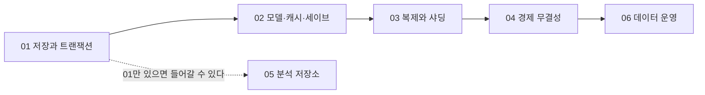

# 데이터베이스 시리즈

`db/`는 SQL 문법 강좌가 아니라, 장애와 동시성 아래에서 게임 상태를 보존하는 계약을 다루는 축이다. 여섯 편은 하나의 질문을 계층으로 쪼갠다 — **커밋했다고 응답한 데이터가 어떤 장애까지 살아남고, 동시에 도착한 두 요청 중 무엇이 실패하며, 그 보장이 노드·샤드·시스템 경계를 넘을 때 어디서 깨지는가.**

저장 엔진과 트랜잭션에서 출발해 복제와 샤딩, 게임 경제의 무결성, 분석 저장소와 데이터 운영으로 이어진다. 경제 밸런스와 실시간 매치 상태는 인접 주제와 함께 살핀다.

## 파일 번호와 읽는 순서

**파일 번호 순서가 곧 읽는 순서다.** 뒤 편은 앞 편이 세운 모델을 전제로 쓰였고, 건너뛰면 유도가 닫히지 않는다 — 04의 멱등성 키 논증은 01의 격리 수준 위에서만 결론이 나오고, 06의 시점 복구는 01의 WAL 없이 성립하지 않는다.

05만 전제가 얕다. 분석 저장소는 저장 레이아웃과 파생 데이터의 문제라 01만 읽고도 들어갈 수 있고, 번호는 뒤에 있지만 02~04를 요구하지 않는다.

| # | 문서 | 이 편이 답하는 질문 | 전제 |
|---|---|---|---|
| 01 | [저장과 트랜잭션](part01_storage_transactions.md) | 커밋 응답 이후 어떤 바이트가 남고, 동시 접근의 어떤 역사가 금지되는가 | 없음 — 축의 출발점 |
| 02 | [모델·캐시·세이브](part02_models_cache_saves.md) | 어떤 불변식을 어느 저장 경계가 지키고, 같은 데이터의 사본은 누가 소유하는가 | 01의 ACID·버퍼 풀·격리 |
| 03 | [복제와 샤딩](part03_replication_sharding.md) | 노드가 여럿일 때 보장이 어디서 갈라지고, 어떤 라우팅이 그것을 되붙이는가 | 01의 내구성·WAL, 02의 키 설계 |
| 04 | [경제 무결성](part04_economy_integrity.md) | 전달이 최소 한 번뿐인 세계에서 돈을 정확히 한 번 움직이는 구조는 무엇인가 | 01의 격리·유니크 제약, 03의 교차 샤드 |
| 05 | [분석 저장소](part05_analytics_store.md) | 스캔 워크로드를 위해 데이터를 어떻게 다시 배치하고, 파생 데이터를 어디까지 되돌릴 수 있는가 | 01의 페이지·버퍼 풀 |
| 06 | [데이터 운영](part06_data_operations.md) | 그 저장소를 서비스가 도는 채로 어떻게 고치고 되감는가 | 01~04 전부 |

## 공통 핵심과 선택 심화

`db/`는 커리큘럼 전체에서 전문 선택 축이지만, 축 안에서도 갈린다. 아래 표는 번호순이 아니라 *필수의 넓이* 순이다 — 읽는 순서는 여전히 번호순이고, 이 표는 어디까지 읽어야 하는지만 정한다.

| 묶음 | 들어가야 하는 사람 |
|---|---|
| 01·02 | 게임 서버 코드를 만지는 사람 전원의 최소선. 데이터를 저장하는 순간 이 두 편의 판단이 이미 내려져 있다. |
| 04 | 재화·결제·거래·우편에 손대는 사람의 필수. 서비스 규모와 무관하다 — 동접 100명의 게임도 이중 지급은 난다. |
| 03 | 단일 노드가 가용성이나 부하의 한계에 닿았을 때, 또는 다지역 서비스를 설계할 때. |
| 05 | 텔레메트리 저장소나 지표 파이프라인의 저장 계층을 맡을 때. |
| 06 | 데이터베이스를 운영·당직하는 사람. |

## 인접 주제와 연결

데이터 저장의 무결성과 운영을 익힌 뒤에는 `live_service/`에서 경제 정책과 지표 해석, `network/`에서 실시간 매치 상태의 복제를 이어 볼 수 있다. 파일시스템의 동작은 `system/`, 직렬화 형식은 `parts/`, 플랫폼별 저장 제약은 `platform/`과 연결된다.

## 완료 조건

여섯 편을 읽었다면 다음에 코드와 측정값으로 답할 수 있어야 한다.

- `COMMIT`이 성공했을 때 어떤 바이트가 어디에 남고, 프로세스 크래시·OS 크래시·전원 손실·노드 상실 중 어디까지 견디는지를 RPO로 적을 수 있는가?
- 두 요청이 같은 행을 동시에 노릴 때 무엇이 실패하며, 그 실패의 근거가 격리 수준인지 유니크 제약인지 조건부 갱신인지 말할 수 있는가?
- 같은 지급 요청이 100번 병렬로 도착해도 원장 행이 하나뿐인 코드를 쓰고, 커밋 직후 죽은 서버의 재시도까지 테스트로 재현할 수 있는가?
- 팔로워 읽기가 자기 쓰기를 놓칠 때, 커밋 위치 토큰으로 판정해 리더로 보낼지 기다릴지 고를 수 있는가?
- 분석 질의가 빨라졌을 때 읽은 파티션·chunk·바이트의 비율로 그 이유를 대고, 원시 데이터 보존 기간을 "언제까지 과거를 고칠 수 있는가"로 번역할 수 있는가?
- "백업이 있다"가 아니라 "복원 시간이 RTO 안이다"를 실측으로 말할 수 있는가?
- 캐시를 통째로 지워도, 인메모리 스토어가 죽어도, 샤드가 이사 중이어도 돈이 늘거나 줄지 않는가?
