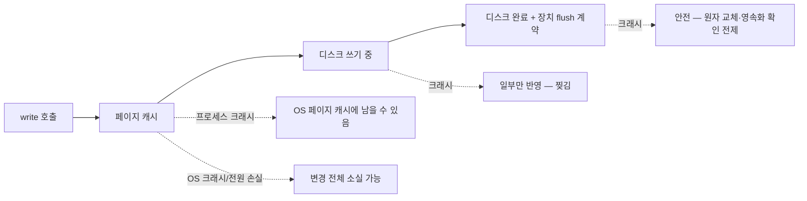
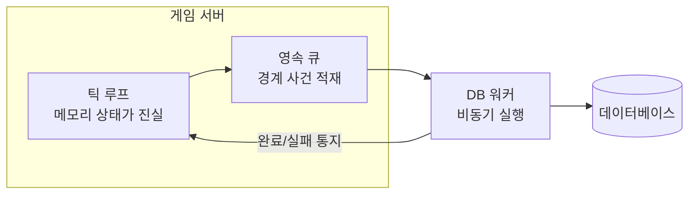
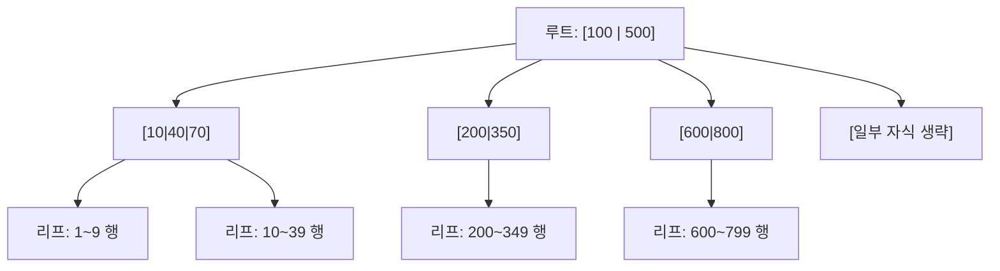
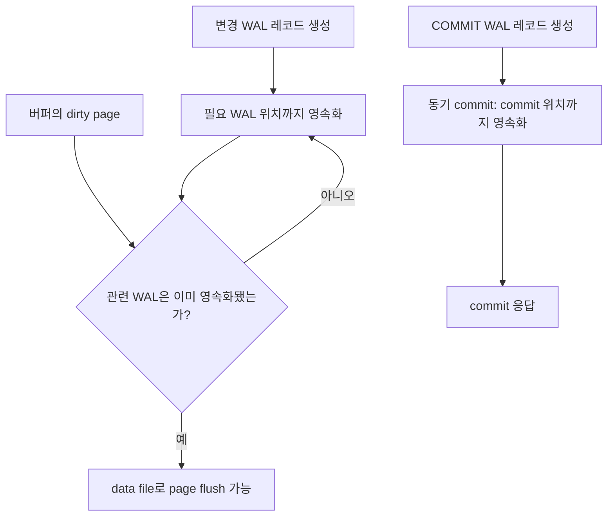
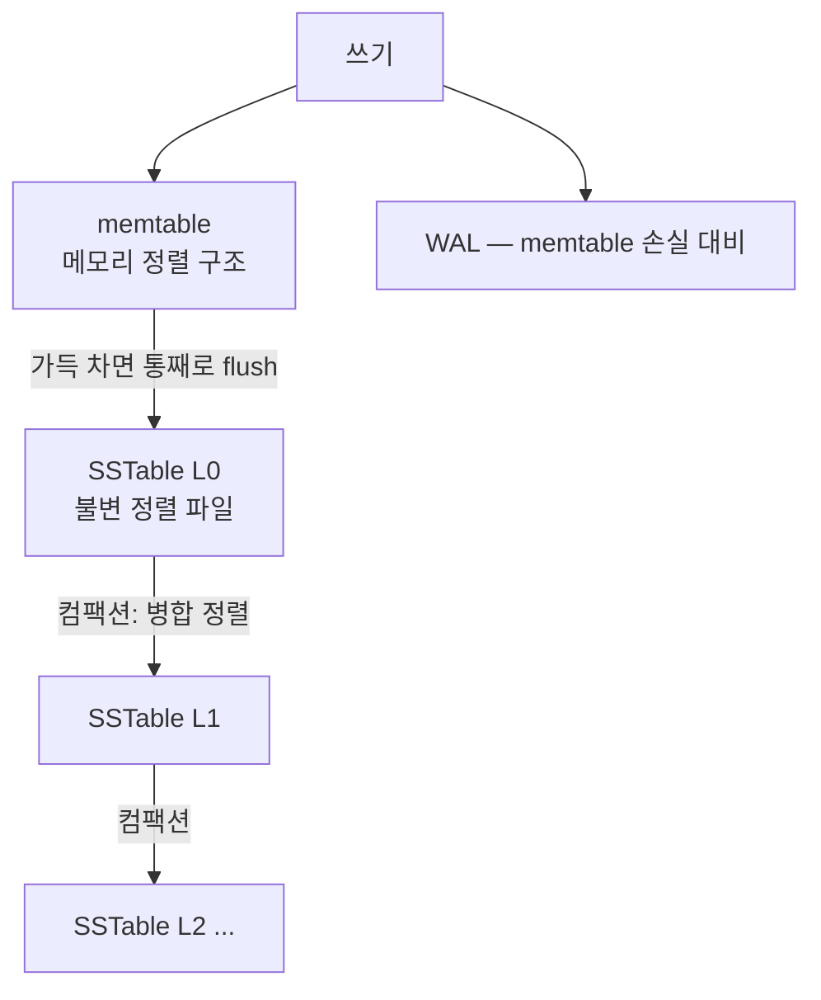
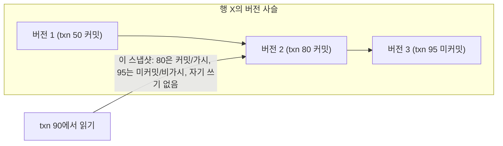

## 들어가며

데이터베이스는 파일보다 편리한 저장 API가 아니라, 장애와 동시성 아래에서 상태를 보존하고 여러 작업의 순서를 통제하는 시스템이다. 저장 엔진의 페이지와 로그, 인덱스, 트랜잭션 격리와 복구가 하나의 계약을 만든다.

이 글은 데이터베이스가 필요한 이유에서 시작해 B-Tree와 LSM 계열 저장 엔진, WAL, 잠금과 MVCC, 격리 수준과 데드락까지를 하나의 내부 실행 모델로 연결한다.

읽는 기준은 코드다. 각 개념은 결국 스키마 제약, 트랜잭션 함수, 재시도 루프, 동시성 테스트 중 하나로 내려와야 한다. `COMMIT`이 성공했을 때 어떤 바이트가 디스크와 로그에 남고, 두 요청이 동시에 들어왔을 때 어떤 함수가 하나를 실패시키는지를 설명할 수 있어야 한다.

---

## 목차

1. 게임이 저장하는 것들
2. 소박한 파일 저장이 깨지는 곳
3. 찢긴 쓰기: 크래시의 해부
4. fsync와 내구성의 가격
5. ACID: 데이터베이스의 약속
6. 게임 서버에서 영속 계층의 자리
7. 무엇을 어디에 저장하는가
8. 디스크의 물리: 왜 자료구조가 달라지는가
9. 페이지: 디스크 자료구조의 단위
10. B-트리: 제자리 갱신의 계보
11. WAL: 크래시에도 살아남는 쓰기
12. LSM 트리: 추가 전용의 계보
13. 세 가지 증폭: 트레이드오프의 언어
14. 게임 워크로드에 대응시키기
15. 동시성이 만드는 이상 현상들
16. 격리 수준의 사다리
17. 구현 1: 잠금
18. 구현 2: MVCC — 읽기와 쓰기의 비충돌
19. 게임 사례로 읽는 격리 선택
20. 데드락과 잠금 순서
21. 실전 규칙 모음
22. 트랜잭션 계약을 코드로 고정하기

---


## 1. 게임이 저장하는 것들

게임의 데이터는 수명과 가치가 제각각이다. 저장 설계의 첫 단계는 이 분류다.

| 데이터 | 수명 | 손실 비용 | 쓰기 빈도 |
|---|---|---|---|
| 계정·인증 정보 | 영구 | 서비스 신뢰 상실 | 낮음 |
| 결제·재화 잔액 | 영구 | 금전 보상, 법적 책임 | 중간 |
| 인벤토리·장비·진행도 | 영구 | 이탈 직결 | 중간~높음 |
| 시즌 랭크·통계 | 시즌 | 경쟁 신뢰 훼손 | 높음 |
| 매치 결과·전적 | 영구(요약) | 낮음~중간 | 매치당 1회 |
| 진행 중 매치 상태 | 분 단위 | 낮음 (재시작 허용) | 매 틱 |
| 텔레메트리·로그 | 분석 주기 | 낮음 (표본 손실) | 폭주 |

표의 위쪽일수록 정확성이, 아래쪽일수록 처리량이 지배한다. 결제 기록은 단 한 건도 틀리면 안 되지만 초당 수십 건이고, 텔레메트리는 1%가 사라져도 분석에 지장이 없지만 초당 수만 건이다. 이 양극단을 같은 저장소, 같은 보장 수준으로 다루는 것은 한쪽에 과잉이고 다른 쪽에 과소다 — 데이터 분류가 곧 저장소 선택의 입력이 된다.

진행 중 매치 상태의 행이 따로 있는 이유도 분명히 해 둘 가치가 있다. 매 틱 갱신되는 월드 상태를 매 틱 디스크에 적는 게임은 없다 — 그 상태의 진실은 서버 메모리이고, 영속 계층에는 *경계 사건* (매치 종료, 보상 확정)의 결과만 내려간다. "무엇이 영속 대상인가"는 "무엇이 메모리에서 죽어도 되는가"의 여집합이다.

## 2. 소박한 파일 저장이 깨지는 곳

플레이어 데이터를 JSON 파일 하나로 저장하는 서버를 가정한다.

```cpp
void SavePlayer(const Player& p) {
    std::ofstream f("players/" + p.id + ".json");
    f << ToJson(p);   // 잔액, 인벤토리, 진행도 전부
}
```

이 코드는 네 방향에서 깨진다.

- **쓰기 도중 크래시**: `ToJson` 출력의 절반만 쓰인 시점에 전원이 나가면 깨진 JSON이 남는다. 안전한 저장은 임시 파일에 완전한 새 버전을 쓰고 내구화한 뒤 이름을 원자적으로 교체하며, 디렉터리 항목의 내구성까지 플랫폼 계약에 맞춰 처리한다.
- **동시 쓰기**: 두 요청(아이템 사용과 우편 수령)이 같은 플레이어를 동시에 저장하면, 나중에 닫힌 쪽이 먼저 닫힌 쪽을 통째로 덮어쓴다 — 한쪽의 변경이 흔적 없이 사라진다(lost update).
- **읽고-고치고-쓰기 경쟁**: 잔액 1,000을 두 요청이 동시에 읽고, 각자 500을 차감해 500을 쓴다 — 1,000이 차감되어야 할 자리에 500만 차감된다. 파일 잠금으로 막을 수 있지만, 잠금의 범위·순서·해제를 직접 설계하는 순간 이미 데이터베이스의 한 조각을 만들고 있는 것이다.
- **질의 불가**: "보유 골드 상위 100명"을 구하려면 파일 전부를 열어 파싱해야 한다. 데이터가 구조가 아니라 덩어리로 저장되어 있기 때문이다.

네 문제의 공통점은 *코드가 틀려서가 아니라 모델이 없어서* 생긴다는 것이다. 원자성, 격리, 내구성, 질의 — 이 넷을 임시방편으로 하나씩 덧대는 길의 끝에 있는 것이 데이터베이스이므로, 처음부터 그것을 쓰는 편이 싸다.

## 3. 찢긴 쓰기: 크래시의 해부

"파일에 쓴다"는 한 번의 동작이 아니다. `write` 호출은 데이터를 커널의 페이지 캐시에 복사할 뿐이고, 디스크 도달은 커널이 나중에(수 초 뒤일 수 있다) 수행한다. 그 사이의 크래시는 쓰기를 통째로 잃는다. 디스크에 닿는 중의 크래시는 더 나쁘다 — 저장 장치는 일정 크기 단위로 쓰므로, 여러 단위에 걸친 갱신은 *일부만 반영된* 채 멈출 수 있다. 이것이 찢긴 쓰기(torn write)다.

크래시 시점별로 파일에 남는 것을 정리하면 다음과 같다.



X2가 치명적인 이유는 *검출조차 어렵다* 는 데 있다 — 파일은 존재하고, 크기도 그럴듯하고, 절반의 내용은 옳다. 체크섬 없이는 정상 데이터와 구분되지 않는다.

고전적 처방은 *원자적 교체* 다 — 새 내용을 임시 파일에 다 쓰고, 디스크 도달을 강제한 뒤, 이름 바꾸기로 원본을 대체한다.

```cpp
void SaveAtomic(const std::string& path, const std::string& data) {
    // 대상 경로별 직렬화 또는 호출별 고유 임시 파일의 배타 생성이 선행 조건이다
    std::string tmp = CreateExclusiveTempInSameDirectory(path);
    WriteAll(tmp, data);            // 소유 핸들로 전량 쓰고 오류·short write 검사
    FsyncFile(tmp);
    AtomicReplace(tmp, path);       // POSIX rename/renameat 계열, Windows ReplaceFile 등
    FsyncParentDirectory(path);     // POSIX에서 rename 메타데이터의 crash durability
}
```

계약은 다음과 같다 — 대상 경로별 writer가 직렬화되거나 각 호출이 독립적인 임시 파일을 배타적으로 생성한다. 임시 파일은 대상과 같은 파일 시스템에 만들고, 전체 쓰기 → 파일 동기화 → 원자 교체 → (지원하는 경우) 부모 디렉터리 동기화를 확인한다. rename 뒤 동기화가 실패했다면 그것은 **원본이 그대로**라는 뜻이 아니라 **새 파일은 보이지만 내구성은 불확실**하다는 뜻일 수 있다. 고유 임시 파일만으로는 서로 다른 버전을 읽고-고쳐-쓰는 lost update가 해결되지 않으므로, 전체 read-modify-write에는 별도의 잠금/버전/CAS 계약이 필요하다.

같은 파일 시스템 안의 POSIX `rename`은 다른 프로세스가 관찰하는 namespace 교체를 원자적으로 만든다. 그러나 **원자적 가시성**과 **전원 장애 뒤 내구성**은 별개다. 임시 파일 내용을 `fsync`하고 rename한 뒤 부모 디렉터리도 `fsync`해야 새 directory entry의 영속성을 요청할 수 있다. Windows의 교체 API와 flush 계약, 콘솔 SDK, 네트워크 파일 시스템은 다르며 `std::filesystem::rename` 하나가 기존 파일 교체와 crash durability를 이식성 있게 보장하지 않는다. 임시 파일은 대상과 같은 파일 시스템에 두고 플랫폼별 wrapper를 검증해야 한다.

이 절차도 디스크 firmware와 파일 시스템 오류까지 완벽히 막지는 못하므로 checksum, 세대 번호, 이전 세이브 보존과 복구 테스트를 더한다. 데이터베이스의 WAL도 “데이터 페이지보다 복구 로그를 먼저 durable하게 만든다”는 원리를 더 일반적인 transaction 복구 규약으로 확장한 것이다.

## 4. fsync와 내구성의 가격

"커밋했다"고 응답한 데이터가 약속한 장애 모델 뒤에도 살아 있는 성질이 내구성(durability)이다. 로컬 파일에서 `fsync`/`fdatasync`는 dirty data와 필요한 메타데이터를 안정 저장소로 내리도록 운영체제에 요청하고 완료를 기다리는 핵심 경계다. 정확한 보장은 파일 시스템, mount 옵션, 장치 write cache와 power-loss protection에 달려 있으며, 분산 DB의 durability는 replica acknowledgement와 합의 범위까지 포함할 수 있다.

고정 지연표 대신 실행 경로를 분리한다.

| 경로 | 완료가 뜻하는 것 | 변동 원인 |
|---|---|---|
| buffered write | 사용자 버퍼가 page cache로 복사됨 | page fault, dirty throttling, 메모리 압박 |
| file sync | 해당 파일의 dirty data/metadata flush 완료 요청 | queue depth, controller cache, FTL, journal, 동시 I/O |
| DB commit | WAL 및 복제 정책이 정한 지점 도달 | group commit, synchronous replica 수, consensus RTT |

한 transaction씩 직렬로 sync하면 처리량 상한이 sync latency의 역수에 가까워진다. 동시 transaction의 WAL record를 한 flush에 묶는 group commit은 여러 commit이 같은 장치 왕복을 나눠 갖게 한다. 이 때문에 단일 요청 latency와 전체 transaction throughput을 따로 측정해야 한다.

내구성에는 수위가 있다. 로컬 WAL flush, 다수 replica acknowledgement, 비동기 replica, 주기 flush는 각각 견디는 장애와 허용 손실 창이 다르다. 결제·원장은 강한 commit과 정산을 요구하고, 재생 가능한 telemetry는 더 큰 손실 창을 허용할 수 있다. “완전 내구”라는 이름보다 process crash, OS crash, 전원 손실, 장치 손실, zone 손실 중 어디까지 견디는지 RPO로 적는다.

## 5. ACID: 데이터베이스의 약속

데이터베이스 트랜잭션(transaction)은 여러 읽기·쓰기를 하나의 단위로 묶는 추상이고, 그 단위에 네 가지 성질을 약속한다.

- **원자성(Atomicity)**: 전부 적용되거나 전혀 적용되지 않는다. "아이템 차감 + 골드 지급" 중간에 크래시해도 절반만 반영된 상태는 없다.
- **일관성(Consistency)**: 트랜잭션 전후로 정의된 불변식(잔액 비음수, 외래 키 정합)이 유지된다 — 절반은 데이터베이스 제약이, 절반은 응용 로직이 지킨다.
- **격리(Isolation)**: 동시에 실행되는 트랜잭션들이 서로의 중간 상태를 보지 않는다. 2절의 lost update와 읽기-쓰기 경쟁이 이 약속의 대상이다.
- **내구성(Durability)**: 커밋 응답 이후의 크래시에도 결과가 남는다 — 4절의 fsync가 그 비용이다.

```sql
BEGIN;
UPDATE wallets   SET gold  = gold - 500 WHERE player_id = 42 AND gold >= 500;
-- affected_rows != 1이면 ROLLBACK 후 잔액 부족/지갑 없음 반환 (지급하지 않는다)
UPDATE inventory SET count = count + 1  WHERE player_id = 42 AND item_id = 7;
-- 지급도 1행을 바꿨는지(또는 INSERT가 성공했는지) 확인, 아니면 ROLLBACK
COMMIT;
```

트랜잭션은 실제로 수행된 변경을 함께 커밋/롤백한다. 조건부 갱신이 0행인 경우는 SQL 실패가 아니므로, 차감과 지급이 각각 의도한 행을 바꿨는지 검사해 어긋나면 커밋 전에 전체 롤백해야 한다. 남는 것은 질의이고, 그것은 데이터를 구조(테이블·인덱스)로 저장한다는 관계형 모델의 몫이다.

약속에는 가격이 있다 — 격리는 잠금 또는 버전 관리의 비용을, 내구성은 fsync의 지연을, 원자성은 로그 쓰기의 추가 I/O를 청구한다. 데이터베이스를 쓰는 설계 감각의 절반은 "어디서 이 약속을 전부 사고, 어디서 일부를 무를 것인가"의 판단이고, 1절의 분류표가 그 판단의 지도다.

## 6. 게임 서버에서 영속 계층의 자리

게임 서버는 고정 틱으로 도는 실시간 시뮬레이션이고, 데이터베이스 호출은 밀리초 단위로 블로킹될 수 있는 외부 I/O다. 이 둘을 한 스레드에 섞으면 틱이 멈춘다 — 따라서 영속 계층의 첫 번째 설계 규칙은 *틱 루프 안에서 데이터베이스를 기다리지 않는다* 이다.

표준 구조는 비동기 경계다.



틱 루프는 "매치 종료, 보상 확정" 같은 사건을 큐에 적고 즉시 다음 틱으로 간다. 워커가 트랜잭션을 실행하고, 결과(성공·실패)를 사건으로 되돌린다. 이 구조에서 두 가지 결정이 따라온다.

- **진실의 위치 선언**: 매치 중의 상태는 서버 메모리가 진실이고, 데이터베이스는 경계 사건의 기록이다. 거꾸로 로비·상점에서는 데이터베이스가 진실이고 서버 메모리는 캐시다. 어느 쪽이 진실인지 모호한 데이터가 정합성 버그의 산지가 된다.
- **실패의 처리**: 데이터베이스 쓰기는 실패할 수 있다(타임아웃, 장애). 보상 지급이 실패했을 때 재시도할 것인가, 어디에 적어 두고 복구할 것인가 — 영속 계층 설계의 본론은 성공 경로가 아니라 이 실패 경로다. 같은 보상이 두 번 지급되지 않게 하는 장치(요청별 고유 키로 중복을 걸러내는 멱등 처리)가 재시도의 전제 조건이다.

## 7. 무엇을 어디에 저장하는가

1절의 분류를 저장소 유형에 대응시키면 게임 백엔드의 전형적 저장 지형이 나온다.

| 데이터 | 전형적 저장소 | 이유 |
|---|---|---|
| 계정·결제·인벤토리·경제 | 관계형 DB | 트랜잭션·제약·질의가 본질 요구 |
| 세션·매치메이킹 대기열·랭킹 | 인메모리 스토어(Redis류) | 짧은 수명, 높은 빈도, 원자적 연산 |
| 매치 진행 상태 | 서버 메모리 | 틱 단위 갱신 — 영속 비대상 |
| 텔레메트리·이벤트 로그 | 추가 전용 로그 → 분석 저장소 | 폭주 쓰기, 질의는 나중에 일괄 |
| 세이브 블롭(비경쟁 진행도) | 키-값 또는 오브젝트 스토리지 | 구조 질의 불요, 덩어리 읽쓰기 |

이 표는 출발점이지 규칙이 아니다 — 규모가 작을 때는 관계형 DB 하나가 전부를 감당하는 것이 운영상 옳고(움직이는 부품 최소화), 분화는 측정된 병목이 요구할 때 한다. 다만 *분류 자체* 는 처음부터 해 두어야 한다. 코드에 "이 데이터의 보장 수준" 구분이 없으면, 나중의 분화는 전면 수술이 된다.


## 8. 디스크의 물리: 왜 자료구조가 달라지는가

메모리 자료구조(해시맵, 레드블랙 트리)를 그대로 디스크에 옮기면 느려지는 이유는 접근 비용의 비대칭이다.

| 매체·경로 | 랜덤 접근의 주 비용 | 순차 처리의 이점 |
|---|---|---|
| DRAM | cache/TLB/NUMA와 memory-level parallelism | prefetch, 넓은 burst, 높은 locality |
| NVMe/SATA SSD | controller·queue·FTL·flash read, 작은 I/O당 고정 비용 | 큰 I/O와 queue 병렬성으로 command 비용 상각 |
| HDD | seek와 rotational latency | head 이동을 줄이고 연속 transfer 유지 |

두 사실이 저장 자료구조의 설계를 결정한다. 첫째, 작은 I/O마다 고정 command·mapping 비용이 있어 여러 record를 한 page I/O로 묶는 편이 유리하다. 둘째, 저장장치·파일 시스템·buffer pool의 전송과 관리 단위가 애플리케이션 record보다 크다. 다만 SSD의 랜덤/순차 격차는 queue depth, read/write 혼합, cache hit와 장치에 따라 크게 달라 “항상 수십 배”로 고정할 수 없다. `fio` 같은 raw device 측정과 실제 DB page-cache/buffer-pool 측정을 분리한다.

따라서 디스크 자료구조의 목표는 포인터 추적 횟수의 최소화(랜덤 접근 줄이기)와 접근 단위의 정렬(블록을 꽉 채워 쓰기)이 된다. B-트리는 첫 번째를, LSM은 두 번째를 극단까지 밀어붙인 답이다.

## 9. 페이지: 디스크 자료구조의 단위

스토리지 엔진은 파일을 고정 크기 페이지(page, 보통 4~16KB)의 배열로 다룬다. 페이지가 메모리와 디스크 사이를 오가는 단위이고, 자주 쓰는 페이지를 메모리에 잡아 두는 버퍼 풀(buffer pool)이 그 캐시다.


이 구조에서 성능의 첫 번째 분기가 나온다 — *작업 집합이 버퍼 풀에 들어가는가*. 들어가면 읽기는 메모리 속도이고, 넘치면 작업 집합·접근 패턴에 따라 페이지 교체가 늘고 디스크 I/O가 끼어들 수 있다. "데이터가 작을 때는 빠르던 DB가 어느 규모부터 급격히 느려지는" 현상의 정체가 대부분 이 경계 통과다. 게임 백엔드의 용량 계획에서 "활성 플레이어의 데이터가 버퍼 풀(또는 그 역할의 메모리)에 들어가는가"가 첫 질문인 이유다.

## 10. B-트리: 제자리 갱신의 계보

B-트리는 페이지를 노드로 하는 다진 탐색 트리다. 이 절은 내부 노드에 구분 키를 두고 리프에 데이터(또는 그 위치)를 두며 리프를 순서대로 연결하는 **B+tree식 레이아웃**을 기준으로 설명한다 — 일반 B-tree와 구현별 변형은 데이터의 위치와 split 방식이 다르다. 내부 노드는 페이지 하나에 수백 개의 키와 자식 포인터를 담을 수 있는 분기 계수를 가지며, 이는 점유율의 일반 보장이 아니다. 아래 그림은 일부 자식 가지만 그린 개념도이므로, 표시한 구분 키 사이에 생략된 범위가 있다.



분기 수가 크므로 트리가 얕다 — 분기 500이면 $\log_{500} N$ 단계로, 1억 키도 3~4 페이지 접근이면 닿는다. 페이지당 랜덤 접근 1회라는 디스크 비용 모델에서 "포인터 추적 3~4회"는 사실상 최적이고, 범위 질의(리프를 순서대로 훑기)도 자연스럽다. 반세기 넘게(1972년 발표 이후) 관계형 데이터베이스의 기본 인덱스인 이유다.

쓰기는 제자리 갱신이다 — 키가 속한 리프 페이지를 찾아 그 페이지를 고쳐 쓴다. 페이지가 가득 차면 둘로 쪼개고(split) 부모에 새 키를 올린다. 이 제자리성에서 두 가지 비용이 나온다.

- **랜덤 쓰기**: 갱신되는 리프들은 디스크 곳곳에 흩어져 있다 — 쓰기가 랜덤 I/O가 된다.
- **찢긴 페이지 위험**: 페이지 하나를 고쳐 쓰는 도중의 크래시는 반쯤 쓰인 페이지를 남겨 트리 구조를 깨뜨릴 수 있다. WAL은 데이터 페이지보다 먼저 redo/undo에 필요한 로그를 내구화하고, page checksum·double write 같은 기법은 저장 장치의 원자 쓰기 단위 밖에서 생기는 torn page를 보완한다.

## 11. WAL: 크래시에도 살아남는 쓰기

Write-Ahead Logging(WAL)의 규칙은 한 줄이다 — dirty data page를 **영속 저장소에 쓰기 전에**, 그 변경을 설명하는 WAL 레코드가 먼저 영속화되어 있어야 한다. 메모리 버퍼 페이지를 고치는 시점과 그 페이지를 데이터 파일에 write하는 시점은 다르므로, 버퍼를 수정할 때마다 fsync하라는 규칙이 아니다. 동기 커밋은 필요한 commit WAL의 내구화를 응답 조건으로 두고, 데이터 페이지 flush는 background writer나 체크포인트에서 일어날 수 있다.



이 순서가 두 약속을 동시에 산다.

- **내구성**: 동기 커밋 정책에서는 커밋 성공을 응답하기 전에 해당 트랜잭션의 commit record까지 안정 저장소에 flush한다. 크래시 후에는 필요한 로그를 redo해 데이터 페이지에 아직 반영되지 않은 커밋 결과를 복원한다. 비동기 커밋이나 저장장치의 flush 계약을 완화하면 이 보장 범위도 달라진다.
- **원자성**: steal 정책에서는 미커밋 트랜잭션이 바꾼 페이지도 크래시 전에 디스크로 나갈 수 있다. 따라서 “commit marker가 없으면 로그를 무시”하는 것만으로는 부족하다. recovery는 winner와 loser를 식별하고, 구현에 따라 history를 redo한 뒤 loser의 변경을 compensation log record와 함께 undo하거나 동등한 방식으로 원자성을 복원한다.

로그는 논리적으로 append되므로 흩어진 데이터 페이지를 커밋마다 동기식으로 쓰는 것보다 I/O를 모으기 쉽다. 커밋 임계 경로에는 WAL append와 durability barrier가 남고, 데이터 페이지 쓰기는 뒤로 미룰 수 있다. 실제 장치에서는 파일 시스템, SSD FTL, cache와 동시 writer 때문에 물리 쓰기가 완전히 순차라는 보장은 없다. group commit은 여러 commit을 한 flush에 묶어 flush당 처리량을 높이지만 개별 트랜잭션의 대기 분포와 batch 형성 지연을 함께 측정해야 한다.

체크포인트는 recovery가 시작할 분석 지점과 당시의 dirty page·active transaction 정보를 기록해 복구 시 스캔 범위를 제한한다. fuzzy checkpoint는 실행 중 쓰기와 병행되므로 체크포인트 이전 로그를 즉시 모두 버릴 수 있는 것이 아니다. 아직 flush되지 않은 page의 recLSN, 진행 중 transaction, replica·backup·PITR 보존 요구가 허용하는 지점까지만 WAL을 재활용한다. dirty page flush가 몰리면 지연과 대역폭 경합이 생길 수 있어 엔진은 background writer와 checkpoint pacing을 사용한다. ARIES는 analysis, redo-repeating-history, undo와 compensation log record를 결합한 대표적인 WAL recovery 설계이며 모든 데이터베이스가 동일한 알고리즘을 구현하는 것은 아니다.

## 12. LSM 트리: 추가 전용의 계보

LSM(Log-Structured Merge) 트리는 "랜덤 쓰기를 아예 없애자"는 발상이다 — 모든 쓰기를 메모리에 모았다가, 덩어리째 순차로 내린다.



- **쓰기 경로**: memtable(정렬 맵)에 넣고 WAL에 append — 끝. 디스크 랜덤 쓰기가 없다. memtable이 차면 정렬된 불변 파일(SSTable)로 통째로 flush한다 — 순차 쓰기다.
- **읽기 경로**: memtable → 최신 SSTable → 그 아래 레벨 순으로 키를 찾는다. 한 키가 여러 파일에 있을 수 있으므로(갱신이 덮어쓰기가 아니라 새 항목 추가이므로) 여러 파일을 봐야 할 수 있다 — 읽기가 쓰기보다 비싸지는 구조다. 파일마다 블룸 필터(Bloom filter)를 둬서 "이 파일에 그 키 없음"을 디스크 접근 없이 걸러내는 것이 표준 완화책이다.
- **컴팩션(compaction)**: 겹치는 SSTable들을 병합 정렬해 아래 레벨의 더 큰 파일로 합치고, 덮어쓰인 옛 값과 삭제 표시(tombstone)를 이때 청소한다. 단 tombstone은 더 오래된 값이 하위 레벨/다른 run에 가려져 남지 않고 그 버전을 필요로 하는 활성 snapshot이 더 이상 없다는 조건을 확인한 뒤에만 제거할 수 있다 — 조건 없이 지우면 삭제한 키가 낮은 레벨의 옛 값으로 되살아난다(tombstone resurrection). 백그라운드에서 상시 도는 이 병합이 LSM의 유지비다.

운영 현상으로 번역하면 — LSM은 쓰기 폭주를 잘 받지만, 컴팩션이 밀리면 읽기가 느려지고(볼 파일이 늘어서) 디스크 대역폭을 컴팩션이 잠식한다. "쓰기는 빠른데 가끔 전체가 출렁인다"는 LSM 계열의 전형적 증상은 대부분 컴팩션 부채의 청산 장면이다.

## 13. 세 가지 증폭: 트레이드오프의 언어

두 계보의 비교는 "무엇이 몇 배로 부풀려지는가"의 언어로 정리된다. 응용이 1을 요청할 때 엔진이 실제로 수행하는 양의 배수다.

| 증폭 | 정의 | B-트리 | LSM |
|---|---|---|---|
| 쓰기 증폭 | 응용 쓰기 1바이트당 디스크 쓰기 | 페이지 단위 덮어쓰기 + WAL — 중간 | flush + 다단 컴팩션 재쓰기 — 워크로드 따라 큼 |
| 읽기 증폭 | 읽기 1건당 확인할 위치 수 | 트리 깊이만큼 — 작고 일정 | 여러 SSTable — 크고 가변 (블룸 필터로 완화) |
| 공간 증폭 | 논리 데이터 대비 디스크 사용 | 페이지 빈 공간 — 중간 | 덮어쓰인 옛 값이 컴팩션 전까지 잔존 — 가변 |

요약하면 B-트리는 point/range read와 예측 가능한 read amplification에, LSM은 순차 flush를 통한 쓰기 처리량에 유리한 경향이 있다. SSD와 cache, compaction 정책, value 크기가 이 경계를 바꾸므로 read/write/space amplification, tail latency와 복구 시간을 실제 workload로 함께 측정한다.

## 14. 게임 워크로드에 대응시키기

게임 백엔드의 대표 워크로드를 두 계보에 대응시킨다.

| 워크로드 | 특성 | 적합 계보 |
|---|---|---|
| 계정·인벤토리·경제 | 읽기 위주, 트랜잭션, 예측 가능한 지연 요구 | B-트리 (관계형 DB) |
| 텔레메트리·이벤트 적재 | 쓰기 폭주, 읽기는 나중에 일괄 | LSM (또는 추가 전용 로그) |
| 전적·로그성 이력 | 쓰기 많고 갱신 없음, 키 조회 | LSM 우세 |
| 랭킹·세션 | 초고빈도 갱신, 작은 데이터 | 인메모리 (디스크 엔진 비대상) |

두 가지 실무 감각을 덧붙인다. 첫째, *기본값은 B-트리 관계형 DB* 다 — 게임의 돈이 걸린 데이터(계정·경제)는 트랜잭션과 제약이 본질 요구이고, 그 영역에서 B-트리 엔진들의 성숙도가 곧 안정성이다. LSM은 쓰기 폭주가 측정으로 확인된 영역(텔레메트리)에 도입한다. 둘째, *엔진의 운영 현상을 어휘로 가져갈 것* — 체크포인트 스파이크(B-트리)와 컴팩션 부채(LSM)는 엔진의 결함이 아니라 설계의 그림자이고, 모니터링 그래프에서 그 모양을 알아보는 것이 운영 역량의 일부다.


## 15. 동시성이 만드는 이상 현상들

격리가 완벽하지 않을 때 생기는 대표 이상 현상을 게임 데이터로 재현한다.

- **더티 리드(dirty read)**: 커밋되지 않은 변경을 읽는다. 거래 트랜잭션이 골드를 차감해 둔(아직 미커밋) 상태를 다른 요청이 읽고 행동했는데, 거래가 롤백되면 — 존재한 적 없는 상태에 근거한 행동이 남는다.
- **반복 불가능 읽기(non-repeatable read)**: 한 트랜잭션 안에서 같은 행을 두 번 읽었는데 값이 다르다. 검증 단계에서 읽은 잔액과 차감 단계에서 읽은 잔액이 다르면, 검증이 무효가 된다.
- **팬텀(phantom)**: 같은 조건의 *집합* 질의가 두 번째에 다른 행 집합을 돌려준다. "이 플레이어의 진행 중 거래는 0건"을 확인하고 새 거래를 만드는 사이, 다른 요청이 거래를 끼워 넣는다 — 행이 아니라 *조건* 에 대한 경쟁이다.
- **갱신 손실(lost update)**: 두 트랜잭션이 같은 값을 읽고-고치고-쓴다. 잔액 1,000에서 각자 500을 차감해 둘 다 500을 쓰면, 차감 하나가 사라진다.
- **쓰기 왜곡(write skew)**: 둘 다 자기 읽기에 근거해 *서로 다른 행* 을 고쳤는데, 합쳐 놓으면 불변식이 깨진다. "파티 탱커는 최소 1명" 규칙 아래, 탱커 둘이 동시에 각자 탈퇴 검사를 통과하고 탈퇴하는 경우가 정확히 이 모양이다.

아래로 갈수록 미묘하고, 마지막 둘은 "각 트랜잭션은 옳았는데 결과가 틀린" 부류라 코드 리뷰로 잡기 어렵다. 격리 수준은 이 목록의 어디까지를 데이터베이스가 막아 주는가의 선언이다.

## 16. 격리 수준의 사다리

SQL 표준의 네 수준과, 각 수준이 허용하는 이상 현상을 정리한다.

| 수준 | 더티 리드 | 반복 불가 | 팬텀 | 갱신 손실·쓰기 왜곡 |
|---|---|---|---|---|
| Read Uncommitted | 허용 | 허용 | 허용 | 허용 |
| Read Committed | 차단 | 허용 | 허용 | 허용 |
| Repeatable Read(엔진에 따라 SI) | 차단 | 차단 | 구현 따라 | 갱신 손실은 대개 차단, 쓰기 왜곡 허용 |
| Serializable | 차단 | 차단 | 차단 | 차단 |

세 가지 주의가 표를 실전 가치로 만든다. 첫째, *기본값은 Serializable이 아니다* — PostgreSQL·SQL Server의 기본은 Read Committed, MySQL(InnoDB)의 기본은 Repeatable Read다. 둘째, *같은 이름이 같은 행동을 뜻하지 않는다* — Repeatable Read와 snapshot isolation은 같은 행으로 묶어도 동일하지 않다. 예를 들어 PostgreSQL의 Read Committed는 문장(statement)마다 새 스냅샷을, Repeatable Read는 첫 비트랜잭션제어 문장 시점의 스냅샷을 쓴다. ANSI 현상 표와 잠금 기반 직관만으로 MVCC 구현의 write skew와 visibility 규칙을 모두 설명할 수 없으므로 자기 데이터베이스의 문서로 확인해야 한다. 셋째, *Serializable은 공짜가 아니다* — 직렬 실행과 동등함을 보장하는 대가로 잠금 경합 또는 직렬화 실패에 대한 재시도가 따른다.

### 충돌 직렬 가능성의 형식적 정의: 우선순위 그래프

직렬 가능성을 "직렬 실행과 같은 결과"라고만 두면 검증할 수 없다. 형식적 기준은 우선순위 그래프(precedence graph, 직렬화 그래프)다. 스케줄의 각 트랜잭션을 정점으로 놓고, 두 연산이 *충돌* 하면(같은 데이터 항목을 건드리고 적어도 하나가 쓰기) 먼저 실행된 트랜잭션에서 나중 트랜잭션으로 방향 간선을 긋는다. 충돌은 세 종류다.

- 쓰기→읽기(wr 의존): $T_i$가 쓴 값을 $T_j$가 읽는다.
- 읽기→쓰기(rw 반의존, anti-dependency): $T_i$가 읽은 항목을 $T_j$가 나중에 덮어쓴다.
- 쓰기→쓰기(ww 의존): $T_i$가 쓴 항목을 $T_j$가 덮어쓴다.

정리(Papadimitriou 1979; Bernstein-Hadzilacos-Goodman 1987): 스케줄이 충돌 직렬 가능(conflict-serializable)인 것은 그 우선순위 그래프가 비순환인 것과 동치다. 비순환이면 위상 정렬이 존재하고, 그 순서가 같은 결과를 내는 직렬 실행이다. 순환이 있으면 — $T_1\to T_2\to\dots\to T_1$ — 모든 간선의 방향을 동시에 만족하는 직렬 순서가 없으므로 그 스케줄은 **충돌 직렬 가능하지 않다**. 다만 이것은 충돌 동등성(conflict equivalence) 기준의 결론이며, blind write를 허용하는 일반 스케줄의 view 직렬 가능성과는 범위가 다르다 — 예를 들어 `w1(x=1); w2(x=2); w1(x=3)`은 양방향 충돌 간선이 있지만 읽기가 없고 최종 writer가 $T_1$이므로 $T_2; T_1$과 view-equivalent다. "충돌 직렬 가능성"의 검증은 이 한 가지 질문, *그래프에 순환이 있는가* 로 환원된다.

2단계 잠금(17절)이 직렬 가능을 보장하는 근거도 여기서 나온다 — 모든 트랜잭션이 잠금을 커밋까지 쥐면(rigorous 2PL), 충돌하는 두 연산의 순서가 잠금 획득 순서로 고정되어 우선순위 그래프에 역방향 간선이 생길 수 없다(Eswaran 외 1976). Serializable의 "재시도 전제"는 결국 이 비순환을 강제하는 두 길 — 잠금으로 충돌을 직렬화하거나, 순환을 검출해 한쪽을 중단하거나 — 의 비용이다.

## 17. 구현 1: 잠금

고전 구현은 2단계 잠금(Two-Phase Locking)이다 — 트랜잭션이 읽는 행에 공유 잠금, 고치는 행에 배타 잠금을 걸고, 한 번 해제한 뒤에는 새 잠금을 얻지 않는 두 단계(확장·수축) 규칙을 따른다. 배타 잠금만 커밋까지 보유하는 변형이 strict 2PL, 공유·배타 잠금을 모두 커밋까지 보유하는 변형이 rigorous(strong strict) 2PL이다. 존재하는 행만 잠그는 것으로는 "조건에 맞는 행이 없음"을 읽고 끝난 뒤 다른 트랜잭션이 그 조건을 만족하는 행을 삽입하는 팬텀을 막지 못하므로, 조건·범위가 불변식에 들어가면 key-range/predicate(또는 테이블) 잠금이 함께 필요하다. 충돌하는 접근은 잠금 대기열에서 기다린다.

직관적이고 강하지만 비용이 뚜렷하다 — *읽기가 쓰기를 막고 쓰기가 읽기를 막는다*. 인기 아이템의 시세 조회(읽기)가 폭주하면 그 아이템의 거래(쓰기)가 줄을 서고, 그 역도 성립한다. 잠금의 입자(행/페이지/테이블)와 보유 시간이 처리량을 직접 결정하므로, 잠금 기반 시스템의 튜닝은 "트랜잭션을 짧게, 잠그는 범위를 좁게"로 수렴한다.

명시적 잠금은 응용이 직접 쓰는 도구이기도 하다.

```sql
BEGIN;
SELECT gold FROM wallets WHERE player_id = 42 FOR UPDATE;  -- 이 행에 배타 잠금
-- 검증 후
UPDATE wallets SET gold = gold - 500 WHERE player_id = 42;
COMMIT;
```

`SELECT... FOR UPDATE`는 "읽은 값에 근거해 곧 고치겠다"는 선언이다 — 같은 행을 노리는 다른 트랜잭션을 검증 단계부터 줄 세워, 15절의 갱신 손실을 차단한다. 읽기-검증-쓰기 패턴의 표준 안전장치다.

## 18. 구현 2: MVCC — 읽기와 쓰기의 비충돌

현대 데이터베이스의 주류 구현은 다중 버전 동시성 제어(MVCC, Multi-Version Concurrency Control)다 — 행을 덮어쓰는 대신 *버전을 쌓고*, 각 읽기는 자신에게 필요한 스냅샷(또는 가시성 규칙)에 보이는 버전을 고른다. 스냅샷을 언제 얻는지는 보편 규칙이 아니라 엔진과 격리 수준의 선택이다 — 예를 들어 PostgreSQL은 Read Committed에서 문장마다 새 스냅샷을, Repeatable Read에서 첫 비트랜잭션제어 문장 시점의 스냅샷을 쓴다. 어느 버전이 보이는지는 트랜잭션 ID 숫자 비교만이 아니라 스냅샷 시점의 active transaction 집합, 커밋 상태, 자신의 쓰기를 함께 보고 정해지며, 트랜잭션 ID 할당 순서는 커밋 순서가 아니다.



효과는 구조적이다. 일반적인 일관 읽기(plain `SELECT`)는 쓰는 중인 행의 이전 커밋 버전을 볼 수 있어, 같은 행의 writer가 끝날 때까지 행 잠금에서 기다리는 일을 크게 줄인다. 그러나 “모든 읽기가 잠금 없이 항상 진행한다”는 뜻은 아니다. `SELECT ... FOR UPDATE` 같은 잠금 읽기, 스키마 변경과 메타데이터 잠금, 버퍼·페이지 내부 latch, 직렬화 가능 격리의 predicate/SSI 관리, 너무 오래된 스냅샷에 필요한 버전 정리는 구현에 따라 대기나 중단을 만들 수 있다. MVCC가 제거하는 핵심은 **버전 가시성으로 해결할 수 있는 일반 reader-writer 행 충돌**이다.

대가는 버전 보관 공간과 그 청소(PostgreSQL의 vacuum, MySQL의 undo 로그 정리), 가시성 판정 비용이다. 오래 열린 트랜잭션은 과거 버전을 계속 필요로 해 청소를 막고 저장 공간과 읽기 비용을 키울 수 있으므로, 통계 조회도 트랜잭션 수명과 snapshot age를 계측해야 한다.

MVCC 위의 스냅샷 격리(snapshot isolation)는 Repeatable Read급의 일관된 읽기를 싸게 주지만, 15절의 *쓰기 왜곡은 막지 못한다* — 두 트랜잭션이 서로 다른 행을 고치면 충돌 검출에 걸리지 않기 때문이다. 이를 마저 막는 것이 직렬화 가능 스냅샷 격리(SSI — PostgreSQL의 Serializable이 이 구현)로, 읽기-쓰기 의존성을 추적해 위험한 패턴을 충돌로 중단시킨다. "Serializable = 재시도 전제"라는 규칙이 여기서 나온다.

### 스냅샷 격리 이상의 형태: 위험한 rw 구조

스냅샷 격리가 쓰기 왜곡을 못 막는 이유를 우선순위 그래프(16절)로 정밀화하면, SSI가 무엇을 탐지해야 하는지가 드러난다. MVCC에서는 간선이 버전 사이의 관계로 확장되는데(다중버전 직렬화 그래프, Adya 1999), 핵심은 읽기→쓰기 반의존 간선이다 — $T_i$가 읽은 버전을 $T_j$가 더 새 버전으로 덮어쓰면 $T_i\xrightarrow{rw}T_j$이고, 이 간선만은 같은 스냅샷을 보는 두 트랜잭션 사이에서도 생긴다.

15절의 파티 탱커 불변식("탱커 최소 1명")을 두 트랜잭션으로 재현한다. 초기 탱커는 A, B 둘이다.

- $T_1$: 스냅샷에서 {A,B}를 읽어 탱커 2명을 확인하고, A를 딜러로 바꾼다.
- $T_2$: 같은 스냅샷에서 {A,B}를 읽어 탱커 2명을 확인하고, B를 딜러로 바꾼다.

둘은 서로 다른 행을 고쳤으므로 ww·wr 충돌이 없어 SI의 첫 커미터 승리(first-committer-wins) 검사를 통과한다. 그러나 우선순위 그래프에는 rw 간선이 둘 있다 — $T_1$은 B를 읽었고 $T_2$가 B를 덮었으니 $T_1\xrightarrow{rw}T_2$, $T_2$는 A를 읽었고 $T_1$이 A를 덮었으니 $T_2\xrightarrow{rw}T_1$. 순환 $T_1\to T_2\to T_1$ — 비직렬이다. 어떤 직렬 순서에서든 나중에 검사한 트랜잭션은 탱커 1명만 보고 탈퇴를 거부했어야 한다.

Fekete 외(2005)의 정리가 이 모양을 일반화한다 — SI에서 일어나는 모든 비직렬 실행의 순환에는 *연속한 두 rw 반의존 간선* ($\dots\to T_i\xrightarrow{rw}T_j\xrightarrow{rw}T_k\to\dots$)이 반드시 있고, 가운데 $T_j$(피벗)는 들어오는 rw와 나가는 rw를 동시에 가진다. 위 예에서는 두 트랜잭션이 각각 서로의 피벗이다. SSI가 하는 일은 정확히 이 구조의 탐지다 — 런타임에 rw 간선을 추적하다 한 트랜잭션에 들고 나는 rw가 함께 나타나면 피벗으로 보고 중단시킨다(Cahill 외 2008, PostgreSQL Serializable). 단, "들고 나는 rw 동시 존재"는 진짜 순환의 과근사이므로 실제로는 직렬 가능한 실행도 더러 헛중단(false positive)된다 — Serializable 코드가 재시도 루프를 전제해야 하는 또 하나의 이유다.

## 19. 게임 사례로 읽는 격리 선택

대표 시나리오별로 필요한 도구를 맞춘다.

**재화 차감 — 원자적 조건부 갱신으로 격리 의존을 없앤다.** 읽고-검증하고-쓰는 대신, 검증을 갱신 안에 넣는다.

```sql
UPDATE wallets SET gold = gold - 500
WHERE player_id = 42 AND gold >= 500;
-- 영향 행 수 0이면 잔액 부족 — 응용이 거절 처리
```

단문 갱신은 행 잠금 한 번으로 원자적이고, 격리 수준과 무관하게 갱신 손실이 없다. *가능하면 격리에 기대지 말고 연산을 원자화하라* — 이 한 줄이 게임 경제 코드의 제1규칙이다.

**플레이어 간 거래 — 트랜잭션 + 잠금 순서.** 네 갱신(양쪽 차감·지급)을 한 트랜잭션으로 묶되, 두 플레이어의 행을 잠그므로 데드락 가능성이 생긴다 — 20절의 잠금 순서 규칙이 따라온다. 격리 수준은 Read Committed + `FOR UPDATE`(또는 원자적 조건부 갱신 조합)로 충분하다.

**한정 수량 판매 — 경합 그 자체가 워크로드.** "선착순 1,000개"는 모든 요청이 같은 카운터 행을 노린다. 원자적 감소(`UPDATE... SET stock = stock - 1 WHERE stock > 0`)가 정합성을 지키지만, 행 잠금 직렬화로 처리량이 그 행의 잠금 처리 속도에 묶인다 — 정합성 문제가 아니라 *핫스팟* 문제로 변하고, 처방도 달라진다(카운터 분할, 대기열 앞단, 인메모리 선차감 후 정산).

**파티 불변식 — 쓰기 왜곡의 영역.** "탱커 최소 1명" 류의 *여러 행에 걸친 불변식* 은 스냅샷 격리가 못 지킨다. Serializable + 재시도, 또는 불변식을 한 행으로 물질화(파티 행에 탱커 수 컬럼을 두고 원자적 갱신)하는 설계가 답이다.

## 20. 데드락과 잠금 순서

거래 트랜잭션 둘이 서로 반대 순서로 두 지갑을 잠그면 — A가 42를 쥐고 77을 기다리고, B가 77을 쥐고 42를 기다리는 — 데드락이다. 데이터베이스는 대기 그래프의 순환을 감지해 한쪽을 강제 중단시킨다(데드락 에러). 막는 규칙은 동시성 프로그래밍과 동일하다.

- **전역 잠금 순서**: 여러 행을 잠글 때는 항상 같은 기준(플레이어 ID 오름차순)으로 잠근다. 순환의 성립 조건을 없앤다.
- **트랜잭션을 짧게**: 잠금 보유 중에 외부 호출(다른 서비스, 네트워크)을 끼우지 않는다 — 보유 시간이 곧 충돌 창이다.
- **중단을 정상 경로로**: 데드락 희생과 직렬화 실패는 버그가 아니라 프로토콜이다 — 멱등하게 재시도한다.

```cpp
// 재시도 래퍼 — 데드락/직렬화 실패는 짧은 지터 후 재실행한다
for (int attempt = 0; attempt < kMaxRetry; ++attempt) {
    auto r = RunTransaction(tradeTxn);
    if (r.ok()) return r;
    if (!r.retryable()) return r;          // 잔액 부족 등 — 재시도 무의미
    SleepJitter(attempt);                  // 동기화된 재충돌 방지
}
```

## 21. 실전 규칙 모음

이 글의 결론을 게임 백엔드의 작업 규칙으로 압축한다.

| 규칙 | 근거 |
|---|---|
| 기본 격리 수준을 명시적으로 정하고 문서화한다 | DB마다 기본값이 다르다 — 암묵은 사고의 씨앗 |
| 단일 행의 검증+갱신은 원자적 조건부 UPDATE로 | 격리 수준 무관하게 갱신 손실 차단 |
| 읽고-고치는 패턴엔 `FOR UPDATE` | 검증 시점부터 줄 세우기 |
| 다중 행 불변식은 Serializable 또는 물질화 | 스냅샷 격리는 쓰기 왜곡을 못 막는다 |
| 모든 트랜잭션 실행에 재시도 루프 | 데드락·직렬화 실패는 프로토콜이다 |
| 트랜잭션 안에서 외부 I/O 금지 | 잠금 보유 시간 = 충돌 창 |
| 핫스팟은 격리가 아니라 구조로 푼다 | 직렬화는 정합성을 주지 처리량을 주지 않는다 |


## 22. 트랜잭션 계약을 코드로 고정하기

트랜잭션 설계는 문서에 "원자적으로 처리한다"라고 적는 것으로 끝나지 않는다. 서비스 함수의 모양이 그 계약을 드러내야 한다. 좋은 형태는 입력 검증, 잠금 범위, 갱신, 재시도 가능 오류를 코드 구조로 분리한다.

아이템 거래를 예로 들면, 불변식은 두 개다.

```text
한 아이템의 owner_id는 동시에 하나뿐이다.
거래가 성공하면 아이템 소유권 변경과 거래 기록 삽입은 같이 커밋된다.
```

이를 DB 스키마와 트랜잭션이 함께 고정한다.

```sql
CREATE TABLE player_item (
    item_id     BIGINT PRIMARY KEY,
    owner_id    BIGINT NOT NULL,
    version     BIGINT NOT NULL DEFAULT 0
);

CREATE TABLE item_trade (
    trade_id    BIGINT PRIMARY KEY,
    item_id     BIGINT NOT NULL,
    from_id     BIGINT NOT NULL,
    to_id       BIGINT NOT NULL,
    created_at  TIMESTAMPTZ NOT NULL DEFAULT now()
);
```

조건부 갱신은 읽기-검사-쓰기의 경쟁 창을 줄인다. `owner_id = :from_id` 조건이 검증과 갱신을 한 문장으로 묶는다.

```sql
BEGIN;

UPDATE player_item
   SET owner_id = :to_id,
       version = version + 1
 WHERE item_id = :item_id
   AND owner_id = :from_id;

-- affected_rows가 1이 아니면 소유자가 아니거나 이미 거래됨

INSERT INTO item_trade(trade_id, item_id, from_id, to_id)
VALUES (:trade_id, :item_id, :from_id, :to_id);

COMMIT;
```

애플리케이션 코드는 DB 오류를 "예외가 났다"로만 취급하면 안 된다. 어떤 오류는 재시도해야 하고, 어떤 오류는 사용자에게 실패로 반환해야 한다.

```cpp
TradeResult TransferItem(Db& db, TradeCommand cmd) {
    return db.RunSerializable([&](Tx& tx) {
        int changed = tx.Execute(
            "UPDATE player_item SET owner_id=?, version=version+1 "
            "WHERE item_id=? AND owner_id=?",
            cmd.to, cmd.item, cmd.from);

        if (changed != 1) {
            return TradeResult::NotOwnerOrAlreadyMoved();
        }

        tx.Execute(
            "INSERT INTO item_trade(trade_id,item_id,from_id,to_id) "
            "VALUES (?,?,?,?)",
            cmd.tradeId, cmd.item, cmd.from, cmd.to);

        return TradeResult::Ok();
    });
}
```

테스트도 같은 불변식을 직접 공격해야 한다. 두 스레드가 같은 아이템을 동시에 서로 다른 대상에게 보내고, 성공한 거래가 하나뿐인지 확인한다.

```text
given item.owner = A
parallel:
  transfer(item, A -> B)
  transfer(item, A -> C)
assert count(success) == 1
assert item.owner in {B, C}
assert item_trade rows for item == 1
```

이런 테스트가 없으면 격리 수준 표를 외워도 코드가 옳다는 증거가 없다. 데이터베이스를 프로그래머답게 다룬다는 것은 불변식을 스키마, 트랜잭션, 재시도 정책, 동시성 테스트에 같은 이름으로 박아 넣는 것이다.


---

## 결론

데이터베이스의 핵심 가치는 쿼리 문법이 아니라 지속성, 동시성, 복구의 계약이다. 저장 구조와 트랜잭션 구현을 이해하면 성능과 정확성 사이의 비용을 설명하고, 장애 뒤 어떤 상태가 남는지 예측할 수 있다.

## 더 읽을거리

- Martin Kleppmann, *Designing Data-Intensive Applications* (O'Reilly, 2017), Ch.1·7 — 데이터 시스템의 신뢰성과 트랜잭션 개관.
- [SQLite: Atomic Commit In SQLite](https://www.sqlite.org/atomiccommit.html) — 단일 파일 데이터베이스가 원자성·내구성을 지키는 전 과정의 공식 해설.
- Jeff Moyer, [LWN: Ensuring data reaches disk](https://lwn.net/Articles/457667/) (2011) — write와 fsync 사이에서 데이터가 사는 곳. 응용 버퍼-라이브러리 버퍼-페이지 캐시-장치 캐시의 전 계층 해설.
- Jim Gray, Andreas Reuter, *Transaction Processing: Concepts and Techniques* (Morgan Kaufmann, 1992) — 트랜잭션 개념·잠금·복구 이론의 원전.
- [PostgreSQL 문서: Reliability and the Write-Ahead Log](https://www.postgresql.org/docs/current/wal.html) — 운영 데이터베이스의 내구성 구현 공식 문서.
- Martin Kleppmann, *Designing Data-Intensive Applications*, Ch.3 (Storage and Retrieval) — B-트리/LSM 비교의 가장 좋은 단일 챕터.
- Rudolf Bayer, Edward McCreight, "Organization and Maintenance of Large Ordered Indexes" (Acta Informatica, 1972) — B-트리 원전.
- Patrick O'Neil 외, "The Log-Structured Merge-Tree (LSM-Tree)" (Acta Informatica, 1996) — LSM 원전.
- C. Mohan 외, "ARIES: A Transaction Recovery Method Supporting Fine-Granularity Locking and Partial Rollbacks Using Write-Ahead Logging" (ACM TODS, 1992) — WAL 기반 복구의 산업 표준 알고리즘.
- [SQLite: Write-Ahead Logging](https://www.sqlite.org/wal.html) — 실전 엔진의 WAL 모드 공식 문서.
- [RocksDB Wiki: Compaction](https://github.com/facebook/rocksdb/wiki/Compaction) — LSM 컴팩션 전략의 실물 문서.
- Martin Kleppmann, *Designing Data-Intensive Applications*, Ch.7 (Transactions) — 격리 수준과 이상 현상의 가장 명료한 현대적 정리.
- Hal Berenson 외, "A Critique of ANSI SQL Isolation Levels" (SIGMOD 1995) — 표준 격리 수준 정의의 허점과 스냅샷 격리의 정식화. 쓰기 왜곡이라는 용어의 출처.
- Christos Papadimitriou, "The Serializability of Concurrent Database Updates" (JACM 26(4), 1979) — 충돌 직렬 가능성과 우선순위 그래프 비순환 동치의 원전.
- Kapali Eswaran 외, "The Notions of Consistency and Predicate Locks in a Database System" (CACM 19(11), 1976) — 2단계 잠금과 직렬 가능성 정리의 원전.
- Philip Bernstein, Vassos Hadzilacos, Nathan Goodman, *Concurrency Control and Recovery in Database Systems* (Addison-Wesley, 1987) — 직렬화 그래프 이론의 표준 교과서.
- Atul Adya, "Weak Consistency: A Generalized Theory and Optimistic Implementations for Distributed Transactions" (PhD thesis, MIT, 1999) — 다중버전 직렬화 그래프와 격리 수준의 구현 독립 정의.
- Alan Fekete 외, "Making Snapshot Isolation Serializable" (ACM TODS 30(2), 2005) — SI 비직렬 실행에 연속한 두 rw 반의존(위험한 구조)이 반드시 존재함을 증명.
- Michael Cahill, Uwe Röhm, Alan Fekete, "Serializable Isolation for Snapshot Databases" (SIGMOD 2008) — rw 추적 기반 SSI 구현. PostgreSQL Serializable의 기반.
- [PostgreSQL 문서: Transaction Isolation](https://www.postgresql.org/docs/current/transaction-iso.html) — MVCC 기반 구현의 수준별 실제 행동. SSI 포함.
- [MySQL 문서: InnoDB Transaction Isolation Levels](https://dev.mysql.com/doc/refman/8.4/en/innodb-transaction-isolation-levels.html) — 기본값 Repeatable Read의 의미론.
