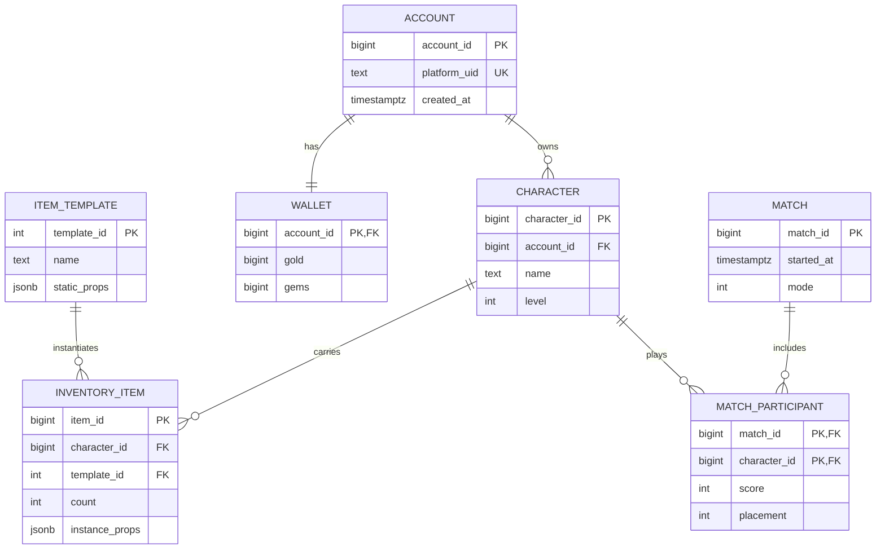
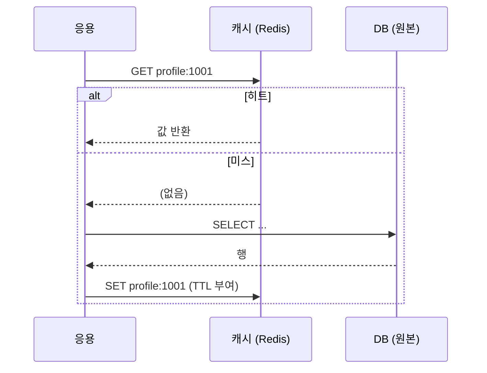

## 들어가며

데이터 모델은 현실의 객체를 테이블이나 문서로 옮기는 작업이 아니라, 어떤 불변식을 어느 저장 경계에서 지킬지 결정하는 일이다. 캐시와 클라이언트 저장을 추가하면 같은 데이터가 여러 수명과 신뢰 경계에 존재한다.

이 글은 관계형 모델과 정규화, 키-값 저장소와 캐시 일관성, 세이브 데이터의 버전·무결성·클라우드 충돌을 하나의 데이터 소유권 문제로 다룬다.

읽는 기준은 실행 가능한 계약이다. 정규화는 DDL의 `PRIMARY KEY`·`UNIQUE`·`CHECK`로, 캐시 정책은 키와 무효화 함수로, 세이브 호환성은 버전 마이그레이션 코드로 내려와야 한다. 말로만 존재하는 모델은 긴급 패치와 우회 쿼리 앞에서 무너진다.

---

## 목차

1. 핵심 도메인의 ERD
2. 정규화: 진실을 한 곳에
3. 게임 인벤토리 모델링: 행이냐 덩어리냐
4. 키 설계: 자연 키, 대리 키, 복합 키
5. 인덱스: 질의 패턴에서 역산한다
6. 비정규화와 JSON 컬럼의 자리
7. 변경을 견디는 스키마
8. 키-값 모델: 단순함의 대가와 보상
9. Redis 자료구조와 게임 용례
10. 원자성: 한 shard의 직렬화 경계
11. 캐시 패턴: cache-aside의 해부
12. 무효화와 정합성: 캐시의 두 난제
13. 스탬피드와 핫키: 부하의 함정
14. 캐시인가 스토어인가: 역할의 선언
15. 세이브 데이터의 분류
16. 안전한 쓰기: 원자적 교체와 세대 백업
17. 직렬화 형식의 선택
18. 버전 마이그레이션
19. 클라우드 저장과 충돌 해소
20. 변조: 막을 것과 받아들일 것
21. 플랫폼별 제약
22. 스키마 불변식을 코드로 고정하기

---


## 1. 핵심 도메인의 ERD

게임 백엔드의 뼈대 스키마를 엔티티 관계도로 그린다.



이 도면에서 게임 모델링의 반복 패턴 셋이 보인다.

- **템플릿-인스턴스 분리**: 아이템의 정적 속성(이름, 기본 능력치 — 기획 데이터)은 `ITEM_TEMPLATE`에 한 번, 개별 보유분의 동적 상태(강화 수치, 귀속 여부)는 `INVENTORY_ITEM`에 행마다 둔다. 기획 데이터를 행마다 복사하면 밸런스 패치가 전 행 갱신이 된다 — 분리가 곧 패치 가능성이다.
- **교차 테이블**: 매치와 캐릭터의 다대다 관계는 `MATCH_PARTICIPANT`가 푼다. 참가자별 결과(점수, 순위)는 관계 자체의 속성이므로 이 테이블에 산다.
- **지갑의 독립**: 재화를 계정 행의 컬럼이 아니라 별도 테이블로 두면, 돈이 걸린 행의 잠금 경합이 계정의 다른 갱신과 분리되고, 화폐 추가가 행 추가로 끝나는 길도 열린다(7절).

## 2. 정규화: 진실을 한 곳에

정규화(normalization)의 실용적 요약은 한 줄이다 — *같은 사실을 두 곳에 적지 않는다*. 캐릭터 이름이 인벤토리 행마다 복사되어 있으면, 개명은 수만 행 갱신이 되고, 하나라도 빠뜨리면 데이터가 서로 모순된다(갱신 이상).

```text
지양: inventory_item(item_id, character_id, character_name, ...)
       — 이름 변경 시 인벤토리 전 행을 고쳐야 한다
권장: 이름은 character 테이블에만. 필요하면 조인으로 읽는다.
```

조인 비용을 걱정해 미리 복사해 두는 것은 거의 항상 이른 최적화다 — 인덱스가 있는 조인은 빠르고, 모순된 데이터의 디버깅은 느리다. 비정규화는 *측정된 읽기 병목* 에 대한 의식적 처방으로만 도입하고(6절), 그때도 "원본은 어디인가"를 선언해 파생본의 갱신 경로를 코드로 못 박는다.

게임에서 정규화가 특히 값진 곳은 *돈의 경로* 다 — 재화 잔액, 아이템 소유권은 단 한 곳에만 존재해야 트랜잭션의 원자성이 의미를 가진다. 같은 골드가 두 테이블에 있으면 "한 트랜잭션으로 묶는다"는 보장 자체가 성립하지 않는다.

## 3. 게임 인벤토리 모델링: 행이냐 덩어리냐

인벤토리는 게임 모델링의 고전 갈림길이다 — 아이템 하나를 행 하나로 둘 것인가(행 모델), 인벤토리 전체를 JSON/바이너리 한 덩어리로 둘 것인가(블롭 모델).

| 기준 | 행 모델 | 블롭 모델 |
|---|---|---|
| 부분 갱신 | 행 단위 — 싸고 안전 | 전체 다시 쓰기 |
| 동시성 | 행 잠금 입자 | 덩어리 잠금 — 갱신 충돌 잦음 |
| 서버 간 질의 | SQL로 가능 ("이 아이템 보유자 전원") | 불가 — 전 덩어리 파싱 |
| 트랜잭션 결합 | 거래·우편과 행 단위로 묶임 | 덩어리 교체 단위 |
| 읽기 비용 | 조인·다행 읽기 | 한 번에 한 덩어리 — 단순 |
| 스키마 진화 | 마이그레이션 필요 | 응용이 버전 처리 |

판단 기준은 *그 데이터가 경제에 참여하는가* 다. 거래·우편·경매·과금이 닿는 아이템은 행 모델이어야 한다 — 트랜잭션의 입자가 아이템 단위여야 복제·증발 없는 이전이 성립하고, 운영 질의("어제 지급된 아이템 회수")가 가능해진다. 반면 경제에 닿지 않는 순수 진행 데이터(퀘스트 플래그, 튜토리얼 진척, 설정)는 블롭이 단순하고 충분하다.

행 모델의 스택 가능 아이템(물약 99개)은 행 하나 + `count` 컬럼으로, 고유 아이템(강화된 장비)은 행 하나 = 인스턴스 하나로 둔다 — 위 ERD의 `count`와 `instance_props`가 그 두 경우를 함께 받는 형태다.

## 4. 키 설계: 자연 키, 대리 키, 복합 키

기본 키(primary key)의 선택지는 셋이고, 게임에서의 판단은 비교적 일관된다.

- **대리 키(surrogate key) 기본**: 의미 없는 자동 증가 정수(또는 시간 정렬 ID)를 기본 키로 둔다. 플랫폼 UID나 이메일 같은 자연 키는 *바뀐다* — 플랫폼 이전, 계정 통합이 현실에서 일어나고, 기본 키 변경은 모든 참조의 연쇄 갱신이다. 자연 키는 고유 제약(unique)으로만 둔다.
- **외부 노출 ID의 분리**: 자동 증가 키를 API에 노출하면 규모 추정과 열거 공격(ID를 1씩 올려 긁기)의 표적이 된다. 외부에는 무작위 ID를 따로 두는 것이 관행이다.
- **복합 키는 교차 테이블에**: `MATCH_PARTICIPANT(match_id, character_id)`처럼 관계 자체가 정체성인 테이블은 복합 기본 키가 자연스럽다 — 같은 매치에 같은 캐릭터가 두 번 참가하는 모순을 키가 막아 준다.

분산 환경을 의식한다면 ID 생성 방식도 키 설계의 일부다 — 자동 증가는 단일 노드 발급이라는 제약을 만들므로, 샤딩을 내다보는 시스템은 노드 독립 생성이 가능한 ID(시간 + 노드 + 일련번호 구성의 64비트 ID류)를 처음부터 쓰는 편이 이사 비용을 줄인다.

## 5. 인덱스: 질의 패턴에서 역산한다

인덱스는 "이 질의를 어떻게 빨리 풀 것인가"의 답이지, 테이블에 붙이는 장식이 아니다. 설계 순서는 질의 → 인덱스의 역산이다.

| 질의 | 필요한 인덱스 |
|---|---|
| 캐릭터의 인벤토리 로드 | `inventory_item(character_id)` |
| 특정 템플릿 보유자 검색 (운영) | `inventory_item(template_id)` |
| 플랫폼 UID로 로그인 | `account(platform_uid)` — unique |
| 캐릭터의 최근 매치 20건 | `match_participant(character_id, match_id DESC)` |
| 시즌 랭킹 상위 100 | `season_rating(season_id, rating DESC)` |

읽는 법 두 가지가 실전의 대부분을 처리한다.

- **복합 인덱스는 왼쪽 접두사로 동작한다**: `(character_id, match_id DESC)`는 `character_id` 단독 조건에도, `character_id` + 정렬에도 쓰인다 — 거꾸로 `match_id` 단독 조건에는 쓰이지 못한다. 등호 조건 컬럼을 앞에, 범위·정렬 컬럼을 뒤에 두는 것이 기본형이다.
- **인덱스는 쓰기의 세금이다**: 행 삽입·갱신마다 모든 관련 인덱스가 함께 갱신된다. 쓰기 빈도가 높은 테이블(매치 참가, 텔레메트리)에 "혹시 몰라" 인덱스를 쌓으면 쓰기 처리량으로 청구서가 온다. 질의가 증명한 인덱스만 둔다.

검증 도구는 실행 계획이다 — `EXPLAIN`으로 질의가 인덱스를 타는지(index scan), 테이블을 전부 읽는지(sequential scan)를 확인하는 습관이 "느린 질의" 신고의 대부분을 출시 전에 잡는다. 라이브에서는 슬로우 쿼리 로그가 같은 역할의 상시 감시다.

## 6. 비정규화와 JSON 컬럼의 자리

원칙(정규화)에는 의식적 예외가 둘 있다.

**파생값의 물질화.** "캐릭터의 총 전투력", "길드의 멤버 수"처럼 매번 집계하면 비싼 값을 컬럼으로 두는 것 — 읽기 병목이 측정될 때의 표준 처방이다. 규칙은 갱신 경로의 단일화다: 파생값을 고치는 코드를 한 곳(트리거 또는 단일 서비스 함수)으로 모으고, 주기적 재계산(밤마다 원본에서 다시 집계)으로 표류를 교정한다. 파생값과 원본의 불일치는 *언젠가 반드시 생긴다* 는 전제로 교정 장치까지가 한 세트다.

**JSON 컬럼.** 관계형 스키마 안의 반정형 필드 — 위 ERD의 `static_props`, `instance_props`가 그 자리다. 적정 용법의 경계는 명확하다.

```text
적합: 구조가 템플릿마다 다르고, 조건 검색 대상이 아니며,
      읽고 쓰는 주체가 게임 코드뿐인 속성 묶음.
      (장비 옵션 목록, 이벤트별 진행 데이터)

부적합: 조인·집계·제약의 대상이 되는 값.
      JSON 안의 골드는 트랜잭션 제약이 못 닿는 골드다.
```

JSON 컬럼은 "스키마 변경 없이 필드를 더한다"는 유연성을 주지만, 그 유연성만큼 데이터베이스의 보호(타입, 제약, 외래 키)가 닿지 않는다. *경제와 정합성의 영역은 컬럼으로, 콘텐츠의 다양성은 JSON으로* — 이 분할이 게임 스키마의 균형점이다.

## 7. 변경을 견디는 스키마

라이브 게임의 스키마는 매주의 콘텐츠 패치를 받는다. 변경 압력을 견디는 구조적 선택들:

- **열거를 행으로**: 화폐 종류를 `wallet`의 컬럼(gold, gems,...)으로 두면 화폐 추가가 스키마 변경이다. `currency_balance(account_id, currency_id, amount)` 행 모델이면 데이터 추가로 끝난다. 종류가 늘어날 것이 확실한 축(화폐, 재화, 시즌)은 컬럼이 아니라 행으로 편다.
- **기획 데이터와 상태의 분리**: 아이템 템플릿·드랍 테이블 같은 기획 데이터는 갱신 주체가 패치이고, 플레이어 상태는 갱신 주체가 런타임이다. 같은 테이블에 섞으면 패치 배포가 라이브 데이터 마이그레이션이 된다 — 1절의 템플릿-인스턴스 분리가 이 압력에 대한 응답이기도 하다.
- **소프트 삭제와 이력**: 운영은 "지난주 상태"를 자주 묻는다(보상 분쟁, 롤백 요청). 파괴적 삭제 대신 상태 플래그, 그리고 돈이 걸린 변경에는 추가 전용 이력 테이블(원장)을 둔다 — 현재 상태 테이블과 이력 테이블의 이중 구조가 게임 경제 스키마의 표준형이다.

스키마 변경 자체의 안전한 실행(무중단 마이그레이션)은 운영의 영역이지만, 변경이 *작게* 끝나는 스키마를 설계 단계에서 고르는 것 — 그것이 이 절의 요지다.


## 8. 키-값 모델: 단순함의 대가와 보상

단순 키-값 스토어의 중심 인터페이스는 `GET(key)`, `SET(key, value)`, `DEL(key)`다. 키를 알고 있을 때의 직접 접근과 제한된 서버 측 연산을 우선하고, 관계형 모델의 임의 조인·외래 키·ad hoc 질의를 기본 계약으로 삼지 않는다. 제품마다 secondary index, transaction, persistence 기능이 다르므로 “KV”라는 이름만으로 지연과 일관성을 확정할 수는 없다.

| 항목 | 관계형 DB | 인메모리 KV |
|---|---|---|
| 주 접근 경로 | query plan·index·join | key lookup·자료구조 명령 |
| 질의 | 임의 SQL | 키 직격 (+ 자료구조 연산) |
| 정합성 도구 | 트랜잭션·제약·격리 | 제품별 명령 원자성·transaction/script |
| 내구성 | WAL·fsync·replication 정책에 따라 보장 범위 결정 | 없음/RDB/AOF/replication 설정에 따라 손실 창 결정 |
| 자원 | buffer cache와 영속 저장소 | 주로 RAM, persistence·replica 비용 추가 |

게임 백엔드에서는 *키로 직격할 수 있고 수명이 짧거나 다른 원본에서 재구축 가능한* 세션, 대기열 상태, 쿨다운, 캐시된 프로필이 인메모리 KV의 좋은 출발점이다. Redis도 AOF·replication으로 원본 역할을 맡을 수 있지만 durability acknowledgement, failover 시 유실 창, backup·restore와 invariant 표현 능력을 따로 설계해야 한다. 잔액·인벤토리를 관계형 DB에 두라는 권장은 “KV는 원래 못 믿는다”가 아니라 제약·트랜잭션·감사 질의가 그 문제와 잘 맞기 때문이다.

## 9. Redis 자료구조와 게임 용례

Redis가 단순 KV를 넘는 지점은 *값이 자료구조* 라는 데 있다 — 서버 쪽에서 자료구조 연산이 원자적으로 수행되므로, 읽어와서-고치고-되쓰는 왕복과 경쟁이 사라진다.

| 자료구조 | 핵심 연산 | 게임 용례 |
|---|---|---|
| String | GET/SET/INCR | 세션 토큰, 카운터, 쿨다운(TTL과 결합) |
| Hash | HSET/HGETALL | 프로필 캐시 — 필드 단위 부분 갱신 |
| List | LPUSH/BRPOP | 작업 큐, 최근 알림 목록 |
| Set | SADD/SISMEMBER | 오늘 접속자 집합, 중복 방지 |
| Sorted Set | ZADD/ZRANGE/ZRANK | 리더보드 — 점수 정렬·순위 조회 |
| TTL (모든 키) | EXPIRE | 세션 만료, 일일 리셋, 캐시 수명 |

대표 용례 둘을 코드 수준으로 본다.

**리더보드.** 정렬 집합(sorted set)은 멤버마다 점수를 갖고 점수순 정렬을 유지한다 — 갱신과 순위 조회가 모두 $O(\log N)$이다.

```text
ZADD season42 1873 player:1001      # 점수 갱신 (재삽입이 곧 갱신)
ZREVRANK season42 player:1001       # 내 순위 (0-기반, 내림차순)
ZREVRANGE season42 0 99 WITHSCORES  # 상위 100명
```

관계형 인덱스도 점수 갱신과 탐색을 대략 로그 시간에 처리할 수 있으므로 차이는 Big-O 하나가 아니다. Redis sorted set은 메모리 안의 순위 연산과 명령 API를 바로 제공해 왕복과 구현 상수를 줄이는 반면, 관계형 DB는 durable transaction·snapshot 질의·감사와 다른 테이블 조인을 함께 제공한다. 실시간 표시용 순위와 시즌 보상 확정용 snapshot의 요구를 분리하고 실제 갱신률·상위 N 조회·개인 순위 조회를 재생해 선택한다.

**일일 쿨다운.** TTL을 키에 직접 거는 패턴.

```text
SET daily:1001:dungeon 1 NX EX 86400
# NX: 키가 없을 때만 성공 — 성공이면 입장 허용, 실패면 24시간 rolling cooldown 중
```

검사와 설정이 명령 하나로 원자적이어서 "검사 후 설정" 사이의 경쟁을 닫는다. 이는 입장 시점부터 86,400초를 세는 rolling cooldown이다. 특정 지역 시간대의 자정에 리셋하는 일일 제한이라면 서버가 계산한 다음 reset instant까지 TTL을 두고 DST·timezone 정책을 명시해야 한다.

## 10. 원자성: 한 shard의 직렬화 경계

Redis의 keyspace 명령 실행은 한 shard의 실행 경계에서 직렬화되므로, 개별 명령은 중간 상태를 다른 명령에 노출하지 않는다. 현대 Redis가 네트워크 I/O, persistence, background 작업이나 일부 기능에 여러 스레드·프로세스를 쓸 수 있다는 사실과 **한 shard의 명령 원자성**은 구분해야 한다. Cluster에서는 shard가 여럿이므로 서로 다른 hash slot의 명령이 전역 순서를 공유하지 않는다.

```text
INCRBY counter:event_join 1
SET cooldown:1001 unique-token NX EX 30
```

`INCRBY stock -1` 뒤 음수면 되돌리는 방식은 두 명령 사이에 잘못된 상태가 보이고 프로세스가 죽으면 복구되지 않는다. 조건 검사와 차감을 한 script/function 안에 묶는다.

여러 명령을 원자적으로 묶는 도구 중 하나가 Lua script나 Redis Function이다. 실행 중 다른 명령이 그 중간 상태를 관찰하지 않지만, script가 오래 돌면 같은 shard의 다른 요청을 지연시킨다.

```lua
-- 재고가 있을 때만 차감하고 구매 기록까지 원자적으로
local stock = tonumber(redis.call('GET', KEYS[1]))
if stock == nil or stock <= 0 then return 0 end
redis.call('DECR', KEYS[1])
redis.call('SADD', KEYS[2], ARGV[1])   -- 구매자 집합에 추가
return 1
```

Cluster에서 script가 접근하는 key들은 일반적으로 같은 hash slot에 있어야 한다. `{event42}:stock`, `{event42}:buyers`처럼 hash tag로 함께 배치할 수 있지만, 한 hot slot의 처리량 한계와 장애 도메인도 함께 생긴다.

관계형 트랜잭션과의 차이도 분명히 해야 한다. Redis script의 원자성은 해당 Redis 실행 경계 안의 이야기다. Redis 변경과 관계형 DB 기록을 평범한 Redis transaction 하나로 묶을 수는 없다. 한 저장소를 업무 사실의 원본으로 정하고 outbox·멱등 consumer·보상 상태 기계로 다른 저장소에 반영하거나, 정말 필요하면 참여 제품이 지원하는 분산 트랜잭션 프로토콜을 별도로 구성한다.

직렬화 경계의 그림자도 있다. `KEYS *`, 큰 반환, 거대한 collection 연산, 긴 script는 같은 shard의 뒤 요청을 세운다. `SCAN`도 한 호출의 작업량을 제한할 뿐 전체 scan 비용을 없애지 않는다. slow log·command latency·event-loop utilization·hot key를 계측하고, script에 입력 크기와 실행 시간 상한을 둔다.

## 11. 캐시 패턴: cache-aside의 해부

캐시의 표준 패턴은 cache-aside(look-aside)다 — 응용이 캐시를 먼저 보고, 미스면 원본(DB)에서 읽어 캐시에 채운다.



```cpp
Profile LoadProfile(PlayerId id) {
    if (auto cached = redis.Get(Key(id))) return Decode(*cached);
    Profile p = db.QueryProfile(id);                  // 원본 읽기
    redis.Set(Key(id), Encode(p), /*ttl=*/300s);      // 채움 + 수명
    return p;
}
```

설계 포인트는 셋이다. 첫째, *모든 캐시 항목에 TTL*을 두어 무효화 누락의 최악 신선도 경계를 선언한다. 둘째, Redis 장애 시 DB 직행이 가능하더라도 cache miss 폭증이 DB를 무너뜨리지 않도록 부하 차단과 부분 기능 축소를 함께 설계한다. 셋째, 읽기 빈도에 비해 변경이 적고 재사용률이 높은 데이터만 캐시해 낮은 hit rate가 만드는 메모리 낭비와 일관성 부채를 피한다.

## 12. 무효화와 정합성: 캐시의 두 난제

원본이 바뀌었을 때 캐시를 어떻게 따라가게 하는가 — 캐시의 모든 미묘함이 여기 모인다.

**갱신 시 삭제(invalidate-on-write)가 기본형이다.** 원본 갱신 후 캐시 키를 지운다(갱신된 값을 캐시에 직접 쓰는 것보다 안전하다 — 동시 갱신의 순서 역전으로 낡은 값이 남는 부류의 경쟁이 줄어든다). 다음 읽기가 미스를 내고 새 값을 채운다.

```cpp
void UpdateNickname(PlayerId id, std::string name) {
    db.UpdateNickname(id, name);     // 1. 원본 갱신
    redis.Del(Key(id));              // 2. 캐시 무효화
}
```

이 두 줄 사이에도 함정은 있다 — 1과 2 사이의 크래시는 낡은 캐시를 TTL까지 남기고, 삭제 직후 다른 요청이 *갱신 전 트랜잭션이 보던 옛 값* 을 읽어 다시 채우는 경쟁도 이론상 존재한다. 완전한 해법은 비싸므로, 실무의 답은 계층적이다: 짧은 TTL(안전망) + 갱신 시 삭제(즉시성) + 정합이 돈에 닿는 데이터는 캐시하지 않거나 캐시를 *읽기 힌트* 로만 쓰기.

**신선도는 데이터별 계약이다.** "닉네임 5분 지연"은 무해하고, "잔액 5분 지연"은 사고다. 캐시 도입 시 데이터마다 허용 신선도를 적고, 허용치가 0인 데이터는 캐시 대상에서 제외하는 것 — 이 분류가 캐시 버그의 대부분을 설계 단계에서 제거한다.

## 13. 스탬피드와 핫키: 부하의 함정

**캐시 스탬피드(stampede).** 인기 키의 TTL이 만료되는 순간, 그 키를 읽던 수천 요청이 동시에 미스를 내고 *전부 DB로 직행* 한다 — 캐시가 막아 주던 부하가 한 점에 한꺼번에 떨어진다. 패치 직후 전 서버가 같은 기획 데이터를 다시 채우는 순간도 같은 모양이다. 처방의 사다리:

- **단일 채움(per-key 잠금)**: 미스를 낸 요청 중 하나만 DB에 가고(SETNX로 채움 권리 선점), 나머지는 짧게 대기 후 캐시 재시도.
- **TTL 지터**: 같은 부류 키들의 만료 시각이 한 점에 모이지 않게 TTL에 무작위 가감을 둔다.
- **선제 갱신**: 만료 전에 백그라운드가 미리 다시 채운다 — 자주 읽히는 소수 키(기획 데이터)에 적합.

**핫키(hot key).** 전 서버가 같은 키 하나(이벤트 보스의 상태, 전체 공지)를 초고빈도로 읽으면, 그 키가 사는 Redis 인스턴스 하나에 부하가 집중된다 — 클러스터로 키를 분산해도 *한 키는 한 노드* 이므로 소용없다. 처방은 사본이다: 키를 N개로 복제해 읽기를 분산하거나(`notice:1`~`notice:N` 중 무작위 읽기), 아예 각 게임 서버의 프로세스 메모리에 두는 로컬 캐시(수 초 TTL)를 한 겹 더 둔다. 로컬 캐시 + Redis + DB의 3계층은 대규모 서비스의 표준 형태다.

### 스탬피드의 정량 모델과 확률적 조기 만료

위 처방의 사다리는 휴리스틱으로 읽히지만, 각 단계가 *얼마나* 부하를 줄이는지는 간단한 모델로 양화된다. 그래야 "지터를 얼마나", "선제 갱신을 얼마나 일찍"이 임의의 손맛이 아니라 설계 수치가 된다.

**스탬피드의 규모.** 어떤 키가 초당 $\lambda$회 읽히고, 미스 시 원본 재계산(DB 질의 + `SET`)에 $\delta$초가 걸린다고 하자. 키가 만료된 순간부터 첫 재계산이 캐시를 다시 채울 때까지의 $\delta$ 구간 동안, *도착하는 모든 요청이 미스* 다. 단일 채움 장치가 없으면 이 구간의 요청이 전부 독립적으로 DB를 친다. 기대 동시 DB 적중은

$$
M \approx \lambda\,\delta.
$$

$\lambda=10{,}000\,\text{req/s}$, $\delta=50\,\text{ms}$이면 한 번의 만료가 $M\approx 500$개의 동시 질의를 한 점에 떨어뜨린다 — 캐시가 막아 주던 부하의 정체가 이 곱이다. per-key 잠금(단일 채움)은 이 $\lambda\delta$를 만료당 정확히 1로 떨어뜨린다(나머지는 대기 후 캐시 재시도). 즉 단일 채움의 이득은 $\lambda\delta$ 배다.

**TTL 지터의 분산 감소.** 배포 직후 워밍업이나 일괄 캐시처럼 $N$개의 키가 같은 시각에 동일 TTL $\tau$로 생성되면, 모두 같은 순간에 만료되어 $N$번의 스탬피드가 겹친다. TTL에 $\pm J$의 균등 지터를 주면 만료가 폭 $2J$에 고르게 퍼지므로, 임의의 $\delta$ 윈도 안에서 동시에 만료되는 키의 기댓값은

$$
N_{\text{concurrent}} \approx N\,\frac{\delta}{2J}.
$$

$N=10{,}000$, $\delta=50\,\text{ms}$, $J=30\,\text{s}$이면 동시 만료가 약 $8.3$개로, 지터 없는 $10{,}000$ 대비 $2J/\delta=1200$배 낮아진다. 지터 폭 $J$를 재계산 시간 $\delta$에 비해 충분히 크게 잡는 것이 핵심이고, 이 비 $2J/\delta$가 곧 평탄화 배수다.

**확률적 조기 만료.** 단일 채움은 만료 *후* 동시 미스를 한 명으로 줄이지만, 그 한 명이 재계산하는 동안의 지연은 남는다. 더 나은 길은 만료 *전에* 누군가 한 명이 미리 다시 채우는 것이다. 매 읽기에서 각 클라이언트가 독립적으로, 만료가 가까울수록·재계산이 비쌀수록 커지는 확률로 조기 재계산을 결정하면 된다. Vattani 외(2015)의 XFetch가 이 결정을 지수 분포로 형식화한다.

```cpp
// 캐시에는 값과 함께 측정된 재계산 시간 delta, 절대 만료시각 expiry를 저장
Value XFetch(Key k, Seconds ttl, double beta = 1.0) {
    auto [val, delta, expiry] = cache.GetWithMeta(k);
    double now = Now();
    // -delta*beta*log(U), U~Unif(0,1] 는 평균 delta*beta 의 지수난수(>=0)
    if (!val || now - delta * beta * std::log(UniformOpen01()) >= expiry) {
        double start = Now();
        val = Recompute(k);
        delta = Now() - start;                 // 재계산 비용 측정
        cache.SetWithMeta(k, val, delta, /*expiry=*/Now() + ttl);
    }
    return *val;
}
```

이 판정의 동작을 분석한다. $U\sim\text{Unif}(0,1]$에 대해 $-\ln U$는 평균 1의 지수 분포이므로, 간격 $g=-\delta\beta\ln U$는 평균 $\delta\beta$의 지수 분포다($g\ge 0$). 조건 $\text{now}+g\ge \text{expiry}$는 $g\ge \Delta$와 같고, 여기서 $\Delta=\text{expiry}-\text{now}$는 남은 수명이다. 따라서 한 번의 읽기가 조기 재계산을 일으킬 확률은

$$
P(\text{recompute}\mid \Delta)=P(g\ge \Delta)=\exp\!\left(-\frac{\Delta}{\delta\beta}\right).
$$

이 확률은 만료에서 멀 때($\Delta$ 큼) 거의 0이고 만료에 다가갈수록 1로 오른다. 또 재계산 비용 $\delta$가 클수록 지수의 시간 척도가 늘어 *더 일찍* 발동한다 — 비싼 값일수록 여유 있게 미리 갱신하라는 규칙이 공식에 내장된다. 한 클라이언트가 먼저 발동해 만료시각을 갱신하면 나머지는 신선한 값을 보고 멈추므로, 흔한 경우 *단 한 명* 이 실제 만료 전에 재계산하고 스탬피드는 0이 된다. $\beta$는 적극성 손잡이다: $\beta$를 키우면 더 일찍 갱신해 스탬피드 위험은 더 낮아지지만 불필요한 조기 재계산이 늘어 — Vattani 외는 이 절충의 기대 비용을 최소화하는 선택을 제시한다($\beta=1$이 표준 출발점). 지수 분포를 고르는 이유도 여기 있다: 무기억성 덕에 클라이언트별 발동 위험률이 시각에 매끈하게 의존해 분석이 닫힌다.

세 처방은 배타적이지 않다 — 짧은 TTL + 지터(동시 만료 평탄화) + per-key 단일 채움(만료 후 안전망) + 비싼 핵심 키에 한해 확률적 조기 만료(만료 전 선제)의 조합이 실무의 형태다.

## 14. 캐시인가 스토어인가: 역할의 선언

Redis를 쓰는 시스템의 사고 대부분은 기술이 아니라 *역할의 모호함* 에서 온다 — 같은 인스턴스가 어떤 키는 "지워져도 되는 캐시"로, 어떤 키는 "지워지면 안 되는 원본"으로 쓰일 때다. 메모리가 차서 축출(eviction) 정책이 돌면 캐시 키와 함께 원본 키가 지워지고, 재시작 한 번에 대기열이 증발한다.

역할별 요구를 가르면 다음과 같다.

| 역할 | 데이터 예 | 소실 허용 | 필요한 설정 |
|---|---|---|---|
| 캐시 | 프로필 사본, 카탈로그 | 허용 (원본에서 재생) | 축출 허용, 영속화 불요 |
| 휘발 스토어 | 세션, 쿨다운, 대기열 | 부분 허용 (재로그인 등으로 복구) | 축출 금지, 영속화 선택 |
| 원본 스토어 | 랭킹 확정값, 재화 | 불허 | 이 역할을 맡기지 않는 것이 답 |

운영 규칙으로 옮기면 — *캐시와 스토어는 인스턴스를 분리* 하고(축출 정책이 다르므로), Redis의 영속화 옵션(주기 스냅샷, 추가 전용 로그)은 "재시작 시 워밍업 단축"으로 이해하되 관계형 DB급 내구성으로 간주하지 않으며, *돈이 걸린 확정값의 원본은 관계형 DB에 두고 Redis에는 그 사본·중간값만* 둔다. 실시간 랭킹은 Redis가 갱신하되, 시즌 종료의 보상 확정은 DB로 옮겨 적은 스냅샷을 근거로 하는 식 — 빠른 곳에서 일하고, 믿을 곳에서 확정한다.


## 15. 세이브 데이터의 분류

한 게임의 로컬 데이터도 성격이 갈린다 — 분류가 곧 처리 방침이다.

| 데이터 | 손실 비용 | 동기화 대상 | 비고 |
|---|---|---|---|
| 진행 세이브 (스토리·캐릭터) | 최악 | 클라우드 | 이 글의 본론 |
| 설정 (그래픽·키 바인딩) | 낮음 | 선택 | 기기 종속 설정(해상도)은 제외 |
| 로컬 캐시 (다운로드 에셋, 서버 데이터 사본) | 없음 — 재생성 가능 | 비대상 | 언제든 지워도 동작해야 한다 |
| 스크린샷·리플레이 | 사용자 판단 | 선택 | 용량 주의 |

두 가지 규칙이 분류에서 나온다. 첫째, *캐시와 세이브를 같은 곳에 두지 않는다* — "캐시 삭제"가 진행을 지우는 사고, 클라우드 용량을 캐시가 잠식하는 낭비를 모두 막는다. 둘째, *기기 종속 설정과 사용자 설정을 가른다* — 해상도·그래픽 프리셋은 기기를 따라가야 하고(클라우드로 옮기면 노트북이 데스크톱 설정을 받는다), 키 바인딩·접근성 설정은 사용자를 따라가는 쪽이 맞다.

## 16. 안전한 쓰기: 원자적 교체와 세대 백업

세이브 쓰기의 적은 *쓰는 도중의 중단* 이다 — 크래시, 전원 차단, 콘솔 강제 종료. 파일을 제자리에서 덮어쓰는 코드는 중단 시 옛 세이브를 파괴한 채 새 세이브도 완성하지 못한다 — 진행 전체의 손실이다.

표준 처방은 두 겹이다.

**원자적 교체.** 새 내용을 임시 파일에 완전히 쓰고, 디스크 도달을 강제한 뒤, 이름 바꾸기로 본 파일을 대체한다.

```cpp
bool SaveAtomic(const Path& path, Span<const uint8_t> data) {
    Path tmp = path + ".tmp";
    if (!WriteAll(tmp, data)) return false;
    if (!FlushToDisk(tmp))    return false;   // fsync — 캐시가 아니라 디스크까지
    return AtomicRename(tmp, path);           // 어느 순간 중단돼도 옛것 아니면 새것
}
```

이름 바꾸기는 파일 시스템 메타데이터의 원자적 갱신이므로, 중단 시점이 어디든 본 파일은 "완전한 옛 세이브" 또는 "완전한 새 세이브"다 — 제3의 깨진 상태가 없다. fsync를 빼먹으면 rename이 데이터보다 먼저 디스크에 닿는 역전이 가능하다는 것(그 순간의 전원 차단 = 빈 파일)까지가 이 패턴의 정확한 형태다.

**세대 백업과 검증.** 원자적 교체로도 못 막는 것 — 디스크 자체의 손상, 그리고 *게임 버그가 만든 정상적으로 저장된 깨진 데이터* — 의 보험이다. 직전 N세대(예: 3개)를 돌려 보관하고, 모든 세이브에 체크섬을 박아 로드 시 검증하며, 본 파일이 검증에 실패하면 이전 세대로 자동 폴백한다. "세이브 슬롯이 깨졌습니다"가 "지난 세이브로 복구했습니다"로 바뀌는 차이가 이 한 겹이다.

자동 저장의 빈도와 시점도 안전의 일부다 — 전투 결과·아이템 획득 같은 *경계 사건 직후* 저장이 기본이고, 저장 중 표시(콘솔 규정이기도 하다)로 "저장 중 종료"를 줄인다.

## 17. 직렬화 형식의 선택

세이브의 직렬화 형식은 세 갈래에서 고른다.

| 형식 | 장점 | 단점 | 적합 |
|---|---|---|---|
| 텍스트 (JSON류) | 디버깅 쉬움, 도구 불요 | 크고 느림, 파싱 비용, 편집 쉬움 | 설정, 소규모 진행 |
| 자체 바이너리 | 작고 빠름, 통제 완전 | 버전 처리 전부 수동 | 성능 민감, 콘솔 |
| 스키마 기반 (Protobuf/FlatBuffers류) | 전후방 호환 내장, 코드 생성 | 빌드 의존, 학습 | 장기 운영 타이틀 |

선택 기준에서 성능보다 무거운 것이 *진화 가능성* 이다 — 세이브는 출시 후 수년간 버전 N의 게임이 버전 1의 파일을 읽어야 하는 데이터다. 스키마 기반 형식의 "필드 번호 + 모르는 필드 무시 + 기본값" 규약은 정확히 이 문제의 표준 답이고, 자체 바이너리를 쓴다면 같은 규약 — 필드 태그, 버전 헤더, 미지 필드 건너뛰기 — 을 직접 갖춰야 한다는 뜻이 된다.

형식과 별개로 공통 골격이 있다 — *헤더의 분리*. 버전, 체크섬, 저장 시각, 플레이 요약(레벨, 위치, 플레이 시간)을 고정 헤더에 두면, 세이브 목록 UI가 본문 파싱 없이 그려지고, 마이그레이션이 버전을 먼저 읽고 분기할 수 있다.

## 18. 버전 마이그레이션

패치는 데이터 모양을 바꾼다 — 새 스탯 추가, 인벤토리 구조 변경, 퀘스트 시스템 개편. 옛 세이브는 그대로인데 코드가 바뀌므로, 로드 경로에 마이그레이션 층이 필요하다.

표준 형태는 *순차 단계 적용* 이다 — 버전 k→k+1의 변환 함수를 사슬로 두고, 파일 버전에서 현재 버전까지 차례로 통과시킨다.

```cpp
SaveData Load(Bytes raw) {
    Header h = ReadHeader(raw);
    SaveData d = Parse(raw, h.version);
    for (int v = h.version; v < kCurrentVersion; ++v) {
        d = migrations[v](d);        // v → v+1, 각 단계는 순수 함수
    }
    return d;
}
```

운용 규칙들:

- **단계는 영구 보존한다**: 1.0의 세이브가 3.7에서도 열려야 하므로, 옛 변환 단계는 지우지 않는다 — 마이그레이션 사슬은 게임의 데이터 역사 그 자체다.
- **기본값 설계가 절반이다**: 새 필드의 마이그레이션은 대부분 "합리적 기본값 부여"다 — 옛 세이브의 플레이어가 새 시스템에서 손해도 횡재도 보지 않는 값을 기획과 함께 정한다.
- **저장은 항상 최신 버전으로**: 로드 시 마이그레이션, 저장 시 현재 버전 — 역방향(다운그레이드) 호환은 비용 대비 가치가 없어 보통 포기하고, 대신 "이 세이브는 더 새 버전의 것"이라는 명확한 거절 메시지를 둔다.
- **마이그레이션도 테스트 자산이다**: 각 버전의 대표 세이브 파일을 픽스처로 보관하고, 전 사슬 통과를 CI에서 돌린다 — 패치마다 "옛 세이브가 열리는가"를 사람이 기억할 일이 아니다.

## 19. 클라우드 저장과 충돌 해소

플랫폼 클라우드 저장(Steam Cloud, 콘솔 클라우드, 모바일 백업)은 기기 분실·이전에서 진행을 지키지만, 같은 세이브의 사본이 여러 기기에 생기는 순간 *충돌* 이라는 분산 시스템 문제를 가져온다 — 데스크톱에서 저녁에 플레이하고(오프라인이라 업로드 안 됨), 노트북에서 아침에 플레이하면, 두 갈래의 진행이 생긴다.

충돌 해소의 선택지는 셋뿐이다.

- **최신 우선(자동)**: 시계 기준 최신본 채택 — 단순하지만 기기 시계는 믿을 수 없고, "더 많이 진행한 쪽"이 진다는 보장도 없다. 무해한 데이터(설정)에만 적합하다.
- **사용자 선택**: 두 사본의 요약(저장 시각, 플레이 시간, 진행 위치 — 17절의 헤더가 여기서 일한다)을 보여 주고 고르게 한다 — 진행 세이브의 표준. 플랫폼 UI가 대신해 주는 경우(Steam Cloud 충돌 다이얼로그)도 이 모델이다.
- **병합**: 두 갈래의 진행을 합친다 — 수집형 데이터(도감, 업적)는 합집합이 자연스럽지만, 스토리 진행 같은 선형 상태는 병합이 정의되지 않는다. 데이터 일부에만 선별 적용하는 고급 기법이다.

설계 교훈은 *충돌을 드물게 만드는 것이 해소보다 싸다* 는 것 — 종료·일시정지 시 즉시 업로드, 시작 시 다운로드 확인, 오프라인 플레이 후 재접속 시의 명시적 동기화 절차가 충돌 빈도를 자릿수로 줄인다. 그리고 클라우드 동기화 대상에서 캐시를 제외하는 15절의 분류가 여기서 용량·속도로 보상한다.

## 20. 변조: 막을 것과 받아들일 것

로컬 파일은 플레이어의 것이다 — 에디터로 열리고, 값이 바뀌고, 커뮤니티에 공유된다. 기술적 진실부터: *클라이언트에 있는 데이터의 변조는 궁극적으로 막을 수 없다*. 암호화 키도 검증 코드도 같은 기기에 있기 때문이다. 따라서 질문은 "막을 수 있는가"가 아니라 "무엇이 걸려 있는가"다.

- **싱글플레이 진행**: 걸린 것이 본인의 경험뿐이다 — 변조는 사실상 치트 코드이고, 적극 방어의 가치가 없다. 체크섬(16절)은 변조 방지가 아니라 *손상 감지* 용이고, 가벼운 난독화는 "실수로 깨뜨리는 것"을 막는 정도의 의미다.
- **경쟁·경제에 닿는 데이터**: 멀티플레이 순위, 거래 가능 재화, 대전 기록 — 이 데이터가 로컬 저장이라면 설계가 잘못된 것이다. 답은 보호 강화가 아니라 *서버 권위로의 이동* 이다: 검증 가능한 것만 서버가 기록하고, 클라이언트 파일은 표시용 사본으로 강등한다.
- **회색 지대 (협동·비동기 경쟁)**: 협동 세이브 호스팅, 고스트 데이터 등 — 변조 이득과 피해 범위를 보고 서버 검증(불변식 검사: 시간 대비 불가능한 진행, 존재 불가능한 아이템)을 선별 적용한다.

요약하면 변조 대응은 암호학이 아니라 *아키텍처 결정* 이다 — 데이터의 가치가 본인을 넘는 순간 그 데이터의 진실은 서버로 간다.

## 21. 플랫폼별 제약

세이브 시스템은 플랫폼 규정의 적용 대상이다 — 인증(콘솔 심사)에서 자주 걸리는 영역이므로 설계 단계에서 반영한다.

- **저장 위치의 규정**: 각 플랫폼이 지정한 세이브 경로·API를 써야 클라우드 동기화와 용량 관리가 작동한다 — PC도 문서 폴더 직접 쓰기보다 플랫폼 API(Steam Cloud 등) 경유가 표준이다.
- **용량 쿼터**: 콘솔·클라우드의 세이브 용량은 제한적이다 — 스크린샷·리플레이를 세이브에 섞으면 쿼터가 터진다(15절의 분류가 다시).
- **저장 중 종료의 처리**: 콘솔은 "저장 중 표시 중 전원 차단"의 데이터 보존을 심사한다 — 16절의 원자적 교체 + 세대 백업이 그 답이고, 저장 표시의 노출 규칙(최소 표시 시간 등)은 플랫폼 가이드라인을 따른다.
- **사용자 전환과 복수 프로필**: 콘솔의 계정 전환, PC의 가족 공유 — 세이브가 *플랫폼 사용자별로 격리* 되어야 한다는 요구. 경로에 사용자 식별을 포함하는 구조를 처음부터 갖춘다.
- **모바일의 백업 의미론**: OS 백업(기기 이전)에 포함될 데이터와 제외할 캐시를 디렉토리·플래그로 구분하는 규약이 있다 — 따르지 않으면 기기 이전에서 진행이 사라지거나, 반대로 수 GB 캐시가 백업을 점령한다.


## 22. 스키마 불변식을 코드로 고정하기

데이터 모델링의 산출물은 ERD 그림이 아니라 실행 가능한 제약이다. "인벤토리 슬롯은 한 계정에서 중복될 수 없다"는 말은 회의록에 남아 있으면 약하고, `UNIQUE` 제약과 테스트에 들어가면 강하다.

인벤토리를 행 단위로 모델링한다면 최소 계약은 다음처럼 생긴다.

```sql
CREATE TABLE player_inventory_item (
    player_id   BIGINT NOT NULL,
    slot_index  INTEGER NOT NULL,
    item_id     BIGINT NOT NULL,
    stack_count INTEGER NOT NULL CHECK (stack_count > 0),
    item_type   TEXT NOT NULL,
    updated_at  TIMESTAMPTZ NOT NULL DEFAULT now(),
    PRIMARY KEY (player_id, item_id),
    UNIQUE (player_id, slot_index)
);

CREATE INDEX idx_inventory_player_type
    ON player_inventory_item(player_id, item_type);
```

이 스키마는 세 가지 버그를 DB 레벨에서 막는다.

| 버그 | 막는 제약 |
|---|---|
| 같은 아이템 행 중복 | `PRIMARY KEY (player_id, item_id)` |
| 한 슬롯에 두 아이템 배치 | `UNIQUE (player_id, slot_index)` |
| 0개 이하 스택 저장 | `CHECK (stack_count > 0)` |

애플리케이션 코드는 이 제약을 우회하지 말고 이용해야 한다. 슬롯 이동은 먼저 읽고 검사한 뒤 두 번 UPDATE하는 대신, 충돌을 DB가 판정하게 만든다.

```sql
UPDATE player_inventory_item
   SET slot_index = :to_slot,
       updated_at = now()
 WHERE player_id = :player_id
   AND item_id = :item_id;
```

`UNIQUE (player_id, slot_index)` 위반이 나면 목적지 슬롯이 이미 찬 것이다. 이 오류는 "DB 실패"가 아니라 도메인 실패다. 서비스 계층은 이를 명시적 결과로 바꾼다.

```cpp
MoveResult MoveItem(Db& db, PlayerId player, ItemId item, int toSlot) {
    try {
        db.Execute(kMoveItemSql, player, item, toSlot);
        cache.Delete("inventory:" + ToString(player));
        return MoveResult::Ok();
    } catch (const UniqueViolation& e) {
        return MoveResult::SlotOccupied();
    }
}
```

캐시 키도 스키마처럼 계약을 가져야 한다. 어떤 쿼리 결과를 캐시하는지와 어떤 쓰기가 그 키를 무효화하는지가 같은 코드 근처에 있어야 한다.

```text
cache key: inventory:{player_id}
source query:
  SELECT item_id, slot_index, stack_count, item_type
  FROM player_inventory_item
  WHERE player_id = ?
  ORDER BY slot_index

invalidate on:
  insert/update/delete player_inventory_item where player_id = ?
```

이 표를 코드 주석으로만 두면 시간이 지나며 깨진다. 더 좋은 방식은 repository 함수가 DB 쓰기와 캐시 무효화를 같은 경로로 강제하는 것이다. 우회 쓰기가 필요하다면 캐시 무효화 테스트가 함께 있어야 한다.

마이그레이션도 마찬가지다. nullable 컬럼 추가, 백필, not null 전환을 한 번에 하면 운영 중 잠금과 실패 창이 커진다.

```sql
ALTER TABLE player_inventory_item ADD COLUMN bind_state TEXT;

UPDATE player_inventory_item
   SET bind_state = 'unbound'
 WHERE bind_state IS NULL;

ALTER TABLE player_inventory_item
    ALTER COLUMN bind_state SET NOT NULL;
```

데이터 모델이 프로그래머답게 보이려면, 각 불변식이 DDL, repository 함수, 캐시 무효화, 마이그레이션, 테스트 중 최소 두 곳 이상에 고정되어 있어야 한다. 말로만 존재하는 모델은 첫 긴급 패치에서 사라진다.


---

## 결론

좋은 데이터 모델은 조회가 편한 모양보다 변경과 무결성의 경계를 명확히 한다. 캐시와 클라이언트 세이브는 원본 데이터베이스를 대체하지 않으며, 각 사본의 신뢰도와 수명, 충돌 해결 규칙을 명시해야 한다.

## 더 읽을거리

- Martin Kleppmann, *Designing Data-Intensive Applications*, Ch.1, Ch.2 (Data Models and Query Languages), Part III (Derived Data) — 관계형/문서 모델 선택의 균형 잡힌 정리와 캐시·파생 데이터라는 관점의 자리매김.
- E. F. Codd, "A Relational Model of Data for Large Shared Data Banks" (CACM, 1970) — 관계형 모델 원전.
- [PostgreSQL 문서: Indexes](https://www.postgresql.org/docs/current/indexes.html) — 복합 인덱스·부분 인덱스·실행 계획의 공식 레퍼런스.
- [Use The Index, Luke!](https://use-the-index-luke.com/) — 질의에서 인덱스를 역산하는 사고법의 무료 교재.
- Bill Karwin, *SQL Antipatterns* (Pragmatic Bookshelf, 2010) — JSON 남용·키 설계 실수 등 스키마 안티패턴 도감.
- [Redis 공식 문서: Data types](https://redis.io/docs/latest/develop/data-types/) — 자료구조별 연산과 복잡도의 1차 출처.
- [Redis 공식 문서: Key eviction](https://redis.io/docs/latest/develop/reference/eviction/) 및 [Persistence](https://redis.io/docs/latest/operate/oss_and_stack/management/persistence/) — 캐시/스토어 역할 분리의 근거가 되는 설정들.
- [Redis 공식 문서: Scripting with Lua](https://redis.io/docs/latest/develop/programmability/eval-intro/) 및 [Redis Cluster](https://redis.io/docs/latest/operate/oss_and_stack/management/scaling/) — script 원자성, blocking 비용과 같은-slot 제약.
- [AWS: Caching challenges and strategies (Builders' Library)](https://aws.amazon.com/builders-library/caching-challenges-and-strategies/) — 스탬피드·네거티브 캐시 등 대규모 운영의 캐시 교훈.
- Rajesh Nishtala 외, "Scaling Memcache at Facebook" (NSDI 2013) — 캐시 계층·무효화·스탬피드의 초대규모 실전 기록.
- A. Vattani, F. Chierichetti, K. Lowenstein, "Optimal Probabilistic Cache Stampede Prevention" (PVLDB 8(8), 2015) — XFetch 확률적 조기 만료의 원전. $\exp(-\Delta/\delta\beta)$ 발동 규칙과 기대 비용 최소화 유도.
- [SQLite: How To Corrupt An SQLite Database File](https://www.sqlite.org/howtocorrupt.html) — 파일 기반 영속성이 깨지는 모든 경로의 목록. 세이브 시스템 설계자의 필독 반면교사.
- Dan Luu, ["Files are hard"](https://danluu.com/file-consistency/) — rename·fsync 의미론과 파일 시스템별 함정의 실증 정리.
- [Protocol Buffers: Language Guide — Updating A Message Type](https://protobuf.dev/programming-guides/proto3/#updating) — 전후방 호환 직렬화 규약의 표준 문서.
- [Steamworks 문서: Steam Cloud](https://partner.steamgames.com/doc/features/cloud) — PC 플랫폼 클라우드 저장·충돌 처리의 실물 규정.
- [Android 문서: Back up user data](https://developer.android.com/identity/data/backup) / [Apple 문서: URLResourceValues.isExcludedFromBackup](https://developer.apple.com/documentation/foundation/urlresourcevalues/isexcludedfrombackup) — 모바일 백업 포함/제외 규약의 1차 출처.
