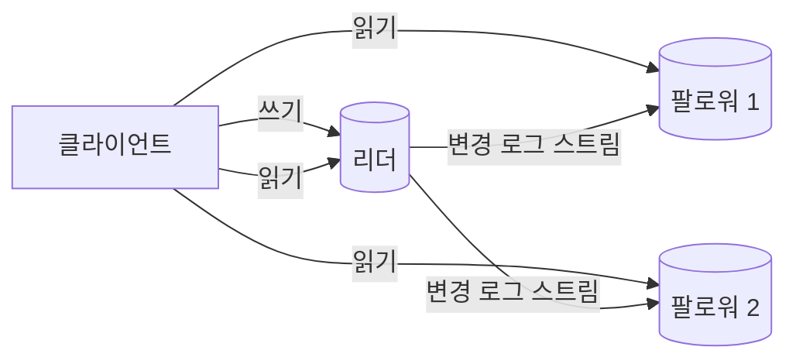
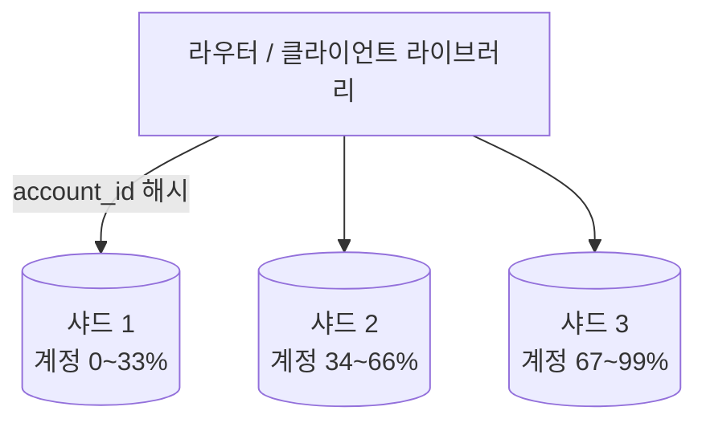

## 들어가며

단일 데이터베이스 노드는 두 방향에서 한계에 닿는다 — 그 기계가 죽으면 서비스 전체가 멈춘다는 가용성의 한계, 그리고 한 기계의 CPU·메모리·디스크가 받아낼 수 있는 부하의 한계. 답도 두 방향이다 — 같은 데이터를 여러 노드에 두는 복제(replication), 데이터를 잘라 여러 노드에 나누는 샤딩(sharding).

둘 다 "노드를 늘린다"는 점에서 비슷해 보이지만 성격이 다르다. 복제는 사본을 만들므로 읽기 확장과 장애 대비를 주는 대신 *사본 간 불일치* 라는 새 문제를 만들고, 샤딩은 쓰기와 용량을 확장하는 대신 *조각 간 작업* (교차 샤드 질의·트랜잭션)을 어렵게 만든다. 글로벌 게임 서비스의 데이터 계층은 이 둘의 조합 위에 서고, 그 조합의 미묘함 — 복제 지연, 페일오버의 데이터 손실 창, 샤드 키 선택, 리샤딩 — 이 운영 사고의 단골 출처다.

이 글은 리더-팔로워 복제와 복제 지연이 만드는 이상 현상들, 페일오버의 함정, 샤딩의 키 선택과 재배치, 그리고 일관성-가용성 트레이드오프의 언어(CAP)를 게임 백엔드의 결정 문제로 정리한다.

읽는 기준은 라우팅 코드다. 쓰기는 어느 리더로 가고, 자기 쓰기 읽기는 어떤 토큰으로 보장하며, 샤드 키가 없는 함수가 어떻게 교차 샤드 위험을 드러내는지를 코드 형태로 설명할 수 있어야 한다. 토폴로지가 설정 파일에만 있으면 운영 지식이고, 라우터 타입과 테스트에 있으면 프로그램 지식이다.


---

## 목차
1. [리더-팔로워 복제](#1-리더-팔로워-복제)
2. [복제 지연이 만드는 이상 현상](#2-복제-지연이-만드는-이상-현상)
3. [동기 복제와 페일오버의 함정](#3-동기-복제와-페일오버의-함정)
4. [샤딩: 데이터를 자르는 법](#4-샤딩-데이터를-자르는-법)
5. [샤드 키 선택과 교차 샤드 작업](#5-샤드-키-선택과-교차-샤드-작업)
6. [리샤딩: 자라는 데이터의 이사](#6-리샤딩-자라는-데이터의-이사)
7. [일관성-가용성의 언어와 게임의 선택](#7-일관성-가용성의-언어와-게임의-선택)
8. [라우팅과 지연을 코드 경계로 만들기](#8-라우팅과-지연을-코드-경계로-만들기)


---

## 1. 리더-팔로워 복제

가장 널리 쓰이는 복제 구조는 리더-팔로워(leader-follower)다 — 쓰기는 리더 한 노드만 받고, 리더의 변경 로그를 팔로워들이 받아 같은 순서로 적용한다.



쓰기를 한 곳으로 모으는 이유는 순서다. 한 복제 그룹의 갱신 순서를 리더에서 정하고 팔로워가 커밋된 로그 접두부를 재생하면 사본들이 같은 역사를 공유할 수 있다. 다중 리더 구조는 쓰기 가용성과 지역 지연을 개선하는 대신 충돌 탐지·해소 의미를 요구한다. 계정·경제 데이터처럼 충돌을 임의 병합하기 어려운 경우에는 단일 리더 또는 합의로 순서화된 쓰기 경로가 흔하다.

이 구조가 주는 것은 읽기 확장, 장애 대비, 백업·분석 경로 분리다. 새로 생기는 비용은 복제 지연(replication lag), 승격 프로토콜, 읽기 일관성 선택이다. 지연 분포는 저장장치, 적용 속도, 네트워크, 장시간 트랜잭션과 장애 복구에 따라 달라지며 정상 시 짧더라도 backlog가 생기면 크게 늘 수 있다.

### 원격 호출은 결과를 모호하게 만든다

단일 프로세스의 함수 호출은 반환되거나 프로세스 전체가 실패한다. 원격 쓰기는 응답이 오지 않았을 때 다음 상태를 구분할 수 없다.

1. 요청이 리더에 도착하지 않았다.
2. 리더가 요청을 받았지만 로그에 기록하기 전에 죽었다.
3. 로그에는 기록했지만 복제되기 전에 죽었다.
4. 과반수에 복제하고 커밋했지만 응답이 유실되었다.
5. 응답이 늦게 오고 있을 뿐이다.

타임아웃은 이 중 어느 상태인지 판정하지 않는다. 클라이언트가 더 기다리지 않겠다는 결정일 뿐이다. 따라서 타임아웃 뒤 재시도는 같은 쓰기를 두 번 실행할 수 있다. 데이터베이스가 제공하는 트랜잭션 원자성과 원격 요청의 한 번 실행 보장은 서로 다른 문제다.

복제 시스템의 API는 응답이 의미하는 지속성 수준을 명시해야 한다.

| 응답 조건 | 장애 시 의미 |
|---|---|
| 리더 메모리에 반영 | 리더 프로세스 장애에도 손실 가능 |
| 리더 WAL에 지속 | 리더 디스크는 보존되지만 노드 상실 시 손실 가능 |
| 한 팔로워까지 지속 | 두 노드 동시 장애 전까지 보존 가능 |
| 과반수에 지속 후 커밋 | 이후 과반수 리더가 확정 항목을 보존하도록 설계 가능 |

“쓰기 성공”이라는 한 문장으로는 내구성을 설명할 수 없다. 어떤 저장 장치에 어느 순서로 기록되었고, 어떤 장애 집합까지 버티는지가 계약이다.

### 로그 접두부와 상태 머신

복제 로그는 단순 변경 내역 모음이 아니라 사본들이 같은 상태에 도달하게 하는 순서 계약이다. 결정적 상태 머신에 같은 명령을 같은 순서로 적용하면 같은 상태가 나온다는 전제를 사용한다.

```text
log index:  41        42             43
command:    add 100   buy item 17    equip item 17
```

팔로워가 43번을 먼저 적용하거나 42번을 건너뛰면 상태가 달라진다. 따라서 적용 인덱스는 연속적으로 증가해야 하고, 커밋되지 않은 항목을 외부에 확정 결과로 노출해서는 안 된다. 비결정적 난수, 현재 시각, 외부 API 호출을 상태 머신 내부에서 직접 사용하면 같은 로그도 다른 결과를 만들 수 있다. 필요한 값은 리더가 명령에 포함해 순서화하거나, 외부 부작용을 별도의 멱등한 단계로 분리한다.

## 2. 복제 지연이 만드는 이상 현상

팔로워 읽기는 *조금 과거의 일관된 상태* 를 읽는 것이다. 그 "조금 과거"가 사용자 경험과 충돌하는 패턴은 정형화되어 있다.

- **자기 쓰기 읽기(read-your-writes) 위반**: 닉네임을 바꾸고(리더) 프로필을 새로고침했는데(팔로워) 옛 닉네임이 보인다. 사용자는 자기 변경이 사라졌다고 인식한다 — 지연이 1초여도 사고처럼 보인다.
- **단조 읽기(monotonic reads) 위반**: 새로고침마다 다른 팔로워를 읽으면, 더 낡은 사본을 읽는 순간 *시간이 거꾸로 간다* — 방금 보이던 우편이 사라졌다 다시 나타난다.
- **인과 역전**: 길드 공지("보스 잡음")는 보이는데 그 원인(보스 처치 기록)은 아직 안 보인다 — 서로 다른 데이터의 복제 진도가 다를 때.

처방은 *읽기 경로의 라우팅 규칙* 이다.

| 규칙 | 구현 |
|---|---|
| 자기 쓰기 이상을 읽음 | 커밋 위치 토큰 이상을 적용한 사본을 고르고, 없으면 리더로 보내거나 기다린다 |
| 같은 세션은 같은 사본으로 | 세션-팔로워 고정으로 단조 읽기 확보 |
| 경제 불변식은 강한 쓰기 경로로 | 잔액 확인과 차감을 같은 직렬화 가능 트랜잭션·조건부 갱신·원장 명령으로 원자화한다 |
| 지연 둔감 읽기만 팔로워로 | 전적 조회, 랭킹 화면, 프로필 열람 |

요지는 일괄 정책이 아니라 *데이터·맥락별 선언* 이라는 것 — "이 읽기는 얼마나 묵어도 되는가"를 질의 단위로 묻는 습관이 복제 도입의 실질 비용이다.

### 일관성은 사본이 같은가가 아니라 어떤 역사가 허용되는가다

일관성 모델은 어느 순간 모든 사본의 바이트가 같은지를 묻는 규칙이 아니다. 여러 클라이언트의 호출과 응답으로 이루어진 *역사(history)* 중 어떤 순서를 합법으로 인정할지 정의한다.

- **선형화 가능성(linearizability)**: 각 연산이 호출과 응답 사이의 한 점에서 원자적으로 일어난 것처럼 배치할 수 있고, 실제 시간 순서를 보존한다.
- **순차 일관성(sequential consistency)**: 모든 클라이언트가 같은 전역 순서를 보지만, 실제 시간 순서를 보존할 필요는 없다.
- **인과 일관성(causal consistency)**: 원인과 결과 관계가 있는 작업의 순서를 보존한다. 서로 독립적인 동시 작업은 다른 순서로 보일 수 있다.
- **최종 일관성(eventual consistency)**: 새 갱신이 멈추면 사본이 결국 수렴한다. 수렴 시간과 중간 읽기 보장은 별도로 정의해야 한다.

선형화 가능성과 데이터베이스의 직렬화 가능성(serializability)은 자주 혼동된다. 선형화 가능성은 개별 연산의 실제 시간 순서를 다루고, 직렬화 가능성은 여러 트랜잭션의 결과가 어떤 직렬 실행과 같아야 함을 다룬다. 한 시스템이 직렬화 가능한 트랜잭션을 제공하면서도 오래된 복제본 읽기로 선형화 가능하지 않을 수 있다.

### 세션 보장은 약한 일관성을 사용할 수 있게 만든다

모든 읽기를 리더로 보내는 대신, 사용자 세션 안에서 필요한 최소 보장을 만들 수 있다.

- read-your-writes: 내 쓰기 이후에는 그 쓰기 이상이 적용된 사본에서 읽는다.
- monotonic reads: 한 번 본 버전보다 오래된 버전을 다시 보지 않는다.
- monotonic writes: 같은 클라이언트의 쓰기를 순서대로 적용한다.
- writes-follow-reads: 읽고 내린 결정이 그 읽기보다 오래된 상태 위에 기록되지 않게 한다.

구현은 커밋 위치나 논리적 버전을 세션 토큰에 담고, 읽기 라우터가 그 위치까지 적용한 복제본만 선택하는 방식이 일반적이다. 단순히 “같은 팔로워에 붙인다”는 방법은 해당 팔로워가 장애 나거나 뒤처질 때 보장을 설명하기 어렵다.

### 벽시계와 논리적 순서를 구분한다

노드의 벽시계는 서로 정확히 같지 않고 보정 중 뒤로 이동할 수 있다. 타임스탬프가 큰 쓰기를 무조건 최신으로 선택하면 시계가 앞선 노드가 다른 갱신을 덮을 수 있다. 경과 시간 측정에는 단조 시계를 쓰고, 분산 갱신 순서에는 데이터베이스가 부여한 로그 위치·트랜잭션 ID·논리 시계를 사용한다.

Lamport 시계는 인과적으로 앞선 사건에 더 작은 번호를 부여하지만, 번호만으로 두 사건이 실제 인과 관계인지 판정하지 못한다. 벡터 시계는 참여자별 카운터를 통해 동시 갱신을 판정할 수 있지만 메타데이터가 커진다. 어떤 시계를 선택할지는 “최신 하나를 고를 것인가”, “동시 충돌을 보존해 해결할 것인가”라는 데이터 의미에 달려 있다.

## 3. 동기 복제와 페일오버의 함정

복제의 두 다이얼이 내구성과 가용성을 가른다.

**동기 vs 비동기.** 비동기 복제에서 리더는 원격 사본의 확인을 기다리지 않고 성공을 응답할 수 있으므로, 리더와 아직 받지 못한 로그가 함께 사라지면 확인된 쓰기도 잃을 수 있다. 동기 복제라는 이름도 구현마다 `수신`, `WAL 지속`, `적용`, `과반 커밋` 중 어느 지점을 기다리는지가 다르다. 확인된 쓰기가 어떤 장애 집합에서 보존되는지는 그 지점과 승격 규칙으로 결정된다. 일부 동기 사본과 나머지 비동기 사본을 두는 구성은 가능한 절충안이지 모든 워크로드의 표준 해법은 아니다.

**페일오버(failover).** 리더가 죽으면 팔로워 하나를 새 리더로 승격한다. 자동화된 이 절차에는 유명한 함정이 둘 있다.

- **데이터 손실 창**: 비동기 복제에서 가장 앞선 팔로워조차 리더의 마지막 커밋들을 못 받았을 수 있다 — 승격은 그 커밋들의 폐기다. "결제는 됐는데 기록이 사라진" 부류의 사고가 이 창에서 난다. 돈이 걸린 시스템이 동기 복제를 사는 이유다.
- **스플릿 브레인(split-brain)**: 옛 리더가 죽은 게 아니라 *네트워크에서 고립* 된 것이었다면, 승격 후 리더가 둘이 된다 — 양쪽이 쓰기를 받으면 두 갈래의 역사가 생기고 병합은 불가능에 가깝다. 방어는 펜싱(fencing — 옛 리더의 쓰기 차단)과 과반 합의 기반의 승격(노드 과반이 동의해야 리더)이다.

**펜싱 토큰(fencing token) — 임대만으로는 부족한 이유.** 임대(lease)는 "T초 동안 네가 리더"라고 시간으로 소유권을 빌려준다. 그러나 승격된 새 리더가 일하는 동안 옛 리더가 정말 죽은 게 아니라 멈춰 있었을 뿐이라면 — stop-the-world GC 정지, OS 스케줄링 지연, 디스크 I/O 블로킹으로 수 초간 얼었다가 — 깨어난 옛 리더는 자기 임대가 만료된 줄 모르고 "나는 아직 리더"라며 쓰기를 보낸다. 벽시계 기반 임대 만료는 이 좀비를 막지 못한다(정지 동안 시간 비교 자체가 멈춰 있었으므로). 해법은 소유권이 바뀔 때마다 *단조 증가하는 세대 번호* — 펜싱 토큰 — 를 발급하고, 모든 쓰기에 그 토큰을 실어 보내, 자원 쪽이 자신이 본 가장 큰 토큰보다 작은 쓰기를 거부하게 하는 것이다.

```text
임대 발급:  A=token33  →  (A 정지)  →  B=token34
저장소는 "수용한 최대 토큰"을 기억한다
  B가 token34로 씀  →  34 ≥ 34  →  수용, 최대=34
  좀비 A가 token33로 씀  →  33 < 34  →  거부
```

핵심은 락 서비스가 "락을 줬다"고 알려주는 것이 아니라 *보호 대상 자원 자신* 이 오래된 소유자를 거부할 수 있어야 한다는 것이다. 같은 원리가 분산 락, 작업 큐의 단일 소비자, 샤드 리더, 그리고 게임 운영에서 한 매치 인스턴스의 소유권(어느 데디케이티드 서버가 그 세션의 권위인가)을 정하는 데 그대로 적용된다.

게임 운영 관점의 결론 — 페일오버는 "자동이니 안심"이 아니라 *연습해야 하는 절차* 다. 승격 소요 시간(그동안 쓰기 불가), 손실 창의 크기, 응용의 재연결 동작까지를 주기적 훈련으로 측정해 두는 것이 장애 날의 차이를 만든다.

### 과반수 쿼럼이 제공하는 교차

복제본이 $N$개이고 쓰기 확인 수가 $W$, 읽기 확인 수가 $R$이라 하자. $W + R > N$이면 모든 읽기 쿼럼은 직전 쓰기 쿼럼과 적어도 한 노드에서 교차한다. $W > N/2$이면 서로 다른 두 쓰기 쿼럼도 교차한다.

이 교차는 비둘기집 논증이다. 쓰기 쿼럼 $Q_w$와 읽기 쿼럼 $Q_r$이 모두 같은 $N$개 노드 집합의 부분집합이므로, 포함-배제로

$$|Q_w \cap Q_r| = |Q_w| + |Q_r| - |Q_w \cup Q_r| \ge W + R - N$$

이고 $W+R>N$이면 우변이 최소 1이라 교차가 보장된다. 두 쓰기 쿼럼도 같은 논리로 $|Q_{w1}\cap Q_{w2}|\ge 2W-N$이라 $W>N/2$에서 양수가 된다. Dynamo 계열의 기본값 $N{=}3,\,W{=}2,\,R{=}2$는 $W+R=4>3$이라 모든 읽기가 최신 쓰기를 본 노드를 적어도 하나 포함한다.

교차는 중요한 재료지만 그 자체가 최신 값을 자동으로 판정하지는 않는다. 교차 노드가 어떤 버전을 보유하는지, 동시 쓰기를 어떻게 순서화하는지, 오래된 복제본을 어떻게 수리하는지가 추가로 필요하다. “과반수에 쓰고 과반수에서 읽는다”만으로 선형화 가능성이 자동 보장되는 것은 아니다.

지연을 줄이려고 $W+R\le N$인 부분 쿼럼(partial quorum)을 쓰면 교차가 사라지고, staleness가 결정적 보장에서 확률적 현상으로 바뀐다. 쓰기가 막 $W$개 노드에 반영된 직후 $R$개 노드를 균등하게 읽으면, 그 $R$개가 전부 미반영 $N-W$개에서 뽑힐 때만 옛 값이 읽힌다 — 초기하 분포로

$$P(\text{stale}) = \frac{\binom{N-W}{R}}{\binom{N}{R}}$$

예컨대 $N{=}3,\,W{=}R{=}1$이면 $\binom{2}{1}/\binom{3}{1}=2/3$, $N{=}5,\,W{=}R{=}2$면 $\binom{3}{2}/\binom{5}{2}=3/10$의 확률로 *쓰기 직후* 옛 값이 읽힌다. 시간이 흘러 비동기 복제가 퍼지면 신선한 노드 수가 $W$에서 $N$으로 늘어 이 확률은 0으로 감쇠한다 — 쓰기 후 경과 시간 $t$에 대한 이 감쇠 곡선이 t-visibility이고, 이를 복제 전파 지연 분포로 정량화한 것이 확률적 유계 staleness(PBS)다. 부분 쿼럼은 틀린 설계가 아니라 *수 ms의 staleness 창을 지연과 맞바꾸는* 설계이며, 그 창의 크기를 측정해 SLA에 명시할 수 있다.

장애 허용 수는 과반수 구조에서 명확하다. $N=2f+1$이면 최대 $f$개 노드가 응답하지 않아도 $f+1$개의 과반수를 만들 수 있다. 세 노드는 한 노드 장애를, 다섯 노드는 두 노드 장애를 허용한다. 노드 수를 짝수로 늘려도 허용 장애 수가 늘지 않는 구간이 있으므로 복제본 수는 비용과 장애 도메인을 함께 보고 정한다.

### 합의는 리더를 뽑는 투표가 아니라 결정의 불변식이다

합의 알고리즘은 일부 노드와 메시지가 실패해도 서로 다른 두 값을 확정하지 않도록 한다.

- **안전성(safety)**: 나쁜 일이 일어나지 않는다. 서로 다른 두 로그 항목이 같은 위치에서 커밋되지 않는다.
- **생존성(liveness)**: 충분히 좋은 조건이 지속되면 결국 진전한다.
- **유효성(validity)**: 결정된 값은 허용된 제안에서 나온다.

완전 비동기 네트워크에서 한 프로세스라도 정지할 수 있을 때, 결정적 합의 알고리즘이 모든 실행에서 종료한다고 보장할 수는 없다. 이 결과는 합의가 실무에서 불가능하다는 뜻이 아니다. 안전성은 항상 지키고, 네트워크가 일정 시간 안정되는 부분 동기 조건과 무작위 선거 타임아웃 아래에서 생존성을 얻는 것이 실용 합의 알고리즘의 접근이다.

### Raft 로그 복제에서 반드시 지켜야 하는 것

Raft 계열 프로토콜은 증가하는 임기(term)로 리더 세대를 구분하고, 로그 인덱스와 임기로 로그 접두부의 일치를 검사한다.

```text
entry = { index, term, command }
```

후보는 한 임기에 과반수 표를 받아야 리더가 된다. 각 노드는 한 임기에 한 번만 투표하고, 자신의 로그만큼 최신이거나 더 최신인 후보에게만 표를 준다. 이 제한은 이미 커밋된 항목을 잃을 후보가 리더가 되는 것을 막는다.

리더는 팔로워에게 새 항목과 바로 앞 항목의 인덱스·임기를 함께 보낸다. 팔로워는 앞 항목이 일치할 때만 새 항목을 받아들인다. 이 검사는 같은 인덱스와 임기를 가진 로그가 그 이전 접두부도 같다는 성질을 만든다.

현재 임기의 항목이 과반수에 복제되면 리더는 해당 위치까지 커밋할 수 있다. 과거 임기의 항목이 단지 과반수 노드에 존재한다는 이유만으로 직접 커밋되었다고 판정하면, 이후 선거 순서에 따라 덮일 수 있다. 과거 항목은 현재 임기 항목이 커밋될 때 그 접두부로 함께 확정된다.

합의 클러스터 안에서 커밋이 안전해도 외부 부작용은 별도다. 오래된 리더가 결제 API나 저장 장치에 명령을 보낼 수 있다면 임기나 펜싱 토큰을 외부 경계까지 전달해 거부하게 해야 한다.

### 강한 읽기도 프로토콜이 필요하다

리더가 자신의 임기가 아직 유효하다고 믿는 것만으로 선형화 가능한 읽기를 보장할 수 없다. 네트워크에서 고립된 옛 리더가 오래된 값을 반환할 수 있기 때문이다. 강한 읽기는 현재 리더임을 과반수와 확인하는 read index 절차, 안전한 lease 조건, 또는 읽기를 로그에 기록하는 방법처럼 명시된 프로토콜이 필요하다.

팔로워 읽기는 더 낮은 지연과 높은 처리량을 주지만 어느 커밋 위치까지 반영했는지를 함께 다뤄야 한다. API가 strong, bounded-stale, eventual 같은 읽기 수준을 구분하면 호출자가 업무 의미에 맞는 비용을 선택할 수 있다.

## 4. 샤딩: 데이터를 자르는 법

샤딩은 데이터를 샤드 키(shard key) 기준으로 잘라 노드들에 나누는 것이다 — 쓰기 처리량과 저장 용량이 노드 수에 비례해 늘어난다.



자르는 방식은 둘이다.

- **해시 샤딩**: `hash(key) mod N` 또는 해시 범위 매핑 — 부하가 균등하게 퍼진다. 범위 질의(키 순서로 훑기)는 전 샤드 분산 질의가 된다.
- **범위 샤딩**: 키 구간별로 자른다 — 범위 질의가 한 샤드에 머문다. 대신 새 데이터가 한 구간에 몰리면(시간순 키) 그 샤드만 뜨거워진다.

게임의 지배적 접근 패턴은 "한 플레이어의 데이터 묶음"이므로, *계정 ID 해시 샤딩* 이 기본형이다 — 로그인·인벤토리·지갑 작업이 전부 한 샤드 안에서 끝난다. 같은 이유로 한 계정의 연관 테이블들(캐릭터·인벤토리·지갑)을 *같은 샤드 키로 같은 샤드에* 모으는 것(코로케이션)이 중요하다 — 그래야 한 플레이어의 트랜잭션이 단일 샤드 트랜잭션으로 남는다.

## 5. 샤드 키 선택과 교차 샤드 작업

샤드 키가 가르는 것은 단순하다 — *키가 같으면 싸고, 다르면 비싸다*.

| 작업 | 샤드 관점 | 비용 |
|---|---|---|
| 내 인벤토리 로드 | 단일 샤드 (account_id) | 평소와 동일 |
| 아이템 사용·구매 | 단일 샤드 트랜잭션 | 평소와 동일 |
| 플레이어 간 거래 | **교차 샤드** — 두 계정이 다른 샤드 | 원자성 보장 어려움 |
| 전체 랭킹 | 전 샤드 집계 | 분산 질의 또는 별도 집계 저장소 |
| 운영 검색 (닉네임으로) | 샤드 키가 아님 — 전 샤드 | 별도 인덱스 서비스 |

교차 샤드 트랜잭션이 문제의 중심이다. 두 샤드에 걸친 원자적 커밋의 고전 답인 2단계 커밋(2PC)은 조정자 장애 시의 블로킹과 지연 비용 때문에 게임 백엔드에서 기피된다. 실무의 답은 회피와 우회다.

- **회피 — 같은 샤드로 모은다**: 거래·길드처럼 상호작용이 잦은 단위를 같은 샤드에 두는 키 설계(길드 단위 샤딩 등). 단, 어떤 키를 골라도 모든 상호작용을 같은 샤드로 모을 수는 없다.
- **우회 — 단계적 확정**: 교차 샤드 작업을 "한 샤드의 확정 + 비동기 후속"으로 분해한다. 거래라면: 보내는 쪽 샤드에서 차감과 *이전 중* 기록을 원자적으로 확정하고, 받는 쪽 샤드 지급은 비동기로 — 실패하면 차감을 되돌리는 보상(compensation) 단계까지가 한 세트다. 일시적으로 "어느 쪽에도 없는" 중간 상태가 보일 수 있음을 받아들이는 대신, *돈이 증발하거나 복제되는 최종 상태* 는 없게 만드는 구조다.

## 6. 리샤딩: 자라는 데이터의 이사

샤드 수는 영원하지 않다 — 동접이 자라면 3샤드를 12샤드로 늘려야 한다. `hash(key) mod N`의 N을 바꾸면 *거의 모든 키의 소속이 바뀌므로* 전면 이사가 된다. 이 비용을 줄이는 표준 설계가 가상 버킷이다.

```text
키 → hash → 버킷 (고정 4096개) → 버킷-샤드 매핑 테이블 → 물리 샤드
```

키-버킷 매핑은 영원히 고정하고, 버킷-샤드 매핑만 운영이 바꾼다 — 12샤드로 늘릴 때는 일부 버킷의 소속만 바꾸고 그 버킷들만 이사한다. 이사 중에는 "옛 샤드 읽기 + 양쪽 쓰기 + 검증 후 전환" 같은 점진 절차가 따라오고, 이 절차의 자동화 수준이 곧 그 팀의 확장 속도다.

설계 시점의 교훈으로 당기면 — *처음부터 샤딩하라가 아니라, 처음부터 샤딩 가능하게 하라*. 모든 플레이어 데이터 접근이 계정 ID를 경유하게 하고, 교차 계정 질의를 별도 경로(집계 저장소)로 분리해 두면, 단일 DB에서 샤딩으로의 이사가 "라우팅 계층 추가"로 줄어든다. 거꾸로 아무 테이블이나 조인하던 코드베이스의 샤딩 전환은 전면 재작성이 된다.

### 무중단 리샤딩은 소유권 이전 프로토콜이다

데이터 복사만 끝났다고 샤드 이전이 끝난 것은 아니다. 이전 중에도 쓰기가 계속 들어오므로, 어느 시점부터 어느 노드가 권위 있는 소유자인지 정해야 한다.

```text
1. 목적 샤드에 기준 스냅샷 복사
2. 복사 이후 변경 로그를 목적 샤드에 따라잡기
3. 짧은 전환 구간에서 새 쓰기 차단 또는 이중 기록
4. 라우팅 세대 증가와 함께 목적 샤드를 소유자로 전환
5. 이전 샤드의 오래된 세대 쓰기 거부
6. 검증 후 이전 사본 정리
```

라우터 캐시는 즉시 갱신되지 않는다. 따라서 요청에 라우팅 세대나 소유권 토큰을 포함하고 저장소가 오래된 세대의 쓰기를 거부해야 한다. “새 라우팅 테이블을 배포했으니 이전 노드로는 요청이 안 간다”는 가정은 지연된 요청과 정지 후 재개한 프로세스 앞에서 깨진다.

이중 기록은 두 곳에 차례로 쓰는 것만으로 원자적이지 않다. 한쪽만 성공할 수 있으므로 변경 로그 재생, 재시도 가능한 멱등 쓰기, 최종 대조가 필요하다. 리샤딩 절차 자체를 상태 머신으로 만들고 각 단계의 재시작 동작을 정의해야 운영자가 장애 중 수동 추측에 의존하지 않는다.

## 7. 일관성-가용성의 언어와 게임의 선택

분산 데이터의 트레이드오프를 말하는 표준 어휘가 CAP 정리다. 네트워크 분단 중에는 선형화 가능성처럼 단일 최신 값을 보장하는 일관성과, 모든 비장애 노드에 도착한 요청이 결국 성공 응답을 받는 가용성을 동시에 보장할 수 없다. 분단을 견뎌야 하는 시스템의 실질 질문은 어떤 연산을 거부하고 어떤 연산에 오래되거나 충돌 가능한 결과를 허용할지다.

게임 데이터에 대응시키면 선택은 데이터별로 갈린다.

- **경제·인벤토리 — 일관성 우선**: 분단 중 잔액이 갈라지는 것보다 결제가 잠시 멈추는 쪽이 낫다. 리더 기반 복제 + 과반 합의 승격이 이 선택의 구현이고, "분단 중 소수파 쪽은 쓰기 거부"가 그 모습이다.
- **프레즌스·일부 세션 탐색 — 가용성 우선 가능**: 접속 표시가 지역마다 잠시 다른 비용을 서비스가 감수할 수 있다면 낡은 답을 허용할 수 있다. 친구 관계 변경, 초대 권한, 제재처럼 보안·권한 의미가 있는 소셜 연산은 별도의 강한 경로가 필요하다.
- **랭킹·통계 — 최종 일관성(eventual consistency)**: 갱신이 결국 모든 사본에 닿으면 충분하다 — 수렴까지의 창을 사용자 경험이 견딜 수 있게 설계한다(순위 "집계 중" 표시 등).

손실 비용과 신선도 요구가 보장 수준을 정한다는 원리는 노드가 하나든 백 개든 같다. 분산 환경에서는 네트워크 지연과 부분 장애가 추가되어 그 비용의 자릿수가 달라질 뿐이다.

### CAP를 정상 상태 설계 공식으로 쓰지 않는다

CAP에서 가용성은 임의의 비장애 노드에 도착한 모든 요청이 결국 응답을 받는다는 강한 정의이고, 일관성은 보통 선형화 가능성을 뜻한다. “서비스가 연중 99.99% 열린다”는 운영 가용성과 같은 말이 아니다.

분할이 없을 때도 강한 조정은 지연 비용을 가진다. 실제 설계에서는 다음 질문을 따로 묻는다.

- 정상 상태에서 로컬 읽기와 과반수 읽기 사이의 지연 차이를 감수할 수 있는가
- 분할 중 소수파의 쓰기를 거부할 것인가
- 오래된 읽기를 얼마나 허용할 것인가
- 충돌이 생기면 자동 병합할 수 있는 업무 의미가 있는가
- 수렴 전 상태가 사용자와 외부 시스템에 노출되어도 되는가

“AP 데이터베이스”나 “CP 데이터베이스”라는 제품 라벨보다, 각 연산의 읽기·쓰기 수준과 장애 시 동작을 문서화하는 편이 정확하다.

### 검증은 성공 사례가 아니라 금지된 역사를 찾는다

복제 시스템 테스트는 노드를 몇 번 끄고 최종 행 수를 비교하는 것으로 충분하지 않다. 지연, 유실, 중복, 재정렬, 디스크 부분 쓰기, 프로세스 정지와 재시작을 조합하고, 실행 역사가 약속한 일관성 모델을 위반하는지 검사해야 한다.

대표 불변식은 다음과 같다.

- 커밋된 경제 원장 항목은 이후 어떤 리더에서도 사라지지 않는다.
- 같은 멱등성 키의 외부 효과는 한 번만 존재한다.
- 한 소유권 세대보다 오래된 쓰기는 전환 이후 수용되지 않는다.
- 적용 인덱스는 커밋 인덱스를 넘지 않는다.
- 리샤딩 완료 뒤 원본과 목적지의 키 집합과 버전이 일치한다.

결정적 시뮬레이터가 메시지 전달과 시계를 제어하면 드문 선거·재시도 순서를 재현할 수 있다. 실제 데이터베이스를 대상으로 할 때는 요청의 호출·응답 시각과 버전을 기록해 역사 기반 검사를 수행한다.


## 8. 라우팅과 지연을 코드 경계로 만들기

복제와 샤딩은 인프라 설정만이 아니라 애플리케이션 코드의 타입 경계다. 함수가 `Db` 하나만 받으면 어느 읽기가 리더를 요구하고 어느 읽기가 팔로워를 허용하는지 사라진다. 읽기 일관성 요구를 호출부가 표현해야 한다.

```cpp
enum class ReadConsistency {
    StaleOk,
    ReadYourWrites,
    LeaderOnly
};

struct ReadToken {
    ShardId shard;
    LogPosition minApplied;
};
```

쓰기 응답은 단순 성공이 아니라 "이 쓰기가 어느 로그 위치까지 커밋되었는가"를 돌려준다.

```cpp
WriteResult UpdateProfile(DbRouter& db, PlayerId player, ProfilePatch patch) {
    ShardId shard = db.ShardForPlayer(player);
    auto r = db.Leader(shard).Execute(
        "UPDATE player_profile SET nickname=?, version=version+1 WHERE player_id=?",
        patch.nickname, player);

    return {
        .ok = r.ok,
        .readToken = ReadToken{shard, r.commitPosition}
    };
}
```

이후 같은 사용자가 자기 프로필을 읽을 때는 팔로워가 그 로그 위치까지 따라왔는지 확인한다. 따라오지 못했으면 리더로 라우팅하거나 짧게 기다린다.

```cpp
Profile LoadProfile(DbRouter& db, PlayerId player, ReadToken token) {
    ShardId shard = db.ShardForPlayer(player);
    Replica& replica = db.Follower(shard);

    if (token.shard == shard && replica.Applied() >= token.minApplied) {
        return replica.QueryProfile(player);
    }

    return db.Leader(shard).QueryProfile(player);
}
```

샤딩도 같은 방식으로 코드에 드러나야 한다. 샤드 키가 함수 인자로 없으면 그 함수는 단일 샤드 작업인지 교차 샤드 작업인지 알 수 없다.

```cpp
ShardId DbRouter::ShardForPlayer(PlayerId id) {
    uint64_t bucket = Hash64(id.value) % kVirtualBucketCount;
    return routingTable.Lookup(bucket);
}

DbConn& DbRouter::ForPlayer(PlayerId id, AccessMode mode) {
    ShardId shard = ShardForPlayer(id);
    return mode == AccessMode::Write ? Leader(shard) : Follower(shard);
}
```

교차 샤드 작업은 별도 타입으로 밀어내야 한다. 그래야 코드 리뷰에서 비용과 실패 처리가 보인다.

```cpp
struct CrossShardTransfer {
    PlayerId from;
    PlayerId to;
    Currency amount;
};

TransferResult TransferCurrency(DbRouter& db, CrossShardTransfer cmd) {
    ShardId a = db.ShardForPlayer(cmd.from);
    ShardId b = db.ShardForPlayer(cmd.to);

    if (a == b) {
        return TransferInsideOneShard(db.Leader(a), cmd);
    }

    return TransferBySaga(db, cmd);  // pending, commit, compensate 상태를 기록한다
}
```

이 형태의 장점은 추상적이다. 일관성 요구가 API에 나타나고, 복제 지연은 `ReadToken`으로 테스트 가능해지며, 교차 샤드 작업은 우발적으로 숨지 않는다. 데이터베이스 토폴로지는 설정 파일에만 있으면 운영자가 아는 사실이고, 라우터 타입에 있으면 컴파일러와 테스트가 아는 사실이다.


---

## 결론

복제는 사본으로 읽기 확장과 장애 대비를 사고 복제 지연이라는 청구서를 받는다 — 자기 쓰기 읽기·단조 읽기의 위반은 읽기 경로의 데이터별 라우팅 규칙으로 막고, 내구성이 필요한 곳은 동기 복제로, 페일오버는 손실 창과 스플릿 브레인을 아는 채로 연습해 둔다. 샤딩은 쓰기와 용량을 확장하는 대신 교차 샤드 작업을 비싸게 만든다 — 계정 ID 해시 + 코로케이션으로 대부분의 작업을 단일 샤드에 가두고, 남는 교차 작업은 단계적 확정과 보상으로 우회하며, 가상 버킷으로 미래의 이사를 예약해 둔다.

일관성과 가용성의 선택은 시스템 전역이 아니라 데이터별로 내린다 — 경제는 멈추더라도 일관되게, 프레즌스는 낡더라도 응답하게. 이 선택의 어휘와 근육이 갖춰지면, 다음 문제는 분산된 조각들 위에서 *돈의 흐름* 을 끝까지 옳게 만드는 일 — 멱등성, 중복 지급, 보상 트랜잭션의 설계다.

## 더 읽을거리

- Martin Kleppmann, *Designing Data-Intensive Applications*, Ch.5 (Replication)·Ch.6 (Partitioning)·Ch.9 (Consistency and Consensus) — 이 글 전체의 정밀판. Ch.8 (The Trouble with Distributed Systems)에 펜싱 토큰의 정식 논거와 그림이 있다.
- Martin Kleppmann, "How to do distributed locking" (2016) — 임대 만료의 정지 함정과 펜싱 토큰의 출처가 된 블로그 글.
- Seth Gilbert, Nancy Lynch, "Brewer's Conjecture and the Feasibility of Consistent, Available, Partition-Tolerant Web Services" (ACM SIGACT News, 2002) — CAP의 정식 증명.
- [PostgreSQL 문서: High Availability, Load Balancing, and Replication](https://www.postgresql.org/docs/current/high-availability.html) — 동기/비동기 복제 옵션의 실물.
- Giuseppe DeCandia 외, "Dynamo: Amazon's Highly Available Key-value Store" (SOSP 2007) — 가용성 우선 설계의 고전(가상 노드·최종 일관성).
- Peter Bailis 외, "Probabilistically Bounded Staleness for Practical Partial Quorums" (PVLDB 5(8), 2012) — 부분 쿼럼의 staleness를 t-visibility·k-staleness로 정량화한 원전.
- [Vitess 문서: Sharding](https://vitess.io/docs/reference/features/sharding/) — MySQL 위 가상 버킷 리샤딩의 산업 구현.
