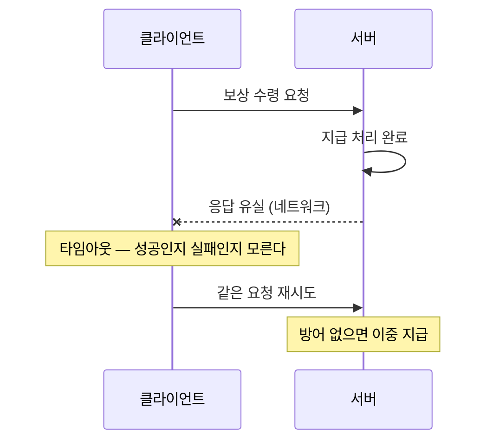
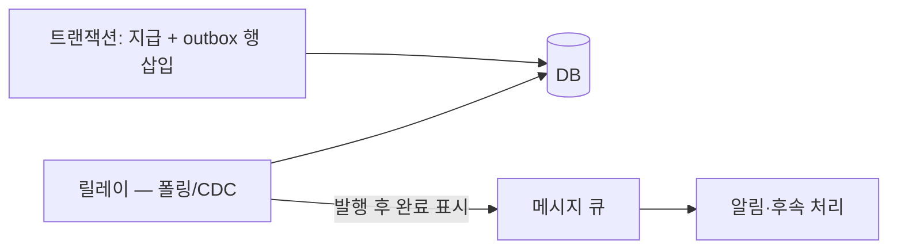

## 들어가며

게임에서 데이터 사고의 등급을 가르는 것은 돈이다. 프로필 사진이 잠깐 옛것으로 보이는 것과, 같은 보상이 두 번 지급되는 것 — 전자는 신고도 안 들어오고, 후자는 경제 인플레이션·롤백·보상 공지·신뢰 하락의 연쇄가 된다. 결제, 재화, 아이템, 우편, 거래, 경매 — 이 경로 위의 데이터를 옳게 유지하는 기술이 이 글의 주제다.

어려움의 뿌리는 하나다 — *분산 환경에서 "정확히 한 번"은 공짜로 주어지지 않는다*. 네트워크는 응답을 잃고, 클라이언트는 재시도하고, 서버는 중간에 죽는다. "요청이 두 번 도착하는 것"과 "요청이 도착했는지 알 수 없는 것"은 정상 동작이고, 그 위에서 지급·차감이 정확히 한 번 일어난 것과 같은 효과를 만들어야 한다. 멱등성이 그 답의 이름이다.

이 글은 중복의 발생 경로에서 출발해, 멱등성 키의 설계와 구현, 돈 흐름의 회계 모델(원장), 여러 시스템에 걸친 작업의 단계적 확정(사가와 아웃박스), 그리고 검증과 정산 — 사고를 막는 층과 사고를 *발견하는* 층 — 까지를 게임 경제의 작업 표준으로 정리한다.

읽는 기준은 지급 함수다. 같은 요청이 100번 병렬로 들어와도 원장 행이 하나만 생기는지, 서버가 커밋 직후 죽어도 재시도 응답이 같은지, 외부 메시지가 DB 커밋과 어긋나지 않는지를 코드와 테스트로 보여야 한다. 경제 무결성은 문구가 아니라 멱등성 키, 유니크 제약, 원장, 아웃박스가 한 트랜잭션 안에서 만나는 모양이다.


---

## 목차
1. [중복은 어디서 오는가](#1-중복은-어디서-오는가)
2. [멱등성: 정확히 한 번의 등가물](#2-멱등성-정확히-한-번의-등가물)
3. [멱등성 키의 구현](#3-멱등성-키의-구현)
4. [원장: 돈의 흐름은 추가 전용으로](#4-원장-돈의-흐름은-추가-전용으로)
5. [여러 시스템에 걸친 돈: 아웃박스와 사가](#5-여러-시스템에-걸친-돈-아웃박스와-사가)
6. [결제 검증: 외부 세계와의 경계](#6-결제-검증-외부-세계와의-경계)
7. [정산과 탐지: 마지막 방어선](#7-정산과-탐지-마지막-방어선)
8. [지급 경로의 테스트 가능한 형태](#8-지급-경로의-테스트-가능한-형태)


---

## 1. 중복은 어디서 오는가

"같은 작업이 두 번"은 버그가 아니라 분산 시스템의 기본 날씨다. 발생 경로를 알아야 방어 지점이 보인다.



- **응답 유실 후 재시도**: 위 그림 — 처리는 됐는데 응답만 사라진 경우, 재시도는 옳은 행동이고 중복은 서버가 걸러야 한다.
- **사용자 행동**: 버튼 연타, 새로고침, 두 기기 동시 로그인 — 같은 의도의 요청이 자연히 여러 번 온다.
- **내부 재처리**: 큐 기반 처리에서 워커가 작업을 끝내고 완료 표시 전에 죽으면, 그 작업은 다른 워커에게 다시 간다 — 큐의 전달 보장이 "최소 한 번(at-least-once)"인 이유다.
- **운영 작업**: 장애 복구 중의 재실행, 밀린 배치의 중복 기동.

공통 구조가 보인다 — *전달은 최소 한 번이 현실적 최선이고, 효과를 최대 한 번으로 누르는 것은 수신자의 일* 이다. 그 수신자 쪽 장치가 멱등성이다.

### 응답 없음은 실패가 아니라 결과 미확정이다

원격 요청의 결과는 성공·실패 두 값이 아니다. 처리 결과를 호출자가 아직 모르는 *미확정(unknown)* 상태가 있다.

```text
요청 전송
  ├─ 서버 도착 전 유실                 → 효과 없음
  ├─ 효과 적용 전 서버 장애             → 효과 없음
  ├─ 효과 적용 후 응답 전 서버 장애       → 효과 있음
  └─ 응답 전송 후 응답 유실              → 효과 있음
```

호출자는 타임아웃만으로 위 두 경우(효과 없음)와 아래 두 경우(효과 있음)를 구분할 수 없다. 그래서 “타임아웃이면 롤백되었다”는 API 계약은 서버가 실제로 그런 원자적 취소 프로토콜을 제공하지 않는 한 거짓이다. 호출자가 할 수 있는 일은 같은 의도를 식별할 키로 결과를 조회하거나 재시도하는 것이다.

메시지 전달 의미도 같은 경계를 가진다.

| 전달 계약 | 허용되는 현상 | 업무 효과에 필요한 것 |
|---|---|---|
| at-most-once | 손실 가능, 중복 전달 없음 | 손실을 허용하거나 별도 복구 |
| at-least-once | 중복 가능, 확인(ack)되지 않은 메시지는 재전달 | 수신자 멱등성 |
| 브로커 내부 exactly-once | 브로커가 관리하는 읽기·쓰기 중복 억제 | 외부 DB·API 효과는 별도 원자성 필요 |

“정확히 한 번 메시지”와 “정확히 한 번 업무 효과”를 구분해야 한다. 큐가 중복을 제거해도 소비자가 외부 결제 API를 호출한 직후 죽으면 그 효과의 결과는 다시 미확정이 된다.

## 2. 멱등성: 정확히 한 번의 등가물

연산 $f$가 멱등(idempotent)이라는 것은 $f(f(x)) = f(x)$ — 두 번 적용해도 한 번과 같다는 뜻이다. "최소 한 번 전달 + 멱등한 처리 = 정확히 한 번의 효과"가 분산 시스템의 기본 등식이다.

게임 연산을 멱등성 관점으로 분류하면 방어가 필요한 곳이 드러난다.

| 연산 | 자연 멱등? | 비고 |
|---|---|---|
| `SET level = 10` | 멱등 | 절대값 설정은 안전 |
| `gold = gold + 500` | **비멱등** | 재실행마다 증가 — 방어 필수 |
| 아이템 지급 (행 삽입) | **비멱등** | 재실행마다 한 개 더 |
| 우편 읽음 표시 | 멱등 | 상태 전이의 재적용 무해 |
| 일회성 보상 수령 | 조건부 | "미수령일 때만"을 원자화하면 멱등 |

비멱등 연산을 멱등하게 만드는 길은 둘이다. 첫째, *연산 자체를 조건부로* 만들어 "수령 안 했으면 지급하고 수령 표시"를 한 원자 단위로 묶는다. 둘째, *요청에 신원을 부여*해 같은 클릭이나 지급 시도의 재실행을 식별하는 멱등성 키를 저장한다. 구매 자체는 반복 가능해도 동일한 요청 키의 효과는 한 번만 commit되어야 한다.

### 멱등성과 가환성은 다르다

멱등 연산은 같은 연산을 반복해도 결과가 같다는 뜻이다. 가환 연산은 서로 다른 두 연산의 순서를 바꿔도 결과가 같다는 뜻이다.

```text
SET nickname = "A"       반복에는 멱등, 다른 SET과는 순서가 중요
ADD set_element X        반복에도 멱등, 다른 원소 추가와 가환
gold = gold + 100        반복에 비멱등, 다른 증가 연산과는 가환
```

분산 갱신을 합칠 때는 두 성질을 따로 본다. 중복 전달 방어에는 멱등성이 필요하고, 서로 다른 노드에서 동시에 일어난 갱신을 순서 없이 병합하려면 가환성이나 명시적 충돌 해결 규칙이 필요하다.

### 한 번의 의도 경계를 먼저 정의한다

멱등성 키가 무엇을 식별하는지 모호하면 정상적인 두 구매를 중복으로 오인하거나, 같은 구매의 재시도를 새 작업으로 처리한다.

- 버튼 클릭 한 번
- 플랫폼 결제 트랜잭션 한 건
- 매치 결과 한 건
- 운영 보상 캠페인에서 계정 한 명에 대한 지급 한 건

키는 이 업무 의도와 일대일이어야 한다. 단순히 현재 시각이나 요청 본문 해시를 키로 쓰면, 같은 내용의 정상 반복과 재시도를 구분하지 못한다.

## 3. 멱등성 키의 구현

멱등성 키(idempotency key)는 *의도 한 번* 에 부여되는 고유 식별자다 — 클라이언트가 구매 버튼을 누르는 순간 생성하고, 그 의도의 모든 재시도에 같은 키를 싣는다.

서버 구현의 정석은 처리 기록과 효과를 *같은 트랜잭션* 에 넣는 것이다.

```sql
BEGIN;
-- 1. 키 선점: 이미 있으면 유니크 위반 — 중복 요청이다
INSERT INTO processed_requests (idem_key, account_id, created_at)
VALUES ('c1f3-...', 42, now());

-- 2. 효과 적용 (1이 성공한 경우에만 도달)
UPDATE wallets   SET gems = gems - 100 WHERE account_id = 42 AND gems >= 100;
INSERT INTO inventory_item (character_id, template_id, count) VALUES (7, 301, 1);

COMMIT;
```

원자성이 핵심이다 — 키 기록과 효과가 한 트랜잭션이므로, "키만 적히고 효과는 없는" 또는 그 반대의 중간 상태가 없다. 유니크 위반을 받은 중복 요청에는 *첫 처리의 응답을 그대로* 돌려준다(처리 결과를 키 행에 함께 저장) — 클라이언트 입장에서 재시도는 늦게 도착한 성공일 뿐이다.

운영 디테일 셋. 첫째, *키의 범위와 수명* — 키 테이블은 자라기만 하므로 보존 기간(예: 30일)을 정해 정리하되, 그 기간은 "클라이언트가 재시도할 수 있는 최대 시간"보다 길어야 한다. 둘째, *키 생성 주체* — 클라이언트 생성이 기본이되, 신뢰할 수 없는 입력이므로 계정 ID와 결합해 저장한다(남의 키 충돌 공격 방지). 셋째, *처리 중 상태* — 같은 키의 요청이 첫 처리가 끝나기 전에 또 오면, 거절하고 잠시 후 재시도시킨다(키 행을 "처리 중"으로 먼저 삽입하는 2단계) — 동시 도착 중복까지 닫는 마감 처리다.

### 검사-후-삽입의 경쟁 창

위 트랜잭션이 효과를 *조회 없이* `INSERT`로 시작하는 데에는 이유가 있다. 흔한 직관 — "먼저 키가 있는지 `SELECT`로 보고, 없으면 효과를 적용하고 키를 적는다" — 는 동시 요청에서 무너진다.

```sql
-- 잘못된 패턴: 검사(time-of-check)와 적용(time-of-use) 사이에 창이 열린다
SELECT 1 FROM processed_requests WHERE idem_key = 'K';   -- 결과: 없음
-- ── 이 지점에서 같은 키의 다른 트랜잭션이 같은 검사를 통과한다 ──
UPDATE wallets SET gems = gems - 100 WHERE account_id = 42 AND gems >= 100;
INSERT INTO processed_requests (idem_key, account_id, created_at) VALUES ('K', 42, now());
```

같은 키 K로 도착한 두 동시 요청 $R_1, R_2$의 인터리빙은 다음과 같다.

```text
R1: SELECT … WHERE idem_key=K   -> 없음
R2: SELECT … WHERE idem_key=K   -> 없음   (R1이 아직 커밋 전이라 그 INSERT가 안 보인다)
R1: UPDATE gems -= 100; INSERT K; COMMIT
R2: UPDATE gems -= 100; INSERT K; COMMIT
결과: 100이 두 번 차감 — 멱등성 키를 두고도 이중 처리
```

핵심은 *격리 수준만으로는 이 창이 닫히지 않는다* 는 것이다. Read Committed에서는 각 문장이 새 스냅숏을 받지만 $R_2$의 `SELECT` 시점에 $R_1$의 `INSERT`는 아직 커밋되지 않아 보이지 않고, 스냅숏 격리(PostgreSQL의 Repeatable Read)에서는 각 트랜잭션이 자기 시작 시점의 스냅숏을 보므로 역시 보이지 않는다. 두 경우 모두 선검사는 "없음"을 반환하고 두 트랜잭션이 함께 효과를 적용한다. 직렬화 가능(Serializable)까지 올리면 실행 결과가 어떤 직렬 순서와 같도록 강제되어 이 인터리빙도 막히지만, 그 보장은 엔진과 구현(예: PostgreSQL의 SSI)에 따라 중단(serialization failure)과 재시도 비용을 수반하고, 더 낮은 격리 수준에서 도는 대다수 운영 경로에는 적용되지 않는다.

그래서 격리 수준에 무관하고 이식 가능한 정확성의 근거는 *유니크 제약* 이다. `INSERT`를 먼저 실행해 두 번째 시도가 유니크 위반(또는 `INSERT ... ON CONFLICT DO NOTHING`의 0행 영향)으로 걸러지게 하고, 그 결과로 효과 적용 여부를 가른다. 중복을 닫는 사건은 두 번째 `INSERT`가 유니크 인덱스에서 부딪히는 순간이지 `SELECT`가 아니다. 선검사 `SELECT`는 흔한 경로 — 이미 처리된 키를 빠르게 가려 저장된 응답을 재생 — 의 최적화로만 두고, 중복 차단의 근거로는 삼지 않는다. 같은 논리가 4절의 원장 유니크 제약과 6절의 플랫폼 거래 ID에도 그대로 적용된다.

### 처리 기록의 상태 머신

장시간 작업은 키 행을 삽입하고 한 트랜잭션 안에서 끝내기 어렵다. 이 경우 처리 기록 자체를 상태 머신으로 만든다.

```text
ABSENT -> IN_PROGRESS -> SUCCEEDED
                     \-> FAILED_RETRYABLE
                     \-> FAILED_FINAL
```

상태 전이는 조건부 갱신으로 원자화한다. `IN_PROGRESS`가 영원히 남지 않도록 소유자와 lease, 재개 정책이 필요하며, 오래된 작업자가 나중에 결과를 덮지 않도록 세대 번호를 사용할 수 있다.

같은 키로 다른 요청 본문이 오면 기존 결과를 돌려주어서는 안 된다. 키와 함께 정규화한 요청 매개변수의 해시를 저장하고 불일치를 오류로 처리해야 한다. 그렇지 않으면 클라이언트 버그나 공격자가 기존 키를 재사용해 엉뚱한 결과를 정상 성공처럼 받을 수 있다.

### 보존 기간은 데이터 계약이다

중복 제거 기록을 정리한 뒤 늦은 재시도가 오면 새 요청처럼 실행된다. 따라서 보존 기간은 저장 비용만으로 정할 수 없다.

```text
dedup retention >=
    최대 클라이언트 오프라인 재시도 기간
  + 최대 큐 보존 기간
  + 운영 재처리 가능 기간
```

영구적으로 한 번만 실행되어야 하는 플랫폼 결제 ID나 보상 캠페인 키는 짧은 TTL 테이블보다 업무 원장에 영구 유니크 제약으로 남기는 편이 맞다.

## 4. 원장: 돈의 흐름은 추가 전용으로

잔액 컬럼 하나(`gold = 12,400`)는 현재 상태만 안다 — 어떻게 그 값이 되었는지는 모른다. 분쟁("어제 골드가 사라졌어요"), 사고 조사(이중 지급의 범위), 회계(매출 정산)는 전부 *흐름* 을 물으므로, 돈에는 추가 전용 이력 — 원장(ledger) — 을 함께 둔다.

```sql
CREATE TABLE gold_ledger (
    entry_id    bigint PRIMARY KEY,
    account_id  bigint NOT NULL,
    delta       bigint NOT NULL,          -- +지급 / -차감
    reason      text   NOT NULL,          -- 'quest_reward', 'shop_purchase', ...
    ref_id      text,                     -- 멱등성 키·주문 ID 등 원인 참조
    created_at  timestamptz NOT NULL
);
```

운용 규칙은 회계의 그것과 같다.

- **수정·삭제 금지**: 잘못된 지급의 교정도 *반대 부호의 새 항목* 으로 적는다 — 역사는 고치지 않고 덧붙인다. 감사 가능성의 토대다.
- **잔액과 원장의 동시 갱신**: 잔액 컬럼(빠른 현재값)과 원장 삽입을 같은 트랜잭션에 묶는다 — 잔액은 원장의 합계 캐시라는 관계가 선언된다.
- **원인 추적 가능**: 모든 항목이 `reason`과 `ref_id`로 "왜"에 연결된다 — 사고 조사가 질의 한 번이 된다.

이 구조는 7절의 정산(원장 합계와 잔액의 대조)을 가능하게 하는 전제이기도 하다. 거래량이 큰 게임에서 원장 테이블은 빠르게 자라므로, 기간별 파티셔닝과 오래된 구간의 아카이브가 운영 항목으로 따라온다.

## 5. 여러 시스템에 걸친 돈: 아웃박스와 사가

지급이 한 데이터베이스 안에서 끝나지 않는 경우 — 구매 확정(DB)과 푸시 알림(메시지 큐), 거래의 두 샤드, 게임 재화(우리 DB)와 플랫폼 결제(외부) — 가 진짜 난이도다. 두 시스템을 한 트랜잭션으로 묶을 수 없으므로, 구조로 푼다.

**아웃박스(outbox) 패턴 — DB와 메시지의 원자성.** "DB 커밋 + 큐 발행"을 직접 하면 둘 사이의 크래시가 한쪽만 남긴다. 아웃박스는 발행할 메시지를 *같은 DB 트랜잭션 안에서* 아웃박스 테이블에 적고, 별도 릴레이가 그 테이블을 읽어 큐로 옮긴다.



릴레이의 발행은 최소 한 번이므로 수신자는 멱등해야 한다(2절의 등식이 다시 등장한다). 이 패턴 하나로 "커밋됐는데 알림이 안 갔다 / 알림은 갔는데 롤백됐다" 부류가 구조적으로 사라진다.

**사가(saga) — 단계적 확정과 보상.** 여러 시스템의 갱신을 로컬 트랜잭션의 *순서열* 로 분해하고, 중간 실패 시 이미 확정된 단계들을 *보상 트랜잭션* (반대 연산)으로 되돌린다. 교차 샤드 거래의 형태로 쓰면:

```text
1. 샤드 A: 판매자 아이템 차감 + "이전 중" 기록     (로컬 원자)
2. 샤드 B: 구매자에게 아이템 지급                  (로컬 원자, 멱등)
3. 샤드 A: "이전 완료"로 확정
실패 시: 2가 끝내 실패하면 → 보상: 샤드 A에 아이템 반환 + "취소" 기록
```

사가의 본질적 대가는 *중간 상태의 가시성* 이다 — 아이템이 잠시 "어디에도 없는" 순간이 존재한다. 게임 UX는 이것을 "전송 중" 상태로 노출하는 쪽이 정직하고(우편함의 "배달 중"), 설계 검증의 기준은 "어느 단계에서 멈춰도, 재시도와 보상으로 *돈이 늘거나 줄지 않는 최종 상태* 에 도달하는가"다.

### 2단계 커밋이 해결하는 문제와 남기는 문제

여러 참여자가 prepare와 commit을 지원한다면 2단계 커밋(2PC)으로 원자적 결정을 만들 수 있다.

```text
1. coordinator -> participants: PREPARE
2. participants: 커밋 가능한 상태와 잠금을 지속 기록
3. 모두 YES면 coordinator가 COMMIT, 하나라도 NO면 ABORT 기록
4. 결정 통지 후 참여자가 완료
```

2PC는 참여자 일부만 커밋하는 결과를 막지만, 준비 후 결정 통지를 받지 못한 참여자는 독자적으로 커밋이나 중단을 선택할 수 없다. 조정자 복구나 결정 확인까지 잠금과 준비 상태를 유지해야 한다. 외부 결제 API나 메시지 브로커처럼 prepare를 지원하지 않는 시스템은 참여자로 넣을 수도 없다.

따라서 2PC를 피한다는 말은 원자성 요구가 사라진다는 뜻이 아니다. 데이터 경계를 바꿔 한 로컬 트랜잭션에 넣거나, 중간 상태와 보상을 업무 모델에 포함시키는 선택이다.

### 사가의 보상은 롤백이 아니다

보상은 이미 외부에 관찰된 과거를 지우지 못한다. 배송 알림을 보냈다가 취소 알림을 보내는 것, 지급한 아이템을 회수하는 것은 새로운 업무 사건이다. 그 사이 사용자가 아이템을 소비했거나 시장에 판매했을 수 있다.

각 단계는 다음 계약을 가져야 한다.

| 항목 | 질문 |
|---|---|
| 정방향 작업 | 재시도해도 한 번의 효과인가 |
| 보상 작업 | 중복 실행되어도 안전한가 |
| 보상 가능성 | 이미 소비·이전된 효과를 되돌릴 수 있는가 |
| 중간 상태 | 사용자와 다른 시스템에 어떻게 보이는가 |
| 종료 조건 | 자동 복구가 불가능할 때 누가 개입하는가 |

모든 작업에 보상이 존재하지는 않는다. 보상 불가능한 단계를 최대한 뒤로 미루고, 앞선 단계에서 필요한 검증과 예약을 끝내는 이유다.

### 아웃박스가 제공하는 정확한 보장

아웃박스는 업무 변경과 “이 이벤트를 발행해야 한다”는 의도를 같은 트랜잭션으로 묶는다. 이벤트가 브로커에 정확히 한 번 도착하거나 소비자가 정확히 한 번 처리하는 것까지 보장하지 않는다.

릴레이의 대표 실패 지점은 다음과 같다.

| 실패 시점 | 결과 | 복구 |
|---|---|---|
| outbox 커밋 전 장애 | 업무 변경과 이벤트 모두 없음 | 원 요청 재시도 |
| 커밋 후 발행 전 장애 | outbox 행 남음 | 릴레이 재시작 후 발행 |
| 발행 후 완료 표시 전 장애 | 같은 이벤트 재발행 가능 | 소비자 이벤트 ID 중복 제거 |
| 소비자 효과 적용 후 ack 전 장애 | 메시지 재전달 가능 | 소비자 업무 효과 멱등화 |

이벤트에는 전역적으로 유일한 이벤트 ID, 업무 엔티티 ID, 엔티티별 순서 번호, 스키마 버전을 포함하는 편이 좋다. 소비자는 이벤트 ID로 중복을 거르고, 순서 번호로 누락과 역전을 탐지한다.

### 파티션 순서와 소비자 오프셋

로그 기반 브로커의 순서는 보통 전체가 아니라 파티션 안에서만 보장된다. 같은 계정의 경제 이벤트를 같은 파티션으로 보내면 계정별 순서를 유지하면서 계정 간 처리는 병렬화할 수 있다.

소비자 오프셋을 언제 커밋하는지도 전달 의미를 바꾼다.

- 효과 적용 전 오프셋 커밋: 장애 시 메시지를 잃을 수 있다.
- 효과 적용 후 오프셋 커밋: 장애 시 메시지가 재처리될 수 있다.
- 효과와 오프셋을 같은 저장소 트랜잭션에 기록: 그 저장소 경계 안에서는 원자화 가능하다.

외부 효과가 경계 밖에 남는 한, 최종 방어는 여전히 멱등성이다.

## 6. 결제 검증: 외부 세계와의 경계

현금 결제는 플랫폼(앱스토어, 콘솔, PC 플랫폼)이 처리하고, 게임 서버는 그 결과를 받아 재화를 지급한다. 이 경계의 규칙들은 위 도구들의 직접 응용이다.

- **영수증은 서버가 검증한다**: 클라이언트가 보낸 "결제했어요"는 입력이지 사실이 아니다 — 플랫폼 검증 API로 영수증의 진위·상품·상태를 서버가 확인한 뒤에만 지급한다.
- **트랜잭션 ID가 멱등성 키다**: 플랫폼이 부여한 거래 고유 ID를 지급 기록의 유니크 키로 — 같은 영수증의 재제출(재시도든 공격이든)이 이중 지급이 되지 않는다.
- **상태 통지는 최소 한 번으로 온다**: 플랫폼의 서버 통지(환불, 구독 갱신)는 중복·역순 도착을 전제하고 멱등하게 처리한다.
- **환불은 경제의 역류다**: 환불 통지를 받으면 지급분 회수를 시도해야 하는데, 이미 소비된 재화의 회수는 음수 잔액·아이템 회수 정책이라는 *게임 디자인 결정* 을 요구한다 — 기술이 정책을 대신 정해 주지 않는 영역이다. 원장(4절)이 있어야 환불 범위의 정확한 산정이 가능하다.

## 7. 정산과 탐지: 마지막 방어선

방어를 다 갖춰도 버그는 난다 — 새 이벤트 코드의 지급 경로 하나가 멱등성 키를 빠뜨리는 식으로. 마지막 층은 사고를 *빨리 발견* 하는 장치다.

- **정산(reconciliation)**: 주기적으로 불변식을 검사한다 — 계정별 `잔액 == 원장 합계`, 전체 `발행 총량 == 지급 합계 - 회수 합계`, 플랫폼 정산서와 우리 지급 기록의 대조. 어긋난 계정의 목록이 곧 조사 대상이다. 원장이 없으면 이 검사 자체가 불가능하다.
- **경제 지표의 이상 탐지**: 시간당 재화 발행량, 경로(reason)별 지급 분포의 기준선을 두고 급변을 경보로 — "이벤트 보상 발행량이 평소의 40배"는 그래프에서 5분 만에 보이지만, 신고로는 며칠 걸린다.
- **운영 개입 도구의 사전 구축**: 사고 발견 후의 조치 — 특정 경로 지급 중단 스위치, 영향 계정 추출 질의, 회수 배치 — 는 사고 당일 만들면 늦다. 원장 스키마와 함께 미리 갖춰 두는 것이 라이브 경제 운영의 준비 상태다.

방어의 전체 그림은 층이다 — 트랜잭션(한 DB 안의 원자성) 위에 멱등성(중복의 무해화), 그 위에 아웃박스·사가(시스템 경계의 정합), 그 위에 원장·정산(발견과 복구). 아래층이 막지 못한 것을 위층이 잡는다.


## 8. 지급 경로의 테스트 가능한 형태

경제 무결성은 "중복 지급을 막는다"라는 요구사항이 아니라 하나의 코드 경로다. 지급 함수는 멱등성 키 선점, 원장 추가, 잔액 캐시 갱신, 외부 알림 아웃박스 기록을 같은 트랜잭션에 넣어야 한다.

필요한 테이블은 다음처럼 나뉜다.

```sql
CREATE TABLE idempotency_key (
    key         TEXT PRIMARY KEY,
    result     JSONB,
    created_at TIMESTAMPTZ NOT NULL DEFAULT now()
);

CREATE TABLE wallet_ledger (
    entry_id    BIGSERIAL PRIMARY KEY,
    player_id   BIGINT NOT NULL,
    currency    TEXT NOT NULL,
    delta       BIGINT NOT NULL,
    reason      TEXT NOT NULL,
    ref_key     TEXT NOT NULL UNIQUE,
    created_at  TIMESTAMPTZ NOT NULL DEFAULT now()
);

CREATE TABLE wallet_balance (
    player_id BIGINT NOT NULL,
    currency  TEXT NOT NULL,
    amount    BIGINT NOT NULL,
    PRIMARY KEY (player_id, currency)
);
```

지급 함수의 핵심은 `idempotency_key.key`와 `wallet_ledger.ref_key`가 같은 외부 작업을 한 번만 통과시키는 것이다.

```cpp
GrantResult GrantCurrency(Db& db, GrantCommand cmd) {
    return db.RunTransaction([&](Tx& tx) {
        auto existing = tx.QueryOne(
            "SELECT result FROM idempotency_key WHERE key=? FOR UPDATE",
            cmd.idempotencyKey);

        if (existing) {
            return DecodeGrantResult(existing["result"]);
        }

        tx.Execute(
            "INSERT INTO idempotency_key(key) VALUES (?)",
            cmd.idempotencyKey);

        tx.Execute(
            "INSERT INTO wallet_ledger(player_id,currency,delta,reason,ref_key) "
            "VALUES (?,?,?,?,?)",
            cmd.player, cmd.currency, cmd.amount, cmd.reason, cmd.idempotencyKey);

        tx.Execute(
            "INSERT INTO wallet_balance(player_id,currency,amount) VALUES (?,?,?) "
            "ON CONFLICT (player_id,currency) DO UPDATE "
            "SET amount = wallet_balance.amount + EXCLUDED.amount",
            cmd.player, cmd.currency, cmd.amount);

        GrantResult result = GrantResult::Ok(cmd.amount);
        tx.Execute(
            "UPDATE idempotency_key SET result=? WHERE key=?",
            EncodeJson(result), cmd.idempotencyKey);
        return result;
    });
}
```

이 코드는 외부 알림을 직접 보내지 않는다. 트랜잭션 안에서 메시지 브로커를 호출하면 DB는 롤백됐는데 메시지는 나가거나, 메시지는 실패했는데 DB는 커밋되는 상태가 생긴다. 필요한 외부 효과는 아웃박스 행으로 기록하고 별도 워커가 보낸다.

```sql
INSERT INTO outbox(event_type, aggregate_id, payload)
VALUES ('CurrencyGranted', :player_id, :payload_json);
```

테스트는 성공 경로보다 실패 경로를 먼저 가져야 한다.

```text
case duplicate request:
  same idempotency key로 GrantCurrency를 100번 병렬 호출
  assert wallet_ledger rows for ref_key == 1
  assert wallet_balance.amount increased once
  assert all responses are identical

case crash after ledger before response:
  transaction commit 후 응답 전 서버 kill
  retry same idempotency key
  assert second call returns stored result
  assert no second ledger row
```

이 테스트가 통과하면 "정확히 한 번"을 네트워크가 보장해서가 아니라, 수신자가 중복을 같은 결과로 접었기 때문에 경제 상태가 보존된다. 프로그래머가 붙잡아야 할 단위는 결제 API 설명서가 아니라 이 지급 함수와 그 불변식이다.


---

## 결론

분산 환경의 전달은 최소 한 번이 현실이고, 돈의 정확히 한 번은 수신자의 멱등성으로 만든다 — 조건부 원자 연산으로 자연 멱등화하거나, 멱등성 키를 효과와 같은 트랜잭션에 선점 기록한다. 돈의 흐름은 추가 전용 원장으로 적어 잔액을 그 합계 캐시로 두고, 시스템 경계를 넘는 흐름은 아웃박스(DB-메시지 원자성)와 사가(단계 확정 + 보상)로 분해하되 "어느 단계에서 멈춰도 돈이 늘지도 줄지도 않는가"를 검증 기준으로 삼는다. 결제는 서버 검증 + 플랫폼 거래 ID의 멱등 처리이고, 환불은 원장 위에서만 정확히 산정된다.

그리고 마지막 층 — 정산과 이상 탐지 — 가 "막지 못한 사고를 며칠이 아니라 분 단위로 발견"하게 한다. 경제 데이터가 이렇게 트랜잭션의 본진에서 흐르는 동안, 또 다른 종류의 데이터 — 분석을 위한 행동 기록 — 는 전혀 다른 모양의 파이프라인을 탄다. 폭주하는 쓰기를 받아 나중에 묻는 그 길이 별도의 주제다.

## 더 읽을거리

- Martin Kleppmann, *Designing Data-Intensive Applications*, Ch.12 (The Future of Data Systems) 중 정확히 한 번 처리 논의 — 멱등성 등식의 정밀판.
- Hector Garcia-Molina, Kenneth Salem, "Sagas" (SIGMOD 1987) — 사가 패턴의 원전.
- [Stripe 문서: Idempotent requests](https://docs.stripe.com/api/idempotent_requests) — 결제 업계의 멱등성 키 설계 실물.
- [microservices.io: Transactional Outbox](https://microservices.io/patterns/data/transactional-outbox.html) — 아웃박스 패턴 정리(Chris Richardson).
- Pat Helland, "Life beyond Distributed Transactions: an Apostate's Opinion" (CIDR 2007) — 분산 트랜잭션을 피하는 설계 철학의 고전.
- Hal Berenson, Phil Bernstein, Jim Gray, Jim Melton, Elizabeth O'Neil, Patrick O'Neil, "A Critique of ANSI SQL Isolation Levels" (SIGMOD 1995) — 격리 수준과 스냅숏 격리에서 무엇이 막히고 무엇이 안 막히는지의 1차 분석. 멱등성 키가 격리 수준이 아니라 유니크 제약으로 정확성을 얻는 이유의 배경.
- [Apple: App Store Server Notifications](https://developer.apple.com/documentation/appstoreservernotifications) / [Google Play: Real-time developer notifications](https://developer.android.com/google/play/billing/rtdn-reference) — 결제 통지의 최소 한 번 의미론 1차 출처.
